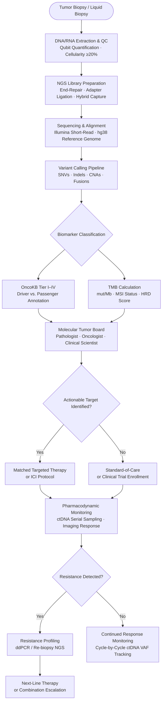

# Lesson 6: Precision Oncology Systems

## 1. First-Principles Intuition & Invariants

Cancer is fundamentally a disease of information corruption. Where normal cellular life depends on the faithful transcription, translation, and execution of genomic instructions, malignancy arises when somatic mutations, epigenetic silencing, and chromosomal rearrangements corrupt the feedback loops that govern proliferation, differentiation, and apoptosis. Precision oncology is the clinical discipline that attempts to read that corruption with enough resolution to intervene at its mechanistic root, rather than attacking dividing cells indiscriminately as cytotoxic chemotherapy does.

The intellectual foundation of precision oncology rests on three invariants that every practitioner must internalize before interpreting a molecular report or designing a treatment protocol.

The first invariant is oncogene addiction. Many tumors, despite carrying dozens of somatic alterations, depend disproportionately on the signaling output of a single driver mutation for survival. The EGFR-mutant non-small-cell lung cancer (NSCLC) cell depends on constitutive EGFR kinase activity so completely that withdrawal of that signal through a targeted inhibitor like osimertinib collapses the proliferative program faster than the cell can recruit alternative survival pathways. This dependency is the therapeutic lever that precision oncology exploits. It explains why a 150 mg daily dose of osimertinib achieves response rates above 80% in EGFR exon 19 deletion or L858R-mutant NSCLC, while the same tumor would be largely unresponsive to a BRAF inhibitor. Mechanistic specificity is not just elegant; it is the pharmacological prerequisite for efficacy.

The second invariant is clonal heterogeneity. No tumor is a monoclonal population at the time of clinical presentation. Branching clonal evolution, governed by Darwinian selection pressure within the tumor microenvironment, generates subclonal populations carrying distinct mutational profiles. Next-generation sequencing (NGS) of a single biopsy core captures the dominant clone but systematically underrepresents subclones present at variant allele frequencies (VAF) below roughly 5–10%. This matters clinically because the subclone that survives first-line targeted therapy is frequently the one that pre-existed at low frequency before treatment began, not a de novo mutant generated by the drug. Understanding this forces the practitioner to think of treatment not as a static prescription but as a selective pressure that reshapes the tumor's evolutionary landscape.

The third invariant is the distinction between a driver and a passenger alteration. The cancer genome accumulates thousands of somatic mutations over its history, the vast majority of which confer no selective growth advantage. These passenger mutations are evolutionary hitchhikers. Only driver mutations in cancer genes, those that activate proto-oncogenes like KRAS, ALK, RET, MET, and ROS1, or inactivate tumor suppressors like TP53, CDKN2A, and PTEN, are therapeutically actionable. A molecular report listing 47 somatic variants is clinically useful only after the practitioner separates the handful of drivers from the background noise of passenger events, a task requiring familiarity with curated databases like OncoKB, COSMIC, and ClinVar, combined with functional domain knowledge.

---

## 2. Core Architecture & Mechanics

### Genomic Profiling: From Tissue to Actionable Report

The clinical workflow of precision oncology begins with specimen acquisition and ends with a treatment decision anchored in molecular evidence. That pathway is more architecturally complex than it appears on the surface.

Tissue biopsy remains the gold standard for comprehensive genomic profiling. A formalin-fixed, paraffin-embedded (FFPE) block from a surgical resection or core-needle biopsy undergoes macrodissection to enrich tumor cellularity above the 20% threshold that most NGS panels require for reliable variant calling. DNA is extracted, quantified by Qubit fluorometry, and subjected to library preparation, which involves end-repair, adapter ligation, and hybrid-capture enrichment against a panel of target genes. Comprehensive genomic profiling (CGP) panels like Foundation One CDx interrogate 324 cancer-relevant genes for single nucleotide variants (SNVs), small insertions and deletions (indels), copy number alterations (CNAs), and gene fusions, while simultaneously calculating tumor mutational burden (TMB) and microsatellite instability (MSI) status from the same sequencing run. TMB is reported in mutations per megabase (mut/Mb); values above 10 mut/Mb correlate with response to immune checkpoint inhibitors (ICIs) across tumor types, forming the rationale for the tumor-agnostic pembrolizumab approval by the FDA in 2020.

Liquid biopsy, using circulating tumor DNA (ctDNA) extracted from plasma, represents a parallel and increasingly critical profiling modality. ctDNA is released into the bloodstream through apoptosis and necrosis of tumor cells, and digital droplet PCR (ddPCR) or ultra-deep NGS can detect mutant alleles at VAFs as low as 0.01–0.1%. This sensitivity makes liquid biopsy the preferred tool for treatment monitoring, early detection of acquired resistance mutations, and situations where tissue re-biopsy carries procedural risk. The clinical limitation is that ctDNA shedding is heterogeneous: brain metastases and some early-stage tumors shed poorly into the peripheral circulation, producing false-negative results that must not be interpreted as absence of disease.

The diagram below maps the full architecture of a precision oncology decision system, from specimen acquisition through resistance monitoring.

### Biomarker Validation and Tier Classification

Not every mutation identified on a CGP report justifies a treatment change. The OncoKB framework classifies alterations across four tiers of clinical evidence. Level 1 designates FDA-recognized biomarkers predictive of response to an approved drug in a specific tumor type, such as EGFR exon 19 deletions predicting osimertinib sensitivity in NSCLC, or BRAF V600E predicting combined vemurafenib plus cobimetinib sensitivity in melanoma. Level 2 covers standard-of-care biomarkers supported by evidence from professional guidelines. Level 3 encompasses investigational alterations with promising but not yet practice-defining data. Level 4 covers biologically compelling alterations supported by preclinical data alone.

The practitioner's job in a molecular tumor board is to map each reported variant to its OncoKB tier, assess whether a matching therapy is accessible within the patient's current clinical context, and evaluate whether the variant is present in the dominant clone or only in a minor subclone. A Level 1 alteration detected at a VAF of 2% in a heavily pre-treated patient with multiple competing resistance mechanisms is a qualitatively different clinical signal from the same alteration detected at 45% VAF in a treatment-naive tumor.

### Pharmacodynamics of Targeted Agents

Understanding why a drug works demands understanding its pharmacodynamic (PD) mechanism with precision. Kinase inhibitors occupy the ATP-binding pocket of their target kinase, competing with endogenous ATP to prevent substrate phosphorylation. First-generation EGFR inhibitors (erlotinib, gefitinib) are reversible competitive inhibitors, which means their efficacy is partly undermined when intracellular ATP concentrations are high relative to drug concentration. Third-generation osimertinib is an irreversible covalent inhibitor: it forms a covalent bond with Cys797 in the EGFR kinase domain, locking the enzyme into an inactive conformation regardless of ATP concentration and achieving superior central nervous system (CNS) penetration by virtue of its physicochemical properties.

Antibody-drug conjugates (ADCs) represent a structurally distinct pharmacodynamic architecture. Trastuzumab deruxtecan (T-DXd) consists of a HER2-targeting antibody linked to a topoisomerase I inhibitor payload via a cleavable tetrapeptide linker. After the antibody binds HER2 on the tumor cell surface and the complex is internalized into the lysosome, lysosomal proteases cleave the linker and release the cytotoxic payload intracellularly. The membrane-permeable payload then diffuses out of the targeted cell and kills neighboring HER2-low or HER2-negative cells, an effect called the bystander killing mechanism. This phenomenon explains why T-DXd retains activity in HER2-low breast cancer (IHC 1+ or 2+/ISH-negative), a population that derives no benefit from conventional trastuzumab.

### Combination Therapy Rationale

Single-agent targeted therapy almost invariably fails over time because tumors evolve resistance through the mechanisms described in Section 3. Rational combination therapy aims to close the mutational escape routes before they can be exploited. The logic follows from pathway architecture: when a targeted agent blocks a node in the MAPK pathway, the upstream signal frequently adapts by activating a parallel pathway. BRAF-inhibited melanoma cells upregulate EGFR and PDGFR signaling to bypass the blockade, which provides the mechanistic rationale for combining BRAF inhibition (dabrafenib) with MEK inhibition (trametinib), attacking two sequential nodes of the same pathway to prevent reactivation through RAS-independent mechanisms. The clinical result of this combination in BRAF V600-mutant melanoma is a 10-month improvement in progression-free survival over BRAF inhibitor monotherapy.

The combination of targeted therapy with immune checkpoint inhibition requires more careful pharmacodynamic reasoning. While the intuition that killing tumor cells releases neoantigens and primes immune responses is mechanistically sound, the temporal sequencing and dosing of the two modalities matters profoundly. Some targeted agents suppress T-cell function at high doses; others enhance antigen presentation. The practitioner designing a combination protocol must consider not just efficacy but the immune microenvironment dynamics that the targeted agent induces before adding a PD-1 or CTLA-4 inhibitor.

---

## 3. High-Performance Optimization & Failure Modes

### Clinical Trial Design for Precision Oncology

The randomized controlled trial architecture inherited from cytotoxic chemotherapy, selecting patients by histology and randomizing to treatment or placebo across a broad unselected population, is poorly suited to precision oncology's small, biomarker-defined patient populations. This mismatch drove the development of adaptive trial architectures now considered standard for molecularly targeted agents.

The basket trial design enrolls patients across multiple tumor histologies based on a shared molecular alteration rather than organ of origin, testing the hypothesis that oncogene addiction transcends tissue type. The TAPUR trial and the NCI-MATCH study represent the two most prominent examples. This design is powerful for identifying signal in rare alterations but requires careful statistical handling because response rates across histologies are not independent, and genomic co-mutations within each tumor type create confounding that must be pre-specified in the statistical analysis plan.

The umbrella trial design runs the complementary logic: a single histology is profiled at enrollment, and patients are assigned to parallel arms based on their molecular subtype. This architecture suits common malignancies with multiple actionable subgroups, such as NSCLC, where patients are stratified to EGFR-, ALK-, RET-, MET exon 14-, KRAS G12C-, or NTRK-matched arms within a single protocol. The statistical challenge here is maintaining adequate power in each arm while controlling the family-wise error rate across multiple simultaneous comparisons.

Adaptive seamless Phase I/II designs use pre-specified decision rules (Bayesian response-adaptive randomization or frequentist group sequential boundaries) to drop underperforming arms, expand promising ones, and potentially confirm efficacy without initiating a separate Phase III study. The FDA's Project Optimus initiative, launched in 2021, specifically addresses dose optimization within this framework, recognizing that many targeted agents were approved at their maximum tolerated dose, which may not be the biologically optimal dose for sustained pathway suppression with tolerable toxicity.

Minimal residual disease (MRD) endpoints, defined by ctDNA clearance after treatment, are increasingly accepted as surrogate endpoints that predict long-term outcomes faster than traditional progression-free survival. The IMvigor010 trial in urothelial carcinoma demonstrated that adjuvant atezolizumab benefited only the ctDNA-positive subgroup, a finding invisible to the overall trial population analysis. Integrating MRD as a stratification factor at enrollment is now a design requirement in well-constructed precision oncology protocols.

### Resistance Evolution: Mechanisms and Clinical Mitigation

Resistance to targeted therapy is not a failure of the drug; it is a predictable evolutionary outcome that the practitioner must anticipate structurally. Acquired resistance mechanisms fall into three categories that map onto the genomic architecture of the tumor.

Target-site mutations represent the most direct escape route: the kinase acquires a secondary mutation within or adjacent to the drug-binding pocket that sterically or electrostatically prevents inhibitor binding while preserving catalytic function. The EGFR T790M mutation, which gate-keeper residue substitution increases ATP affinity and excludes first-generation inhibitors, was the paradigmatic example until osimertinib neutralized it. Osimertinib resistance in turn generates EGFR C797S mutations, which prevent covalent bond formation, alongside on-target amplifications and off-target bypass alterations including MET amplification (detected in approximately 15–20% of osimertinib-resistant cases), HER2 amplification, and KRAS mutations. Each of these resistance mechanisms is detectable by serial ctDNA profiling before radiographic progression, giving the practitioner a 2–4 month window to design the next therapeutic step.

Pathway bypass represents the second resistance category. Rather than mutating the drug target itself, the tumor recruits a parallel signal that converges downstream on the same proliferative effectors. Colorectal cancer treated with anti-EGFR antibodies (cetuximab, panitumumab) develops resistance through amplification of downstream KRAS and NRAS, rendering EGFR blockade irrelevant by constitutively activating the MAPK cascade below the drug's point of intervention. Critically, ctDNA monitoring in these patients shows the emergence of RAS-mutant clones as early as six weeks after initiating anti-EGFR therapy, long before clinical progression. Some centers now operate rechallenge protocols: when ctDNA RAS clones decay after therapy withdrawal, anti-EGFR rechallenge can re-sensitize the patient, exploiting the competitive fitness disadvantage that RAS-mutant clones sometimes carry in the absence of EGFR inhibitor pressure.

Phenotypic plasticity, the third and least tractable resistance mechanism, involves lineage switching rather than genomic mutation. EGFR-mutant NSCLC can transform histologically into small-cell lung cancer (SCLC) under osimertinib pressure, with concurrent loss of RB1 and TP53. The resulting SCLC-like tumor no longer expresses EGFR at functional levels and is therefore completely refractory to continued EGFR-directed therapy. This transformation is estimated to occur in 3–14% of osimertinib-resistant cases and is only detectable by tissue re-biopsy, not by standard ctDNA panels, because the alteration is not a point mutation but an epigenetic and transcriptional reprogramming event. The clinical response is transition to platinum-etoposide chemotherapy, the standard backbone for SCLC, combined with ongoing investigation of EZH2 inhibitors that target the epigenetic machinery driving the transformation.

Failure mode mitigation in a precision oncology workflow depends on building resistance surveillance prospectively into the treatment protocol rather than waiting for radiographic evidence of progression. The recommended framework is monthly ctDNA monitoring during active targeted therapy, with pre-specified thresholds for liquid biopsy-confirmed resistance profiling and molecular tumor board review. When a rising ctDNA signal is detected, tissue re-biopsy of the most accessible progressing site should be obtained, because phenotypic plasticity and large-scale structural alterations require histological and immunohistochemical characterization that plasma NGS cannot provide. Treatment changes should not be made on ctDNA data alone without correlation to clinical and radiographic context, because ctDNA fluctuation occurs during effective therapy as tumor cells release DNA during cell death, and a transient spike does not equal progression.

---

## 4. Summary & Verification Matrix

| Domain | Governing Invariant | Operational Mechanism | Diagnostic Criterion | Failure Mode & Mitigation |
|---|---|---|---|---|
| **Genomic Profiling** | Drivers are rare; passengers dominate the mutational landscape | CGP via hybrid-capture NGS (324+ genes); FFPE cellularity ≥20%; VAF-based clonal hierarchy interpretation | OncoKB Tier I–IV classification; VAF >5% for confident driver calling | Subclonal driver missed at low VAF: supplement tissue NGS with ultra-deep ctDNA ddPCR |
| **Biomarker Validation** | Tissue-of-origin context modulates predictive value of shared alterations | Molecular tumor board review correlating TMB, MSI, HRD scores with matched therapy evidence tiers | TMB ≥10 mut/Mb for ICI eligibility; MSI-H/dMMR confirmed by IHC + PCR concordance | False TMB inflation from germline contamination: require matched normal sequencing for accurate somatic subtraction |
| **Pharmacodynamics** | Oncogene addiction defines the therapeutic window; covalent inhibitors overcome ATP competition | Irreversible kinase inhibition (Cys797 bond for osimertinib); ADC bystander killing via cleavable linker payload release | Pharmacodynamic endpoint: ctDNA VAF reduction ≥50% within 4–6 weeks of treatment initiation | Inadequate CNS penetration of non-covalent inhibitors: switch to CNS-active agents (osimertinib, lorlatinib) for brain-metastatic disease |
| **Combination Therapy** | Single-agent blockade creates selective pressure for bypass pathway activation | Vertical pathway co-inhibition (BRAF + MEK); sequenced ICI combinations timed to antigen-release kinetics | Synergy confirmed by progression-free survival delta vs. monotherapy historical controls; toxicity profiling by CTCAE grading | Immune suppression from high-dose targeted agent: implement PK-guided dose separation and sequential rather than concurrent ICI scheduling |
| **Clinical Trial Design** | Biomarker-unselected histological populations dilute signal in molecularly targeted agents | Basket/umbrella/adaptive seamless designs; Bayesian response-adaptive randomization; ctDNA MRD as surrogate endpoint | Bayesian posterior probability of response >0.85 for arm expansion; ctDNA clearance rate as surrogate for 24-month DFS | Family-wise error inflation in multi-arm umbrella trials: pre-specify alpha allocation per arm and apply Bonferroni or hierarchical gatekeeping correction |
| **Resistance Evolution** | Resistance is Darwinian, not random; subclonal selection is predictable from pathway architecture | Target-site secondary mutations; bypass pathway amplification; phenotypic plasticity/lineage switching | Monthly serial ctDNA VAF trending; rising ctDNA ≥2-fold above nadir triggers resistance profiling and tumor board escalation | Phenotypic plasticity undetectable by ctDNA: mandatory tissue re-biopsy at radiographic progression for histological transformation (SCLC, squamous) confirmation |
