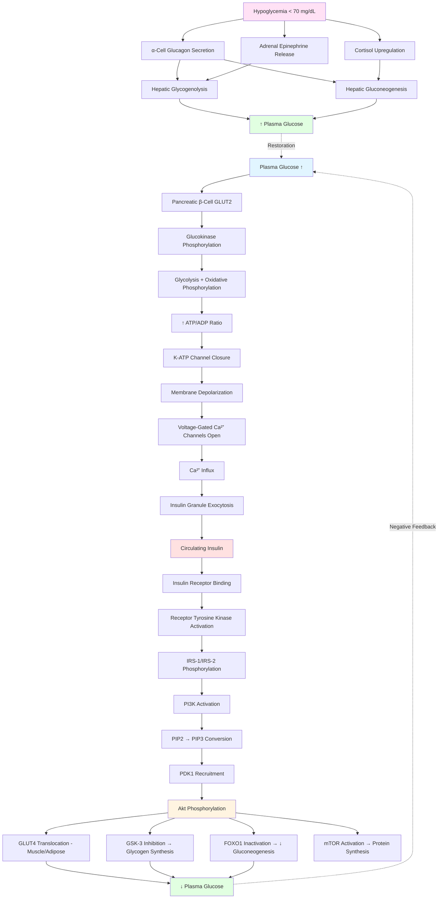

# Lesson 1: Glucose Homeostasis and Insulin Physiology

## 1. First-Principles Intuition & Invariants

Glucose homeostasis represents the fundamental metabolic contract of mammalian physiology: maintaining plasma glucose concentration within the narrow therapeutic window of 70 to 100 mg/dL in the fasted state and preventing postprandial excursions beyond 140 mg/dL. This precision emerges not from a single control loop but from an orchestrated symphony of pancreatic hormone secretion, hepatic glucose fluxes, peripheral tissue uptake, and counter-regulatory feedback mechanisms. The cost of dysregulation is profound—chronic hyperglycemia drives non-enzymatic glycation of proteins and lipids, generating advanced glycation end products that accelerate microvascular complications including retinopathy, nephropathy, and neuropathy, while acute hypoglycemia threatens neuronal viability and can precipitate seizure, coma, or death within minutes.

The central actor in this system is insulin, a 51-amino-acid peptide hormone synthesized exclusively by pancreatic beta cells within the islets of Langerhans. Insulin biosynthesis begins with preproinsulin translation in the rough endoplasmic reticulum, followed by signal peptide cleavage to yield proinsulin. This 86-amino-acid precursor folds into its characteristic three-dimensional structure stabilized by three disulfide bonds, then undergoes proteolytic processing by prohormone convertases PC1/3 and PC2, which excise the 31-residue C-peptide connecting chain. The resulting mature insulin molecule consists of an A-chain and B-chain linked by disulfide bridges, packaged into dense-core secretory granules alongside equimolar C-peptide and trace amounts of proinsulin. Clinically, serum C-peptide serves as an invaluable biomarker of endogenous insulin secretion, remaining detectable even when exogenous insulin confounds direct insulin assays.

Beta-cell glucose sensing operates through a specialized metabolic amplification circuit. Glucose enters the beta cell via the high-capacity, low-affinity GLUT2 transporter, which equilibrates intracellular and extracellular glucose concentrations without rate limitation. Glucokinase—the rate-limiting enzyme with a Km near 10 mM—phosphorylates glucose to glucose-6-phosphate, effectively functioning as the glucose sensor of the beta cell. As glycolysis and mitochondrial oxidative phosphorylation accelerate, the cytoplasmic ATP-to-ADP ratio rises, triggering closure of ATP-sensitive potassium channels composed of Kir6.2 pore subunits and SUR1 regulatory subunits. Membrane depolarization opens voltage-gated L-type calcium channels, and the resulting calcium influx drives SNARE-mediated exocytosis of insulin granules. This elegant mechanism couples metabolic flux directly to hormone secretion, creating a glucose-proportional output across physiological concentration ranges.

The metabolic effects of insulin are vast and tissue-specific. In skeletal muscle and adipose tissue, insulin binding to the heterotetrameric insulin receptor—a receptor tyrosine kinase—initiates autophosphorylation of intracellular tyrosine residues, recruiting insulin receptor substrate proteins IRS-1 and IRS-2. These scaffolding proteins activate phosphatidylinositol 3-kinase, which phosphorylates membrane phospholipid PIP2 to PIP3, creating docking sites for PDK1 and Akt. Activated Akt promotes translocation of GLUT4-containing vesicles from intracellular storage compartments to the plasma membrane, increasing glucose uptake capacity up to twentyfold in muscle and adipocytes. Simultaneously, Akt phosphorylates and inactivates glycogen synthase kinase-3, relieving inhibition of glycogen synthase and promoting glycogen synthesis. In the liver, insulin suppresses gluconeogenesis by inhibiting transcription of phosphoenolpyruvate carboxykinase and glucose-6-phosphatase, the rate-limiting enzymes of hepatic glucose production. Lipogenesis is stimulated through activation of acetyl-CoA carboxylase and fatty acid synthase, while lipolysis is suppressed via inhibition of hormone-sensitive lipase in adipocytes.

Counter-regulatory mechanisms provide critical fail-safe protection against hypoglycemia. Glucagon, secreted by pancreatic alpha cells when glucose falls below approximately 80 mg/dL, binds G-protein-coupled receptors on hepatocytes, activating adenylyl cyclase and raising intracellular cyclic AMP. Protein kinase A phosphorylates and activates phosphorylase kinase, initiating glycogenolysis, while simultaneously inhibiting glycogen synthesis and activating gluconeogenic enzyme transcription. Epinephrine, released from the adrenal medulla during acute hypoglycemic stress, potentiates hepatic glucose output while simultaneously driving glycogenolysis in skeletal muscle, though muscle-derived lactate must undergo hepatic Cori cycle conversion to glucose. Cortisol, the dominant glucocorticoid, operates on a slower timescale, upregulating gluconeogenic enzyme expression and inducing peripheral insulin resistance to defend plasma glucose during prolonged fasting or physiologic stress. Growth hormone exerts similar counter-regulatory effects, antagonizing insulin action and promoting lipolysis. The interplay of these hormones creates a robust, redundant defense against hypoglycemia, though this system becomes pathologically dysregulated in diabetes, particularly in individuals with long-standing type 1 disease who develop defective counter-regulatory responses.

## 2. Core Architecture & Mechanics

The glucose homeostasis system operates as a distributed feedback network with multiple sensor nodes, effector organs, and hormonal communication channels. Understanding the topology of insulin signaling cascades and glucose transporter distribution across tissues is essential for predicting pharmacological interventions and metabolic perturbations in diabetic states.

Insulin receptor signaling bifurcates into two major pathways with distinct metabolic outcomes. The canonical PI3K-Akt pathway mediates the majority of insulin's metabolic effects on glucose, lipid, and protein metabolism. Upon insulin binding, the alpha subunits of the insulin receptor undergo conformational change, relieving inhibition of the intracellular beta subunit tyrosine kinase domains. Autophosphorylation on tyrosine residues creates high-affinity docking sites for IRS proteins, which themselves become tyrosine-phosphorylated. The p85 regulatory subunit of PI3K binds phosphorylated tyrosines on IRS proteins, relieving inhibition of the p110 catalytic subunit. Active PI3K phosphorylates the 3-position of the inositol ring in membrane phosphatidylinositol-4,5-bisphosphate, generating phosphatidylinositol-3,4,5-trisphosphate. This lipid second messenger recruits pleckstrin-homology-domain-containing proteins including PDK1 and Akt to the plasma membrane. PDK1 phosphorylates Akt at threonine 308, while mTORC2 phosphorylates serine 473, achieving full Akt activation. The parallel MAPK pathway, activated through Grb2-SOS recruitment and Ras activation, primarily mediates mitogenic and growth-promoting effects through ERK1/2, though crosstalk between pathways provides additional regulatory complexity.

Glucose transporter biology reveals exquisite tissue-specific optimization for metabolic function. The GLUT family comprises fourteen facilitative transporters with distinct kinetic properties and regulatory mechanisms. GLUT1, expressed ubiquitously with particularly high density in erythrocytes and the blood-brain barrier, exhibits a Km near 1-2 mM, ensuring constitutive glucose supply to the brain even during mild hypoglycemia. GLUT2, the low-affinity high-capacity transporter with Km approximately 15-20 mM, dominates in hepatocytes, pancreatic beta cells, and intestinal epithelium, where bidirectional flux and proportional sensing are functionally critical. GLUT3, with the lowest Km around 1 mM, provides high-affinity uptake in neurons. GLUT4, the insulin-responsive isoform, resides in specialized intracellular vesicles in muscle and adipose tissue, translocating to the plasma membrane only upon Akt-mediated phosphorylation of AS160 and subsequent Rab GTPase activation. This sequestration mechanism creates the dramatic insulin-stimulated glucose uptake that characterizes these tissues, while its dysfunction defines insulin resistance. GLUT5 specializes in fructose transport in the small intestine, operating independently of glucose and insulin signaling.

Hepatic glucose metabolism operates bidirectionally, making the liver both a glucose sink during fed states and the primary source during fasting. Insulin promotes hepatic glucose uptake through GLUT2 and activates glucokinase, which unlike other hexokinases is not product-inhibited by glucose-6-phosphate. The resulting metabolic flux feeds glycogen synthesis via activation of glycogen synthase and simultaneously provides substrate for de novo lipogenesis. Insulin simultaneously suppresses glucose output by inhibiting key gluconeogenic enzymes. FOXO1, a forkhead box transcription factor, normally upregulates phosphoenolpyruvate carboxykinase and glucose-6-phosphatase gene expression. Akt-mediated phosphorylation causes FOXO1 nuclear export and proteasomal degradation, effectively silencing the gluconeogenic program. Glycogenolysis is suppressed through inactivation of phosphorylase kinase. During fasting, this regulatory circuitry reverses—falling insulin and rising glucagon drive cAMP-PKA signaling, phosphorylating and inactivating glycogen synthase while activating phosphorylase kinase. Simultaneously, gluconeogenic transcription factors including CREB, PGC-1α, and unphosphorylated FOXO1 collaborate to maximize hepatic glucose production, sustaining euglycemia despite zero exogenous glucose intake.

Beta-cell function depends critically on mitochondrial integrity and the amplifying pathway of insulin secretion. While ATP-dependent closure of K-ATP channels constitutes the triggering pathway, full physiologic insulin secretion requires additional amplifying signals generated by glucose metabolism. Pyruvate cycling pathways produce NADPH and metabolic coupling factors including glutamate and long-chain acyl-CoA species. These molecules modulate exocytotic machinery, enhance calcium sensitivity, and sustain second-phase insulin secretion during prolonged glucose exposure. Incretin hormones—principally glucagon-like peptide-1 and glucose-dependent insulinotropic peptide secreted by intestinal L-cells and K-cells respectively—potentiate glucose-stimulated insulin secretion through G-protein-coupled receptor activation, cAMP elevation, and PKA-mediated enhancement of exocytosis. This gut-pancreas axis explains the incretin effect, whereby oral glucose provokes substantially greater insulin secretion than isoglycemic intravenous glucose. Therapeutic exploitation of this pathway through GLP-1 receptor agonists and DPP-4 inhibitors has revolutionized type 2 diabetes management.

## 3. High-Performance Optimization & Failure Modes

Clinical optimization of glucose homeostasis requires understanding the kinetic parameters and failure modes that distinguish normal physiology from prediabetic insulin resistance and overt diabetes. First-phase insulin secretion—the rapid spike occurring within three to five minutes of glucose exposure—derives from release of pre-docked, fusion-competent granules and provides critical suppression of hepatic glucose output immediately postprandially. Loss of first-phase secretion represents an early marker of beta-cell dysfunction, detectable years before fasting hyperglycemia develops. Second-phase secretion, a sustained plateau driven by the amplifying pathway, maintains peripheral glucose disposal during prolonged nutrient absorption. Progressive beta-cell failure in type 2 diabetes initially manifests as selective first-phase loss, then gradual deterioration of second-phase capacity, ultimately requiring exogenous insulin replacement when residual secretory capacity falls below approximately thirty percent of normal.

Insulin resistance—the reduced biological response to a given insulin concentration—emerges from multiple molecular defects. At the receptor level, chronic hyperinsulinemia drives receptor downregulation and accelerated degradation, reducing cell-surface density. Post-receptor defects predominate in obesity-associated insulin resistance: accumulation of intramyocellular lipid metabolites including diacylglycerol and ceramides activates serine kinases such as protein kinase C theta and JNK, which phosphorylate IRS proteins on serine rather than tyrosine residues. This serine phosphorylation sterically inhibits tyrosine phosphorylation and promotes IRS degradation, severing the connection between receptor activation and downstream PI3K-Akt signaling. Simultaneously, adipose tissue dysfunction in obesity generates chronic low-grade inflammation, with macrophage infiltration and secretion of TNF-alpha and IL-6. These cytokines further impair insulin signaling through NF-kappa-B activation and additional serine kinase engagement, creating a vicious cycle of inflammation and metabolic dysfunction. Hepatic insulin resistance manifests primarily as failure to suppress gluconeogenesis, driving fasting hyperglycemia despite normal or elevated insulin levels—the hallmark of early type 2 diabetes.

Counter-regulatory hormone excess produces distinct patterns of glucose dysregulation. Glucagonoma, a rare alpha-cell neoplasm, generates severe hyperglycemia through unrestrained hepatic glucose production, often accompanied by necrolytic migratory erythema and weight loss. More commonly, stress hyperglycemia in critical illness reflects combined elevation of cortisol, catecholamines, and inflammatory cytokines, inducing hepatic and peripheral insulin resistance while simultaneously impairing insulin secretion. Pheochromocytoma drives episodic hyperglycemia through catecholamine surges that inhibit insulin secretion via alpha-2 adrenergic receptors on beta cells while stimulating hepatic glycogenolysis. Cushing syndrome produces sustained hyperglycemia through cortisol-mediated upregulation of gluconeogenic enzymes, peripheral insulin resistance, and visceral adiposity accumulation. Recognition of these secondary causes is essential—treating the underlying endocrinopathy often resolves glucose intolerance without chronic antidiabetic therapy.

Hypoglycemia unawareness represents a catastrophic failure mode in intensive insulin therapy. Recurrent hypoglycemic episodes blunt counter-regulatory hormone responses and reduce sympathoadrenal activation thresholds. The resulting syndrome—termed hypoglycemia-associated autonomic failure—eliminates warning symptoms that normally prompt corrective carbohydrate ingestion, allowing blood glucose to fall to levels causing confusion, seizure, or coma before recognition occurs. Mechanistically, this involves resetting of hypothalamic glucose-sensing neurons and blunted epinephrine secretory responses. Clinical management demands scrupulous avoidance of hypoglycemia for weeks to months, allowing restoration of protective counter-regulation. Continuous glucose monitoring systems with predictive low-glucose alerts provide critical protection, while newer insulin analogues with flatter pharmacokinetic profiles reduce hypoglemia risk compared to older formulations.

Beta-cell mass regulation represents the ultimate determinant of diabetes risk and progression. In healthy individuals, beta cells undergo slow but continuous turnover, with replication rates estimated at one to three percent annually in adults. Type 1 diabetes results from autoimmune destruction mediated by CD8-positive T cells recognizing beta-cell autoantigens including GAD65, IA-2, and insulin itself. Epitope spreading amplifies the response over months to years until residual beta-cell mass falls below the threshold necessary to maintain euglycemia, typically when greater than eighty percent destruction has occurred. Type 2 diabetes involves a more complex failure—early compensatory beta-cell hyperplasia and increased insulin secretion maintain glucose homeostasis despite insulin resistance, but sustained demand eventually exhausts proliferative capacity. Chronic hyperglycemia and elevated free fatty acids exert glucolipotoxicity, generating endoplasmic reticulum stress, oxidative damage, and amyloid deposition from islet amyloid polypeptide aggregation. Apoptotic beta-cell death accelerates, and remaining cells become dedifferentiated, losing key transcription factors including PDX-1 and MafA that define mature beta-cell identity. These changes are partially reversible with aggressive metabolic intervention—bariatric surgery and sustained weight loss can restore beta-cell function in early type 2 diabetes, though prolonged disease typically produces irreversible loss.

## 4. Summary & Verification Matrix

| **Physiologic Domain** | **Core Mechanism** | **Regulatory Invariant** | **Clinical Failure Mode** | **Diagnostic Biomarker** |
|------------------------|-------------------|-------------------------|---------------------------|-------------------------|
| **Beta-Cell Glucose Sensing** | GLUT2 equilibration → glucokinase phosphorylation → ATP/ADP rise → K-ATP closure → depolarization → Ca²⁺ influx → exocytosis | First-phase: 3-5 min from docked granules; Second-phase: amplifying pathway sustains secretion; C-peptide:insulin 1:1 molar ratio | Loss of first-phase secretion in prediabetes; progressive second-phase decline in T2DM; absolute deficiency in T1DM | Fasting C-peptide <0.6 ng/mL indicates severe deficiency; OGTT insulin curves; HOMA-β calculation from fasting glucose/insulin |
| **Insulin Signaling Cascade** | Insulin receptor tyrosine kinase → IRS-1/2 phosphorylation → PI3K activation → PIP3 generation → PDK1/mTORC2 → Akt phosphorylation (Thr308, Ser473) | Akt mediates GLUT4 translocation, GSK-3 inhibition, FOXO1 exclusion, mTOR activation; MAPK pathway parallel mitogenic signaling | Serine kinase activation (PKC-θ, JNK) by lipid metabolites blocks IRS tyrosine phosphorylation; TNF-α/IL-6 drive inflammatory insulin resistance | Hyperinsulinemic-euglycemic clamp (gold standard, M-value); HOMA-IR >2.5 indicates resistance; adiponectin:leptin ratio inversion |
| **Glucose Transporter Function** | GLUT1 (Km 1-2 mM, constitutive CNS/RBC); GLUT2 (Km 15-20 mM, bidirectional hepatocyte/β-cell); GLUT4 (insulin-responsive, AS160-Rab-mediated translocation in muscle/adipose) | GLUT4 vesicle cycling creates 10-20× insulin-stimulated uptake; GLUT2 proportional sensing enables β-cell glucose responsiveness | GLUT4 sequestration in insulin resistance; GLUT1 deficiency syndrome causes seizures and developmental delay | Muscle biopsy GLUT4 expression; PET imaging with ¹⁸F-FDG quantifies tissue-specific glucose uptake; genetic testing for SLC2A1 mutations |
| **Hepatic Glucose Flux** | Fed state: insulin → glucokinase activation, FOXO1 nuclear exclusion, GSK-3 inhibition → glycogen synthesis, suppressed gluconeogenesis; Fasted: glucagon → cAMP-PKA → phosphorylase activation, PEPCK/G6Pase transcription | Insulin:glucagon ratio determines net hepatic output; FOXO1 controls PEPCK/G6Pase transcription; autoregulation maintains 2 mg/kg/min basal output | Failure to suppress gluconeogenesis drives fasting hyperglycemia in T2DM; glycogen storage diseases cause fasting hypoglycemia | Hepatic glucose production by tracer dilution or ²H₂O; fasting glucose >100 mg/dL suggests hepatic insulin resistance; glucagon stimulation test |
| **Counter-Regulatory Defense** | Glucagon (α-cell, threshold ~80 mg/dL) → hepatic glycogenolysis/gluconeogenesis; Epinephrine (adrenal, threshold ~65 mg/dL) → glycogenolysis, lipolysis; Cortisol/GH (threshold ~55 mg/dL) → sustained gluconeogenesis | Redundant four-hormone system; 1-3 mg/kg glucose corrects mild hypoglycemia; unconscious patients require 25 g IV dextrose or 1 mg IM glucagon | Hypoglycemia unawareness from autonomic failure; absent glucagon response in long-standing T1DM; combined defects risk severe hypoglycemia | Continuous glucose monitoring trend analysis; mixed-meal tolerance test with hormone sampling; reduced symptom scores during controlled hypoglycemia |
| **Beta-Cell Mass Dynamics** | Adults: 1-3% annual replication rate; compensatory hyperplasia in insulin resistance; apoptosis from glucolipotoxicity (ER stress, oxidative damage, amyloid deposition) | PDX-1, MafA, and NeuroD1 maintain differentiated identity; ~80% loss threshold for T1DM onset; dedifferentiation reversible with metabolic intervention | T1DM: autoimmune destruction (anti-GAD65, anti-IA-2, anti-insulin antibodies); T2DM: glucolipotoxic apoptosis exceeding compensatory proliferation | Fasting C-peptide and stimulated (post-glucagon or OGTT) C-peptide quantify residual mass; islet autoantibodies for T1DM; amyloid on pancreatic imaging rare but pathognomonic |
