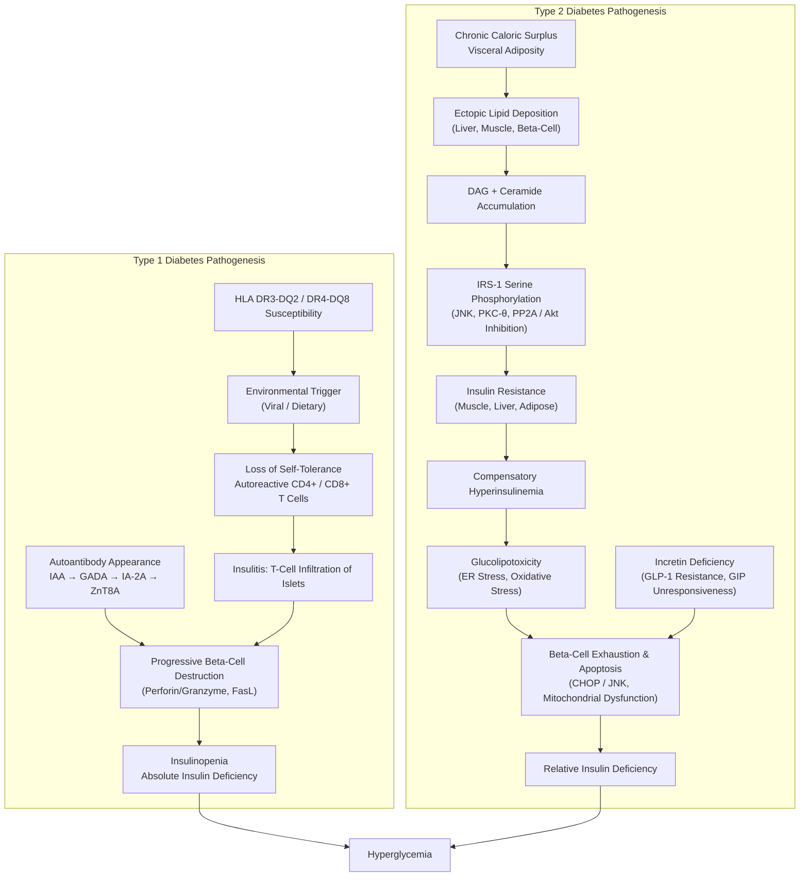

# Lesson 2: Pathogenesis of Type 1 and Type 2 Diabetes

## 1. First-Principles Intuition & Invariants

The pathogenesis of diabetes mellitus is not a single disease process but two fundamentally distinct etiologies that converge on a shared endpoint: chronic hyperglycemia. Understanding the divergence between Type 1 and Type 2 diabetes requires us to abandon the simplistic framing of "juvenile versus adult" or "insulin-dependent versus non-insulin-dependent" and instead trace the molecular and immunological architecture that drives each condition. The invariant that governs all glucose homeostasis is the balance between insulin-mediated glucose disposal, primarily in skeletal muscle and adipose tissue, and hepatic glucose output, which is suppressed by insulin and amplified by glucagon. When beta-cell function is adequate, the system absorbs insulin resistance through compensatory hyperinsulinemia. When beta-cell function fails, whether through autoimmune destruction or metabolic exhaustion, glycemic control collapses. This is the central invariant: beta-cell failure is the necessary and sufficient condition for overt diabetes, regardless of whether the proximate cause is immunological or metabolic.

In Type 1 diabetes mellitus (T1DM), the pathology is autoimmune destruction of pancreatic beta cells. This process begins years before clinical presentation, with a prodromal phase characterized by the appearance of autoantibodies against beta-cell antigens while glucose tolerance remains entirely normal. The disease has a strong genetic component, but concordance in monozygotic twins is only 30–50%, which means environmental triggers—viral infections, dietary factors, gut microbiome perturbations—are essential cofactors. The genetic architecture is dominated by the Human Leukocyte Antigen (HLA) locus on chromosome 6p21, which accounts for roughly half of the heritable risk. Specific HLA class II haplotypes, particularly DR3-DQ2 and DR4-DQ8, confer susceptibility by shaping how antigen-presenting cells display beta-cell peptides to CD4+ T helper cells. When these peptides are presented in a pro-inflammatory context, autoreactive T cells escape central and peripheral tolerance and infiltrate the islets, a process called insulitis.

In Type 2 diabetes mellitus (T2DM), the pathology begins not in the beta cell but in peripheral tissues. Insulin resistance in skeletal muscle, liver, and adipose tissue forces the beta cell into compensatory overdrive. For years, perhaps decades, the beta cell meets demand, and fasting glucose remains within reference range. But the metabolic milieu that drives insulin resistance—chronic caloric surplus, visceral adiposity, ectopic lipid accumulation—is also toxic to the beta cell itself. The concept of glucolipotoxicity captures this dual insult: chronically elevated glucose and free fatty acids do not merely stress the beta cell but actively damage it through ER stress, oxidative stress, and apoptotic signaling. The beta cell does not fail because it is overworked in a mechanical sense; it fails because the metabolic environment is cytotoxic. This distinction matters clinically because it means that beta-cell decline in T2DM is, at least in its early stages, potentially arrestable if the metabolic environment is corrected.

The incretin axis provides a third layer of pathophysiology relevant to T2DM. Incretins—primarily GLP-1 and GIP—are gut-derived hormones released in response to oral nutrient intake that amplify glucose-stimulated insulin secretion. In healthy individuals, oral glucose elicits a substantially greater insulin response than an isoglycemic intravenous glucose infusion, a phenomenon known as the incretin effect. In T2DM, this incretin effect is markedly attenuated. The deficit is not primarily due to reduced GLP-1 secretion but rather to beta-cell resistance to GLP-1 signaling and a near-total loss of GIP efficacy. This understanding directly underpins the pharmacologic rationale for GLP-1 receptor agonists and DPP-4 inhibitors: exogenous GLP-1 signaling can bypass the endogenous incretin resistance and restore a significant fraction of the lost beta-cell responsiveness.

The practitioner's task in pathogenesis assessment is not merely to classify a patient as T1DM or T2DM but to identify where the patient sits on the disease timeline, what residual beta-cell function remains, and what molecular mechanisms are currently active and potentially addressable. This requires a working knowledge of immunological markers, lipid-mediated insulin signaling disruption, and incretin physiology that goes beyond what a glucose panel or HbA1c can reveal.

## 2. Core Architecture & Mechanics

### T1DM: Autoimmune Beta-Cell Destruction

The autoimmune process in T1DM follows a predictable serological and pathological sequence. The first detectable abnormality is the appearance of islet autoantibodies, which serve as markers of an ongoing autoimmune process rather than direct effectors of beta-cell death. The four most clinically relevant autoantibodies are islet cell autoantibodies (ICA), insulin autoantibodies (IAA), glutamic acid decarboxylase autoantibodies (GADA), and insulinoma-associated antigen-2 autoantibodies (IA-2A). A fifth marker, zinc transporter-8 autoantibodies (ZnT8A), adds additional sensitivity. GADA and IA-2A are the most stable and diagnostically useful in clinical practice. GADA in particular persists for decades after disease onset, making it the primary antibody for distinguishing latent autoimmune diabetes in adults (LADA) from T2DM.

The temporal hierarchy of autoantibody appearance is now well characterized. IAA is typically the first autoantibody to appear in young children, often within the first two years of life. GADA tends to appear later and is more common in older children and adults. IA-2A and ZnT8A generally appear closer to clinical onset and their presence correlates with more rapid progression. The number of positive autoantibodies is the strongest predictor of progression to overt diabetes. A single autoantibody confers a relatively low risk, but the presence of two or more autoantibodies is associated with a 5-year risk exceeding 50% and a lifetime risk approaching 80–100%.

The HLA associations provide the genetic scaffolding for this autoimmune process. The DR3-DQ2 haplotype (DRB1*03:01, DQA1*05:01, DQB1*02:01) and the DR4-DQ8 haplotype (DRB1*04:01 or 04:04, DQA1*03:01, DQB1*03:02) are the principal susceptibility haplotypes. Individuals who are homozygous or compound heterozygous for both haplotypes carry the highest genetic risk. Conversely, the DQB1*06:02 allele, part of the DR15-DQ6 haplotype, confers strong protection against T1DM, likely because it presents beta-cell peptides in a manner that promotes regulatory T-cell responses rather than effector responses. This protective effect is dominant: even one copy of DQB1*06:02 reduces T1DM risk by approximately 50-fold.

The actual beta-cell destruction is mediated by CD8+ cytotoxic T lymphocytes that infiltrate the islets and recognize beta-cell-specific peptides presented by HLA class I molecules on the beta-cell surface. The mechanism of killing involves perforin-granzyme release and Fas-FasL apoptosis. CD4+ T helper cells coordinate this response by producing pro-inflammatory cytokines, particularly IFN-γ and TNF-α, which activate macrophages and sustain the inflammatory milieu. The insulitis process is patchy and asynchronous: some islets are destroyed while adjacent islets remain intact, which explains why C-peptide secretion can persist for years after clinical diagnosis in some patients.

### T2DM: Insulin Resistance and Beta-Cell Failure

The molecular architecture of insulin resistance in T2DM centers on the insulin receptor substrate (IRS) signaling pathway. Under normal conditions, insulin binds to its receptor on the cell surface, triggering autophosphorylation of receptor tyrosine residues, which then phosphorylates IRS-1 on specific tyrosine residues. Phosphotyrosine-IRS-1 recruits PI3-kinase, activating the Akt pathway, which drives GLUT4 translocation to the cell membrane for glucose uptake and suppresses hepatic gluconeogenesis.

The pathogenic disruption occurs through serine phosphorylation of IRS-1. Multiple kinases—JNK, IKK-β, PKC-θ, and the mammalian target of rapamycin complex 1 (mTORC1)—phosphorylate IRS-1 on serine residues such as Ser307 (in the rodent sequence) rather than the activating tyrosine residues. Serine-phosphorylated IRS-1 is unable to propagate the insulin signal effectively and is targeted for proteasomal degradation. This creates a negative feedback loop where the very inflammatory and lipid signals that trigger insulin resistance also destroy the signaling machinery.

Ectopic lipid deposition is the proximate driver of this serine phosphorylation. When adipose tissue storage capacity is exceeded, free fatty acids and lipid intermediates accumulate in non-adipose tissues: liver, skeletal muscle, and the pancreatic beta cell itself. In muscle, intramyocellular lipid metabolites, particularly diacylglycerol (DAG) and ceramides, activate novel PKC isoforms and the JNK pathway, both of which phosphorylate IRS-1 on inhibitory serine residues. Ceramides, synthesized de novo from palmitate via serine palmitoyltransferase, additionally activate protein phosphatase 2A (PP2A), which dephosphorylates Akt, providing a second independent mechanism of insulin signaling disruption distal to IRS-1.

In the liver, ectopic lipid accumulation drives non-alcoholic fatty liver disease (NAFLD) and hepatic insulin resistance. The liver continues gluconeogenesis despite adequate or elevated insulin levels because the insulin signal fails to suppress FOXO1, the transcription factor that drives PEPCK and glucose-6-phosphatase expression. The result is inappropriate fasting hepatic glucose output, one of the earliest measurable abnormalities in T2DM pathogenesis.

### Glucolipotoxicity and Beta-Cell Exhaustion

The beta cell in T2DM faces a dual metabolic insult. Chronic hyperglycemia increases metabolic flux through glycolysis and the TCA cycle, raising ATP-to-ADP ratios and keeping K-ATP channels closed, which sustains calcium influx and insulin exocytosis. Initially, this drives compensatory hyperinsulinemia. But chronically elevated glucose also increases ER protein load, as proinsulin biosynthesis is upregulated, and the ER's folding capacity is exceeded. Unfolded protein accumulation triggers the unfolded protein response (UPR), which initially is adaptive but, if sustained, activates pro-apoptotic ER stress pathways through CHOP and JNK.

Concurrently, elevated free fatty acids, particularly saturated palmitate, contribute lipotoxic stress. Palmitate is poorly suited for triglyceride storage and instead accumulates as ceramides and DAG within the beta cell. These lipotoxic species activate apoptotic cascades and impair mitochondrial function. The combination of glucotoxicity and lipotoxicity—glucolipotoxicity—creates a feedforward loop where progressive beta-cell dysfunction reduces insulin secretory capacity, worsening hyperglycemia, which in turn accelerates beta-cell decline. By the time T2DM is diagnosed clinically, beta-cell mass is typically reduced by 20–60%, and function is often reduced by 50% or more.

### Incretin Deficiency

The incretin effect in T2DM is reduced by approximately 50% compared to healthy controls. The mechanistic basis is nuanced. GIP secretion from intestinal K cells is often preserved, but beta-cell responsiveness to GIP is profoundly impaired in T2DM. GLP-1 secretion from L cells in the distal intestine and colon may be modestly reduced, but the primary deficit is also a degree of beta-cell resistance, though less severe than for GIP. This differential resistance is the pharmacological basis for GLP-1 receptor agonist efficacy: exogenous GLP-1 at supraphysiological doses can overcome the partial resistance and restore glucose-stimulated insulin secretion. GIP-based therapies alone are largely ineffective in established T2DM because the beta-cell resistance to GIP is near-complete.

## 3. High-Performance Optimization & Failure Modes

### Antibody Panel Stratification and Clinical Decision Flow

For the practitioner, the pathogenesis framework translates directly into a diagnostic and monitoring workflow. When a patient presents with hyperglycemia, the first decision point is phenotypic classification, because the treatment algorithm diverges immediately. Clinical features—age at onset, BMI, presence of ketoacidosis, family history—provide initial probability estimates but are insufficient. The gold standard for classification is the islet autoantibody panel. A recommended panel includes GADA, IA-2A, ZnT8A, and IAA. GADA alone detects approximately 70–80% of autoimmune diabetes cases; adding IA-2A and ZnT8A increases sensitivity to approximately 90–95%. IAA is most informative in children under 10 at diagnosis, as its prevalence declines with age and can be confounded by exogenous insulin therapy if measured after treatment has commenced.

Adults who present with apparent T2DM but who are lean, have a rapid onset of hyperglycemia, or fail oral hypoglycemic therapy should be tested for GADA. A positive GADA in this context reclassifies the patient as LADA, which carries a different prognosis: more rapid progression to insulin requirement and a distinct autoimmune substrate. The practical implication is that these patients should be started on insulin earlier rather than relying on sulfonylureas, which stress the remaining beta cells and may accelerate functional exhaustion.

### C-Peptide Monitoring for Residual Beta-Cell Function

C-peptide measurement provides a direct, quantitative assessment of endogenous insulin secretion. Unlike insulin itself, C-peptide is extracted primarily by the kidney with a longer half-life and negligible hepatic clearance, making it a more stable surrogate for beta-cell output. Fasting C-peptide, stimulated C-peptide (after mixed-meal or glucagon challenge), and urinary C-peptide-to-creatinine ratio each serve different purposes. Fasting C-peptide below 0.2 nmol/L is consistent with absolute insulin deficiency typical of long-standing T1DM. Values above 0.6 nmol/L indicate significant residual beta-cell function, which has therapeutic implications: patients with preserved C-peptide have better glycemic control, lower hypoglycemia risk, and slower complication progression.

The practical workflow for monitoring beta-cell function in T2DM involves obtaining a fasting C-peptide and a paired fasting glucose at least annually in patients on insulin therapy. A declining stimulated C-peptide over sequential measurements indicates ongoing beta-cell loss and should prompt intensification of therapy to reduce glucotoxicity, as even modest sustained hyperglycemia accelerates beta-cell apoptosis through ER stress pathways.

### Addressing Insulin Resistance at the Molecular Level

In T2DM, the pathogenesis-driven treatment approach targets the molecular mechanisms of insulin resistance rather than merely chasing glucose levels. Weight reduction of 5–10% reduces ectopic liver fat by 30–50%, which directly reduces hepatic DAG and ceramide content and restores IRS-1 tyrosine phosphorylation capacity. Bariatric surgery achieves this most dramatically: Roux-en-Y gastric bypass reduces hepatic fat content by over 80% within weeks, and insulin sensitivity improves before significant weight loss occurs, demonstrating that the metabolic environment, not adipose mass per se, is the critical variable.

Pharmacologically, thiazolidinediones (TZDs) such as pioglitazone address insulin resistance through PPAR-γ activation in adipose tissue, promoting adipocyte differentiation and redirecting lipids away from ectopic depots into subcutaneous adipose storage. This reduces circulating free fatty acids, lowers hepatic and muscle DAG and ceramide levels, and consequently reduces IRS-1 serine phosphorylation. The result is improved insulin signaling at the molecular level. The clinical trade-offs include weight gain from fluid retention and an increased risk of heart failure in susceptible patients.

### Incretin-Based Therapy Optimization

The incretin axis provides a direct therapeutic target. GLP-1 receptor agonists address the incretin deficiency in T2DM by providing supraphysiological GLP-1 signaling that bypasses the partial beta-cell resistance. Semaglutide, liraglutide, and tirzepatide (a dual GLP-1/GIP receptor agonist) restore glucose-stimulated insulin secretion, suppress glucagon in a glucose-dependent manner, slow gastric emptying, and reduce appetite. Tirzepatide's dual agonism is particularly notable because it addresses both incretin axes: the GIP component enhances GLP-1 receptor sensitivity, partially overcoming the GIP resistance that characterizes T2DM.

### Failure Modes and Diagnostic Pitfalls

Several failure modes complicate accurate pathogenesis assessment and treatment. The first is misclassification of LADA as T2DM. Approximately 10% of adults diagnosed with T2DM are GADA-positive, and these patients progress to insulin dependence within 3–5 years. If they are treated as typical T2DM with escalating oral agents, the delay in initiating insulin prolongs glucotoxicity and accelerates residual beta-cell loss. The mitigation is routine GADA screening in adults with atypical features or early treatment failure.

The second failure mode is the assumption that beta-cell function in T2DM is irreversibly lost. While beta-cell mass is reduced, function can be partially recovered if glucolipotoxicity is addressed. Studies of very-low-calorie diets, totaling 600–800 kcal/day for 8–12 weeks, demonstrate normalization of hepatic insulin sensitivity within days and recovery of first-phase insulin secretion within weeks, even in patients with longstanding T2DM. This indicates that a significant fraction of beta-cell dysfunction is functional rather than structural, mediated by metabolic stress rather than irreversible apoptosis.

The third failure mode is over-reliance on HbA1c for monitoring. HbA1c reflects average glycemia but provides no information about glycemic variability, postprandial excursions, or beta-cell trajectory. In patients with declining beta-cell function, postprandial hyperglycemia often precedes fasting hyperglycemia by months to years. Continuous glucose monitoring (CGM) provides the granular data needed to detect this early signal, and time-in-range (TIR) above 70% correlates with lower complication risk. For pathogenesis monitoring, pairing CGM data with periodic C-peptide and autoantibody panels gives a comprehensive picture of disease trajectory and residual beta-cell reserve.

A fourth failure mode involves the assumption that T1DM and T2DM are mutually exclusive. Approximately 10% of T2DM patients are GADA-positive; additional low-titer autoantibodies to other beta-cell antigens may be detected in a small minority, and some T1DM patients develop insulin resistance characteristic of T2DM, particularly with weight gain from intensive insulin therapy. The concept of "double diabetes" or "hybrid diabetes" recognizes that both pathogenic processes can coexist, and treatment must address both the autoimmune component and the metabolic environment.

## 4. Summary & Verification Matrix

| Domain | Governing Invariant | Core Mechanism | Key Diagnostic Marker | Primary Failure Mode |
|---|---|---|---|---|
| **T1DM Autoimmunity** | Progressive beta-cell destruction leads to absolute insulin deficiency | HLA class II (DR3-DQ2, DR4-DQ8) presents beta-cell peptides to autoreactive CD4+ T cells; HLA class I presents to CD8+ cytotoxic T cells. Perforin-granzyme and FasL-mediated apoptosis destroy beta cells | GADA, IA-2A, ZnT8A, IAA panel; ≥2 antibodies predict progression >50% at 5 years | LADA misclassified as T2DM; delayed insulin initiation accelerates beta-cell loss |
| **T2DM Insulin Resistance** | IRS-1 serine phosphorylation blocks insulin signal transduction | Ectopic lipid (DAG, ceramide) activates JNK, PKC-θ, PP2A; IRS-1 is inhibited and Akt is dephosphorylated, preventing GLUT4 translocation and FOXO1 suppression | Fasting insulin, HOMA-IR, stimulated C-peptide; hepatic steatosis on imaging | Treating glucose without addressing ectopic lipid load; progression despite oral agents |
| **Beta-Cell Exhaustion** | Glucolipotoxicity drives ER stress and mitochondrial dysfunction beyond adaptive capacity | Chronic hyperglycemia + palmitate overload → UPR activation → CHOP/JNK apoptosis; ceramides disrupt mitochondrial membrane potential | Stimulated C-peptide declining on serial measurement; first-phase insulin loss on IVGTT | Assuming beta-cell loss is irreversible; functional impairment from glucotoxicity is recoverable with metabolic correction |
| **Incretin Axis** | GLP-1 resistance and near-complete GIP unresponsiveness reduce the incretin effect by ~50% | Beta-cell resistance to GLP-1 and GIP signaling blunts postprandial insulin secretion; glucagon suppression is impaired | Mixed-meal C-peptide vs. fasting C-peptide ratio; blunted GLP-1 response | Using GIP-only agonists in established T2DM (beta-cell GIP resistance is near-complete); GLP-1 monotherapy without addressing resistance |
| **Genetic Risk Stratification** | HLA haplotypes confer dominant susceptibility or protection | DR3-DQ2 and DR4-DQ8 increase antigen presentation of beta-cell peptides; DQB1*06:02 confers dominant protection via regulatory T-cell promotion | HLA typing for at-risk relatives in T1DM prevention trials; family-based risk assessment | Over-interpreting genetic risk without autoantibody testing; genetic susceptibility ≠ disease certainty |
| **Hybrid Diabetes** | Autoimmune and metabolic pathogenesis can coexist in the same patient | T1DM patients developing insulin resistance from weight gain; T2DM patients with low-titer autoantibodies showing accelerated beta-cell decline | GADA screening in T2DM with atypical features; C-peptide monitoring in T1DM with weight gain and increasing insulin requirements | Rigid T1DM/T2DM classification prevents dual-pathway treatment; missing insulin resistance in T1DM or autoimmunity in T2DM |
