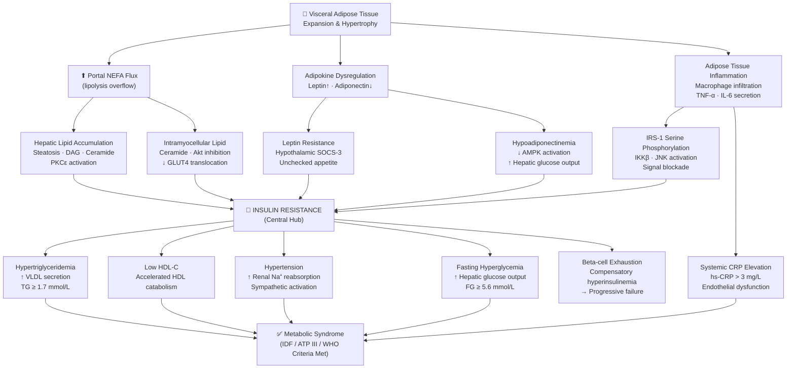

# Lesson 3: Metabolic Syndrome Criteria and Central Pathophysiology

## 1. First-Principles Intuition & Invariants

Metabolic syndrome is not a disease in the classical monogenic sense. It is a clustering of interrelated physiological derangements that, when present together, multiply cardiovascular and type 2 diabetes risk far beyond what any single component predicts in isolation. Understanding it requires abandoning the reductionist habit of treating dyslipidemia, hypertension, hyperglycemia, and abdominal obesity as independent problems with independent etiologies. They are not independent. They are downstream consequences of a single upstream failure: the progressive breakdown of insulin signaling fidelity in metabolically active tissues.

The intuition that anchors this lesson is straightforward. When adipose tissue, particularly the visceral depot surrounding the portal circulation, exceeds its safe lipid storage capacity, it begins to malfunction as an endocrine organ. It releases inflammatory cytokines instead of regulatory adipokines, spills non-esterified fatty acids into the portal system, and drives ectopic lipid deposition in the liver, skeletal muscle, and pancreatic beta cells. Each of these downstream events independently impairs insulin signaling. Collectively, they force the pancreas into compensatory hyperinsulinemia, which sustains normoglycemia temporarily while accelerating endothelial dysfunction, dyslipidemia, and hypertension. The metabolic syndrome, then, is the clinically detectable surface of this deeper cascade.

The practitioner invariant that follows from this model is that waist circumference is not simply one criterion among five. It is the sentinel measurement, the clinical proxy for visceral adipose tissue (VAT) burden, and the variable most tightly coupled to insulin resistance severity. All other criteria should be interpreted in its context.

### Diagnostic Criteria: IDF, ATP III, and WHO

Three major frameworks have defined metabolic syndrome diagnostically, and their differences reveal genuine scientific disagreements about which phenotype carries the greatest clinical weight.

The **World Health Organization (WHO) 1998 criteria** placed insulin resistance at the definitional center, requiring its presence either as confirmed type 2 diabetes, impaired fasting glucose, impaired glucose tolerance, or directly measured insulin resistance (via hyperinsulinemic-euglycemic clamp or HOMA-IR). Two additional features from a list including hypertension (≥140/90 mmHg), dyslipidemia (triglycerides ≥1.7 mmol/L or HDL-C <0.9 mmol/L in men, <1.0 mmol/L in women), central obesity (waist-to-hip ratio >0.90 in men, >0.85 in women, or BMI >30 kg/m²), or microalbuminuria (urinary albumin excretion ≥20 μg/min) were then required. The WHO model is mechanistically rigorous but clinically burdensome; direct insulin resistance measurement is impractical in routine outpatient settings.

The **National Cholesterol Education Program Adult Treatment Panel III (NCEP ATP III) 2001 criteria** adopted a democratic, equipotential model: any three of five criteria suffice. These are abdominal obesity (waist circumference >102 cm in men, >88 cm in women), fasting triglycerides ≥1.7 mmol/L (150 mg/dL), HDL-C <1.03 mmol/L in men or <1.29 mmol/L in women, blood pressure ≥130/85 mmHg, and fasting glucose ≥6.1 mmol/L (110 mg/dL). The ATP III criteria are operationally simple and require no specialized testing beyond a fasting lipid panel and waist tape. Their limitation is that they can identify a metabolic syndrome phenotype without technically requiring central obesity, though in practice nearly all ATP III-positive patients carry excess VAT.

The **International Diabetes Federation (IDF) 2005 criteria** restored central obesity as a mandatory threshold, recognizing that the syndrome rarely presents clinically without VAT accumulation. The IDF specified ethnicity-adjusted waist circumference cutoffs: ≥94 cm for European men (≥80 cm for women), ≥90 cm for South and East Asian, Chinese, Japanese, and South/Central American men (≥80 cm for women), reflecting the well-documented observation that South Asian and East Asian populations develop visceral adiposity and insulin resistance at substantially lower absolute waist circumferences than European populations. Two of four remaining criteria complete the diagnosis: triglycerides ≥1.7 mmol/L or treatment for hypertriglyceridemia, HDL-C below sex-specific thresholds or treatment for low HDL, blood pressure ≥130/85 mmHg or antihypertensive treatment, and fasting glucose ≥5.6 mmol/L (100 mg/dL) or prior type 2 diabetes diagnosis.

A 2009 Joint Interim Statement from the IDF, American Heart Association, and several other bodies harmonized these frameworks, eliminating mandatory central obesity while retaining ethnicity-specific waist thresholds as one of the five criteria and accepting any three of five for diagnosis. This remains the operational standard in most clinical and research settings today.

The practical invariant for the advanced practitioner is that the specific framework matters less than the recognition that each diagnosed criterion represents a point on a continuous metabolic deterioration spectrum. A patient meeting two criteria is not safe; they are on trajectory.

---

## 2. Core Architecture & Mechanics

### Visceral Adiposity as the Central Driver

Adipose tissue is not inert energy storage. It is a metabolically active endocrine organ that communicates continuously with the liver, skeletal muscle, pancreas, cardiovascular system, and hypothalamus through a dense signaling network of adipokines, lipid intermediates, and inflammatory mediators. Subcutaneous adipose tissue (SAT), the depot under the skin of the abdomen, thighs, and buttocks, behaves quite differently from visceral adipose tissue, the depot wrapped around the mesenteric, omental, and perinephric structures draining into the portal vein.

VAT is histologically distinct from SAT. Its adipocytes are smaller on average but contain a substantially higher density of adrenergic receptors and glucocorticoid receptors, making them hyperresponsive to catecholamine-driven lipolysis and cortisol-driven lipogenesis simultaneously. VAT also harbors a larger proportion of crown-like structures, clusters of macrophages surrounding dead or dying adipocytes, which are the histological signature of adipose tissue inflammation. When VAT mass exceeds the lipid buffering capacity of its adipocytes, the resulting overflow of non-esterified fatty acids (NEFAs) drains almost directly into the portal circulation, reaching the liver at concentrations several times higher than those seen from peripheral lipolysis.

This anatomical reality is the mechanistic core of the entire syndrome. Portal NEFA flux drives hepatic de novo lipogenesis, increases VLDL secretion, and directly impairs hepatic insulin receptor signaling by activating serine kinases that phosphorylate insulin receptor substrate-1 (IRS-1) at inhibitory sites. Hepatic insulin resistance then elevates hepatic glucose output even in the postprandial state, contributing to fasting hyperglycemia, while simultaneously disrupting normal insulin suppression of VLDL production, explaining the characteristic dyslipidemic profile of elevated triglycerides and low HDL-C.

### Adipokine Dysregulation: Leptin Resistance and Adiponectin Deficiency

As VAT expands, the adipokine secretion profile shifts in two critical and opposing directions. Leptin production rises with adipocyte hypertrophy, while adiponectin production falls. These changes are not incidental; they are mechanistically central to the perpetuation and amplification of insulin resistance.

Leptin, produced primarily by adipocytes in proportion to fat mass, normally signals energy sufficiency to the hypothalamus, suppressing appetite and increasing sympathetic nervous system activity and peripheral fatty acid oxidation. In metabolic syndrome, chronically elevated leptin levels paradoxically fail to suppress appetite or restore insulin sensitivity. This leptin resistance emerges from several converging mechanisms: downregulation of hypothalamic leptin receptor expression, impaired JAK2-STAT3 signal transduction downstream of the receptor, and suppressor of cytokine signaling-3 (SOCS-3) induction by inflammatory cytokines. The result is a vicious cycle in which excess VAT generates high leptin levels that the hypothalamus cannot process, allowing further caloric intake and adipose expansion unchecked.

Adiponectin, by contrast, is an insulin-sensitizing, anti-inflammatory adipokine whose plasma concentration is paradoxically inversely proportional to fat mass. Adiponectin activates AMP-activated protein kinase (AMPK) in skeletal muscle and liver, increasing fatty acid oxidation and suppressing hepatic glucose output. It also suppresses NF-κB signaling in macrophages, reducing inflammatory cytokine production. As VAT expands, adiponectin secretion is suppressed by TNF-α, IL-6, and local oxidative stress within adipose tissue itself. Hypoadiponectinemia removes a critical counter-regulatory brake on hepatic glucose production and peripheral lipolysis, amplifying insulin resistance at multiple tissue levels simultaneously.

### Ectopic Fat Distribution

When visceral adipocytes reach their lipid storage ceiling and plasma NEFA and triglyceride levels remain chronically elevated, lipid begins accumulating in tissues that are not physiologically designed for it. The liver, skeletal muscle, myocardium, and pancreatic islets all become targets of ectopic lipid deposition, and each site of ectopic fat carries its own pathological consequence.

Hepatic steatosis, the accumulation of triglyceride within hepatocytes, impairs mitochondrial beta-oxidation efficiency and generates lipotoxic intermediates including diacylglycerol (DAG) and ceramide. DAG activates protein kinase C epsilon (PKCε), which phosphorylates the insulin receptor at threonine-1160, directly reducing receptor tyrosine kinase activity and impairing downstream IRS-1-mediated signaling. This is the molecular mechanism connecting non-alcoholic fatty liver disease (NAFLD) to hepatic insulin resistance, and it explains why steatosis frequently precedes clinical hyperglycemia by years.

In skeletal muscle, intramyocellular lipid (IMCL) accumulation follows a similar pattern. Ceramide synthesis from saturated fatty acids activates protein phosphatase 2A (PP2A) and inhibits Akt (PKB), the central node of insulin's glucose transport signaling cascade. Akt inhibition prevents GLUT4 translocation to the sarcolemma, reducing glucose uptake after meals and forcing the pancreas to maintain disproportionately high insulin secretion to achieve normal postprandial glycemic control. Because skeletal muscle accounts for approximately 80% of insulin-mediated glucose disposal, even modest IMCL-driven Akt impairment has outsized systemic consequences.

### Low-Grade Chronic Inflammation

The inflammatory dimension of metabolic syndrome is inseparable from its metabolic dimension. VAT is densely infiltrated by M1-polarized macrophages, which secrete TNF-α and IL-6 in sustained, low-amplitude waves that differ fundamentally from the acute, high-amplitude cytokine bursts of infection or injury. This chronic subthreshold inflammatory state directly impairs insulin signaling: TNF-α activates IκB kinase (IKKβ) and JNK, both of which phosphorylate IRS-1 at serine residues, converting IRS-1 from an insulin signal amplifier into a signaling inhibitor. IL-6 stimulates hepatic C-reactive protein (CRP) production, which serves as a clinically accessible biomarker of this inflammatory tone. High-sensitivity CRP (hs-CRP) values above 3 mg/L correlate with incident cardiovascular events and are strongly associated with insulin resistance severity, though CRP is a marker rather than a mediator of the core pathology.

The following diagram maps the signal architecture from visceral adipose tissue expansion through each downstream component of the metabolic syndrome, illustrating how insulin resistance functions as the shared hub.

The diagram makes explicit what the diagnostic criteria tables obscure: the five measurable criteria are not five parallel causes of cardiovascular risk. They are five downstream readouts of a single causal network whose apex is visceral adiposity and whose central node is insulin resistance.

---

## 3. High-Performance Optimization & Failure Modes

### Clinical Assessment: Maximizing Diagnostic Sensitivity in Practice

The most consequential practitioner error in managing metabolic syndrome is treating the diagnostic threshold as a binary gate rather than a risk-gradient signal. A patient with two ATP III criteria and a waist circumference of 97 cm carries substantially higher cardiovascular risk than their label of "not meeting criteria" suggests. Advanced practitioners should layer quantitative biomarkers on top of the categorical criteria.

HOMA-IR (fasting insulin [μIU/mL] × fasting glucose [mmol/L] ÷ 22.5) provides a validated, clinically deployable estimate of hepatic insulin resistance. Values above 2.5 in non-diabetic adults reliably identify insulin resistance in population studies, though laboratory reference ranges vary. When HOMA-IR is unavailable or the clinical question involves predominantly peripheral (muscle) insulin resistance, the triglyceride-to-HDL ratio (in mg/dL units, with a threshold above 3.0 in Caucasian populations, though lower thresholds apply in other ethnicities) functions as a validated, free-of-charge surrogate.

For visceral adiposity quantification beyond waist circumference, dual-energy X-ray absorptiometry (DXA) with body composition analysis or abdominal CT cross-sectional VAT area measurement at L4-L5 (threshold ≥100 cm² by CT correlates strongly with metabolic risk) provide objective tissue-level data when clinical uncertainty exists, particularly in patients with the metabolically obese normal weight (MONW) phenotype, who meet no waist circumference threshold but carry significant visceral fat.

Adiponectin measurement deserves wider clinical use than it currently receives. Total adiponectin below 4 μg/mL in men and below 7 μg/mL in women predicts incident type 2 diabetes and cardiovascular events independently of conventional risk scores. In populations where fasting glucose and lipids remain borderline, low adiponectin identifies the inflammatory-metabolic phenotype that conventional criteria miss.

### Therapeutic Targeting of the Central Mechanism

Because insulin resistance is the hub, interventions that reduce it propagate benefit across all five criteria simultaneously. This distinguishes metabolic syndrome management from polypharmacy targeting each criterion in isolation.

A 5–10% reduction in body weight, achieved through sustained caloric deficit targeting 500–750 kcal/day below total daily energy expenditure, reduces VAT disproportionately relative to subcutaneous fat, typically by 20–30% at 10% total weight loss. This VAT reduction drives measurable improvements in HOMA-IR within 8–12 weeks, precedes significant changes in waist circumference, and reduces hs-CRP by 30–50% in clinical trials. The mechanism is straightforward: smaller visceral adipocytes have lower lipolytic output, generate less portal NEFA flux, recruit fewer macrophages, and restore adiponectin secretion. Every downstream criterion improves as a consequence.

Aerobic exercise at 150–300 minutes per week of moderate intensity (60–70% HRmax) or 75–150 minutes of vigorous intensity drives AMPK activation in skeletal muscle independently of insulin, bypassing the IRS-1 serine phosphorylation blockade entirely. GLUT4 expression increases with aerobic training through a PGC-1α-dependent transcriptional pathway, effectively expanding the muscle's glucose disposal capacity regardless of insulin resistance severity. Resistance training adds complementary benefit by increasing lean muscle mass, expanding the metabolically active glucose sink, and improving mitochondrial oxidative capacity in existing muscle fibers.

### Failure Modes and Clinical Pitfalls

The most dangerous failure mode is diagnostic latency: the metabolic syndrome is typically present for years before any single criterion crosses a clinical action threshold. Practitioners relying solely on fasting glucose to track glycemic risk will miss the decade of compensatory hyperinsulinemia during which insulin resistance progresses silently. Measuring fasting insulin alongside glucose, and calculating HOMA-IR at routine metabolic panels, closes this surveillance gap.

A second failure mode is ethnicity-blind waist circumference application. Using ATP III thresholds (>102 cm men, >88 cm women) in South Asian, East Asian, or Hispanic patients substantially underestimates metabolic risk. South Asian men with waist circumferences of 88–94 cm already carry VAT burdens and insulin resistance severities comparable to European men at 102 cm. The IDF ethnicity-adjusted thresholds exist precisely to address this, and their use in non-European patients is not optional precision medicine; it is standard-of-care accuracy.

A third failure mode involves the treatment of hypertriglyceridemia and hypertension with pharmacology while ignoring the central adiposity driving both. Fibrates reduce triglycerides effectively but do not reduce VAT, do not restore adiponectin, and do not modify insulin resistance. Similarly, ACE inhibitors and ARBs reduce blood pressure and carry renoprotective benefits, but the sympathetic activation and renal sodium retention underlying hypertension in metabolic syndrome are downstream of insulin resistance, not its cause. Pharmacologic treatment of individual criteria is appropriate and often necessary, but practitioners who do not simultaneously address the VAT-insulin resistance axis are managing symptoms rather than the disease.

Finally, the temporal sequence of beta-cell failure represents a critical prognostic failure point. Compensatory hyperinsulinemia can maintain normoglycemia for 10–15 years during which insulin resistance progressively worsens. When beta-cell secretory capacity begins to decline, fasting glucose rises steeply, and the transition from metabolic syndrome to type 2 diabetes can occur within 2–3 years. HOMA-β (20 × fasting insulin [μIU/mL] ÷ [fasting glucose (mmol/L) − 3.5]) provides a clinically available index of beta-cell reserve that flags patients approaching this inflection point before overt diabetes is diagnosable.

---

## 4. Summary & Verification Matrix

| Domain | Invariant / Mechanism | Key Parameters & Thresholds | Clinical Failure Mode |
|---|---|---|---|
| **Diagnostic Criteria** | IDF requires central obesity as mandatory; ATP III accepts any 3 of 5 criteria; WHO mandates measured insulin resistance; harmonized 2009 criteria accept any 3 of 5 with ethnicity-adjusted waist thresholds | IDF waist: ≥94 cm (European men), ≥90 cm (South/East Asian men), ≥80 cm (women of most ethnicities); TG ≥1.7 mmol/L; HDL-C <1.03/1.29 mmol/L; BP ≥130/85 mmHg; FG ≥5.6 mmol/L | Applying ATP III waist thresholds to South Asian or East Asian patients underestimates VAT burden and misclassifies high-risk individuals |
| **Visceral Adiposity & Portal NEFA Flux** | VAT drains into portal circulation, delivering NEFA at concentrations that drive hepatic de novo lipogenesis, steatosis, VLDL overproduction, and PKCε-mediated hepatic insulin receptor impairment | CT VAT area ≥100 cm² at L4-L5; portal NEFA flux 2–3× higher per unit fat mass than subcutaneous depot; DAG and ceramide as lipotoxic intermediates | Waist circumference within population-specific normal range does not exclude significant VAT in MONW phenotype; DXA or CT required to confirm |
| **Adipokine Dysregulation** | Leptin resistance (SOCS-3-mediated hypothalamic signaling failure) prevents appetite suppression despite hyperleptinemia; hypoadiponectinemia removes AMPK-mediated hepatic glucose suppression and anti-inflammatory braking | Total adiponectin <4 μg/mL (men) or <7 μg/mL (women) predicts incident T2DM and CVD independently of lipid panels; leptin resistance not directly measurable, inferred from obesity + hyperleptinemia | Adiponectin underused clinically; borderline-criteria patients with low adiponectin carry significant undiagnosed risk that standard lipid panels do not capture |
| **Insulin Resistance Quantification** | HOMA-IR quantifies hepatic insulin resistance from fasting glucose and insulin; TG:HDL ratio (mg/dL) serves as a validated surrogate; direct measurement via hyperinsulinemic-euglycemic clamp is gold standard but research-grade | HOMA-IR >2.5 indicates insulin resistance in non-diabetic adults; TG:HDL ratio >3.0 in Caucasian populations (lower thresholds for other ethnicities); HOMA-β decline indicates beta-cell decompensation approaching T2DM transition | Relying solely on fasting glucose misses the decade of compensatory hyperinsulinemia; insulin resistance progresses silently until beta-cell reserve exhaustion produces overt hyperglycemia |
| **Low-Grade Chronic Inflammation** | TNF-α and IL-6 from VAT-infiltrating M1 macrophages activate IKKβ and JNK, phosphorylating IRS-1 at serine residues and converting it into a signaling inhibitor; IL-6 drives hepatic CRP production | hs-CRP >3 mg/L indicates high cardiovascular inflammatory risk; TNF-α and IL-6 measurable in research settings; macrophage crown-like structures quantifiable on adipose biopsy | hs-CRP elevation treated as an independent cardiovascular biomarker rather than an indicator of VAT-driven systemic inflammation; root cause (VAT reduction) not addressed |
| **Therapeutic Prioritization** | 5–10% weight loss reduces VAT by 20–30%, restores adiponectin, reduces HOMA-IR within 8–12 weeks, and improves all five criteria simultaneously; aerobic exercise activates muscle AMPK independently of insulin, bypassing IRS-1 blockade; pharmacology addressing individual criteria without VAT reduction manages symptoms only | 150–300 min/week moderate aerobic exercise; 500–750 kcal/day deficit targeting VAT-preferential loss; hs-CRP reduction 30–50% at 10% body weight loss | Prescribing fibrates for hypertriglyceridemia or antihypertensives for BP without addressing central adiposity leaves insulin resistance and adipokine dysregulation fully intact |
