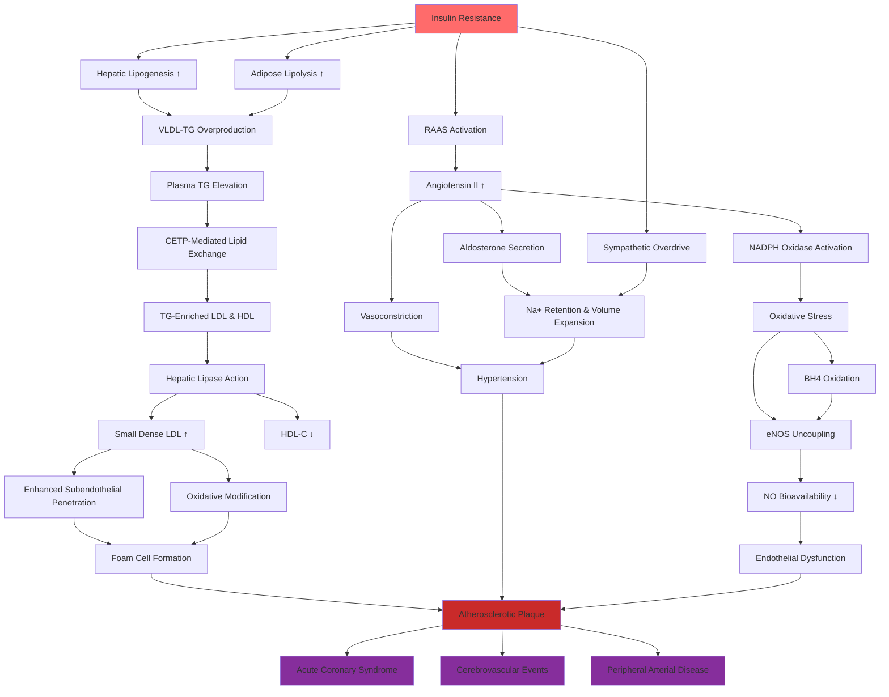

# Lesson 4: Dyslipidemia, Hypertension, and Cardiovascular Risk Mechanisms

## 1. First-Principles Intuition & Invariants

Metabolic syndrome and type 2 diabetes mellitus constitute a unified pathophysiological landscape in which insulin resistance orchestrates a cascade of lipid transport derangements, vascular endothelial injury, and blood pressure dysregulation. The triad of atherogenic dyslipidemia, hypertension, and accelerated atherosclerosis represents the most clinically consequential manifestation of this metabolic decompensation, accounting for the two- to fourfold elevation in cardiovascular mortality observed in diabetic populations compared to metabolically healthy cohorts. Understanding the mechanistic interconnections between hepatic lipogenesis, lipoprotein remodeling, renin-angiotensin-aldosterone system activation, and endothelial nitric oxide synthase uncoupling provides the practitioner with the conceptual framework necessary to interpret lipid panels, titrate pharmacotherapy, and stratify absolute cardiovascular risk with precision.

The core invariant governing dyslipidemia in insulin-resistant states is the hepatic overproduction of triglyceride-rich very-low-density lipoprotein particles. Normally, insulin suppresses hepatic glucose output and constrains de novo lipogenesis through the inhibition of sterol regulatory element-binding protein 1c. In insulin resistance, however, this transcriptional brake fails selectively while insulin continues to drive lipogenic gene expression through alternate signaling pathways, creating a paradoxical state of simultaneous hyperglycemia and hepatic triglyceride accumulation. The liver responds to this lipid surfeit by secreting large, triglyceride-enriched VLDL particles into the circulation at rates that exceed the capacity of peripheral tissues to extract and oxidize fatty acids. Once in the plasma compartment, these VLDL remnants undergo enzymatic remodeling through the action of cholesteryl ester transfer protein, which mediates the bidirectional exchange of triglycerides from VLDL into low-density and high-density lipoprotein particles in return for cholesteryl esters. This exchange reaction generates triglyceride-enriched LDL and HDL particles that subsequently undergo lipolysis by hepatic lipase, yielding small, dense LDL particles and reduced HDL cholesterol concentrations—the canonical lipid phenotype of metabolic syndrome.

Small dense LDL particles exhibit enhanced atherogenicity through multiple mechanisms. Their reduced diameter permits deeper penetration into the subendothelial space through intercellular junctions in the arterial intima. Their prolonged plasma residence time increases susceptibility to oxidative modification, and their diminished affinity for the LDL receptor impairs hepatic clearance. Oxidized LDL particles stimulate endothelial expression of vascular cell adhesion molecule-1 and monocyte chemoattractant protein-1, initiating the inflammatory cascade that recruits circulating monocytes into the vessel wall. These monocytes differentiate into macrophages, internalize oxidized LDL through scavenger receptors, and transform into lipid-laden foam cells—the histological hallmark of early atherosclerotic lesions. Simultaneously, the reduction in HDL cholesterol concentration impairs reverse cholesterol transport, the physiological process by which peripheral tissue cholesterol is mobilized back to the liver for biliary excretion. HDL particles also possess antioxidant and anti-inflammatory properties mediated by paraoxonase-1 and sphingosine-1-phosphate, protective functions that are compromised when HDL particle number declines.

Hypertension in insulin-resistant states arises from the convergence of multiple hemodynamic and neurohumoral mechanisms. Insulin resistance directly activates the sympathetic nervous system through hypothalamic and brainstem circuits, increasing vascular tone and heart rate. Hyperinsulinemia enhances renal sodium reabsorption in the proximal tubule and collecting duct, expanding plasma volume and elevating preload. Most critically, insulin resistance amplifies angiotensin II signaling through upregulation of angiotensin II type 1 receptors in vascular smooth muscle and the adrenal cortex. Angiotensin II exerts multiple pressor effects: it directly constricts resistance arterioles, stimulates aldosterone secretion to promote sodium retention, increases sympathetic outflow, and induces vascular remodeling through smooth muscle cell hypertrophy and collagen deposition. Aldosterone itself perpetuates hypertension by binding mineralocorticoid receptors in the distal nephron, driving sodium-potassium exchange and generating an osmotic gradient that favors water retention. The resulting volume expansion and increased peripheral vascular resistance create a hypertensive milieu that amplifies shear stress on endothelial cells, propagating further vascular injury.

Endothelial dysfunction represents the final common pathway linking dyslipidemia and hypertension to atherothrombotic events. The endothelium normally maintains vascular homeostasis by producing nitric oxide through the enzymatic conversion of L-arginine to L-citrulline by endothelial nitric oxide synthase. Nitric oxide diffuses into adjacent smooth muscle cells, activating soluble guanylate cyclase to generate cyclic guanosine monophosphate, which induces vasodilation, inhibits platelet aggregation, and suppresses smooth muscle proliferation. In metabolic syndrome, oxidative stress generated by mitochondrial fatty acid overload, NADPH oxidase activation, and uncoupled eNOS generates superoxide anion radicals that scavenge nitric oxide, forming peroxynitrite and reducing NO bioavailability. Oxidative modification of the eNOS cofactor tetrahydrobiopterin uncouples the enzyme, causing it to produce superoxide rather than nitric oxide—a vicious cycle that perpetuates endothelial injury. Asymmetric dimethylarginine, an endogenous competitive inhibitor of eNOS that accumulates in insulin-resistant states due to impaired renal clearance, further constrains nitric oxide synthesis. The loss of endothelial NO signaling promotes vasoconstriction, platelet activation, leukocyte adhesion, and smooth muscle proliferation, accelerating atherosclerotic plaque progression and increasing the risk of acute coronary syndromes.

## 2. Core Architecture & Mechanics

The pathophysiological architecture of cardiovascular risk in metabolic syndrome can be conceptualized as a multi-organ network in which hepatic metabolic derangements, altered lipoprotein dynamics, neurohumoral activation, and vascular endothelial injury interact through feedforward and feedback loops. The hepatocyte serves as the central metabolic node, integrating signals from circulating insulin, free fatty acids, and glucose to determine rates of lipogenesis, VLDL assembly, and apolipoprotein B secretion. Under insulin-resistant conditions, the suppression of hepatic glucose production becomes incomplete while lipogenic pathways remain active, creating a metabolic paradox termed selective hepatic insulin resistance. De novo lipogenesis proceeds through acetyl-CoA carboxylase and fatty acid synthase, converting excess glucose and fructose into palmitate and other saturated fatty acids. These newly synthesized fatty acids, combined with circulating free fatty acids released from insulin-resistant adipose tissue, are esterified into triglycerides and packaged with apolipoprotein B-100 to form nascent VLDL particles in the endoplasmic reticulum.

The assembly and secretion of VLDL particles are governed by microsomal triglyceride transfer protein, which loads neutral lipids into the hydrophobic core of apoB-100 to prevent its degradation. The rate of VLDL secretion correlates directly with hepatic triglyceride content and inversely with insulin sensitivity. Once secreted, VLDL particles undergo lipolytic processing by lipoprotein lipase on the capillary endothelial surface, releasing free fatty acids for tissue uptake and generating progressively smaller VLDL remnants and intermediate-density lipoprotein particles. These remnants can be cleared by hepatic LDL receptors or undergo further lipolysis to form LDL particles. In insulin-resistant states, the triglyceride enrichment of VLDL particles creates a substrate excess that overwhelms the capacity of lipoprotein lipase, prolonging the residence time of atherogenic remnants in the circulation.

Cholesteryl ester transfer protein operates at the center of lipoprotein remodeling, mediating the neutral lipid exchange that defines atherogenic dyslipidemia. CETP transfers triglycerides from VLDL and VLDL remnants into LDL and HDL particles in exchange for cholesteryl esters, a reaction driven by concentration gradients and facilitated by the hydrophobic tunnel structure of the CETP protein. The triglyceride-enriched LDL and HDL particles become substrates for hepatic lipase, a lipolytic enzyme anchored to hepatic sinusoidal endothelium that preferentially hydrolyzes triglycerides from these remodeled lipoproteins. The result is the generation of small, dense LDL particles with diameters below 25.5 nanometers and reduced HDL cholesterol concentrations. Hepatic lipase activity is upregulated in insulin-resistant states, accelerating the conversion of large, buoyant LDL into small, dense LDL and promoting HDL catabolism. This enzymatic cascade transforms the lipid profile from a benign pattern of large, buoyant LDL and abundant HDL into the highly atherogenic pattern characteristic of metabolic syndrome.

The renin-angiotensin-aldosterone system becomes hyperactive in insulin resistance through multiple convergent mechanisms. Insulin directly stimulates angiotensinogen synthesis in the liver and enhances angiotensin II type 1 receptor expression in vascular smooth muscle. Hyperglycemia generates advanced glycation end products that activate the RAGE receptor, stimulating pro-renin receptor expression and increasing local angiotensin II production within vascular tissue. Angiotensin-converting enzyme converts angiotensin I to angiotensin II in the pulmonary circulation and within vascular walls, where it exerts autocrine and paracrine effects. Angiotensin II binding to AT1 receptors triggers G-protein-coupled signaling cascades that activate phospholipase C, generating inositol trisphosphate and diacylglycerol to mobilize intracellular calcium and activate protein kinase C. These second messengers induce smooth muscle contraction, stimulate NADPH oxidase to generate reactive oxygen species, and activate transcription factors that promote vascular inflammation and remodeling.

Endothelial nitric oxide synthase couples the oxidation of L-arginine to the reduction of molecular oxygen, requiring coordinated electron transfer from NADPH through FAD and FMN cofactors to a heme prosthetic group complexed with tetrahydrobiopterin. When tetrahydrobiopterin becomes oxidized or depleted, the electron flow becomes uncoupled, and eNOS reduces molecular oxygen to superoxide instead of synthesizing nitric oxide. This uncoupling phenomenon is exacerbated by substrate competition from asymmetric dimethylarginine, which accumulates when the dimethylarginine dimethylaminohydrolase enzyme responsible for its degradation becomes inhibited by oxidative stress. The resulting decline in nitric oxide bioavailability impairs endothelium-dependent vasodilation, allowing unopposed vasoconstrictor influences from angiotensin II, endothelin-1, and sympathetic norepinephrine to dominate vascular tone regulation.

## 3. High-Performance Optimization & Failure Modes

Clinical management of dyslipidemia and hypertension in metabolic syndrome requires a multi-modal therapeutic strategy that addresses insulin resistance, lipoprotein metabolism, and blood pressure regulation simultaneously. The practitioner must recognize that standard lipid-lowering and antihypertensive monotherapies, while effective in metabolically healthy populations, often require intensification and combination in the setting of insulin resistance. The cornerstone of dyslipidemia management remains statin therapy targeting LDL cholesterol reduction through competitive inhibition of HMG-CoA reductase, the rate-limiting enzyme in hepatic cholesterol synthesis. Statin-induced depletion of intracellular cholesterol upregulates LDL receptor expression, enhancing hepatic clearance of circulating LDL and VLDL remnants. High-intensity statin regimens achieving LDL cholesterol reductions of fifty percent or greater demonstrate consistent reductions in major adverse cardiovascular events across diabetic populations, with absolute risk reductions proportional to the magnitude of LDL lowering.

However, the atherogenic dyslipidemia phenotype frequently persists despite adequate LDL cholesterol reduction, manifesting as elevated triglycerides and reduced HDL cholesterol. This residual dyslipidemic risk requires targeted intervention with fibrate therapy or high-dose omega-3 fatty acid preparations. Fibrates activate peroxisome proliferator-activated receptor alpha, a nuclear receptor that upregulates lipoprotein lipase expression, enhances fatty acid oxidation in liver and muscle, and suppresses apolipoprotein C-III synthesis—an inhibitor of lipoprotein lipase activity. The resulting acceleration of VLDL catabolism reduces plasma triglyceride concentrations by thirty to fifty percent and modestly increases HDL cholesterol through enhanced apolipoprotein A-I production. Fenofibrate combined with statin therapy in diabetic patients with elevated triglycerides demonstrates incremental cardiovascular benefit, particularly in those with baseline triglycerides above 204 milligrams per deciliter and HDL cholesterol below 34 milligrams per deciliter. Icosapent ethyl, a highly purified eicosapentaenoic acid ethyl ester administered at four grams daily, reduces triglyceride-rich lipoprotein particles and membrane arachidonic acid content, decreasing inflammatory eicosanoid synthesis and stabilizing atherosclerotic plaques. Randomized controlled trials demonstrate a twenty-five percent relative risk reduction in major cardiovascular events when icosapent ethyl is added to statin therapy in patients with elevated triglycerides.

Hypertension management in insulin-resistant states prioritizes renin-angiotensin-aldosterone system blockade over traditional diuretic or calcium channel blocker monotherapy. Angiotensin-converting enzyme inhibitors and angiotensin II receptor blockers not only reduce blood pressure through vasodilation and natriuresis but also confer pleiotropic metabolic benefits including improved insulin sensitivity, reduced oxidative stress, and attenuation of vascular inflammation. ACE inhibitors block the conversion of angiotensin I to angiotensin II while simultaneously preventing the degradation of bradykinin, a vasodilator peptide that stimulates endothelial nitric oxide release. This dual mechanism enhances NO bioavailability and opposes eNOS uncoupling. ARBs selectively antagonize the AT1 receptor, allowing unopposed angiotensin II binding to AT2 receptors that mediate vasodilation, natriuresis, and anti-proliferative effects. Both drug classes reduce proteinuria and slow the progression of diabetic nephropathy, a critical consideration given the synergistic cardiovascular risk imposed by chronic kidney disease.

Mineralocorticoid receptor antagonists such as spironolactone and eplerenone provide additional blood pressure reduction and cardiovascular protection in patients with resistant hypertension or heart failure. Aldosterone excess promotes sodium retention, potassium wasting, myocardial fibrosis, and vascular stiffness through mineralocorticoid receptor activation in the kidney, heart, and vasculature. Aldosterone also stimulates NADPH oxidase and impairs endothelial nitric oxide synthase function, perpetuating oxidative stress and endothelial dysfunction. Selective mineralocorticoid receptor blockade interrupts these pathways, reducing cardiovascular mortality in patients with heart failure with reduced ejection fraction and providing incremental blood pressure reduction when added to ACE inhibitor or ARB therapy. Practitioners must monitor serum potassium and renal function closely when initiating mineralocorticoid receptor antagonists, particularly in patients with moderate chronic kidney disease or those receiving concomitant RAAS inhibitors, as the risk of hyperkalemia increases substantially with declining glomerular filtration rate.

Quantitative cardiovascular risk stratification integrates lipid parameters, blood pressure measurements, glycemic control metrics, and clinical risk factors into validated algorithms that estimate ten-year probability of atherosclerotic cardiovascular disease events. The Pooled Cohort Equations developed by the American College of Cardiology and American Heart Association incorporate age, sex, race, total cholesterol, HDL cholesterol, systolic blood pressure, antihypertensive treatment status, diabetes status, and current smoking to generate a ten-year risk percentage. Patients with diabetes mellitus aged forty to seventy-five years are automatically classified as intermediate risk or higher, with calculated risks typically ranging from seven-and-a-half to twenty percent. Those with ten-year risks exceeding twenty percent warrant classification as high risk, mandating high-intensity statin therapy, blood pressure targets below 130/80 millimeters of mercury, and consideration of antiplatelet therapy with low-dose aspirin.

Failure modes in cardiovascular risk management arise from therapeutic inertia, inadequate risk stratification, and suboptimal medication adherence. Many clinicians hesitate to escalate therapy despite persistent lipid abnormalities or uncontrolled hypertension, accepting subtherapeutic control that permits ongoing vascular injury. The discordance between LDL cholesterol and apolipoprotein B concentrations in insulin-resistant states can lead to underestimation of atherogenic particle burden, as small dense LDL particles carry less cholesterol per particle than large buoyant LDL. Apolipoprotein B measurement, reflecting the total number of atherogenic particles, provides superior risk prediction in metabolic syndrome and should inform intensification decisions when LDL cholesterol appears controlled but triglycerides remain elevated. Non-HDL cholesterol, calculated as total cholesterol minus HDL cholesterol, captures all apolipoprotein B-containing lipoproteins and serves as a secondary treatment target when triglycerides exceed 200 milligrams per deciliter. Patient medication adherence declines precipitously as pill burden increases, necessitating combination formulations and shared decision-making conversations that emphasize absolute risk reduction rather than surrogate laboratory targets.

## 4. Summary & Verification Matrix

| Domain | Core Invariant | Diagnostic Criteria | Intervention Target | Failure Mode |
|--------|---------------|---------------------|---------------------|--------------|
| **Atherogenic Dyslipidemia** | Hepatic VLDL-TG overproduction drives CETP-mediated generation of small dense LDL and HDL reduction through hepatic lipase action | Triglycerides ≥150 mg/dL, HDL-C <40 mg/dL (men) or <50 mg/dL (women), small dense LDL pattern B on NMR lipoprotein analysis, apoB >130 mg/dL | LDL-C <70 mg/dL with high-intensity statin, non-HDL-C <100 mg/dL, triglycerides <150 mg/dL with fibrate or icosapent ethyl, apoB <80 mg/dL | Residual dyslipidemic risk persists when LDL-C is treated but triglycerides remain elevated; apoB-LDL-C discordance leads to underestimation of particle burden |
| **RAAS-Mediated Hypertension** | Insulin resistance upregulates AT1 receptor expression and angiotensinogen synthesis, amplifying angiotensin II vasoconstrictor, aldosterone secretion, and oxidative stress effects | Systolic BP ≥130 mmHg or diastolic BP ≥80 mmHg on repeated measurements, plasma aldosterone-to-renin ratio >20 suggests primary aldosteronism, impaired endothelium-dependent vasodilation on brachial artery ultrasound | BP <130/80 mmHg with ACE inhibitor or ARB as first-line, add mineralocorticoid receptor antagonist for resistant hypertension, aldosterone suppression in primary aldosteronism | Therapeutic inertia delays intensification despite persistent elevation; hyperkalemia risk with dual RAAS blockade or MRA in CKD; aldosterone escape with long-term ACE-I therapy |
| **Endothelial Dysfunction** | eNOS uncoupling converts enzyme from NO producer to superoxide generator due to BH4 oxidation and ADMA accumulation, collapsing NO bioavailability | Flow-mediated dilation <7% on brachial artery ultrasound, elevated plasma ADMA >0.5 μmol/L, increased oxidative stress markers (8-isoprostane, oxidized LDL), reduced endothelial progenitor cells | Restore NO bioavailability with RAAS blockade, antioxidant-rich dietary patterns, exercise training to upregulate eNOS expression, consider BH4 supplementation in refractory cases | Oxidative stress-eNOS uncoupling creates vicious cycle; ADMA accumulates with declining renal function; antioxidant supplementation trials show paradoxical harm at supraphysiologic doses |
| **Quantitative Risk Stratification** | Ten-year ASCVD risk integrates multiple risk factors; insulin resistance confers multiplicative rather than additive risk elevation | Pooled Cohort Equations ≥7.5% warrants statin discussion, ≥20% defines high risk mandating intensive therapy, coronary artery calcium score >100 Agatston units reclassifies intermediate risk upward | High-intensity statin for 10-year risk ≥7.5%, BP <130/80 mmHg, HbA1c <7%, antiplatelet therapy for established ASCVD or 10-year risk ≥20% with bleeding risk assessment | Risk algorithms underestimate burden in younger patients with long diabetes duration; focus on relative risk reduction obscures absolute benefit in low-risk groups; CAC score of zero does not eliminate risk in diabetes |
