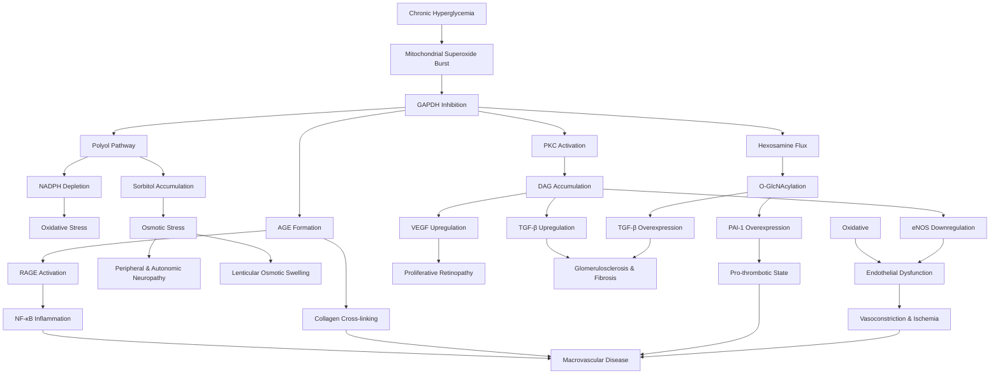

# Lesson 5: Microvascular and Macrovascular Complications

## 1. First-Principles Intuition & Invariants

The systemic destruction wrought by chronic hyperglycemia does not occur randomly; it follows highly predictable, quantifiable biochemical cascades that target specific vascular beds and neuronal populations. To master the clinical management of diabetes and metabolic syndrome, the practitioner must internalize a critical invariant: tissue susceptibility to hyperglycemic injury is dictated entirely by cellular glucose uptake kinetics. Skeletal muscle and adipose tissue, which rely on insulin-mediated GLUT4 translocation, are largely spared from intracellular glucose toxicity because their glucose transport downregulates in the absence of insulin. Conversely, the retina, renal glomeruli, and peripheral nerves depend on insulin-independent GLUT1 and GLUT3 transporters. These tissues act as unregulated glucose sinks, meaning their intracellular glucose concentrations rise in direct parallel with extracellular plasma levels. This structural vulnerability establishes the anatomical boundaries of diabetic microvascular disease.

When intracellular glucose concentrations exceed the metabolic capacity of the glycolytic pathway, the excess substrate spills into four interconnected, pathological cascades: the polyol pathway, advanced glycation end-product (AGE) formation, protein kinase C (PKC) activation, and the hexosamine biosynthetic pathway. While historically taught as separate mechanisms, they are actually downstream manifestations of a single, unifying intracellular event: mitochondrial superoxide overproduction. Hyperglycemia drives excessive pyruvate generation, which overwhelms the mitochondrial electron transport chain. The resulting superoxide burst inhibits the enzyme glyceraldehyde-3-phosphate dehydrogenase (GAPDH) via poly-ADP-ribose polymerase (PARP) activation. With GAPDH inhibited, upstream glycolytic intermediates accumulate and are forcibly shunted into the four toxic pathways. 

The polyol pathway consumes intracellular glucose by converting it to sorbitol via aldose reductase, utilizing NADPH as a cofactor. This depletion of NADPH cripples the cell’s ability to regenerate glutathione, its primary antioxidant defense, leaving the tissue highly vulnerable to oxidative stress. Simultaneously, the accumulation of intracellular sorbitol generates a localized osmotic gradient, drawing fluid into the cell and inducing osmotic stress, a mechanism particularly devastating in the lens of the eye and Schwann cells of the peripheral nerves. 

Simultaneously, the hyperglycemic environment drives the non-enzymatic glycation of intracellular and extracellular proteins, forming Amadori products that subsequently rearrange into irreversible advanced glycation end-products. These AGEs cross-link collagen and elastin, stiffening the vascular basement membrane and increasing vascular resistance. More critically, AGEs bind to their receptor (RAGE) on endothelial cells and macrophages, triggering a sustained inflammatory cascade via NF-κB activation, further amplifying oxidative stress and tissue destruction.

Excess dihydroxyacetone phosphate (DHAP) derived from blocked glycolysis is converted into diacylglycerol (DAG), a potent and sustained activator of protein kinase C. The activation of PKC, specifically the PKC-β isoform, alters the expression of vasoactive mediators. It upregulates endothelin-1, causing vasoconstriction, and downregulates endothelial nitric oxide synthase (eNOS), reducing vasodilation. PKC activation also drives the overexpression of vascular endothelial growth factor (VEGF) and transforming growth factor-beta (TGF-β), directly mediating retinal neovascularization and glomerular fibrosis, respectively. 

Finally, the accumulation of fructose-6-phosphate shunts excess glucose into the hexosamine pathway, generating UDP-GlcNAc. This activated sugar substrate directly modifies serine and threonine residues on nuclear transcription factors via O-GlcNAcylation. The hyper-GlcNAcylation of transcription factors like Sp1 pathologically upregulates the expression of pro-fibrotic factors, most notably plasminogen activator inhibitor-1 (PAI-1) and TGF-β, establishing a chronic, fibrotic environment within the microvasculature. Understanding these four overlapping cascades is not merely academic; it defines the pharmacological targets for retarding the progression of diabetic complications.

## 2. Core Architecture & Mechanics

The biochemical aberrations detailed above translate into concrete, mechanical architectural failures within target organs. The clinical architecture of diabetic nephropathy follows a highly predictable, quantifiable trajectory from hyperfiltration to end-stage renal disease (ESRD). In the early hyperglycemic state, the glomerulus exhibits hyperfiltration, characterized by an elevated glomerular filtration rate (GFR) often exceeding 120 mL/min/1.73m². This is driven by hyperglycemia-induced afferent arteriolar dilation via nitric oxide, combined with angiotensin II-mediated efferent arteriolar constriction. The resulting intraglomerular hypertension mechanically stresses the glomerular capillaries and physically damages the fenestrated endothelium and the underlying podocytes. 

As damage progresses, the mesangial cells respond to the prolonged mechanical and biochemical stress by proliferating and overproducing extracellular matrix, leading to glomerular hypertrophy. The structural hallmark of this phase is the thickening of the glomerular basement membrane (GBM) and the expansion of the mesangial matrix. If unchecked, this progresses to Kimmelstiel-Wilson nodular glomerulosclerosis, characterized by acellular, eosinophilic nodules at the periphery of the glomerular tuft. The mechanical consequence of this fibrosis is the obliteration of the capillary lumen, drastically reducing the filtration surface area. Clinically, this is tracked via the urinary albumin-to-creatinine ratio (UACR). The transition from normoalbuminuria (UACR < 30 mg/g) to microalbuminuria (30-300 mg/g) marks the onset of incipient nephropathy. The subsequent jump to macroalbuminuria (UACR > 300 mg/g) indicates overt nephropathy, followed by an inevitable, progressive decline in eGFR. 

In the retina, the architectural failure is similarly driven by microvascular hemodynamics. The earliest mechanical disruption occurs in the pericytes, the specialized contractile cells that wrap retinal capillaries and maintain vascular tone and endothelial viability. Hyperglycemia induces pericyte apoptosis via the polyol pathway osmotic stress and AGE accumulation. The loss of pericytes leads to focal capillary dilation, forming microaneurysms. These weakened, balloon-like outpouchings leak plasma proteins and lipids (hard exudates) and rupture, forming dot-blot hemorrhages within the inner nuclear and outer plexiform layers. 

As capillaries occlude due to pericyte loss and endothelial dysfunction, the retina becomes ischemic. The hypoxic tissue responds by secreting vascular endothelial growth factor (VEGF), a potent angiogenic cytokine. VEGF drives pathological neovascularization, but these newly formed vessels are structurally defective, lacking tight junctions and pericyte support. They leak profusely, causing macular edema, and their fibrous attachments contract, pulling on the retina and causing tractional retinal detachment. This transition from non-proliferative diabetic retinopathy (NPDR) to proliferative diabetic retinopathy (PDR) represents a critical architectural failure of the blood-retinal barrier.

Diabetic neuropathy manifests as a length-dependent, symmetric axonopathy. The longest peripheral nerves, which possess the highest metabolic demand and longest axonal transport distances, fail first. The distal sensory nerves of the feet are the initial casualties. The mechanism is twofold. First, the polyol pathway induces osmotic swelling in Schwann cells, damaging myelin sheaths and slowing nerve conduction velocities. Second, microvascular disease of the vasa nervorum—the tiny arteries supplying the nerve fascicles—creates ischemic injury, blunting axonal transport and causing Wallerian degeneration of the distal axon. As unmyelinated C-fibers and small myelinated A-δ fibers degrade, the patient experiences a paradoxical combination of numbness and burning neuropathic pain. Autonomic neuropathy follows a similar ischemic and metabolic trajectory, crippling the autonomic ganglia and leading to resting tachycardia, orthostatic hypotension, gastroparesis, and neurogenic bladder dysfunction.

Macrovascular disease in diabetes is not merely standard atherosclerosis occurring at an accelerated rate; it possesses distinct pathological characteristics. The chronic hyperglycemia, combined with the insulin resistance intrinsic to metabolic syndrome, creates a profoundly atherogenic endothelial phenotype. AGE cross-linking renders the arterial wall stiff and resistant to physiological remodeling. The combination of hyperglycemia, hypertension, and dyslipidemia drives macrophages into the subendothelial space, where they feast on oxidized LDL particles, forming lipid-laden foam cells that coalesce into necrotic, vulnerable plaques. In diabetic patients, these plaques are highly inflammatory, possess thin fibrous caps, and are prone to acute rupture, triggering thrombotic occlusions. 

## 3. High-Performance Optimization & Failure Modes

Optimizing patient outcomes requires intercepting these pathological cascades at their earliest mechanistic stages, utilizing precise pharmacological and procedural workflows. The clinical execution of diabetic complication management is a multi-vector optimization problem. You must aggressively normalize intracellular glucose flux while simultaneously managing the downstream hemodynamic and lipid aberrations.

In the optimization of diabetic nephropathy, the primary objective is to lower intraglomerular pressure to arrest mesangial expansion and protein leakage. The clinical workflow demands the immediate deployment of angiotensin-converting enzyme (ACE) inhibitors or angiotensin II receptor blockers (ARBs) at the first detection of microalbuminuria, well before gross macroalbuminuria occurs. These agents dilate the efferent arteriole, mechanically reducing the hydraulic pressure driving protein across the damaged GBM. The modern clinical workflow now integrates sodium-glucose cotransporter-2 (SGLT2) inhibitors as a high-performance optimization tool. By inhibiting proximal tubular glucose reabsorption, SGLT2 inhibitors restore the tubuloglomerular feedback mechanism, causing afferent arteriolar constriction. This dual arteriolar modulation—efferent dilation via ACEi/ARBs and afferent constriction via SGLT2 inhibitors—optimizes intraglomerular hemodynamics, proven to sharply decelerate the decline of eGFR and reduce progression to ESRD. Blood pressure targets must be aggressively titrated to strictly remain below 130/80 mmHg, utilizing the aforementioned RAAS blockade as the pharmacological foundation.

For proliferative retinopathy, the optimization strategy targets the VEGF-driven neovascular cascade. Practitioners must execute annual or semi-annual fundus photography screening to detect microaneurysms and intraretinal hemorrhages before vision is compromised. Once clinically significant macular edema (CSME) or proliferative disease is identified on Optical Coherence Tomography (OCT) or fluorescein angiography, the workflow shifts to mechanical destruction and pharmacological blockade. Panretinal photocoagulation (PRP) deploys thousands of laser burns across the peripheral retina, intentionally destroying ischemic tissue to mechanically eliminate the source of VEGF production. For precise edema reduction, intravitreal injection of anti-VEGF agents, such as ranibizumab or aflibercept, directly neutralizes the cytokine, rapidly resolving macular fluid and improving visual acuity. 

Managing neuropathy relies heavily on strict glycemic stabilization to halt the polyol pathway osmotic damage, combined with targeted symptomatic pharmacology. The clinical workflow demands the utilization of 10g Semmes-Weinstein monofilament testing at four distinct sites on the plantar surface of each foot to mechanically detect the loss of protective sensation. When this protective threshold is breached, the patient requires immediate offloading interventions, such as total contact casts or specialized orthotics, to prevent foot ulceration. For the management of burning neuropathic pain, deploy tricyclic antidepressants, dual serotonin-norepinephrine reuptake inhibitors like duloxetine, or gabapentinoids such as pregabalin, calibrated carefully to modulate the hyperactive pain signaling without inducing cognitive sedation.

Macrovascular disease optimization mandates aggressive lipid modulation and platelet inhibition. The statin dosage must be titrated to achieve an LDL cholesterol target strictly below 55 mg/dL for secondary prevention, utilizing high-intensity atorvastatin or rosuvastatin. If this target is unmet, the workflow integrates proprotein convertase subtilisin/kexin type 9 (PCSK9) inhibitors. Aspirin 81 mg is deployed for secondary prevention in patients with established coronary or peripheral arterial disease. 

However, executing these optimization workflows introduces severe failure modes and edge cases that must be managed with precision. The most critical failure mode in rapid glycemic optimization is the phenomenon of "early worsening" diabetic retinopathy. When a patient with chronic, severely uncontrolled hyperglycemia undergoes rapid HbA1c reduction over a short timeframe, the sudden improvement in glycemic control alters retinal blood flow autoregulation and metabolic signaling, acutely upregulating VEGF expression and causing an initial flare of retinopathy progression. Practitioners must caution patients that a transient burst of retinal hemorrhages may occur during the first 6-12 months of aggressive insulin therapy, requiring heightened ophthalmologic surveillance rather than a loosening of glycemic targets.

A second dangerous failure mode involves the iatrogenic induction of acute kidney injury (AKI) through the over-zealous stacking of RAAS blockade and SGLT2 inhibitors, particularly in the presence of volume depletion or concurrent NSAID use. The combined efferent arteriolar dilation and afferent arteriolar constriction can severely drop the glomerular hydrostatic pressure, causing an abrupt ischemic decline in GFR. The clinical workflow must mandate a creatinine check 1-2 weeks after initiating or up-titrating these agents. If creatinine rises by more than 30% from baseline, the practitioner must immediately evaluate for volume depletion, discontinue nephrotoxic medications, and potentially reduce the RAAS blockade dose.

Finally, strict glycemic optimization in patients with autonomic neuropathy creates a paradoxical failure mode regarding hypoglycemia unawareness. As autonomic neuropathy blunts the adrenergic response to falling glucose levels, the patient loses the physiological tremor, palpitations, and diaphoresis that normally signal hypoglycemia. The reliance on strict HbA1c targets in these specific patients can lead to silent, profound neuroglycopenia and sudden cardiac death. The optimization workflow must incorporate continuous glucose monitoring (CGM) with aggressive low-glucose alerts to mechanically compensate for the patient's broken endogenous warning system, occasionally intentionally relaxing the HbA1c target above 7.5% if severe hypoglycemia persists.

## 4. Summary & Verification Matrix

| Complication System | Governing Invariant | Pathophysiological Mechanism | Diagnostic Criteria | Clinical Failure Mode / Pitfall |
| :--- | :--- | :--- | :--- | :--- |
| **Biochemical Cascade** | Insulin-independent GLUT transport allows intracellular glucose toxicity in retina, glomeruli, and nerves. | Mitochondrial superoxide inhibits GAPDH, shunting glucose into polyol, AGE, PKC, and hexosamine cascades. | HbA1c >7.0%; elevated Time Above Range via CGM. | Over-reliance on fasting glucose; missing postprandial spikes that drive AGE formation. |
| **Diabetic Nephropathy** | Intraglomerular hypertension mechanically drives mesangial matrix expansion and GBM thickening. | PKC/TGF-β driven mesangial fibrosis; GBM charge barrier loss causing albuminuria. | UACR > 30 mg/g (micro) or > 300 mg/g (macro); eGFR decline. | Stacking ACEi + SGLT2i without volume assessment, triggering acute kidney injury. |
| **Diabetic Retinopathy** | Pericyte apoptosis initiates microaneurysm formation and subsequent retinal ischemia. | VEGF-driven neovascularization; fragile vessel rupture causing vitreous hemorrhage and retinal detachment. | Fundus photography; OCT for macular edema; fluorescein angiography. | "Early worsening" retinopathy triggered by overly rapid initial HbA1c reduction. |
| **Diabetic Neuropathy** | Length-dependent axonopathy due to Schwann cell osmotic stress and vasa nervorum ischemia. | Polyol pathway NADPH depletion and sorbitol accumulation; Wallerian degeneration. | 10g Monofilament failure; nerve conduction velocity reduction. | Treating neuropathic pain without assessing for autonomic dysfunction (gastroparesis, orthostasis). |
| **Macrovascular Disease** | AGE cross-linking and PKC-mediated endothelial dysfunction create highly inflammatory, vulnerable plaques. | Foam cell formation from oxidized LDL; thin-cap fibroatheroma rupture and thrombosis. | Coronary calcium score > 300; ABI < 0.9; carotid intima-media thickness > 1.0 mm. | Failing to target LDL < 55 mg/dL for secondary prevention; missing silent ischemia. |
