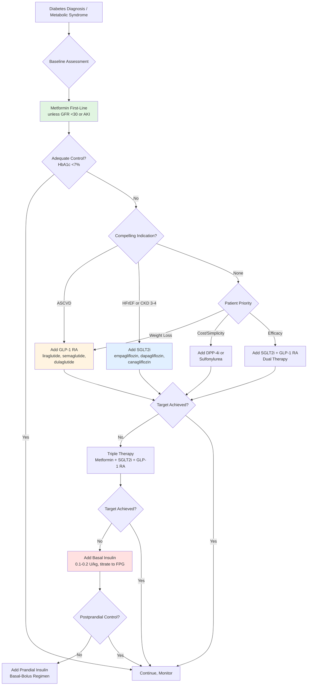

# Lesson 6: Pharmacological Management and Therapeutic Targets

## 1. First-Principles Intuition & Invariants

The pharmacological management of diabetes mellitus and metabolic syndrome represents one of the most sophisticated examples of rational drug design guided by mechanistic biochemistry. Unlike empirical therapeutics discovered through phenotypic screening, the modern antidiabetic arsenal emerged from precise molecular understanding of glucose homeostasis failure modes. At its foundation lies a deceptively simple invariant: chronic hyperglycemia damages endothelial cells, neurons, and renal podocytes through four converging mechanisms—polyol pathway flux overwhelming aldose reductase, advanced glycation end-product formation cross-linking structural proteins, protein kinase C activation disrupting vascular signaling, and hexosamine pathway shunting causing aberrant O-GlcNAcylation of transcription factors. Every pharmacological intervention ultimately aims to restore euglycemia while simultaneously interrupting these downstream damage cascades.

The historical trajectory of antidiabetic drug development illuminates the progressive refinement of therapeutic targets. Insulin, isolated in 1921 by Banting and Best, remained the sole option for type 1 diabetes and advanced type 2 disease until the 1950s, when sulfonylureas emerged from observations that certain sulfonamide antibiotics caused hypoglycemia. Metformin, derived from the medieval herbal remedy Galega officinalis containing guanidine compounds, was introduced in Europe in 1957 but remained unavailable in the United States until 1995 due to concerns about lactic acidosis seen with the related biguanide phenformin. The thiazolidinedione class, rationally designed to activate peroxisome proliferator-activated receptor gamma, arrived in the late 1990s with troglitazone, though hepatotoxicity necessitated its withdrawal and cautious use of subsequent agents. The incretin-based therapies—dipeptidyl peptidase-4 inhibitors and glucagon-like peptide-1 receptor agonists—emerged in the 2000s after recognition that the incretin effect, the amplification of insulin secretion by gut-derived hormones, was blunted in type 2 diabetes. Most recently, sodium-glucose cotransporter-2 inhibitors, initially conceived as pure glucose-lowering agents, revealed unexpected cardiorenal protective effects that transcend glycemic control, fundamentally reshaping treatment paradigms.

The mechanistic classification of antidiabetic agents organizes around five primary nodes of intervention: hepatic glucose production suppression, peripheral insulin sensitivity enhancement, pancreatic beta-cell insulin secretion augmentation, incretin axis restoration, and renal glucose reabsorption inhibition. Metformin operates principally through hepatic adenosine monophosphate-activated protein kinase activation, shifting the cellular energy sensor toward catabolic programs that suppress gluconeogenesis while enhancing peripheral glucose uptake. The molecular cascade begins with mild inhibition of mitochondrial complex I, creating a transient energetic deficit that elevates the AMP-to-ATP ratio. AMPK phosphorylation then cascades through multiple effectors: acetyl-CoA carboxylase inhibition reducing malonyl-CoA and de-repressing fatty acid oxidation, phosphorylation of transcriptional coactivators like CRTC2 and CBP blocking gluconeogenic gene expression, and direct effects on the lysosomal v-ATPase-Ragulator-AMPK signaling axis. Critically, metformin does not stimulate insulin secretion, conferring a low intrinsic hypoglycemia risk that makes it the universal first-line agent.

Sodium-glucose cotransporter-2 inhibitors represent a paradigm shift by inducing deliberate glycosuria, exploiting the kidney's role as a glucose-regulating organ. The proximal convoluted tubule normally reabsorbs all filtered glucose through SGLT2 transporters in the S1 and S2 segments, maintaining zero urinary glucose loss even as plasma concentrations rise. By blocking this transporter, SGLT2 inhibitors lower the renal threshold for glucose excretion from approximately 180 mg/dL to 40–80 mg/dL, inducing caloric loss of 200–300 kilocalories daily and improving glycemia through an insulin-independent mechanism. The cardiorenal benefits, however, extend far beyond glucose lowering. Proposed mechanisms include natriuretic effects reducing preload, metabolic reprogramming toward ketone body oxidation improving cardiac energetics, reduction in sympathetic nervous system overactivity, amelioration of glomerular hyperfiltration through tubuloglomerular feedback restoration, and direct anti-inflammatory and anti-fibrotic effects on renal tubular cells. These pleiotropic benefits manifest clinically as dramatic reductions in heart failure hospitalization and chronic kidney disease progression, independent of baseline glycemic control.

The incretin axis therapies—GLP-1 receptor agonists and DPP-4 inhibitors—restore the physiological amplification of insulin secretion by nutrients. GLP-1, secreted by intestinal L-cells in response to ingested carbohydrates and fats, binds pancreatic beta-cell receptors coupled to Gs proteins, elevating cyclic AMP and sensitizing the insulin secretory machinery to glucose. Crucially, this effect is glucose-dependent: at euglycemia, GLP-1 exerts minimal insulinotropic action, dramatically reducing hypoglycemia risk. Native GLP-1 has a plasma half-life under two minutes, cleaved by the ubiquitous enzyme dipeptidyl peptidase-4. DPP-4 inhibitors prolong endogenous GLP-1 activity by blocking this degradation, while GLP-1 receptor agonists use structural modifications—exendin-4 sequences, albumin binding, or peptide backbone alterations—to resist enzymatic cleavage and achieve pharmacologically useful half-lives. GLP-1 receptor agonists confer additional benefits beyond glycemic control: gastric emptying delay creating satiety, hypothalamic appetite suppression producing substantial weight loss averaging 5–15% depending on agent and dose, and potential cardioprotective effects demonstrated in cardiovascular outcomes trials.

Thiazolidinediones activate peroxisome proliferator-activated receptor gamma, a nuclear receptor predominantly expressed in adipocytes that orchestrates transcriptional programs promoting lipid storage and adipocyte differentiation. Paradoxically, enhancing fat cell insulin sensitivity improves whole-body glucose homeostasis by sequestering free fatty acids away from liver and muscle, where lipid accumulation causes insulin resistance through mechanisms involving diacylglycerol activation of protein kinase C isoforms that phosphorylate and impair insulin receptor substrate proteins. Pioglitazone and rosiglitazone lower hemoglobin A1c by 1.0–1.5 percentage points while improving lipid profiles and reducing inflammatory markers. However, mechanism-based adverse effects—fluid retention from renal collecting duct sodium channel upregulation, bone fracture risk from mesenchymal stem cell differentiation skewing away from osteoblasts toward adipocytes, and potential bladder cancer signals—have relegated this class to third-line status despite metabolic benefits.

The insulin secretagogue classes—sulfonylureas and meglitinides—directly depolarize pancreatic beta cells by closing ATP-sensitive potassium channels, triggering voltage-gated calcium influx and insulin granule exocytosis. This mechanism operates independently of ambient glucose concentration, creating intrinsic hypoglycemia risk. Sulfonylureas bind the SUR1 subunit of the KATP channel with varying affinity and dissociation kinetics: first-generation agents like tolbutamide and chlorpropamide exhibit shorter durations, while second-generation glipizide, glyburide, and glimepiride provide once-daily dosing. Meglitinides like repaglinide bind a distinct site, producing rapid onset and short duration suitable for prandial glucose control. Chronic beta-cell stimulation raises theoretical concerns about accelerating beta-cell exhaustion, though long-term clinical data remain equivocal. Weight gain of 2–5 kilograms commonly occurs through reduced glycosuria and insulin's anabolic effects.

Exogenous insulin therapy remains indispensable for type 1 diabetes, advanced type 2 disease with beta-cell failure, and hyperglycemic emergencies. Insulin formulations span a pharmacokinetic spectrum designed to mimic physiological secretion: basal analogs like glargine, detemir, and degludec provide 12–42 hour coverage through subcutaneous depot formation or albumin binding, while rapid-acting analogs like lispro, aspart, and glulisine reach peak concentrations within 60–90 minutes for prandial control. Premixed formulations combine intermediate NPH or protamine-bound analogs with rapid components for simplified twice-daily regimens. Intensive basal-bolus regimens, mimicking physiological secretion most closely, require multiple daily injections or continuous subcutaneous insulin infusion pumps coupled with frequent glucose monitoring, demanding substantial patient engagement but offering superior glycemic control and lifestyle flexibility.

Emerging therapeutic targets push beyond incremental glucose lowering toward multi-organ metabolic reprogramming. Dual GIP-GLP-1 receptor co-agonists like tirzepatide harness glucose-dependent insulinotropic polypeptide, the other major incretin, which enhances insulin secretion, promotes lipid storage in adipocytes, and may exert central appetite effects. Clinical trials demonstrate hemoglobin A1c reductions exceeding 2 percentage points with weight loss approaching 15–20%, effects rivaling metabolic surgery. Hepatic fibroblast growth factor 21 analogs, mimicking a fasting-induced hepatokine that promotes fatty acid oxidation, ketogenesis, and insulin sensitivity, show promise for metabolic dysfunction-associated steatohepatitis. Glucagon receptor antagonists, blocking the counter-regulatory hormone that stimulates hepatic glucose production, improve glycemia but raise concerns about hepatic steatosis and paradoxical alpha-cell hyperplasia. The challenge remains balancing efficacy with mechanism-based toxicities, long-term safety verification, and cost-effectiveness in an increasingly crowded therapeutic landscape.

## 2. Core Architecture & Mechanics

The pharmacological architecture governing diabetes treatment algorithms operates as a tiered decision tree integrating multiple patient-specific variables: baseline hemoglobin A1c, presence of atherosclerotic cardiovascular disease or heart failure, chronic kidney disease stage, body mass index, hypoglycemia risk tolerance, cost constraints, and patient preference. The American Diabetes Association and European Association for the Study of Diabetes consensus algorithms position metformin as universal first-line therapy unless contraindicated by estimated glomerular filtration rate below 30 mL/min/1.73m² or acute metabolic decompensation. This primacy rests on decades of safety data, low hypoglycemia risk, modest weight neutrality or loss, cardiovascular safety demonstrated in the UK Prospective Diabetes Study, and generic availability yielding cost-effectiveness.

The critical branch point occurs at first escalation, where compelling cardiovascular or renal indications override glycemic considerations alone. Patients with established atherosclerotic cardiovascular disease—prior myocardial infarction, stroke, or peripheral arterial disease—receive GLP-1 receptor agonists with proven cardiovascular benefit in outcomes trials: liraglutide, semaglutide, dulaglutide, or exenatide extended-release. These agents demonstrated 10–26% relative risk reductions for major adverse cardiovascular events through mechanisms incompletely understood but likely involving atherosclerotic plaque stabilization, endothelial function improvement, and anti-inflammatory effects beyond weight loss and glucose lowering. Patients with heart failure with reduced ejection fraction or chronic kidney disease stages 3–4 receive SGLT2 inhibitors—empagliflozin, canagliflozin, dapagliflozin, or ertugliflozin—which reduce heart failure hospitalization by 30–35% and slow renal function decline, even in patients without diabetes, establishing these agents as foundational cardiorenal protective therapies.

When neither compelling indication exists and hemoglobin A1c remains above target despite metformin monotherapy, agent selection weighs efficacy, weight effects, hypoglycemia risk, and cost. GLP-1 receptor agonists provide the greatest efficacy-weight benefit profile, lowering A1c by 1.0–1.8 percentage points while inducing 3–6 kilogram weight loss with once-weekly formulations enhancing adherence. SGLT2 inhibitors offer 0.5–1.0 percentage point A1c reduction, 2–4 kilogram weight loss, and cardiorenal benefits extending to primary prevention populations. DPP-4 inhibitors provide 0.5–0.8 percentage point reductions with weight neutrality and excellent tolerability but lack cardiovascular benefits, positioning them for elderly patients prioritizing hypoglycemia avoidance and simplicity. Thiazolidinediones, despite potent insulin sensitization, occupy narrow niches due to adverse effect profiles. Sulfonylureas, once second-line staples, now represent third-line options when cost constraints dominate, accepting 2–5 kilogram weight gain and hypoglycemia risk for generic affordability.

Triple therapy combinations layer complementary mechanisms: metformin suppressing hepatic glucose production, SGLT2 inhibitors inducing glycosuria, and GLP-1 agonists enhancing insulin secretion and reducing appetite create synergistic effects without redundancy. Quadruple oral therapy becomes impractical due to pill burden and cost, at which point basal insulin addition provides reliable efficacy. Basal insulin initiation typically starts at 0.1–0.2 units per kilogram body weight administered at bedtime, with weekly titration by 2–4 units guided by fasting glucose targets of 80–130 mg/dL. Once fasting control is achieved but postprandial hyperglycemia persists, prandial insulin additions complete physiological replacement, either as discrete boluses calculated by carbohydrate counting ratios or fixed premixed formulations.

The mechanistic interplay between antidiabetic classes manifests in both synergistic benefits and potential antagonisms. Metformin and SGLT2 inhibitors reduce glucotoxicity, partially recovering endogenous insulin secretion and breaking the vicious cycle of hyperglycemia-induced beta-cell dysfunction. GLP-1 agonists and insulin act through opposite pathways—endogenous secretion enhancement versus exogenous replacement—but combining them is common in advanced disease where residual beta-cell function benefits from GLP-1 support while exogenous insulin covers the secretory deficit. Thiazolidinediones and insulin both promote weight gain and fluid retention, creating additive adverse effects that warrant caution, particularly in patients with marginal cardiac reserve where combination therapy may precipitate heart failure exacerbation.

The pharmacokinetic considerations governing agent selection include renal elimination dependencies, hepatic metabolism pathways, and drug-drug interactions. Metformin, excreted unchanged by kidneys, requires dose reduction when estimated glomerular filtration rate falls below 45 mL/min/1.73m² and discontinuation below 30 mL/min/1.73m², both to prevent accumulation-related lactic acidosis risk and because efficacy diminishes as renal function declines. SGLT2 inhibitors similarly lose glycemic efficacy below estimated glomerular filtration rate of 45 mL/min/1.73m² since reduced filtration limits substrate delivery, though cardiorenal benefits persist, leading to continuation for organ protection rather than glucose lowering. Sulfonylureas, particularly glyburide with active metabolites, accumulate in renal insufficiency, amplifying hypoglycemia risk. GLP-1 receptor agonists exhibit variable renal dependencies: exenatide requires dose adjustment, while liraglutide and semaglutide, with minimal renal elimination, remain safe across renal function stages.

The diagram captures the algorithmic flow from diagnosis through escalation, emphasizing the branch point where cardiorenal indications override purely glycemic considerations. The color coding distinguishes metformin foundation in green, incretin therapies in amber, SGLT2 inhibitors in blue, and insulin intensification in red, visually reinforcing the mechanistic diversity and strategic layering that characterizes modern diabetes pharmacotherapy.

## 3. High-Performance Optimization & Failure Modes

Optimizing pharmacological management for individual patients requires navigating the tension between population-level evidence and patient-specific physiology, preferences, and contexts. The glycemic target itself constitutes the first optimization parameter: while hemoglobin A1c below 7% represents the standard for most adults, individualization demands consideration of life expectancy, hypoglycemia vulnerability, and microvascular complication burden. Elderly patients with limited life expectancy, cognitive impairment, or high hypoglycemia risk warrant relaxed targets of 7.5–8.5%, prioritizing safety and quality of life over aggressive glucose lowering unlikely to yield benefit within remaining lifespan. Conversely, young patients with early disease, long life expectancy, and willingness to engage intensive management may pursue targets below 6.5% to maximize cumulative microvascular protection, accepting greater treatment burden and mild hypoglycemia risk.

The failure modes inherent to each drug class demand proactive mitigation strategies. Metformin-associated gastrointestinal intolerance—nausea, diarrhea, metallic taste—affects 20–30% of initiators but can be minimized through gradual dose titration starting at 500 milligrams once daily with meals, advancing by 500 milligrams weekly to target doses of 1000 milligrams twice daily or 1500–2000 milligrams of extended-release formulations. Lactic acidosis risk, while rare at 0.03 cases per 1000 patient-years, necessitates withholding metformin during acute kidney injury, contrast dye administration, severe infections, or hypoperfusion states where tissue hypoxia might accumulate lactate. Vitamin B12 deficiency develops in 10–30% of long-term users through calcium-dependent ileal absorption interference, warranting annual screening and supplementation when levels fall below 300 picograms per milliliter.

SGLT2 inhibitor optimization balances cardiorenal benefits against mechanism-based adverse effects. Genitourinary infections, particularly vulvovaginal candidiasis in women and balanitis in men, occur due to glucose-enriched urine creating a favorable microbial growth environment. Incidence ranges from 5–15%, managed through hygiene counseling, topical antifungals, and rarely requiring discontinuation. Euglycemic diabetic ketoacidosis, a paradoxical state where ketosis develops despite only modestly elevated glucose, results from SGLT2 inhibitor-induced glycosuria triggering counterregulatory glucagon secretion, which stimulates hepatic ketogenesis. Risk factors include severe insulin deficiency, prolonged fasting, ketogenic diets, and acute illnesses. Prevention requires patient education to discontinue SGLT2 inhibitors during illness, surgical procedures, or extreme carbohydrate restriction, and to monitor ketones when symptomatic despite euglycemia. Volume depletion and orthostatic hypotension particularly affect elderly patients or those on loop diuretics, necessitating cautious initiation, hydration counseling, and diuretic dose reduction when feasible.

GLP-1 receptor agonist optimization centers on gastrointestinal tolerability and injection technique. Nausea affects 20–40% of initiators but typically wanes within weeks as tachyphylaxis develops. Starting with the lowest approved dose and advancing slowly—liraglutide from 0.6 milligrams daily to 1.2–1.8 milligrams over weeks, semaglutide from 0.25 milligrams weekly to 0.5–1.0 milligrams over four weeks—allows adaptation. Dietary counseling to reduce meal size and fat content helps, as delayed gastric emptying amplifies postprandial fullness. Injection site rotation between abdomen, thigh, and upper arm prevents lipohypertrophy that might impair absorption. Rare but serious pancreatitis signals, while not definitively causally linked, warrant discontinuation when abdominal pain, elevated lipase, or imaging findings suggest pancreatitis. The theoretical medullary thyroid carcinoma risk, observed in rodent models where GLP-1 receptors populate C-cells but extrapolating uncertainly to humans with minimal C-cell receptor expression, contraindicates use in patients with personal or family history of medullary thyroid cancer or multiple endocrine neoplasia type 2.

Insulin therapy optimization demands intensive patient education and glucose monitoring infrastructure. Hypoglycemia, the rate-limiting toxicity, results from insulin excess relative to carbohydrate intake, physical activity, or physiological insulin sensitivity. Mild hypoglycemia—glucose 54–70 mg/dL with symptoms of tremor, palpitations, and anxiety—resolves with 15 grams of fast-acting carbohydrate, the rule of 15: four glucose tablets, four ounces of juice, or tablespoon of honey, rechecking glucose after 15 minutes. Severe hypoglycemia—below 54 mg/dL or requiring assistance—necessitates glucagon administration, either intramuscular injection or intranasal powder formulations, and emergency medical evaluation. Hypoglycemia unawareness, a catastrophic failure mode where counterregulatory warning symptoms disappear, develops after recurrent episodes and requires immediate regimen liberalization to restore protective symptom thresholds. Continuous glucose monitoring systems, tracking interstitial glucose every 5 minutes with predictive low glucose alerts, reduce severe hypoglycemia by 40–50% in users compared to fingerstick monitoring, justifying cost in high-risk populations.

The cardio-renal protective mechanisms of SGLT2 inhibitors and GLP-1 receptor agonists create a paradigm where these agents may be initiated for organ protection independent of glycemic need. Patients with diabetes and heart failure with reduced ejection fraction receive SGLT2 inhibitors even at goal hemoglobin A1c, treating these as foundational heart failure medications akin to ACE inhibitors and beta-blockers. Similarly, chronic kidney disease with albuminuria warrants SGLT2 inhibitor initiation to slow progression, with empagliflozin and dapagliflozin now approved for non-diabetic chronic kidney disease based on trials demonstrating 30–40% reductions in renal composite endpoints. This evolution reframes diabetes pharmacotherapy from pure glucose control toward integrated cardiometabolic management, aligning with the reality that cardiovascular disease causes 50–60% of diabetes mortality rather than microvascular complications.

Metabolic syndrome component treatment extends beyond glucose to blood pressure, lipids, and hepatic steatosis. Antihypertensive selection in diabetes favors ACE inhibitors or angiotensin receptor blockers for renal protection through efferent arteriole dilation reducing glomerular pressure, even when albuminuria is absent. Target blood pressure of 130/80 millimeters of mercury balances cardiovascular risk reduction against orthostatic hypotension risk in autonomic neuropathy. Lipid management pursues LDL cholesterol below 70 mg/dL in established cardiovascular disease, below 100 mg/dL in diabetes without disease, using high-intensity statins as first-line therapy. SGLT2 inhibitors modestly raise LDL by 5–10%, while GLP-1 agonists reduce triglycerides by 10–20%, influencing agent selection in dyslipidemia. Metabolic dysfunction-associated steatohepatitis, present in 40–50% of patients with type 2 diabetes, responds to weight loss and insulin sensitization, positioning GLP-1 agonists and pioglitazone as therapeutic options with emerging evidence for fibrosis regression.

Emerging combination therapies exploit synergistic mechanisms: fixed-ratio combinations of basal insulin with GLP-1 agonists—insulin glargine-lixisenatide, insulin degludec-liraglutide, insulin glargine-semaglutide—provide complementary fasting and postprandial control with less weight gain and hypoglycemia than insulin alone. Dual GIP-GLP-1 agonist tirzepatide demonstrates superiority over semaglutide in head-to-head trials, lowering A1c by an additional 0.5 percentage points and producing 5 kilograms greater weight loss, though long-term safety surveillance continues for this novel mechanism. Triple agonists incorporating glucagon receptor activity alongside GIP and GLP-1 aim to further enhance weight loss through increased energy expenditure, currently in late-stage development. The challenge remains distinguishing genuine therapeutic advances from marginal improvements with disproportionate cost implications in resource-limited settings where generic metformin and sulfonylureas remain the economic reality for the majority of the global diabetes population.

## 4. Summary & Verification Matrix

| **Therapeutic Class** | **Primary Mechanism** | **Efficacy (A1c Reduction)** | **Key Benefits** | **Critical Failure Modes** | **Cardiorenal Effects** |
|-----------------------|----------------------|------------------------------|------------------|----------------------------|------------------------|
| **Metformin** | AMPK activation suppressing hepatic gluconeogenesis; mild mitochondrial complex I inhibition elevating AMP/ATP ratio | 1.0–1.5 percentage points | Low hypoglycemia risk, weight neutral, cardiovascular safety demonstrated, generic cost-effectiveness | Gastrointestinal intolerance (20–30%); lactic acidosis in renal failure, hypoxia, or acidotic states; vitamin B12 malabsorption requiring annual screening | Neutral to modest cardiovascular benefit; contraindicated eGFR <30 mL/min/1.73m² |
| **SGLT2 Inhibitors** | Proximal tubule SGLT2 blockade inducing glycosuria; renal threshold reduction from 180 mg/dL to 40–80 mg/dL with 200–300 kcal daily loss | 0.5–1.0 percentage points | 30–35% heart failure hospitalization reduction; chronic kidney disease progression slowing; 2–4 kg weight loss; blood pressure reduction 3–5 mmHg | Genitourinary infections (5–15%); euglycemic diabetic ketoacidosis in insulin deficiency, fasting, or illness; volume depletion in elderly or diuretic users | Cardiorenal protective independent of glucose lowering; approved for HFrEF and CKD regardless of diabetes status |
| **GLP-1 Receptor Agonists** | Incretin mimicry enhancing glucose-dependent insulin secretion; gastric emptying delay; central appetite suppression via hypothalamic POMC neurons | 1.0–1.8 percentage points | 10–26% MACE reduction with CV-proven agents; 5–15% weight loss; low hypoglycemia risk when used without insulin or sulfonylureas | Gastrointestinal intolerance (20–40%); pancreatitis concern (causal link unproven); theoretical medullary thyroid cancer contraindication based on rodent C-cell hyperplasia | Cardiovascular benefit with liraglutide, semaglutide, dulaglutide; mechanisms include plaque stabilization, endothelial function, anti-inflammatory effects |
| **DPP-4 Inhibitors** | Dipeptidyl peptidase-4 enzyme inhibition prolonging endogenous incretin (GLP-1, GIP) half-life from <2 min to therapeutic duration | 0.5–0.8 percentage points | Weight neutral; excellent tolerability; oral administration; low hypoglycemia risk; suitable for elderly prioritizing simplicity | Neutral cardiovascular outcomes (SAVOR, EXAMINE, TECOS trials); potential heart failure signal with saxagliptin; pancreatitis and joint pain rare adverse events | Cardiovascular neutral; no organ-protective benefits demonstrated; safe in renal impairment with dose adjustment |
| **Thiazolidinediones** | PPARγ nuclear receptor activation in adipocytes promoting lipid storage, adiponectin secretion, and free fatty acid sequestration from muscle and liver | 1.0–1.5 percentage points | Insulin sensitization addressing core pathophysiology; triglyceride reduction; potential anti-inflammatory and atherosclerotic plaque stabilization | Fluid retention and heart failure exacerbation (3–5%); bone fracture risk in women via MSC differentiation toward adipocytes; bladder cancer signal with pioglitazone; 2–5 kg weight gain | Pioglitazone reduces MACE in insulin-resistant patients; contraindicated in NYHA class III-IV heart failure due to fluid retention |
| **Insulin** | Exogenous replacement of endogenous hormone; receptor tyrosine kinase activation promoting GLUT4 translocation, glycogen synthesis, lipogenesis, and protein anabolism | Unlimited; titrate to target | Essential for type 1 diabetes; definitive efficacy for severe hyperglycemia; enables physiological mimicry with basal-bolus regimens | Hypoglycemia, especially severe episodes requiring assistance; weight gain 2–5 kg; lipohypertrophy at injection sites; requires intensive monitoring and education | Neutral; microvascular benefit established in DCCT/UKPDS; hypoglycemia risk may increase cardiovascular events in vulnerable populations |
