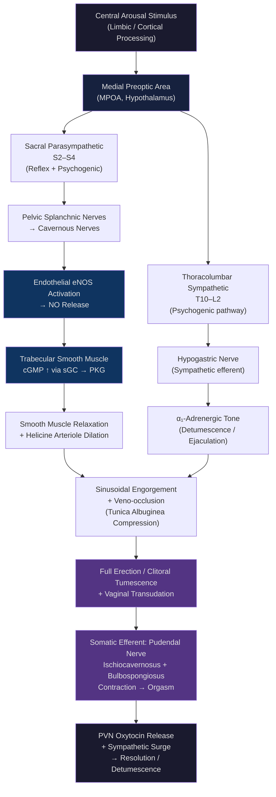

# Lesson 1: Sexual Anatomy, Physiology & the Sexual Response Cycle

## 1. First-Principles Intuition & Invariants

Human sexual function is not a behavior overlaid on a neutral body — it is a deeply integrated physiological system in which vascular tone, smooth muscle contractility, peripheral innervation, and central neuromodulation operate as a single coordinated network. To evaluate dysfunction clinically, the practitioner must first internalize the architecture of this network at every level: gross structural anatomy, the histological composition of erectile and glandular tissue, the autonomic and somatic neural pathways that modulate arousal, and the cascade of vasoactive signaling molecules that execute the hemodynamic work of engorgement, lubrication, and orgasm. Without this foundation, pharmacological or behavioral interventions rest on guesswork.

The central invariant governing sexual physiology is that arousal is fundamentally a neurovascular event. Whether one examines penile erection or clitoral tumescence, the proximate mechanism is the same: parasympathetically mediated release of nitric oxide (NO) triggers smooth muscle relaxation in helicine arterioles and trabecular sinusoids, dramatically increasing arterial inflow while simultaneously restricting venous outflow through compression of subtunical venules against the rigid tunica albuginea. The tissue architecture — the arrangement of sinusoidal spaces within a fibrous envelope — is the mechanical amplifier that converts a biochemical signal into a measurable pressure differential. Genital engorgement is therefore not simply increased blood flow; it is a pressure-trapping mechanism that depends on the mechanical compliance and tensile strength of surrounding connective tissue as much as on vascular tone.

A second invariant is that the sexual response cycle is a multi-axis phenomenon. Masters and Johnson's foundational four-phase model (excitement, plateau, orgasm, resolution) described observable physiological events — myotonia, vasocongestion, heart rate elevation, and muscular discharge — in terms of their sequence and intensity. What the model lacked was a motivational or psychological dimension, which Helen Singer Kaplan's triphasic model addressed by positioning *desire* as a discrete, CNS-mediated phase that precedes and gates the peripheral vascular response. Clinically, this distinction is not academic. A patient with intact vascular architecture but absent desire has a different diagnosis and treatment pathway than one with normal libido and compromised arterial inflow. The two models are therefore complementary rather than competing: Masters and Johnson map the peripheral mechanical sequence, while Kaplan situates that sequence within a motivational context governed by limbic and hypothalamic circuits.

The third invariant concerns sexual dimorphism in anatomy without dimorphism in fundamental mechanism. Male and female genital structures are developmentally homologous — the glans penis and clitoris share embryonic origin in the genital tubercle; the penile corpora cavernosa and clitoral crura are anatomically identical erectile bodies; the bulbospongiosus and ischiocavernosus muscles function symmetrically in both sexes during orgasm. This homology means that the physiological mechanisms of erection, engorgement, and climax operate on the same neurovascular logic across sexes, even though the gross anatomy distributes this tissue differently and the subjective experience of response may differ substantially.

---

## 2. Core Architecture & Mechanics

### Male Reproductive Anatomy: Structural and Histological Foundations

The penis consists of three cylindrical erectile bodies enclosed in a multilayered fascial system. The paired corpora cavernosa occupy the dorsolateral positions and are the primary erectile structures; the corpus spongiosum runs ventrally, surrounds the urethra, and expands distally into the glans. Each corpus cavernosum is encased in the tunica albuginea, a dense collagenous sheath whose outer longitudinal and inner circular fiber layers create the mechanical rigidity necessary for intracavernosal pressure to reach 100 mmHg or above during full erection. Within this sheath, the trabecular network of smooth muscle and collagen creates sinusoidal spaces whose caliber is the primary determinant of erectile capacity. In the flaccid state, trabecular smooth muscle is tonically contracted under α-adrenergic drive (predominantly norepinephrine acting on α₁-receptors), keeping sinusoidal spaces collapsed and arterial inflow minimal. At arousal, parasympathetic activation via the cavernous nerves (branches of the pelvic splanchnic nerves, S2–S4) releases acetylcholine, which stimulates endothelial nitric oxide synthase (eNOS) to produce NO. NO diffuses into trabecular smooth muscle cells, activates soluble guanylate cyclase, raises cyclic GMP (cGMP), and activates protein kinase G — ultimately phosphorylating myosin light-chain kinase and promoting smooth muscle relaxation. Helicine arterioles dilate, sinusoidal spaces expand, and rising intracavernosal pressure compresses the emissary veins against the tunica, completing the veno-occlusive mechanism.

Vasoactive intestinal polypeptide (VIP) acts as a co-transmitter alongside NO, contributing to smooth muscle relaxation through adenylyl cyclase-mediated cAMP elevation. Prostaglandin E₁ (the pharmacological basis for intracavernosal injection therapy) similarly increases cAMP. The clinical leverage point for phosphodiesterase type 5 (PDE5) inhibitors lies precisely in this cascade: sildenafil and tadalafil block cGMP degradation, amplifying and prolonging the smooth muscle relaxation signal when NO is present. They do not generate erection de novo; they lower the threshold.

The testis is organized around seminiferous tubules lined by Sertoli cells and spermatogenic epithelium, producing approximately 1,500 spermatozoa per second in a healthy adult male. Leydig cells in the interstitium secrete testosterone under LH stimulation, establishing the androgen milieu required for libido, spermatogenesis, and secondary sex characteristic maintenance. Sperm mature as they transit the epididymis over approximately 12 days, acquiring motility and the acrosomal enzymes necessary for fertilization. At ejaculation, seminal vesicles contribute fructose-rich alkaline fluid (approximately 65–70% of ejaculate volume), the prostate contributes zinc-rich, slightly acidic secretions (approximately 20–30%), and bulbourethral glands provide pre-ejaculatory mucus for urethral lubrication and pH buffering.

### Female Reproductive Anatomy: External, Internal, and Erectile Architecture

The clitoris is substantially larger than its external representation suggests. The visible glans is the distal tip of a wishbone-shaped structure whose shaft, crura, and vestibular bulbs extend internally, surrounding the vaginal introitus in a horseshoe configuration. The crura attach bilaterally to the ischiopubic rami; the vestibular bulbs flank the vaginal walls laterally. Total clitoral erectile tissue volume, by MRI measurement, averages 10–15 cm in length when the full internal structure is included. Histologically, this tissue is structurally identical to the penile corpora cavernosa: trabecular smooth muscle within a tunica albuginea, supplied by branches of the internal pudendal artery, and innervated by the dorsal nerve of the clitoris (a branch of the pudendal nerve carrying both somatic sensation from S2–S4 and sympathetic and parasympathetic fibers).

Clitoral engorgement follows the same NO-mediated veno-occlusive mechanism as penile erection. Vaginal lubrication, however, operates through a distinct mechanism: parasympathetic vasodilation produces a transudate that weeps through the vaginal epithelium — a plasma filtration process rather than active secretion. The Bartholin's glands (greater vestibular glands, homologous to the bulbourethral glands) contribute mucus at the introitus, particularly during sustained arousal, but account for a minority of total lubrication volume. The vaginal epithelium undergoes marked changes during the arousal-to-plateau transition: the rugose walls expand and elongate (vaginal tenting), the proximal two-thirds balloons outward, and the cervix and uterus elevate — a process Masters and Johnson termed *uterine tenting* — creating anatomical accommodation and altering the vaginal biochemical environment toward receptivity.

The uterus, ovaries, and fallopian tubes are served by the uterine artery (a branch of the internal iliac), with complex autonomic innervation from the hypogastric plexus mediating uterine contractility through the orgasmic phase and the first stage of parturition. The ovary undergoes cyclical folliculogenesis under FSH and LH, producing estradiol and progesterone in a precisely timed sequence that governs endometrial preparation, cervical mucus rheology, and importantly, central nervous system sensitization to sexual stimuli.

### Neural Architecture: Central and Peripheral Signal Pathways

Sexual arousal involves four levels of neural organization. At the spinal level, reflex erection and lubrication can be mediated through sacral parasympathetic centers (S2–S4) independent of supraspinal input — this is the physiological basis for reflex erections in patients with upper motor neuron spinal cord injuries. Psychogenic arousal, generated by cortical and limbic processing of visual, auditory, olfactory, or tactile stimuli, descends through thoracolumbar sympathetic pathways (T10–L2) and can modulate or override spinal reflex activity. The medial preoptic area (MPOA) of the hypothalamus functions as the primary integrating center for sexual motivation and behavioral output, receiving dopaminergic input from the mesolimbic system (desire amplification) and serotonergic modulation from the raphe nuclei (desire suppression — the clinical mechanism underlying SSRI-induced sexual dysfunction). The paraventricular nucleus of the hypothalamus coordinates oxytocin release during orgasm, contributing to post-climactic bonding and uterine contractility.

The following diagram maps the neurovascular signal architecture from central arousal stimulus to peripheral hemodynamic response.

### Masters & Johnson's Four-Phase Model and Kaplan's Triphasic Extension

Masters and Johnson, working from direct physiological measurement in the 1960s, identified four sequential phases. During **excitement**, vasocongestive changes begin within 10–30 seconds of effective stimulation: penile erection or clitoral engorgement, labial swelling, vaginal transudation, scrotal thickening, nipple erection, and an initial rise in heart rate and blood pressure. **Plateau** represents a consolidation and intensification of these changes: the coronal ridge deepens, the Cowper's glands emit pre-ejaculatory fluid, full vaginal tenting completes, the labia minora develop a deep vasocongestion termed the "sex skin" color change, and myotonia becomes generalized. During **orgasm**, the somatic arc fires: rhythmic contractions of the ischiocavernosus and bulbospongiosus muscles at approximately 0.8-second intervals produce the subjective experience of climax; in the male, emission (vas deferens and seminal vesicle contractions, coordinated by the hypogastric nerve) is followed by ejaculation (urethral striated muscle contractions under pudendal nerve control). Female orgasm involves equivalent pelvic floor contractile activity, uterine contractions, and in some individuals, expulsion of fluid from the paraurethral (Skene's) glands, whose histological similarity to the male prostate has been confirmed by PSA immunostaining. **Resolution** is a reversal of vasocongestion over minutes (women) to tens of minutes (men), with the male refractory period governed by central serotonergic and prolactin-mediated inhibition of further arousal.

Kaplan's triphasic model added **desire** as a prodromal phase governed by limbic dopaminergic circuits and androgen sensitivity (testosterone acting on androgen receptors in the MPOA). This reconceptualization has direct clinical consequence: hypoactive sexual desire disorder (HSDD) is classified as a failure at the desire phase with intact peripheral architecture, necessitating central rather than peripheral intervention.

---

## 3. High-Performance Optimization & Failure Modes

### Clinical Assessment: Mapping the Failure Point

The practitioner's primary diagnostic task is to localize dysfunction within the signal chain illustrated above. Erectile dysfunction (ED) stratifies mechanistically. Vasculogenic ED — the most common etiology, accounting for roughly 60–70% of cases — reflects impaired arterial inflow (most commonly atherosclerotic disease of the pudendal, penile, or cavernous arteries), or veno-occlusive failure (cavernosal fibrosis reducing sinusoidal compliance, or tunica albuginea weakness permitting premature venous egress). The penile-brachial index and penile Doppler ultrasonography with intracavernosal prostaglandin E₁ challenge (measuring peak systolic velocity ≥25 cm/s and end-diastolic velocity < 5 cm/s as thresholds for adequate arterial inflow and veno-occlusion respectively) are the primary hemodynamic tools for this differentiation.

Neurogenic ED arises from disruption anywhere in the described pathway: diabetic autonomic neuropathy damaging small-fiber cavernous nerve function, radical prostatectomy transecting the neurovascular bundles, or spinal cord injury interrupting supraspinal psychogenic pathways. Biothesiometry (vibration perception threshold at the glans) and bulbocavernosus reflex latency testing quantify peripheral somatic nerve integrity, while nocturnal penile tumescence testing (NPT via RigiScan) distinguishes psychogenic from organic causes by confirming reflex erections during REM sleep when psychogenic suppression is absent.

Female sexual dysfunction similarly stratifies. Genital arousal disorder involves impaired vasocongestion and lubrication, often secondary to estrogen deficiency causing atrophic vaginitis (reduced epithelial glycogen, altered microbiome, decreased transudation), peripheral neuropathy, or vascular insufficiency. Vaginal pH measurement (normal 3.8–4.5; rising above 5.0 in atrophy), Vulvar algesiometer testing for provoked vestibulodynia, and validated instruments such as the Female Sexual Function Index (FSFI) provide structured diagnostic scaffolding. Persistent genital arousal disorder (PGAD) represents the inverse failure mode: pathological vascular engorgement without subjective desire, frequently associated with pudendal nerve entrapment, spinal cord cysts at S2–S4, or restless leg syndrome pharmacology, illustrating that the vascular effector mechanism can be driven without central gating.

### Neurotransmitter Dysfunction and Pharmacological Levers

SSRI-induced sexual dysfunction is the most prevalent iatrogenic form encountered in clinical practice. Serotonin (5-HT₂ receptor activation in particular) suppresses dopaminergic firing in the MPOA, blunts spinal erectile reflexes, and delays or abolishes orgasm via central inhibition of the ejaculatory reflex arc. The clinical options range from dose reduction and timing adjustment (taking the SSRI dose after sexual activity) to augmentation with bupropion (dopamine/norepinephrine reuptake inhibitor that partially counteracts serotonergic suppression) or switching to agents with lower sexual side-effect profiles (mirtazapine, agomelatine). PDE5 inhibitors do not address SSRI-induced anorgasmia because the failure is central, not in the peripheral NO-cGMP cascade.

Testosterone deficiency, in both males and females, reduces hypothalamic androgen receptor activation in the MPOA, attenuating desire and reducing NO synthase expression in cavernosal tissue. Total and free testosterone measurement (with attention to SHBG levels that govern bioavailability), LH and FSH to differentiate primary from secondary hypogonadism, and prolactin to exclude prolactinoma are the first-line biochemical workup in patients presenting with low desire and fatigue. In postmenopausal women, the estrogen-to-androgen ratio is a particularly important clinical lever: vaginal estrogen therapy restores epithelial health and transudation capacity, while low-dose testosterone supplementation may be required to restore central desire.

### Aging, Comorbidity, and Structural Deterioration

Aging produces predictable architectural changes that the clinician must anticipate. In males over 50, progressive tunica albuginea fibrosis reduces sinusoidal compliance, requiring greater arterial inflow to achieve the same intracavernosal pressure. Cavernous nerve density declines. The refractory period extends substantially as central serotonergic and prolactin-mediated inhibition becomes more prominent after each ejaculation. Peyronie's disease — focal fibrotic plaque formation within the tunica albuginea — creates focal compliance failure, deforming the erection axis and causing painful curvature; this is fundamentally a connective tissue repair disorder triggered by repetitive microtrauma, with TGF-β1 and reactive oxygen species implicated in myofibroblast activation and collagen III deposition.

In females, the hypoestrogenic state of menopause reduces collagen content of the vaginal epithelium, decreases vascular density in the lamina propria, and raises vaginal pH, producing the genitourinary syndrome of menopause (GSM). Clitoral hood adhesion secondary to chronic inflammatory atrophy can physically restrict glans exposure and reduce accessible tactile surface area. Pelvic floor hypertonicity — frequently a consequence of vulvodynia, vaginismus, or chronic guarding pain responses — creates a failure mode in which voluntary muscular relaxation necessary for penetration and pleasurable orgasm is impaired. Pelvic floor physiotherapy targeting coordination of levator ani and superficial perineal muscles addresses this structural failure mode directly and is the first-line treatment for primary vaginismus.

---

## 4. Summary & Verification Matrix

| Domain | Governing Mechanism | Key Diagnostic Instrument | Primary Failure Mode | Clinical Intervention |
|---|---|---|---|---|
| **Genital Hemodynamics** | NO → cGMP → smooth muscle relaxation → veno-occlusion via tunica albuginea compression | Penile Doppler (PSV ≥25 cm/s; EDV < 5 cm/s post-PGE₁) | Vasculogenic ED: atherosclerotic inflow deficit or veno-occlusive failure from cavernosal fibrosis | PDE5 inhibitors (peripheral amplification); intracavernosal PGE₁; penile vascular surgery for selected arterial causes |
| **Neural Pathway Integrity** | Sacral parasympathetic (S2–S4) reflex arc + supraspinal psychogenic modulation via MPOA | Nocturnal penile tumescence (RigiScan); bulbocavernosus reflex latency; biothesiometry | Neurogenic ED: diabetic neuropathy, post-prostatectomy cavernous nerve injury, SCI | Nerve-sparing surgical technique; early post-operative PDE5 rehabilitation; vacuum erection devices |
| **Central Desire Phase** | Dopaminergic MPOA activation gated by limbic circuitry and androgen receptor sensitivity | FSFI or IIEF desire subscales; total/free testosterone; prolactin; LH/FSH | HSDD: serotonergic suppression (SSRI), hyperprolactinemia, hypogonadism | SSRI switch/dose adjustment; bupropion augmentation; testosterone therapy (male and female); cabergoline for prolactinoma |
| **Response Cycle Staging** | Masters & Johnson four phases (excitement → plateau → orgasm → resolution) + Kaplan desire prodrome | Clinical history with phase-specific timing and subjective-objective concordance | Phase-specific dissociation: desire intact but arousal absent (vascular/neural); arousal intact but orgasm absent (central inhibition, neuropathy) | Phase-localized diagnosis guides peripheral vs. central intervention selection |
| **Female Genital Architecture** | Clitoral NO-mediated veno-occlusion; vaginal transudation via parasympathetic vasodilation; pelvic floor contractile discharge at orgasm | FSFI; vaginal pH; vulvoscopy for atrophy/adhesion; pelvic floor EMG | GSM (atrophic transudation failure); pelvic floor hypertonicity (vaginismus); PGAD (unregulated engorgement) | Topical/systemic estrogen; pelvic floor physiotherapy; pudendal nerve block for PGAD |
| **Structural Connective Tissue** | Tunica albuginea tensile integrity enabling intracavernosal pressure amplification; collagen remodeling under estrogen and androgen influence | Penile ultrasound for Peyronie's plaque; MRI for fibrosis extent; hormonal panel | Peyronie's disease (focal fibrosis → deformity); menopause-associated vaginal collagen loss; tunica aging fibrosis reducing compliance | Intralesional collagenase (Peyronie's); penile prosthesis for refractory fibrosis; vaginal estrogen + ospemifene for GSM |
