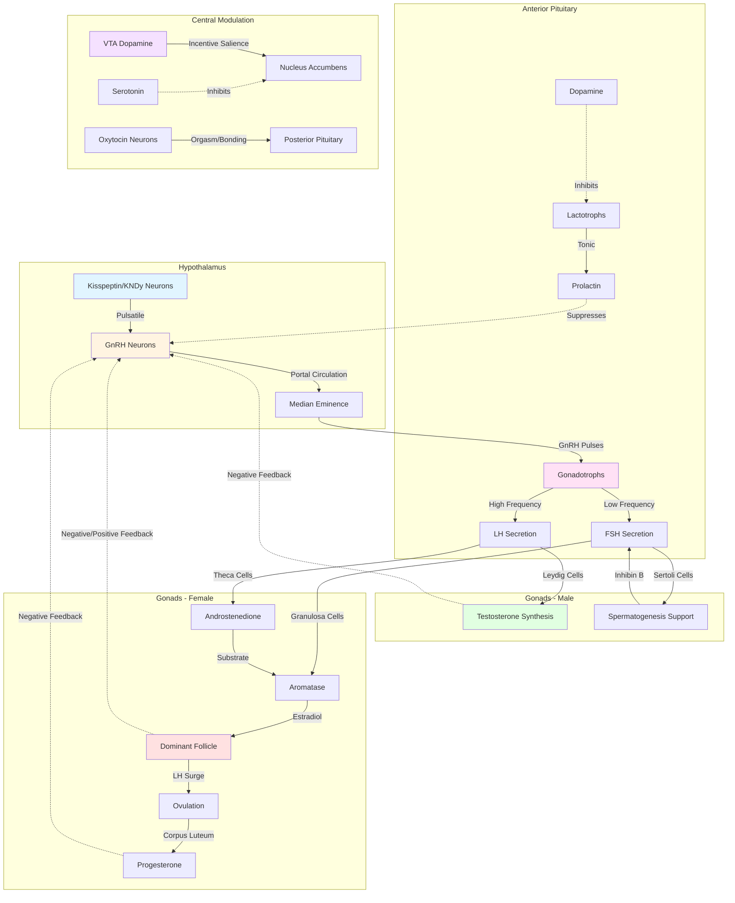

# Lesson 2: Neuroendocrine Regulation of Sexual Function

## 1. First-Principles Intuition & Invariants

Sexual function in humans emerges from a precisely orchestrated hierarchy of neuroendocrine control systems that span hypothalamic pulse generators, anterior pituitary hormone secretion, peripheral gonadal steroidogenesis, and centrally mediated behavioral drive circuits. The architecture resembles a multi-tiered feedback amplifier in which the hypothalamus generates a low-amplitude, high-frequency pulsatile signal—gonadotropin-releasing hormone (GnRH)—that is transformed by the anterior pituitary into secondary messengers, luteinizing hormone (LH) and follicle-stimulating hormone (FSH), which in turn command the gonads to synthesize sex steroids and produce gametes. These sex steroids exert both negative and positive feedback regulation on the hypothalamic-pituitary axis, modulating pulse frequency and amplitude, while simultaneously acting on peripheral tissues to drive secondary sexual characteristics, libido, and reproductive readiness.

The fundamental invariant governing this system is pulsatility. GnRH neurons in the arcuate nucleus and preoptic area of the hypothalamus do not secrete continuously but instead discharge in synchronized bursts every sixty to ninety minutes, a rhythm that is absolutely required for normal gonadotropin secretion. Continuous GnRH exposure paradoxically downregulates pituitary GnRH receptors and suppresses LH and FSH release, a principle exploited clinically in the use of GnRH agonists for hormone-sensitive cancers and precocious puberty. The pulse generator is itself modulated by kisspeptin neurons, which integrate metabolic signals from leptin, ghrelin, and insulin, as well as photoperiodic input from the suprachiasmatic nucleus. This ensures that reproductive function is suppressed under conditions of energy insufficiency, chronic stress, or inappropriate developmental timing.

At the gonadal level, LH and FSH bind to G-protein-coupled receptors on Leydig cells and ovarian theca cells (LH receptors) or Sertoli cells and granulosa cells (FSH receptors), activating adenylyl cyclase and driving cyclic AMP-dependent protein kinase A pathways. LH stimulates the synthesis of testosterone in Leydig cells via upregulation of cholesterol side-chain cleavage enzyme (CYP11A1) and subsequent steroidogenic enzymes including 17α-hydroxylase (CYP17A1). Testosterone serves as the obligate precursor for estradiol synthesis in granulosa cells, where aromatase (CYP19A1) catalyzes the conversion of androgens to estrogens. In males, approximately 5% of circulating testosterone is converted peripherally to dihydrotestosterone (DHT) by 5α-reductase, a more potent androgen that mediates prostate growth, male-pattern hair distribution, and external genital differentiation during development.

Estradiol and testosterone exert genomic effects through intracellular nuclear receptors—estrogen receptor alpha (ERα) and beta (ERβ), and androgen receptor (AR)—that function as ligand-activated transcription factors. Upon steroid binding, these receptors dimerize, translocate to the nucleus, bind to specific DNA response elements (estrogen response elements or androgen response elements), and recruit coactivator complexes to modulate transcription of target genes involved in cellular differentiation, metabolism, and neurotransmitter receptor expression. Non-genomic effects occur within minutes through membrane-associated steroid receptors and second-messenger pathways, influencing neuronal excitability, neurotransmitter release, and rapid behavioral changes.

Sexual motivation and arousal are centrally regulated by dopaminergic projections from the ventral tegmental area to the nucleus accumbens and medial preoptic area, circuits that encode incentive salience and reward prediction. Dopamine agonists enhance libido, whereas dopamine antagonists (typical antipsychotics) and serotonin reuptake inhibitors frequently cause sexual dysfunction by increasing prolactin and dampening dopaminergic tone. Prolactin, secreted by lactotroph cells of the anterior pituitary, is unique among pituitary hormones in being under tonic inhibitory control by hypothalamic dopamine via the tuberoinfundibular pathway. Hyperprolactinemia—whether from prolactinoma, dopamine antagonist use, or primary hypothyroidism—suppresses GnRH pulsatility and directly inhibits gonadotropin secretion, leading to hypogonadism, reduced libido, and infertility.

Oxytocin and vasopressin, synthesized in the paraventricular and supraoptic nuclei and released from the posterior pituitary, modulate pair bonding, orgasmic response, and uterine contractility during parturition. Oxytocin receptors in the brain facilitate affiliative behavior and social reward processing, while peripheral oxytocin triggers myometrial and myoepithelial contractions. Orgasm in both sexes is associated with pulsatile oxytocin release and activation of the mesolimbic dopamine system, generating the subjective experience of pleasure and reinforcing sexual behavior.

## 2. Core Architecture & Mechanics

The hypothalamic-pituitary-gonadal (HPG) axis operates as a three-tiered endocrine cascade with nested feedback loops at each level. The hypothalamic tier consists of approximately 1,500 to 3,000 GnRH neurons clustered in the arcuate nucleus and preoptic area. These neurons project axons to the median eminence, where GnRH is secreted into the hypophyseal portal circulation, a specialized vascular plexus that delivers hypothalamic releasing hormones directly to the anterior pituitary without systemic dilution. GnRH pulse frequency and amplitude are dynamically regulated: high-frequency pulses (every sixty minutes) favor LH secretion, while lower-frequency pulses (every two to three hours) preferentially drive FSH release. This frequency-dependent decoding allows differential control of Leydig cell steroidogenesis versus Sertoli cell spermatogenesis or granulosa cell folliculogenesis.

Kisspeptin neurons, coexpressing neurokinin B and dynorphin (collectively termed KNDy neurons in the arcuate nucleus), function as the master regulators of GnRH pulse generation. Neurokinin B acts on NK3 receptors in an autocrine/paracrine manner to synchronize KNDy neuron firing, while dynorphin provides negative feedback via kappa-opioid receptors to terminate each pulse. Kisspeptin itself binds to GPR54 (KISS1R) on GnRH neurons, providing the excitatory drive necessary for GnRH release. Mutations in KISS1 or KISS1R result in isolated hypogonadotropic hypogonadism with absent puberty, underscoring the obligate role of kisspeptin signaling in reproductive axis activation.

At the anterior pituitary, GnRH binds to GnRH receptors on gonadotroph cells, activating Gq-coupled phospholipase C pathways that mobilize intracellular calcium and trigger exocytosis of LH and FSH. LH is a heterodimeric glycoprotein consisting of a common α-subunit (shared with FSH, TSH, and hCG) and a hormone-specific β-subunit. FSH shares this structural motif. Both hormones circulate with half-lives of approximately thirty minutes for LH and three to four hours for FSH, accounting for the pulsatile profile of LH in serum and the more stable FSH baseline.

In males, LH stimulates Leydig cells to convert cholesterol to pregnenolone within mitochondria via CYP11A1, followed by sequential enzymatic steps: pregnenolone is hydroxylated by 3β-hydroxysteroid dehydrogenase (3β-HSD) to progesterone, then by CYP17A1 (17α-hydroxylase/17,20-lyase) to androstenedione, and finally reduced by 17β-hydroxysteroid dehydrogenase (17β-HSD) to testosterone. Intratesticular testosterone concentrations reach 100-fold higher levels than systemic circulation, bathing Sertoli cells and germ cells in a high-androgen microenvironment essential for spermatogenesis. FSH binds to Sertoli cell FSH receptors, upregulating androgen-binding protein (ABP) and aromatase, supporting germ cell maturation and local estradiol synthesis. Inhibin B, secreted by Sertoli cells in response to FSH, exerts selective negative feedback on pituitary FSH secretion without affecting LH.

In females, the ovarian cycle is divided into follicular and luteal phases, each with distinct hormonal profiles. During the early follicular phase, rising FSH stimulates granulosa cell proliferation and estradiol synthesis. Theca cells, under LH stimulation, produce androstenedione, which diffuses to granulosa cells where aromatase converts it to estradiol—this two-cell, two-gonadotropin model is fundamental to ovarian steroidogenesis. As the dominant follicle matures, rising estradiol initially exerts negative feedback on the hypothalamus and pituitary, suppressing FSH and preventing multifollicular development. When estradiol exceeds a threshold of approximately 200 pg/mL for more than 48 hours, it switches to positive feedback, triggering the mid-cycle LH surge that induces ovulation. Post-ovulation, the ruptured follicle transforms into the corpus luteum, which secretes progesterone and estradiol during the luteal phase. Progesterone maintains endometrial secretory transformation and exerts negative feedback on GnRH pulse frequency, preventing additional LH surges.

Prolactin is constitutively secreted by lactotrophs and held in check by dopamine released from tuberoinfundibular neurons that project to the median eminence. Dopamine binds to D2 receptors on lactotrophs, activating inhibitory Gi pathways that suppress prolactin gene transcription and exocytosis. Thyrotropin-releasing hormone (TRH), vasoactive intestinal peptide (VIP), and estrogen can stimulate prolactin release, explaining the hyperprolactinemia seen in primary hypothyroidism and pregnancy. Elevated prolactin suppresses GnRH pulse frequency, reduces gonadotroph responsiveness to GnRH, and directly inhibits gonadal steroidogenesis, manifesting clinically as oligomenorrhea, anovulation, erectile dysfunction, and reduced libido.

Testosterone and estradiol cross the blood-brain barrier and bind to androgen and estrogen receptors distributed throughout limbic structures, including the amygdala, hippocampus, medial preoptic area, and ventromedial hypothalamus. In males, testosterone is locally converted to estradiol by neuronal aromatase, and both hormones contribute to libido and sexual behavior through complementary mechanisms. Androgen receptors in the medial preoptic area are critical for copulatory behavior, while estrogen receptors modulate reward circuitry and emotional valence. In females, estradiol enhances sexual receptivity and incentive motivation during the periovulatory phase, coordinating reproductive behavior with peak fertility.

Dopaminergic tone is the primary driver of sexual desire and motivation. Dopamine release in the nucleus accumbens encodes reward anticipation and reinforces approach behavior. Drugs that enhance dopaminergic signaling—such as bupropion, pramipexole, and apomorphine—can restore libido in patients with dopamine-deficient states (Parkinson disease, depression). Conversely, serotonin has a predominantly inhibitory effect on sexual function, mediated by 5-HT2A and 5-HT2C receptors in the prefrontal cortex and hypothalamus. Selective serotonin reuptake inhibitors (SSRIs) elevate synaptic serotonin and commonly cause delayed orgasm, anorgasmia, and reduced libido. The ratio of dopamine to serotonin activity sets the threshold for sexual arousal and orgasmic latency.

Orgasm involves coordinated activation of autonomic, somatic, and neuroendocrine pathways. Sympathetic outflow triggers emission of seminal fluid into the posterior urethra in males, while rhythmic contractions of the bulbospongiosus and ischiocavernosus muscles generate the expulsive phase of ejaculation. In females, uterine and pelvic floor contractions occur at 0.8-second intervals. Central oxytocin release during orgasm activates reward circuitry and facilitates pair bonding. The post-orgasmic refractory period in males is mediated by prolactin release and opioid peptide signaling, which inhibit dopaminergic tone and suppress arousal.

## 3. High-Performance Optimization & Failure Modes

Clinical optimization of neuroendocrine sexual function begins with rigorous diagnostic characterization of the HPG axis using timed serum hormone measurements, provocative testing, and imaging. In males presenting with low libido or erectile dysfunction, morning total testosterone (drawn between 0700 and 1000 hours to capture the diurnal peak) below 300 ng/dL warrants further evaluation. If confirmed on repeat testing, simultaneous measurement of LH and FSH distinguishes primary hypogonadism (elevated gonadotropins, testicular failure) from secondary hypogonadism (low or inappropriately normal gonadotropins, hypothalamic-pituitary dysfunction). Prolactin should be measured in all cases of hypogonadotropic hypogonadism, as even modest hyperprolactinemia (greater than 20 ng/mL) can suppress GnRH pulsatility. Macroprolactinemia, a benign laboratory artifact caused by prolactin-IgG complexes, can be excluded by polyethylene glycol precipitation.

In females with oligomenorrhea or anovulation, day-3 FSH and estradiol provide a window into ovarian reserve and hypothalamic-pituitary responsiveness. An elevated day-3 FSH (greater than 10-15 IU/L) with low estradiol suggests diminished ovarian reserve, whereas low FSH with low estradiol indicates hypothalamic amenorrhea due to energy deficit, stress, or hyperprolactinemia. Polycystic ovary syndrome (PCOS), the most common endocrine cause of anovulation, presents with elevated LH-to-FSH ratio (often greater than 2:1), hyperandrogenemia (elevated free testosterone or dehydroepiandrosterone sulfate), and insulin resistance. GnRH stimulation testing, though rarely performed outside research protocols, reveals exaggerated LH responses and blunted FSH responses in PCOS, reflecting increased GnRH pulse frequency.

Pharmacological optimization of GnRH pulsatility is achieved through pulsatile GnRH pump therapy, delivered subcutaneously every ninety minutes via programmable infusion device. This approach mimics physiological pulsatility and is highly effective in restoring fertility in patients with idiopathic hypogonadotropic hypogonadism or hypothalamic amenorrhea. Alternatively, exogenous gonadotropin therapy with recombinant FSH and human chorionic gonadotropin (hCG, which acts as an LH analog) bypasses the hypothalamic-pituitary tier and directly stimulates the gonads. Dosing typically begins with 75-150 IU of recombinant FSH administered subcutaneously three times weekly, titrated based on ultrasound follicle tracking and estradiol monitoring in females or semen analysis in males.

Testosterone replacement therapy (TRT) in males with confirmed hypogonadism restores libido, erectile function, muscle mass, and bone density. Transdermal testosterone gel (50-100 mg daily) provides stable serum levels and avoids supraphysiological peaks, while intramuscular testosterone enanthate or cypionate (100-200 mg every one to two weeks) is more cost-effective but produces oscillating serum concentrations. Target trough testosterone should be 400-700 ng/dL. Aromatase inhibitors such as anastrozole (0.5 mg twice weekly) can be added if excessive aromatization to estradiol occurs, manifesting as gynecomastia or emotional lability. TRT suppresses endogenous LH and FSH secretion via negative feedback, leading to testicular atrophy and infertility; men desiring fertility preservation should receive hCG monotherapy (1,500-2,000 IU subcutaneously three times weekly) to maintain intratesticular testosterone without suppressing gonadotropins.

Hyperprolactinemia is treated with dopamine agonists. Cabergoline (0.25-1.0 mg twice weekly) is preferred over bromocriptine due to superior tolerability, longer half-life, and greater efficacy in normalizing prolactin and shrinking prolactinomas. Cabergoline selectively binds to D2 receptors on lactotrophs, restoring dopaminergic inhibition. Prolactin normalization typically restores GnRH pulsatility within weeks, with resumption of menses and spermatogenesis. High-dose cabergoline (greater than 3 mg per week) has been associated with cardiac valvulopathy in Parkinson disease patients, though this risk appears minimal at doses used for hyperprolactinemia.

SSRI-induced sexual dysfunction affects 40-65% of patients and represents a major barrier to antidepressant adherence. Mechanistic strategies include dose reduction, drug holidays (skipping doses before anticipated sexual activity), or switching to antidepressants with minimal serotonergic effects such as bupropion (a norepinephrine-dopamine reuptake inhibitor) or mirtazapine (which blocks 5-HT2A and 5-HT2C receptors). Adjunctive bupropion (150-300 mg daily) added to an SSRI can partially restore dopaminergic tone and improve libido and orgasmic function. Sildenafil and other phosphodiesterase-5 inhibitors address erectile dysfunction but do not reverse central libido suppression. Buspirone, a 5-HT1A partial agonist (15-60 mg daily), has shown modest efficacy in mitigating SSRI-induced sexual dysfunction, likely through presynaptic inhibition of serotonin release.

Failure modes of the HPG axis are often multifactorial. Hypothalamic amenorrhea in female athletes or individuals with anorexia nervosa results from energy deficit activating metabolic checkpoints that suppress kisspeptin neuron activity. Leptin, secreted by adipocytes in proportion to fat mass, normally stimulates kisspeptin neurons; low leptin during energy insufficiency removes this permissive signal, halting GnRH pulsatility. Restoration requires weight gain and normalization of energy availability (greater than 30 kcal per kg fat-free mass per day), though recovery may lag months behind metabolic improvement. Opioid-induced hypogonadism occurs through direct suppression of GnRH pulse frequency by μ-opioid receptor activation in the hypothalamus. Chronic opioid users universally develop low testosterone and require either opioid dose reduction or TRT.

Age-related decline in testosterone begins in the fourth decade in males, with an average decrease of 1-2% per year. This reflects combined primary (Leydig cell senescence, reduced testicular blood flow) and secondary (attenuated GnRH pulse amplitude, increased aromatase activity in adipose tissue) mechanisms. Late-onset hypogonadism presents with decreased libido, fatigue, reduced muscle mass, and increased visceral adiposity. TRT improves these symptoms but must be balanced against potential risks including polycythemia (erythropoietin stimulation), worsening obstructive sleep apnea, and acceleration of subclinical prostate cancer. Baseline prostate-specific antigen (PSA) and hematocrit should be monitored every three to six months during the first year of TRT.

## 4. Summary & Verification Matrix

| Invariant/Mechanism | Physiological Basis | Diagnostic Criterion | Failure Mode |
|---------------------|---------------------|----------------------|--------------|
| **GnRH Pulsatility** | Synchronized KNDy neuron bursts every 60-90 minutes drive LH/FSH secretion; continuous GnRH downregulates receptors and suppresses gonadotropins. High-frequency pulses favor LH; low-frequency favor FSH. | Pulsatile LH in serum (8-12 pulses per 24 hours in males); peak LH amplitude 5-15 IU/L. GnRH stimulation test: LH rises 3-5 fold at 30-60 minutes in normal axis. | Hypothalamic amenorrhea (energy deficit, stress) suppresses pulse frequency to less than 1 per 4 hours, causing anovulation. Continuous GnRH agonist therapy paradoxically suppresses LH/FSH, used clinically for prostate cancer and precocious puberty. |
| **Gonadal Steroidogenesis** | LH stimulates Leydig/theca cells via cAMP-PKA to produce testosterone/androstenedione through CYP11A1, CYP17A1, 17β-HSD. FSH stimulates Sertoli/granulosa cells to upregulate aromatase, converting androgens to estradiol. Two-cell, two-gonadotropin model in ovary. | Morning testosterone 300-1,000 ng/dL in males; day-3 estradiol 25-75 pg/mL in females. Free testosterone by equilibrium dialysis or calculated from SHBG more accurate than total testosterone when SHBG altered (obesity, hyperthyroidism). | Primary hypogonadism (Klinefelter, chemotherapy) shows elevated LH/FSH with low testosterone. Secondary hypogonadism (pituitary adenoma, hemochromatosis) shows low LH/FSH with low testosterone. Aromatase excess syndrome causes gynecomastia with elevated estradiol. |
| **Sex Steroid Feedback** | Testosterone and estradiol exert negative feedback on hypothalamic GnRH pulse frequency and pituitary gonadotropin secretion via nuclear receptors (AR, ERα). High sustained estradiol (greater than 200 pg/mL for 48 hours) switches to positive feedback in females, triggering LH surge and ovulation. Progesterone slows GnRH pulse frequency. | LH suppression to less than 0.5 IU/L with exogenous testosterone replacement. Mid-cycle LH surge peaks at 25-100 IU/L at day 12-14 of menstrual cycle. Luteal progesterone greater than 3 ng/mL confirms ovulation. | Exogenous testosterone or anabolic steroids suppress LH/FSH, causing testicular atrophy and azoospermia. Estrogen-secreting tumors or aromatase inhibitor failure can disrupt ovulatory LH surge. PCOS shows loss of progesterone negative feedback, maintaining high GnRH pulse frequency and elevated LH-to-FSH ratio. |
| **Prolactin-Dopamine Control** | Tuberoinfundibular dopamine tonically inhibits lactotroph prolactin secretion via D2 receptors and Gi signaling. TRH, VIP, estrogen stimulate prolactin. Prolactin suppresses GnRH pulse frequency and directly inhibits gonadal steroidogenesis. | Serum prolactin less than 20 ng/mL in non-pregnant adults. Macroprolactinemia ruled out by PEG precipitation. MRI sella for prolactin greater than 100 ng/mL to identify prolactinoma. | Dopamine antagonists (antipsychotics, metoclopramide) and pituitary stalk compression (non-secretory macroadenomas) disinhibit prolactin, causing hyperprolactinemia, hypogonadism, and galactorrhea. Primary hypothyroidism raises TRH, stimulating prolactin. Cabergoline (D2 agonist) normalizes prolactin and restores fertility. |
| **Central Dopaminergic Libido Regulation** | VTA dopamine projections to nucleus accumbens encode reward prediction and sexual motivation. Testosterone and estradiol upregulate dopamine receptor expression in limbic circuits. Serotonin (5-HT2A, 5-HT2C) exerts inhibitory modulation of sexual arousal and prolongs orgasmic latency. | Clinical assessment via validated questionnaires (FSFI, IIEF). Functional MRI shows nucleus accumbens activation during erotic stimuli in healthy libido. | SSRIs elevate serotonin, suppressing dopaminergic tone and causing anorgasmia, delayed ejaculation, reduced libido in 40-65% of patients. Parkinson disease dopamine depletion causes hypoactive sexual desire. Dopamine agonists (bupropion, pramipexole) restore libido; 5-HT1A agonists (buspirone) partially reverse SSRI dysfunction. |
| **Oxytocin and Orgasmic Response** | Paraventricular nucleus oxytocin neurons project to posterior pituitary (peripheral release) and mesolimbic reward circuitry (central release). Orgasm triggers pulsatile oxytocin secretion every 0.8 seconds, activating nucleus accumbens and facilitating pair bonding. Peripheral oxytocin induces genital smooth muscle contractions. | Plasma oxytocin rises 3-5 fold during orgasm, peaking at 100-150 pg/mL. Central receptor occupancy assessed via PET ligand binding studies (research setting only). Clinical orgasmic function assessed via FSFI/IIEF orgasm domain scores. | Oxytocin receptor polymorphisms (rs53576) associate with reduced pair bonding and sexual satisfaction. Prolactin surge post-orgasm (2-3 fold baseline) mediates refractory period via dopamine inhibition and opioid peptide release. Anorgasmia in SSRI users reflects serotonin-mediated suppression of oxytocin neuron excitability. |
