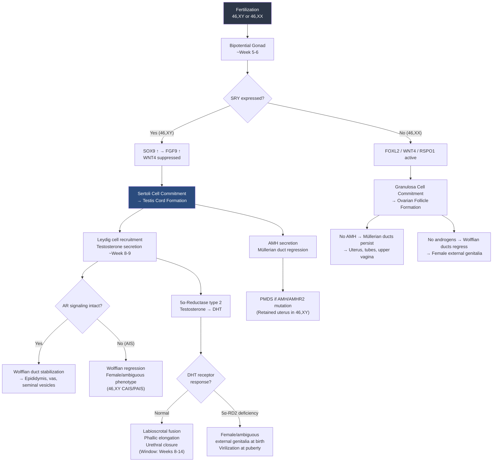

# Lesson 3: Sexual Development, Differentiation, and Variations in Sex Characteristics

## 1. First-Principles Intuition & Invariants

Human sexual development is not a single event but a cascade of overlapping, partially redundant biological decisions that unfold across embryogenesis, fetal life, neonatal transition, and puberty. The clinical intuition required to manage patients with disorders of sex development (DSD) rests on understanding that sex is determined at three distinct but interdependent levels: chromosomal sex, established at fertilization; gonadal sex, established by week 7 of gestation through transcriptional cascades; and phenotypic sex, the downstream product of gonadal hormone secretion acting on target tissues across a precisely timed developmental window. A disruption at any single level does not reliably predict what will happen at subsequent levels, because each transition is independently regulated. This is the first and most important invariant a clinician must internalize: the three tiers of sex determination are linked probabilistically, not deterministically.

The default developmental trajectory of the human embryo, in the absence of active molecular signaling, is female. This is not a normative claim but a mechanistic one. The bipotential gonad, the undifferentiated genital ridge present in every embryo at approximately five weeks of gestation, requires a specific, time-sensitive transcriptional trigger to commit to a testicular fate. Without that trigger, ovarian differentiation proceeds. Simultaneously, the internal duct system follows the same logic: the Müllerian ducts, which will become the uterus, fallopian tubes, and upper vagina, persist and develop unless they are actively suppressed by anti-Müllerian hormone (AMH), also called Müllerian inhibiting substance (MIS). The Wolffian ducts, which give rise to the epididymis, vas deferens, and seminal vesicles, require sustained androgen stimulation to stabilize; in its absence, they regress. The external genitalia begin in a neutral, undifferentiated state and masculinize only under the influence of dihydrotestosterone (DHT), a 5α-reductase-derived androgen. Nature's default trajectory, in the mechanistic sense, is therefore female phenotype in the absence of a functioning testis-determining axis.

The key invariants the practitioner must hold simultaneously are these. First, chromosomal sex (most commonly 46,XX or 46,XY) establishes the initial conditions but does not itself directly produce phenotype; it does so through the gonad. Second, the SRY gene on the Y chromosome is the master switch for testicular determination, but SRY alone is insufficient; it functions as a transcriptional activator within a gene regulatory network that includes SOX9, FGF9, DMRT1, and several others. Third, androgens act on target tissues through the androgen receptor (AR), and the biological effect of androgens depends entirely on the number, binding affinity, and downstream signaling integrity of these receptors, not simply on circulating hormone concentration. A patient with complete androgen insensitivity syndrome (CAIS) may have higher circulating testosterone than the population average for males, yet present with a fully female external phenotype, because the receptor is non-functional. Fourth, psychosexual development, including gender identity, gender role behavior, and sexual orientation, is shaped by a combination of prenatal hormone exposure, postnatal social environment, and neurobiological factors whose relative contributions remain an active area of research. The practitioner's clinical responsibility is to treat the whole person across all these dimensions, not to reduce them to a karyotype.

---

## 2. Core Architecture & Mechanics

### The SRY Gene and the Testis-Determining Transcriptional Cascade

At the center of gonadal sex determination sits SRY (sex-determining region Y), a gene encoding a high-mobility group (HMG) box transcription factor. SRY is expressed in the somatic cells of the bipotential gonad, now known to be the supporting cell precursors, beginning around week 6 of human gestation. Its primary molecular action is to bind a specific DNA sequence motif, induce a sharp bend in the double helix at that site, and thereby activate transcription of SOX9, a related HMG-box factor that is the true effector of Sertoli cell fate. The SRY-to-SOX9 transition is the critical decision point: once SOX9 expression exceeds a threshold in supporting cell precursors, it engages a self-reinforcing feedforward loop. SOX9 activates FGF9, which suppresses the pro-ovarian WNT4/RSPO1/β-catenin pathway, and in turn promotes further SOX9 expression. This bistable switch commits the supporting cell lineage irreversibly to Sertoli cell fate, initiating formation of testis cords.

The Sertoli cells then orchestrate the remainder of testicular organogenesis. They secrete AMH within days of commitment, initiating Müllerian duct regression. Simultaneously, Sertoli cell paracrine signaling recruits steroidogenic Leydig cell precursors, which under the stimulation of placental hCG (and later fetal pituitary LH) begin secreting testosterone by approximately week 8 to 9 of gestation. This testosterone is the primary virilizing hormone for the Wolffian ducts, which are exquisitely sensitive because androgen receptors are expressed at high density in their mesenchymal walls. Critically, DHT, produced locally in genital skin and urogenital sinus by 5α-reductase type 2, drives external genitalia masculinization: labioscrotal fusion, phallic elongation, and urethral closure. The window for this masculinization of external genitalia closes by approximately 12 to 14 weeks of gestation; after that point, androgens can cause clitoromegaly but cannot achieve complete labioscrotal fusion.

In the 46,XX gonad without SRY, the pro-ovarian pathway is not suppressed. FOXL2 and the WNT4/RSPO1 axis maintain the supporting cell precursors as granulosa cell precursors, and oogonia proceed through the first stages of meiosis in the second trimester. Without AMH, Müllerian ducts develop fully. Without androgens, Wolffian ducts regress, and the external genitalia remain in the female configuration. The ovary is therefore not simply the absence of testis function; FOXL2 and WNT4/RSPO1 are active molecular gatekeepers that must be maintained not only during fetal life but throughout adulthood to prevent transdifferentiation of granulosa cells into Sertoli-like cells, as elegant mouse knockout experiments have demonstrated.

### Duct Differentiation: Müllerian and Wolffian Systems

The internal duct systems present a clinically important case of parallel, mutually exclusive developmental pathways. Both Müllerian and Wolffian ducts are present simultaneously in every embryo from approximately week 5 to week 8, constituting the period of maximal developmental ambiguity. The Müllerian ducts, also called paramesonephric ducts, arise from coelomic epithelium lateral to the mesonephric (Wolffian) ducts and extend caudally to fuse at the urogenital sinus, forming the uterovaginal primordium. Wolffian ducts, the mesonephric ducts, run medially and are the conduit for urine from the mesonephric kidney before the definitive metanephric kidney becomes functional. Their fate in males is transformation into the epididymis, vas deferens, seminal vesicles, and ejaculatory duct under sustained testosterone signaling; their fate in females is complete regression because estrogens do not maintain them.

AMH secreted by fetal Sertoli cells binds to AMH receptor II (AMHR2), a serine/threonine kinase receptor expressed specifically on Müllerian duct mesenchyme. Downstream SMAD signaling causes programmed apoptosis of Müllerian duct epithelium over a proximal-to-distal wave, completing regression by approximately week 9 to 10 in male fetuses. A clinical consequence of partial AMH signaling failure, whether from AMH gene mutations or AMHR2 mutations, is persistent Müllerian duct syndrome (PMDS), where a 46,XY individual with otherwise fully masculinized external genitalia harbors a uterus and fallopian tubes, typically discovered incidentally during hernia repair or orchidopexy.

### Androgen Receptor Signaling Architecture

The androgen receptor (AR) is a member of the nuclear receptor superfamily, encoded on the X chromosome at Xq11-12. Its domain structure comprises an N-terminal transactivation domain (NTD), a central DNA-binding domain (DBD) with two zinc-finger motifs, a hinge region, and a C-terminal ligand-binding domain (LBD). In the cytoplasm, AR is held in an inactive configuration by a chaperone complex including HSP90 and HSP70. When testosterone or DHT enters the cell and binds the LBD, the chaperone complex dissociates, the receptor undergoes conformational change, dimerizes, and translocates to the nucleus. There, the DBD binds androgen response elements (AREs) in target gene promoters, recruiting co-activators and driving transcription of genes governing Wolffian duct stabilization, penile and scrotal development, descent of the testes, and pubertal virilization. Because AR is X-linked, 46,XY individuals have a single copy, and loss-of-function mutations produce complete or partial androgen insensitivity syndrome (CAIS or PAIS) with no possibility of compensation from a second allele.

The following diagram illustrates the core developmental signaling architecture from chromosomal sex through gonadal commitment to phenotypic output, including the principal DSD failure nodes.

