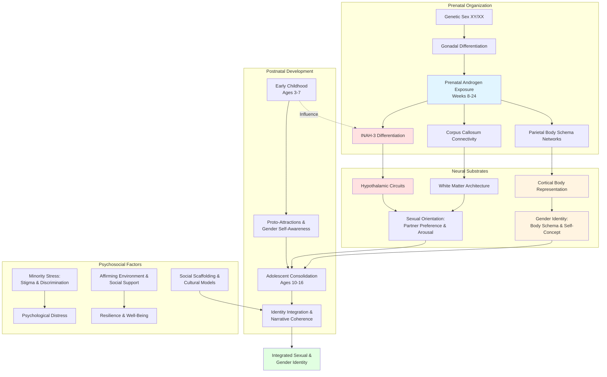

# Lesson 4: Sexual Orientation, Gender Identity, Psychosexual Theory

## 1. First-Principles Intuition & Invariants

Human sexuality operates as an emergent biopsychosocial system whose architecture cannot be reduced to a single axis of biological determinism or cultural construction alone. Sexual orientation—the enduring pattern of romantic, emotional, and sexual attraction to individuals of particular genders—and gender identity—the deeply held internal sense of being male, female, both, neither, or somewhere along a spectrum—arise from the coordinated interplay of prenatal hormonal environments, postnatal neuroanatomical differentiation, epigenetic modulation, social scaffolding, and individual cognitive-affective processing. Contemporary medical practice demands a depathologized, affirming clinical framework that recognizes these dimensions as natural variants of human diversity rather than disorders requiring correction, while simultaneously maintaining diagnostic precision for gender dysphoria when the incongruence between assigned sex and experienced gender identity produces clinically significant distress or functional impairment.

The foundational invariant underlying all modern clinical approaches is that sexual orientation and gender identity are neither volitional choices nor psychiatric pathologies amenable to conversion or reparative interventions. Decades of systematic research across neuroscience, endocrinology, behavioral genetics, and developmental psychology converge on a model where sexual orientation crystallizes during prenatal and early postnatal critical periods through organizational effects of sex hormones on neural circuitry, particularly within hypothalamic nuclei, amygdala, and prefrontal regions governing salience attribution, mate preference, and self-concept. Gender identity formation follows a parallel but partially dissociable trajectory, with evidence suggesting that prenatal androgen exposure influences not only genital differentiation but also the sexually dimorphic development of brain regions involved in body schema representation, self-recognition, and social identity integration.

The depathologization history of sexual orientation provides essential context for contemporary practice. Homosexuality was removed from the Diagnostic and Statistical Manual of Mental Disorders (DSM) in 1973 following sustained advocacy, empirical research demonstrating no inherent psychopathology, and recognition that distress associated with minority sexual orientations stemmed primarily from societal stigma rather than intrinsic dysfunction. Gender identity followed a more protracted evolution: "gender identity disorder" terminology in DSM-IV was replaced with "gender dysphoria" in DSM-5, explicitly shifting the diagnostic focus from identity itself to the distress arising from incongruence. The International Classification of Diseases (ICD-11) further advanced this trajectory by reclassifying gender incongruence from the mental disorders chapter to a new chapter on sexual health conditions, emphasizing that gender diversity is not inherently pathological while preserving access to medical interventions for those who experience clinically significant dysphoria.

Biopsychosocial models of sexual orientation and gender identity must account for multiple levels of causality operating across timescales. At the biological substrate, prenatal androgen exposure during critical windows—approximately gestational weeks eight through twenty-four in humans—exerts organizational effects on sexually dimorphic brain structures. The third interstitial nucleus of the anterior hypothalamus (INAH-3) exhibits robust sexual dimorphism, with cisgender males showing volumes approximately twice those of cisgender females. Landmark postmortem neuroanatomical studies by LeVay and Swaab demonstrated that INAH-3 volumes in homosexual males more closely resemble those of heterosexual females, suggesting that sexual orientation may be encoded in part through variations in hypothalamic differentiation. Similarly, transgender women (assigned male at birth, female gender identity) show INAH-3 volumes intermediate between cisgender males and cisgender females, even when controlling for hormone therapy exposure, implicating prenatal organizational factors in gender identity formation.

The fraternal birth order effect represents one of the most replicated epidemiological findings in sexual orientation research: each additional older biological brother increases the probability of homosexuality in later-born males by approximately thirty-three percent. This effect is specific to biological brothers sharing the same gestational parent, does not generalize to adopted or step-siblings, and shows no analogous pattern for female sexual orientation. The prevailing mechanistic hypothesis invokes maternal immunological memory: male fetuses express Y-chromosome-linked minor histocompatibility antigens (H-Y antigens) that can elicit maternal antibody responses during successive male pregnancies. These maternal anti-H-Y antibodies may cross the placental barrier in subsequent pregnancies, interfering with typical masculinization of fetal brain circuitry and thereby increasing the probability of androphilia (attraction to males) in later-born sons. This immunological model provides a concrete biological mechanism linking birth order to sexual orientation while simultaneously illustrating the complex interplay between genetic sex determination, immunology, and neurodevelopment.

Psychosexual development unfolds through a dynamic interplay of biological predisposition, early childhood socialization, and adolescent identity consolidation. Classical psychoanalytic theories—particularly Freudian models invoking Oedipal conflicts, castration anxiety, and defensive identification—have been comprehensively discredited by empirical research demonstrating that sexual orientation and gender identity are not products of parenting styles, early trauma, or family constellation variables. Contemporary developmental models emphasize instead the emergence of proto-attractions and gender self-awareness during early childhood (ages three to seven), often manifesting as preferential patterns of play behavior, peer affiliation, and fantasy content, followed by crystallization and conscious labeling during adolescence as individuals integrate sexual and gender identities into coherent self-narratives.

Clinical frameworks for affirming care recognize that psychological distress associated with minority sexual orientations or gender identities arises predominantly from minority stress—the chronic exposure to stigma, discrimination, rejection, and victimization—rather than from the identities themselves. Meyer's minority stress model delineates distal stressors (objective experiences of discrimination and violence), proximal stressors (internalized stigma, concealment effort, and anticipatory vigilance), and buffering factors (community connectedness, identity affirmation, and social support). Medical practitioners must screen systematically for minority stress sequelae including elevated rates of depression, anxiety, suicidality, and substance use disorders while simultaneously avoiding pathologizing attribution errors that locate dysfunction within identity rather than within hostile social environments.

## 2. Core Architecture & Mechanics

The neurobiological architecture underlying sexual orientation and gender identity involves distributed circuits spanning hypothalamic nuclei, limbic structures, sensory integration cortices, and prefrontal regions responsible for self-concept and social cognition. Sexual orientation appears to be encoded primarily through variations in subcortical structures governing mate preference, sexual arousal, and pair-bonding behavior, whereas gender identity involves additional cortical networks supporting body schema representation, self-recognition, and the integration of interoceptive signals with conceptual self-models.

The anterior hypothalamus contains four interstitial nuclei (INAH-1 through INAH-4), with INAH-3 demonstrating the most robust sexual dimorphism and correlation with sexual orientation. INAH-3 receives dense projections from the medial amygdala and sends efferents to the ventral tegmental area and nucleus accumbens, positioning it as a critical node in circuits mediating sexual motivation and partner preference. Functional neuroimaging studies using olfactory stimuli derived from putative human pheromones—androstadienone (male-typical) and estratetraenol (female-typical)—reveal sexually differentiated hypothalamic activation patterns: heterosexual males and homosexual females show preferential hypothalamic responses to estratetraenol, while heterosexual females and homosexual males respond preferentially to androstadienone. These activation patterns align with sexual orientation rather than chromosomal sex, providing convergent evidence that hypothalamic circuits are organized according to attraction patterns established during prenatal development.

White matter microstructure also exhibits orientation-related differences. Diffusion tensor imaging studies demonstrate that homosexual males display corpus callosum and superior longitudinal fasciculus connectivity patterns intermediate between heterosexual males and heterosexual females, suggesting that sexual orientation correlates with sexually dimorphic features of interhemispheric and intrahemispheric connectivity. Functional connectivity analyses reveal that resting-state networks involved in self-referential processing, reward valuation, and social cognition differ systematically across sexual orientation groups, with homosexual individuals showing connectivity signatures that more closely resemble opposite-sex heterosexual individuals.

Gender identity formation involves additional neural systems beyond those governing sexual orientation. The right inferior parietal lobule and superior parietal lobule play critical roles in body schema representation and the integration of visual, proprioceptive, and tactile information into a coherent sense of bodily self. Neuroimaging studies of transgender individuals reveal that cortical thickness, surface area, and functional connectivity within these parietal networks often align more closely with experienced gender identity than with assigned sex at birth. The insular cortex, responsible for interoceptive awareness and the integration of visceral signals with emotional states, also shows gender-atypical patterns in transgender individuals, suggesting that gender identity may be partially grounded in the neural representation of internal bodily states and their congruence with gendered self-concepts.

Gender dysphoria diagnostic criteria in DSM-5 require marked incongruence between experienced or expressed gender and assigned gender, lasting at least six months, manifesting in at least two of the following: marked incongruence between experienced gender and primary or secondary sex characteristics; strong desire to be rid of one's sex characteristics; strong desire for the sex characteristics of another gender; strong desire to be of another gender; strong desire to be treated as another gender; strong conviction that one has the typical feelings and reactions of another gender. Critically, the diagnosis requires clinically significant distress or impairment in social, occupational, or other important areas of functioning. This distress criterion distinguishes gender dysphoria from gender incongruence per se, recognizing that many individuals with gender identities differing from assigned sex do not experience clinically significant distress when living in affirming environments with access to appropriate medical and social transition resources.

The clinical assessment process for gender dysphoria involves comprehensive biopsychosocial evaluation conducted by experienced mental health professionals. Assessment must differentiate gender dysphoria from body dysmorphic disorder (which involves preoccupation with perceived defects in appearance not limited to sex characteristics), transient cross-gender identification during childhood exploration phases, and psychotic delusions involving gender. A thorough developmental history explores the onset, duration, and stability of gender incongruence; presence of co-occurring mental health conditions; social support systems; and goals for medical or social transition. The World Professional Association for Transgender Health (WPATH) Standards of Care emphasize that assessment should be collaborative rather than gatekeeping, focusing on supporting informed decision-making and access to appropriate interventions rather than determining eligibility through arbitrary criteria.

Affirming clinical frameworks prioritize the reduction of dysphoria and enhancement of well-being through gender-affirming medical interventions when desired by the patient. Pubertal suppression using gonadotropin-releasing hormone (GnRH) agonists such as leuprolide or histrelin provides adolescents experiencing gender dysphoria a pause in endogenous pubertal development, preventing the development of irreversible secondary sex characteristics incongruent with gender identity. These interventions are reversible upon discontinuation, allowing time for continued identity exploration and reducing regret risk while simultaneously preventing distress associated with unwanted masculinization or feminization. Systematic reviews demonstrate that pubertal suppression is associated with improved psychological functioning and reduced suicidality in appropriately selected adolescents when implemented as part of comprehensive multidisciplinary care.

Gender-affirming hormone therapy for adults involves either feminizing regimens (estradiol plus antiandrogen such as spironolactone) or masculinizing regimens (testosterone), inducing gradual development of secondary sex characteristics congruent with gender identity over timescales of six months to several years. Metabolic monitoring must address cardiovascular risk factors, bone mineral density, hepatic function, and hormone levels. Surgical interventions range from chest reconstruction (mastectomy for transmasculine individuals, augmentation mammoplasty for transfeminine individuals) to genital reconstruction procedures including vaginoplasty, phalloplasty, metoidioplasty, and gonadectomy. Outcomes research consistently demonstrates high satisfaction rates and significant reductions in gender dysphoria following medical transition when care adheres to evidence-based protocols and multidisciplinary standards.

## 3. High-Performance Optimization & Failure Modes

Optimizing clinical care for patients navigating sexual orientation and gender identity concerns requires systematic integration of affirming communication practices, multidisciplinary coordination, and proactive minority stress mitigation. Intake protocols should employ inclusive language on registration forms, offering options beyond binary male/female categories and collecting both legal name and chosen name plus pronouns. Electronic health record systems must support documentation of gender identity, sex assigned at birth, and current anatomy independently, enabling accurate clinical decision support for screening recommendations and medication dosing while respecting patient identity. Staff training on microaggression avoidance, pronoun usage, and trauma-informed care principles reduces iatrogenic harm from well-intentioned but insufficiently informed clinical interactions.

Screening for minority stress sequelae must occur systematically rather than only when patients present with overt psychiatric symptoms. Validated instruments such as the Minority Stress Scale, the Gender Minority Stress and Resilience Measure, and the Outness Inventory quantify exposure to discrimination, internalized stigma, concealment effort, and community connectedness. Routine depression and anxiety screening using PHQ-9 and GAD-7 should be supplemented with suicide risk assessment given elevated rates of suicidal ideation and attempts among sexual and gender minority populations, particularly transgender adolescents. Evidence-based interventions for minority stress include cognitive-behavioral therapy adapted to address internalized stigma and anticipatory vigilance, community connection facilitation, and family therapy to improve acceptance and reduce rejection behaviors.

The clinical boundary between affirming care and premature medicalization requires careful navigation. Not all individuals with gender incongruence desire medical transition; some achieve congruence and well-being through social transition alone, while others identify within nonbinary frameworks that may or may not include medical interventions. The principle of informed consent for gender-affirming care in adults respects autonomy while ensuring comprehensive education regarding intervention effects, risks, and irreversibility considerations. For adolescents, a more cautious developmental approach balances respect for emerging autonomy with recognition of ongoing identity consolidation, typically involving multidisciplinary assessment and phased interventions beginning with social transition and potentially progressing to pubertal suppression and later hormone therapy.

Failure modes in clinical practice arise from multiple sources. Conversion therapy efforts—interventions attempting to change sexual orientation or gender identity—are not only ineffective but demonstrably harmful, associated with increased depression, anxiety, suicidality, and substance abuse. Professional medical organizations including the American Medical Association, American Psychological Association, and American Academy of Pediatrics have issued policy statements condemning conversion therapy and supporting legislation prohibiting its practice with minors. Practitioners who harbor implicit biases regarding sexual and gender diversity may inadvertently communicate rejection or skepticism, activating minority stress cascades and deterring patients from seeking necessary care.

Inadequate attention to co-occurring mental health conditions represents another common failure mode. Gender dysphoria frequently co-occurs with depression, anxiety, autism spectrum conditions, and trauma histories. While affirming gender identity and facilitating desired transitions are often necessary interventions, they may be insufficient when co-occurring conditions require independent treatment. Comprehensive assessment must disentangle symptoms directly attributable to gender dysphoria from those arising from distinct psychiatric conditions, avoiding both the error of attributing all distress to gender incongruence and the error of dismissing gender dysphoria as secondary to other psychopathology.

Regret and detransition, though statistically rare (occurring in approximately one to two percent of individuals who medically transition), warrant serious clinical consideration. Systematic reviews indicate that regret most commonly stems from inadequate social support, persistent discrimination, or complications from surgical procedures rather than from fundamental misidentification of gender identity. However, cases of adolescent-onset gender dysphoria without childhood history and with rapid peer-group clustering raise questions about social contagion and differential diagnosis, though research remains limited. Comprehensive assessment, particularly for adolescents, must explore the stability and coherence of gender identity narratives, presence of influencing peer dynamics, co-occurring psychiatric conditions that might affect identity formation, and realistic expectations regarding transition outcomes.

Medico-legal considerations include documentation standards for gender-affirming interventions, particularly when treating minors. Informed consent documentation must reflect thorough discussion of intervention effects, risks, alternatives, and uncertainty regarding long-term outcomes, especially for pubertal suppression and adolescent hormone therapy where long-term data remain incomplete. Insurance authorization processes often require extensive documentation of persistent gender dysphoria, real-life experience, and mental health stability, creating administrative burdens that can delay necessary care. Practitioners must navigate these requirements while advocating for patients and resisting arbitrary gatekeeping practices that lack empirical justification.

## 4. Summary & Verification Matrix

| Domain | Core Mechanism | Clinical Implementation | Failure Mode & Mitigation |
|--------|----------------|------------------------|---------------------------|
| **Sexual Orientation Neurobiology** | Prenatal androgen exposure during gestational weeks 8–24 organizes sexually dimorphic brain structures including INAH-3, corpus callosum connectivity, and hypothalamic-limbic circuits governing mate preference and sexual arousal; fraternal birth order effect operates via maternal anti-H-Y antibody interference with fetal masculinization | Recognize sexual orientation as neurobiologically grounded, non-volitional characteristic established during prenatal development; screen for minority stress sequelae (depression, anxiety, suicidality) rather than pathologizing orientation itself; provide affirming psychotherapy addressing internalized stigma and family rejection | **Conversion therapy** attempts to change orientation cause harm without efficacy; implicit bias in clinical communication activates minority stress. **Mitigation:** Staff training on affirming communication; policy adherence to professional statements condemning conversion therapy; routine minority stress screening with validated instruments |
| **Gender Identity Formation** | Gender identity emerges through integration of body schema representation (parietal cortex), interoceptive awareness (insula), hypothalamic circuits, and prefrontal self-concept networks; prenatal androgen exposure influences sexually dimorphic brain development; identity crystallization occurs across childhood (ages 3–7 proto-awareness) through adolescence (narrative integration) | Comprehensive biopsychosocial assessment exploring developmental history, stability of gender incongruence, co-occurring conditions, and social support; collaborative treatment planning respecting patient autonomy while ensuring informed consent; multidisciplinary care coordination for medical transition when desired | **Premature medicalization** without adequate assessment or **inappropriate gatekeeping** delaying necessary care. **Mitigation:** WPATH Standards of Care adherence; phased interventions for adolescents (social transition → pubertal suppression → hormone therapy); regular reassessment of goals and well-being; documentation of informed consent process |
| **Gender Dysphoria Diagnosis** | DSM-5 requires marked incongruence between experienced/expressed gender and assigned gender for ≥6 months, manifesting in ≥2 criteria (desire to be rid of sex characteristics, desire for other-gender characteristics, desire to be treated as other gender, conviction of having other-gender feelings) PLUS clinically significant distress or functional impairment; distinguishes identity from dysphoria | Diagnostic evaluation differentiates gender dysphoria from body dysmorphic disorder, transient childhood exploration, and psychotic delusions; assessment focuses on dysphoria reduction and well-being enhancement rather than gatekeeping; treatment includes social transition, psychotherapy, pubertal suppression (adolescents), hormone therapy, and/or surgical interventions based on patient goals | **False-positive diagnosis** in context of body dysmorphic disorder or peer influence; **false-negative** when gender incongruence exists without distress in affirming environment. **Mitigation:** Longitudinal assessment across multiple sessions; exploration of identity stability and narrative coherence; screening for co-occurring psychiatric conditions; collaboration with experienced gender specialists |
| **Gender-Affirming Medical Interventions** | Pubertal suppression with GnRH agonists (leuprolide, histrelin) pauses endogenous puberty reversibly; feminizing hormone therapy (estradiol + antiandrogen) or masculinizing therapy (testosterone) induces gradual development of congruent secondary sex characteristics over 6 months–2 years; surgical interventions (chest reconstruction, genital procedures) provide anatomical congruence | Informed consent process covering effects, risks, irreversibility considerations, and long-term outcome uncertainty; metabolic monitoring (cardiovascular risk, bone density, liver function, hormone levels); outcomes assessment using validated gender dysphoria measures and quality-of-life instruments; high satisfaction and dysphoria reduction in appropriately selected patients | **Inadequate informed consent** leading to regret (1–2% incidence); **insufficient monitoring** of metabolic complications; **neglect of co-occurring mental health conditions** requiring independent treatment. **Mitigation:** Comprehensive pre-intervention assessment; phased approach for adolescents; regular monitoring per endocrine society guidelines; integrated mental health care addressing depression, anxiety, trauma independent of gender transition |
