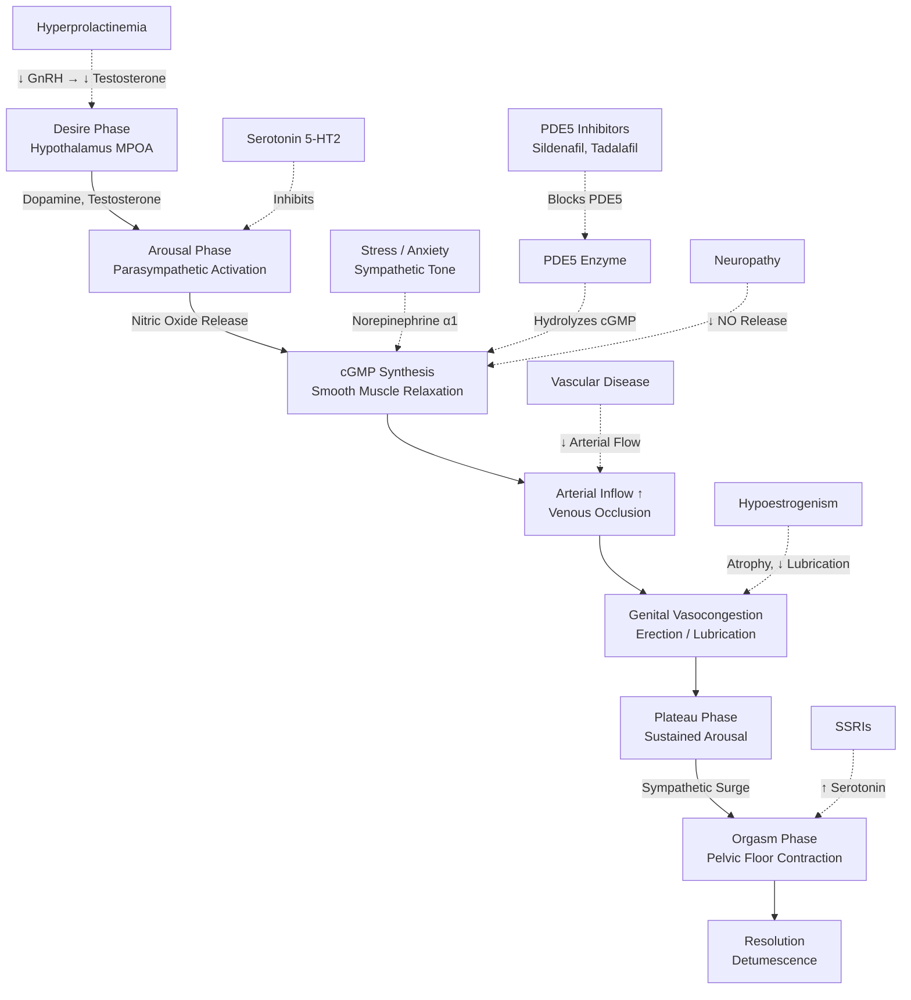

# Lesson 5: Sexual Dysfunction, Pathophysiology, Pharmacological Mechanisms

## 1. First-Principles Intuition & Invariants

Sexual function represents one of the most intricate orchestrations of autonomic, somatic, endocrine, vascular, and psychological systems in human physiology. Unlike many organ systems that operate with a degree of autonomy from higher cortical input, sexual response is simultaneously governed by spinal reflex arcs and profoundly influenced by limbic structures, prefrontal executive networks, and learned behavioral patterns. This dual nature—reflexive yet cognitively mediated—creates a vulnerability surface where dysfunction can emerge from peripheral vascular occlusion, neurotransmitter imbalances, endocrine deficiencies, psychological trauma, or iatrogenic pharmacological interference. The practitioner must therefore approach sexual dysfunction not as a singular disease entity but as a symptom constellation arising from diverse pathophysiological substrates that converge on the common phenotype of impaired desire, arousal, orgasm, or pain during sexual activity.

The diagnostic frameworks codified in DSM-5 and ICD-11 provide standardized taxonomies that distinguish sexual dysfunctions by phase of the sexual response cycle and by sex-specific anatomical and hormonal contexts. DSM-5 introduced significant revisions by collapsing previously separate desire and arousal disorders in women into Female Sexual Interest/Arousal Disorder, recognizing that desire and arousal form a more unified construct in female sexual response compared to the more discrete phases observed in male populations. The criteria also mandate temporal persistence—symptoms must be present for a minimum of six months—and functional impairment or distress, filtering out transient dissatisfaction or normative variation. ICD-11 maintains similar categorical distinctions but places greater emphasis on contextual factors and partner dynamics, acknowledging that sexual dysfunction cannot be assessed in isolation from relationship quality, cultural attitudes, and situational stressors.

Erectile dysfunction, the most prevalent male sexual dysfunction, exemplifies the hemodynamic and neurogenic mechanisms underlying arousal disorders. Penile erection requires coordinated vasodilation of the helicine arteries within the corpora cavernosa, arterial inflow expansion to seven to eight times baseline, and venous occlusion via compression of subtunical venules against the tunica albuginea. This process depends on nitric oxide release from nonadrenergic noncholinergic neurons and endothelial cells, which activates guanylate cyclase in smooth muscle, elevating cyclic guanosine monophosphate and driving calcium efflux and smooth muscle relaxation. Phosphodiesterase type 5 enzymes terminate this signaling by hydrolyzing cGMP. Vascular insufficiency from atherosclerotic plaque, diabetes-induced endothelial dysfunction, or chronic hypertension reduces arterial compliance and flow reserve, while neuropathy from diabetes, pelvic surgery, or spinal cord injury disrupts the autonomic signaling required to initiate and sustain the cascade. Psychogenic erectile dysfunction, often seen in younger men without organic pathology, arises from sympathetic overdrive during performance anxiety or stress, opposing parasympathetic-mediated tumescence.

Female sexual dysfunction encompasses a broader phenotypic range, reflecting the complexity of female genital anatomy and the lesser degree to which physiological arousal correlates with subjective experience. Female Sexual Interest/Arousal Disorder captures both reduced or absent sexual thoughts and lack of responsive desire, alongside diminished genital or nongenital sensation during activity. Genito-pelvic pain/penetration disorder consolidates vaginismus and dyspareunia, recognizing that involuntary pelvic floor muscle contraction and penetration pain frequently coexist and share overlapping etiologies including vestibulodynia, atrophic vaginitis from hypoestrogenism, endometriosis, or prior trauma. Hypoactive sexual desire disorder, applicable to both sexes but more commonly diagnosed in women, reflects persistently low or absent desire that causes distress, distinct from asexuality or relationship dissatisfaction, and often secondary to hormonal deficiencies, chronic illness, or medication side effects.

Iatrogenic sexual dysfunction represents a critical yet under-recognized cause, particularly from psychotropic medications. Selective serotonin reuptake inhibitors produce sexual side effects in fifty to seventy percent of patients through multiple mechanisms: serotonin enhancement at 5-HT2 receptors inhibits dopaminergic and nitric oxide pathways involved in arousal and orgasm, while serotonin's effects on spinal ejaculatory reflex centers delay or abolish orgasm. Antihypertensive agents, particularly beta-blockers and thiazide diuretics, impair erectile function through reduced cardiac output, decreased peripheral perfusion, and interference with adrenergic signaling required for emission and ejaculation. Antipsychotics with dopamine D2 receptor antagonism elevate prolactin, which suppresses gonadotropin-releasing hormone pulsatility, reducing testosterone and estrogen synthesis and consequently diminishing libido. The practitioner must systematically inventory all medications, including over-the-counter antihistamines and supplements, and weigh the risks of dose reduction or substitution against therapeutic efficacy for the primary psychiatric or medical condition.

Endocrine etiologies span hypogonadism, hyperprolactinemia, thyroid dysfunction, and adrenal disorders. Testosterone serves as the primary androgen mediating libido in both sexes, though women require far lower circulating concentrations. Hypogonadism in men, whether primary testicular failure or secondary hypothalamic-pituitary suppression, reduces desire, erectile rigidity, and orgasmic intensity. In women, surgical menopause or premature ovarian insufficiency drops both estrogen and testosterone, causing vaginal atrophy, reduced lubrication, and diminished arousal alongside loss of desire. Hyperprolactinemia from prolactinomas or dopamine antagonist medications suppresses GnRH, creating secondary hypogonadism. Hypothyroidism slows metabolic rate and reduces sex hormone-binding globulin, altering free androgen availability, while hyperthyroidism can produce anxiety and autonomic instability that interfere with arousal. Cushing syndrome and Addison disease disrupt the hypothalamic-pituitary-adrenal axis with downstream effects on gonadal steroidogenesis.

## 2. Core Architecture & Mechanics

The physiological architecture of sexual response proceeds through sequential yet overlapping phases: desire, arousal, plateau, orgasm, and resolution. Each phase relies on distinct neuroanatomical circuits and neurotransmitter systems, creating multiple points where pathology can disrupt function. Desire originates in the medial preoptic area of the hypothalamus, modulated by dopamine projections from the ventral tegmental area that encode reward salience and motivation. Testosterone acts on androgen receptors in this region to amplify dopaminergic tone. Inhibitory influences arise from serotonergic raphe nuclei and opioid peptides, which tonically suppress sexual motivation when activated by stress or satiety signals. The balance between excitatory dopamine and norepinephrine versus inhibitory serotonin and opioid systems determines baseline libido and responsiveness to sexual cues.

Arousal transitions desire into physiological preparation for sexual activity. In males, parasympathetic preganglionic neurons from the sacral spinal cord segments S2–S4 project via the pelvic nerve to release acetylcholine and vasoactive intestinal peptide at pelvic ganglia, which in turn release nitric oxide at cavernosal smooth muscle. Nitric oxide diffuses into smooth muscle cells, activating soluble guanylate cyclase to convert GTP to cGMP, which opens potassium channels and closes calcium channels, producing hyperpolarization and relaxation. Arterial inflow surges while venous outflow is mechanically occluded by expansion of the corpora against the tunica albuginea, raising intracavernosal pressure to eighty to one hundred millimeters of mercury. Sympathetic activation during stress or anxiety releases norepinephrine, which acts on alpha-1 adrenergic receptors to contract smooth muscle and counteract erection. Phosphodiesterase type 5 inhibitors such as sildenafil, tadalafil, and vardenafil selectively block cGMP hydrolysis, prolonging smooth muscle relaxation and amplifying the erectile response to endogenous nitric oxide release.

Female arousal involves genital vasocongestion of the clitoral erectile tissue, vaginal wall, and labia, mediated by the same nitric oxide–cGMP pathway. Vaginal lubrication arises from transudate across the vaginal epithelium driven by increased hydrostatic pressure in subepithelial capillaries. Estrogen maintains epithelial thickness, glycogen content, and vascular density; hypoestrogenism from menopause, lactation, or oophorectomy produces atrophic thinning, reduced lubrication, and increased pH that predisposes to irritation and infection. Subjective arousal in women correlates imperfectly with genital vasocongestion, reflecting the greater influence of contextual, relational, and psychological factors on perceived arousal compared to men.

Orgasm represents a coordinated spinal reflex involving rhythmic contraction of pelvic floor muscles, the urethra, and reproductive ducts at intervals of zero-point-eight seconds, accompanied by activation of the nucleus accumbens, ventral tegmental area, and insula, producing intense pleasure and reward. In men, emission—the deposition of seminal fluid into the posterior urethra—precedes expulsion and is mediated by sympathetic hypogastric nerve activity triggering contraction of the seminal vesicles, prostate, and vas deferens. Female orgasm involves contraction of the uterus and pelvic floor without a mandatory ejaculatory component, though some women experience expulsion of fluid from Skene's glands. Delayed or absent orgasm, termed anorgasmia, arises from serotonergic inhibition at spinal reflex centers, neuropathy affecting pudendal nerve sensory input, or psychological factors including hyperarousal and spectatoring—the tendency to self-monitor performance rather than remain immersed in sensation.

Pain disorders encompass dyspareunia, pain during penetration or deep thrusting, and vaginismus, involuntary contraction of the pelvic floor preventing penetration. Provoked vestibulodynia, a common cause of introital dyspareunia, involves hypersensitivity and allodynia of the vulvar vestibule, possibly from increased nerve fiber density and mast cell infiltration. Deep dyspareunia suggests endometriosis, pelvic inflammatory disease adhesions, or uterine retroversion. Vaginismus often has a learned component, where prior pain or trauma conditions anticipatory pelvic floor hypertonicity, creating a self-reinforcing cycle. Pelvic floor physical therapy using biofeedback, dilator training, and myofascial release can recondition motor patterns and reduce hypertonicity.

## 3. High-Performance Optimization & Failure Modes

Clinical assessment of sexual dysfunction requires a systematic history that deconstructs the symptom into phase-specific deficits, clarifies onset and progression, and maps temporal associations with medications, medical conditions, relationship changes, or psychological stressors. The practitioner should directly inquire about desire frequency, spontaneous versus responsive desire patterns, quality of arousal and lubrication, ability to achieve and maintain erection, orgasmic latency and intensity, and presence of pain with precise anatomical localization. Many patients will not volunteer sexual concerns without explicit prompting, and cultural or religious factors may inhibit disclosure. A nonjudgmental tone and normalization of sexual health as integral to overall wellbeing facilitate candid discussion.

Physical examination for erectile dysfunction includes assessment of secondary sexual characteristics, testicular size and consistency, penile anatomical abnormalities such as Peyronie plaques or hypospadias, and peripheral vascular examination noting femoral and pedal pulses. Neurologic screening tests perineal sensation and the bulbocavernosus reflex, though absence of this reflex has limited diagnostic specificity. For female sexual dysfunction, pelvic examination assesses vaginal epithelial integrity, presence of atrophy or inflammation, pelvic floor muscle tone, and reproduction of pain with cotton swab testing of the vestibule or bimanual palpation of pelvic organs. A tense, hypertonic pelvic floor suggests vaginismus or pelvic floor dysfunction, while tenderness of the levator ani or obturator internus indicates myofascial pain.

Laboratory evaluation targets endocrine and metabolic etiologies. Morning total testosterone and sex hormone-binding globulin allow calculation of free testosterone, the bioavailable fraction. Prolactin screens for hyperprolactinemia, which if elevated necessitates MRI of the pituitary. Thyroid-stimulating hormone detects thyroid dysfunction. Hemoglobin A1c and fasting glucose assess glycemic control relevant to diabetic neuropathy and endothelial dysfunction. Lipid panels and cardiovascular risk stratification are essential given the association between erectile dysfunction and subclinical atherosclerosis; erectile dysfunction often precedes coronary events by two to three years due to smaller caliber of penile arteries rendering them more susceptible to early plaque burden. Nocturnal penile tumescence testing differentiates psychogenic from organic erectile dysfunction by documenting preserved erections during REM sleep, though this test is rarely necessary given the efficacy of empiric PDE5 inhibitor trials.

Pharmacological management for erectile dysfunction centers on PDE5 inhibitors, which have revolutionized treatment with efficacy rates of sixty to seventy percent across diverse etiologies. Sildenafil has a rapid onset of thirty to sixty minutes and duration of four to six hours, making it suitable for planned activity. Tadalafil offers a longer half-life of seventeen hours, permitting more spontaneous timing and daily low-dose regimens that maintain steady-state levels. These medications require endogenous nitric oxide release from sexual stimulation; they do not produce erections in the absence of arousal. Absolute contraindications include concurrent nitrate use, as the combination produces severe hypotension via synergistic vasodilation. Caution is warranted in patients with severe cardiovascular disease, particularly those unable to achieve four metabolic equivalents of exertion, as sexual activity imposes cardiac demand comparable to climbing two flights of stairs. Common side effects include headache, flushing, dyspepsia, and transient visual disturbances from PDE6 cross-reactivity in retinal photoreceptors.

Alternative therapies for refractory erectile dysfunction include intracavernosal injection of alprostadil, a prostaglandin E1 analog that directly activates adenylate cyclase independent of nitric oxide, and vacuum erection devices that create negative pressure to draw blood into the corpora, with a constriction ring maintaining tumescence. Surgical placement of penile prostheses, either malleable or inflatable, offers definitive treatment when pharmacotherapy fails, though this is irreversible and destroys residual erectile tissue. Testosterone replacement in hypogonadal men restores libido and can improve erectile function when low testosterone contributes to dysfunction, but it does not reliably restore erections in eugonadal men and carries risks of polycythemia, prostate growth, and cardiovascular events in older populations.

Management of female sexual dysfunction requires multimodal approaches addressing biological, psychological, and relational contributors. Local estrogen therapy as vaginal creams, tablets, or rings reverses atrophic changes, restoring epithelial thickness and lubrication with minimal systemic absorption. Ospemifene, a selective estrogen receptor modulator, offers an oral alternative. Flibanserin, a serotonin 5-HT1A agonist and 5-HT2A antagonist, is FDA-approved for premenopausal women with hypoactive sexual desire disorder, though its modest efficacy—an additional one-half satisfying sexual event per month—and side effects including hypotension, syncope, and somnolence limit uptake. Bremelanotide, a melanocortin receptor agonist administered subcutaneously, represents a newer option with similar modest benefit. Off-label use of transdermal testosterone in postmenopausal women shows improvements in desire and satisfaction, though formulations approved for women are unavailable in many jurisdictions.

Pelvic floor physical therapy provides evidence-based treatment for vaginismus and dyspareunia, using manual therapy to release myofascial trigger points, biofeedback to increase awareness of pelvic floor contraction and relaxation, and progressive dilator therapy to desensitize pain responses and restore tolerance for penetration. Cognitive-behavioral therapy addresses maladaptive cognitions, anxiety, and trauma history, while sex therapy incorporating sensate focus exercises reduces performance pressure and rebuilds intimacy and communication between partners. These psychotherapeutic interventions often outperform pharmacological approaches for female sexual dysfunction given the greater influence of psychological and contextual factors.

Medication-induced sexual dysfunction necessitates careful risk-benefit analysis. For SSRI-induced dysfunction, strategies include dose reduction if clinically feasible, switching to bupropion or mirtazapine which have lower sexual side effect profiles, or adding bupropion as an augmentation agent to counteract serotonergic inhibition via dopaminergic and noradrenergic enhancement. Sildenafil has shown efficacy for SSRI-induced erectile dysfunction and may benefit anorgasmia. Antihypertensive-related dysfunction may improve with transition from beta-blockers or thiazides to angiotensin-converting enzyme inhibitors, angiotensin receptor blockers, or calcium channel blockers, which have more favorable sexual side effect profiles. Antipsychotic-induced hyperprolactinemia may respond to dose reduction, switch to prolactin-sparing agents like aripiprazole or quetiapine, or addition of aripiprazole as adjunctive dopamine partial agonism to lower prolactin while maintaining antipsychotic efficacy.

## 4. Summary & Verification Matrix

| **Invariant Domain** | **Mechanism / Diagnostic Criteria** | **Pharmacological Target** | **Failure Mode & Mitigation** |
|----------------------|-------------------------------------|----------------------------|-------------------------------|
| **Erectile Dysfunction** | Nitric oxide → cGMP → smooth muscle relaxation → arterial inflow and venous occlusion. Vascular insufficiency, diabetic neuropathy, psychogenic sympathetic overdrive disrupt cascade. DSM-5 requires six-month duration, marked distress. | PDE5 inhibitors (sildenafil, tadalafil) block cGMP hydrolysis, amplifying endogenous NO signaling. Contraindicated with nitrates. | PDE5 inhibitor failure: consider intracavernosal alprostadil, vacuum devices, penile prosthesis. Screen for undiagnosed cardiovascular disease; ED predicts coronary events by two to three years. |
| **Female Sexual Interest/Arousal Disorder** | Collapsed desire and arousal phases reflect unified construct in female sexual response. Reduced sexual thoughts, absent responsive desire, diminished genital sensation. Hypoestrogenism produces atrophy and inadequate lubrication. | Flibanserin (5-HT1A agonist, 5-HT2A antagonist) modulates serotonergic inhibition of desire. Bremelanotide (melanocortin agonist) enhances arousal. Local estrogen reverses atrophy. | Modest pharmacological efficacy; psychotherapy (CBT, sensate focus) often superior. Combination with pelvic floor PT for coexisting pain. Address relationship dynamics and partner factors. |
| **Genito-Pelvic Pain/Penetration Disorder** | Dyspareunia: provoked vestibulodynia (nerve fiber density, mast cells), deep pain (endometriosis, PID adhesions). Vaginismus: learned pelvic floor hypertonicity from prior trauma or pain. ICD-11 combines due to frequent co-occurrence. | Topical lidocaine for vestibulodynia. Tricyclic antidepressants or gabapentin for neuropathic component. Local estrogen if atrophic. No FDA-approved pharmacotherapy. | Pelvic floor PT with biofeedback, myofascial release, progressive dilators. Cognitive-behavioral pain reprocessing. Surgical vestibulectomy for refractory vestibulodynia with fifty to eighty percent success. |
| **Medication-Induced Sexual Dysfunction** | SSRIs: serotonin 5-HT2 activation inhibits dopamine and NO pathways; delays orgasm. Beta-blockers and thiazides: reduced cardiac output and peripheral perfusion. Antipsychotics: D2 antagonism → hyperprolactinemia → secondary hypogonadism. | Switching: bupropion or mirtazapine (lower sexual side effects). Augmentation: bupropion for dopamine/NE enhancement. PDE5 inhibitors for SSRI-induced ED/anorgasmia. | Systematic medication inventory including OTC agents. Weigh sexual dysfunction distress against primary disease control. Aripiprazole adjunct for prolactin lowering in antipsychotic-treated patients. |
| **Hypogonadism & Endocrine Dysfunction** | Testosterone mediates libido in both sexes via hypothalamic MPOA androgen receptors. Hyperprolactinemia suppresses GnRH pulsatility. Hypothyroidism reduces SHBG, alters free androgen. Surgical menopause drops estrogen and testosterone. | Testosterone replacement (transdermal, intramuscular) restores libido and erectile function in hypogonadal men. Off-label transdermal testosterone for postmenopausal women. Cabergoline for prolactinomas. | Testosterone replacement risks: polycythemia, cardiovascular events, prostate growth. Monitor hematocrit, PSA, lipids. Does not improve ED in eugonadal men. Treat underlying pituitary adenoma if hyperprolactinemia confirmed. |
| **Orgasmic Dysfunction & Delayed Ejaculation** | Spinal reflex centers coordinate rhythmic pelvic floor contraction at zero-point-eight-second intervals. Serotonergic inhibition at sacral reflex nuclei delays or abolishes orgasm. Pudendal neuropathy reduces sensory input. Psychological spectatoring prevents immersion. | Cyproheptadine (5-HT2 antagonist) or buspirone (5-HT1A agonist) as SSRI antidotes. Bupropion augmentation. No reliably effective pharmacotherapy for primary anorgasmia. | Sensate focus and directed masturbation training. Address performance anxiety and hyperarousal. Vibratory stimulation for spinal cord injury-related anorgasmia. Pseudoephedrine for anejaculation in autonomic neuropathy. |
