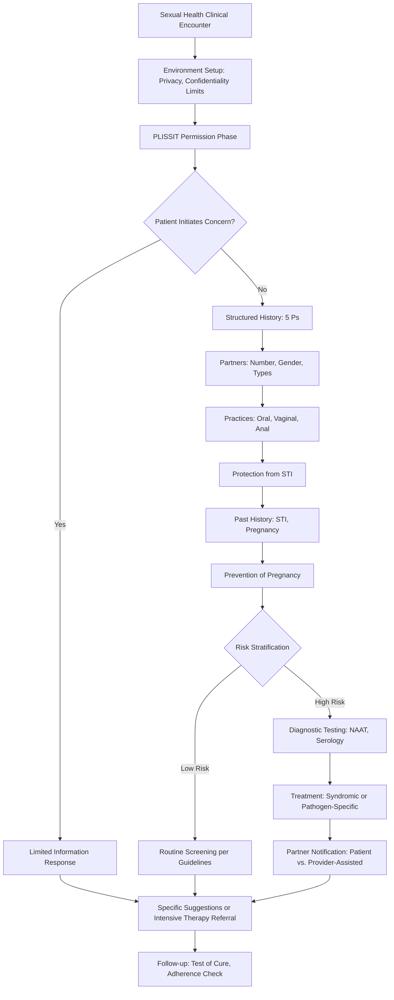

# Lesson 6: Clinical Ethics, Sexual Health, Reproductive Medicine

## 1. First-Principles Intuition & Invariants

Sexual health exists at the intersection of clinical medicine, public health epidemiology, reproductive endocrinology, psychological trauma, and legal ethics. The World Health Organization defines sexual health not merely as the absence of disease or dysfunction, but as a state of physical, emotional, mental, and social well-being in relation to sexuality. This definition embeds three foundational invariants: that sexual health requires positive affirmation rather than mere deficit correction, that it spans biological systems and psychosocial contexts, and that healthcare practitioners must address not only pathophysiology but also autonomy, consent, and cultural identity. These invariants force clinicians to operate simultaneously as diagnosticians, counselors, public health agents, and ethical arbiters.

The clinical encounter for sexual health begins with history-taking that navigates profound vulnerability. Unlike cardiovascular or musculoskeletal assessment, sexual history exposes patients to potential judgment regarding behavior, identity, and intimate choices. The PLISSIT model provides a graduated intervention framework: Permission to discuss sexual topics without shame, Limited Information tailored to immediate concerns, Specific Suggestions for behavior modification or symptom management, and Intensive Therapy referral for complex psychosexual dysfunction. This stepwise escalation recognizes that most patients need only permission and limited education, reserving specialist referral for the minority requiring intensive intervention. The model's invariant is that every patient deserves permission to name their concerns without encountering clinician discomfort or evasion.

Sexually transmitted infections represent a unique category of communicable disease where partner notification ethics collide with patient confidentiality. Classical public health doctrine grants authorities the power to trace and notify contacts for diseases of epidemic potential, yet sexual contact tracing requires patients to disclose intimate partners, often across overlapping social networks. The tension between individual privacy and community protection cannot be resolved through simple rules. Instead, clinicians must navigate a spectrum from patient-initiated notification, where the diagnosed individual informs partners voluntarily, through provider-assisted anonymous notification using health department intermediaries, to mandatory reporting for notifiable diseases such as HIV, syphilis, and gonorrhea. The governing invariant is that partner notification serves dual purposes: it interrupts transmission chains and offers contacts the opportunity for early diagnosis and treatment, but it can succeed only when patients trust that disclosure will not result in violence, social ostracism, or legal prosecution.

Contraception mechanisms span behavioral, barrier, hormonal, intrauterine, and surgical modalities, each with distinct failure rates measured as perfect-use versus typical-use percentages. Perfect-use failure reflects inherent method efficacy when used flawlessly, while typical-use failure incorporates human adherence lapses. The gap between these rates varies dramatically: sterilization and long-acting reversible contraceptives such as intrauterine devices and subdermal implants exhibit near-identical perfect and typical-use failure rates below one percent annually because they require no daily user action, while oral contraceptive pills show perfect-use failure near 0.3 percent but typical-use failure approaching eight percent due to missed doses. This divergence establishes a clinical decision invariant: methods requiring no user intervention at coitus or on daily schedules provide superior real-world efficacy for populations with adherence barriers.

Reproductive medicine evaluates fertility through a systematic workup that begins with cycle history, ovulation confirmation, semen analysis, and tubal patency assessment. Female fertility declines exponentially after age thirty-five due to oocyte quantity and quality deterioration, while male fertility depends on sperm concentration, motility, and morphology thresholds established by WHO reference ranges. The infertility diagnostic algorithm follows a one-year exposure window for couples under thirty-five and a six-month window for women over thirty-five, recognizing that age-related fecundity decline mandates accelerated intervention. Assisted reproductive technology encompasses ovulation induction, intrauterine insemination, and in vitro fertilization with or without intracytoplasmic sperm injection. The success rates depend on maternal age, ovarian reserve measured by anti-Müllerian hormone and antral follicle count, and embryo ploidy status. The fundamental invariant is that live birth rates per cycle decline steeply with maternal age regardless of technology, making early intervention and realistic expectation-setting essential.

Sexual trauma assessment and mandatory reporting create ethical dilemmas when legal obligations conflict with therapeutic alliance. Clinicians must report suspected child abuse and abuse of vulnerable adults in most jurisdictions, yet mandated reporting can deter survivors from disclosure if they fear loss of agency or retraumatization through investigation. Trauma-informed care prioritizes patient autonomy, transparency regarding reporting obligations, and minimizing repeat interviews. The forensic examination using a sexual assault evidence collection kit must occur within seventy-two to one hundred twenty hours of assault to recover biological evidence, yet survivors often delay presentation due to shock, shame, or practical barriers. Clinicians must balance evidence preservation with the survivor's immediate psychological safety, recognizing that the primary obligation is clinical care rather than forensic perfection.

LGBTQ+ populations experience healthcare disparities rooted in minority stress, discrimination, and provider knowledge gaps. Transgender patients face barriers accessing gender-affirming hormone therapy and surgical referrals when providers lack competency or harbor ideological objections. Men who have sex with men encounter higher rates of HIV, syphilis, and hepatitis C, yet screening algorithms often fail to identify risk when clinicians assume heterosexuality or omit sexual behavior questions. Lesbian and bisexual women report lower cervical cancer screening rates despite equivalent HPV exposure risk from past or current male partners. These disparities emerge not from biological susceptibility alone but from systemic failures: inadequate sexual history-taking, provider discomfort, insurance coverage exclusions, and hostile clinical environments. The corrective invariant is that sexual orientation and gender identity must be routinely documented, respectfully queried, and integrated into risk stratification without assumption.

Clinician bias operates below conscious awareness, shaping whom we screen, what we ask, and how we interpret responses. Implicit bias research demonstrates that providers hold stereotypic associations linking certain demographics with promiscuity, irresponsibility, or dishonesty, biases that distort clinical judgment. A middle-aged married woman may not be asked about new partners despite divorce risk factors, while a young Black man may be presumptively screened for STIs without behavioral indication. Cultural competency training attempts to mitigate bias through awareness, yet knowledge acquisition alone proves insufficient. Structural competency reframes the challenge: disparities arise not merely from individual prejudice but from healthcare system design that rations access, enforces heteronormative forms, and trains clinicians in populations unrepresentative of those they will serve. The actionable corrective is standardized, universal sexual history protocols that eliminate discretionary screening, thereby removing bias as a gatekeeper.

## 2. Core Architecture & Mechanics

The clinical architecture for sexual health assessment begins with creating a confidential, nonjudgmental environment where patients receive explicit permission to discuss sexual concerns. The physical space should ensure auditory privacy, and the clinician must establish ground rules regarding confidentiality limits, particularly mandatory reporting obligations. This pre-interview framing prevents patients from inadvertently disclosing information that triggers reporting before understanding the consequences. The opening question should be open-ended yet normalizing, such as: "Many patients have questions or concerns about sexual health. Is there anything you'd like to discuss today?" This phrasing avoids presumptive heterosexuality and signals that sexual topics are routine clinical content rather than taboo exceptions.

The structured sexual history employs the "Five Ps" framework: Partners, Practices, Protection from STIs, Past history of STIs, and Prevention of pregnancy. Each domain requires specific, behaviorally explicit questions. For partners, the clinician must quantify number in the past year, identify gender of partners to assess anatomic exposure sites, and distinguish between main, casual, and anonymous partners. The gender question must be asked regardless of perceived orientation, using phrasing such as: "Do you have sex with men, women, or both?" rather than asking orientation labels that may not align with behavior. For practices, the clinician must assess oral, vaginal, and anal sex separately because each carries distinct STI transmission probabilities and anatomic screening requirements. Pharyngeal and rectal gonorrhea and chlamydia screening via nucleic acid amplification testing is indicated for patients reporting receptive oral or anal exposure, yet these sites are frequently overlooked when history-taking omits explicit practice questions.

Protection assessment distinguishes between STI prevention and pregnancy prevention, recognizing that many patients conflate the two. Condom use must be quantified using frequency descriptors—always, most of the time, sometimes, never—rather than accepting vague affirmations of "protection." The clinician must probe barriers to consistent use, including partner resistance, erectile dysfunction, latex allergy, or perception that monogamy eliminates risk. Pre-exposure prophylaxis using daily tenofovir disoproxil fumarate/emtricitabine or long-acting cabotegravir injections provides HIV prevention independent of barrier methods, and indications now extend beyond men who have sex with men to include heterosexual individuals with HIV-positive partners or those in areas with high prevalence.

Contraception counseling requires reviewing mechanism of action, typical-use failure rates, noncontraceptive benefits, and side effect profiles across modalities. Combined hormonal contraceptives containing ethinyl estradiol and a progestin prevent ovulation through negative feedback suppression of gonadotropin-releasing hormone pulsatility, thicken cervical mucus to impede sperm penetration, and thin the endometrium. Progestin-only methods such as the implant, levonorgestrel intrauterine device, or depot medroxyprogesterone acetate injection avoid estrogen-related venous thromboembolism risk, making them preferred for patients with contraindications including age over thirty-five combined with smoking, history of thrombosis, or migraine with aura. Copper intrauterine devices provide hormone-free contraception through spermicidal copper ion release and inflammatory endometrial changes that prevent implantation, with efficacy exceeding twelve years and the unique advantage of serving as emergency contraception when placed within five days of unprotected intercourse.

Emergency contraception options include ulipristal acetate, a selective progesterone receptor modulator effective up to one hundred twenty hours post-coitus with superior efficacy compared to levonorgestrel, which loses effectiveness after seventy-two hours and in patients over seventy kilograms body mass. The copper IUD remains the most effective emergency contraception and provides ongoing protection, yet access barriers related to cost and procedural availability limit utilization. Clinicians must correct the persistent misconception that emergency contraception causes abortion; these agents prevent ovulation or fertilization but do not disrupt established pregnancy.

STI diagnostic testing employs nucleic acid amplification technology that detects pathogen DNA or RNA with sensitivity exceeding ninety-five percent for gonorrhea and chlamydia from urine, urethral, cervical, pharyngeal, and rectal specimens. First-catch urine samples in males and vaginal swabs in females provide optimal sensitivity for urogenital infection, but extragenital sites require separate swabs. HIV screening uses fourth-generation antigen-antibody immunoassays that detect p24 antigen and HIV-1/2 antibodies with diagnostic window periods of approximately eighteen days, substantially shorter than earlier antibody-only tests. Positive screens require confirmatory differentiation assays, and patients with high-risk exposure within the window period need repeat testing. Syphilis serology combines nontreponemal tests such as rapid plasma reagin that quantify antibody titer for treatment response monitoring with treponemal-specific tests such as fluorescent treponemal antibody absorption for confirmatory diagnosis.

Partner notification mechanics depend on disease, local regulations, and patient preference. For bacterial STIs amenable to single-dose or short-course therapy, expedited partner therapy allows the index patient to deliver antimicrobial prescriptions or medications directly to partners without requiring partner examination, reducing reinfection rates by ensuring simultaneous treatment. This strategy faces legal barriers in some jurisdictions and is contraindicated for HIV due to testing requirements before antiretroviral initiation. Health department partner services provide anonymous notification where trained staff contact partners using coded identifiers without revealing the index patient's name, preserving confidentiality while ensuring contacts receive testing recommendations.

Fertility evaluation for couples attempting conception without success follows a stepwise algorithm. Initial assessment confirms ovulatory cycles through menstrual regularity, basal body temperature charting showing biphasic patterns, mid-luteal serum progesterone exceeding three nanograms per milliliter, or urinary luteinizing hormone surge detection kits. Semen analysis evaluates volume, concentration, total motile count, progressive motility percentage, and morphology using strict Kruger criteria, with WHO reference ranges defining thresholds: fifteen million sperm per milliliter concentration, forty percent total motility, and four percent normal morphology. Female anatomic assessment employs hysterosalpingography, where radiopaque contrast injected through the cervix outlines the uterine cavity and demonstrates bilateral tubal patency via peritoneal spill, or saline infusion sonography as a radiation-free alternative. Ovarian reserve testing using day three follicle-stimulating hormone, estradiol, and anti-Müllerian hormone levels predicts responsiveness to ovarian stimulation, with high FSH and low AMH indicating diminished reserve.

Assisted reproductive technology protocols begin with controlled ovarian hyperstimulation using injectable gonadotropins to recruit multiple follicles, monitored via transvaginal ultrasound follicle measurements and serum estradiol levels. When lead follicles reach eighteen to twenty millimeters diameter, a trigger injection of human chorionic gonadotropin or GnRH agonist induces final oocyte maturation, and transvaginal ultrasound-guided needle aspiration retrieves oocytes thirty-four to thirty-six hours later. Conventional insemination exposes oocytes to processed sperm in culture, while intracytoplasmic sperm injection mechanically injects a single sperm into each mature oocyte, bypassing fertilization barriers for severe male factor infertility. Embryos develop to cleavage stage on day three or blastocyst stage on day five, with optional preimplantation genetic testing for aneuploidy using trophectoderm biopsy and chromosomal microarray or next-generation sequencing. Euploid blastocysts are vitrified for subsequent frozen embryo transfer, which yields superior live birth rates compared to fresh transfer due to more physiologic endometrial preparation without supraphysiologic estradiol levels from ovarian stimulation.

## 3. High-Performance Optimization & Failure Modes

Optimizing sexual health clinical workflows requires embedding routine screening into existing visit structures rather than relying on episodic patient-initiated requests. Standardized intake forms that include sexual history questions normalize data collection and reduce reliance on provider discretion, which introduces bias. Electronic health record templates should prompt anatomic site-specific testing based on reported practices, automatically generating orders for rectal and pharyngeal NAAT when patients indicate receptive anal or oral exposure. This systematization eliminates the cognitive burden of remembering multistep guidelines and prevents undertesting from omission.

Contraceptive counseling efficiency improves through tiered approaches that present long-acting reversible contraceptives first given their superior typical-use efficacy, reserving detailed discussion of user-dependent methods for patients who decline or have contraindications to LARC. Same-day insertion of IUDs and implants removes access barriers related to scheduling follow-up, insurance preauthorization, or patient attrition. Quick-start protocols that initiate hormonal contraception immediately rather than waiting for menses onset or next cycle reduce unintended pregnancy by shortening the unprotected interval, with add-on barrier methods or abstinence for the first seven days to ensure efficacy.

STI treatment failure modes arise from inadequate dosing, antimicrobial resistance, reinfection from untreated partners, or persistent infection at untested anatomic sites. Neisseria gonorrhoeae resistance to fluoroquinolones emerged globally, and reduced ceftriaxone susceptibility now mandates single-dose intramuscular ceftriaxone five hundred milligrams combined with oral doxycycline one hundred milligrams twice daily for seven days for urogenital or rectal infection, or dual therapy for pharyngeal infection which exhibits reduced clearance. Azithromycin monotherapy for gonorrhea should be abandoned due to resistance. Chlamydia therapy uses doxycycline one hundred milligrams twice daily for seven days, which demonstrates superior efficacy compared to single-dose azithromycin one gram and reduces macrolide resistance pressure. Test-of-cure is indicated three months post-treatment to detect reinfection, which occurs in approximately twenty percent of treated patients when partners remain untreated.

Partner notification failure modes include patient refusal due to fear of violence or relationship dissolution, lost contact information, or anonymous encounters precluding tracing. Motivational interviewing techniques that explore barriers and emphasize shared responsibility improve notification rates compared to directive commands. For HIV disclosure, clinicians must assess intimate partner violence risk before encouraging direct disclosure, as HIV-positive status revelation has precipitated homicide in documented cases. Anonymous health department notification bypasses this risk but requires patient cooperation in naming contacts. Legal duties to warn third parties of HIV exposure exist in some jurisdictions, creating tension between confidentiality and harm prevention when patients refuse disclosure to known at-risk partners.

Fertility treatment optimization addresses modifiable factors before escalating to assisted reproduction. Male factor improvement targets oxidative stress reduction through antioxidant supplementation with coenzyme Q10, vitamin E, and selenium, though evidence remains mixed. Varicocelectomy for palpable varicoceles improves sperm parameters in select cases. Female factor optimization includes weight reduction for obese anovulatory patients with polycystic ovary syndrome, where five to ten percent body mass loss restores ovulation in the majority. Metformin improves insulin sensitivity and ovulation rates but does not enhance live birth rates beyond weight loss alone. Smoking cessation in both partners improves gamete quality and ART success rates.

Assisted reproductive technology failure modes include poor ovarian response to stimulation, failed fertilization, embryonic arrest before blastocyst stage, implantation failure, and pregnancy loss. Ovarian response prediction using anti-Müllerian hormone and antral follicle count allows protocol individualization, with high-responders receiving lower gonadotropin doses to prevent ovarian hyperstimulation syndrome, a potentially life-threatening complication causing vascular permeability, ascites, pleural effusions, and thromboembolism. Fertilization failure occurs in ten to fifteen percent of conventional IVF cycles but reduces to two percent with ICSI rescue. Embryo quality depends on parental age, with aneuploidy rates approaching seventy-five percent in oocytes from women over forty-two, explaining the steep age-related decline in live birth rates. Preimplantation genetic testing for aneuploidy improves implantation rates and reduces miscarriage by selecting euploid embryos, but cannot overcome the absolute scarcity of viable embryos when ovarian reserve is severely diminished.

Sexual trauma forensic examination optimizes evidence recovery through timely collection, proper technique, and chain-of-custody documentation. The examiner should be a trained sexual assault nurse examiner or forensic physician who collects swabs from contacted orifices, obtains fingernail scrapings if the survivor scratched the assailant, photographs injuries, and collects reference DNA standards. Toluidine blue dye application highlights posterior fourchette microabrasions, though normal exams are common even after penetrating assault due to tissue elasticity. Prophylactic STI treatment includes ceftriaxone for gonorrhea, doxycycline for chlamydia, and metronidazole for trichomonas, with HIV post-exposure prophylaxis using tenofovir/emtricitabine plus raltegravir or dolutegravir for twenty-eight days initiated within seventy-two hours. Emergency contraception prevents pregnancy when assault occurred during the fertile window. Psychological first aid and referral to victim advocacy services address acute trauma, recognizing that long-term sequelae including post-traumatic stress disorder require ongoing mental health support beyond the acute medical encounter.

Transgender healthcare optimization requires protocol-driven hormone therapy monitoring to prevent under- or overtreatment. Masculinizing therapy using intramuscular testosterone enanthate or cypionate targets serum testosterone levels in the male physiologic range of three hundred to one thousand nanograms per deciliter, with monitoring at trough levels before the next injection. Feminizing therapy combines estradiol via oral, transdermal, or injectable routes with spironolactone or bicalutamide for androgen blockade, targeting estradiol levels of one hundred to two hundred picograms per milliliter and testosterone suppression below fifty nanograms per deciliter. Adverse effect surveillance includes monitoring hemoglobin for testosterone-induced polycythemia, liver function for oral estradiol, and potassium for spironolactone. Breast and cervical cancer screening follows organ inventory rather than gender identity: transgender women on long-term estrogen require mammography per cisgender female guidelines, while transgender men who retain a uterus require continued cervical cytology despite testosterone therapy.

## 4. Summary & Verification Matrix

| Domain | Governing Invariant | Core Mechanism | Diagnostic/Intervention Threshold | Failure Mode & Mitigation |
|--------|---------------------|----------------|-----------------------------------|---------------------------|
| **Sexual History** | Explicit permission and nonjudgmental framing enable disclosure; structured Five Ps prevent omissions | PLISSIT model escalates from permission through limited information to specific suggestions and intensive therapy; anatomic site-specific screening follows reported practices | Universal screening for sexually active individuals: annual gonorrhea/chlamydia NAAT for age <25 or risk factors; HIV/syphilis per CDC guidelines based on behavior and prevalence | Clinician discomfort leads to screening omission; mitigate via standardized intake forms and EHR-prompted testing algorithms that eliminate discretionary gatekeeping |
| **Contraception** | User-independent methods (LARC, sterilization) exhibit superior typical-use efficacy versus user-dependent methods (pills, barriers); typical-use failure quantifies real-world adherence lapses | Combined hormonal methods suppress GnRH pulsatility preventing ovulation; progestin-only methods thicken cervical mucus and may suppress ovulation; copper IUD creates spermicidal and inflammatory environment | LARC first-line for most patients; quick-start protocols initiate method immediately with backup barriers for 7 days; same-day insertion removes access barriers | Continuation failure from side effects or access barriers; mitigate via counseling on expected bleeding changes, same-day insertion availability, and removal on request to preserve autonomy |
| **STI Treatment & Partner Notification** | Antimicrobial resistance mandates updated regimens; untreated partners cause reinfection; expedited partner therapy treats partners without examination when feasible | Ceftriaxone 500mg IM + doxycycline 100mg BID x7d for gonorrhea; doxycycline 100mg BID x7d for chlamydia; partner notification via patient-delivered therapy or anonymous health department contact | Treat based on NAAT or clinical syndrome; test-of-cure at 3 months detects reinfection; partner treatment within days prevents ping-pong reinfection | Treatment failure from resistance or reinfection; mitigate via adherence confirmation, dual therapy per guidelines, and aggressive partner notification with expedited treatment |
| **Fertility & ART** | Female fecundity declines exponentially after age 35; embryo aneuploidy drives age-related IVF failure; ovarian reserve predicts stimulation response | Controlled ovarian hyperstimulation recruits multiple follicles; ICSI bypasses fertilization barriers; preimplantation genetic testing selects euploid embryos; frozen transfer optimizes endometrial receptivity | Initiate workup after 6 months in women >35 or 12 months if <35; semen analysis, ovulation confirmation, tubal patency assessment; proceed to IVF for tubal factor, severe male factor, or failed ovulation induction | Poor response, failed fertilization, aneuploidy, implantation failure; mitigate via ovarian reserve testing for protocol selection, ICSI for male factor, PGT-A for recurrent failure, but cannot overcome absolute oocyte scarcity in advanced age |
| **Sexual Trauma & Consent** | Trauma-informed care prioritizes survivor autonomy; mandatory reporting obligations require transparent pre-disclosure; forensic evidence collection window closes at 72–120 hours | Sexual assault examination collects swabs from contacted orifices, injuries photographed, reference DNA obtained; prophylactic STI treatment and emergency contraception prevent sequelae; chain-of-custody documentation preserves forensic integrity | Offer examination within 120 hours; prophylaxis includes ceftriaxone + doxycycline + metronidazole + HIV PEP (TDF/FTC/RAL or DTG) within 72 hours; psychological first aid and advocacy referral | Examination refusal, delayed presentation beyond evidence window, retraumatization from invasive procedures; mitigate via patient control over exam extent, trained SANE examiners, and prioritizing clinical care over forensic perfection |
| **LGBTQ+ Health & Bias Mitigation** | Disparities arise from minority stress, provider knowledge gaps, and systemic heteronormativity; implicit bias distorts screening decisions; sexual orientation and gender identity documentation enables tailored care | Routine SOGI collection without assumption; anatomic inventory determines cancer screening (mammography for transwomen on estrogen, cervical cytology for transmen with cervix); PrEP indication assessment via behavioral risk rather than identity labels | MSM: pharyngeal/rectal NAAT, annual syphilis/HIV screening; transgender hormone therapy monitoring at 3 months then biannually (testosterone levels, estradiol levels, CBC, CMP); screen all sexually active individuals regardless of perceived orientation | Assumption-based omissions (e.g., not offering cervical screening to lesbian-identified patient with past male partners); mitigate via universal standardized protocols that remove discretion and heteronormative defaults from clinical pathways |
