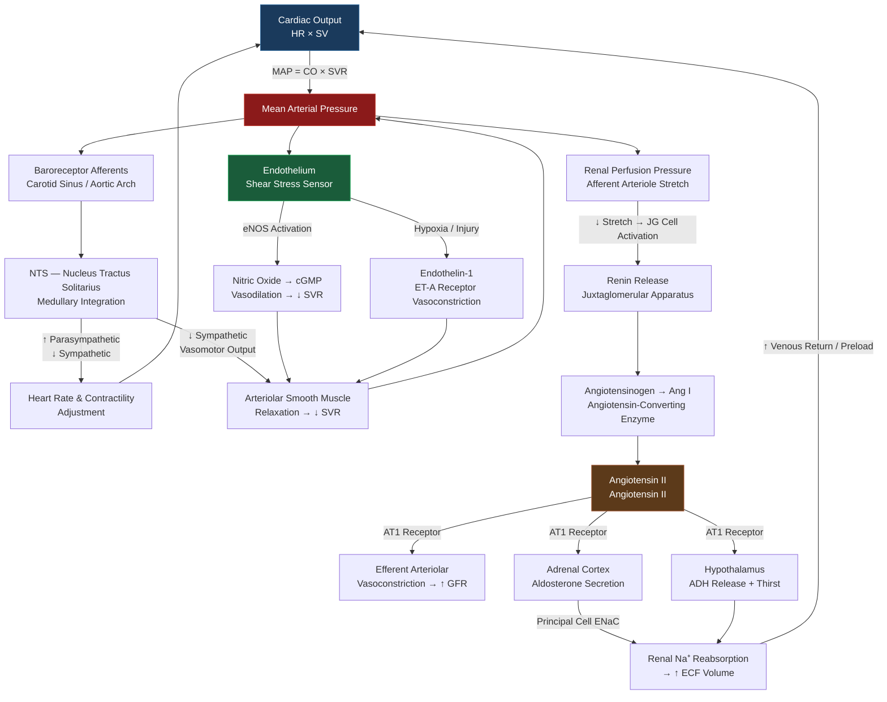

# Lesson 1: Cardiovascular Physiology of Blood Pressure Regulation

## 1. First-Principles Intuition & Invariants

Blood pressure is not a static property of the circulation; it is an emergent phenomenon, a continuously negotiated equilibrium between the heart's mechanical output and the resistance the vasculature opposes to that flow. To treat hypertension intelligently, a clinician must first understand why pressure exists at all, and what forces conspire to elevate or defend it.

The governing hemodynamic identity is deceptively simple: **MAP = CO × SVR**, where mean arterial pressure equals the product of cardiac output and systemic vascular resistance. This equation does not describe a cause-and-effect chain so much as a constraint that the cardiovascular system must satisfy at every heartbeat. Cardiac output (CO) is itself the product of heart rate and stroke volume, and stroke volume is shaped by three interdependent determinants: preload, afterload, and myocardial contractility. Systemic vascular resistance (SVR) emerges from the aggregate tone of small arteries and arterioles throughout the body, governed by the Hagen-Poiseuille relationship, in which resistance scales with the fourth power of vessel radius. This fourth-power dependence is the central mechanical fact of hypertension: a 20% reduction in arteriolar radius doubles resistance. No pharmacological intuition makes clinical sense without internalizing that number.

Preload represents the end-diastolic ventricular volume, the stretch placed on myocardial sarcomeres before contraction begins. Frank-Starling mechanics dictate that increasing preload augments stroke volume up to an optimum, beyond which overstretched sarcomeres lose actin-myosin overlap efficiency and output falls. In the hypertensive patient, chronically elevated afterload forces the left ventricle to work against a stiffer arterial tree. The initial adaptive response is concentric hypertrophy: sarcomeres are added in parallel, wall thickness increases, and the chamber stiffens. This preserves stroke volume in the short term but reduces diastolic compliance, raises filling pressures, and sets the stage for heart failure with preserved ejection fraction (HFpEF), one of hypertension's most common and difficult-to-treat downstream consequences.

Afterload, the tension the ventricle must generate to eject blood, is clinically approximated by SVR and aortic impedance. In young adults, the aorta is elastic; it buffers systolic pressure by expanding to absorb stroke volume, then recoils during diastole to maintain flow. This elastic reservoir function, the Windkessel effect, is progressively lost with arterial aging and atherosclerosis. When the aorta stiffens, pulse wave velocity increases, the reflected pressure wave returns to the central circulation during systole rather than diastole, amplifying systolic pressure and reducing diastolic coronary perfusion. Isolated systolic hypertension in older adults is precisely this phenomenon made manifest, and it explains why pulse pressure (systolic minus diastolic) is itself an independent cardiovascular risk marker.

Three invariants govern every mechanism discussed in this lesson. First, the cardiovascular system defends perfusion of the brain and coronary arteries above all other objectives; baroreceptor arcs and hormonal axes bend toward this priority. Second, sodium is the principal determinant of extracellular fluid volume and therefore of venous return and preload; every system that regulates blood pressure eventually converges on renal sodium handling. Third, the endothelium is not passive plumbing but an active signaling organ that integrates mechanical shear stress, circulating hormones, and metabolic cues to continuously tune vascular tone.

---

## 2. Core Architecture & Mechanics

### Hemodynamic Signal Architecture

The following diagram maps the principal regulatory pathways from mechanical cardiac output through neurohumoral feedback loops to end-organ vascular tone. Reading it as a signal-flow graph rather than a static anatomy chart clarifies where hypertensive disease can break any individual arc and why multiple redundant mechanisms make normalization without pharmacological intervention difficult once pathological set points are established.

### The Baroreceptor Reflex Arc

Baroreceptors are mechanosensitive stretch receptors embedded in the adventitia of the carotid sinus and aortic arch. At normal arterial pressure they fire tonically, sending continuous afferent signals via the glossopharyngeal nerve (CN IX, carotid sinus) and vagus nerve (CN X, aortic arch) to the nucleus tractus solitarius (NTS) in the dorsal medulla. The NTS integrates this input and modulates two downstream outputs: the dorsal motor nucleus of the vagus for parasympathetic heart rate control, and the rostral ventrolateral medulla (RVLM) for sympathetic vasomotor tone. When pressure rises, increased baroreceptor firing augments vagal tone (slowing heart rate), inhibits the RVLM (reducing sympathetic outflow), and thereby lowers both CO and SVR simultaneously.

The critical clinical insight is that baroreceptors reset their operating threshold within 24 to 72 hours when arterial pressure is chronically elevated. A patient with longstanding hypertension has baroreceptors calibrated to defend the higher pressure as the new normal. This resetting explains why rapid blood pressure reduction in a hypertensive emergency can precipitate symptomatic hypotension and end-organ ischemia even when the achieved pressure would be perfectly normal in a healthy individual. Gradual, staged reduction strategies, particularly for hypertensive urgency managed outpatient, exploit this resetting biology deliberately.

### The Renin-Angiotensin-Aldosterone System

The RAAS operates as a hormonal volume and pressure sensor with a minimum three-day time constant, making it the dominant mechanism for sustained blood pressure regulation rather than beat-to-beat buffering. Renin is a protease secreted by juxtaglomerular (JG) cells at the afferent arteriole in response to three converging signals: reduced renal perfusion pressure (direct baroreceptor effect at the JG cell), decreased chloride delivery to the macula densa (a consequence of reduced GFR and tubular flow), and β₁-adrenergic stimulation from sympathetic innervation of the kidney.

Renin cleaves angiotensinogen, a hepatic protein, to yield angiotensin I, a biologically inert decapeptide. Angiotensin-converting enzyme (ACE), expressed abundantly on pulmonary endothelium, removes two C-terminal residues to produce angiotensin II (Ang II), the principal effector molecule of the system. Ang II acts through AT1 receptors distributed across vascular smooth muscle, the adrenal cortex, the hypothalamus, and the kidney itself. Its integrated actions are vasoconstriction (immediate, via efferent arteriolar constriction and direct vascular smooth muscle effects), aldosterone release (delayed, 1 to 2 hours, increasing renal sodium and water reabsorption via ENaC upregulation in collecting duct principal cells), ADH secretion (hypothalamic, amplifying free-water retention), and central thirst stimulation (circumventricular organs, increasing oral intake). Each arm amplifies blood volume and SVR simultaneously.

The implications for drug targeting are precise. ACE inhibitors block the conversion step, reducing Ang II while permitting bradykinin accumulation (a vasodilatory mediator normally degraded by ACE), which explains both their antihypertensive efficacy and their class-specific adverse effect of dry cough. ARBs (angiotensin receptor blockers) block the AT1 receptor directly, eliminating bradykinin-related side effects while preserving AT2 receptor signaling, which is generally vasodilatory and organ-protective. Mineralocorticoid receptor antagonists (spironolactone, eplerenone) block aldosterone's renal sodium-retaining effect without touching Ang II itself, making them effective agents in resistant hypertension where RAAS upregulation has often escaped upstream blockade.

### Endothelial Function and Vascular Tone

The vascular endothelium occupies roughly 7,000 m² of surface area in the adult human body and processes mechanical, chemical, and immune signals simultaneously. Under laminar shear stress, endothelial nitric oxide synthase (eNOS) is activated via phosphoinositide 3-kinase (PI3K) and Akt-mediated phosphorylation at serine 1177, producing nitric oxide (NO) from L-arginine. NO diffuses into adjacent smooth muscle cells, activates soluble guanylyl cyclase, raises cyclic GMP, and triggers myosin light-chain phosphatase activation, producing relaxation and vasodilation. This flow-mediated dilation (FMD) response is the physiological basis of the FMD ultrasound assessment used in clinical research to quantify endothelial health.

In hypertension, endothelial dysfunction precedes and amplifies structural vascular disease. Elevated Ang II and oxidative stress (via NADPH oxidase activation) generate superoxide (O₂⁻), which reacts with NO at a rate three times faster than eNOS produces it, effectively scavenging the vasodilatory signal. Simultaneously, endothelin-1 (ET-1) production increases; ET-1 binding to ET-A receptors on smooth muscle cells drives prolonged, potent vasoconstriction and smooth muscle proliferation. The result is a progressive shift in the endothelial vasoactive balance from vasodilatory to vasoconstrictive, raising basal SVR and reducing the vascular reserve available to buffer pressure surges.

---

## 3. High-Performance Optimization & Failure Modes

### Clinical Optimization: Accurate Pressure Measurement as the Foundation

No therapeutic decision is more reliable than the data underlying it. Automated oscillometric devices introduced into practice have substantially reduced white-coat artifact compared to auscultatory mercury sphygmomanometers, but they carry their own failure modes. Cuff selection is paramount: a cuff bladder should encircle at least 80% of the arm circumference and cover two-thirds of the upper arm length. Using a standard adult cuff on an obese arm with an upper-arm circumference above 42 cm will read falsely high by 5 to 10 mmHg, misclassifying a normotensive patient or overstating severity in a hypertensive one. Conversely, using a large cuff on a thin arm underestimates pressure. This is not a minor procedural footnote; in outcome trials the difference between 130 mmHg and 140 mmHg systolic as a treatment threshold has direct mortality implications.

Ambulatory blood pressure monitoring (ABPM) over 24 hours remains the reference standard for diagnosing true hypertension, specifically because it captures the nocturnal dipping pattern that office measurement cannot. Normal physiology produces a 10 to 20% drop in blood pressure during sleep; the absence of this dip (non-dipping) is an independent predictor of cardiovascular events and target-organ damage independent of the absolute daytime level. Masked hypertension (normal office readings, elevated ambulatory readings) affects roughly 15 to 30% of patients classified as normotensive by office measurement alone and carries a cardiovascular risk comparable to sustained hypertension. Masked hypertension is particularly prevalent in patients with diabetes, chronic kidney disease, or high occupational stress, and ABPM should be considered systematically in these populations rather than reserved only for borderline office readings.

### Failure Mode 1: Renal-Pressure Natriuresis Curve Resetting

Under normal physiology, any rise in arterial pressure is countered by an increase in renal sodium and water excretion, a phenomenon Guyton termed "pressure natriuresis." The operating point of this curve, the pressure at which sodium intake equals sodium excretion, defines the long-term blood pressure set point. Essential hypertension is fundamentally a rightward shift of this curve: the kidneys require a higher operating pressure to achieve the same sodium balance. This shift can be driven by reduced nephron mass (from subclinical renal injury, low birth weight reducing endowment, or age-related nephron dropout), intrarenal RAAS upregulation (Ang II shifts the curve by increasing tubular sodium reabsorption directly), or sympathetically mediated reduction in renal blood flow. A consequence of this model is that volume contraction (from diuretics) works partly by moving the patient down their shifted natriuresis curve to a lower operating pressure, but it does not correct the underlying curve displacement, which is why diuretic monotherapy in patients with significant RAAS activation is often insufficient and why combination therapy targeting both volume (thiazide or loop diuretic) and RAAS (ACE inhibitor or ARB) produces synergistic pressure reduction.

### Failure Mode 2: Hypertensive Emergency and Autoregulatory Breakthrough

Cerebral autoregulation normally maintains constant cerebral blood flow across a MAP range of approximately 60 to 150 mmHg by adjusting cerebrovascular resistance. In chronic hypertension, this autoregulatory curve shifts rightward: the lower autoregulatory limit rises, meaning the chronically hypertensive brain tolerates higher pressures but is vulnerable to ischemia at pressures that would be normal in a healthy person. When MAP acutely exceeds the upper autoregulatory limit (which in a severe hypertensive emergency may be above 180 mmHg), pressure-passive cerebral perfusion causes hydrostatic disruption of the blood-brain barrier, vasogenic edema, and the clinical syndrome of hypertensive encephalopathy or posterior reversible encephalopathy syndrome (PRES). The therapeutic mandate here is controlled, titrated reduction: a maximum 20 to 25% MAP reduction within the first hour, using intravenous agents with predictable, titratable action (labetalol, nicardipine, clevidipine).

The same autoregulatory logic extends beyond the cerebral circulation. Coronary, renal, and retinal vascular beds each shift their autoregulatory curves rightward in chronic hypertension, and each becomes vulnerable when pressure either exceeds the upper limit (accelerating end-organ damage: papilledema, acute kidney injury, myocardial ischemia from increased afterload) or drops below the elevated lower limit (iatrogenic ischemia from overly aggressive pressure reduction). This is why the 20–25% rule exists: it targets a reduction sufficient to relieve pressure-passive perfusion and restore autoregulatory control without crossing the ischemic threshold of any adapted vascular bed. Agents such as sublingual nifedipine, which produce unpredictable, precipitous drops, are explicitly contraindicated because they violate this therapeutic window. The broader lesson is that hypertension management is not simply a matter of lowering a number but of restoring the physiological set points—pressure-natriuresis curve position, autoregulatory range, baroreflex sensitivity, and RAAS tone—toward values that preserve end-organ perfusion across the full range of daily physiologic challenge.

Across both failure modes discussed in this unit, a unifying principle emerges: chronic hypertension represents a multi-system adaptation in which regulatory curves have shifted to defend an elevated operating pressure. Treatment must therefore address the *reason* the curves shifted, not merely the pressure they produce. Volume depletion without RAAS blockade leaves the pressure-natriuresis curve displaced and invites compensatory activation that restores the hypertensive set point. Rapid pressure reduction without respect for autoregulatory adaptation trades one form of end-organ injury for another. Effective therapy—whether chronic or emergent—works by repositioning these curves over a timescale that the adapted organs can tolerate, which is the physiological basis for combination pharmacotherapy in chronic disease and for titrated, controlled reduction in hypertensive emergency.

## Summary & Verification Matrix

| System / Concept | Governing Invariant | Core Mechanism | Diagnostic / Verification Criterion |
|---|---|---|---|
| **Pressure-Natriuresis Curve** | Long-term BP equilibrates at the pressure where daily sodium intake equals renal sodium excretion | Kidneys shift the curve rightward via reduced nephron number, intrarenal RAAS activation, or sympathetic vasoconstriction; operating pressure rises until sodium balance is re-established | Diuretic monotherapy insufficient when RAAS-driven curve displacement persists; verify by synergistic response to combined diuretic + ACE inhibitor/ARB |
| **Baroreflex Buffering** | Baroreceptors regulate *short-term* BP lability, not the long-term set point | Rapid adaptations within seconds; receptors reset to chronically elevated pressures, buffering is suppressed, sensitivity declines | Confirm baroreflex dysfunction by sustained lability despite adequate resting pressure control; heart rate variability testing shows impaired reflex gain |
| **RAAS Integration** | Ang II and aldosterone couple vascular tone and sodium retention to pressure and volume status | Ang II raises efferent arteriolar tone, aldosterone increases distal sodium reabsorption; intrarenal RAAS creates a feed-forward loop that displaces the natriuresis curve | Elevated plasma renin or aldosterone-to-renin ratio; falling BP with ACE inhibitor/ARB challenge confirms RAAS contribution |
| **Autoregulatory Range (Cerebral)** | Cerebral blood flow is constant across MAP ≈ 60–150 mmHg in healthy adults | Resistance vessels dilate or constrict in response to perfusion pressure changes; chronic hypertension shifts the curve rightward, raising both the upper and lower protective limits | Transcranial Doppler or imaging confirms preserved flow at high MAP; ischemic symptoms at "normal" pressures in chronically hypertensive patients indicate a rightward-shifted lower limit |
| **Hypertensive Emergency** | Reduce MAP by no more than 20–25% in the first hour | Acute MAP exceeding the upper autoregulatory limit causes pressure-passive perfusion, BBB disruption, vasogenic edema, and PRES | Evidence of end-organ damage (encephalopathy, papilledema, acute kidney injury, chest pain) with BP typically >180/120; titratable IV antihypertensive required |
| **Combined Volume + RAAS Therapy** | Synergy requires addressing both axes of the pressure-natriuresis relationship | Diuretics move the patient down a shifted curve; ACE inhibitor/ARB repositions the curve itself toward normal | BP reduction from combination exceeds the sum of monotherapy effects; serum potassium and renal function must be monitored when dual therapy is initiated |
