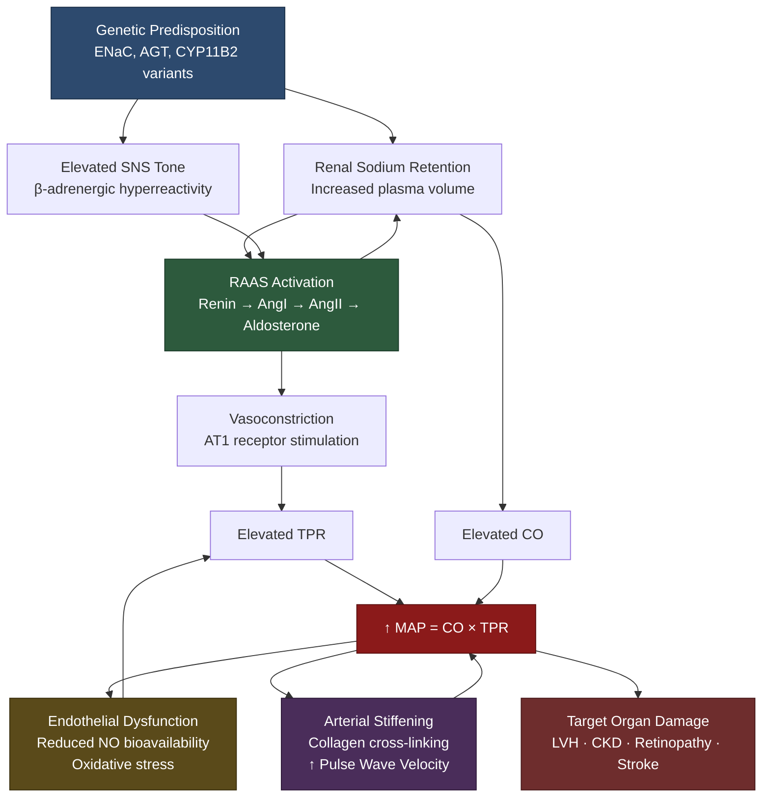

# Lesson 2: Hypertension Pathophysiology with Classification Systems

## 1. First-Principles Intuition & Invariants

Blood pressure is not a static property of the cardiovascular system; it is an emergent result of competing physiological negotiations between cardiac output, vascular resistance, blood volume, and autonomic tone. To understand hypertension, one must first abandon the intuition that elevated pressure is simply "too much force" and instead recognize it as a failure of regulatory homeostasis across multiple overlapping control systems. The arterial tree is designed to tolerate a wide range of transient pressure fluctuations — the surge during maximal exertion, the drop during sleep — and return reliably to a defended set point. When that set point itself drifts upward and becomes fixed, the pathological state we call hypertension has taken root.

The fundamental hemodynamic identity governing this entire domain is the relationship between mean arterial pressure (MAP), cardiac output (CO), and total peripheral resistance (TPR): **MAP = CO × TPR**. Every mechanism that produces sustained hypertension must ultimately act through one or both terms on the right side of this equation. Increased cardiac output from volume expansion driven by sodium retention elevates the left side. Structural narrowing of resistance arterioles, neurohormonal vasoconstriction, and endothelial dysfunction elevate TPR. In practice, most established hypertension is characterized by normal or even reduced cardiac output with markedly elevated peripheral resistance, reflecting a disease that begins with volume and neurohormonal dysregulation and matures into a structural vascular disorder.

The distinction between **primary (essential) hypertension** and **secondary hypertension** is the most consequential conceptual divide in clinical practice. Primary hypertension, which accounts for roughly 90–95% of all cases, has no single identifiable cause. It is a polygenic, environmentally modulated disorder in which the cumulative effect of dozens of small-effect genetic variants, acting on renal sodium handling, the renin-angiotensin-aldosterone system (RAAS), sympathetic nervous system tone, and endothelial signaling, shifts the pressure set point upward over decades. Secondary hypertension, by contrast, arises from a discrete, identifiable lesion or disease process — primary aldosteronism, renovascular stenosis, pheochromocytoma, obstructive sleep apnea, or thyroid dysfunction, among others — and can in principle be cured rather than merely managed once the underlying cause is corrected. The practical implication is that every new hypertension diagnosis must pass through a clinical filter asking: is this typical primary hypertension, or does the age of onset, severity, medication resistance, or associated features demand a secondary workup?

Genetic architecture contributes to primary hypertension through several convergent pathways. Variants in genes encoding the epithelial sodium channel (ENaC), aldosterone synthase (CYP11B2), angiotensinogen (AGT), and the beta-2 adrenergic receptor collectively set a person's renal salt sensitivity, their baseline RAAS activity, and their sympathetic nervous system reactivity. Family history confers a roughly 35–65% heritability estimate for blood pressure, yet no single Mendelian variant accounts for most of this variance, which is why pharmacogenomics has not yet displaced conventional phenotypic classification in clinical decision-making. What genetics provides, practically, is a prior probability: a 45-year-old with bilateral family history of early cardiovascular disease and newly discovered stage 2 hypertension has a different pre-test landscape than a 65-year-old presenting after decades of high dietary sodium intake and sedentary behavior.

Endothelial dysfunction is both a consequence and an amplifier of elevated pressure. The endothelium maintains vascular tone principally through the balance between nitric oxide (NO) bioavailability and vasoconstrictor mediators like endothelin-1 and thromboxane A2. Under normal conditions, shear stress from flowing blood continuously stimulates endothelial nitric oxide synthase (eNOS) to produce NO, which diffuses into vascular smooth muscle and drives cyclic GMP-mediated relaxation. In hypertension, elevated oxidative stress from NADPH oxidase activation and uncoupled eNOS generates superoxide radicals that scavenge and inactivate NO before it can reach smooth muscle, shifting the balance toward persistent vasoconstriction. This creates a self-reinforcing cycle: elevated pressure increases wall shear stress and mechanical stretch, which amplifies oxidative stress, which further reduces NO, which raises resistance further. By the time a practitioner encounters an established hypertensive patient, this cycle has often been running for years.

Arterial stiffness represents the structural fossilization of this functional dysregulation. As elastin fibers in large conduit arteries fatigue and fracture under repeated pressure pulsatility, collagen cross-linking increases, and the aorta and carotid arteries lose their Windkessel buffering capacity. The clinical consequence is an increase in pulse wave velocity (PWV) and a rise in systolic pressure without a proportionate rise in diastolic pressure — the characteristic widening of pulse pressure seen in elderly hypertensive patients. This matters therapeutically because stiff arteries amplify the work the left ventricle must perform against afterload, accelerating the progression toward left ventricular hypertrophy and diastolic dysfunction.

Neurohormonal dysregulation ties these threads together. Elevated sympathetic nervous system (SNS) activity raises heart rate, increases myocardial contractility, and constricts resistance arterioles. It also activates juxtaglomerular renin release, triggering the RAAS cascade: renin cleaves angiotensinogen to angiotensin I, which angiotensin-converting enzyme (ACE) converts to angiotensin II, which acts on AT1 receptors to cause direct vasoconstriction, stimulate aldosterone secretion (promoting renal sodium and water retention), and drive central sympathetic outflow — a closed positive feedback loop. Understanding this cascade is not an academic exercise; it is the mechanistic map that explains why ACE inhibitors, ARBs, and aldosterone antagonists all interrupt hypertension through distinct but overlapping nodes in the same pathway.

---

## 2. Core Architecture & Mechanics

The pathophysiological architecture of hypertension can be understood as a network of interacting regulatory subsystems, each capable of initiating or sustaining elevated pressure, and each feeding back into the others in ways that make isolated single-cause explanations clinically inadequate.

The diagram above captures a critical architectural truth: hypertension is not a linear disease but a **recurrent causal loop**. Genetic predisposition biases two upstream regulators simultaneously — renal sodium handling and sympathetic tone. Both converge on RAAS activation. The RAAS output diverges again into vasoconstriction (raising TPR) and further volume retention (raising CO). The resulting MAP elevation then damages the endothelium and stiffens conduit arteries, which feed back into the resistance arm and amplify the pressure signal. By the time target organ damage appears, the system has long since lost its dependence on the original genetic trigger; the structural changes have become self-sustaining drivers.

**Primary versus secondary hypertension mechanics** diverge at the point of origin within this diagram. In primary hypertension, the initiating perturbation is diffuse and polygenic, distributed across the renal, neurological, and endothelial nodes simultaneously. In secondary hypertension, a single high-amplitude input overwhelms the system at a specific node. Renal artery stenosis causes unilateral or bilateral reduced renal perfusion pressure, which is interpreted by the juxtaglomerular apparatus as systemic hypotension, triggering pathological renin hypersecretion that drives AngII and aldosterone to levels far exceeding homeostatic need. Primary aldosteronism bypasses renin entirely and forces inappropriate sodium retention directly through autonomous aldosterone secretion from an adrenal adenoma or bilateral hyperplasia. Pheochromocytoma floods the system with catecholamines, activating the SNS arm at crisis-level intensity. Each of these mechanisms produces a distinctive biochemical fingerprint that the astute clinician exploits during the secondary workup.

The **JNC-8 and ACC/AHA classification systems** represent two important but distinct approaches to translating continuous blood pressure data into categorical clinical decisions. The Eighth Joint National Committee (JNC-8, 2014) retained the threshold of 140/90 mmHg for diagnosing hypertension in most adults, with a relaxed target of less than 150/90 mmHg for patients aged 60 and older without diabetes or chronic kidney disease. The ACC/AHA 2017 guidelines made a consequential shift: they lowered the diagnostic threshold to 130/80 mmHg for stage 1 hypertension, reclassifying what JNC-8 would have called "prehypertension" into an actionable stage requiring lifestyle intervention and, in high-risk patients, pharmacotherapy. The 2017 framework identifies a blood pressure of 120–129/less than 80 mmHg as "elevated," 130–139/80–89 mmHg as stage 1, and at or above 140/90 mmHg as stage 2. Hypertensive urgency and emergency are defined by readings above 180/120 mmHg, with the critical distinction between them resting on the presence or absence of acute target organ damage rather than the pressure reading itself.

Practically, this classification divergence means that a 55-year-old with consistent readings of 134/84 mmHg is "hypertensive stage 1" under ACC/AHA 2017 guidance but entirely normotensive under JNC-8 criteria. The practitioner's choice of reference framework therefore materially affects who receives a diagnosis, who is offered medication, and how population-level cardiovascular risk is estimated. Neither system is wrong; they represent different calibrations of the sensitivity/specificity trade-off, with the 2017 guidelines accepting more false-positive diagnoses in exchange for earlier intervention in patients carrying elevated 10-year cardiovascular risk.

**White coat hypertension** and **masked hypertension** represent two phenotypic patterns that expose the inadequacy of the single office measurement as the diagnostic gold standard. White coat hypertension describes the phenomenon in which office blood pressure readings consistently exceed 130/80 mmHg while ambulatory or home measurements remain below threshold. Its mechanism involves an exaggerated pressor response to the clinical encounter: sympathetically mediated vasoconstriction and cardiac acceleration driven by anticipatory anxiety, provider authority, and the procedural stimulus of cuff inflation. Far from being a benign curiosity, white coat hypertension is associated with intermediate cardiovascular risk, metabolic syndrome features, and eventual progression to sustained hypertension in a substantial proportion of patients. Masked hypertension, the inverse phenomenon, is clinically more dangerous because it escapes detection in the clinical setting. Patients with masked hypertension have normal office pressures but carry the full organ damage burden of sustained elevation during their daily lives — particularly during morning surge, physical activity, and occupational stress. Ambulatory blood pressure monitoring (ABPM) remains the reference standard for identifying both phenotypes, with 24-hour mean thresholds of 130/80 mmHg for daytime and 120/70 mmHg for nighttime periods.

---

## 3. High-Performance Optimization & Failure Modes

The practitioner's highest-yield intervention in hypertension management is not selecting the right drug class; it is ensuring that the blood pressure measurement itself is valid. Office measurement error is pervasive and systematically inflates readings. The correct protocol requires the patient to have rested quietly for five minutes in a seated position with back supported, feet flat on the floor, and arm at heart level. The cuff must be sized to encircle at least 80% of arm circumference; using a standard adult cuff on a large arm produces falsely elevated readings through increased compression artifact. Two measurements should be taken at least one minute apart and averaged. Automated oscillometric devices validated to international standards (AAMI/ISO 81060-2) are preferred over mercury or aneroid devices in routine practice, and conversational distraction during measurement raises systolic readings by 10–15 mmHg. These are not trivial sources of error — they are the difference between a correct diagnosis and years of unnecessary medication.

Once a valid measurement confirms hypertension, the secondary workup decision tree is the next critical execution step. The practitioner should conduct this workup systematically rather than reflexively. Resistant hypertension — defined as blood pressure remaining above goal despite concurrent use of three appropriately dosed antihypertensive agents of different classes, one of which is a diuretic — mandates evaluation for secondary causes in all patients, regardless of age. Even in non-resistant presentations, secondary workup is indicated when hypertension presents before age 30 without obesity or family history, when onset is abrupt rather than gradual, when spontaneous hypokalemia accompanies the hypertension (suggesting primary aldosteronism), when paroxysmal symptoms such as headache, palpitations, and diaphoresis suggest pheochromocytoma, or when an epigastric bruit or asymmetric kidney sizes on imaging suggest renovascular disease.

The plasma aldosterone-to-renin ratio (ARR) is the first-line screening tool for primary aldosteronism and should be drawn in the morning after the patient has been ambulatory for at least two hours, with hypokalemia corrected beforehand. An ARR exceeding 20–30 (with aldosterone in ng/dL and renin in ng/mL/hr) warrants confirmatory testing with salt loading or fludrocortisone suppression. For pheochromocytoma, 24-hour urine fractionated metanephrines and catecholamines, or plasma free metanephrines, offer high sensitivity and are interpreted against age-adjusted reference ranges. Renal artery stenosis evaluation begins with Doppler ultrasound of the renal arteries, with CT angiography or MR angiography as confirmatory modalities when clinical suspicion is high and ultrasound is non-diagnostic.

The most consequential failure mode in hypertension management is **clinical inertia**: the tendency to under-diagnose, under-treat, or accept continued elevation without escalation. Studies consistently demonstrate that physicians leave hypertension inadequately controlled far more often than they over-treat it. The pathophysiological cost of this inertia is progressive target organ damage accumulating silently across the left ventricle, retinal vasculature, glomerular filtration apparatus, and cerebral small vessels. Left ventricular hypertrophy, the structural consequence of sustained pressure overload, doubles the risk of sudden cardiac death and significantly impairs diastolic filling, often before any symptom appears. The practitioner who interprets an echocardiographic finding of concentric LVH as a reason to treat more aggressively is making the correct mechanistic inference: the heart is reporting the cumulative pressure exposure history that the office blood pressure record may have underestimated.

A second major failure mode is misclassification of **pseudoresistance** as true resistant hypertension. Before exhausting the secondary workup and escalating to fourth and fifth drug agents, the clinician should systematically eliminate nonadherence (confirmed with pill counts, pharmacy refill records, or supervised dosing), white coat effect (confirmed with ABPM or validated home monitoring), and suboptimal measurement technique. Medication adherence in asymptomatic chronic disease is structurally poor; antihypertensive nonadherence rates of 40–50% are routinely documented in pharmacoepidemiological studies. Urine toxicology screening for antihypertensive metabolites offers a direct but underutilized confirmation approach in complex cases. Only after pseudoresistance has been excluded should the clinical energy shift toward renal denervation, mineralocorticoid receptor antagonist addition, or invasive vascular workup.

The therapeutic calibration of classification criteria to individual patient phenotype is the final optimization challenge. The 10-year atherosclerotic cardiovascular disease (ASCVD) risk calculator integrates blood pressure with age, sex, race, lipid profile, diabetes status, and smoking history to generate a probability that should inform the stage 1 hypertension treatment decision under ACC/AHA 2017 guidelines. A patient with stage 1 hypertension and a 10-year ASCVD risk below 10% is managed with lifestyle intervention alone for three to six months before pharmacotherapy is considered. A patient with identical blood pressure but a 10-year risk above 10% should receive concurrent lifestyle and pharmacological intervention from the first visit. This risk-stratified framework prevents both under-treatment of high-risk patients and unnecessary medicalization of low-risk individuals who would normalize with dietary sodium restriction, exercise, and weight management.

---

## 4. Summary & Verification Matrix

| Domain | Governing Invariant | Mechanism | Diagnostic Criterion | Key Failure Mode |
|---|---|---|---|---|
| Hemodynamic Foundation | MAP = CO × TPR; sustained hypertension requires pathological elevation of one or both terms | Volume expansion raises CO; arterial vasoconstriction and stiffening raise TPR; both are driven by RAAS and SNS dysregulation | Confirmed by average of ≥2 validated measurements on ≥2 separate occasions using calibrated, correctly sized cuff | Measurement error (cuff sizing, positioning, no rest period) invalidates the diagnosis before it begins |
| Primary vs. Secondary Classification | 90–95% of hypertension is primary (polygenic, no discrete cause); 5–10% is secondary (single identifiable lesion amenable to targeted therapy) | Primary: distributed polygenic bias across renal, neurohormonal, and endothelial nodes; Secondary: high-amplitude single-node input (renin hypersecretion, autonomous aldosterone, catecholamine excess) | Secondary workup triggered by: age < 30, abrupt onset, spontaneous hypokalemia, resistant hypertension (≥3 agents including diuretic), paroxysmal symptoms, asymmetric kidneys | Failure to screen for primary aldosteronism (ARR) in resistant or hypokalemic hypertension leaves a treatable surgical cause uncorrected |
| Endothelial Dysfunction & Arterial Stiffness | Reduced NO bioavailability creates a self-amplifying oxidative-vasoconstrictor cycle; arterial collagen cross-linking converts functional to structural resistance elevation | eNOS uncoupling → superoxide scavenges NO → persistent vasoconstriction → increased wall stress → further oxidative stress; Windkessel loss → ↑ pulse wave velocity → ↑ systolic load | Pulse wave velocity > 10 m/s (carotid-femoral) indicates significant large-artery stiffening; echocardiographic LVH signals cumulative pressure burden exceeding office measurements | Treating the pressure number without recognizing established structural stiffness underestimates residual cardiovascular risk in apparently controlled patients |
| JNC-8 vs. ACC/AHA 2017 Classification | Classification threshold selection is a sensitivity/specificity calibration, not a biological truth; threshold choice determines who receives a diagnosis and treatment | JNC-8: HTN ≥140/90 mmHg (≥150/90 for age ≥60); ACC/AHA 2017: elevated 120–129/< 80, Stage 1 130–139/80–89, Stage 2 ≥140/90, crisis ≥180/120 | ACC/AHA Stage 1 management is risk-stratified: lifestyle only if 10-year ASCVD < 10%; lifestyle + pharmacotherapy if ASCVD ≥ 10% | Applying JNC-8 thresholds to a high-cardiovascular-risk patient defers treatment that the ACC/AHA framework would initiate, missing a window of early intervention |
| White Coat & Masked Hypertension | Single office measurement is insufficient to classify phenotype; ambulatory blood pressure monitoring (ABPM) is the reference standard | White coat: exaggerated sympatho-adrenal pressor response to clinical encounter; Masked: normal office readings with sustained daily elevation during activity, morning surge, and occupational stress | ABPM daytime mean ≥ 130/80 mmHg confirms white coat or masked pattern; nighttime mean ≥ 120/70 mmHg; non-dipping pattern (< 10% nocturnal fall) indicates heightened organ damage risk | Diagnosing white coat hypertension without ABPM leads to unnecessary pharmacotherapy; missing masked hypertension allows silent target organ damage to progress unimpeded |
| Clinical Inertia & Pseudoresistance | Under-treatment is the dominant real-world failure; resistant hypertension requires pseudoresistance exclusion before escalation to secondary workup or complex pharmacotherapy | Nonadherence (40–50% prevalence), white coat effect, and suboptimal technique mimic true pharmacological resistance; true resistance implicates secondary causes or inadequate dosing | Confirm adherence via pharmacy refills, pill count, urine metabolites; confirm office elevation with ABPM before classifying as resistant; true resistance = ≥3 agents optimally dosed including diuretic | Escalating pharmacotherapy or pursuing invasive workup without first confirming adherence and excluding white coat effect wastes resources and exposes the patient to unnecessary drug burden |
