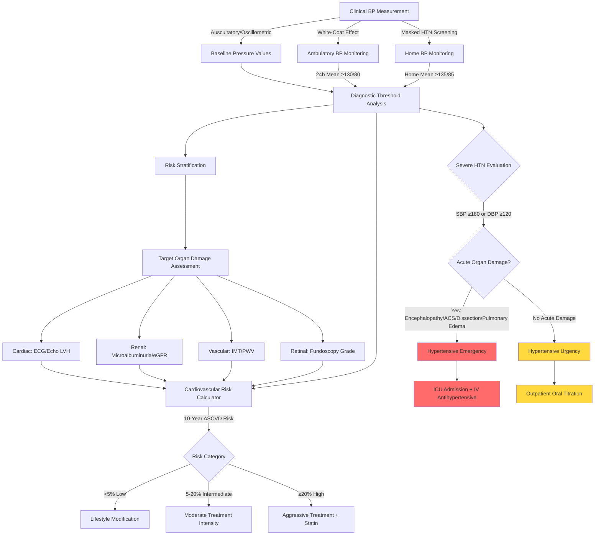

# Lesson 3: Measurement Protocols for Diagnosis with Risk Stratification

## 1. First-Principles Intuition & Invariants

Blood pressure measurement stands as the foundational gateway to hypertension diagnosis, yet the apparent simplicity of wrapping a cuff around an arm belies a sophisticated interplay of fluid dynamics, acoustic signal processing, and physiological variability that can render casual measurement nearly meaningless. The arterial pressure waveform itself represents a pulsatile flow phenomenon driven by left ventricular ejection, with systolic peaks reflecting the kinetic energy of ventricular contraction superimposed on elastic recoil from compliant arterial walls, while diastolic nadirs capture the maintained pressure during ventricular filling governed by peripheral vascular resistance and arterial compliance. This physiological substrate introduces beat-to-beat variability, circadian oscillation with nocturnal dipping patterns, white-coat hypertension driven by sympathetic activation, and masked hypertension where clinic readings falsely reassure while ambulatory pressures remain dangerously elevated.

The diagnostic framework must therefore transcend single-point clinic measurements and embrace a stratified measurement topology that captures pressure behavior across multiple contexts, time windows, and physiological states. Sphygmomanometry, whether auscultatory or oscillometric, samples discrete pressure snapshots but cannot resolve the continuous pressure trajectory that governs end-organ perfusion and vascular stress. Ambulatory blood pressure monitoring extends surveillance across 24-hour cycles, revealing nocturnal non-dipping patterns associated with autonomic dysfunction, obstructive sleep apnea, and accelerated cardiovascular risk. Home blood pressure monitoring democratizes measurement frequency, mitigating white-coat effects while detecting masked hypertension that office readings miss. Each modality introduces unique sources of error: cuff size mismatch produces systematic bias scaling with arm circumference, improper arm positioning generates hydrostatic pressure gradients, inadequate rest periods fail to dissipate sympathetic surges, and observer bias in auscultatory readings creates digit preference artifacts.

Once accurate pressure values are secured, risk stratification integrates these measurements with target organ damage markers and established cardiovascular risk algorithms to partition patients into actionable risk categories that guide treatment intensity. The presence of left ventricular hypertrophy detected by electrocardiography or echocardiography signals chronic pressure overload with increased arrhythmia risk and heart failure susceptibility. Retinal arteriolar narrowing and arteriovenous nicking visualized through fundoscopy reflect systemic microvascular remodeling that parallels cerebral and renal small vessel disease. Microalbuminuria quantifies glomerular endothelial dysfunction and predicts progression to overt nephropathy and cardiovascular events. Carotid intima-media thickness measured by ultrasonography captures subclinical atherosclerosis burden, while pulse wave velocity assesses arterial stiffness that amplifies systolic pressure and compromises coronary perfusion. Risk calculators such as the Framingham Risk Score, ASCVD Risk Estimator, and QRISK3 integrate blood pressure with age, lipid profile, smoking status, and diabetes to generate 10-year cardiovascular event probabilities that inform pharmacological intervention thresholds.

The clinical imperative differentiates hypertensive emergencies, characterized by severely elevated blood pressure with acute end-organ damage demanding immediate intravenous antihypertensive therapy, from hypertensive urgencies, where severe elevation occurs without acute damage and permits cautious oral treatment over hours to days. Emergency presentations include hypertensive encephalopathy with posterior reversible encephalopathy syndrome, acute aortic dissection with asymmetric pulses and widened mediastinum, acute pulmonary edema with crackles and hypoxemia, unstable angina or myocardial infarction, and acute renal failure with oliguria and rising creatinine. Overzealous pressure reduction in emergencies risks cerebral hypoperfusion due to rightward-shifted autoregulation curves, mandating controlled reduction by 10–25% in the first hour followed by gradual normalization over 24–48 hours. Urgencies, lacking acute damage, tolerate gradual outpatient pressure reduction with oral agents, avoiding precipitous drops that provoke ischemic complications in chronically hypertensive vascular beds.

## 2. Core Architecture & Mechanics

The measurement architecture begins with the fundamental oscillometric or auscultatory transduction of intra-arterial pressure into external cuff pressure signals. Oscillometric devices inflate the cuff above systolic pressure, then deflate in stepwise decrements while a pressure transducer detects oscillation amplitude in the cuff pressure waveform. These oscillations arise from arterial wall pulsations transmitted through tissue to the cuff bladder. Systolic pressure corresponds to the cuff pressure where oscillations first appear with rapid amplitude increase, mean arterial pressure aligns with maximum oscillation amplitude, and diastolic pressure occurs where oscillations diminish and plateau. Proprietary algorithms map oscillation envelopes to pressure values, introducing device-specific calibration variations and potential systematic bias. Auscultatory sphygmomanometry employs a stethoscope positioned over the brachial artery to detect Korotkoff sounds—audible pressure pulses generated by turbulent flow through the partially occluded artery. Systolic pressure is identified at the first Korotkoff sound (Phase I), while diastolic pressure corresponds to sound disappearance (Phase V) or muffling (Phase IV in pregnancy or high-output states). Auscultatory measurement demands trained auditory discrimination and introduces observer-dependent variability, including digit preference where observers round to preferred terminal digits (0 or 5 mm Hg), and terminal digit aversion where specific digits are systematically avoided.

Ambulatory blood pressure monitoring deploys a portable oscillometric device programmed to measure blood pressure at regular intervals, typically every 15–30 minutes during waking hours and every 30–60 minutes during sleep, accumulating 40–70 readings over 24 hours. The device stores time-stamped measurements with patient-reported wake and sleep times to calculate daytime, nighttime, and 24-hour mean pressures. Nocturnal dipping, defined as a nighttime systolic pressure reduction of ≥10% relative to daytime values, serves as a key physiological marker; non-dippers exhibit attenuated nocturnal reductions associated with increased cardiovascular and renal risk. Extreme dippers with >20% reductions face elevated stroke risk due to hypoperfusion during sleep. Ambulatory monitoring eliminates white-coat effects, captures pressure load across circadian cycles, and predicts cardiovascular outcomes more accurately than clinic measurements. Diagnostic thresholds differ from clinic values: ambulatory hypertension is defined as daytime mean ≥135/85 mm Hg, nighttime mean ≥120/70 mm Hg, or 24-hour mean ≥130/80 mm Hg, reflecting the lower pressures observed outside clinical settings.

Home blood pressure monitoring empowers patients to perform standardized measurements in their residential environment, accumulating multiple readings across days or weeks. Validated automated oscillometric devices with upper-arm cuffs are preferred over wrist or finger devices, which introduce positional artifacts and reduced accuracy. The protocol mandates seated rest for five minutes before measurement, with back supported, feet flat on the floor, and arm supported at heart level. Two consecutive measurements separated by one minute are averaged, repeated in the morning before medications and in the evening before dinner, across at least three days and ideally seven days. Home blood pressure hypertension is diagnosed at ≥135/85 mm Hg mean, equivalent to ambulatory daytime thresholds. Home monitoring enhances medication adherence through patient engagement, detects masked hypertension with 10–15% prevalence in normotensive clinic populations, and reduces therapeutic inertia by providing longitudinal pressure trends that justify treatment intensification.

Target organ damage assessment constructs a multi-system damage profile that stratifies risk beyond blood pressure values alone. Electrocardiography screens for left ventricular hypertrophy using voltage criteria such as the Cornell criterion (S wave in V3 plus R wave in aVL >28 mm in men or >20 mm in women) or Sokolow-Lyon criterion (S wave in V1 plus R wave in V5 or V6 >35 mm), alongside ST-T wave abnormalities reflecting strain patterns. Echocardiography quantifies left ventricular mass indexed to body surface area, with hypertrophy defined as left ventricular mass index >115 g/m² in men or >95 g/m² in women, and assesses diastolic dysfunction through E/A ratio reversal and elevated E/e' ratio. Fundoscopy visualizes hypertensive retinopathy graded by the Keith-Wagener-Barker classification: Grade I shows arteriolar narrowing with increased light reflex, Grade II adds arteriovenous nicking where arterioles compress underlying venules, Grade III introduces retinal hemorrhages and cotton-wool spots reflecting ischemia, and Grade IV displays papilledema with optic disc swelling indicating malignant hypertension. Urinalysis detects microalbuminuria (30–300 mg/24h or albumin-to-creatinine ratio 30–300 mg/g) signaling glomerular endothelial dysfunction, while serum creatinine and estimated glomerular filtration rate (eGFR) quantify renal impairment. Carotid ultrasonography measures intima-media thickness at the common carotid artery, with values >0.9 mm indicating increased cardiovascular risk and atherosclerotic plaque presence. Pulse wave velocity assessed by applanation tonometry at carotid and femoral sites quantifies arterial stiffness, with values >10 m/s conferring elevated risk.

Cardiovascular risk calculators integrate these data streams into probabilistic risk estimates that inform treatment thresholds and intensity targets. The Pooled Cohort Equations ASCVD Risk Estimator, endorsed by the American College of Cardiology and American Heart Association, incorporates age, sex, race, total and HDL cholesterol, systolic blood pressure, antihypertensive treatment status, diabetes, and smoking to compute 10-year risk of atherosclerotic cardiovascular disease (myocardial infarction, stroke, or cardiovascular death). Risk categories partition patients into low risk (<5%), borderline risk (5–7.5%), intermediate risk (7.5–20%), and high risk (≥20%), with treatment recommendations escalating across categories. The Framingham Risk Score offers alternative risk estimation with similar input variables, while QRISK3, developed in the United Kingdom, adds body mass index, chronic kidney disease, atrial fibrillation, rheumatoid arthritis, and systolic blood pressure variability to enhance prediction accuracy. These calculators guide statin therapy initiation, antihypertensive treatment intensification, and aspirin prophylaxis decisions, translating continuous risk gradients into discrete action thresholds that balance treatment benefit against adverse effects and cost.

## 3. High-Performance Optimization & Failure Modes

Optimization of measurement protocols demands rigorous attention to technical execution and environmental standardization to minimize measurement error and enhance diagnostic precision. Cuff selection must match bladder width to 40% of arm circumference and bladder length to 80% of arm circumference, with standard adult cuffs (12–13 cm width) appropriate for arm circumferences of 27–34 cm. Undersized cuffs systematically overestimate pressure by failing to fully compress the brachial artery, requiring higher cuff pressures to achieve occlusion, while oversized cuffs underestimate pressure through excessive tissue dampening. Obese patients with arm circumferences exceeding 42 cm require large adult or thigh cuffs to avoid spurious hypertension diagnoses. Arm positioning at heart level (mid-sternum, fourth intercostal space) eliminates hydrostatic pressure artifacts; each 10 cm vertical deviation introduces approximately 8 mm Hg pressure error, with arm elevation causing underestimation and arm lowering causing overestimation. Patient preparation requires five minutes of seated rest in a quiet environment with back supported, legs uncrossed, and bladder emptied, since sympathetic activation from recent physical activity, full bladder, or conversational stress elevates pressure by 10–15 mm Hg. Measurement technique specifies inflating the cuff 20–30 mm Hg above palpated systolic pressure to ensure complete arterial occlusion, then deflating at 2–3 mm Hg per second to resolve pressure transitions accurately. Rapid deflation causes underestimation of systolic and overestimation of diastolic pressures by missing early and late Korotkoff sounds.

Ambulatory monitoring optimization addresses patient compliance and data quality through careful device programming and patient education. Cuff inflation frequency balances adequate sampling density against patient discomfort and sleep disruption, with 20-minute intervals during the day and 30–60 minute intervals at night providing robust mean estimates without excessive burden. Patients are instructed to relax the arm during measurements, avoid vigorous activity or exercise within 30 minutes of scheduled readings, and maintain a diary of wake and sleep times, medication doses, and symptomatic events to contextualize pressure fluctuations. Artifact rejection algorithms automatically exclude readings with irregular pulse detection, excessive arm motion, or implausible pressure values, but manual review of pressure traces remains essential to identify systematic device malfunction or persistent artifact. Data interpretation requires calculating separate daytime and nighttime means rather than simple 24-hour averages, since physiological dipping patterns carry prognostic significance independent of mean pressure. Ambulatory monitoring fails to provide value when patients cannot tolerate cuff inflations due to severe pain or skin fragility, when shift work or irregular sleep schedules prevent meaningful day-night partitioning, or when excessive artifacts due to tremor or dyskinesias compromise data quality.

Home monitoring optimization emphasizes standardized measurement technique and data aggregation protocols that mirror professional standards while accommodating patient capabilities. Device validation ensures accuracy through independent testing against mercury sphygmomanometry or invasive intra-arterial measurements, with validated devices listed in registries maintained by organizations such as the British Hypertension Society, European Society of Hypertension, and STRIDE BP. Patients require initial training sessions demonstrating proper cuff application, arm positioning, and device operation, with return demonstration to confirm competence. The measurement protocol specifies duplicate readings in the morning before breakfast and medications, and in the evening before dinner, with one-minute intervals between readings and averaging of the two values. Measurements are repeated across at least three days and preferably seven days, with the first day discarded to allow acclimatization, and subsequent values averaged to calculate mean home blood pressure. Telemedicine integration with Bluetooth-enabled devices that automatically transmit readings to electronic health records enhances data capture and enables real-time clinician review, although security and privacy concerns require HIPAA-compliant data transmission and storage. Home monitoring fails when cognitive impairment prevents protocol adherence, when arthritis or visual impairment compromises device operation, or when patient anxiety regarding measurements paradoxically elevates pressures through repeated sympathetic activation.

Risk stratification optimization integrates target organ damage markers and cardiovascular risk scores to identify patients requiring aggressive treatment despite borderline pressure elevations, and conversely to avoid overtreatment of low-risk patients with isolated pressure elevations. The presence of any target organ damage elevates risk category independent of calculated risk score, mandating treatment intensification. For example, a patient with 7% calculated 10-year ASCVD risk (borderline) but with left ventricular hypertrophy on echocardiography is reclassified to high risk, justifying statin initiation and lower blood pressure targets. Conversely, young patients with isolated systolic hypertension but no target organ damage or additional risk factors may be managed with lifestyle modification alone, avoiding pharmacological adverse effects in low absolute risk populations. Risk calculator limitations include population-specific calibration that reduces accuracy in diverse ethnic groups not represented in derivation cohorts, inability to incorporate family history or novel biomarkers like high-sensitivity C-reactive protein or lipoprotein(a), and failure to account for competing mortality risks in elderly populations where 10-year cardiovascular risk may overestimate treatment benefit due to limited life expectancy.

Hypertensive emergency management demands immediate recognition and controlled blood pressure reduction to prevent irreversible organ damage while avoiding precipitous drops that provoke ischemic complications. Clinical presentation guides the urgency of intervention: acute aortic dissection requires immediate reduction of systolic blood pressure to <120 mm Hg within 20 minutes using intravenous beta-blockers (esmolol, labetalol) combined with vasodilators (nitroprusside, nicardipine) to reduce both pressure and shear stress on the aortic wall. Acute pulmonary edema with hypertensive crisis responds to intravenous loop diuretics (furosemide) and vasodilators (nitroglycerin, nitroprusside) to reduce preload and afterload, rapidly reversing pulmonary congestion. Hypertensive encephalopathy with altered mental status, seizures, and posterior reversible encephalopathy syndrome on MRI requires cautious pressure reduction by 10–15% in the first hour and 25% over the first eight hours, since overly aggressive reduction risks watershed infarction in chronically hypertensive patients with rightward-shifted cerebral autoregulation curves. Acute myocardial infarction or unstable angina with hypertension benefits from intravenous nitroglycerin or beta-blockers to reduce myocardial oxygen demand, avoiding excessive pressure reduction that compromises coronary perfusion. Intravenous agents chosen for their rapid onset, short half-life, and titratable effects include nicardipine (dihydropyridine calcium channel blocker, onset 5–10 minutes), esmolol (ultrashort-acting beta-blocker, onset <60 seconds), labetalol (combined alpha and beta blocker, onset 2–5 minutes), and nitroprusside (direct vasodilator, onset <60 seconds, requiring arterial line monitoring due to potent hypotensive effects and cyanide toxicity risk with prolonged use). Oral agents are avoided in emergencies due to unpredictable absorption and inability to titrate effects, with sublingual nifedipine specifically contraindicated due to uncontrolled hypotension risk and reflex tachycardia precipitating myocardial ischemia.

Hypertensive urgency management permits gradual outpatient pressure reduction over 24–48 hours using oral antihypertensive agents, emphasizing patient education and close follow-up to ensure adequate response without precipitous drops. Long-acting oral agents such as amlodipine (calcium channel blocker, onset 6–12 hours, duration 24 hours), lisinopril (ACE inhibitor, onset 1 hour, peak 6 hours), or clonidine (central alpha-2 agonist, onset 30–60 minutes) provide controlled pressure reduction while minimizing ischemic risk. Patients are instructed to rest in a calm environment, take the prescribed oral agent, and monitor home blood pressure every 2–4 hours. Follow-up within 24–48 hours confirms adequate response and allows treatment adjustment. Emergency department discharge is appropriate for urgencies once acute end-organ damage is excluded through history, physical examination, electrocardiography, chest radiography, and basic metabolic panel with creatinine, reserving admission for patients with concerning symptoms, inadequate outpatient support, or inability to follow up within 24 hours.

## 4. Summary & Verification Matrix

| **Invariant Domain** | **Core Mechanism** | **Diagnostic Threshold** | **Optimization Target** | **Failure Mode** |
|----------------------|-------------------|-------------------------|------------------------|------------------|
| **Sphygmomanometry Technique** | Oscillometric amplitude mapping or auscultatory Korotkoff sound detection during cuff deflation | Clinic HTN: ≥130/80 mm Hg (ACC/AHA) or ≥140/90 mm Hg (ESC/ESH); cuff bladder 40% arm circumference width, 80% length | Arm at heart level, 5-minute seated rest, appropriate cuff size, 2–3 mm Hg/s deflation rate | Undersized cuff → 10–30 mm Hg overestimation; arm below heart → 8 mm Hg per 10 cm underestimation; white-coat effect → false HTN diagnosis |
| **Ambulatory BP Monitoring** | Automated oscillometric readings every 15–60 minutes over 24 hours; separate daytime and nighttime mean calculation | Ambulatory HTN: 24h mean ≥130/80, daytime ≥135/85, nighttime ≥120/70 mm Hg; non-dipping: <10% nocturnal SBP reduction | 20-minute daytime intervals, 30–60 minute nighttime intervals; artifact rejection; diary of wake/sleep times | Excessive artifacts from motion/tremor → unreliable means; shift work/irregular sleep → invalid day/night partitioning; patient intolerance of nocturnal cuff inflations |
| **Home BP Monitoring** | Patient-performed duplicate morning and evening measurements with validated automated oscillometric device over ≥3 days | Home HTN: ≥135/85 mm Hg mean; duplicate readings 1 minute apart, average of 3–7 days excluding first day | Validated device (BHS/ESH/STRIDE BP), seated rest 5 minutes, arm supported at heart level, Bluetooth transmission for remote monitoring | Cognitive impairment → protocol non-adherence; white-coat effect at home in anxious patients; non-validated wrist/finger devices → inaccurate readings |
| **Target Organ Damage Assessment** | Multi-system evaluation: ECG/echo for LVH, fundoscopy for retinopathy, urinalysis for microalbuminuria, carotid ultrasound for IMT/plaque, PWV for arterial stiffness | LVH: Cornell >28 mm (men) or >20 mm (women), LV mass index >115 g/m² (men) or >95 g/m² (women); microalbuminuria 30–300 mg/g; IMT >0.9 mm; PWV >10 m/s | Serial assessments to track treatment response; multi-modality integration for comprehensive risk profile | Single-modality screening misses subclinical damage in other vascular beds; microalbuminuria false positives from exercise or UTI; PWV measurement technique variability |
| **Cardiovascular Risk Stratification** | ASCVD Risk Estimator or Framingham integrating age, BP, lipids, diabetes, smoking → 10-year CV event probability | Low <5%, borderline 5–7.5%, intermediate 7.5–20%, high ≥20%; any target organ damage elevates to high risk | Target organ damage screening in intermediate risk; enhanced risk markers (hs-CRP, Lp(a), CAC score) for risk refinement | Population-specific calibration limits accuracy in non-derivation cohorts; competing mortality in elderly overestimates treatment benefit; inability to incorporate family history |
| **Hypertensive Emergency vs Urgency** | Emergency: severe HTN (SBP ≥180 or DBP ≥120) with acute end-organ damage (encephalopathy, ACS, dissection, pulmonary edema); urgency: severe HTN without acute damage | Emergency: ICU admission, IV antihypertensive (nicardipine, esmolol, labetalol), 10–25% reduction in 1st hour; urgency: outpatient oral agents, 24–48h gradual reduction | Controlled reduction avoiding precipitous drops; agent selection based on specific organ involvement (beta-blocker + vasodilator for dissection) | Overly aggressive reduction → watershed stroke, renal hypoperfusion; sublingual nifedipine → uncontrolled hypotension; delayed recognition of acute damage → irreversible injury |
