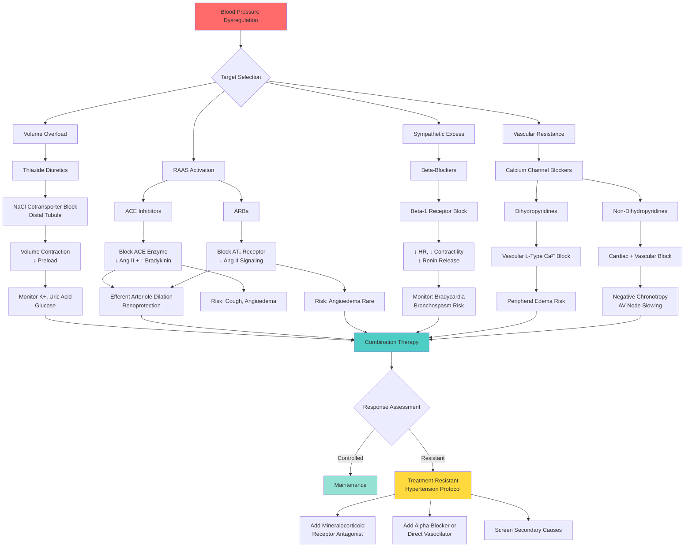

# Lesson 4: Pharmacological Mechanisms with Nonpharmacological Management

## 1. First-Principles Intuition & Invariants

Blood pressure regulation emerges from the continuous dynamic interplay between cardiac output and total peripheral vascular resistance, governed by the fundamental equation **MAP = CO × SVR**, where mean arterial pressure equals cardiac output multiplied by systemic vascular resistance. This deceptively simple relationship masks extraordinary biological complexity: cardiac output itself depends on heart rate and stroke volume, while peripheral resistance responds to sympathetic nervous tone, circulating vasoactive hormones, local metabolic demands, and endothelial nitric oxide production. Hypertension develops when one or more regulatory nodes in this distributed control network become dysregulated, creating persistent elevation in arterial pressure that accelerates vascular injury, left ventricular hypertrophy, renal damage, and cerebrovascular disease.

The renin-angiotensin-aldosterone system functions as the body's master regulator of sodium balance, intravascular volume, and vascular tone. When renal perfusion pressure drops or sympathetic nervous activity increases, juxtaglomerular cells in the afferent arteriole release renin, a proteolytic enzyme that cleaves circulating angiotensinogen into the biologically inert decapeptide angiotensin I. Angiotensin-converting enzyme, abundantly expressed on pulmonary vascular endothelium, removes two amino acids from angiotensin I to generate angiotensin II, an octapeptide with profound vasoconstrictor and sodium-retaining properties. Angiotensin II binds AT₁ receptors on vascular smooth muscle to trigger intense vasoconstriction, stimulates aldosterone secretion from the zona glomerulosa of the adrenal cortex to enhance distal nephron sodium reabsorption, and promotes sympathetic nervous system activation while suppressing baroreceptor sensitivity. This cascade amplifies blood pressure through multiple reinforcing pathways, making it an ideal therapeutic target.

Calcium channel physiology provides another critical control point for vascular resistance. Vascular smooth muscle contraction depends absolutely on cytoplasmic calcium concentration: when membrane depolarization opens voltage-gated L-type calcium channels in the sarcolemma, extracellular calcium floods into the cytoplasm and binds calmodulin, activating myosin light chain kinase to phosphorylate myosin heads and enable actin-myosin cross-bridge cycling. Because arterial smooth muscle maintains tonic contraction to sustain peripheral resistance, blocking calcium influx produces profound vasodilation and immediate blood pressure reduction. The heart similarly depends on L-type calcium channels for excitation-contraction coupling in cardiomyocytes and for pacemaker depolarization in sinoatrial nodal cells, creating potential for negative chronotropic and inotropic effects alongside the desired vasodilation.

Sympathetic nervous system activity exerts moment-to-moment control over both cardiac output and peripheral resistance through catecholamine release at neurovascular junctions and from the adrenal medulla. Beta-1 adrenergic receptors in the sinoatrial node and ventricular myocardium couple through Gs proteins to adenylyl cyclase, increasing cyclic AMP production and protein kinase A activity to accelerate heart rate, enhance contractility, and increase atrioventricular conduction velocity. Alpha-1 adrenergic receptors on vascular smooth muscle trigger vasoconstriction through Gq-coupled phospholipase C activation and inositol trisphosphate-mediated calcium release from sarcoplasmic reticulum stores. Beta-2 receptors in arteriolar beds produce opposing vasodilation, creating tissue-specific responses to circulating epinephrine. Blocking beta-1 receptors reduces cardiac output and suppresses renin release from juxtaglomerular cells, interrupting the renin-angiotensin-aldosterone axis at its origin.

Sodium and water balance ultimately determines intravascular volume and preload, the primary determinant of cardiac output under normal conditions according to the Frank-Starling mechanism. The nephron reabsorbs approximately 99% of filtered sodium through segment-specific transporters: the proximal tubule reclaims 65% through sodium-hydrogen exchangers and sodium-glucose cotransporters, the thick ascending limb of Henle's loop recovers 25% via the sodium-potassium-chloride cotransporter, and the distal convoluted tubule and collecting duct fine-tune final sodium handling through aldosterone-sensitive epithelial sodium channels. Diuretics targeting different nephron segments produce graded natriuresis and volume contraction, reducing preload and cardiac output while simultaneously decreasing vascular stiffness through direct effects on vascular smooth muscle sodium handling.

## 2. Core Architecture & Mechanics

Modern antihypertensive pharmacotherapy employs five major drug classes that target distinct nodes in cardiovascular physiology, allowing rational combination therapy when monotherapy proves inadequate. Each class possesses unique mechanisms, side effect profiles, and clinical indications that guide evidence-based prescribing decisions.

Thiazide and thiazide-like diuretics inhibit the sodium-chloride cotransporter in the distal convoluted tubule, producing sustained natriuresis that contracts extracellular fluid volume and reduces cardiac preload. Hydrochlorothiazide remains widely prescribed despite inferior outcomes data compared to chlorthalidone, which possesses a 40-60 hour half-life enabling once-daily dosing and more consistent 24-hour blood pressure control. The initial blood pressure reduction from thiazides derives primarily from volume contraction, but chronic administration produces additional vasodilation through poorly understood mechanisms involving vascular smooth muscle potassium channel activation and reduced calcium sensitivity. Thiazide therapy predictably causes hypokalemia through increased distal sodium delivery to principal cells in the collecting duct, where electrogenic sodium reabsorption through epithelial sodium channels creates a lumen-negative potential that drives potassium secretion through ROMK channels. Serum potassium monitoring and potassium supplementation or potassium-sparing diuretic co-administration prevent this complication. Thiazides also impair uric acid excretion through enhanced proximal tubule reabsorption, occasionally precipitating gout in susceptible individuals, and interfere with glucose homeostasis through incompletely characterized effects on pancreatic beta cells and peripheral insulin sensitivity.

Angiotensin-converting enzyme inhibitors bind the active site of ACE with high affinity, preventing conversion of angiotensin I to angiotensin II and simultaneously blocking degradation of bradykinin, a vasodilatory peptide that stimulates endothelial nitric oxide and prostacyclin production. The suffix "-pril" identifies this drug class, with lisinopril, enalapril, and ramipril representing commonly prescribed agents. ACE inhibitors reduce peripheral vascular resistance through decreased angiotensin II-mediated vasoconstriction, lower aldosterone secretion to promote natriuresis, diminish sympathetic nervous system activity, and improve baroreceptor sensitivity. Crucially, ACE inhibitors dilate the efferent arteriole more than the afferent arteriole in the glomerulus, reducing intraglomerular capillary pressure and providing renoprotection in diabetic and non-diabetic chronic kidney disease. This selective efferent dilation explains why serum creatinine may rise 20-30% after ACE inhibitor initiation in patients with bilateral renal artery stenosis or solitary kidney stenosis: reducing efferent arteriolar tone collapses the pressure gradient driving glomerular filtration. The most troublesome side effect, occurring in 5-10% of patients, is a dry, persistent cough caused by bradykinin accumulation in bronchial tissues, necessitating drug discontinuation. Life-threatening angioedema, affecting 0.1-0.7% of patients, results from bradykinin-mediated vascular permeability and submucosal edema, typically affecting the face, lips, tongue, and occasionally the larynx.

Angiotensin receptor blockers selectively antagonize the AT₁ receptor subtype, preventing angiotensin II from activating its primary signaling pathway while leaving AT₂ receptors unblocked. The suffix "-sartan" identifies this class, which includes losartan, valsartan, olmesartan, and telmisartan. ARBs provide similar blood pressure reduction and renoprotection as ACE inhibitors without causing bradykinin accumulation, making them the logical alternative for patients who develop ACE inhibitor-induced cough. Angioedema remains possible but occurs less frequently, suggesting that angiotensin II itself may contribute to this adverse effect through non-bradykinin mechanisms. ARBs share the same creatinine-elevation pattern in renovascular disease and require identical monitoring protocols. Both ACE inhibitors and ARBs are absolutely contraindicated in pregnancy due to teratogenic effects causing oligohydramnios, fetal growth restriction, renal dysgenesis, and neonatal death when administered during second and third trimesters.

Calcium channel blockers fall into two pharmacologically distinct subclasses with different clinical profiles. Dihydropyridine calcium channel blockers, identified by the suffix "-dipine" and exemplified by amlodipine, nifedipine, and felodipine, selectively target L-type calcium channels in vascular smooth muscle with minimal direct cardiac effects at therapeutic doses. These agents produce potent peripheral vasodilation, reducing afterload and blood pressure while triggering reflex tachycardia through baroreceptor-mediated sympathetic activation. The vasodilatory effect preferentially affects arterioles over venules, creating an arteriolar-venular pressure gradient that increases capillary hydrostatic pressure and drives fluid extravasation into the interstitial space, manifesting clinically as dependent peripheral edema in 10-30% of patients. This edema does not respond to diuretic therapy because it reflects altered Starling forces rather than sodium retention. Non-dihydropyridine calcium channel blockers, including diltiazem and verapamil, exert significant cardiac effects by slowing sinoatrial node automaticity and atrioventricular node conduction in addition to peripheral vasodilation. These agents reduce heart rate and contractility, producing negative chronotropic and inotropic effects that preclude their use in combination with beta-blockers due to additive risk of bradycardia and heart failure precipitation.

Beta-adrenergic receptor antagonists reduce blood pressure through multiple mechanisms: decreased cardiac output from reduced heart rate and contractility, suppressed renin release from juxtaglomerular cells, and diminished central sympathetic outflow. Cardioselective beta-1 antagonists, including metoprolol, atenolol, and bisoprolol, preferentially block cardiac beta-1 receptors over bronchial and vascular beta-2 receptors, improving tolerability in patients with reactive airway disease, though true selectivity is dose-dependent and incomplete. Non-selective beta-blockers such as propranolol and carvedilol block both receptor subtypes, increasing bronchospasm risk but providing additional benefits in specific conditions like portal hypertension. Carvedilol and labetalol possess additional alpha-1 blocking properties, producing direct vasodilation alongside beta-blockade. Beta-blockers mask hypoglycemia symptoms in diabetic patients by blunting catecholamine-mediated tachycardia, tremor, and diaphoresis while preserving glucagon counter-regulatory responses, requiring extra vigilance during insulin titration. Abrupt beta-blocker withdrawal precipitates rebound hypertension and tachycardia from upregulated beta-receptor density, necessitating gradual dose tapering over one to two weeks.

Rational combination therapy exploits complementary mechanisms and offsetting side effects to achieve blood pressure targets unattainable with monotherapy while minimizing adverse effects. ACE inhibitors or ARBs combine synergistically with thiazide diuretics because diuretic-induced volume contraction activates the renin-angiotensin-aldosterone system, which the ACE inhibitor or ARB then blocks, preventing compensatory sodium retention. Thiazide-induced hypokalemia is attenuated by concurrent ACE inhibitor or ARB therapy through reduced aldosterone secretion. Similarly, dihydropyridine calcium channel blockers pair effectively with ACE inhibitors or ARBs because the reflex tachycardia from vasodilation is blunted by RAAS inhibition, while the ACE inhibitor reduces calcium channel blocker-induced peripheral edema through balanced arteriolar and venular dilation. Beta-blockers should not be combined with non-dihydropyridine calcium channel blockers due to additive negative chronotropic and inotropic effects risking severe bradycardia and heart failure decompensation. Fixed-dose combination pills improve medication adherence by reducing pill burden, with combinations such as amlodipine-benazepril, olmesartan-hydrochlorothiazide, and lisinopril-hydrochlorothiazide demonstrating superior real-world blood pressure control compared to free-drug component administration.

## 3. High-Performance Optimization & Failure Modes

Lifestyle modifications provide the foundation for hypertension management and can delay or eliminate pharmacotherapy need in patients with stage 1 hypertension while augmenting medication efficacy in those requiring drug treatment. The DASH (Dietary Approaches to Stop Hypertension) dietary pattern emphasizes fruits, vegetables, whole grains, lean proteins, and low-fat dairy while restricting saturated fat, cholesterol, and processed foods. This eating pattern reduces systolic blood pressure by 8-14 mmHg through multiple mechanisms: increased potassium intake from fruits and vegetables enhances renal sodium excretion and directly vasodilates arterioles, increased dietary fiber improves insulin sensitivity and reduces sympathetic nervous tone, and reduced saturated fat intake improves endothelial function and nitric oxide bioavailability. Sodium restriction to less than 2,300 mg daily, and ideally below 1,500 mg daily, produces additional blood pressure reduction of 2-8 mmHg by contracting extracellular volume and reducing cardiac preload. Patients with salt-sensitive hypertension, including elderly individuals, African Americans, and those with chronic kidney disease, demonstrate particularly robust responses to sodium restriction.

Weight reduction in overweight and obese patients produces approximately 1 mmHg blood pressure reduction per kilogram of weight loss through decreased cardiac output requirements, reduced sympathetic nervous system activity, and improved insulin sensitivity with decreased hyperinsulinemia-driven sodium retention. Even modest weight loss of 5-10% of body weight generates clinically meaningful blood pressure improvements. Aerobic exercise training, performed at moderate intensity for 150 minutes weekly or vigorous intensity for 75 minutes weekly, reduces blood pressure by 5-8 mmHg through enhanced endothelial nitric oxide production, improved autonomic balance with increased parasympathetic tone, and structural vascular remodeling. Resistance training provides additional benefits by increasing muscle mass and improving insulin sensitivity, though blood pressure reduction magnitude is slightly less than with aerobic exercise.

Alcohol consumption demonstrates a J-shaped relationship with cardiovascular risk, with moderate intake (one drink daily for women, two drinks daily for men) associated with reduced coronary disease risk but excessive intake causing dose-dependent blood pressure elevation, cardiac myopathy, and stroke risk. Patients consuming more than moderate amounts should reduce intake to achieve blood pressure benefits of 2-4 mmHg. Smoking cessation eliminates the acute vasoconstrictive and sympathomimetic effects of nicotine while preventing long-term endothelial dysfunction and arterial stiffening, though blood pressure reduction per se may be modest compared to dramatic reductions in cardiovascular event risk.

Treatment-resistant hypertension, defined as blood pressure remaining above target despite concurrent use of three antihypertensive agents from different classes at maximally tolerated doses, including a diuretic, affects 10-15% of hypertensive patients and demands systematic evaluation for secondary causes and optimization of medication regimens. The first diagnostic priority involves confirming true resistant hypertension by excluding pseudoresistance from white-coat effect, medication non-adherence, suboptimal dosing, or inappropriate drug combinations. Twenty-four-hour ambulatory blood pressure monitoring documents blood pressure behavior outside the clinic environment, identifies white-coat hypertension, and assesses overnight dipping patterns. Medication adherence screening through motivational interviewing and pill count verification uncovers non-adherence in up to 50% of presumed treatment-resistant cases.

Secondary hypertension causes including primary aldosteronism, renal artery stenosis, obstructive sleep apnea, pheochromocytoma, Cushing's syndrome, and thyroid dysfunction require evaluation when clinical features suggest specific diagnoses. Primary aldosteronism, present in 5-10% of hypertensive patients and considerably higher in treatment-resistant cohorts, results from autonomous aldosterone secretion from adrenal adenomas or bilateral adrenal hyperplasia, causing sodium retention, volume expansion, and hypokalemia. Screening with morning plasma aldosterone concentration and plasma renin activity, calculating the aldosterone-to-renin ratio, identifies candidates for confirmatory testing with oral sodium loading or saline infusion protocols. Adrenal computed tomography and adrenal vein sampling distinguish unilateral adenomas amenable to surgical resection from bilateral hyperplasia requiring medical management with mineralocorticoid receptor antagonists.

Renal artery stenosis from atherosclerotic plaques or fibromuscular dysplasia reduces renal perfusion pressure, triggering renin release and renovascular hypertension. Clinical clues include abrupt hypertension onset before age 30 or after age 55, abdominal bruit, asymmetric kidney size, flash pulmonary edema, or acute kidney injury after ACE inhibitor initiation. Duplex ultrasonography, computed tomography angiography, or magnetic resonance angiography visualize stenotic lesions, with selective angioplasty and stenting reserved for hemodynamically significant stenoses causing refractory hypertension or progressive renal insufficiency. Obstructive sleep apnea, affecting 30-40% of hypertensive patients, causes nocturnal hypoxemia, sympathetic activation, and loss of normal nocturnal blood pressure dipping, with continuous positive airway pressure therapy providing modest blood pressure reduction and dramatic improvement in sleep quality and daytime function.

When secondary causes are excluded and medication adherence verified, intensified pharmacotherapy targets mechanisms not addressed by the initial regimen. Adding spironolactone, a mineralocorticoid receptor antagonist, to resistant hypertension regimens produces 15-25 mmHg systolic blood pressure reduction, often dramatically restoring blood pressure control even in patients without biochemical evidence of primary aldosteronism. Spironolactone's efficacy derives from blocking aldosterone's sodium-retaining and vascular fibrosis-promoting effects, with low doses (12.5-50 mg daily) providing substantial benefit. Hyperkalemia risk necessitates baseline potassium assessment and monitoring, particularly when combining spironolactone with ACE inhibitors or ARBs, with combination therapy contraindicated when baseline serum potassium exceeds 4.5 mEq/L or estimated glomerular filtration rate falls below 30 mL/min/1.73m². Eplerenone provides a selective mineralocorticoid receptor antagonist alternative with reduced gynecomastia and sexual dysfunction risk compared to spironolactone's nonselective antagonism of androgen and progesterone receptors.

Direct vasodilators including hydralazine and minoxidil produce potent arteriolar dilation through smooth muscle relaxation but trigger compensatory sodium retention and reflex tachycardia, necessitating concurrent diuretic and beta-blocker therapy to prevent pseudotolerance and tachycardia-related symptoms. These agents are reserved for refractory cases given their side effect profiles, with hydralazine-induced lupus-like syndrome occurring in slow acetylators and minoxidil causing cosmetically troublesome hypertrichosis. Alpha-1 adrenergic antagonists such as doxazosin lower blood pressure through peripheral vasodilation and improve lower urinary tract symptoms in men with benign prostatic hyperplasia, though first-dose orthostatic hypotension and lack of outcome benefit in heart failure trials limit their use to specific clinical scenarios.

Central sympatholytics including clonidine and methyldopa reduce blood pressure by stimulating alpha-2 adrenergic receptors in the rostral ventrolateral medulla, decreasing central sympathetic outflow. Clonidine is available in transdermal patch formulation improving adherence, but abrupt discontinuation precipitates severe rebound hypertension from sympathetic surge, mandating gradual tapering. Sedation, dry mouth, and erectile dysfunction limit tolerability. Methyldopa remains a preferred agent during pregnancy due to extensive safety data despite causing positive direct antiglobulin test in 10-20% of patients and rare immune-mediated hemolytic anemia.

## 4. Summary & Verification Matrix

| **Invariant Mechanism** | **Drug Class & Action** | **Monitoring Parameters** | **Failure Modes & Contraindications** |
|------------------------|------------------------|---------------------------|--------------------------------------|
| **Volume-Pressure Coupling** | Thiazide diuretics inhibit distal tubule NaCl cotransporter, contracting extracellular volume and reducing preload; chlorthalidone preferred over hydrochlorothiazide for 24-hour blood pressure control and superior outcomes data | Serum potassium, magnesium, sodium, creatinine, uric acid, and glucose at 2-4 weeks and periodically; supplement potassium or add potassium-sparing agent if K+ <3.5 mEq/L | Hypokalemia with muscle weakness and arrhythmia risk; hyperuricemia precipitating gout; glucose intolerance; hyponatremia in elderly; contraindicated in sulfa allergy |
| **RAAS Cascade Interruption** | ACE inhibitors block angiotensin I conversion and bradykinin degradation; ARBs selectively antagonize AT₁ receptors; both produce efferent arteriolar dilation conferring renoprotection | Serum potassium and creatinine at 1-2 weeks post-initiation and periodically; accept creatinine rise up to 30% if stable; hold if K+ >5.5 mEq/L or creatinine rise >35% | ACE inhibitor dry cough (5-10%) requires switch to ARB; angioedema (0.1-0.7%) demands immediate discontinuation; hyperkalemia risk with potassium supplementation or renal insufficiency; acute kidney injury in bilateral renal artery stenosis; absolute contraindication in pregnancy (teratogenic second/third trimester) |
| **Vascular Smooth Muscle Calcium Influx** | Dihydropyridine CCBs (amlodipine, nifedipine) selectively block vascular L-type calcium channels producing potent peripheral vasodilation; non-dihydropyridines (diltiazem, verapamil) add cardiac effects with negative chronotropy and inotropy | Heart rate and peripheral edema assessment; no routine laboratory monitoring required; evaluate for gingival hyperplasia | Dependent peripheral edema (10-30%) from altered Starling forces, not responsive to diuretics; reflex tachycardia with dihydropyridines; bradycardia and AV block with non-dihydropyridines; avoid combining non-dihydropyridines with beta-blockers; contraindicated in decompensated heart failure |
| **Sympathetic-Cardiac Output Axis** | Beta-blockers reduce cardiac output through negative chronotropy and inotropy, suppress renin release, decrease central sympathetic outflow; cardioselective agents (metoprolol, bisoprolol) preferentially block beta-1 receptors | Heart rate monitoring targeting 55-65 bpm resting; assess for bronchospasm, fatigue, exercise intolerance; glucose monitoring in diabetics (masks hypoglycemia symptoms) | Bradycardia and AV conduction block; bronchospasm in reactive airway disease (non-selective agents higher risk); mask hypoglycemia symptoms in diabetics; fatigue and exercise intolerance; erectile dysfunction; rebound hypertension with abrupt withdrawal requires gradual taper over 1-2 weeks; contraindicated in decompensated heart failure, high-grade AV block |
| **Mineralocorticoid-Sodium Homeostasis** | Spironolactone and eplerenone antagonize aldosterone at mineralocorticoid receptor, blocking distal nephron sodium retention and vascular fibrosis; first-line add-on therapy for treatment-resistant hypertension achieving 15-25 mmHg reduction | Serum potassium and creatinine at 1 week, 1 month, and quarterly; hold if K+ >5.0 mEq/L or eGFR <30 mL/min/1.73m²; avoid high-potassium foods and salt substitutes | Hyperkalemia risk especially with concurrent ACE inhibitor/ARB or renal insufficiency; spironolactone causes gynecomastia and sexual dysfunction via androgen/progesterone receptor antagonism (eplerenone selective alternative); contraindicated if baseline K+ >4.5 mEq/L |
| **Lifestyle-Physiology Integration** | DASH diet (high potassium, fiber, low sodium/saturated fat) reduces BP 8-14 mmHg; sodium restriction <2,300 mg daily adds 2-8 mmHg reduction; weight loss achieves 1 mmHg per kilogram lost; aerobic exercise 150 min/week reduces BP 5-8 mmHg through improved endothelial function and autonomic balance | Home blood pressure monitoring with validated device; maintain log demonstrating morning and evening readings; target <130/80 mmHg; assess diet recall, exercise habits, alcohol intake, and tobacco use at each visit | Non-adherence from complexity or cost; excessive sodium restriction may impair palatability and sustainability; orthostatic hypotension in elderly with overly aggressive targets; exercise-induced hypotension early in therapy requiring pre-exercise BP check |
