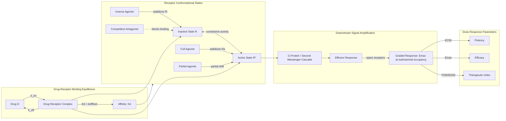

# Lesson 1: Pharmacological Principles, Drug-Receptor Interactions, Dose-Response Relationships

## 1. First-Principles Intuition & Invariants

Pharmacology rests on a single deceptively simple proposition: drugs do not create new functions in the body. They modulate existing ones. Every pharmacological agent, from a bronchodilator rescue inhaler to a targeted monoclonal antibody, operates by binding to a biological molecule that already serves a physiological purpose. The drug does not invent a new signal; it amplifies, attenuates, or redirects a signal the organism was already producing. This invariant, first articulated clearly by Paul Ehrlich in the late nineteenth century, shapes every downstream concept in receptor pharmacology. Ehrlich's famous dictum, *corpora non agunt nisi fixata*—substances do not act unless they are bound—remains the load-bearing axiom of the discipline. If a compound does not bind a receptor, an enzyme, an ion channel, a transporter, or a structural protein in a concentration-dependent and saturable manner, it is not exerting a pharmacological effect in the classical sense. It may be exerting a physicochemical or osmotic effect, but those operate outside receptor theory.

Understanding why this matters requires unpacking what a receptor actually is from a mechanistic standpoint. A receptor is a protein—typically a membrane-spanning glycoprotein or an intracellular ligand-gated complex—that exists in one of several conformational states. In its resting state, the receptor is inactive or minimally active. In its active state, it transduces a downstream signal: it opens an ion pore, it activates a G-protein alpha subunit, it recruits a kinase cascade, or it translocates to the nucleus to alter transcription. The transition between these states is not purely drug-driven. Most receptors possess constitutive activity, meaning they occasionally flicker into the active conformation even without a ligand present. A drug that stabilizes the active conformation and increases the frequency of that transition is an agonist. A drug that binds the receptor but does not favor the active conformation, and thereby blocks endogenous ligand access, is an antagonist. A drug that binds and actively shifts the equilibrium toward the inactive conformation, suppressing constitutive activity, is an inverse agonist. These three categories, along with the partial agonist, form the fundamental operational vocabulary of receptor pharmacology.

The distinction between affinity and efficacy is the conceptual hinge on which all dose-response reasoning turns. Affinity describes how tightly a drug binds its receptor, quantified by the equilibrium dissociation constant $K_d$, which is the drug concentration at which half the receptors are occupied at equilibrium. A drug with high affinity achieves substantial receptor occupancy at low nanomolar concentrations. Efficacy, by contrast, describes the magnitude of the functional response generated per receptor-occupancy event. A full agonist has maximal efficacy: each binding event produces a full conformational transition and a full downstream signal. A partial agonist has intermediate efficacy: even when it saturates every receptor, the maximal response it can produce is less than that of a full agonist. This is not a binding deficiency. A partial agonist may have extraordinary affinity, occupying nearly every receptor at low concentrations, yet still produce a submaximal physiological response because the conformational change it induces is incomplete or because it stabilizes a receptor state with lower signaling efficiency. The clinical consequence is direct and unavoidable: no amount of additional partial agonist will close that efficacy gap. You cannot push past the ceiling effect by increasing the dose, because the ceiling is a property of the drug-receptor interaction, not of the drug concentration.

This leads to the critical invariant that practitioners must internalize: potency and efficacy are independent axes. Potency refers to the concentration or dose required to produce a defined effect, typically the EC50—the concentration producing 50 percent of the maximal response. A drug is potent if its EC50 is low. Efficacy refers to the maximal effect achievable, the Emax. A drug can be extremely potent yet have low efficacy, as is the case with partial agonists like buprenorphine at the mu-opioid receptor. Buprenorphine binds with extraordinary affinity (Kd in the sub-nanomolar range) and produces analgesia at very low doses, yet its maximal analgesic effect plateaus well below that of morphine or fentanyl. Conversely, a drug can have high efficacy but relatively low potency, requiring higher concentrations to reach its full but robust maximal effect. Understanding this orthogonal relationship prevents one of the most common errors in clinical and experimental pharmacology: confusing a rightward shift on a dose-response curve with a reduction in maximal effect. A rightward shift means more drug is needed to achieve a given response—decreased potency. A downward compression of the ceiling means the drug cannot achieve as much—decreased efficacy. These are different phenomena with different mechanisms.

## 2. Core Architecture & Mechanics

The operational mechanics of drug-receptor interaction are governed by the law of mass action applied to a bimolecular binding equilibrium. When a drug D encounters a receptor R, the forward rate depends on the drug concentration and the association rate constant $k_{on}$, while the reverse rate depends on the receptor-drug complex concentration and the dissociation rate constant $k_{off}$. At equilibrium, the forward and reverse rates are equal, yielding the relationship $K_d = k_{off} / k_{on}$. This means the dissociation constant is fundamentally a ratio of how fast the drug leaves the receptor to how fast it finds the receptor. Drugs with slow dissociation kinetics—low $k_{off}$—have long receptor residence times, which often translates into prolonged pharmacological effect even after plasma concentrations have fallen. This is why a drug like tiotropium, an anticholinergic with a dissociation half-life measured in hours at the M3 muscarinic receptor, produces sustained bronchodilation despite once-daily dosing, while shorter-residence competitors require more frequent administration.

The relationship between receptor occupancy and functional response is not linear. This is one of the most practically important and frequently misunderstood aspects of receptor pharmacology. The classical occupancy theory proposed by Clark in the 1920s assumed that response was directly proportional to occupancy—that 50 percent occupancy would produce 50 percent of maximal response. In reality, the relationship is hyperbolic and often far steeper than occupancy predicts. The maximal response of many full agonists is achieved at fractional occupancy levels well below 100 percent. This phenomenon, termed receptor reserve or spare receptors, means that a system can produce a maximal biological response even when the majority of receptors are unoccupied. The practical implication is profound for both drug development and clinical practice: the EC50 of a full agonist in a system with receptor reserve is typically far lower than its Kd. The drug does not need to occupy half the receptors to produce half the maximal response; it may need to occupy only 5 or 10 percent. The reserve acts as an amplification buffer. In the beta-2 adrenergic receptor system, for instance, catecholamines can elicit near-maximal bronchodilation while occupying a small fraction of available receptors, which explains why beta-agonist tolerance mechanisms that downregulate receptor number can be partially compensated before clinical efficacy is lost.

Graded dose-response curves plot the magnitude of an individual response against increasing drug concentration on a logarithmic axis, producing the characteristic sigmoidal curve. The lower asymptote represents baseline activity; the upper asymptote represents Emax; the inflection point corresponds to EC50. From this curve, the practitioner extracts two quantitative parameters: the potency (EC50) and the maximal effect (Emax). Quantal dose-response curves, by contrast, plot the proportion of a population achieving a predefined all-or-nothing endpoint—therapeutic success, a specific side effect, or lethality—against dose. The quantal curve yields the ED50 (dose effective in 50 percent of the population), the TD50 (toxic dose in 50 percent), and the LD50 (lethal dose in 50 percent). The therapeutic index is defined as TD50/ED50, providing a population-level safety margin. A drug with a narrow therapeutic index, such as digoxin or warfarin, requires individualized dosing and therapeutic drug monitoring because the margin between efficacy and toxicity is thin. A drug with a wide therapeutic index, such as penicillin, can be dosed with far less precision without endangering the patient.

Competitive antagonism operates through reversible binding at the same site the agonist occupies. Because the binding is reversible and at the same site, the antagonist's effect can be overcome by increasing agonist concentration—this is surmountable antagonism. On a log dose-response curve, competitive antagonists produce a parallel rightward shift with no change in Emax. The magnitude of the shift is governed by the Schild equation, which relates the dose ratio (the factor by which agonist concentration must be increased to overcome the antagonist) to the antagonist concentration and its affinity. The Schild plot, in which the log of the dose ratio minus one is plotted against the negative log of the antagonist concentration, yields the pA2 value—a quantitative measure of antagonist potency that is independent of the agonist used. Noncompetitive antagonism, by contrast, involves either irreversible binding or binding at an allosteric site that reduces the agonist's efficacy. Irreversible antagonists, such as phenoxybenzamine at the alpha-1 adrenergic receptor, form covalent bonds with the receptor. Because no amount of additional agonist can displace a covalently bound antagonist, the antagonism is insurmountable. The dose-response curve shows a depressed Emax with no parallel rightward shift, because the problem is not access to the receptor but the reduced number of functional receptors available. In a system with receptor reserve, however, the initial effect of an irreversible antagonist may be a rightward shift with no change in Emax, because spare receptors compensate until the reserve is exhausted. Only after the reserve is depleted does Emax begin to fall. This temporal pattern is diagnostically useful: a rightward shift followed by Emax depression as antagonist concentration increases is a signature of irreversible antagonism acting on a system with receptor reserve.

## 3. High-Performance Optimization & Failure Modes

The transition from receptor theory to clinical optimization demands that practitioners reason about both the kinetics of drug-receptor interaction and the adaptive responses of the biological system over time. Receptors are not static targets. They are dynamic proteins whose density, sensitivity, and coupling efficiency are regulated by the very signals they transduce. Sustained agonist exposure drives receptor desensitization, a process with two temporally distinct phases. Homologous desensitization occurs within seconds to minutes of agonist exposure. G-protein-coupled receptor kinases (GRKs) phosphorylate the occupied receptor, which then recruits beta-arrestin. Beta-arrestin sterically blocks further G-protein coupling and targets the receptor for clathrin-mediated endocytosis, internalizing the receptor into endosomes where it is either recycled back to the membrane or routed to lysosomal degradation. This short-term desensitization is mechanistically distinct from downregulation, which occurs over hours to days and involves a genuine reduction in total receptor number through decreased transcription, increased degradation, or both. Tachyphylaxis—the rapid waning of response to a repeatedly administered drug—is the clinical manifestation of acute desensitization. The classic example is the diminished bronchodilator response to repeated doses of beta-2 agonists or the reduced hemodynamic effect of repeated indirect sympathomimetics like amphetamine, which deplete presynaptic norepinephrine stores rather than acting directly on postsynaptic receptors.

Optimizing therapeutic regimens in the face of receptor adaptation requires strategic dosing architectures rather than naive dose escalation. When tachyphylaxis is encountered, the instinctive response is to increase the dose. This is often wrong. If desensitization is receptor-mediated, increasing the dose provides diminishing returns because the receptor pool is already saturated or internalized. The correct strategy involves drug holidays, rotation to a different receptor target, or selection of agents with biased agonism—drugs that activate the desired signaling pathway (such as Gs coupling for bronchodilation) while avoiding the pathway that drives beta-arrestin recruitment and subsequent desensitization. This is the pharmacological frontier of biased agonism at GPCRs, where ligand-selective receptor conformations can preferentially activate therapeutic pathways while sparing those responsible for tolerance and adverse effects. Carvedilol, for instance, acts as a biased ligand at the beta-2 adrenergic receptor, engaging beta-arrestin-mediated signaling pathways that confer cardioprotection while functioning as a competitive antagonist at the Gs-coupled pathway, avoiding the tachycardia and tolerance associated with conventional beta-agonism.

Receptor upregulation presents the inverse failure mode. Chronic antagonist exposure causes the system to compensate by increasing receptor density, which is why abrupt withdrawal of a beta-blocker produces rebound tachycardia and hypertension, and why abrupt discontinuation of chronic clonidine produces a hypertensive crisis driven by supersensitive alpha-2 receptors and unopposed sympathetic outflow. The practitioner's responsibility is to anticipate these adaptive responses. Tapering schedules must be calibrated to the receptor turnover half-life, which varies by receptor type and tissue. For beta-adrenergic receptors, receptor resynthesis and membrane reinsertion require approximately 48 to 72 hours after withdrawal of chronic antagonist exposure. For glucocorticoid receptors, the timeline is longer, on the order of days to weeks, because the transcriptional machinery governing receptor expression is itself regulated by glucocorticoid receptor occupancy.

The therapeutic index operationalizes the safety margin, but it is a population statistic, not an individual guarantee. The standard TD50/ED50 ratio tells you that the median toxic dose is some multiple of the median effective dose in a defined population, but it tells you nothing about the overlap between the dose distributions for therapeutic and toxic effects in individuals. A more clinically actionable parameter is the margin of safety, defined as LD1/ED99—the ratio of the dose lethal to 1 percent of the population to the dose effective in 99 percent. This captures the tail overlap that the therapeutic index obscures. A drug can have an apparently comfortable therapeutic index yet a dangerously narrow margin of safety if the dose-response distributions for efficacy and toxicity have broad, overlapping tails. This is the situation with phenytoin, where the therapeutic range of 10 to 20 micrograms per milliliter sits precariously close to the threshold for cerebellar toxicity, and where Michaelis-Menten elimination kinetics cause disproportionate increases in plasma concentration with modest dose increases once metabolic saturation is approached. The practitioner managing such a drug must titrate with awareness that the dose-response relationship is not linear across the dosing range but flattens and steepens unpredictably at saturation points.

Quantal dose-response analysis also reveals interindividual variability that can be exploited therapeutically or that can precipitate failure. A quantal curve that is steep, with a narrow dose range separating the threshold from the ceiling, implies that most individuals respond similarly—a population with low pharmacogenomic variability. A shallow quantal curve, spread across a wide dose range, implies substantial interindividual differences in receptor sensitivity, drug metabolism, or both. In the latter case, population-level dosing guidelines are inadequate, and individual titration guided by biomarkers, therapeutic drug monitoring, or pharmacogenomic profiling becomes the standard of care. The opioid system exemplifies this: CYP2D6 metabolizer status dramatically alters the conversion of codeine to morphine, such that ultrarapid metabolizers may experience toxicity at standard doses while poor metabolizers may experience inadequate analgesia at the same dose. The receptor pharmacology is identical in both individuals; the variability lies upstream in the metabolic activation step, but it manifests at the receptor level as either an excessive or insufficient effective agonist concentration.

## 4. Summary & Verification Matrix

| Concept | Governing Invariant | Diagnostic Signature on Dose-Response Curve | Failure Mode & Mitigation |
|---|---|---|---|
| **Affinity vs. Efficacy** | Affinity ($K_d$) governs occupancy; efficacy governs maximal response per occupancy event. These are independent parameters. | High affinity + low efficacy: curve reaches a submaximal ceiling (partial agonist) regardless of concentration. | Treating a partial agonist like a full agonist and escalating dose to achieve maximal effect. Mitigation: switch to a full agonist or combine with one; do not dose-escalate past the ceiling. |
| **Potency vs. Efficacy** | Potency = EC50 (concentration for 50% effect). Efficacy = Emax (maximal achievable effect). Orthogonal axes. | Rightward shift = decreased potency. Downward compression of ceiling = decreased efficacy. | Confusing rightward shift with efficacy loss. Mitigation: always distinguish parallel shift (potency) from ceiling depression (efficacy) before adjusting therapy. |
| **Competitive Antagonism** | Reversible binding at agonist site; surmountable by increasing agonist concentration. | Parallel rightward shift, no change in Emax. Schild analysis yields pA2. | Failing to escalate agonist dose to overcome competitive blockade. Mitigation: titrate agonist upward; expect dose ratio predicted by Schild equation. |
| **Noncompetitive / Irreversible Antagonism** | Covalent or allosteric binding reducing functional receptor number; insurmountable. | Depressed Emax. In receptor-spare systems: initial rightward shift, then Emax depression as reserve is consumed. | Attempting to overcome irreversible antagonism with more agonist. Mitigation: wait for receptor resynthesis (48–72 hr for adrenergic receptors) or use a pharmacologically distinct pathway. |
| **Desensitization & Tachyphylaxis** | Sustained agonist exposure drives GRK phosphorylation, beta-arrestin recruitment, internalization (acute), and transcriptional downregulation (chronic). | Time-dependent rightward shift and Emax depression with repeated dosing at the same concentration. | Dose escalation into a desensitized receptor pool. Mitigation: drug holidays, receptor target rotation, biased agonist selection, or dosing intervals exceeding receptor resynthesis half-life. |
| **Therapeutic Index & Margin of Safety** | TI = TD50/ED50 (population median). Margin of safety = LD1/ED99 (tail overlap). Narrow TI demands individualized dosing. | Quantal curves with overlapping efficacy and toxicity dose distributions indicate narrow safety margin. | Applying population TI to individual patients without accounting for pharmacogenomic variability or nonlinear kinetics. Mitigation: therapeutic drug monitoring, pharmacogenomic screening, and dose titration guided by individual biomarkers. |
