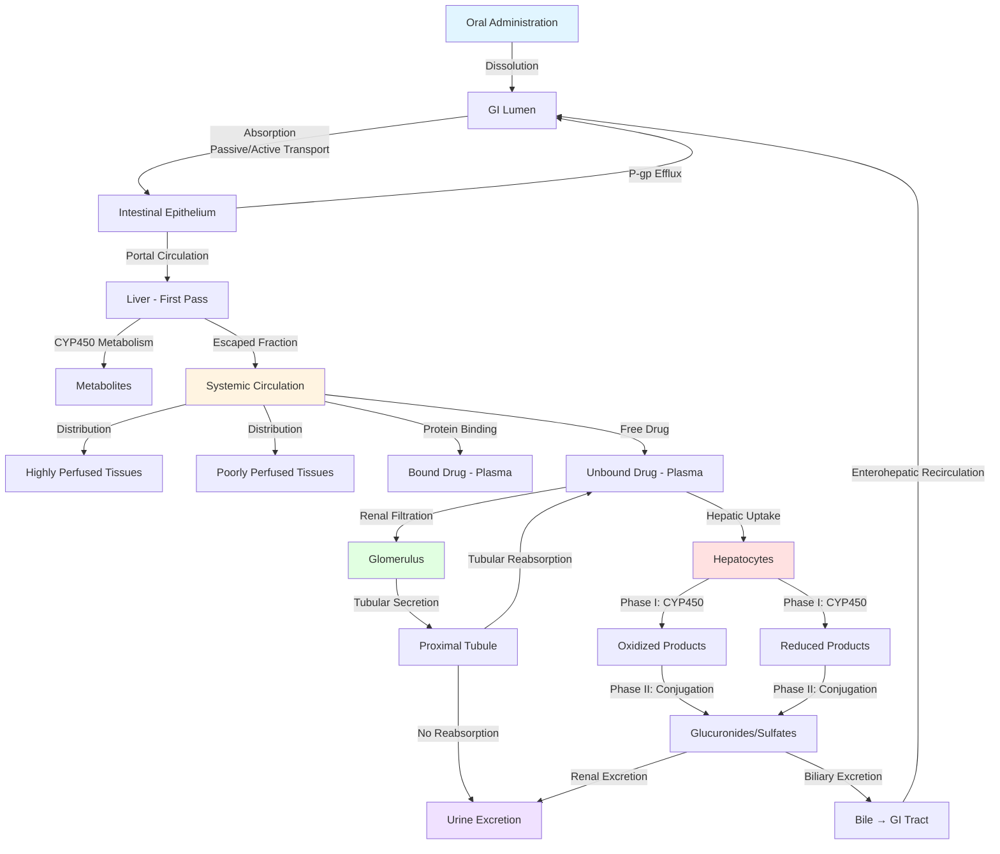

# Lesson 2: Pharmacokinetics: Absorption, Distribution, Metabolism, Excretion

## 1. First-Principles Intuition & Invariants

Pharmacokinetics represents the quantitative discipline that governs what the body does to a drug, standing in essential counterbalance to pharmacodynamics, which describes what the drug does to the body. While pharmacodynamic principles establish receptor occupancy, signal transduction cascades, and downstream physiological effects, pharmacokinetics establishes the temporal concentration profiles that dictate whether therapeutic targets are reached, maintained, and eventually cleared. The four pillars of pharmacokinetic analysis—absorption, distribution, metabolism, and excretion, collectively abbreviated as ADME—constitute a complete life cycle for any xenobiotic molecule entering systemic circulation.

The fundamental invariant underlying all pharmacokinetic modeling is the principle of mass balance: drug molecules must be accounted for at every temporal snapshot, transitioning through defined compartments according to first-order or zero-order kinetics. Unlike biological systems driven by homeostatic feedback, pharmacokinetic processes operate primarily through passive diffusion gradients, enzymatic saturation curves, and carrier-mediated transport mechanisms that obey Michaelis-Menten kinetics. Understanding these processes allows clinicians to predict plasma concentration trajectories, calculate appropriate dosing intervals, anticipate drug-drug interactions, and adjust regimens for patients with hepatic or renal impairment.

Bioavailability, symbolized as **F**, quantifies the fraction of administered drug that reaches systemic circulation in unmetabolized form. For intravenous administration, bioavailability equals unity by definition because the drug bypasses all absorption barriers and enters the vascular compartment directly. Oral administration, however, imposes sequential obstacles: dissolution in gastric or intestinal fluid, permeation across the intestinal epithelium, transit through the hepatic portal circulation, and survival through first-pass hepatic metabolism. The product of these fractional survivals yields the systemic bioavailability, often substantially less than one hundred percent. First-pass metabolism represents a critical determinant of oral bioavailability, particularly for drugs with high hepatic extraction ratios, where a significant proportion of absorbed drug molecules undergo biotransformation during their initial transit through the liver before entering the systemic arterial circulation.

Volume of distribution, denoted **Vd**, quantifies the apparent volume into which a drug appears to distribute based on plasma concentration measurements. This parameter does not correspond to any actual physiological volume but instead represents a proportionality constant relating total drug amount in the body to measured plasma concentration. A drug with Vd of approximately five liters remains confined largely to the vascular compartment, matching total blood volume. Conversely, lipophilic drugs with extensive tissue binding exhibit volumes of distribution far exceeding total body water, sometimes reaching several hundred liters for a seventy-kilogram individual. This apparent paradox arises because tissue sequestration depletes plasma concentrations, creating the mathematical appearance of distribution into a vastly enlarged virtual space.

Clearance, symbolized **CL**, represents the volume of plasma from which drug is completely removed per unit time, typically expressed in milliliters per minute or liters per hour. Unlike elimination rate, which varies with drug concentration, clearance remains constant for drugs following first-order kinetics, serving as an intrinsic measure of the body's capacity to eliminate the compound. Total body clearance comprises the sum of individual organ clearances, with hepatic and renal routes dominating for most therapeutic agents. Hepatic clearance depends on hepatic blood flow, intrinsic enzymatic capacity, and the fraction of drug unbound in plasma, while renal clearance depends on glomerular filtration rate, active tubular secretion, and tubular reabsorption. The relationship between clearance, volume of distribution, and elimination half-life establishes the foundational kinetic equation: **t½ = 0.693 × Vd / CL**.

Elimination half-life represents the time required for plasma concentration to decline by fifty percent during the elimination phase. For drugs following first-order kinetics, half-life remains constant regardless of dose or concentration, enabling straightforward prediction of accumulation and time to steady state. Multiple-dosing regimens establish dynamic equilibrium when the rate of drug administration equals the rate of elimination, typically requiring four to five half-lives to approach steady-state concentrations within ninety-four to ninety-seven percent of the asymptotic value. Understanding half-life enables rational dosing interval selection: dosing intervals approximating one half-life maintain relatively stable trough and peak concentrations, while intervals substantially longer than half-life produce pronounced oscillations between potentially subtherapeutic troughs and supratherapeutic peaks.

The cytochrome P450 superfamily constitutes the dominant enzymatic system responsible for phase I oxidative metabolism, with hepatic microsomes containing the highest concentrations of these heme-containing monooxygenases. CYP3A4 alone metabolizes approximately fifty percent of clinically prescribed medications, making it the single most important drug-metabolizing enzyme. CYP2D6, despite representing only two percent of total hepatic CYP content, exhibits polymorphic genetic variation producing distinct phenotypic populations: poor metabolizers lacking functional enzyme, intermediate metabolizers with reduced activity, extensive metabolizers with normal activity, and ultrarapid metabolizers with gene duplication producing excessive activity. These genetic polymorphisms profoundly impact therapeutic outcomes, with poor metabolizers at risk for toxicity from standard doses and ultrarapid metabolizers at risk for therapeutic failure. Phase II conjugation reactions—glucuronidation, sulfation, acetylation, methylation, and glutathione conjugation—typically follow phase I oxidation, adding hydrophilic moieties that dramatically enhance renal elimination by increasing molecular polarity and molecular weight above the glomerular filtration threshold.

## 2. Core Architecture & Mechanics

Absorption from the gastrointestinal tract proceeds through passive transcellular diffusion for lipophilic molecules or active carrier-mediated transport for hydrophilic nutrients and drug analogs. The Biopharmaceutics Classification System categorizes drugs along two orthogonal axes: aqueous solubility and intestinal permeability. Class I compounds exhibit high solubility and high permeability, achieving rapid and complete absorption with bioavailability limited primarily by first-pass metabolism rather than absorption barriers. Class II compounds demonstrate high permeability but low solubility, making dissolution the rate-limiting step; micronization, salt formation, and lipid-based formulations enhance absorption by increasing effective surface area or creating supersaturated states at the absorption surface. Class III compounds possess high solubility but low permeability, with absorption limited by membrane transit; paracellular transport through tight junctions or active efflux by P-glycoprotein at the apical membrane further restricts bioavailability. Class IV compounds suffer both low solubility and low permeability, presenting formidable challenges requiring prodrug strategies, permeation enhancers, or alternative routes of administration.

The intestinal epithelium expresses abundant P-glycoprotein efflux pumps on the apical membrane, actively extruding absorbed drug molecules back into the intestinal lumen and thereby reducing net absorption. Substrates for both CYP3A4 and P-glycoprotein—including cyclosporine, tacrolimus, and many HIV protease inhibitors—experience coordinated restriction, with P-glycoprotein limiting absorption while CYP3A4 mediates first-pass metabolism. Inhibitors of these systems, such as grapefruit juice constituents that irreversibly inactivate intestinal CYP3A4 and competitively inhibit P-glycoprotein, can dramatically increase bioavailability and precipitate toxicity when patients inadvertently consume large quantities.

Distribution from plasma into tissues depends on tissue perfusion, capillary permeability, and the drug's physicochemical properties. Highly perfused organs—brain, heart, liver, kidneys—equilibrate rapidly with plasma during the distribution phase, while poorly perfused tissues—adipose, bone, resting skeletal muscle—equilibrate slowly, sometimes requiring hours to reach distribution equilibrium. Plasma protein binding, primarily to albumin for acidic drugs and alpha-1-acid glycoprotein for basic drugs, restricts distribution because only unbound drug can diffuse across capillary membranes. The unbound fraction, denoted **fu**, becomes clinically critical for highly bound drugs where small absolute changes in binding translate into large proportional changes in free drug concentration. Hypoalbuminemia, uremia, and displacement interactions elevate free fractions, potentially increasing both therapeutic efficacy and toxicity risk.

The blood-brain barrier imposes stringent restrictions on central nervous system penetration through continuous tight junctions between capillary endothelial cells, absence of fenestrations, and active efflux transporters. Lipophilic drugs with molecular weights below four hundred to five hundred Daltons cross most readily, while hydrophilic or ionized molecules remain largely excluded unless specific influx transporters facilitate passage. P-glycoprotein expressed at the luminal surface of brain capillary endothelium actively extrudes many drugs, limiting CNS exposure even for lipophilic compounds. Inflammatory conditions, traumatic injury, or infection can compromise barrier integrity, paradoxically increasing CNS drug penetration during pathological states.

Hepatic metabolism proceeds through sequential phase I and phase II reactions, although some drugs undergo only phase II conjugation if they already possess appropriate functional groups. Phase I reactions—oxidation, reduction, and hydrolysis—introduce or unmask functional groups such as hydroxyl, carboxyl, or amino moieties, often producing metabolites with similar or even enhanced pharmacological activity. The cytochrome P450 enzymes catalyze oxidative reactions through a complex catalytic cycle involving heme iron cycling between ferric and ferryl states, oxygen activation, and substrate hydroxylation. Enzyme induction by drugs such as rifampin, carbamazepine, and phenytoin increases CYP450 expression over days to weeks, accelerating metabolism of coadministered substrates and potentially causing therapeutic failure. Enzyme inhibition occurs more rapidly, with competitive inhibitors such as ketoconazole and mechanism-based inactivators such as erythromycin producing effects within hours, elevating substrate concentrations and increasing toxicity risk.

Phase II conjugation reactions transfer glucuronic acid, sulfate, acetyl, methyl, or glutathione groups from activated cofactors onto phase I metabolites or parent drugs, dramatically increasing hydrophilicity and molecular weight. UDP-glucuronosyltransferases located in hepatic and intestinal microsomes catalyze glucuronidation, the quantitatively dominant conjugation pathway. Glucuronide conjugates undergo biliary excretion into the intestine, where bacterial beta-glucuronidases can cleave the conjugate, releasing parent drug for reabsorption in a phenomenon termed enterohepatic recirculation. This cycling prolongs drug residence time and necessitates higher maintenance doses to sustain therapeutic concentrations.

Renal elimination operates through three coordinated processes: glomerular filtration, active tubular secretion, and passive tubular reabsorption. Glomerular filtration passes unbound drug molecules smaller than approximately sixty-five thousand Daltons through the fenestrated capillaries of the glomerulus, with most efficient filtration below ~10,000 Daltons, at a rate proportional to glomerular filtration rate and unbound plasma fraction. Active secretion by organic anion transporters and organic cation transporters in proximal tubular epithelium extracts both bound and unbound drug from peritubular capillaries and secretes it into tubular fluid, providing an elimination mechanism independent of protein binding. Passive tubular reabsorption occurs when lipophilic drugs diffuse from concentrated tubular fluid back across tubular epithelium into peritubular blood, effectively reducing net excretion. Urinary pH manipulation can trap ionized weak acids or bases in tubular fluid through ion trapping, enhancing elimination; alkalinization accelerates salicylate excretion in aspirin overdose, while acidification accelerates amphetamine excretion.

Compartmental modeling simplifies the body into discrete mathematical compartments communicating through first-order rate constants. The one-compartment model assumes instantaneous distribution equilibrium, with plasma concentration declining monoexponentially after intravenous bolus administration according to **C(t) = C₀ × e^(-kt)**, where **k** represents the elimination rate constant equal to **0.693/t½**. The two-compartment model distinguishes a rapidly equilibrating central compartment comprising blood and highly perfused organs from a slowly equilibrating peripheral compartment representing less perfused tissues. After intravenous bolus, plasma concentration follows a biexponential decline with an initial rapid distribution phase followed by a slower elimination phase, described by **C(t) = Ae^(-αt) + Be^(-βt)**, where alpha and beta represent distribution and elimination rate constants. The terminal elimination half-life calculated from the beta phase determines accumulation during chronic dosing, while the distribution phase impacts peak concentrations after bolus administration.

## 3. High-Performance Optimization & Failure Modes

Optimizing therapeutic regimens requires integration of pharmacokinetic parameters with pharmacodynamic targets to achieve desired steady-state concentrations while minimizing peak-trough oscillations. Loading doses exploit volume of distribution relationships to rapidly establish therapeutic concentrations, calculated as **Loading Dose = Vd × Css × (1/F)**, where Css represents target steady-state concentration and F represents bioavailability. Without loading doses, drugs with long half-lives require days to weeks to reach steady state, delaying therapeutic benefit unacceptably for acute conditions. Maintenance dosing sustains steady-state concentrations by matching elimination rate, calculated as **Maintenance Dose Rate = CL × Css × (1/F)**, ensuring input rate equals elimination rate at equilibrium.

Therapeutic drug monitoring provides empirical validation of pharmacokinetic predictions for drugs with narrow therapeutic indices, significant interpatient variability, or nonlinear kinetics. Peak and trough sampling for aminoglycosides, vancomycin, and digoxin enables calculation of patient-specific clearance and volume of distribution, allowing dose individualization to achieve target concentrations. Bayesian estimation algorithms integrate population pharmacokinetic parameters with individual patient measurements, producing refined parameter estimates from sparse sampling that would otherwise provide insufficient data for full kinetic characterization.

Hepatic impairment reduces metabolic clearance in proportion to functional hepatic mass and residual enzyme activity, necessitating dose reduction for drugs with predominant hepatic elimination. The Child-Pugh score and Model for End-Stage Liver Disease score provide clinical indices of hepatic dysfunction, guiding empirical dose adjustments in the absence of formal pharmacokinetic studies. Drugs with high hepatic extraction ratios exhibit flow-limited clearance, with elimination dependent primarily on hepatic blood flow rather than intrinsic metabolic capacity; cirrhotic shunting that bypasses hepatocytes reduces first-pass metabolism and increases oral bioavailability while simultaneously reducing overall clearance during maintenance dosing.

Renal impairment reduces elimination of drugs and active metabolites excreted unchanged in urine, requiring dose reduction or interval extension proportional to creatinine clearance reduction. The Cockcroft-Gault equation and Modification of Diet in Renal Disease equation estimate glomerular filtration rate from serum creatinine, age, sex, and body weight, providing practical indices for dose adjustment. Drugs eliminated entirely by renal excretion require linear dose reduction proportional to creatinine clearance reduction, while drugs with mixed hepatic-renal elimination require more modest adjustments. Hemodialysis removes drugs with low volumes of distribution, low protein binding, and small molecular size, necessitating supplemental postdialysis doses to restore therapeutic concentrations.

Drug-drug interactions arising from pharmacokinetic mechanisms include enzyme inhibition, enzyme induction, and transporter inhibition, each producing characteristic concentration profiles and time courses. Enzyme inhibition elevates substrate concentrations within hours to days, with competitive inhibitors producing reversible effects that dissipate with inhibitor washout. Mechanism-based inactivators such as clarithromycin form reactive intermediates that covalently modify CYP450 enzymes, producing quasi-irreversible inhibition requiring new enzyme synthesis for recovery over days to weeks. Enzyme induction occurs more slowly, requiring transcriptional upregulation and protein synthesis over one to two weeks to reach maximal effect; discontinuation of the inducer similarly requires one to two weeks for enzyme levels to return to baseline. Transporter inhibition affects both absorption and elimination; P-glycoprotein inhibition at the blood-brain barrier increases CNS penetration, potentially causing sedation or cognitive impairment for substrates previously excluded from the brain.

Genetic polymorphisms in drug-metabolizing enzymes create discrete phenotypic populations with divergent pharmacokinetic profiles. CYP2D6 poor metabolizers accumulate codeine without generating morphine through O-demethylation, experiencing inadequate analgesia; conversely, ultrarapid metabolizers generate excessive morphine, risking respiratory depression. CYP2C19 poor metabolizers experience reduced clopidogrel efficacy because the prodrug fails to undergo metabolic activation, resulting in inadequate platelet inhibition and increased thrombotic risk; however, this same phenotype produces excessive proton pump inhibitor exposure and hypergastrinemia. Preemptive genotyping enables phenotype-guided dosing, although clinical implementation remains limited by cost, turnaround time, and uncertainty regarding optimal dose adjustments for intermediate metabolizer phenotypes.

Saturable metabolism produces nonlinear pharmacokinetics when drug concentrations approach or exceed enzyme Michaelis constant values, with elimination half-life paradoxically increasing at higher doses. Phenytoin exhibits classic saturable kinetics at therapeutic concentrations, with small dose increases producing disproportionate concentration elevations and potential toxicity. Ethanol follows zero-order elimination kinetics at typical intoxicating concentrations because alcohol dehydrogenase operates at maximum velocity, eliminating approximately one standard drink per hour regardless of blood alcohol concentration. Monitoring drugs with saturable kinetics requires heightened vigilance during dose escalation, with smaller incremental adjustments and more frequent concentration measurements than would be necessary for drugs following linear kinetics.

Physiologically based pharmacokinetic modeling incorporates anatomical, physiological, and biochemical parameters to predict drug disposition mechanistically rather than relying on empirical compartmental fits. These models integrate organ blood flows, tissue volumes, partition coefficients, enzyme kinetics, and transporter activities to simulate concentration-time profiles in plasma and individual tissues. While computationally intensive and requiring extensive parameterization, physiologically based approaches enable prediction of special population kinetics—pediatrics, pregnancy, obesity—and facilitate drug-drug interaction prediction during development before clinical studies are feasible. Verification against observed clinical data remains essential because simplifying assumptions regarding tissue homogeneity, transporter distribution, and enzyme localization introduce systematic errors that can compromise predictive accuracy.

## 4. Summary & Verification Matrix

| Pharmacokinetic Parameter | Governing Mechanism | Calculation & Units | Clinical Failure Mode | Diagnostic & Mitigation Strategy |
|--------------------------|-------------------|-------------------|---------------------|--------------------------------|
| **Bioavailability (F)** | Fractional systemic absorption after accounting for incomplete dissolution, intestinal permeation barriers, P-glycoprotein efflux, and first-pass hepatic metabolism | F = (AUC_oral × Dose_IV) / (AUC_IV × Dose_oral); dimensionless (0–1) | First-pass saturation at high doses increases F nonlinearly; food interactions alter absorption kinetics; grapefruit juice inhibits intestinal CYP3A4, elevating F unpredictably | Compare dose-normalized AUC between oral and IV routes; assess food effect studies; screen for CYP3A4/P-gp inhibitor coadministration |
| **Volume of Distribution (Vd)** | Apparent distribution space relating total body drug amount to plasma concentration, determined by tissue binding, lipophilicity, and plasma protein binding | Vd = Dose / C₀ (IV bolus) or Vd = (CL × t½) / 0.693; liters or L/kg | Hypoalbuminemia increases Vd for highly bound drugs; tissue sequestration creates prolonged terminal half-lives; third-spacing in edema or ascites expands Vd unpredictably | Calculate loading dose as Vd × Css to achieve target rapidly; measure free drug concentrations in hypoalbuminemia; adjust for obesity using lean body weight |
| **Clearance (CL)** | Volume of plasma completely cleared per unit time through hepatic metabolism and renal excretion, representing intrinsic elimination capacity | CL = Dose / AUC or CL = Vd × k = (0.693 × Vd) / t½; mL/min or L/hr | Hepatic impairment reduces metabolic clearance disproportionately for high-extraction drugs; renal impairment mandates dose reduction for renally eliminated drugs; drug interactions inhibit clearance | Estimate creatinine clearance (Cockcroft-Gault) for renal dosing; apply Child-Pugh score for hepatic adjustment; perform therapeutic drug monitoring for narrow-index drugs |
| **Elimination Half-Life (t½)** | Time for plasma concentration to decline by fifty percent, governing accumulation to steady state and washout kinetics | t½ = (0.693 × Vd) / CL; hours or days | Saturable metabolism causes dose-dependent half-life (phenytoin); active metabolites prolong pharmacological half-life beyond parent elimination; genetic polymorphisms alter half-life unpredictably | Achieve steady state in 4–5 half-lives; use loading doses for long-half-life drugs requiring rapid onset; genotype CYP2D6/CYP2C19 for polymorphic substrates |
| **Steady-State Concentration (Css)** | Equilibrium concentration achieved when dosing rate equals elimination rate, maintaining therapeutic levels during chronic administration | Css,avg = (F × Dose Rate) / CL; mg/L or μg/mL | Accumulation without steady-state awareness causes toxicity; missed doses create subtherapeutic troughs; enzyme induction over time lowers Css progressively | Measure trough concentrations at steady state; adjust maintenance dose as Dose Rate = (CL × Css,target) / F; anticipate 50% Css decline with enzyme inducers over 2 weeks |
| **Cytochrome P450 Activity** | Phase I oxidative metabolism by hepatic microsomal CYP isoforms (CYP3A4, CYP2D6, CYP2C9, CYP2C19) converting lipophilic drugs to polar metabolites, subject to induction and inhibition | Activity assessed via probe drug metabolic ratios or phenotyping; enzyme-specific activity varies by isoform and genetic polymorphism | Inhibitor coadministration elevates substrate concentrations within hours; inducers reduce substrate exposure over 1–2 weeks; poor metabolizer phenotypes accumulate standard doses to toxic levels | Screen all medications for CYP450 interactions using interaction databases; genotype high-risk polymorphic enzymes; adjust doses empirically when adding/removing inducers or inhibitors; measure concentrations 1–2 weeks after interaction changes |
