# Lesson 3: Autonomic, Cardiovascular, Renal Pharmacology

## 1. First-Principles Intuition & Invariants

The autonomic nervous system governs the body's involuntary physiology through two anatomically and neurochemically distinct divisions: the sympathetic and parasympathetic systems. Understanding cardiovascular and renal pharmacology begins with grasping one foundational invariant — every drug in this space either mimics, blocks, or modulates the chemical messengers and receptors through which these two divisions exert opposing influence on the same target organs. The heart, vasculature, kidney tubules, and bronchioles do not distinguish between endogenous norepinephrine and an exogenous agonist. They respond to receptor occupancy, and receptor occupancy determines clinical outcome.

The sympathetic system releases norepinephrine from postganglionic terminals onto adrenergic receptors, with the adrenal medulla additionally secreting epinephrine into systemic circulation. The parasympathetic system releases acetylcholine onto muscarinic receptors at target organs and onto nicotinic receptors at ganglia. This neurochemical duality is not incidental — it is the structural foundation upon which the entire pharmacological toolset for hypertension, arrhythmia, heart failure, and renal fluid management is built.

Adrenergic receptors subdivide into alpha and beta families with clinically decisive consequences. Alpha-1 receptors reside on vascular smooth muscle; their activation by norepinephrine or phenylephrine causes vasoconstriction, raising systemic vascular resistance and diastolic blood pressure. Alpha-2 receptors sit both presynaptically on sympathetic nerve terminals, where their activation suppresses further norepinephrine release, and centrally in the brainstem, where stimulation by clonidine or methyldopa reduces sympathetic outflow to the periphery. Beta-1 receptors dominate in the sinoatrial node and ventricular myocardium, mediating increased heart rate (chronotropy), contractility (inotropy), and conduction velocity (dromotropy). Beta-2 receptors populate bronchial and vascular smooth muscle, where their activation causes relaxation. Beta-3 receptors in adipose tissue and the bladder carry metabolic and urological significance but fall outside the cardiovascular core.

Muscarinic receptor subtypes impose equal precision on parasympathetic pharmacology. M2 receptors at the sinoatrial and atrioventricular nodes respond to acetylcholine by hyperpolarizing the pacemaker potential through G-protein-coupled inward rectifier potassium channels, slowing heart rate and AV conduction. M3 receptors on vascular endothelium paradoxically produce vasodilation by stimulating endothelial nitric oxide synthase, releasing NO that diffuses into smooth muscle and activates guanylyl cyclase. The practitioner who confuses M2 and M3 mediation will misread the hemodynamic response to bethanechol versus pilocarpine and misattribute side effects in clinical scenarios.

The governing invariant across the entire lesson is this: **cardiovascular pharmacology is receptor-subtype pharmacology.** Selectivity determines therapeutic index. A non-selective beta blocker applied to a severe asthmatic risks M2-unopposed bronchospasm via beta-2 blockade. An alpha-1 blocker like prazosin reduces afterload but precipitates first-dose hypotension because it cannot compensate with reflex tachycardia when beta-1 receptors are unblocked. Every mechanism examined below can be traced back to which receptor, in which tissue, with what coupling cascade, and at what point in the cardiac or vascular cycle the drug intervenes.

---

## 2. Core Architecture & Mechanics

### Sympathetic and Parasympathetic Signal Architecture

The two autonomic divisions do not operate through simple on/off switches. They produce graded receptor occupancy curves that compete at shared target organs, with downstream second-messenger cascades determining the magnitude and duration of the cellular response. Norepinephrine binding to beta-1 receptors activates Gs protein, stimulating adenylyl cyclase to produce cyclic AMP, which activates protein kinase A. PKA phosphorylates L-type calcium channels, the ryanodine receptor, and phospholamban, collectively increasing calcium entry, amplifying calcium-induced calcium release from the sarcoplasmic reticulum, and accelerating calcium reuptake after systole — the mechanistic basis of positive inotropy, lusitropy, and chronotropy in a single biochemical cascade.

Parasympathetic countersignaling through M2 receptors couples Gi protein to adenylyl cyclase, suppressing cAMP production and thereby opposing every PKA-mediated step. This is not mere inhibition; it is active biochemical competition at the intracellular level. When a practitioner administers atropine to reverse bradycardia from organophosphate poisoning, they are removing the muscarinic blockade at M2 and M3 receptors simultaneously, which raises heart rate and dries secretions but also precipitates urinary retention and blurred vision from M3 blockade in the bladder and ciliary muscle.

The following diagram maps the receptor-to-effector signal topology for the major autonomic and cardiovascular drug targets covered in this lesson, from receptor binding through second messengers to end-organ response and clinical output.

```mermaid
graph TD
    A["Sympathomimetics\n(Epi, NE, Dopamine,\nDobutamine, Phenylephrine)"] --> B{Adrenergic Receptor}
    B --> B1["β1 (Heart)\nGs → cAMP↑ → PKA\n→ ↑HR, ↑Contractility"]
    B --> B2["β2 (Smooth Muscle)\nGs → cAMP↑\n→ Broncho/Vasodilation"]
    B --> A1["α1 (Vasculature)\nGq → IP3/DAG\n→ Vasoconstriction"]
    B --> A2["α2 (Presynaptic)\nGi → cAMP↓\n→ ↓NE Release"]

    C["Parasympathomimetics\n(ACh, Bethanechol,\nPilocarpine, Neostigmine)"] --> D{Muscarinic Receptor}
    D --> M2["M2 (SA/AV Node)\nGi → ↑IKACh\n→ ↓HR, ↓Conduction"]
    D --> M3["M3 (Endothelium/Smooth Muscle)\nGq → eNOS → NO\n→ Vasodilation"]

    E["Antihypertensives"] --> ACEi["ACE Inhibitors\nBlock Ang I→Ang II\n↓Vasoconstriction, ↓Aldosterone"]
    E --> ARB["ARBs\nBlock AT1 Receptor\nSame end-organ effect"]
    E --> CCB["CCB (Dihydropyridine)\nBlock VGCC on Vascular SM\n↓SVR, ↓Afterload"]
    E --> BB["β-Blockers\nBlock β1\n↓HR, ↓CO, ↓Renin"]

    F["Antiarrhythmics (Vaughan Williams)"] --> C1["Class I: Na⁺ Channel Block\nIA/IB/IC — ↓Phase 0 slope"]
    F --> C2["Class II: β-Blockers\n↓Phase 4 automaticity"]
    F --> C3["Class III: K⁺ Channel Block\n↑APD, ↑ERP"]
    F --> C4["Class IV: CCB (Non-DHP)\n↓AV node conduction"]

    G["Diuretics"] --> Thiaz["Thiazides\nDCT Na/Cl cotransporter\n↓NaCl reabsorption"]
    G --> Loop["Loop (Furosemide)\nTAL NKCC2 block\n↑Na, K, Cl excretion"]
    G --> KSpar["K⁺-Sparing\nAldosterone antagonist\nor ENaC block\n↑K⁺ retention"]

    H["Heart Failure Drugs"] --> ARNI["ARNI (Sacubitril/Valsartan)\nNeprilysin + AT1 block\n↑BNP effect, ↓Fibrosis"]
    H --> Dig["Digoxin\nNa/K ATPase inhibition\n↑[Ca²⁺]i → ↑Inotropy"]
    H --> SGlt2["SGLT2 Inhibitors\nGlucose/Na cotransport block\n↓Preload/Afterload, Cardioprotective"]
```

### Sympathomimetics and Sympatholytics in Clinical Context

Epinephrine's receptor promiscuity makes dose the master variable. At low infusion rates (0.01–0.05 mcg/kg/min), beta-2-mediated vasodilation in skeletal muscle and beta-1-mediated inotropy dominate, producing increased cardiac output with modest mean arterial pressure change. At high rates (above 0.1 mcg/kg/min), alpha-1 vasoconstriction overrides beta-2 dilation, sharply raising SVR and diastolic pressure. This dose-dependent receptor recruitment governs why epinephrine is the first-line agent in anaphylaxis — the concurrent beta-2 bronchodilation, beta-1 inotropy, and alpha-1 vasoconstriction address all three lethal vectors of anaphylactic physiology simultaneously.

Dopamine presents a similar tiered selectivity. Below 3 mcg/kg/min, it preferentially activates dopaminergic D1 receptors in the renal and mesenteric vasculature, reducing renal vascular resistance and increasing glomerular filtration. From 3 to 10 mcg/kg/min, beta-1 stimulation predominates. Above 10 mcg/kg/min, alpha-1 vasoconstriction dominates. This predictive titration model gives the intensivist a tool to shift organ perfusion priorities by infusion rate alone.

Beta-blockers represent the most consequential class of sympatholytics in cardiovascular medicine. Cardioselective agents (metoprolol, atenolol, bisoprolol) block beta-1 with minimal beta-2 activity at therapeutic doses, making them the preferred choice in patients with reactive airway disease. The beta-blocker's benefit in heart failure operates through a counterintuitive mechanism: by reducing sympathetic overdrive that chronically stimulates pathological cardiac remodeling, beta-blockade over weeks to months reverses maladaptive ventricular dilation, reduces wall stress, and improves ejection fraction. This is why beta-blockers are started at low doses in stable heart failure and titrated slowly — acute high-dose beta-blockade in decompensated heart failure can precipitate cardiogenic shock by abruptly withdrawing the compensatory catecholamine support maintaining cardiac output.

### Antihypertensives: Mechanism Layers and Interaction Points

The renin-angiotensin-aldosterone system (RAAS) is the dominant humoral regulator of long-term blood pressure and extracellular volume, making it the most pharmacologically targeted system in hypertension management. Renin, released from juxtaglomerular cells in response to reduced renal perfusion pressure, low tubular sodium delivery, or sympathetic beta-1 stimulation, cleaves angiotensinogen to angiotensin I. ACE then converts angiotensin I to angiotensin II, which acts on AT1 receptors to cause potent vasoconstriction, aldosterone release from the adrenal cortex (promoting sodium and water retention in exchange for potassium), ADH release, and direct cardiac and vascular fibrosis.

ACE inhibitors (lisinopril, ramipril, enalapril) block this conversion, reducing angiotensin II and aldosterone simultaneously. They also preserve bradykinin, a vasodilatory peptide normally degraded by ACE, which amplifies the antihypertensive effect but also causes the characteristic dry cough in roughly 15% of patients through bradykinin-mediated bronchial irritation. ARBs (losartan, valsartan, candesartan) block the AT1 receptor directly, producing equivalent RAAS blockade without bradykinin accumulation and therefore without cough. The choice between them in clinical practice often hinges on this single tolerability variable.

Calcium channel blockers divide into two mechanistically and clinically distinct groups. Dihydropyridines (amlodipine, nifedipine, felodipine) act preferentially on vascular smooth muscle L-type calcium channels, reducing SVR and afterload with minimal direct cardiac effect at therapeutic doses. Non-dihydropyridines (verapamil, diltiazem) block L-type channels in both vascular smooth muscle and cardiac tissue, reducing heart rate and AV nodal conduction in addition to afterload. This makes them effective antiarrhythmics for rate control in atrial fibrillation but also gives them negative inotropic potential that makes them dangerous when combined with beta-blockers or used in left ventricular dysfunction.

### Antiarrhythmics: The Vaughan Williams Framework in Practice

The Vaughan Williams classification organizes antiarrhythmic drugs by their primary ion channel or receptor target, though virtually every clinically used agent has secondary actions that complicate tidy categorization. Class I agents block cardiac sodium channels, slowing Phase 0 depolarization and thereby reducing conduction velocity. The subclass distinctions matter: Class Ia agents (procainamide, quinidine) block both sodium and potassium channels, prolonging the action potential duration and effective refractory period — useful in both atrial and ventricular arrhythmias but carrying torsades de pointes risk from QT prolongation. Class Ib agents (lidocaine, mexiletine) bind preferentially to inactivated sodium channels, making them most effective in rapidly firing ischemic tissue with depolarized resting membrane potentials. Class Ic agents (flecainide, propafenone) produce the most potent sodium channel blockade, dramatically slowing conduction, but the CAST trial permanently altered their use by demonstrating increased mortality in patients with structural heart disease — they remain appropriate in structurally normal hearts with supraventricular arrhythmias.

Class III agents (amiodarone, sotalol, dofetilide, ibutilide) block potassium channels responsible for repolarization, prolonging APD and ERP without affecting Phase 0. Amiodarone is pharmacologically the most complex antiarrhythmic in common use: it has Class I, II, III, and IV properties, inhibits thyroid hormone metabolism, accumulates in tissues with an elimination half-life of 40 to 55 days, and interacts with warfarin through CYP2C9 inhibition with dangerous predictability. Its efficacy in sustained ventricular tachycardia and electrical storm is unmatched, but its organ toxicity profile demands ongoing monitoring of thyroid, pulmonary, hepatic, and corneal function.

### Diuretics and Heart Failure Pharmacology

Loop diuretics (furosemide, bumetanide, torsemide) block the NKCC2 cotransporter in the thick ascending limb of Henle, the site responsible for approximately 25% of nephron sodium reabsorption. Blocking NKCC2 not only eliminates this reabsorption but also disrupts the medullary osmotic gradient that drives collecting duct water reabsorption, producing a large-volume, isotonic diuresis. The resultant kaliuresis (potassium loss) is mechanistically downstream: increased sodium delivery to the collecting duct drives aldosterone-mediated Na/K exchange at principal cells, wasting potassium. This is why aggressive loop diuresis without potassium supplementation precipitates hypokalemia that shifts resting membrane potential toward threshold, increasing atrial and ventricular ectopy — a dangerous positive feedback loop in heart failure patients already prone to arrhythmia.

The ARNI class, exemplified by sacubitril/valsartan (Entresto), represents the most significant pharmacological advance in heart failure pharmacotherapy in decades. Sacubitril inhibits neprilysin, the enzyme that degrades natriuretic peptides (BNP, ANP), substance P, and bradykinin. The resulting natriuretic peptide accumulation promotes natriuresis, vasodilation, and inhibition of cardiac fibrosis and hypertrophy through GC-A receptor signaling. Valsartan simultaneously blocks the AT1 receptor to prevent the AT2-mediated fibrotic and vasoconstrictive cascade. The PARADIGM-HF trial demonstrated that sacubitril/valsartan reduced cardiovascular death and heart failure hospitalization by 20% compared to enalapril alone, supplanting ACE inhibitors as the standard of care in HFrEF when tolerated. The critical practical caveat: a 36-hour washout from any ACE inhibitor is mandatory before starting sacubitril/valsartan because the combination risks severe angioedema through simultaneous bradykinin accumulation.

---

## 3. High-Performance Optimization & Failure Modes

### Drug Interaction and Hemodynamic Instability Patterns

The most consequential clinical failure mode in this pharmacological space is unrecognized synergistic hemodynamic depression. Combining a beta-blocker with a non-dihydropyridine calcium channel blocker creates additive suppression of sinoatrial automaticity and AV nodal conduction. In patients with subclinical sick sinus syndrome or first-degree AV block, this combination can precipitate complete heart block or severe bradycardia with hemodynamic compromise. The practitioner should audit the full medication list for this combination before initiating either drug, particularly in elderly patients where intrinsic conduction system disease is prevalent and pharmacokinetics are altered by reduced renal and hepatic clearance.

RAAS blockade optimization requires attention to baseline renal function and potassium handling. ACE inhibitors and ARBs reduce glomerular efferent arteriolar resistance — a mechanism that lowers intraglomerular pressure and is nephroprotective in diabetic nephropathy but also reduces GFR in states where efferent constriction is maintaining filtration under low perfusion pressure. Initiating an ACE inhibitor in a patient with bilateral renal artery stenosis or severe heart failure with reduced cardiac output can precipitate acute kidney injury because the kidneys are dependent on angiotensin II to maintain filtration. A rise in serum creatinine of up to 30% after initiating RAAS blockade is acceptable and expected; a rise greater than 30% mandates dose reduction or cessation and imaging to exclude renovascular disease.

Hyperkalemia represents a convergent failure mode across multiple drug classes. ACE inhibitors, ARBs, aldosterone antagonists (spironolactone, eplerenone), and potassium-sparing diuretics (amiloride, triamterene) all impair renal potassium excretion through different mechanisms but toward the same electrolyte disturbance. When two or more of these agents are combined — a common occurrence in optimized HFrEF regimens — serum potassium must be monitored at baseline, two weeks after initiation, and regularly thereafter. Potassium above 5.5 mEq/L should trigger dose reduction; levels above 6.0 mEq/L with ECG changes (peaked T-waves, widened QRS) require urgent management with calcium gluconate membrane stabilization, insulin-glucose intracellular shift, sodium bicarbonate, and kayexalate or patiromer for definitive elimination.

### Antiarrhythmic Proarrhythmia: The Core Paradox

Every antiarrhythmic drug can cause the very arrhythmia it is intended to suppress — a phenomenon called proarrhythmia. The mechanism varies by drug class. Class Ic agents slow conduction sufficiently in re-entrant circuits to allow unidirectional block to become bidirectional, converting tolerable SVT to 1:1 conducted atrial flutter with a ventricular rate that exceeds the original problem. QT-prolonging agents (Class Ia, Class III) risk torsades de pointes, a polymorphic ventricular tachycardia triggered by early afterdepolarizations that arise when repolarization reserve is diminished. Risk escalates with hypokalemia, hypomagnesemia, bradycardia, female sex (longer baseline QTc), and concomitant use of other QT-prolonging agents (antipsychotics, antiemetics, fluoroquinolones). Maintaining QTc below 500 ms is a standard monitoring threshold during antiarrhythmic therapy; a prolongation exceeding 25% from baseline is a signal to reassess.

### Diuretic Resistance

Diuretic resistance in advanced heart failure occurs when loop diuretics fail to produce adequate natriuresis despite escalating doses. The mechanisms are multiple and compound each other. Neurohormonal activation (RAAS and sympathetic) causes tubular sodium avidity that overcomes pharmacological inhibition. Reduced renal perfusion from low cardiac output decreases tubular secretion of loop diuretics (which must reach the tubular lumen by organic anion transporters to act), reducing effective drug concentration at the NKCC2 transporter. Post-diuretic sodium retention during the drug-free interval between once-daily doses allows the kidney to reclaim the sodium lost during the drug's effect window. Strategies to overcome resistance include switching to continuous infusion (maintaining constant tubular drug levels), combining with a thiazide diuretic to block sequential nephron segments (sequential nephron blockade), and ensuring adequate cardiac output with hemodynamic optimization before escalating diuretic dose further. Torsemide and bumetanide offer superior and more predictable oral bioavailability compared to furosemide (80–100% versus 10–80%), a clinically significant variable in patients with gut edema impairing absorption.

---

## 4. Summary & Verification Matrix

| Drug Class / Mechanism | Primary Receptor or Target | Key Effector Pathway | Clinical Application | Critical Failure Mode |
|---|---|---|---|---|
| **Sympathomimetics** (Epinephrine, Dopamine, Dobutamine) | α1, β1, β2 (dose- and agent-dependent) | Gs → cAMP → PKA → ↑Ca²⁺; Gq → IP3/DAG → vasoconstriction | Anaphylaxis, cardiogenic shock, septic shock vasopressor support | Tachyarrhythmia, ischemia at high alpha doses; extravasation necrosis with norepinephrine |
| **Beta-Blockers** (Metoprolol, Carvedilol, Bisoprolol) | β1 (selective) or β1/β2/α1 (non-selective) | Gi inhibition of adenylyl cyclase → ↓cAMP → ↓PKA → ↓HR, ↓inotropy, ↓renin | HFrEF, hypertension, rate control, post-MI remodeling prevention | Acute decompensation if started in unstable HF; bronchospasm with non-selective agents; masking hypoglycemia in diabetics |
| **RAAS Blockers** (ACEi, ARBs, ARNI) | ACE enzyme; AT1 receptor; neprilysin | ↓Angiotensin II → ↓SVR, ↓aldosterone, ↓fibrosis; ↑natriuretic peptides (ARNI) | Hypertension, HFrEF (ARNI first-line), diabetic nephropathy, post-MI | AKI in renal artery stenosis or low-perfusion states; hyperkalemia; angioedema (ACEi/ARNI); 36-hour ACEi washout required before ARNI |
| **Antiarrhythmics** (Class I–IV, Amiodarone) | Na⁺ channels (I), β1 (II), K⁺ channels (III), L-type Ca²⁺ channels (IV) | Phase 0 slowing (I), ↓automaticity (II), ↑APD/ERP (III), ↓AV nodal conduction (IV) | Atrial fibrillation rate/rhythm control, VT/VF, SVT | Proarrhythmia: torsades (Class Ia/III), 1:1 flutter conversion (Class Ic), severe bradycardia (Class II + IV combination); amiodarone organ toxicity |
| **Diuretics** (Loop, Thiazide, K⁺-Sparing) | NKCC2 (loop); NCC (thiazide); ENaC/aldosterone receptor (K-sparing) | ↓Tubular Na reabsorption → natriuresis, diuresis; medullary gradient disruption (loop) | Volume overload in HF, hypertension, edema, ascites | Hypokalemia and arrhythmia (loop/thiazide); hyperkalemia (K-sparing + ACEi/ARB); diuretic resistance in low-output states |
| **Heart Failure Core Regimen** (ARNI + Beta-blocker + MRA + SGLT2i) | Multi-target: AT1, neprilysin, β1, aldosterone receptor, SGLT2 | Simultaneous preload/afterload reduction, neurohormonal blockade, natriuretic amplification, metabolic cardioprotection | HFrEF (EF ≤ 40%): GDMT four-pillar protocol per ACC/AHA | Failure to initiate or titrate due to hypotension or bradycardia; must monitor renal function and electrolytes at each uptitration step |
