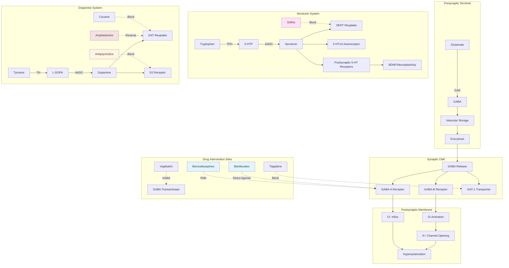

# Lesson 4: Central Nervous System Pharmacology, Neurotransmitter Systems

## 1. First-Principles Intuition & Invariants

The central nervous system operates as a distributed electrochemical network where information propagates through precisely timed voltage-gated ion flux and chemical neurotransmitter signaling across synaptic junctions. Unlike peripheral tissues where receptor occupancy often follows simple concentration-response curves, CNS pharmacology demands understanding of circuit-level dynamics, receptor desensitization kinetics, compensatory upregulation, and the distinction between acute receptor binding and chronic adaptive remodeling that defines therapeutic efficacy and withdrawal syndromes.

Every psychoactive drug modulates one or more of four primary neurotransmitter systems: gamma-aminobutyric acid (GABA), the principal inhibitory transmitter; glutamate, the dominant excitatory signal; dopamine, governing reward prediction error and motor control; and serotonin, regulating mood homeostasis, appetite, and circadian rhythm. These systems do not operate in isolation. GABAergic interneurons tonically inhibit dopaminergic projection neurons in the ventral tegmental area, glutamatergic pyramidal cells drive striatal medium spiny neurons, and serotonergic raphe nuclei send diffuse modulatory projections throughout the cortex and limbic structures. Pharmacological intervention at any node propagates through interconnected feedback loops, producing both desired therapeutic effects and predictable side-effect profiles that reflect collateral receptor engagement across anatomical regions.

The blood-brain barrier imposes a lipophilicity requirement that constrains drug design. Only molecules with log P values between 1.5 and 2.5 and molecular weights below 400-500 Daltons reliably penetrate the endothelial tight junctions and astrocytic endfeet surrounding cerebral capillaries. This explains why quaternary ammonium cholinesterase inhibitors like neostigmine remain peripherally restricted while tertiary amines like physostigmine cross into CNS compartments. Once across the barrier, drug distribution follows regional cerebral blood flow, with gray matter receiving proportionally higher concentrations than white matter tracts.

Receptor subtypes determine pharmacological selectivity and adverse effect liability. The GABA-A receptor complex contains at least nineteen subunit isoforms (α1-6, β1-3, γ1-3, δ, ε, θ, π, ρ1-3) that assemble into pentameric chloride channels with distinct anatomical distributions and pharmacological sensitivities. Benzodiazepines binding at the α-γ interface potentiate channel opening probability only when GABA occupies its orthosteric site, producing anxiolysis at α2/3 subunits, sedation at α1, muscle relaxation at α2/5, and anticonvulsant activity predominantly through α1 mechanisms. The α1-selective hypnotic zolpidem demonstrates that subtype-specific targeting reduces next-day hangover by sparing α2/3-mediated anxiolytic tolerance.

Serotonin presents fourteen receptor subtypes (5-HT1A through 5-HT7) divided into G-protein coupled receptors and the 5-HT3 ligand-gated cation channel. Selective serotonin reuptake inhibitors (SSRIs) block the presynaptic serotonin transporter (SERT), acutely increasing synaptic serotonin availability. However, therapeutic antidepressant effects require four to six weeks because immediate serotonin elevation triggers autoinhibitory 5-HT1A somatodendritic autoreceptors that suppress raphe firing. Only after chronic exposure do these autoreceptors desensitize, permitting sustained elevation of serotonin at postsynaptic 5-HT1A heteroreceptors in hippocampus and prefrontal cortex that mediate antidepressant neuroplasticity through brain-derived neurotrophic factor (BDNF) upregulation and dendritic spine remodeling.

Dopamine signaling bifurcates into D1-like receptors (D1, D5) coupled to Gs proteins that stimulate adenylyl cyclase and D2-like receptors (D2, D3, D4) coupled to Gi that inhibit cyclic AMP formation. Antipsychotic efficacy correlates with D2 receptor occupancy in mesolimbic pathways, with 65-70% striatal D2 blockade required for antipsychotic response and occupancy above 78% producing extrapyramidal motor side effects. The therapeutic window narrows further because simultaneous blockade of tuberoinfundibular D2 receptors disinhibits prolactin secretion, producing galactorrhea and sexual dysfunction, while nigrostriatal D2 antagonism generates parkinsonian rigidity and bradykinesia. Second-generation antipsychotics like clozapine and quetiapine exploit fast dissociation kinetics from D2 receptors and high 5-HT2A antagonism to widen this therapeutic index.

Glutamate operates through ionotropic NMDA, AMPA, and kainate receptors plus metabotropic G-protein coupled receptors. NMDA receptor overactivation during ischemia or seizure produces excitotoxic calcium influx that triggers mitochondrial dysfunction and caspase-mediated apoptosis. Conversely, NMDA receptor hypofunction, as induced by phencyclidine or ketamine, produces dissociative anesthesia and psychotomimetic symptoms that model certain aspects of schizophrenia. Ketamine's rapid-onset antidepressant effects at sub-anesthetic doses appear mediated by disinhibition of cortical pyramidal neurons through preferential blockade of NMDA receptors on GABAergic interneurons, leading to glutamate surge and subsequent AMPA receptor-mediated synaptic potentiation.

Opioid pharmacology centers on three G-protein coupled receptor subtypes: mu (μ), kappa (κ), and delta (δ). Mu receptor agonism in the periaqueductal gray and rostral ventromedial medulla produces descending pain inhibition, while activation in the locus coeruleus and nucleus tractus solitarius suppresses respiration. The ventral tegmental area and nucleus accumbens mu receptors mediate euphoria and addiction liability. Partial agonists like buprenorphine display ceiling effects for respiratory depression while maintaining analgesic efficacy due to high receptor affinity but submaximal intrinsic efficacy. Tolerance develops through receptor phosphorylation by G-protein receptor kinases, beta-arrestin recruitment, and receptor internalization, requiring dose escalation. Physical dependence reflects compensatory upregulation of adenylyl cyclase activity that becomes unmasked during withdrawal, producing noradrenergic hyperactivity manifesting as lacrimation, piloerection, diarrhea, and sympathetic storm.

The addiction neurobiology converges on the mesolimbic dopamine pathway projecting from ventral tegmental area to nucleus accumbens. All drugs of abuse—whether directly (amphetamine, cocaine) or indirectly (opioids, nicotine, alcohol, cannabinoids)—increase dopamine release in this circuit. Repeated exposure produces allostatic dysregulation where the hedonic set point shifts, requiring drug presence to achieve baseline mood and producing anhedonia during abstinence. Prefrontal cortical hypometabolism impairs executive control over drug-seeking behavior, transforming voluntary use into compulsive consumption resistant to negative consequences.

## 2. Core Architecture & Mechanics

The GABAergic system provides tonic inhibition throughout the neuraxis, with particularly dense innervation in cerebral cortex, hippocampus, amygdala, cerebellum, and striatum. GABA synthesis occurs through glutamic acid decarboxylase (GAD) conversion of glutamate to GABA in presynaptic terminals. After vesicular release into the synaptic cleft, GABA activates postsynaptic GABA-A ionotropic receptors that conduct chloride influx, hyperpolarizing the membrane, and metabotropic GABA-B receptors that couple through Gi proteins to open potassium channels and inhibit presynaptic calcium channels. Synaptic GABA is cleared by plasma membrane GABA transporters (GAT-1 through GAT-4) located on both neurons and glia.

Benzodiazepines represent positive allosteric modulators that shift the GABA concentration-response curve leftward without directly opening the chloride channel in GABA's absence. This ceiling effect contrasts with barbiturates, which at high concentrations directly activate GABA-A receptors independent of GABA and prolong channel open time, producing dose-dependent CNS depression that extends to medullary respiratory centers with lethal potential. The barbiturate binding site resides at the β subunit transmembrane domain, distinct from the benzodiazepine α-γ interface. Flumazenil competitively antagonizes benzodiazepines at this site, reversing sedation within two to three minutes when administered intravenously at 0.2 mg boluses titrated to effect, though its elimination half-life of sixty minutes necessitates monitoring for resedation when reversing long-acting agents like diazepam.

Zolpidem, zaleplon, and eszopiclone belong to the Z-drug class with preferential α1 subunit selectivity. Standard dosing of zolpidem at 10 mg produces peak plasma concentration within 1.6 hours and maintains therapeutic concentrations for six to eight hours, aligning with sleep architecture requirements. The α1 selectivity reduces next-day psychomotor impairment compared to non-selective benzodiazepines but introduces risk of complex sleep-related behaviors including sleep-driving and sleep-eating, likely reflecting differential suppression of memory consolidation circuits while motor programs remain partially executable.

Selective serotonin reuptake inhibitors achieve therapeutic plasma concentrations within five to seven days of daily dosing, but the clinical antidepressant response lags by four to six weeks due to the sequential molecular cascade. SERT blockade immediately elevates synaptic serotonin, which initially activates presynaptic 5-HT1A autoreceptors that provide negative feedback suppression of raphe nuclei firing. Sustained elevation desensitizes these autoreceptors over two to three weeks, allowing raphe neurons to resume firing at normal rates while postsynaptic serotonin remains elevated. This sustained postsynaptic 5-HT1A receptor activation in hippocampus and prefrontal cortex triggers CREB phosphorylation, BDNF transcription, and ultimately synaptogenesis that restores mood regulation capacity compromised by chronic stress-induced dendritic atrophy.

Common SSRIs include fluoxetine (half-life 96 hours including active norfluoxetine metabolite), sertraline (26 hours), paroxetine (21 hours), citalopram (35 hours), and escitalopram (30 hours). The long half-life of fluoxetine provides protection against discontinuation syndrome but requires five to six weeks for complete washout before switching to monoamine oxidase inhibitors (MAOIs) to avoid serotonin syndrome. Sertraline exhibits dose-dependent inhibition of dopamine reuptake at doses above 150 mg daily, potentially offering additional benefit in anhedonic depression subtypes. Paroxetine displays significant anticholinergic activity producing dry mouth, constipation, and urinary retention, plus steep dose-response curves necessitating gradual taper to avoid withdrawal symptoms.

Serotonin-norepinephrine reuptake inhibitors (SNRIs) like venlafaxine and duloxetine block both SERT and the norepinephrine transporter (NET), theoretically providing superior efficacy in severe depression, though meta-analyses demonstrate only modest incremental benefit over SSRIs. Venlafaxine exhibits sequential pharmacology, blocking SERT at low doses (75 mg) and adding NET inhibition only above 150 mg daily. Duloxetine demonstrates balanced SERT/NET inhibition across its dose range (30-120 mg) and carries FDA approval for diabetic peripheral neuropathy and fibromyalgia due to descending noradrenergic pain modulation enhancement.

Tricyclic antidepressants (TCAs) like amitriptyline, nortriptyline, and desipramine block SERT and NET but also antagonize histamine H1 receptors (sedation, weight gain), muscarinic acetylcholine receptors (dry mouth, constipation, urinary retention, cognitive impairment), and alpha-1 adrenergic receptors (orthostatic hypotension). Their narrow therapeutic index reflects sodium channel blockade producing QRS widening and ventricular arrhythmias in overdose. TCAs require baseline ECG screening and are contraindicated with QTc intervals exceeding 450 milliseconds. Despite side-effect burden, tertiary amine TCAs remain valuable for treatment-resistant depression and chronic pain syndromes, with nortriptyline preferred due to reduced anticholinergic load and well-defined therapeutic plasma window of 50-150 ng/mL.

Antipsychotic medications divide into first-generation typical agents and second-generation atypicals. First-generation antipsychotics like haloperidol and chlorpromazine act primarily through high-affinity D2 receptor antagonism. Haloperidol requires plasma concentrations of 4-20 ng/mL corresponding to 65-70% striatal D2 occupancy for antipsychotic efficacy. Occupancy exceeding 78% produces extrapyramidal symptoms including acute dystonia (sustained muscle contractions within hours to days, treated with benztropine 1-2 mg IM), akathisia (subjective restlessness within days to weeks, managed with propranolol 20-40 mg three times daily or benzodiazepines), parkinsonism (bradykinesia and rigidity within weeks, treated with anticholinergics), and tardive dyskinesia (involuntary choreiform movements after months to years of exposure, often irreversible).

Second-generation antipsychotics including risperidone, olanzapine, quetiapine, aripiprazole, and clozapine demonstrate varying degrees of 5-HT2A antagonism relative to D2 blockade. The 5-HT2A antagonism in cortical regions theoretically enhances dopamine release in prefrontal cortex while D2 antagonism in mesolimbic pathways treats positive symptoms. Clozapine remains the gold standard for treatment-resistant schizophrenia due to unique efficacy and low extrapyramidal symptom burden but requires weekly to biweekly absolute neutrophil count monitoring due to 0.8% incidence of agranulocytosis. Therapeutic clozapine plasma levels range from 350-600 ng/mL, with seizure risk escalating above 600 mg daily doses.

Aripiprazole functions as a partial D2 agonist with intrinsic activity approximately 30% of dopamine, producing functional antagonism in hyperdopaminergic mesolimbic circuits while providing partial agonist support in hypodopaminergic mesocortical pathways. This mechanism reduces extrapyramidal symptoms and hyperprolactinemia compared to full antagonists. Standard dosing begins at 10-15 mg daily with maintenance range of 10-30 mg once daily, leveraging its 75-hour elimination half-life for consistent receptor occupancy.

Anticonvulsant pharmacology exploits multiple mechanisms including sodium channel inactivation (phenytoin, carbamazepine, lamotrigine), calcium channel blockade (ethosuximide for T-type channels), GABA-A positive allosteric modulation (benzodiazepines), GABA transaminase inhibition (vigabatrin), and synaptic vesicle protein SV2A binding (levetiracetam). Phenytoin displays zero-order kinetics at therapeutic concentrations, where hepatic metabolism saturates and small dose increases produce disproportionate plasma concentration rises. Therapeutic range spans 10-20 μg/mL, with ataxia and nystagmus emerging above 20 μg/mL and mental status changes above 30 μg/mL. Carbamazepine induces its own metabolism through CYP3A4 upregulation, requiring dose titration over four to six weeks to maintain therapeutic concentrations of 4-12 μg/mL.

Valproic acid provides broad-spectrum seizure control through sodium channel effects, T-type calcium channel inhibition, and enhancement of GABA synthesis. Therapeutic levels range from 50-100 μg/mL, though some patients require 100-125 μg/mL for refractory cases. Valproate carries black-box warnings for hepatotoxicity (particularly in children under two years with mitochondrial disorders), pancreatitis, and teratogenicity including neural tube defects when used during pregnancy. Lamotrigine requires exceptionally slow titration (25 mg daily for two weeks, then 50 mg daily for two weeks, advancing by 25-50 mg every two weeks) to avoid Stevens-Johnson syndrome, with risk amplified by concurrent valproate coadministration that inhibits lamotrigine glucuronidation.

Opioid agonists span from weak agents like codeine (requiring CYP2D6 conversion to morphine, ineffective in 7-10% of Caucasian poor metabolizers) through moderate potency tramadol, hydrocodone, and oxycodone to strong agonists including morphine, hydromorphone, fentanyl, and sufentanil. Morphine demonstrates oral bioavailability of only 25-30% due to extensive first-pass glucuronidation, necessitating oral-to-parenteral conversion ratios of 3:1. Intravenous morphine onset occurs within five minutes with peak effect at twenty minutes and duration of three to four hours. Fentanyl demonstrates 80-100 times greater potency than morphine due to higher lipophilicity and mu receptor affinity, enabling transdermal delivery for chronic pain but also producing rapid-onset euphoria when diverted to intravenous abuse.

Buprenorphine functions as a partial mu agonist with such high receptor affinity (Kd approximately 0.2 nM) that it precipitates withdrawal when administered to opioid-dependent patients with full agonists present. This property enables office-based opioid use disorder treatment when combined with naloxone in sublingual formulations that undergo extensive first-pass metabolism when swallowed (deterring injection abuse) but achieve therapeutic levels when absorbed sublingually. Standard induction begins at 2-4 mg sublingual buprenorphine after twelve hours of abstinence from short-acting opioids or 24-48 hours from methadone, titrating to 12-16 mg daily maintenance dosing that saturates mu receptors and blocks euphoria from illicit opioid use.

Naloxone and naltrexone serve as competitive mu receptor antagonists reversing opioid toxicity. Naloxone administered at 0.4-2.0 mg intravenously, intramuscularly, or intranasally reverses respiratory depression within two minutes, though its 30-60 minute duration necessitates repeated dosing or continuous infusion when reversing long-acting opioids like methadone. Overly aggressive reversal precipitates acute withdrawal and sympathetic surge with hypertension, tachycardia, and pulmonary edema in opioid-dependent patients. Titrating naloxone to respiratory rate restoration (target 12-16 breaths per minute) rather than complete consciousness minimizes withdrawal severity while securing the airway.

## 3. High-Performance Optimization & Failure Modes

Benzodiazepine prescribing requires matching pharmacokinetic profile to clinical indication. Acute anxiety or panic attacks demand rapid-onset agents like alprazolam or lorazepam that achieve peak plasma concentrations within one to two hours, while chronic generalized anxiety benefits from longer-acting agents like clonazepam with 18-50 hour half-life providing stable anxiolysis without interdose rebound. Lorazepam offers advantages in hepatic impairment due to direct glucuronidation without Phase I oxidative metabolism, and its intermediate duration of 10-20 hours balances efficacy against accumulation risk in elderly patients. Intravenous lorazepam at 2-4 mg serves as second-line status epilepticus treatment following initial benzodiazepine failure, administered at maximum rate of 2 mg/minute to avoid respiratory depression.

Benzodiazepine tolerance develops within two to four weeks for sedative-hypnotic effects but occurs more slowly for anxiolytic properties, explaining sustained benefit in generalized anxiety disorder despite rapid tolerance to sleep induction. Physical dependence manifests after four to six weeks of continuous use, with withdrawal severity correlating to dose, duration, and elimination half-life. Short-acting agents like alprazolam produce withdrawal within 12-24 hours characterized by rebound anxiety, insomnia, tremor, diaphoresis, and perceptual disturbances. Severe withdrawal may precipitate seizures, typically within 24-72 hours of cessation. Supervised taper protocols convert short-acting benzodiazepines to equivalent diazepam doses, then reduce diazepam by 10% every one to two weeks over three to six months for long-term users.

SSRI optimization requires patience through the delayed onset period. Starting doses of escitalopram 10 mg, sertraline 50 mg, or fluoxetine 20 mg daily provide adequate therapeutic exposure in most patients, though some require titration to escitalopram 20 mg or sertraline 150-200 mg. Administering SSRIs with food reduces nausea, and evening dosing may attenuate activation side effects. Sexual dysfunction (delayed orgasm, decreased libido, anorgasmia) affects 40-60% of patients and represents the most common reason for non-adherence. Mitigation strategies include drug holidays (skipping doses before anticipated sexual activity, feasible only with short half-life agents), dose reduction, switching to bupropion or mirtazapine with lower sexual dysfunction rates, or adding bupropion 150-300 mg daily to restore libido through dopaminergic and noradrenergic enhancement.

Serotonin syndrome presents as a clinical triad of mental status changes (agitation, confusion), autonomic instability (hyperthermia, tachycardia, diaphoresis, mydriasis), and neuromuscular hyperactivity (clonus, hyperreflexia, tremor, rigidity). It emerges when serotonergic drugs combine, classically MAOIs with SSRIs but also occurring with tramadol, meperidine, dextromethorphan, linezolid (a weak MAOI), or St. John's wort. Management requires immediate discontinuation of serotonergic agents, aggressive cooling, intravenous benzodiazepines for agitation and neuromuscular rigidity, and cyproheptadine 12 mg initially then 2 mg every two hours as 5-HT2A antagonist for severe cases. Differentiation from neuroleptic malignant syndrome (which evolves over days with lead-pipe rigidity, no clonus, elevated creatine kinase) is critical as treatments differ.

Antipsychotic treatment-resistance, defined as inadequate response to two different antipsychotics at therapeutic doses for six weeks each, mandates clozapine trial. Clozapine initiation begins at 12.5 mg once or twice daily, advancing by 25-50 mg increments every one to two days as tolerated, targeting 300-450 mg daily in divided doses. Baseline absolute neutrophil count (ANC) above 1500 cells/μL is required, with monitoring weekly for six months, biweekly for six months, then monthly thereafter. ANC between 1000-1500 triggers increased monitoring; below 1000 mandates interruption; below 500 requires permanent discontinuation. Clozapine metabolite norclozapine accumulates with smoking cessation (CYP1A2 induction loss), potentially precipitating toxicity requiring dose reduction by 25-50%.

Antipsychotic-induced metabolic syndrome emerges within weeks of olanzapine or clozapine initiation, with weight gain averaging 10-15 pounds over three months. Monitoring requires baseline and quarterly assessments of weight, fasting glucose, lipid panel, and blood pressure. Metformin 500-1000 mg twice daily attenuates weight gain when initiated concurrently with antipsychotic. Switching to agents with lower metabolic burden (aripiprazole, ziprasidone, lurasidone) may be necessary when metabolic parameters deteriorate despite lifestyle intervention.

Opioid rotation exploits incomplete cross-tolerance between agents to restore analgesia in tolerant patients. When converting between opioids, reduce the equianalgesic dose by 25-50% to account for incomplete tolerance, then retitrate to effect. Methadone rotation requires particular caution as its long, variable half-life (15-60 hours) and NMDA receptor antagonism produce disproportionately greater analgesic potency at high morphine equivalent doses. Methadone for chronic pain typically starts at 2.5-5 mg every eight hours regardless of prior opioid exposure, advancing by 5 mg weekly increments while monitoring for sedation and QTc prolongation (requires baseline and annual ECGs, contraindicated if QTc exceeds 500 milliseconds).

Naloxone prescribing for overdose prevention requires education on administration technique. Intranasal formulations deliver 4 mg per actuation, requiring single spray per nostril for 8 mg total dose. If no response within two to three minutes, administer second dose. Injectable naloxone at 0.4 mg/mL can be administered intramuscularly into deltoid or thigh. Bystanders must call emergency services immediately as naloxone duration may be shorter than fentanyl, leading to renarcotization within 30-90 minutes requiring repeat dosing or hospital observation.

Anticonvulsant therapeutic drug monitoring guides dosing for agents with defined therapeutic ranges. Drawing phenytoin levels five to seven days after dose changes, at trough (immediately before next dose) provides steady-state concentrations. Protein binding alterations in hypoalbuminemia, pregnancy, or uremia falsely lower total phenytoin levels while free fractions remain therapeutic, necessitating free phenytoin measurement when albumin falls below 3.0 g/dL. Carbamazepine levels drawn at trough after two to four weeks of dosing guide adjustments, though clinical seizure control remains the primary endpoint. Valproate levels correlate poorly with efficacy in bipolar disorder but guide toxicity assessment, with levels above 125 μg/mL associated with tremor, thrombocytopenia, and hyperammonemic encephalopathy.

General anesthesia requires titration across hypnotic agents (propofol, etomidate, volatile anesthetics), opioids (fentanyl, remifentanil), and neuromuscular blockers (rocuronium, vecuronium). Propofol infusion at 100-200 μg/kg/min maintains unconsciousness through GABA-A receptor potentiation and possible sodium channel effects. Its rapid redistribution produces emergence within five to ten minutes of discontinuation. Etomidate offers hemodynamic stability useful in unstable patients but causes adrenal suppression even after single induction doses of 0.3 mg/kg, mandating stress-dose corticosteroid coverage in septic patients. Volatile anesthetics like sevoflurane and desflurane provide titratable unconsciousness with minimum alveolar concentration (MAC) values defining equipotent doses; 1 MAC prevents movement in response to surgical incision in 50% of patients.

## 4. Summary & Verification Matrix

| System | Core Mechanism | Therapeutic Target | Primary Failure Mode | Diagnostic Criterion | Mitigation Protocol |
|--------|----------------|-------------------|---------------------|---------------------|---------------------|
| GABAergic / Benzodiazepines | Positive allosteric modulation of GABA-A chloride channels at α-γ interface | Anxiolysis (α2/3), sedation (α1), anticonvulsant (α1), muscle relaxation (α2/5) | Physical dependence after 4-6 weeks with rebound anxiety, tremor, seizure risk upon cessation | Withdrawal within 12-72 hours of short-acting agent discontinuation; seizure threshold lowering | Convert to diazepam equivalent, taper 10% every 1-2 weeks over 3-6 months; IV lorazepam 2-4 mg for withdrawal seizures |
| Serotonergic / SSRIs | SERT blockade elevating synaptic 5-HT; 4-6 week autoreceptor desensitization enables postsynaptic BDNF-mediated neuroplasticity | Major depressive disorder, generalized anxiety disorder, panic disorder, OCD | Sexual dysfunction (40-60% incidence); serotonin syndrome with MAOI/tramadol combination; discontinuation syndrome with short half-life agents | Hamilton Depression Rating Scale ≥50% reduction at 6-8 weeks; hyperthermia, clonus, autonomic instability for serotonin syndrome | Drug holiday or bupropion augmentation for sexual dysfunction; immediate drug cessation + cyproheptadine 12 mg for serotonin syndrome; gradual taper over 4-6 weeks |
| Dopaminergic / Antipsychotics | D2 receptor antagonism (65-70% occupancy for efficacy; >78% for EPS) or partial agonism (aripiprazole) | Schizophrenia positive symptoms, acute mania, agitation | Extrapyramidal symptoms (dystonia, akathisia, parkinsonism, tardive dyskinesia); metabolic syndrome with olanzapine/clozapine; agranulocytosis with clozapine (0.8%) | PANSS positive subscale reduction; AIMS score for tardive dyskinesia; ANC monitoring with clozapine | Benztropine 1-2 mg IM for acute dystonia; propranolol 20-40 mg TID for akathisia; switch to aripiprazole for metabolic syndrome; discontinue clozapine if ANC <500 |
| Glutamatergic / NMDA Modulators | NMDA receptor antagonism producing dissociation (ketamine) or anticonvulsant effect (memantine) | Treatment-resistant depression (ketamine 0.5 mg/kg IV), moderate-severe Alzheimer disease (memantine) | Emergence phenomena (dissociation, hallucinations); bladder dysfunction with chronic ketamine abuse | ≥50% MADRS reduction within 24 hours for ketamine; MMSE stabilization for memantine | Benzodiazepine pretreatment to reduce dissociative symptoms; limit ketamine infusions to twice weekly; discontinue with urinary frequency or hematuria |
| Opioid / Mu Agonists | Mu receptor Gi-coupled inhibition in periaqueductal gray (analgesia), locus coeruleus (euphoria), medulla (respiratory depression) | Moderate-severe acute and chronic pain; opioid use disorder (buprenorphine partial agonist) | Respiratory depression (RR <8-10/min, hypoxemia); tolerance requiring dose escalation; physical dependence with withdrawal syndrome; overdose death | Pain intensity reduction ≥50% on numeric rating scale; respiratory rate <10/min or SpO2 <90% indicating toxicity | Naloxone 0.4-2.0 mg IV/IM/IN titrated to RR 12-16/min; buprenorphine 12-16 mg sublingual daily for opioid use disorder; opioid rotation with 25-50% dose reduction for tolerance |
| Anticonvulsants / Sodium Channel Blockers | Use-dependent inactivation of voltage-gated sodium channels (phenytoin, carbamazepine, lamotrigine) | Focal and generalized tonic-clonic seizures; bipolar disorder (lamotrigine for depression phase) | Phenytoin zero-order kinetics producing non-linear dose-concentration relationship; Stevens-Johnson syndrome with lamotrigine (2-4 week slow titration required) | Seizure freedom for ≥12 months; therapeutic drug levels (phenytoin 10-20 μg/mL; carbamazepine 4-12 μg/mL) | Phenytoin dose adjustments in 25-30 mg increments when near saturation; lamotrigine 25 mg daily × 2 weeks then 50 mg × 2 weeks escalation; discontinue immediately for rash |
