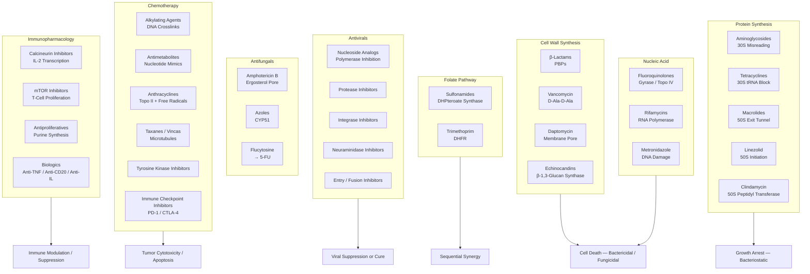

# Lesson 5: Antimicrobials, Chemotherapy, Immunopharmacology

## 1. First-Principles Intuition & Invariants

The entire edifice of antimicrobial pharmacology rests on a single, ruthless constraint: selective toxicity — the capacity to eradicate a pathogen while leaving host biochemistry functionally intact. Paul Ehrlich, working with trypanosomal dyes in the early 1900s, framed this as the "magic bullet," a compound that would bind pathogen-specific molecular machinery with negligible affinity for homologous host structures. Every antimicrobial class in modern practice is a refinement of that idea, exploiting differences between microbial and mammalian cell architecture: the peptidoglycan cell wall, the prokaryotic 70S ribosome, the bacterial DNA gyrase, the fungal ergosterol membrane, the viral polymerase, or the rapidly dividing malignant cell's addiction to nucleotide synthesis.

Selective toxicity is quantified as the therapeutic index, the ratio of the dose producing toxicity in 50% of subjects (TD50) to the dose producing efficacy in 50% (ED50). Penicillin, which targets a cell wall structure absent in human cells, possesses an enormous therapeutic index; amphotericin B, which targets ergosterol that differs from cholesterol by a single double bond, has a narrow one. This index dictates everything downstream: dosing latitude, the need for serum concentration monitoring, the acceptability of empiric therapy, and the clinical tolerance for combination regimens.

The second invariant is the pharmacokinetic-pharmacodynamic (PK/PD) relationship, which divides antimicrobials into two killing philosophies. Time-dependent agents — beta-lactams, macrolides, lincosamides — kill proportionally to the duration that free drug concentration exceeds the minimum inhibitory concentration (fT > MIC). The clinician's goal is to maintain that threshold for 40–60% of the dosing interval, which is why beta-lactams are dosed at intervals shorter than their elimination half-lives or administered as prolonged infusions. Concentration-dependent agents — aminoglycosides, fluoroquinolones, daptomycin — kill proportionally to peak concentration relative to MIC (Cmax/MIC) and to total drug exposure (AUC/MIC). For these, the optimal strategy maximizes peak concentration even if it means extending the dosing interval, which is the rationale for once-daily aminoglycoside dosing. A third category, concentration-dependent with time-dependence (vancomycin, azithromycin, tetracyclines, linezolid), is governed primarily by AUC/MIC, which has driven the transition from trough-based vancomycin monitoring to AUC-guided dosing.

Resistance is not an aberration; it is the inevitable evolutionary consequence of imposing lethal selection pressure on populations measured in billions. A single bacterium, dividing every 30 minutes, generates 2^48 descendants per day — any mutation conferring survival advantage will be amplified relentlessly. Resistance mechanisms fall into four functional categories: enzymatic inactivation (beta-lactamases hydrolyzing the beta-lactam ring, acetyltransferases modifying aminoglycosides), target modification (PBP2a in MRSA sidestepping beta-lactam binding, methylated 23S rRNA conferring macrolide resistance), reduced permeability or increased efflux (porin loss in Pseudomonas, AcrAB-TolC pumps in Enterobacteriaceae), and bypass pathway creation (alternative DHFR enzymes circumventing trimethoprim). Antimicrobial stewardship — the disciplined restriction of broad-spectrum agents, rapid de-escalation from empiric to directed therapy, and avoidance of unnecessary prolonged courses — is not a nicety but a structural necessity, because every antibiotic course exerts selective pressure that enriches resistant subpopulations.

The minimum inhibitory concentration (MIC), the lowest concentration preventing visible growth in standardized broth, is the central currency of susceptibility reporting. But MIC is a snapshot under artificial conditions; in vivo success depends on immune status, infection site penetration (CSF, bone, prostate, endocardial vegetations), protein binding, and inoculum density. The MIC must be interpreted through the PK/PD lens, not as a binary susceptible/resistant flag.

## 2. Core Architecture & Mechanics

### Cell Wall Synthesis Inhibitors

The bacterial cell wall is a cross-linked peptidoglycan mesh that resists osmotic lysis; without it, the cell ruptures in hypotonic media. Beta-lactam antibiotics — penicillins, cephalosporins, carbapenems, and monobactams — share a four-membered beta-lactam ring that structurally mimics the D-alanyl-D-alanine terminus of the peptidoglycan precursor. They bind penicillin-binding proteins (PBPs), the transpeptidase enzymes that cross-link peptidoglycan strands, and form a covalent acyl-enzyme intermediate that inactivates the enzyme. The result is a weakened wall, autolysin activation, and osmotic lysis. Carbapenems (imipenem, meropenem, ertapenem) possess the broadest spectrum, stable against most beta-lactamases except carbapenemases (KPC, NDM, OXA-48). Piperacillin-tazobactam extends piperacillin's coverage with a beta-lactamase inhibitor; ceftazidime-avibactam and meropenem-vaborbactam address carbapenem-resistant Enterobacteriaceae by inhibiting class A and C beta-lactamases.

Vancomycin, a glycopeptide, operates upstream of the transpeptidase step. It binds D-alanyl-D-alanine directly via five hydrogen bonds, sterically blocking the precursor from reaching the PBP. It is large, polar, and Gram-positive–restricted; Gram-negative outer membranes exclude it. Daptomycin, a lipopeptide, inserts into the bacterial membrane in a calcium-dependent manner, oligomerizes, and forms a conductance pore that depolarizes the membrane potential and kills without requiring cell division. It is inactivated by pulmonary surfactant and cannot be used for pneumonia.

### Protein Synthesis Inhibitors

The prokaryotic 70S ribosome (50S + 30S subunits) differs sufficiently from the eukaryotic 80S ribosome to permit selective targeting, though the margin is thin and mitochondrial ribosomes (which are 70S-like) account for dose-dependent toxicity of agents like chloramphenicol and linezolid.

Aminoglycosides (gentamicin, tobramycin, amikacin) bind the 30S subunit's 16S rRNA at the decoding site, causing misreading of mRNA and incorporation of incorrect amino acids. They are bactericidal, concentration-dependent, and exhibit a post-antibiotic effect (PAE) — persistent suppression of growth after concentration falls below MIC. Ototoxicity (irreversible hair cell damage via reactive oxygen species) and nephrotoxicity (proximal tubule accumulation) are the dose-limiting toxicities.

Tetracyclines and the glycylcycline tigecycline bind the 30S subunit at a different site, blocking tRNA entry. They are bacteriostatic, broad-spectrum, and concentrated intracellularly, making them effective against intracellular pathogens (Rickettsia, Chlamydia, Mycoplasma). Doxycycline is the workhorse for community-acquired MRSA, Lyme disease, rickettsial infections, and chlamydial STIs.

Macrolides (azithromycin, clarithromycin, erythromycin) bind the 50S subunit at the peptidyl transferase center, blocking the exit tunnel through which the nascent peptide emerges. They are bacteriostatic, with azithromycin's exceptional tissue penetration (tissue half-life of 2–4 days) permitting short-course regimens. Linezolid, an oxazolidinone, binds the 50S subunit at the initiation complex, preventing formation of the 70S initiation complex — a unique mechanism with no cross-resistance. It is the oral agent of choice for VRE (vancomycin-resistant Enterococcus) and resistant Gram-positive infections. Clindamycin, a lincosamide, binds the 50S subunit and is notable for its inhibition of toxin production in group A streptococcus and CA-MRSA — the rationale for its inclusion in necrotizing fasciitis regimens.

### Nucleic Acid Inhibitors

Fluoroquinolones (ciprofloxacin, levofloxacin, moxifloxacin) inhibit two essential bacterial topoisomerases: DNA gyrase (topoisomerase II) and topoisomerase IV. DNA gyrase introduces negative supercoils into DNA, relieving torsional stress ahead of the replication fork; topoisomerase IV decatenates linked daughter chromosomes after replication. Fluoroquinolones trap the enzyme-DNA complex as a covalent intermediate, converting the enzyme into a DNA-damaging agent. They are concentration-dependent, orally bioavailable, and penetrate prostate tissue and macrophages. Tendon rupture, QT prolongation, aortic aneurysm risk, and C. difficile colitis have curtailed their empiric use.

Rifamycins (rifampin, rifabutin, rifapentine) inhibit bacterial DNA-dependent RNA polymerase, blocking transcription initiation. Rifampin is uniquely potent against staphylococcal biofilms — the reason it is paired with other agents for prosthetic joint infections and endocarditis — but must never be used as monotherapy because resistance emerges within days via single-point mutations in the rpoB gene.

Metronidazole is a prodrug reduced by bacterial ferredoxin in anaerobes to reactive intermediates that damage DNA. It is inert against aerobes, lacks activity against aerobic Gram-positives, and is the cornerstone for anaerobic coverage in intra-abdominal and pelvic infections, as well as C. difficile and Giardia.

### Folate Pathway Antagonists

Sulfonamides are structural analogs of para-aminobenzoic acid (PABA) that competitively inhibit dihydropteroate synthase, blocking folate synthesis. Trimethoprim inhibits dihydrofolate reductase (DHFR) at a later step. Combined as TMP-SMX, they produce sequential blockade of the folate pathway — synergistic because both steps must function for thymidine synthesis. TMP-SMX is the drug of choice for Pneumocystis jirovecii prophylaxis and treatment, and covers community uropathogens and CA-MRSA.

### Antiviral Agents

Antiviral pharmacology targets pathogen-specific enzymes because viruses are obligate intracellular parasites using host machinery. Nucleoside analogs — acyclovir, valacyclovir, tenofovir, emtricitabine, lamivudine — are prodrugs phosphorylated by viral or cellular kinases to active triphosphates that compete with natural nucleotides for incorporation by viral polymerases. Acyclovir's specificity arises from its initial phosphorylation by the herpesvirus thymidine kinase, which does not phosphorylate host nucleosides; host kinases complete the activation. Tenofovir and emtricitabine target HIV reverse transcriptase; sofosbuvir targets HCV NS5B polymerase.

HIV protease inhibitors (darunavir, atazanavir, lopinavir/ritonavir) block cleavage of the gag-pol polyprotein, producing non-infectious virions. Integrase strand transfer inhibitors (INSTIs — dolutegravir, bictegravir, raltegravir) block insertion of viral DNA into the host genome — the current first-line antiretroviral class because of high genetic barrier to resistance and tolerability. Entry inhibitors (maraviroc blocks CCR5; enfuvirtide blocks gp41-mediated fusion) are reserved for salvage therapy. Neuraminidase inhibitors (oseltamivir, zanamivir) block release of influenza virions from infected cells by cleaving sialic acid residues on the host cell surface. HCV NS3/4A protease inhibitors (glecaprevir, voxilaprevir) combined with NS5B and NS5A inhibitors achieve cure rates above 95% for most genotypes.

### Antifungal Agents

Fungi are eukaryotes, sharing most cellular machinery with the host — selective toxicity is harder. Amphotericin B binds ergosterol in the fungal membrane, forming pores that leak ions and kill the cell; its affinity for cholesterol (differing by one double bond) produces the dose-dependent nephrotoxicity that defined antifungal therapy for decades, now mitigated by lipid formulations. Azoles (fluconazole, voriconazole, posaconazole, isavuconazole) inhibit lanosterol 14-alpha-demethylase (CYP51), depleting ergosterol and accumulating toxic methylated sterols. They are CYP3A4 inhibitors and substrates, creating a web of drug interactions. Echinocandins (caspofungin, micafungin, anidulafungin) inhibit beta-1,3-glucan synthase, blocking cell wall synthesis — the fungal equivalent of beta-lactams — with minimal toxicity because the target is absent in mammalian cells. Flucytosine is converted by fungal cytosine deaminase (absent in mammalian cells) to 5-fluorouracil, which disrupts RNA and DNA synthesis; resistance emerges rapidly if used as monotherapy, so it is paired with amphotericin B for cryptococcal meningitis.

### Cancer Chemotherapy

Cytotoxic chemotherapy exploits the proliferative addiction of malignant cells, targeting DNA synthesis, replication, or mitotic machinery. The therapeutic index is narrow because normal rapidly dividing tissues (bone marrow, gastrointestinal mucosa, hair follicles) share that addiction. Alkylating agents (cyclophosphamide, ifosfamide, busulfan, cisplatin, carboplatin) form covalent adducts with DNA, cross-linking strands and triggering apoptosis or misrepair. Platinum compounds (cisplatin, carboplatin, oxaliplatin) form intra- and interstrand crosslinks; nephrotoxicity (cisplatin), neurotoxicity (oxaliplatin), and myelosuppression (carboplatin) are dose-limiting.

Antimetabolites (methotrexate, 5-fluorouracil, gemcitabine, cytarabine, 6-mercaptopurine) mimic normal nucleotide precursors, blocking DNA or RNA synthesis. Methotrexate inhibits DHFR; 5-FU inhibits thymidylate synthase; gemcitabine is a DNA chain terminator after incorporation. Anthracyclines (doxorubicin, daunorubicin, epirubicin) intercalate DNA, inhibit topoisomerase II, and generate free radicals — a triple mechanism that produces dose-dependent, often irreversible cardiomyopathy via oxidative damage to cardiac mitochondria, capped at a lifetime cumulative dose of 450–550 mg/m² for doxorubicin. Taxanes (paclitaxel, docetaxel) stabilize microtubules, preventing depolymerization and arresting mitosis; vincas (vincristine, vinblastine) do the opposite, preventing polymerization. Both produce peripheral neuropathy.

Targeted therapy has transformed oncology by exploiting tumor-specific driver mutations. Tyrosine kinase inhibitors (imatinib for BCR-ABL in CML, erlotinib for EGFR-mutant lung cancer, vemurafenib for BRAF V600E melanoma) occupy the ATP-binding pocket of oncogenic kinases. Monoclonal antibodies (trastuzumab for HER2+ breast cancer, rituximab for CD20+ lymphomas, cetuximab for EGFR-expressing colorectal cancer) bind surface antigens and engage immune effector functions (ADCC, complement) or block signaling. Immune checkpoint inhibitors (nivolumab, pembrolizumab for PD-1; ipilimumab for CTLA-4) release T-cell brakes, producing durable responses but at the cost of autoimmune-like immune-related adverse events (colitis, pneumonitis, hepatitis, endocrinopathies).

### Immunopharmacology

Calcineurin inhibitors (cyclosporine, tacrolimus) block the calcineurin–NFAT pathway in T cells, preventing transcription of IL-2 and other cytokines essential for T-cell activation. They are the cornerstone of solid organ transplant immunosuppression but require lifelong trough monitoring (tacrolimus target 5–15 ng/mL, cyclosporine 100–300 ng/mL depending on post-transplant phase), and carry risks of nephrotoxicity, hypertension, neurotoxicity, and increased malignancy risk. mTOR inhibitors (sirolimus, everolimus) block the mammalian target of rapamycin, arresting T-cell proliferation downstream of IL-2 signaling; they are non-nephrotoxic but impair wound healing, mandating delayed introduction post-transplant. Antiproliferative agents (azathioprine, mycophenolate mofetil) inhibit purine synthesis, depleting lymphocytes dependent on de novo purine synthesis (salvage pathway is less active in lymphocytes). Mycophenolate has largely replaced azathioprine due to better efficacy and tolerability.

Biologic immunomodulators have revolutionized autoimmune disease management. Anti-TNF agents (infliximab, adalimumab, etanercept) neutralize TNF-alpha, a central cytokine in inflammatory cascades; they transformed Crohn's disease, rheumatoid arthritis, and psoriasis but increase the risk of reactivating latent tuberculosis, hepatitis B, and invasive fungal infections. Anti-IL-6 (tocilizumab), anti-CD20 (rituximab depletes B cells), anti-IL-17 (secukinumab), and JAK inhibitors (tofacitinib, baricitinib — small molecules blocking JAK-STAT signaling) provide targeted immunomodulation with distinct safety profiles requiring tuberculosis screening, live-vaccine avoidance, and monitoring for reactivation of latent infections.

## 3. High-Performance Optimization & Failure Modes

### Dosing Architecture: Matching the Killing Philosophy

The single most consequential clinical decision after agent selection is aligning the dosing regimen with the agent's PK/PD philosophy. For time-dependent beta-lactams, the operational target is fT > MIC for 40% (penicillins), 50% (carbapenems), or 60–70% (cephalosporins) of the dosing interval. In critically ill patients with augmented renal clearance (creatinine clearance greater than 130 mL/min), standard doses produce subtherapeutic fT > MIC, requiring either increased dosing frequency, extended infusion over four hours, or continuous infusion. Piperacillin-tazobactam 4.5 g q6h over 30 minutes is inadequate for many Pseudomonas infections; the same dose as a four-hour extended infusion or as continuous infusion at 18 g/day dramatically improves target attainment. Meropenem 2 g q8h extended infusion is standard for serious Gram-negative infections with MIC of 2–4 µg/mL.

For concentration-dependent agents, the strategy inverts. Aminoglycoside once-daily dosing (gentamicin 5–7 mg/kg q24h, tobramycin 5–7 mg/kg q24h, amikacin 15–20 mg/kg q24h) achieves a Cmax/MIC ratio greater than 8–10, which correlates with bactericidal activity, while the long drug-free interval allows renal tubular uptake to recover, reducing nephrotoxicity. Extended-interval dosing is contraindicated in pregnancy, endocarditis (where the post-antibiotic effect is diminished in vegetations), severe renal impairment, and burns. Therapeutic drug monitoring uses a random level drawn 6–14 hours post-dose, interpreted via the Hartford nomogram, to adjust the interval.

Vancomycin dosing has undergone a paradigm shift. The 2020 consensus guidelines abandoned trough-based targets in favor of AUC/MIC greater than 400 for serious MRSA infections, corresponding to an AUC0–24 of 400–600 mg·h/L. Bayesian dosing software or two-level pharmacokinetic estimation (peak drawn 1–2 hours post-infusion, trough drawn immediately before the next dose) is required for serious infections, bacteremia, endocarditis, osteomyelitis, and any patient with unstable renal function. The AUC ceiling of 600 mg·h/L corresponds to the nephrotoxicity threshold, particularly in patients receiving concomitant piperacillin-tazobactam, which triples vancomycin nephrotoxicity risk.

### Therapeutic Drug Monitoring Across Classes

Beyond vancomycin and aminoglycosides, TDM governs the immunosuppressant classes. Tacrolimus troughs are drawn immediately before the morning dose, with targets varying by transplant type and post-transplant phase: 10–15 ng/mL during months 0–3, 8–12 ng/mL during months 3–6, and 5–10 ng/mL long-term for kidney transplant recipients. Tacrolimus is a CYP3A4/5 substrate with enormous interpatient variability; ingestion with food reduces absorption by 30–40%, and grapefruit increases levels dramatically. Cyclosporine uses C2 (two-hour post-dose) monitoring in some programs because peak concentration correlates better with AUC than trough.

Linezolid TDM is emerging because thrombocytopenia correlates with trough greater than 7–8 mg/L and treatment duration beyond 14 days. Patients with renal impairment, those on concomitant serotonergic agents (risk of serotonin syndrome), or those requiring more than two weeks of therapy benefit from monitoring with a target trough of 2–7 mg/L. Voriconazole, metabolized by polymorphic CYP2C19, requires TDM (target trough 1–5.5 mg/L) for all patients after the first five days; 15–20% of Asians and 3–5% of Caucasians are poor metabolizers who accumulate toxic levels at standard doses.

### CYP450 Interaction Management

The azole antifungals and rifampin are the two most clinically consequential CYP450 modulators in antimicrobial therapy. Voriconazole and posaconazole inhibit CYP3A4 and CYP2C19, creating interactions with calcineurin inhibitors, statins, benzodiazepines, and vinca alkaloids. All azoles except isavuconazole prolong the QT interval, and combined with other QT-prolonging agents (fluoroquinolones, macrolides, methadone, antipsychotics) can precipitate torsades de pointes.

Rifampin is a potent CYP3A4 inducer, reducing levels of tacrolimus by 60–80%, warfarin, oral contraceptives, azole antifungals, protease inhibitors, and many antiepileptics. It should be started 2–3 days before tacrolimus introduction in transplant patients requiring antitubercular therapy, with preemptive tacrolimus dose increases and close monitoring. The combination of rifampin with a calcineurin inhibitor is one of the most challenging drug interaction scenarios in clinical pharmacology.

### Resistance Mitigation and Combination Rationale

Combination antimicrobial therapy serves three distinct purposes: expanding empiric coverage before speciation, achieving synergy (beta-lactam plus aminoglycoside for enterococcal endocarditis, amphotericin B plus flucytosine for cryptococcal meningitis, TMP-SMX plus aminoglycoside for severe staphylococcal infections), and preventing resistance emergence (rifampin always paired with a second active agent, antiretroviral regimens always triple-agent, antitubercular therapy four-drug). The risk-benefit calculus differs for each: synergy regimens increase toxicity (aminoglycoside nephrotoxicity), resistance prevention extends treatment duration, and broad empiric coverage delays de-escalation if cultures are not re-reviewed daily.

The most common stewardship failure is prolonged broad-spectrum empiric therapy after culture results become available. The fix is structural: a 48–72-hour antibiotic timeout, during which the clinician reviews culture and susceptibility data, narrows to the narrowest effective agent, reassesses duration, and converts to oral therapy when the patient is clinically stable and absorbing. For many infections (uncomplicated cystitis, community-acquired pneumonia after clinical improvement, cellulitis), oral bioequivalent therapy (ciprofloxacin, linezolid, fluconazole, metronidazole, doxycycline) permits rapid step-down.

### Cytotoxic Handling and Extravasation Management

Cytotoxic chemotherapy administration carries occupational and patient safety risks distinct from antimicrobial therapy. All cytotoxic agents require handling in a biosafety cabinet with closed-system transfer devices (CSTDs), double chemotherapy-tested gloves, and gowns meeting ASTM D6978 standards. Spill kits must be available within 30 seconds' travel. Extravasation of vesicant agents (anthracyclines, vincas) produces tissue necrosis; doxorubicin extravasation requires immediate cessation, aspiration of residual drug from the catheter, application of topical cold packs (15 minutes QID for 72 hours), and consideration of dexrazoxane — the only FDA-approved antidote for anthracycline extravasation, dosed at 1000 mg/m² IV on days 1 and 2, 500 mg/m² on day 3, starting within 6 hours. Vinca extravasation requires warm compresses and hyaluronidase infiltration. Dosing is calculated by body surface area (mg/m²) for most cytotoxics, with capping at 2.0 m² to prevent overdosing in obese patients, though BSA-based dosing does not account for the increased volume of distribution in obesity and may underdose.

### Immunosuppressant Regimen Optimization

Modern transplant regimens use a calcineurin inhibitor backbone (tacrolimus preferred) plus an antiproliferative agent (mycophenolate mofetil preferred) plus a corticosteroid taper. The optimization challenge is balancing rejection risk against infection and malignancy risk over decades of therapy. Standard induction in high-risk recipients uses basiliximab (anti-IL-2 receptor antibody) or, in sensitized recipients, antithymocyte globulin. Long-term, steroid minimization or withdrawal (avoiding chronic corticosteroid toxicity) is attempted in stable recipients. Belatacept (a CTLA-4 fusion protein that blocks CD28 costimulation) offers a non-nephrotoxic alternative to calcineurin inhibitors, but with higher early rejection rates and increased EBV-related post-transplant lymphoproliferative disorder risk in EBV-seronegative recipients.

Failure modes cluster into five categories. First, nephrotoxicity from calcineurin inhibitors is the leading cause of late renal allograft loss; tacrolimus doses must be minimized by combining with mTOR inhibitors or belatacept when possible. Second, opportunistic infection is the price of immunosuppression: PJP prophylaxis (TMP-SMX) for the first 6–12 months, CMV prophylaxis (valganciclovir) for D+/R– transplants, and antifungal prophylaxis for high-risk liver and pancreas transplants. Third, malignancy (skin cancers, PTLD) increases 2–4-fold; sun protection and dermatologic surveillance are mandatory. Fourth, drug interactions (azole antifungals, macrolides, rifampin) can dramatically alter calcineurin inhibitor levels — any new prescription requires level monitoring within 3–5 days. Fifth, nonadherence (estimated 20–35% of long-term recipients) is a leading cause of late rejection; once-daily tacrolimus formulations (Envarsus XR, Astagraf XL) improve adherence and reduce peak-related neurotoxicity.

## 4. Summary & Verification Matrix

| Class | Governing Invariant | Mechanism | Diagnostic Criterion / Target | Primary Failure Mode |
|---|---|---|---|---|
| β-Lactams | Time-dependent killing: fT > MIC 40–70% of interval | PBP acylation → cell wall defect → osmotic lysis | MIC ≤ susceptibility breakpoint; extended or continuous infusion for serious Gram-negative infections | β-Lactamase hydrolysis (ESBL, KPC, NDM); augmented renal clearance producing subtherapeutic exposure |
| Aminoglycosides | Concentration-dependent: Cmax/MIC > 8–10 | 30S decoding site → mistranslation → bactericidal | Random level 6–14 h post-dose via Hartford nomogram; once-daily dosing | Irreversible ototoxicity (hair cell ROS); proximal tubule nephrotoxicity; rapid resistance in monotherapy |
| Vancomycin | AUC/MIC > 400; AUC ceiling ≤ 600 mg·h/L | D-Ala-D-Ala sequestration → cell wall precursor blockade | Two-level PK or Bayesian AUC estimation; trough 15–20 as rough surrogate | MRSA MIC creep (MIC ≥2); nephrotoxicity amplified by concurrent piperacillin-tazobactam |
| Fluoroquinolones | Concentration-dependent: AUC/MIC 30–125 | Gyrase + Topo IV trapping → DNA double-strand breaks | MIC ≤ breakpoint; reserve for confirmed resistant Gram-negative or intracellular pathogens | Tendon or Achilles rupture; QT prolongation; C. difficile colitis; rapid gyrA/parC point mutations |
| Calcineurin Inhibitors | Trough within phase-specific window | Calcineurin–NFAT block → IL-2 transcription suppression | Tacrolimus pre-dose trough: 5–15 ng/mL by phase; monitor within 3–5 days of any new interacting drug | Nephrotoxicity via afferent vasoconstriction; neurotoxicity; malignancy; CYP3A4 interaction–mediated level shifts |
| Anthracyclines | Lifetime cumulative dose cap (450–550 mg/m² doxorubicin) | DNA intercalation + Topo II inhibition + free radicals | Serial echocardiography or MUGA; LVEF monitoring every 100–150 mg/m² | Dose-dependent irreversible cardiomyopathy; vesicant extravasation necrosis (dexrazoxane antidote within 6 h) |
