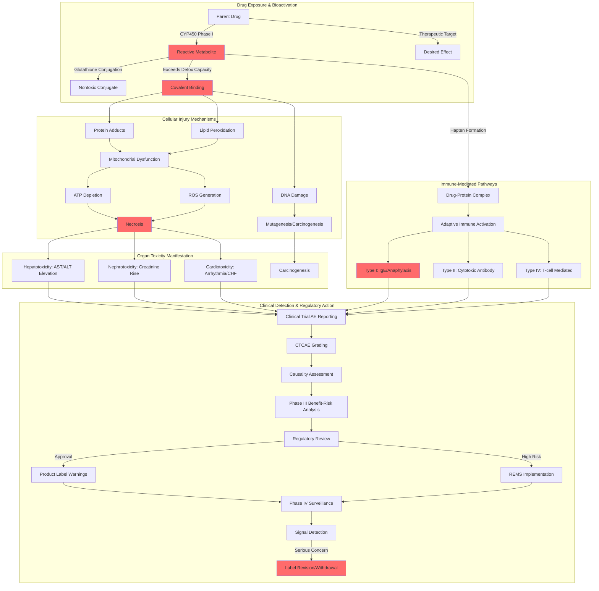

# Lesson 6: Toxicology, Adverse Drug Reactions, Drug Interactions, Regulatory Pharmacology

## 1. First-Principles Intuition & Invariants

The distinction between therapeutic agent and poison resides not in the molecular structure of the compound itself but in the dose delivered to the target organism and the temporal pattern of exposure. Paracelsus articulated this fundamental toxicological invariant in the sixteenth century: the dose makes the poison. Every pharmaceutical compound capable of producing a desired therapeutic effect at one concentration possesses the inherent capacity to induce cellular injury, organ dysfunction, or lethality at higher exposures or in genetically susceptible populations. Toxicology represents the systematic investigation of adverse effects produced by chemical substances on living organisms, encompassing dose-response relationships, mechanisms of cellular injury, organ-specific vulnerability patterns, and the temporal dynamics of toxicity manifestation.

The dose-response curve in toxicology differs fundamentally from the therapeutic dose-response relationship explored in earlier lessons. Therapeutic efficacy curves typically demonstrate a sigmoidal relationship between logarithmic dose and percentage of maximal effect, bounded by receptor saturation kinetics and physiological ceilings. Toxicological dose-response curves, by contrast, assess the probability and severity of adverse outcomes across a population exposed to escalating doses. The threshold dose represents the exposure level below which no measurable toxic effect occurs in the most sensitive individuals within a population. For many toxicological endpoints, particularly cancer induction through genotoxic mechanisms, regulatory agencies employ a linear no-threshold model assuming that even infinitesimal exposures carry proportional risk, though this remains contested for agents acting through receptor-mediated mechanisms requiring threshold occupancy.

The therapeutic index quantifies the safety margin separating efficacious dosing from toxic exposure, calculated as the ratio of the median toxic dose (TD₅₀) to the median effective dose (ED₅₀), or more conservatively as the ratio of the median lethal dose (LD₅₀) to ED₅₀. Drugs with narrow therapeutic indices—digoxin, warfarin, lithium, aminoglycoside antibiotics, cancer chemotherapeutics—demand rigorous therapeutic drug monitoring because modest deviations in plasma concentration precipitate severe toxicity. The therapeutic window for digoxin spans only 0.8 to 2.0 nanograms per milliliter; concentrations exceeding 2.5 nanograms per milliliter induce cardiac arrhythmias through excessive sodium-potassium ATPase inhibition and intracellular calcium overload. Warfarin anticoagulation requires INR (International Normalized Ratio) monitoring to maintain values between 2.0 and 3.0 for most indications, as values exceeding 4.0 exponentially increase hemorrhagic stroke risk while subtherapeutic ratios permit thrombotic events.

Organ-specific toxicity patterns reflect differential drug accumulation, metabolic activation to reactive intermediates, and intrinsic cellular vulnerability. Hepatotoxicity dominates adverse drug reactions because the liver serves as the primary site of xenobiotic biotransformation, concentrating drugs and their metabolites while expressing high activities of cytochrome P450 enzymes that convert parent compounds to reactive electrophiles. Acetaminophen hepatotoxicity exemplifies bioactivation-mediated injury: therapeutic doses undergo glucuronidation and sulfation to nontoxic conjugates, but saturating these pathways through overdose shunts metabolism through CYP2E1 to generate N-acetyl-p-benzoquinone imine (NAPQI), a reactive quinone that depletes hepatic glutathione and covalently binds cellular macromolecules, triggering centrilobular necrosis. N-acetylcysteine serves as the specific antidote by replenishing glutathione stores and directly conjugating NAPQI.

Nephrotoxicity arises from the kidney's concentrating mechanisms, high perfusion rate, and tubular transport systems that accumulate certain compounds to supraphysiological concentrations. Aminoglycoside antibiotics—gentamicin, tobramycin, amikacin—accumulate in proximal tubular epithelial cells through megalin-mediated endocytosis, achieving intracellular concentrations one hundred-fold higher than plasma levels. Intracellular accumulation disrupts mitochondrial protein synthesis and generates reactive oxygen species, producing acute tubular necrosis manifest as rising serum creatinine and declining glomerular filtration rate. Monitoring trough concentrations and implementing once-daily dosing regimens exploit the saturable uptake mechanism to minimize tubular accumulation while maintaining antimicrobial efficacy through concentration-dependent bacterial killing.

Teratogenicity represents developmental toxicity expressed as structural or functional abnormalities in offspring following maternal drug exposure during pregnancy. Critical periods of organogenesis spanning gestational weeks three through eight exhibit maximal vulnerability to teratogenic insults because rapid cellular proliferation, migration, and differentiation permit minimal compensatory repair. Thalidomide exemplifies catastrophic teratogenicity: prescribed as an antiemetic in the late 1950s, it produced phocomelia (severe limb reduction defects) in over ten thousand infants before recognition of its teratogenic mechanism. The drug exists as a racemic mixture of R- and S-enantiomers; though the S-enantiomer demonstrates teratogenic activity, rapid in vivo racemization prevents enantiomeric purification from eliminating risk. Molecular mechanisms involve cereblon protein binding and subsequent degradation of transcription factors essential for limb development. Modern teratogen classification employs FDA pregnancy categories ranging from Category A (controlled studies show no risk) through Category X (contraindicated in pregnancy), though recent revisions provide more nuanced narrative descriptions of human and animal data.

Pharmacogenomics illuminates individual variability in drug response and toxicity through genetic polymorphisms affecting drug-metabolizing enzymes, transporters, and pharmacological targets. Cytochrome P450 2D6 exhibits profound genetic heterogeneity with over one hundred documented allelic variants producing phenotypes ranging from poor metabolizers (homozygous for null alleles) to ultrarapid metabolizers (carrying gene duplications). Codeine analgesia depends on CYP2D6-mediated O-demethylation to morphine; poor metabolizers obtain minimal pain relief from standard doses while ultrarapid metabolizers generate excessive morphine, risking respiratory depression. A nursing infant death from maternal codeine use traced to the mother's ultrarapid metabolizer phenotype concentrating morphine in breast milk catalyzed revised prescribing guidelines. Similarly, thiopurine methyltransferase (TPMT) deficiency affects azathioprine and mercaptopurine metabolism in inflammatory bowel disease and leukemia treatment. Patients homozygous for loss-of-function alleles accumulate toxic thioguanine nucleotide metabolites, producing life-threatening myelosuppression unless doses are reduced to ten percent of standard levels. Preemptive genotyping permits rational dose individualization before toxicity manifests.

Drug-drug interactions arise through pharmacokinetic mechanisms altering absorption, distribution, metabolism, or elimination, or through pharmacodynamic mechanisms where drugs with overlapping or opposing effects produce additive toxicity or efficacy changes. Pharmacokinetic interactions at the metabolic level dominate clinical significance. CYP3A4, responsible for metabolizing approximately fifty percent of marketed drugs, serves as the epicenter of interaction liability. Potent CYP3A4 inhibitors—ketoconazole, clarithromycin, ritonavir, grapefruit juice—impair metabolism of substrate drugs, elevating plasma concentrations and precipitating dose-related toxicities. Simvastatin metabolism through CYP3A4 becomes critically inhibited by concurrent clarithromycin, raising statin levels ten-fold and inducing rhabdomyolysis through skeletal muscle fiber necrosis, myoglobinuria, and acute kidney injury. Conversely, CYP3A4 inducers—rifampin, carbamazepine, phenytoin, St. John's wort—accelerate substrate clearance, reducing efficacy. Rifampin co-administration with oral contraceptives induces ethinyl estradiol metabolism, lowering hormone concentrations below contraceptive thresholds and permitting breakthrough ovulation.

Pharmacodynamic interactions occur when drugs produce additive, synergistic, or antagonistic effects through independent mechanisms converging on common physiological endpoints. Combining central nervous system depressants—benzodiazepines, opioids, alcohol—produces synergistic respiratory depression exceeding predictions from simple additive models because each agent suppresses brainstem respiratory centers through distinct receptor mechanisms (GABA-A potentiation, mu-opioid agonism, NMDA antagonism) that collectively overwhelm compensatory neural drive. The opioid epidemic's mortality burden substantially derives from polysubstance combinations rather than isolated opioid use. QT interval prolongation represents another critical pharmacodynamic interaction endpoint. Multiple drug classes—antiarrhythmics, macrolide antibiotics, antipsychotics, methadone—block the cardiac hERG potassium channel, delaying ventricular repolarization. QT intervals exceeding 500 milliseconds precipitate torsades de pointes, a polymorphic ventricular tachycardia that degenerates into ventricular fibrillation and sudden cardiac death.

Adverse event classification systems employed in clinical trials and post-marketing surveillance distinguish events by causality likelihood, severity, and expectedness. The Common Terminology Criteria for Adverse Events (CTCAE) grades toxicities from Grade 1 (mild, asymptomatic or mild symptoms, clinical or diagnostic observations only) through Grade 5 (death related to adverse event), enabling standardized toxicity reporting across oncology trials. Causality assessment employs algorithms like the Naranjo scale, scoring temporal relationship, dose-response patterns, alternative explanations, previous reports, rechallenge outcomes, and laboratory confirmation to classify causality as definite, probable, possible, or doubtful. Serious adverse events meeting regulatory definitions—death, life-threatening events, hospitalization, persistent disability, congenital anomaly—trigger mandatory reporting timelines to regulatory authorities and institutional review boards.

The drug development pipeline proceeds through preclinical investigation followed by four clinical trial phases before regulatory approval and subsequent post-marketing surveillance. Preclinical studies in cell cultures and animal models assess pharmacological activity, preliminary toxicity profiles, and pharmacokinetic properties. Regulatory toxicology packages require acute toxicity studies establishing LD₅₀ values, subacute and chronic toxicity studies in two species (typically rodent and non-rodent) at multiples of intended human doses, reproductive toxicity assessments, genotoxicity screens (Ames bacterial mutagenicity, chromosomal aberration assays), and carcinogenicity bioassays for drugs intended for chronic use. Phase I trials enroll twenty to eighty healthy volunteers to establish maximum tolerated doses, characterize pharmacokinetics, and identify dose-limiting toxicities. Phase II trials enroll one hundred to three hundred patients with the target disease to assess preliminary efficacy and optimal dosing regimens. Phase III pivotal trials randomize hundreds to thousands of patients to test efficacy against placebo or active comparators with statistical power to detect clinically meaningful benefits while characterizing adverse event profiles. Successful Phase III data supports New Drug Application (NDA) submission to the FDA or Marketing Authorization Application (MAA) to the European Medicines Agency. Regulatory review scrutinizes manufacturing quality, nonclinical toxicology, clinical efficacy and safety data, and proposed labeling. Approval requires demonstration that benefits outweigh risks for the intended population. Phase IV post-marketing surveillance through adverse event reporting systems (FDA's MedWatch, WHO's VigiBase) detects rare toxicities emerging only after widespread population exposure exceeds clinical trial sample sizes by orders of magnitude.

## 2. Core Architecture & Mechanics

The mechanistic architecture of drug toxicity integrates cellular injury pathways, organ-level vulnerability patterns, and systemic responses that manifest as clinically detectable adverse events. At the molecular level, toxic injury proceeds through parent compound effects or, more commonly, through bioactivation to reactive metabolites that exceed cellular detoxification capacity. Cytochrome P450 enzymes catalyze Phase I oxidation reactions that occasionally generate electrophilic intermediates—epoxides, quinones, free radicals—capable of covalently binding to nucleophilic sites on proteins, lipids, and nucleic acids. Glutathione conjugation, the primary Phase II detoxification mechanism, neutralizes electrophiles through enzymatic coupling catalyzed by glutathione S-transferases. When reactive metabolite generation outpaces glutathione synthesis and conjugation capacity, unquenched electrophiles attack critical cellular macromolecules.

Mitochondria represent particularly vulnerable targets because they concentrate lipophilic cationic drugs through the electrochemical gradient across the inner mitochondrial membrane and harbor their own complement of biotransformation enzymes. Mitochondrial toxicity manifests as impaired oxidative phosphorylation, ATP depletion, opening of the mitochondrial permeability transition pore, cytochrome c release, and caspase-mediated apoptosis. Nucleoside reverse transcriptase inhibitors used in HIV treatment—zidovudine, stavudine, didanosine—inhibit mitochondrial DNA polymerase gamma, depleting mitochondrial DNA and producing myopathy, peripheral neuropathy, lactic acidosis, and hepatic steatosis. Valproic acid uncouples oxidative phosphorylation and inhibits beta-oxidation, causing hepatotoxicity with microvesicular steatosis particularly in children under two years with mitochondrial enzyme deficiencies.

Immune-mediated hypersensitivity reactions constitute a distinct toxicity mechanism where drug or metabolite acts as a hapten, binding to endogenous proteins and forming neoantigens that trigger adaptive immune responses. Type I hypersensitivity produces IgE-mediated anaphylaxis with mast cell degranulation releasing histamine, leukotrienes, and prostaglandins that induce bronchospasm, angioedema, vasodilation, and distributive shock. Beta-lactam antibiotics cause anaphylaxis in approximately one in five thousand exposures, with penicillin-specific IgE cross-linking on mast cells triggering life-threatening reactions within minutes. Type II cytotoxic reactions produce drug-induced hemolytic anemia, thrombocytopenia, and agranulocytosis through antibody-mediated destruction of drug-coated blood cells. Type III immune complex reactions cause serum sickness with fever, rash, arthralgias, and glomerulonephritis. Type IV delayed hypersensitivity produces cutaneous reactions ranging from maculopapular eruptions to severe blistering syndromes. Stevens-Johnson syndrome and toxic epidermal necrolysis represent life-threatening mucocutaneous reactions with extensive epidermal detachment, triggered by drugs including allopurinol, sulfonamides, anticonvulsants, and NSAIDs, with mortality rates approaching thirty percent in extensive cases.

The regulatory architecture governing drug approval balances innovation access against population safety through risk-benefit assessment frameworks. The FDA's Center for Drug Evaluation and Research (CDER) employs multidisciplinary review teams including clinical pharmacologists, medical officers, statisticians, toxicologists, and chemists who independently evaluate all submitted data packages. The Prescription Drug User Fee Act (PDUFA) established performance goals for review timelines: ten months for standard applications, six months for priority review granted to drugs addressing unmet medical needs. Breakthrough therapy designation, fast track status, and accelerated approval pathways provide expedited development and review for drugs treating serious conditions where preliminary evidence suggests substantial improvement over existing therapies. Accelerated approval permits marketing authorization based on surrogate endpoints reasonably likely to predict clinical benefit, requiring confirmatory post-approval trials demonstrating actual clinical benefit.

Risk evaluation and mitigation strategies (REMS) impose additional controls beyond product labeling for drugs with serious safety concerns that require risk minimization measures to ensure benefits outweigh risks. REMS programs range from medication guides and communication plans to restricted distribution systems requiring prescriber certification, patient enrollment, pharmacy credentialing, and mandatory laboratory monitoring. Isotretinoin, a potent teratogen used for severe acne, operates under iPLEDGE, a REMS requiring patient registration, monthly pregnancy testing, dual contraception, prescriber attestation, and dispensing limits preventing pregnancy exposure. Clozapine, an antipsychotic with superior efficacy in treatment-resistant schizophrenia but carrying risk of fatal agranulocytosis, requires enrollment in a centralized registry with mandatory weekly (first six months) then biweekly absolute neutrophil count monitoring before each dispensing.

Drug-drug interaction mechanisms partition into absorption, distribution, metabolism, and elimination alterations. Absorption interactions occur through chelation (tetracyclines binding polyvalent cations like calcium, iron, aluminum), altered gastric pH (proton pump inhibitors reducing absorption of pH-dependent drugs like ketoconazole), or P-glycoprotein efflux pump modulation at intestinal epithelium. Distribution interactions involve displacement from plasma protein binding sites, though clinical significance remains controversial because displaced drug undergoes enhanced clearance, producing transient concentration spikes that rarely cause sustained toxicity except for drugs with narrow therapeutic indices and restricted distribution volumes.

Metabolic interactions dominate clinical significance through cytochrome P450 inhibition or induction. Mechanism-based inhibition occurs when a substrate undergoes CYP-catalyzed conversion to a reactive intermediate that irreversibly binds to and inactivates the enzyme, requiring synthesis of new enzyme protein to restore activity. Clarithromycin forms a metabolite-iron complex with CYP3A4 heme, producing quasi-irreversible inhibition lasting days after drug discontinuation. Enzyme induction operates through nuclear receptor activation—pregnane X receptor (PXR), constitutive androstane receptor (CAR)—that translocate to the nucleus and upregulate transcription of CYP genes. Rifampin activates PXR, inducing CYP3A4 expression up to ten-fold over two weeks, with effects persisting two weeks after discontinuation as induced enzyme protein undergoes degradation.

Elimination interactions affect renal and biliary clearance. Probenecid inhibits organic anion transporters in renal proximal tubules, blocking tubular secretion of penicillins and increasing their systemic exposure—a historically exploited interaction when penicillin scarcity necessitated conservation. Methotrexate, cleared by renal tubular secretion, accumulates to toxic levels when co-administered with NSAIDs that inhibit renal prostaglandin synthesis and compete for tubular transport, producing pancytopenia and mucositis. Biliary elimination interactions involve P-glycoprotein and multidrug resistance proteins; cyclosporine inhibits hepatic P-glycoprotein, reducing biliary clearance of co-administered statins and increasing myopathy risk.

## 3. High-Performance Optimization & Failure Modes

Therapeutic drug monitoring (TDM) represents the systematic application of pharmacokinetic principles to individualize dosing for drugs with narrow therapeutic indices, high interpatient variability, or where clinical endpoints prove difficult to assess. Effective TDM requires understanding the relationship between plasma concentration and pharmacological effect, identifying the optimal sampling time relative to dose administration, and interpreting concentrations within the context of patient-specific factors. Aminoglycoside monitoring employs peak concentrations drawn thirty minutes after infusion completion to ensure adequate bacterial killing (targets: gentamicin 5-10 mg/L) and trough concentrations drawn immediately before the next dose to minimize tubular accumulation (targets: < 2 mg/L for conventional dosing, < 1 mg/L for once-daily regimens). Extended-interval dosing administers the entire daily dose once every twenty-four hours, achieving higher peaks that maximize concentration-dependent killing while exploiting the post-antibiotic effect and allowing prolonged periods of low concentrations that permit tubular washout.

Vancomycin TDM traditionally targeted trough concentrations between 10-20 mg/L for serious infections, but emerging evidence suggests that area under the concentration-time curve to minimum inhibitory concentration ratio (AUC/MIC) better predicts efficacy and minimizes nephrotoxicity. Bayesian pharmacokinetic software incorporating patient weight, renal function, and two concentration measurements estimates individual clearance and volume parameters, calculating personalized dosing regimens to achieve target AUC values of 400-600 mg·h/L. Failure to achieve adequate exposure permits treatment failure and resistance emergence, while excessive exposure produces acute tubular necrosis, particularly when combined with other nephrotoxins or in patients with baseline renal impairment.

Phenytoin monitoring confronts the challenge of capacity-limited metabolism producing nonlinear pharmacokinetics. At therapeutic concentrations (10-20 mg/L), hepatic enzyme systems approach saturation, causing small dose increments to produce disproportionate concentration increases. A patient stable on 300 mg daily with a level of 12 mg/L might require only a 10% dose increase to 330 mg daily, yet this seemingly modest adjustment could elevate concentrations to 25 mg/L, producing ataxia, nystagmus, and diplopia. The Michaelis-Menten equation governs nonlinear kinetics, but clinical application proves cumbersome; empirical approaches incrementing doses by no more than 30-50 mg with follow-up levels after steady state (7-10 days) minimize overshoot risk.

Warfarin management exemplifies pharmacodynamic monitoring where the measured parameter (INR) reflects the drug's anticoagulant effect rather than drug concentration. Warfarin exhibits profound interindividual variability in dose requirements (range: 1-20 mg daily) driven by polymorphisms in CYP2C9 (metabolism) and VKORC1 (pharmacological target, vitamin K epoxide reductase). Patients carrying CYP2C9*2 or *3 alleles metabolize S-warfarin slowly, requiring 20-40% dose reductions to avoid over-anticoagulation and hemorrhage. VKORC1 -1639G>A polymorphism in the promoter region determines enzyme expression levels and explains approximately 25% of dose variability. Pharmacogenetic dosing algorithms incorporating genotype, age, weight, and interacting medications predict maintenance doses more accurately than fixed-dose protocols, reducing time to therapeutic INR and hemorrhagic events.

Recognizing and managing drug-induced toxicities demands pattern recognition linking temporal relationships, laboratory abnormalities, and characteristic clinical syndromes to specific agents. Hepatotoxicity patterns guide diagnostic reasoning: acute hepatocellular injury with AST/ALT elevations exceeding ten times upper limit of normal suggests acetaminophen, isoniazid, or halothane; cholestatic patterns with alkaline phosphatase and bilirubin elevation implicate anabolic steroids, oral contraceptives, or chlorpromazine; mixed patterns occur with amoxicillin-clavulanate or phenytoin. The R-value (ALT ratio divided by alkaline phosphatase ratio, where ratios use upper limit of normal as denominator) quantifies injury pattern: R >5 indicates hepatocellular, R < 2 indicates cholestatic, R 2-5 indicates mixed injury. Timing provides critical diagnostic clues: idiosyncratic reactions typically manifest within 4-12 weeks of initiation, while dose-dependent toxins produce injury predictably within hours to days.

Nephrotoxicity monitoring employs serum creatinine and blood urea nitrogen, recognizing that creatinine lacks sensitivity for detecting early tubular injury because glomerular filtration must decline by approximately fifty percent before creatinine rises above normal range. Novel biomarkers including kidney injury molecule-1 (KIM-1), neutrophil gelatinase-associated lipocalin (NGAL), and urinary cystatin C detect proximal tubular damage earlier than creatinine elevations, enabling proactive intervention before irreversible injury. Crystalluria-induced nephrotoxicity from acyclovir, methotrexate, or sulfonamides responds to aggressive hydration and urinary alkalinization that enhance solubility and prevent crystal deposition in tubular lumens.

Cardiotoxicity encompasses diverse mechanisms from anthracycline-induced cardiomyopathy through free radical generation and topoisomerase-2β inhibition in cardiomyocytes, to tyrosine kinase inhibitor-induced hypertension and heart failure, to drug-induced QT prolongation. Cumulative doxorubicin doses exceeding 450-550 mg/m² produce dilated cardiomyopathy with declining left ventricular ejection fraction and progressive heart failure. Monitoring strategies employ serial echocardiography or multigated acquisition (MUGA) scans measuring ejection fraction at baseline and after cumulative dose milestones. Dexrazoxane, an iron-chelating agent, reduces anthracycline cardiotoxicity when administered before chemotherapy by preventing iron-catalyzed free radical generation, though concerns about interference with antitumor efficacy limit use to patients already receiving high cumulative doses.

Post-marketing surveillance systems detect rare adverse events and long-term toxicities invisible during clinical trials' limited sample sizes and durations. Spontaneous reporting systems like FDA's Adverse Event Reporting System (FAERS) compile voluntary reports from healthcare professionals and patients, containing over 25 million reports. Signal detection algorithms including proportional reporting ratios and Bayesian confidence propagation neural networks identify drug-event combinations occurring more frequently than expected under null independence assumptions. Rofecoxib withdrawal in 2004 exemplifies post-marketing safety discoveries: though approved based on clinical trials showing reduced gastrointestinal toxicity compared to traditional NSAIDs, post-marketing analyses revealed doubled cardiovascular event rates at high doses, particularly myocardial infarction and stroke through prostacyclin inhibition without balanced thromboxane A₂ suppression. Withdrawal affected approximately 80 million patient-years of exposure globally.

Pregnancy registries collect prospective outcome data for specific drugs, detecting teratogenic signals that small clinical trials cannot discern. Antiepileptic drug registries established that valproate produces major malformations in 10-12% of exposures, particularly neural tube defects, and causes cognitive impairment even without structural abnormalities. Recognition of these risks prompted contraindication in pregnancy for migraine prophylaxis and severe restrictions for epilepsy management, requiring risk acknowledgment forms and stringent contraception. Isotretinoin registries documented that even intensive REMS programs cannot eliminate all pregnancy exposures, finding approximately 400 pregnancies annually among enrolled users despite mandatory monthly pregnancy testing and contraception requirements.

## 4. Summary & Verification Matrix

| **Governing Invariant** | **Mechanism & Clinical Manifestation** | **Diagnostic Criteria & Monitoring** | **Failure Modes & Mitigation** |
|---|---|---|---|
| **Dose-Response Foundation** | Therapeutic index (TD₅₀/ED₅₀) quantifies safety margin; narrow-index drugs (digoxin, warfarin, lithium, aminoglycosides) require therapeutic drug monitoring because modest concentration deviations produce toxicity. Therapeutic windows: digoxin 0.8-2.0 ng/mL, phenytoin 10-20 mg/L, vancomycin AUC 400-600 mg·h/L. | TDM with peak and trough sampling at steady state (5 half-lives); Bayesian pharmacokinetic modeling incorporating patient covariates (weight, renal function, age); INR monitoring for warfarin targeting 2.0-3.0 for most indications. | Failure to account for nonlinear kinetics (phenytoin) produces disproportionate toxicity from small dose increases; co-administered CYP inhibitors elevate substrate levels unpredictably—mitigate with preemptive dose reductions when adding known interacting drugs. |
| **Bioactivation & Detoxification Balance** | Reactive metabolites (quinones, epoxides, free radicals) generated by CYP450 Phase I metabolism overwhelm glutathione conjugation capacity, causing covalent macromolecule binding. Acetaminophen overdose produces NAPQI accumulation, hepatic glutathione depletion, centrilobular necrosis. Pattern: AST/ALT >1000 U/L, peak 48-72 hours post-ingestion. | Rumack-Matthew nomogram plots serum acetaminophen vs. time post-ingestion; concentrations above treatment line warrant N-acetylcysteine (140 mg/kg loading, 70 mg/kg q4h × 17 doses) to replenish glutathione and conjugate NAPQI. LFTs, INR, creatinine monitoring. | Delayed presentation beyond 24 hours post-ingestion reduces N-acetylcysteine efficacy; chronic alcohol use induces CYP2E1, increasing NAPQI generation at lower doses—use lower treatment threshold (30% reduction) for chronic alcoholics. |
| **Pharmacogenomic Variability** | CYP2D6 polymorphisms create poor metabolizers (no functional alleles) and ultrarapid metabolizers (gene duplications), affecting codeine activation to morphine and antidepressant clearance. TPMT deficiency causes azathioprine accumulation, producing severe myelosuppression. HLA-B*1502 predicts carbamazepine-induced Stevens-Johnson syndrome in Asian populations. | Preemptive genotyping: CYP2D6 before codeine/tamoxifen, TPMT before thiopurines, CYP2C19 before clopidogrel. Clinical phenotyping through test doses with serial monitoring. HLA-B*1502 screening before carbamazepine in at-risk populations. | Standard dosing in unrecognized poor metabolizers causes toxicity (antidepressants) or therapeutic failure (codeine, clopidogrel); ultrarapid metabolizers of prodrugs generate excessive active metabolite—mitigation requires genotype-guided dose adjustment or alternative drug selection. |
| **Drug Interaction Architecture** | CYP3A4 inhibitors (ketoconazole, clarithromycin, ritonavir) impair metabolism of 50% of drugs, elevating substrate levels 5-10 fold. CYP3A4 inducers (rifampin, carbamazepine, St. John's wort) reduce substrate levels by 70-90%, causing therapeutic failure. Mechanism-based inhibition produces quasi-irreversible enzyme inactivation lasting days. | Prospective interaction screening using drug interaction databases; monitor for signs of excess drug effect (myalgia with statins, sedation with benzodiazepines) or loss of efficacy (breakthrough seizures, transplant rejection). Adjust substrate doses preemptively when adding inhibitors/inducers. | Unrecognized interactions account for 20-30% of adverse drug events; drugs with narrow therapeutic indices (immunosuppressants, anticoagulants, antiarrhythmics) most vulnerable—mitigation requires comprehensive medication reconciliation and pharmacist review before new drug initiation. |
| **Immune-Mediated Hypersensitivity** | Type I IgE-mediated anaphylaxis to beta-lactams produces bronchospasm, angioedema, distributive shock within minutes. Type IV delayed reactions produce Stevens-Johnson syndrome/toxic epidermal necrolysis with extensive epidermal detachment, 30% mortality. Allopurinol, anticonvulsants, sulfonamides most common triggers. | Clinical diagnosis based on temporal relationship (anaphylaxis < 1 hour, SJS/TEN 1-8 weeks post-initiation), characteristic rash patterns, mucosal involvement. Skin biopsy shows full-thickness epidermal necrosis in TEN. Penicillin skin testing for suspected Type I reactions. | Cross-reactivity between penicillins and cephalosporins approaches 2-5%; higher for first-generation cephalosporins—use non-beta-lactam alternatives in anaphylaxis history. SJS/TEN requires immediate drug discontinuation and supportive care; failure to recognize and stop offending agent increases mortality—maintain high suspicion for any new severe mucocutaneous reaction. |
| **Regulatory Risk-Benefit Framework** | Phase III trials establish efficacy in 1000-3000 patients; rare events (< 1:1000) emerge only in post-marketing surveillance. Accelerated approval uses surrogate endpoints, requiring confirmatory trials demonstrating clinical benefit. REMS programs (iPLEDGE for isotretinoin, clozapine registry) mandate prescriber certification, patient enrollment, laboratory monitoring for high-risk drugs. | Benefit-risk assessment compares magnitude/durability of efficacy against frequency/severity of adverse events. Number-needed-to-treat (NNT) vs. number-needed-to-harm (NNH) analysis quantifies trade-offs. Phase IV surveillance through FAERS, sentinel distributed database queries, active registries. | Failure to detect safety signals in post-marketing period permits continued harm; rofecoxib withdrawal after 80 million patient-years exposed—enhanced signal detection algorithms and mandatory post-approval safety studies now required. REMS non-compliance permits teratogen exposure; iPLEDGE failures result in 100-200 pregnancies annually despite intensive controls. |
