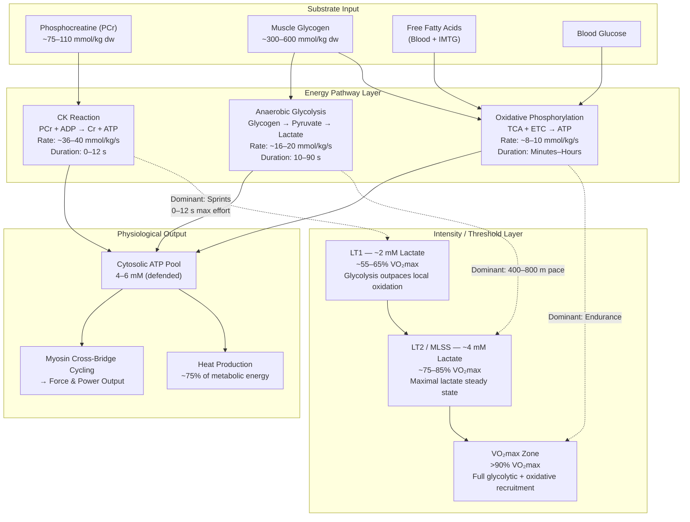

# Lesson 1: Metabolic Energetics in Exercise

## 1. First-Principles Intuition & Invariants

Every muscular contraction, from the flicker of an eye to a maximal deadlift, runs on a single molecular currency: adenosine triphosphate. ATP is not a fuel in the conventional sense. It is the universal energy transducer, the molecule that accepts chemical energy from substrates and donates it, through hydrolysis of its terminal phosphate bond, to the myosin ATPase driving the cross-bridge cycle. The cell maintains ATP concentration within an extraordinarily tight window, roughly 4–6 mM in skeletal muscle at rest, and defends that concentration with remarkable fidelity even under the metabolic storm of maximal exercise. This defense is not passive. It is an active, hierarchically organized system of three distinct resynthesis pathways that activate in a coordinated cascade, each dominating a different temporal window of power output. Understanding that cascade with enough precision to manipulate it in training is the central project of exercise physiology.

The first invariant every practitioner must internalize is that the three energetic systems — phosphocreatine hydrolysis, glycolysis, and oxidative phosphorylation — are never exclusively active. At any intensity, all three are contributing to ATP turnover to some degree. What changes with intensity and duration is the *relative contribution* of each pathway, and that shift follows predictable kinetics governed by oxygen availability, substrate concentration, enzyme activation states, and the intracellular milieu of metabolites like ADP, Pi, calcium, and hydrogen ions. When a sprint coach talks about "training the alactic system," they are shorthand for training the intensity domain where the phosphocreatine pathway dominates — not for eliminating the other two pathways from the picture.

The second invariant concerns the relationship between power and capacity. Each pathway represents a trade-off on those two dimensions. The phosphocreatine system delivers ATP at the highest rate — approximately 36–40 mmol ATP · kg⁻¹ dry muscle · s⁻¹ — but its substrate (phosphocreatine, PCr) is exhausted within 8–12 seconds of maximal effort. Anaerobic glycolysis delivers ATP at a moderate rate but can sustain that rate for 30–90 seconds before substrate depletion and metabolic acidosis constrain power output. Oxidative phosphorylation delivers ATP at the lowest rate but is essentially capacity-unlimited for practical exercise durations because it oxidizes fat and carbohydrate against an oxygen supply that the cardiorespiratory system can maintain. The practitioner who programs a 400-meter race knows intuitively that all three systems are contributing, that the athlete is running a metabolic "loan" from the first two systems that must be "repaid" by the third during recovery. The question is how to train each system to widen both its power ceiling and its capacity floor without compromising the others.

The third invariant governs metabolic transitions. When exercise intensity increases — say, from a 70% HRmax steady-state run to a 90% HRmax surge — the transition between energetic systems is not instantaneous. Oxidative phosphorylation has a kinetic lag, the VO₂ kinetics "slow component," driven by the time required for mitochondrial oxygen delivery, substrate mobilization, and enzyme complex activation to accelerate. During that lag, the deficit is covered disproportionately by glycolysis and PCr hydrolysis, producing what exercise physiologists call the "oxygen deficit." Training specifically reduces the magnitude and duration of this deficit by accelerating VO₂ kinetics — a central adaptation to high-intensity interval training (HIIT) and threshold work that is often underappreciated when practitioners focus only on VO₂max as the headline performance metric.

---

## 2. Core Architecture & Mechanics

### The Three-Pathway Architecture

The phosphocreatine-ATP system operates through the creatine kinase (CK) reaction: PCr + ADP → Cr + ATP. This reaction is thermodynamically favorable at exercise onset because falling ATP concentrations and rising ADP concentrations pull the equilibrium toward ATP synthesis. CK is located directly adjacent to myosin ATPase and the mitochondrial outer membrane, making it a spatial buffer that blunts the ADP spike at the cross-bridge before slower systems can respond. Intramuscular PCr stores average approximately 75–80 mmol · kg⁻¹ dry weight in untrained muscle and can increase to roughly 90–110 mmol · kg⁻¹ in trained sprinters through a combination of creatine loading and sprint-specific adaptation. Recovery of PCr follows an exponential time course with a half-life of approximately 20–30 seconds, reaching roughly 95% repletion within 3–4 minutes in well-trained athletes — a kinetic fact that directly determines optimal rest intervals for power and speed sessions.

Anaerobic glycolysis begins at the glycogen granule in the cytosol. Glycogen phosphorylase, activated allosterically by AMP, ADP, Pi, and calcium within milliseconds of contraction onset, cleaves glucose-1-phosphate from glycogen chains, bypassing the hexokinase step and entering glycolysis with a net yield of 3 ATP per glucose unit compared to 2 ATP from free glucose. The rate-limiting step in fast glycolysis is phosphofructokinase-1 (PFK-1), inhibited by high ATP and low pH and activated by AMP, ADP, Pi, and fructose-2,6-bisphosphate. This regulatory logic is elegant: the system accelerates exactly when energy charge falls, and decelerates when the product (lactate plus H⁺) accumulates sufficiently to threaten homeostasis. The practitioner implication is that repeated sprint training improves buffering capacity (primarily through elevated muscle carnosine and bicarbonate), increases glycolytic enzyme concentrations, and enhances the efflux capacity for lactate and H⁺ via MCT-1 and MCT-4 transporters — adaptations that collectively raise the ceiling before acidosis terminates the effort.

Oxidative phosphorylation encompasses both the tricarboxylic acid cycle (TCA) in the mitochondrial matrix and the electron transport chain (ETC) on the inner mitochondrial membrane. Pyruvate from glycolysis, acetyl-CoA from beta-oxidation of fatty acids, and ketone bodies all converge on the TCA cycle to produce NADH and FADH₂. These carriers donate electrons to Complexes I and II of the ETC, which ultimately reduce molecular oxygen to water at Complex IV. The proton gradient across the inner membrane drives ATP synthase (Complex V), yielding approximately 30–32 ATP per molecule of glucose under physiological conditions. Fat oxidation yields more ATP per molecule (129 ATP for palmitate) but at a lower rate of delivery, which is why the respiratory exchange ratio (RER) rises toward 1.0 as exercise intensity increases and the system shifts toward carbohydrate as the dominant substrate — not because fat becomes unavailable, but because carbohydrate can deliver acetyl-CoA to the TCA cycle faster.

### Lactate Threshold Mechanics

The lactate threshold (LT) is the exercise intensity at which blood lactate concentration rises detectably above baseline, typically around 2 mM in the first threshold (LT1) and 4 mM at the second threshold (LT2, also called the maximal lactate steady state or MLSS). The classical misunderstanding, still present in some fitness circles, is that lactate itself causes fatigue. Lactate is a metabolic intermediate and a valuable fuel: it is exported from Type II glycolytic fibers, taken up by Type I oxidative fibers and the heart via MCT-1, and oxidized directly in the TCA cycle. The fatigue signal is the concurrent rise in hydrogen ions (acidosis) that accompanies rapid glycolysis, not the lactate molecule itself.

LT1 represents the intensity at which glycolytic flux begins to outpace the oxidative capacity of the working muscles plus the clearance capacity of non-working tissues. LT2/MLSS represents the highest intensity at which a steady state between lactate production and clearance can be maintained. Training at and above LT2 drives the most potent adaptations: increased mitochondrial density, elevated MCT-1 and MCT-4 expression, enhanced LDH-H isozyme activity (favoring lactate oxidation), and left-shift of the lactate curve reflecting higher oxidative capacity at any given absolute power output.

### Metabolic State Transitions Across Intensities

The diagram below maps the temporal and intensity-based architecture of the three systems, showing how dominance transitions from PCr through glycolysis to oxidative phosphorylation as both time and intensity vary, and how the lactate thresholds sit within that landscape.

This architecture reveals a critical practitioner truth: the thresholds are not walls but transition zones. An athlete at LT2 is simultaneously using all three systems; the threshold markers describe the *balance point* of that mixture, not a binary switch.

---

## 3. High-Performance Optimization & Failure Modes

### Training Zone Precision and Lactate-Guided Prescription

The most consequential application of metabolic energetics for the advanced practitioner is translating the threshold model into training zone prescription. Arbitrary heart rate zones derived from age-predicted HRmax formulas carry error margins of ±10–20 bpm and regularly misplace athletes in the wrong metabolic domain. Lactate field testing — typically a step protocol using 3–5 minute stages at incremental power outputs (cycling) or paces (running), with 1 mL fingertip capillary blood sampled at each stage — identifies LT1 and LT2 with sufficient precision to anchor the training spectrum. Zone 2 work is prescribed at or just below LT1 (approximately 1.5–2.0 mM blood lactate), targeting mitochondrial biogenesis and fat oxidation efficiency. Threshold work is prescribed at LT2 ± 0.5 mM, maximizing the stimulus for oxidative enzyme upregulation and lactate clearance adaptation. VO₂max intervals are prescribed at the velocity or wattage associated with VO₂max (vVO₂max or Watts-MAX), where effort duration of 3–8 minutes allows full engagement of oxidative phosphorylation at its ceiling while recruiting maximal cardiac output.

A common failure mode in endurance programming is what researchers have called "polarization collapse" — the tendency of moderately trained athletes to perform most of their volume in the "moderate intensity" zone between LT1 and LT2. This zone is metabolically expensive without delivering the high-volume mitochondrial stimulus of Zone 2 or the VO₂max ceiling stimulus of Zone 4–5. It accumulates fatigue without maximizing adaptation. High-performing coaches using the polarized model (approximately 80% of volume below LT1, 20% at or above LT2) consistently report superior LT2 velocity improvements and VO₂max gains compared to threshold-dominant periodization schemes, particularly in athletes training more than 10 hours per week.

### PCr Replenishment and Sprint Session Design

For speed-power athletes, the most operationally important metabolic parameter is PCr resynthesis kinetics. Practical sprint session design that respects PCr biochemistry uses a work-to-rest ratio of approximately 1:6 to 1:12 for maximal alactic efforts (5–8 second sprints), corresponding to rest intervals of 90–180 seconds. Shortening rest to 45–60 seconds forces incomplete PCr replenishment and transitions the session toward glycolytic capacity — a valid training goal, but one that must be explicit and periodized rather than accidental. Practitioners who run 10 × 30m sprints on 45-second rest intervals while believing they are training maximal power are instead training glycolytic repeatability, which produces different neuromuscular and metabolic adaptations.

Creatine monohydrate supplementation (3–5 g/day maintenance, following a loading phase of 20 g/day for 5–7 days) increases intramuscular PCr by approximately 10–20%, extending the duration of maximal PCr-dependent output and accelerating inter-set replenishment. This is one of the most robustly supported ergogenic interventions in the literature, with effect sizes consistently ranging from moderate to large for repeated sprint performance.

### Substrate Utilization Shifts and Glycogen Management

As exercise intensity rises from LT1 toward LT2 and beyond, RER rises from approximately 0.75–0.80 (mixed substrate, fat-dominant) toward 0.95–1.00 (carbohydrate-dominant). This crossover reflects not fat's unavailability but the kinetic constraint: beta-oxidation of long-chain fatty acids requires mitochondrial import via carnitine acyltransferase, and that rate-limited process cannot supply acetyl-CoA to the TCA cycle fast enough to match the demand at intensities above approximately 65% VO₂max in untrained individuals. Trained endurance athletes push this crossover point rightward, maintaining higher fat oxidation rates at greater absolute intensities — an adaptation mediated by elevated IMTG content, greater mitochondrial density, and enhanced CPT-1 activity.

The practical failure mode from this substrate kinetics is glycogen depletion during prolonged moderate-to-high intensity work. Muscle glycogen stores of approximately 400–500 g total are sufficient for roughly 90–120 minutes at LT2 pace. Below that threshold, performance degrades through reduced glycolytic flux, impaired calcium handling in the sarcoplasmic reticulum (which requires glycolytically generated ATP in close spatial proximity to Ca²⁺-ATPase), and central fatigue mediated by elevated brain tryptophan uptake as free fatty acids displace tryptophan from plasma albumin. Intra-exercise carbohydrate ingestion at 60–90 g/hour (glucose-fructose co-ingestion at 2:1 ratio to saturate both SGLT-1 and GLUT-5 intestinal transporters) effectively spares glycogen in efforts beyond 75–90 minutes and is a non-negotiable fueling strategy for race-pace efforts in this duration range.

### Fatigue Mechanisms and the Metabolic Ceiling

The terminal failure mode in maximal exercise is not simply ATP depletion — cellular ATP never reaches zero because the cascade of protective mechanisms halts effort before that point. The practical ceiling is set by the intersection of three converging signals: hydrogen ion accumulation (which inhibits PFK-1 and directly reduces myosin ATPase rate), inorganic phosphate accumulation (which reduces calcium sensitivity of troponin and inhibits the power stroke directly), and central nervous system fatigue mediated by altered neurotransmitter balances and descending drive reduction. Training-induced adaptations — improved buffering, enhanced Pi handling by the sarcoplasmic reticulum, and reduced perceptual sensitivity to acidosis — collectively raise this ceiling. The practitioner's toolkit for targeting each mechanism includes sprint intervals (H⁺ buffering), low-RPM high-resistance cycling (Pi and crossbridge adaptation), and VO₂max intervals (central drive and cardiac output ceiling).

---

## 4. Summary & Verification Matrix

| System / Parameter | Dominant Intensity Zone | Peak ATP Rate | Practical Capacity | Key Limiting Factor | Training Target & Protocol |
|---|---|---|---|---|---|
| **PCr / Alactic** | 0–10 s, maximal sprint (>95% HRmax) | ~36–40 mmol ATP · kg⁻¹ · s⁻¹ | ~8–12 s maximal; ~95% repletion in 3–4 min | PCr substrate exhaustion; CK enzyme rate | 5–8 s maximal sprints, 1:8–1:12 work:rest; creatine supplementation 3–5 g/day |
| **Anaerobic Glycolysis** | 10–90 s, 400–800 m pace (~90–100% HRmax) | ~16–20 mmol ATP · kg⁻¹ · s⁻¹ | ~60–90 s before acidosis limits output | H⁺ accumulation inhibiting PFK-1; Pi rise | Repeated 30–60 s intervals at >95% vVO₂max; buffer-targeted heat/altitude blocks |
| **Oxidative Phosphorylation** | >2 min to hours; <90% VO₂max sustainable | ~8–10 mmol ATP · kg⁻¹ · s⁻¹ | Effectively unlimited (substrate-limited) | O₂ delivery (cardiac output); substrate availability | Zone 2 (< LT1, 1.5–2 mM lactate); LT2 tempo; VO₂max intervals at vVO₂max |
| **Lactate Threshold 1 (LT1)** | ~55–65% VO₂max; 1.5–2.0 mM blood lactate | Mixed PCr + glycolysis + oxidative | Sustainable for hours in trained athletes | Glycolytic flux outpacing local oxidative clearance | High-volume Zone 2 (80% of weekly volume); identifies aerobic base ceiling |
| **Lactate Threshold 2 / MLSS** | ~75–85% VO₂max; ~4 mM blood lactate | Glycolytic + oxidative co-dominant | 30–60 min maximal duration | Lactate production exceeds clearance capacity | Tempo runs / sweet-spot intervals at LT2 ± 0.5 mM; 20–40 min continuous efforts |
| **Glycogen Depletion Failure** | Sustained efforts >75 min at ≥LT1 | Falling (substrate-limited) | 400–500 g total stores; ~90–120 min at LT2 | IMTG + glycogen exhaustion; Ca²⁺-ATPase impairment | 60–90 g/hour glucose-fructose (2:1 ratio) intra-exercise; pre-load 8–10 g/kg CHO/48 h |
