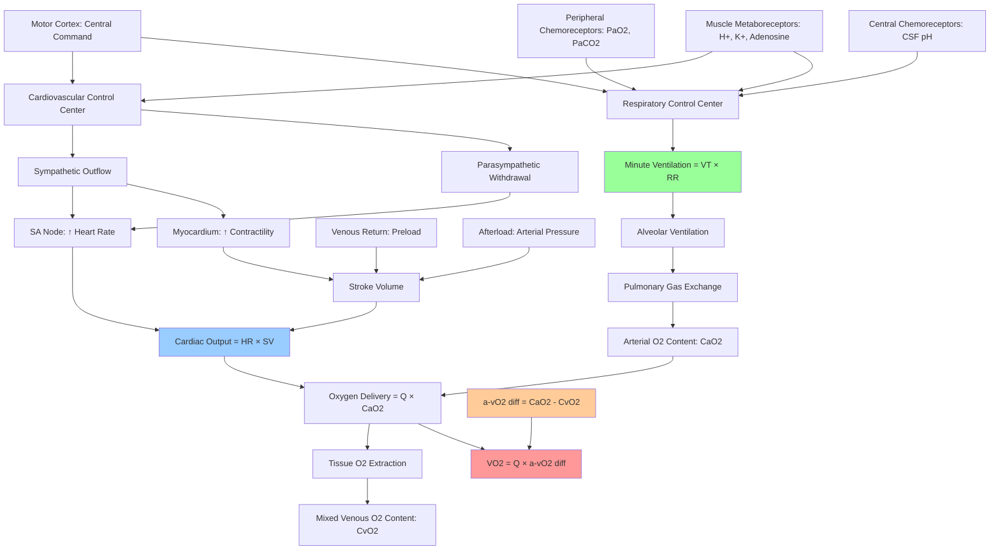

# Lesson 2: Cardiorespiratory Integration During Exercise

## 1. First-Principles Intuition & Invariants

The human body's response to exercise represents one of the most elegant demonstrations of integrated physiological control, where cardiovascular and respiratory systems coordinate with millisecond precision to match oxygen delivery to metabolic demand. At rest, skeletal muscle consumes approximately 20% of total oxygen uptake, but during maximal exercise this proportion can surge to 85% or higher, demanding a coordinated escalation across every link in the oxygen transport cascade. Understanding cardiorespiratory integration requires recognizing that the system operates as a series-coupled network: any bottleneck in oxygen delivery—whether at the level of pulmonary diffusion, cardiac output, hemoglobin saturation, or mitochondrial oxidative capacity—will constrain whole-body performance. The physiological elegance lies not in any single component but in the orchestrated scaling of multiple parallel subsystems, each responding to the same upstream signals yet contributing unique rate-limiting characteristics under different exercise intensities and training states.

The oxygen transport cascade begins with ventilation, where minute ventilation (VE) scales linearly with oxygen consumption (VO2) at low-to-moderate intensities before exhibiting non-linear hyperventilation above the lactate threshold. This ventilatory breakpoint reflects the buffering of metabolically produced hydrogen ions by bicarbonate, yielding excess carbon dioxide that stimulates central chemoreceptors in the medulla. Simultaneously, the cardiovascular system responds through increases in both heart rate and stroke volume, producing elevations in cardiac output that can reach five-fold resting values in trained endurance athletes. The Fick equation governs this relationship with thermodynamic precision: VO2 equals cardiac output multiplied by arteriovenous oxygen difference (a-vO2 diff). Cardiac output itself decomposes into heart rate and stroke volume, where stroke volume is constrained by venous return, myocardial contractility, and afterload. The arteriovenous oxygen difference quantifies how much oxygen tissues extract from arterial blood, typically rising from 5 mL O2 per 100 mL blood at rest to 15-16 mL O2 per 100 mL blood during maximal exercise as muscle capillaries dilate and mitochondrial density increases oxygen extraction efficiency.

Central adaptations—those occurring in the heart and lungs—differ fundamentally from peripheral adaptations in skeletal muscle and its microvascular bed. Endurance training expands plasma volume by 10-20% within days, increasing venous return and preload, which by the Frank-Starling mechanism enhances stroke volume. Left ventricular wall thickness and chamber volume both increase, producing the characteristic "athlete's heart" with resting bradycardia and exceptionally high maximal stroke volumes. Peripheral adaptations include capillary proliferation, which reduces diffusion distances; mitochondrial biogenesis, which amplifies oxidative enzyme activity; and shifts in muscle fiber type distribution toward more oxidative Type IIA fibers. These peripheral changes explain why trained individuals can achieve greater arteriovenous oxygen differences despite similar or even lower maximal cardiac outputs compared to less-trained counterparts at the same absolute workload.

VO2max—the maximal rate of oxygen consumption during exhaustive exercise—represents the gold standard metric of cardiorespiratory fitness and integrates all components of the oxygen transport cascade. Traditionally measured during graded exercise testing with open-circuit spirometry, VO2max exhibits a plateau despite increasing workload, confirming that oxygen delivery has reached its ceiling. Typical VO2max values range from 25-30 mL/kg/min in sedentary individuals to 60-85 mL/kg/min in elite endurance athletes, with the highest recorded values exceeding 90 mL/kg/min in cross-country skiers. The determinants of VO2max partition into central factors (maximal cardiac output) and peripheral factors (maximal a-vO2 diff), with evidence suggesting that cardiac output explains 70-85% of inter-individual variance in VO2max in untrained populations, while peripheral adaptations become increasingly important differentiators among elite athletes.

The respiratory system rarely limits VO2max in healthy individuals at sea level because pulmonary diffusion capacity vastly exceeds metabolic demand under most conditions. Alveolar ventilation can increase from 6 L/min at rest to over 200 L/min during maximal exercise in elite athletes, with tidal volume expanding from 0.5 L to 3-4 L and respiratory rate climbing from 12 breaths/min to 40-60 breaths/min. The oxygen diffusion capacity of the lungs is approximately 30 mL/min/mmHg at rest and can triple during exercise due to recruitment of pulmonary capillaries and increased transit time for red blood cells through the alveolar-capillary interface. However, exercise-induced arterial hypoxemia (EIAH) does occur in approximately 50% of elite endurance athletes during maximal exercise, where arterial oxygen saturation drops below 95%, indicating that even pulmonary diffusion can become rate-limiting when cardiac output reaches extreme values and capillary transit time compresses below the threshold needed for complete hemoglobin saturation.

The cardiovascular response to exercise follows a predictable hierarchy of control mechanisms. At exercise onset, central command from the motor cortex provides feedforward anticipatory increases in heart rate and cardiac output even before metabolic demand rises. This is supplemented by the muscle mechanoreceptor reflex, where mechanosensitive nerve endings in contracting muscles trigger further sympathetic activation. As exercise continues, metaboreceptor feedback from Type IV afferent nerves sensitive to metabolic byproducts (lactate, adenosine, potassium, hydrogen ions) fine-tunes cardiovascular output to match local tissue demand. Arterial baroreceptors shift their operating point upward during exercise, allowing blood pressure to rise without triggering reflex bradycardia, while peripheral vasodilation in active muscle beds is counterbalanced by vasoconstriction in splanchnic and renal circulations, preserving blood pressure and coronary perfusion.

## 2. Core Architecture & Mechanics

The integrated cardiorespiratory response to exercise operates through a multi-tiered feedback control architecture where oxygen transport is optimized across every segment of the delivery chain. Cardiac output adjusts rapidly through sympathetic and parasympathetic modulation of sinoatrial node pacing and myocardial contractility, while peripheral vascular resistance decreases in active muscle through local metabolic vasodilation, creating a pressure gradient that accelerates blood flow exactly where oxygen demand is highest. Ventilation responds primarily to chemoreceptor feedback, with peripheral chemoreceptors in the carotid and aortic bodies sensing arterial oxygen and carbon dioxide tensions, and central chemoreceptors in the medulla responding to cerebrospinal fluid pH, which reflects carbon dioxide diffusion across the blood-brain barrier.

Heart rate increases linearly with exercise intensity, constrained at the upper end by the intrinsic firing rate of sinoatrial pacemaker cells and the refractory period of the atrioventricular node. Maximal heart rate can be roughly estimated as 220 minus age, though individual variation is substantial, with standard deviations of ±10-12 beats per minute. Stroke volume, in contrast, exhibits a curvilinear relationship with exercise intensity, increasing sharply at low workloads as venous return augments end-diastolic volume, then plateauing at approximately 40-60% of VO2max in untrained individuals. Elite endurance athletes demonstrate continued stroke volume increases up to maximal exercise due to superior ventricular compliance and filling capacity. The plateau in stroke volume among less-trained individuals occurs because further increases in heart rate reduce diastolic filling time, offsetting any additional preload benefit, and because afterload rises as systolic blood pressure climbs during intense exercise.

Stroke volume is governed by three interdependent determinants: preload, contractility, and afterload. Preload reflects the end-diastolic volume stretching ventricular myocardial fibers; greater stretch produces more forceful contraction via the Frank-Starling mechanism, mediated by enhanced calcium sensitivity of troponin C and optimal overlap of actin-myosin cross-bridges. Venous return, and thus preload, is augmented during exercise by the skeletal muscle pump, where rhythmic muscle contractions compress veins and one-way valves prevent backflow, by the respiratory pump, where negative intrathoracic pressure during inspiration draws blood toward the right atrium, and by venoconstriction driven by sympathetic activation, which mobilizes venous reservoirs. Contractility, the intrinsic force-generating capacity of myocardial fibers independent of preload, increases during exercise through beta-adrenergic receptor stimulation, which elevates intracellular calcium cycling and accelerates cross-bridge kinetics. Afterload, the resistance the left ventricle must overcome to eject blood, is determined by arterial blood pressure and vascular resistance; systolic pressure rises modestly during dynamic exercise due to increased cardiac output, but mean arterial pressure remains relatively stable because diastolic pressure changes little or even decreases as peripheral vasodilation reduces total systemic resistance.

Arterial oxygen content depends on hemoglobin concentration, hemoglobin saturation, and the small contribution of dissolved oxygen in plasma. Each gram of fully saturated hemoglobin carries 1.34 mL of oxygen, and normal arterial blood contains approximately 15 g of hemoglobin per 100 mL, yielding an arterial oxygen content of roughly 20 mL O2 per 100 mL blood. Hemoglobin saturation remains near 97-98% at sea level across a wide range of exercise intensities in most individuals, though as noted, elite athletes may experience exercise-induced arterial hypoxemia at maximal efforts. The oxygen-hemoglobin dissociation curve shifts rightward during exercise due to elevated temperature, increased carbon dioxide, decreased pH (Bohr effect), and elevated 2,3-diphosphoglycerate in red blood cells, facilitating oxygen unloading at the tissue level. Mixed venous oxygen content, measured in pulmonary artery blood, reflects the average oxygen remaining after tissues have extracted what they need; it decreases from approximately 15 mL O2 per 100 mL at rest to 4-5 mL O2 per 100 mL during maximal exercise, yielding the widening arteriovenous oxygen difference that is a hallmark of trained individuals.

Ventilatory dynamics during exercise are characterized by three distinct phases. Phase I occurs within the first 10-20 seconds of exercise and is mediated by central command and mechanoreceptor input, producing an immediate rise in minute ventilation before any change in arterial blood gases. Phase II, the exponential phase, reflects chemoreceptor-driven adjustments as oxygen consumption increases and carbon dioxide production rises, with ventilation tracking VO2 with a time constant of 30-60 seconds. Phase III represents steady state at submaximal intensities, where ventilation stabilizes proportional to metabolic demand. Above the lactate threshold—typically 50-60% VO2max in untrained individuals and 70-85% in trained athletes—ventilation increases disproportionately relative to VO2 due to buffering of lactic acid by bicarbonate, generating excess CO2 that stimulates ventilation. This ventilatory threshold provides a non-invasive marker of lactate threshold and is widely used to prescribe training intensities.

The oxygen transport cascade exhibits specific bottlenecks that limit performance under different conditions. In healthy untrained individuals at sea level, VO2max is primarily limited by maximal cardiac output; pulmonary diffusion and mitochondrial oxidative capacity both exceed delivery capacity. Training increases stroke volume and thus maximal cardiac output, but also induces peripheral adaptations—capillary density, mitochondrial volume, oxidative enzyme activity—that allow greater oxygen extraction. In elite athletes, the relative contribution of central versus peripheral limitations shifts; maximal cardiac output may still dominate, but peripheral factors become more important, especially in determining performance at submaximal intensities. At altitude, reduced inspired oxygen pressure shifts the limitation toward pulmonary diffusion and arterial oxygen content, with performance declining approximately 1% per 100 meters above 1500 meters elevation. In certain disease states—chronic obstructive pulmonary disease, pulmonary fibrosis, severe anemia—the bottleneck moves upstream to ventilatory capacity or oxygen-carrying capacity, respectively.

## 3. High-Performance Optimization & Failure Modes

Optimizing cardiorespiratory integration for athletic performance demands systematic training of both central and peripheral components across multiple time scales. High-intensity interval training (HIIT) stresses maximal cardiac output by driving heart rate to 90-100% of maximum for repeated intervals of 3-8 minutes, interspersed with active recovery periods. This stimulus triggers left ventricular remodeling, expanding chamber volume and increasing stroke volume. A typical HIIT protocol might prescribe 4-6 repetitions of 4 minutes at 90-95% maximal heart rate with 3 minutes of active recovery, performed twice weekly. Threshold training, executed at or slightly below the lactate threshold (approximately 80-85% of maximal heart rate for trained individuals), enhances lactate clearance capacity and shifts the lactate threshold rightward, permitting higher sustainable workloads. These sessions typically last 20-40 continuous minutes or are broken into intervals of 8-12 minutes. Long, slow distance training at 60-75% maximal heart rate builds capillary density, mitochondrial volume, and fat oxidation capacity, forming the aerobic base that supports high-intensity efforts.

Peripheral adaptations respond preferentially to volume and frequency of training rather than intensity alone. Capillary-to-fiber ratio increases when muscles are repeatedly exposed to moderate hypoxia and elevated metabolic demand, triggering vascular endothelial growth factor (VEGF) signaling that promotes angiogenesis. Mitochondrial biogenesis, regulated by PGC-1α transcriptional coactivation, occurs when energy stress (elevated AMP-to-ATP ratio) and calcium signaling converge, conditions met during both high-intensity intervals and sustained moderate-intensity exercise. The key distinction is that high-intensity training preferentially recruits fast-twitch Type II fibers, inducing oxidative adaptations in these fibers, while moderate-intensity training predominantly engages Type I fibers. A periodized training program therefore includes both modalities: base-building phases emphasizing volume at moderate intensities, followed by intensification phases incorporating high-intensity intervals and threshold work.

VO2max testing provides the definitive assessment of cardiorespiratory fitness and informs individualized training prescription. A graded exercise test protocol increments workload every 1-3 minutes, measuring oxygen consumption via breath-by-breath metabolic cart until the subject reaches volitional exhaustion. VO2max is confirmed by a plateau in VO2 despite increasing workload (less than 150 mL/min increase), respiratory exchange ratio exceeding 1.1 (indicating reliance on anaerobic glycolysis and CO2 from bicarbonate buffering), blood lactate concentration above 8 mM, and heart rate within 10 beats of age-predicted maximum. The test also identifies ventilatory thresholds—VT1 at the first non-linear rise in ventilation relative to VO2, and VT2 at the second steeper rise—which correspond to lactate threshold and respiratory compensation point, respectively. These thresholds partition training zones: below VT1 for recovery and base training, between VT1 and VT2 for threshold work, above VT2 for high-intensity intervals.

Failure modes in cardiorespiratory integration during exercise span mechanical, biochemical, and neural domains. Cardiac drift describes the progressive increase in heart rate during prolonged exercise at constant workload, occurring when stroke volume declines due to dehydration and reduced plasma volume, with heart rate compensating to maintain cardiac output. Left unchecked, cardiac drift can culminate in heat exhaustion or exertional heat stroke when thermoregulatory demands further stress the cardiovascular system. Monitoring heart rate variability and maintaining hydration status with fluid replacement matching sweat losses (approximately 0.4-0.8 L per hour depending on intensity and environment) mitigates cardiac drift. Overtraining syndrome, a chronic maladaptive state induced by excessive training volume without adequate recovery, manifests as persistent elevated resting heart rate, blunted heart rate response to exercise, elevated cortisol-to-testosterone ratio, suppressed immune function, and degraded performance. Prevention requires periodization with deliberate recovery weeks and monitoring subjective wellness alongside objective performance metrics.

Exercise-induced bronchoconstriction (EIB), formerly termed exercise-induced asthma, occurs in up to 20% of the general population and 50% of elite cold-weather athletes, triggered by airway cooling and drying during high ventilation rates. Symptoms include cough, wheeze, chest tightness, and dyspnea typically peaking 5-10 minutes post-exercise. Pre-treatment with inhaled short-acting beta-agonists (e.g., albuterol 200 mcg, 15 minutes before exercise) prevents bronchospasm in most individuals. In cold environments, wearing a mask or buff to warm and humidify inspired air reduces EIB incidence. Diagnosing EIB requires spirometry demonstrating a 10% or greater decline in FEV1 (forced expiratory volume in one second) following exercise challenge or eucapnic voluntary hyperpnea testing.

Altitude exposure presents a unique failure mode where reduced inspired oxygen pressure impairs arterial oxygen saturation, limiting VO2max by approximately 10% per 1000 meters above 1500 meters. Acute mountain sickness (AMS) develops within 6-12 hours at altitudes above 2500 meters in unacclimatized individuals, characterized by headache, nausea, fatigue, and dizziness, mediated by cerebral hypoxia and mild edema. Acclimatization over 7-14 days increases ventilation (hypoxic ventilatory response), elevates red blood cell production (via erythropoietin), and shifts hemoglobin's oxygen affinity, partially restoring oxygen delivery. High-altitude pulmonary edema (HAPE) and high-altitude cerebral edema (HACE) represent life-threatening conditions requiring immediate descent and oxygen supplementation. For competitive athletes, living high and training low—residing at 2000-2500 meters to stimulate erythropoiesis while training at sea level to maintain intensity—optimizes adaptations without the performance decrement of high-altitude training.

Monitoring cardiorespiratory integration in applied settings relies on practical, field-deployable metrics. Heart rate zones derived from maximal heart rate or ventilatory threshold testing guide training intensity distribution. Heart rate variability (HRV), measured via root mean square of successive RR interval differences (RMSSD) using chest strap monitors or validated wearables, reflects autonomic nervous system balance; decreased HRV indicates accumulated fatigue and inadequate recovery. Training impulse (TRIMP) quantifies internal training load by integrating session duration, heart rate, and a weighting factor for intensity, enabling week-to-week load monitoring and preventing the acute-to-chronic workload ratio from exceeding 1.3, a threshold above which injury risk rises sharply. Lactate threshold testing, performed via finger-prick blood sampling at 3-5 incremental workload stages, identifies the workload corresponding to 4 mM lactate concentration, providing a gold-standard metric for prescribing threshold training.

## 4. Summary & Verification Matrix

| Governing Invariant | Mechanism | Diagnostic Criterion | Failure Mode |
|---------------------|-----------|---------------------|--------------|
| **VO2 = Q × a-vO2 diff (Fick Equation)** | Oxygen consumption equals cardiac output multiplied by arteriovenous oxygen difference; integrates central (cardiac output) and peripheral (oxygen extraction) determinants of VO2max | VO2 plateau (< 150 mL/min rise) despite workload increase; RER > 1.1; blood lactate > 8 mM; HR within 10 bpm of predicted max | Central limitation: inadequate stroke volume due to poor venous return or myocardial compliance; peripheral limitation: insufficient capillary density or mitochondrial oxidative capacity |
| **Cardiac Output = HR × SV** | Heart rate increases linearly with intensity; stroke volume rises via Frank-Starling mechanism (preload), enhanced contractility (sympathetic drive), and reduced afterload (peripheral vasodilation) | Maximal HR 220 − age ± 10 bpm; stroke volume plateau at 40-60% VO2max (untrained) or continues rising to maximum (trained); cardiac output 5-6× resting during maximal exercise | Cardiac drift: stroke volume decline from dehydration, compensatory HR rise; heart rate blunting in overtraining syndrome; excessive afterload in hypertensive individuals limiting stroke volume |
| **Ventilatory Threshold (Lactate Threshold)** | Non-linear rise in ventilation relative to VO2 when lactate buffering by bicarbonate generates excess CO2, stimulating central chemoreceptors; typically 50-60% VO2max (untrained), 70-85% (trained) | VT1: first ventilatory breakpoint, ~2 mM lactate; VT2: second breakpoint (respiratory compensation), ~4 mM lactate; breath-by-breath VE/VO2 and VE/VCO2 slopes | Training below VT1 insufficient for adaptation; excessive training above VT2 without recovery leads to overtraining; exercise-induced bronchoconstriction reduces sustainable ventilation |
| **a-vO2 diff = CaO2 − CvO2** | Arteriovenous oxygen difference widens from ~5 mL O2/100 mL at rest to 15-16 mL O2/100 mL at maximum via capillary recruitment, mitochondrial oxygen extraction, and rightward shift of oxygen-hemoglobin dissociation curve (Bohr effect) | Arterial O2 content ~20 mL/100 mL (Hb 15 g/dL, SaO2 97%); mixed venous O2 content drops to 4-5 mL/100 mL at VO2max; trained athletes achieve higher a-vO2 diff than untrained at same cardiac output | Exercise-induced arterial hypoxemia (EIAH): SaO2 < 95% in elite athletes due to insufficient pulmonary transit time; anemia reduces CaO2; carbon monoxide poisoning impairs oxygen unloading |
| **Central vs Peripheral Adaptations** | Central: increased stroke volume (plasma volume expansion, ventricular remodeling); Peripheral: capillary proliferation, mitochondrial biogenesis, oxidative enzyme upregulation, fiber type shift toward Type IIA | Central: resting bradycardia (< 60 bpm in athletes), ↑ maximal stroke volume, ↑ maximal cardiac output; Peripheral: ↑ capillary-to-fiber ratio, ↑ mitochondrial density, ↓ lactate at given workload | Central limitation dominant in untrained; peripheral factors increasingly important in elite athletes; disease states shift bottleneck (COPD → ventilation; anemia → O2 content; heart failure → cardiac output) |
| **Altitude-Induced Hypoxemia** | Reduced inspired PO2 decreases arterial oxygen saturation and content, limiting VO2max ~10% per 1000 m above 1500 m; acclimatization increases ventilation, red blood cell mass, and hemoglobin-oxygen affinity adjustments | SaO2 < 90% at altitudes > 3000 m without acclimatization; VO2max decline proportional to altitude; Lake Louise AMS score ≥ 3 (headache + other symptoms) | Acute mountain sickness (AMS): cerebral hypoxia, mild edema; high-altitude pulmonary edema (HAPE): rales, frothy sputum, SaO2 < 85%; high-altitude cerebral edema (HACE): ataxia, altered consciousness; requires immediate descent |
