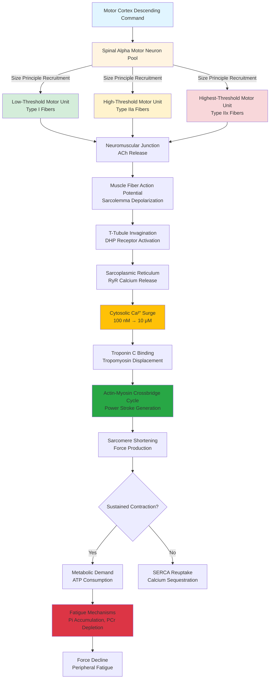

# Lesson 3: Neuromuscular Mechanics of Movement

## 1. First-Principles Intuition & Invariants

The capacity to generate force, accelerate mass, and sustain mechanical work resides not in the muscle alone but in the integrated command architecture linking motor cortex, spinal cord, peripheral nerve, neuromuscular junction, and contractile machinery. Understanding movement requires dissecting this cascade from neural impulse to mechanical output, recognizing that every repetition in the gym, every sprint on the field, and every sustained effort under load is governed by the recruitment logic of motor units, the intrinsic contractile properties of muscle fiber populations, and the metabolic stamina of the excitation-contraction coupling system.

At the foundation of voluntary movement lies the motor unit, defined as a single alpha motor neuron and all the muscle fibers it innervates. Motor units are the quanta of force production. The central nervous system cannot selectively activate individual muscle fibers; it recruits motor units as indivisible blocks. The size principle, articulated by Elwood Henneman in the 1950s, governs this recruitment: motor neurons with smaller cell bodies and lower axonal conduction velocities are recruited first, followed progressively by larger, faster-conducting neurons as force demand escalates. This orderly recruitment from small to large motor units reflects an elegant optimization strategy. Small motor units typically innervate slow-twitch oxidative fibers with high fatigue resistance but modest force output, making them ideal for sustained postural control and low-intensity aerobic work. Large motor units command fast-twitch glycolytic fibers capable of explosive force but rapid fatigue, reserved for maximal efforts and ballistic movements.

Muscle fiber typing extends this hierarchical logic into the biochemical and structural domain. Type I fibers are dense with mitochondria, rich in myoglobin, and optimized for aerobic ATP resynthesis through oxidative phosphorylation. Their slow myosin ATPase isoform cleaves ATP at a leisurely rate, translating into slower crossbridge cycling and lower peak force but prolonged endurance. Type IIa fibers occupy a hybrid niche, possessing substantial oxidative capacity alongside moderate glycolytic enzyme activity, enabling both burst power and reasonable fatigue resistance. Type IIx fibers (often mislabeled IIb in human muscle) are the true sprinters: minimal mitochondrial density, high glycolytic flux, and the fastest myosin ATPase isoform, delivering explosive force at the cost of rapid metabolite accumulation and precipitous fatigue. The fiber type continuum is not rigidly genetic; chronic endurance training shifts IIx toward IIa, while heavy resistance training and detraining can reverse the trend, illustrating the plasticity of the contractile phenotype.

The force-velocity relationship is an immutable mechanical constraint arising from the kinetics of actin-myosin crossbridge cycling. At zero velocity—isometric contraction—all attached crossbridges contribute to force without performing mechanical work, yielding maximal force output. As shortening velocity increases, crossbridges spend less time in the force-generating state before detachment, reducing average force. At very high velocities, the muscle becomes force-limited, unable to overcome even modest loads. Conversely, during eccentric contraction, the muscle lengthens under load, and crossbridges are forcibly detached and re-engaged, allowing supramaximal force production exceeding isometric capacity. This eccentric strength advantage underpins plyometric training and controlled eccentric loading protocols that drive hypertrophy and tendon remodeling. Power, the product of force and velocity, peaks at intermediate velocities approximately thirty to forty percent of maximal shortening speed, a critical insight for designing explosive strength programs targeting vertical jump height or sprint acceleration.

Excitation-contraction coupling is the molecular transduction mechanism converting electrical depolarization into mechanical contraction. An action potential propagates down the alpha motor neuron axon, triggering acetylcholine release at the neuromuscular junction. Acetylcholine binds nicotinic receptors on the motor endplate, generating an endplate potential that initiates a muscle fiber action potential. This depolarization races along the sarcolemma and dives into the transverse tubule network, a system of invaginations placing the electrical signal in intimate contact with the sarcoplasmic reticulum. Voltage-sensitive dihydropyridine receptors in the T-tubule membrane undergo conformational change, mechanically opening ryanodine receptors in the adjacent sarcoplasmic reticulum membrane. Calcium floods the sarcoplasm, binding troponin C and displacing tropomyosin from actin's myosin-binding sites. Myosin heads, pre-energized with ATP hydrolysis products, bind actin, execute a power stroke driven by inorganic phosphate release, and detach upon fresh ATP binding. This cyclical ratcheting of myosin along actin filaments generates sarcomere shortening and macroscopic muscle contraction.

Fatigue, the progressive decline in force-generating capacity during sustained or repeated contractions, arises from failure points distributed across the neuromuscular axis. Central fatigue reflects diminished voluntary drive from motor cortex or reduced motor neuron firing rates, often linked to serotonergic modulation and perceived exertion. Peripheral fatigue encompasses excitation-contraction coupling failure, metabolic depletion, and contractile apparatus dysfunction. Accumulation of inorganic phosphate inhibits calcium release from the sarcoplasmic reticulum and directly impairs crossbridge force production. Hydrogen ion accumulation, long blamed for fatigue, appears less critical than once thought; instead, the depletion of creatine phosphate and glycogen, the buildup of adenosine diphosphate, and reactive oxygen species damage to calcium handling machinery contribute substantially. Understanding these mechanisms allows rational programming of rest intervals, deload phases, and nutritional interventions to sustain high-quality training volume.

## 2. Core Architecture & Mechanics

The neuromuscular system operates as a hierarchical command network with parallel processing at the motor pool level and serial transduction from electrical to chemical to mechanical domains. The motor cortex issues descending volleys through the corticospinal tract, arriving at spinal motor neuron pools segmented by spinal level and muscle target. Each alpha motor neuron integrates excitatory and inhibitory synaptic input, firing action potentials at frequencies ranging from five to fifty hertz depending on recruitment threshold and force demand. The size principle ensures that low-threshold motor units, with input resistances inversely proportional to cell body size, reach firing threshold at modest synaptic drive. High-threshold motor units require intense, synchronized excitatory bombardment, accessible only during maximal voluntary efforts or explosive ballistic tasks.

Once the motor neuron fires, the action potential propagates at velocities between fifty and one hundred twenty meters per second along myelinated A-alpha fibers. At the neuromuscular junction, vesicular acetylcholine release follows a probabilistic model; each action potential liberates approximately one hundred vesicles, each containing five to ten thousand acetylcholine molecules. The safety factor at healthy junctions is high, ensuring one-to-one transmission fidelity, but this margin erodes during high-frequency stimulation or in pathological states. The postsynaptic endplate depolarization triggers a muscle fiber action potential propagating bidirectionally from the endplate zone toward the myotendinous junctions at approximately three to five meters per second. This slower conduction velocity in muscle compared to nerve reflects the unmyelinated sarcolemma and lower density of voltage-gated sodium channels.

The T-tubule network is the architectural innovation enabling rapid, synchronized calcium release across the entire fiber cross-section. T-tubules invaginate every sarcomere at the A-I junction in mammalian skeletal muscle, forming triads with terminal cisternae of the sarcoplasmic reticulum. The dihydropyridine receptor functions as both voltage sensor and mechanical coupler, physically linked to the ryanodine receptor calcium release channel. Upon T-tubule depolarization, the dihydropyridine receptor undergoes a conformational twist, opening the ryanodine receptor and releasing calcium stored at millimolar concentrations in the sarcoplasmic reticulum lumen. Cytosolic calcium concentration surges from resting levels near one hundred nanomolar to several micromolar within milliseconds, saturating troponin C binding sites and initiating contraction. The kinetics of calcium release and reuptake via SERCA pumps dictate the time course of twitch contractions and the fusion frequency required for sustained tetanic force.

The contractile cycle proceeds through discrete biochemical states. In the relaxed state, myosin heads are bound to ATP, hydrolyzed to ADP and inorganic phosphate but remaining attached to the myosin heavy chain in a cocked configuration. Upon calcium-troponin binding and tropomyosin displacement, the myosin head binds actin, forming the rigor complex. Inorganic phosphate release triggers the power stroke, a rotation of the myosin lever arm that slides actin approximately ten nanometers toward the M-line. ADP release completes the force-generating phase. Fresh ATP binding to the myosin head induces rapid dissociation from actin, preventing rigor. ATP hydrolysis re-cocks the myosin head, completing the cycle. At saturating calcium and ATP, this cycle repeats at frequencies up to fifty hertz in fast fibers, generating smooth tetanic contraction. The number of simultaneously attached crossbridges and their average force determine macroscopic muscle tension.

The length-tension relationship reflects the geometric overlap between thick and thin filaments. At optimal sarcomere length, approximately two to two-point-two micrometers, actin and myosin overlap maximally without interference, yielding peak isometric force. At shorter lengths, actin filaments from opposite ends of the sarcomere collide, and myosin heads encounter steric hindrance, reducing force. At excessively long lengths, overlap decreases, fewer crossbridges can form, and passive tension from titin filaments begins to dominate. This relationship has profound practical implications: muscles generate peak force near mid-range joint angles, and training at varying muscle lengths influences regional hypertrophy and functional strength curves.

## 3. High-Performance Optimization & Failure Modes

Optimizing neuromuscular performance requires manipulating recruitment patterns, fiber type expression, metabolic substrate availability, and recovery kinetics. The size principle dictates that low-threshold motor units cannot be bypassed, but recruitment depth and firing rate can be modulated through load intensity, movement velocity, and fatigue state. Heavy loads exceeding eighty-five percent of one-repetition maximum recruit the full motor unit pool early in each repetition, maximizing high-threshold motor unit activation and driving adaptations in Type IIa and IIx fibers. Explosive intent, even with submaximal loads, accelerates recruitment and elevates firing rates, enhancing rate coding and neural drive. Contrast training, pairing heavy strength work with explosive plyometrics, exploits post-activation potentiation, a transient enhancement of contractile force following maximal voluntary contraction due to myosin regulatory light chain phosphorylation.

Fiber type shifts occur on timescales of weeks to months in response to chronic training stimuli. Prolonged endurance training at moderate intensities elevates mitochondrial biogenesis via PGC-1alpha signaling, upregulates oxidative enzymes, and shifts IIx fibers toward the IIa phenotype. Heavy resistance training with long interset rest periods preserves glycolytic capacity and maintains or shifts fibers toward IIx, though true IIx-to-IIb conversion is rare in humans. Hybrid fibers co-expressing multiple myosin isoforms are common during transitional training phases. Recognizing that fiber type is a continuum rather than discrete bins allows for nuanced programming: mixed-method periodization incorporating strength, power, and aerobic capacity can cultivate a versatile fiber type profile suited to multifaceted athletic demands.

Excitation-contraction coupling efficiency declines under several conditions. High-frequency stimulation depletes acetylcholine stores at the neuromuscular junction, reducing endplate potential amplitude and risking transmission failure, though this is rarely limiting in vivo. More critically, prolonged or repeated contractions impair calcium release from the sarcoplasmic reticulum. Inorganic phosphate accumulation, a byproduct of ATP hydrolysis, precipitates with calcium inside the sarcoplasmic reticulum, reducing releasable calcium and forming insoluble calcium phosphate complexes that inhibit ryanodine receptor function. This mechanism underlies the rapid force loss during high-intensity interval training or repeated maximal lifts. Strategic rest intervals—ninety seconds to five minutes between heavy sets—allow inorganic phosphate clearance and creatine phosphate resynthesis, restoring excitation-contraction coupling fidelity.

Peripheral fatigue also manifests as crossbridge dysfunction independent of calcium availability. Inorganic phosphate directly binds the myosin active site, reducing the force generated per power stroke and slowing crossbridge detachment kinetics. Acidosis, while less detrimental than historically believed, may impair calcium sensitivity of the contractile apparatus. Glycogen depletion becomes rate-limiting during prolonged submaximal efforts, as local glycogen stores within individual muscle fibers fuel glycolysis and provide substrate for the malate-aspartate shuttle supporting oxidative phosphorylation. Intramuscular triglyceride stores and circulating free fatty acids can sustain low-intensity work but cannot match the power output glycolysis affords. Pre-training glycogen loading and intra-training carbohydrate intake preserve high-intensity capacity during extended sessions.

Central fatigue emerges as a protective governor and a genuine limitation of voluntary drive. The sense of effort, mediated by anterior cingulate and insular cortices, escalates with perceived exertion and metabolic stress signals relayed via group III and IV afferents from muscle. Serotonin and adenosine accumulation in the central nervous system modulate motor cortex excitability, reducing descending drive. Transcranial magnetic stimulation studies reveal that superimposed electrical stimulation can evoke additional force even during subjectively maximal efforts, demonstrating incomplete motor unit recruitment. Psychological interventions—motivational cues, attentional focus strategies, and caffeine supplementation—reduce central fatigue by modulating perceived effort and enhancing motor cortex excitability. Programming deload weeks every fourth to sixth week mitigates accumulated central fatigue, restoring voluntary activation capacity and preventing overtraining syndrome.

Failure modes at the neuromuscular junction include myasthenia gravis, an autoimmune disorder targeting nicotinic acetylcholine receptors, and Lambert-Eaton syndrome, impairing presynaptic calcium channel function. These pathologies illustrate the critical safety margin at the junction; even modest reductions in receptor density or vesicular release probability precipitate fatigability and weakness. Nutritional deficiencies in choline or vitamin B12 can impair acetylcholine synthesis and nerve conduction, though frank deficiency is rare in athletes. More common is the transient neuromuscular junction fatigue during ultra-endurance events, where repetitive stimulation and metabolic stress degrade transmission fidelity, manifesting as muscle cramping and involuntary fasciculations.

Training programs must balance stimulus intensity, volume, and frequency to drive adaptation without triggering maladaptive fatigue. Daily undulating periodization alternates heavy strength, explosive power, and hypertrophy sessions within a week, distributing neuromuscular stress and preventing monotonous overload. Block periodization sequences accumulation phases emphasizing volume and hypertrophy, intensification phases prioritizing maximal strength, and realization phases honing explosive power and sport-specific transfer. Monitoring readiness through countermovement jump height, grip strength, or subjective wellness questionnaires allows real-time adjustments, reducing sessions when neuromuscular fatigue is elevated and advancing load when recovery is complete. The most sophisticated periodization remains responsive, not prescriptive, adapting to the athlete's current state rather than rigidly adhering to predetermined progressions.

## 4. Summary & Verification Matrix

| **Governing Invariant** | **Mechanism** | **Diagnostic Criteria** | **Failure Mode** |
|---|---|---|---|
| **Size Principle of Motor Unit Recruitment** | Small, low-threshold motor neurons (Type I fibers) recruited first, progressing to large, high-threshold neurons (Type IIx fibers) as force demand escalates; orderly recruitment optimizes fatigue resistance and force modulation. | Surface EMG amplitude increases with load; force-recruitment curves show sigmoidal relationship; transcranial magnetic stimulation reveals progressive motor unit activation thresholds. | Central fatigue reduces voluntary drive, preventing full motor unit pool recruitment; motor neuron disease disrupts orderly recruitment; detraining elevates recruitment thresholds. |
| **Force-Velocity Relationship & Eccentric Advantage** | Crossbridge attachment duration decreases with shortening velocity, reducing force; eccentric loading forcibly detaches and re-engages crossbridges, enabling supramaximal force; power peaks at 30–40% maximal velocity. | Isokinetic dynamometry plots hyperbolic force-velocity curve; eccentric force exceeds isometric by 20–50%; power output maximized at intermediate velocities. | Excessive eccentric volume induces delayed-onset muscle soreness and transient strength loss; inadequate eccentric exposure limits tendon adaptation; training exclusively at low velocities neglects power development. |
| **Excitation-Contraction Coupling Fidelity** | Action potential depolarizes T-tubule, triggering DHP receptor conformational change, opening RyR calcium channels; calcium binds troponin C, enabling actin-myosin interaction; SERCA reuptake restores resting calcium. | Twitch force and time-to-peak tension reflect coupling speed; caffeine potentiates calcium release, transiently enhancing force; fatigue elevates twitch half-relaxation time. | Inorganic phosphate accumulation precipitates calcium in sarcoplasmic reticulum, reducing releasable pool; chronic overtraining impairs SERCA function; glycogen depletion disrupts calcium homeostasis. |
| **Fiber Type Plasticity & Training Specificity** | Chronic endurance training upregulates PGC-1alpha, driving mitochondrial biogenesis and IIx-to-IIa shift; heavy resistance training preserves glycolytic phenotype; detraining reverses adaptations toward IIx. | Muscle biopsy immunohistochemistry quantifies myosin heavy chain isoform distribution; oxidative enzyme activity assays reflect aerobic capacity; force-velocity profiling infers fiber composition. | Monotonous training drives single-dimensional adaptation; concurrent training interference may blunt strength or endurance gains; genetic ceiling limits fiber type transformation. |
| **Peripheral Fatigue: Metabolic & Contractile** | ATP hydrolysis accumulates inorganic phosphate and ADP; phosphate inhibits crossbridge force and calcium release; glycogen depletion limits glycolytic flux; reactive oxygen species impair excitation-contraction coupling. | Force decline during sustained or repeated contractions; elevated perceived exertion; creatine phosphate depletion measured via phosphorus MRS; lactate and ammonia accumulation in venous blood. | Inadequate rest intervals prevent inorganic phosphate clearance; insufficient carbohydrate intake accelerates glycogen depletion; overreaching without recovery leads to chronic fatigue and performance decrement. |
| **Central Fatigue & Voluntary Activation Capacity** | Perceived exertion escalates via group III/IV afferent feedback; serotonin and adenosine accumulation reduce motor cortex excitability; incomplete motor unit recruitment during maximal efforts revealed by superimposed stimulation. | Transcranial magnetic stimulation during maximal voluntary contraction evokes additional force; subjective effort rating exceeds physiological demand; decline in countermovement jump height without peripheral markers. | Psychological stress and sleep deprivation amplify central fatigue; overtraining syndrome manifests as persistent reduction in voluntary drive; inadequate deload phases prevent central recovery. |
