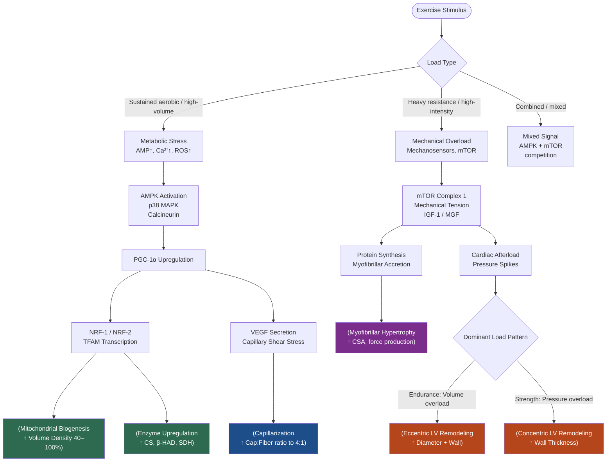

# Lesson 4: Chronic Adaptations to Training

## 1. First-Principles Intuition & Invariants

The human body does not adapt to exercise. It adapts to the specific mechanical, metabolic, and neural demands that exercise imposes, and only to the degree those demands exceed what the existing biological infrastructure can comfortably meet. This distinction is not semantic — it is the entire foundation of exercise physiology as a prescriptive science. A cardiovascular system challenged repeatedly by sustained aerobic output will solve that problem differently than a neuromuscular system overwhelmed by heavy external loads. The adaptations are not generic expressions of fitness; they are precise, tissue-level engineering responses to precise stimuli.

Understanding chronic adaptation requires holding two invariants simultaneously. First, the SAID principle — Specific Adaptation to Imposed Demand — governs every system. Mitochondria proliferate in oxidative fibers subjected to sustained metabolic flux, not in fibers that spend their working lives firing at maximal velocity for two seconds. The left ventricle remodels its geometry in response to the pressure and volume loads it regularly encounters, not in response to what the athlete wishes it would do. Second, adaptation is always in service of reduced disturbance. The organism is not trying to become fitter in any abstract sense; it is eliminating the perturbation. When repeated aerobic bouts repeatedly tax the oxidative phosphorylation system beyond capacity, the body's answer is to expand that capacity until the same bout no longer constitutes a threat to homeostasis.

This logic has immediate practical consequences. Training stimuli below the minimum effective dose produce no structural remodeling. Stimuli above the maximum recoverable volume produce regression through accumulated fatigue and tissue breakdown that outruns repair. Between those boundaries lies the adaptive window, and the practitioner's entire technical art consists of placing athletes inside that window for each physiological target, week after week, across a training career. Everything else — periodization schemes, loading parameters, recovery protocols — is the mechanism for executing that placement reliably.

The chronic adaptations themselves fall into five interconnected categories: mitochondrial biogenesis and density, skeletal muscle capillarization, structural cardiac remodeling, metabolic enzyme upregulation, and the nervous system's progressive refinement of motor unit recruitment. Each has its own time course, its own stimulus specificity, its own ceiling, and its own detraining kinetics. Practitioners who conflate these categories — who assume that any training "builds fitness" in a uniform way — will consistently underserve their athletes. The ones who internalize each adaptation's mechanism can periodize for them deliberately, monitor their development through appropriate field proxies, and diagnose when a given component has stalled or reversed.

---

## 2. Core Architecture & Mechanics

### Mitochondrial Biogenesis

Mitochondrial biogenesis begins with a transcriptional cascade initiated primarily through PGC-1α (peroxisome proliferator-activated receptor gamma coactivator 1-alpha), which functions as the master regulator linking exercise-induced cellular stress to nuclear gene expression. During sustained aerobic exercise, the upstream signals converge on PGC-1α from three directions: AMP-activated protein kinase (AMPK), which is activated by falling ATP:AMP ratios during metabolic stress; p38 MAPK, activated by reactive oxygen species and calcium signaling; and calcineurin, activated by sustained elevations in cytoplasmic calcium from repeated muscle contraction. PGC-1α then coactivates NRF-1 and NRF-2 (nuclear respiratory factors), which drive transcription of nuclear-encoded mitochondrial genes, while simultaneously increasing transcription of TFAM (mitochondrial transcription factor A) to amplify transcription of the mitochondrial genome itself.

The practical outcome over six to eight weeks of consistent aerobic training is a 40–100% increase in mitochondrial volume density in trained muscle fibers, primarily Type I and Type IIa. This increase manifests as both greater numbers of mitochondrial units (biogenesis) and expansion of existing mitochondrial networks through fusion dynamics. The functional consequence is a higher capacity for oxidative ATP resynthesis per unit of muscle volume, a lower absolute reliance on glycolysis at any given work rate, and therefore a rightward shift in the lactate threshold relative to VO₂max.

### Capillarization

Increased capillary-to-fiber ratio is a structural adaptation driven largely by VEGF (vascular endothelial growth factor), which is upregulated in response to local hypoxia, shear stress on existing capillary walls, and lactate accumulation. Trained endurance athletes can exhibit capillary-to-fiber ratios of 2.5:1 to 4:1 compared to approximately 1.5:1 in untrained individuals. This expanded capillary network reduces the mean diffusion distance for oxygen between capillary and mitochondria, extends the red blood cell transit time through each capillary (improving oxygen extraction efficiency), and increases surface area available for metabolic substrate and waste product exchange. Capillarization adapts more slowly than mitochondrial biogenesis, typically requiring twelve or more weeks of consistent stimulus and responding preferentially to high-volume, moderate-intensity work rather than short, high-intensity intervals.

### Structural Cardiac Remodeling

The heart responds to exercise training with structural changes whose geometry is determined by the hemodynamic load pattern. Prolonged endurance training creates repeated episodes of high cardiac output with high ventricular filling pressures — an eccentric volume overload — that over months induces proportional increases in left ventricular (LV) internal diameter and wall thickness, preserving the chamber's normal length-to-diameter ratio. This is athlete's heart in its classic endurance form: a larger, compliant, eccentric cavity capable of a higher stroke volume at rest and during exercise. The resting bradycardia of trained endurance athletes (commonly 40–55 bpm) reflects this elevated stroke volume: cardiac output requirements are met with fewer beats.

Resistance training imposes a different load. Heavy lifting generates transient but extreme spikes in intra-thoracic and intra-aortic pressure, challenging the left ventricle against high afterload. Chronic exposure drives concentric remodeling — increased wall thickness with little change or modest reduction in internal diameter — improving the ventricle's ability to generate high systolic pressure without wall stress becoming pathological. Pure strength athletes therefore develop a heart with thick walls, modest chamber enlargement, and preserved systolic function, distinguishable from pathological hypertrophy through preserved diastolic function, normal E/A wave ratios on echocardiography, and regression with detraining.

### Metabolic Enzyme Upregulation

Mitochondrial density gains are accompanied by corresponding upregulation of the enzymatic machinery housed within them. Citrate synthase (CS) activity, the rate-limiting enzyme of the TCA cycle and the most reliable biochemical marker of mitochondrial content, increases proportionally with biogenesis. Beta-hydroxyacyl-CoA dehydrogenase (β-HAD), a key enzyme in beta-oxidation of fatty acids, increases substantially with aerobic training, underpinning the trained athlete's superior ability to oxidize fat at higher absolute work rates. At the glycolytic end of the spectrum, high-intensity and strength training upregulates phosphofructokinase (PFK) and lactate dehydrogenase (LDH) isoforms that favor rapid lactate clearance, while also increasing glycogen synthase activity and maximal muscle glycogen storage capacity from roughly 350–400 mmol/kg dry weight in untrained individuals to 700–900 mmol/kg in highly trained endurance athletes.

### Signal Architecture Diagram

The diagram below maps the signal cascade from exercise stimulus through to the five major structural outputs, illustrating how specificity is embedded at the signaling level, not just the training prescription level.

The AMPK–mTOR antagonism illustrated in the "combined signal" branch is the mechanistic basis for the interference effect: simultaneous high-volume endurance and heavy resistance work activates both pathways, but AMPK activation can suppress mTORC1, attenuating the hypertrophic protein synthesis signal. This is why concurrent training requires careful sequence and timing management — strength sessions before endurance within the same session, or at minimum six hours separation — to allow AMPK activity to subside before the anabolic window is opened.

---

## 3. High-Performance Optimization & Failure Modes

### Programming for Specificity Within Periodization

The practical implication of the signal architecture is that each adaptation demands its own stimulus profile, and the practitioner must decide which adaptation is the priority target in a given training block. For mitochondrial biogenesis, the most potent stimulus per unit of time is not, counterintuitively, maximal-intensity work. It is work that sustains metabolic stress long enough to produce meaningful AMP accumulation and calcium flux. Zone 2 training (60–75% VO₂max, RPE 12–14, conversational but not comfortable) held for 45–90 minutes generates the sustained AMPK activation signal more reliably than brief all-out efforts. High-intensity interval training (HIIT) at 85–95% VO₂max does also produce PGC-1α upregulation through the p38 MAPK arm of the cascade, via ROS and calcium transients, but the total mitochondrial stimulus per session depends on accumulated time under metabolic stress — a variable that heavily favors high-volume moderate-intensity work for pure mitochondrial density gains.

The empirical recommendation for practitioners targeting aerobic base development is therefore a polarized distribution: approximately 75–80% of weekly aerobic volume in Zone 2 and roughly 15–20% at or above lactate threshold (Zones 4–5), with minimal work in the moderate-intensity Zone 3 that is too hard to allow full recovery yet insufficiently intense to maximally drive HIIT adaptations. This polarized model has consistent support from elite endurance athlete monitoring data, where training log analyses across rowing, cycling, cross-country skiing, and running show strikingly similar distributions among top performers across disciplines.

For capillarization specifically, the volume component is non-negotiable. VEGF upregulation accumulates with time under aerobic load. Athletes who train exclusively with high-intensity short intervals, despite achieving reasonable VO₂max improvements through central cardiac adaptations, frequently show inferior capillary density compared to athletes with equivalent VO₂max built on high-volume aerobic foundations. The practical consequence is a less favorable oxygen extraction coefficient (a-vO₂ difference) and earlier reliance on glycolysis at high absolute workloads. When testing an athlete's response to increased intensity and finding that lactate accumulates faster than VO₂max would predict, underdeveloped capillarization is among the first structural deficits to investigate.

### Cardiac Monitoring and Remodeling Verification

Structural cardiac remodeling is not directly quantifiable in the field, but its functional expression is measurable through easily obtained proxies. Resting heart rate tracked longitudinally over a training block should decline 3–8 bpm over six to twelve weeks in a detrained or moderately trained individual returning to systematic aerobic work. Heart rate variability (HRV), measured with a validated chest strap or optical sensor as the rMSSD metric (root mean square of successive RR interval differences), provides a window into cardiac autonomic modulation. Well-adapted endurance athletes show chronically elevated rMSSD values (>60 ms in many cases) with day-to-day stability. Acute drops of more than 10–15% from a rolling seven-day baseline indicate incomplete parasympathetic recovery and warrant load reduction before the next hard session.

Echocardiography remains the gold standard for quantifying LV dimensions, wall thickness, and functional parameters such as ejection fraction and E/A ratio. For high-performance athletes, baseline echocardiography at the start of a career and periodic re-evaluation every two to three years allows practitioners to track remodeling trajectory and distinguish physiological athlete's heart from hypertrophic cardiomyopathy (HCM). The critical distinguishing criteria are: LV wall thickness above 13 mm requires further evaluation; an E/A ratio below 1.0 (indicating diastolic dysfunction) is not expected in athlete's heart and should trigger cardiology referral; and regression of hypertrophy with four to six weeks of detraining confirms physiological rather than pathological origin.

### Detraining Kinetics and Maintenance Thresholds

Detraining is not the mirror image of training. Different adaptations reverse at different rates, and practitioners who understand these kinetics can design retention protocols that preserve months of structural investment through brief periods of reduced training. Mitochondrial density declines fastest: measurable reductions in CS activity and mitochondrial volume density begin within two to three weeks of complete cessation, with VO₂max declining 4–10% in the first four weeks due primarily to peripheral oxidative losses rather than cardiac deconditioning. Cardiac remodeling (stroke volume, LV chamber dimension) is more durable, with significant structural regression requiring six to eight weeks of complete inactivity in highly trained athletes.

Capillarization occupies a middle ground, with detectable cap-to-fiber ratio reductions emerging around four to six weeks of detraining. Critically, the glycogen storage capacity gained through training begins to normalize relatively quickly — within two to four weeks of reduced training volume — which is why athletes returning from injury frequently describe an inability to sustain high-intensity efforts even when perceived effort feels normal. The glycolytic buffer has partially deflated even if cardiovascular function feels intact.

The maintenance thresholds are well-established from detraining literature and have direct programming utility. Aerobic adaptations (VO₂max, mitochondrial enzymes) can be substantially maintained with as little as two high-intensity sessions per week at 70–90% of prior training intensity, even if volume is reduced by up to 60–70%. Intensity is the dominant maintenance variable; volume can be sacrificed substantially without proportionate loss. This principle underpins the design of competition-phase tapers and in-season maintenance programs for multi-sport athletes: cut volume, preserve intensity, and the adaptive hardware stays largely in place.

The most common failure mode in high-performance programming is not overtraining in its clinical sense but rather chronic underrecovery: progressive accumulation of training load faster than structural remodeling can occur, compounded by insufficient sleep, caloric deficit, or psychological stress that taxes the same HPA axis (hypothalamic-pituitary-adrenal) the body uses to manage exercise-induced cortisol responses. The diagnostic signature is a plateau or regression in performance markers despite continued training, declining HRV baseline, elevated resting heart rate trending upward over days, and subjective complaints of heavy legs and poor motivation. The intervention is not simply rest — it is a structured deload of approximately 40–50% volume reduction at maintained intensity for one week, followed by systematic reinvestment in the adaptive window.

---

## 4. Summary & Verification Matrix

| Adaptation | Primary Stimulus | Key Molecular Mediators | Time Course to Significance | Detraining Onset | Field Proxy / Diagnostic |
|---|---|---|---|---|---|
| Mitochondrial Biogenesis | Sustained aerobic work (Zone 2, 45–90 min); HIIT via ROS/Ca²⁺ | AMPK, PGC-1α, NRF-1/2, TFAM | 4–8 weeks; 40–100% density increase | 2–3 weeks of inactivity; CS activity declines | Lactate threshold power/pace; perceived exertion at fixed submaximal workload |
| Capillarization | High aerobic volume; moderate-intensity sustained work | VEGF, local hypoxia, shear stress | 10–16 weeks; cap:fiber ratio to 4:1 | 4–6 weeks of inactivity | a-vO₂ difference; lactate accumulation rate relative to VO₂max |
| Cardiac Remodeling (Eccentric) | High-volume endurance; repeated volume overload of LV | Frank-Starling stretch, ANP, structural remodeling pathways | 12–24 weeks; measurable chamber enlargement | 6–8 weeks; partial regression | Resting HR decline (3–8 bpm/block); echocardiographic LV internal dimension |
| Cardiac Remodeling (Concentric) | Heavy resistance; repeated pressure overload (high afterload) | Mechanical stretch, IGF-1, calcineurin | 16–24 weeks; measurable wall thickening | 6–8 weeks; regression with detraining confirms physiology | Echo: wall thickness ≤13 mm, E/A ratio >1.0, diastolic function preserved |
| Metabolic Enzyme Upregulation | Aerobic volume (CS, β-HAD); HIIT / strength (PFK, LDH, glycogen synthase) | Transcriptional coactivation via PGC-1α; mTOR-independent enzyme induction | 4–8 weeks concurrent with mitochondrial biogenesis | 2–4 weeks (glycogen synthase fastest); 4–6 weeks (CS, β-HAD) | Fat oxidation rate at submaximal intensities; muscle glycogen repletion rate post-exercise |
| Detraining / Maintenance | Intensity >70% prior max is key maintenance variable; volume may drop 60–70% | Reversal of AMPK and PGC-1α signaling; reduced VEGF; decreased stroke volume | Peripheral (oxidative) losses in 2–3 weeks; central (cardiac) losses in 6–8 weeks | Active if training ceases or drops below 2 high-intensity sessions/week | HRV rMSSD trend (target: stable or rising); resting HR trend (target: stable or falling) |
