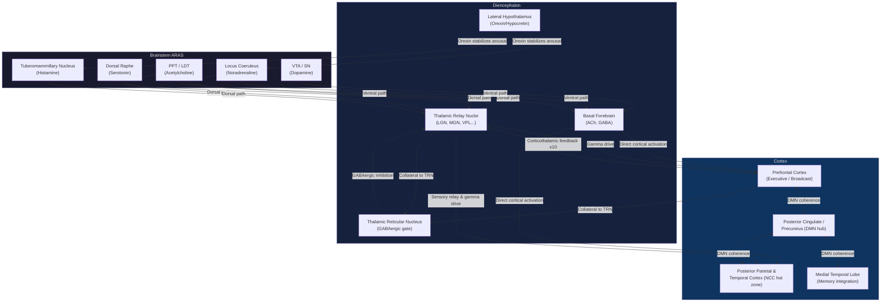

# Lesson 1: Neural Foundations of Consciousness

## 1. First-Principles Intuition & Invariants

Consciousness is not a structure you can point to on a brain atlas. It is an emergent property of coordinated electrical and neurochemical activity distributed across several interacting systems, each contributing a distinct dimension of awareness: wakefulness, attention, self-referential cognition, and the unified sense of being present in a moment. For the physiologist working at the intersection of neurobiology and altered states, understanding consciousness begins not with its phenomenology but with its physical machinery, the specific nuclei, tracts, and oscillatory circuits whose integrity or disruption directly determines whether a subject is alert, dreaming, dissociated, anesthetized, or comatose.

The first invariant is that consciousness requires two separable components: arousal and content. Arousal is the global on/off dimension, the difference between a sleeping and waking brain, and it is governed primarily by subcortical neuromodulatory systems. Content is the qualitative texture of experience, what the conscious brain is actually processing at any moment, and it is generated within cortical and thalamocortical circuits. These two dimensions can dissociate. A patient in a vegetative state has intact arousal, their eyes open, their sleep-wake cycle continues, yet content is absent or inaccessible. Conversely, a subject in rapid-eye-movement sleep has rich conscious content, vivid dreaming, while behavioral arousal and voluntary motor output are actively suppressed. Any serious analysis of altered states must account for where, mechanically, each dimension is perturbed.

The second invariant is that consciousness is not a broadcast but a selection. The brain receives on the order of 10 million bits of sensory data per second through its peripheral afferents, yet the bandwidth of conscious awareness is estimated at roughly 50 bits per second. The machinery of consciousness is therefore fundamentally a filtering and gating system, one that amplifies certain signals into awareness while suppressing others. The thalamus is the anatomical seat of this gate. Its relay nuclei forward sensory information to cortex, while its reticular nucleus (not to be confused with the brainstem reticular formation) acts as an inhibitory shell that modulates which thalamic channels are open at any given moment. Understanding how that gate opens, closes, and distorts under pharmacological, pathological, or meditative conditions is the core technical problem of this course.

The third invariant is that the brain's default state is not silence but structured intrinsic activity. Even in the absence of external task demands, a reproducible network of cortical regions maintains high metabolic activity and characteristic low-frequency oscillations. This default mode network (DMN) is not noise. It is now understood to support self-referential processing, autobiographical memory retrieval, prospective simulation, and the integration of internally generated meaning. In nearly every class of altered state, from psychedelic administration to deep meditation to general anesthesia, the DMN's internal functional connectivity is one of the first and most reliably disrupted signatures. Its architecture is therefore not background information for the practitioner; it is a primary diagnostic target.

---

## 2. Core Architecture & Mechanics

### The Reticular Activating System

The ascending reticular activating system (ARAS) is the foundational arousal infrastructure of the vertebrate brain. Its core nodes sit in the brainstem tegmentum, a column of loosely organized nuclei running from the medulla through the pons and into the midbrain, and they project diffusely upward through two primary pathways. The dorsal route passes through the thalamus, allowing the ARAS to gate thalamocortical relay nuclei and modulate the global excitability of the cortex indirectly. The ventral route bypasses the thalamus entirely, projecting through the lateral hypothalamus and basal forebrain directly onto cortical pyramidal cells and interneurons.

The neurochemical identity of the ARAS is heterogeneous by design. The locus coeruleus, a compact nucleus in the dorsal pons, provides noradrenergic innervation to virtually the entire forebrain and is maximally active during focused wakefulness while falling nearly silent during REM sleep. The dorsal raphe nucleus supplies serotonin, with activity patterns closely mirroring those of the locus coeruleus. The pedunculopontine and laterodorsal tegmental nuclei release acetylcholine, which is paradoxically high during both waking and REM sleep, explaining why both states share high-frequency cortical desynchronization despite their behavioral differences. The tuberomammillary nucleus in the posterior hypothalamus provides histaminergic drive, explaining why first-generation antihistamines produce profound sedation. The ventral tegmental area and substantia nigra contribute dopaminergic projections that modulate motivational salience and the directed quality of wakefulness. No single transmitter carries the arousal signal; the ARAS is a convergent orchestra that must be read as a system.

### Thalamocortical Circuits and the Corticothalamic Loop

The thalamus is not a passive relay. Each specific relay nucleus, the lateral geniculate for vision, the medial geniculate for audition, the ventral posterolateral for somatosensation, receives a primary sensory input from the periphery, processes it, and forwards it to a specific cortical area. That cortical area then sends a return projection back to the same thalamic nucleus that is roughly ten times more numerous than the ascending afferents. The thalamocortical system is therefore not a feedforward conveyor but a closed re-entrant loop in which cortex actively shapes what the thalamus passes upward.

This loop generates the brain's characteristic oscillatory signatures. During wakefulness and REM sleep, thalamocortical neurons are depolarized and fire in tonic mode, producing the low-amplitude, high-frequency (gamma, 30-100 Hz; beta, 13-30 Hz) desynchronized EEG associated with active processing. During NREM sleep and many anesthetic states, thalamocortical neurons hyperpolarize and shift to burst mode, generating the large-amplitude, low-frequency (delta, 0.5-4 Hz) synchronized oscillations and sleep spindles that reflect reduced information integration. The transition between these modes is not simply a matter of reduced activity; it is a qualitative shift in the computational regime of the entire cortex, gated by thalamic membrane potential.

The thalamic reticular nucleus (TRN) wraps around the thalamus like a shield and is composed entirely of GABAergic interneurons. It receives collaterals from both thalamocortical and corticothalamic axons and sends inhibitory projections back to the specific relay nuclei. The TRN is the primary mechanism by which the thalamocortical loop is selectively gated: attention to a visual stimulus, for example, involves corticothalamic feedback that reduces TRN inhibition on the lateral geniculate while increasing it on other relay nuclei, sharpening the attended channel and suppressing the rest. Anesthetic agents that potentiate GABA, such as propofol, dramatically increase TRN inhibition, effectively closing the thalamic gate and isolating cortical regions from both sensory input and each other.

### Neural Correlates of Consciousness and the Default Mode Network

The neural correlates of consciousness (NCCs) are defined as the minimal set of neural mechanisms jointly sufficient for a specific conscious percept. Identifying them requires experimental paradigms that hold external stimulus constant while varying conscious awareness, such as binocular rivalry or masking paradigms. Converging evidence from fMRI, EEG, and intracranial electrophysiology places the NCCs primarily in the posterior cortical hot zone: the posterior parietal cortex, the posterior temporal cortex, and occipital areas, with frontoparietal networks contributing to the reportability and global broadcast of conscious content rather than its generation per se.

The default mode network occupies a central position in conscious self-reference. Its core nodes are the medial prefrontal cortex (mPFC), the posterior cingulate cortex/precuneus (PCC), the angular gyrus, and the medial temporal lobe memory system including the hippocampal formation. These regions are metabolically expensive at rest, consuming disproportionate glucose relative to their volume, and they exhibit tight anticorrelation with the task-positive dorsal attention network. When external attentional demands rise, DMN activity suppresses; when attention turns inward, it rebounds. Under psilocybin, DMN functional connectivity disintegrates, particularly the coherence between mPFC and PCC, correlating directly with the subjective experience of ego dissolution. Under propofol anesthesia, the same mPFC-PCC connection is among the first to drop below threshold. The DMN is therefore not merely an anatomical curiosity but a functional signature of the self-referential, temporally integrated quality of normal consciousness.

The diagram below maps the principal nodes and signal pathways of the arousal and consciousness architecture described above.

---

## 3. High-Performance Optimization & Failure Modes

### Optimizing Clinical Assessment of Arousal and Content

For the advanced practitioner, the most consequential skill in consciousness neurobiology is the ability to dissociate arousal from content in clinical and research settings and to map a subject's state onto the architecture described above with precision. The Glasgow Coma Scale (GCS) remains the dominant emergency tool, but it is fundamentally a motor and behavioral measure. It does not detect covert consciousness, the phenomenon documented by Owen and colleagues in which up to 15-20% of patients meeting behavioral criteria for vegetative state can demonstrate command-following on task-based fMRI paradigms. The practical implication is that GCS alone is insufficient for practitioners who need to determine whether information processing is occurring at a cortical level.

Quantitative EEG provides a tractable and high-resolution window into thalamocortical state. The practitioner should be fluent in four key signatures. First, the presence or suppression of alpha power (8-12 Hz), generated by thalamocortical loop resonance, is a reliable index of thalamic gating status: propofol anesthesia paradoxically increases frontal alpha before producing delta suppression, reflecting thalamic isolation of prefrontal cortex rather than simple sedation. Second, slow-wave activity (0.5-1 Hz), dominated by cortical up and down states, reflects the depth of NREM sleep and anesthetic suppression. Third, gamma-band coherence between frontal and parietal electrodes, the so-called frontoparietal gamma synchrony, tracks conscious content integration and falls markedly in both deep anesthesia and psychedelic ego dissolution. Fourth, the perturbational complexity index (PCI), developed by Casali and colleagues, provides perhaps the most robust single-number estimate of consciousness level by measuring the spatiotemporal complexity of cortical responses to transcranial magnetic stimulation pulses applied during TMS-EEG protocols. PCI above 0.44 reliably distinguishes conscious from unconscious states across sleep stages, anesthesia, and disorders of consciousness.

Orexin/hypocretin system integrity is a critical stability parameter that practitioners evaluating sleep-wake transition disorders must assess directly. Orexin neurons in the lateral hypothalamus send excitatory projections to all major ARAS nuclei, stabilizing the waking state against intrusion by sleep and preventing inappropriate transitions between states. Their loss in narcolepsy type 1 produces state instability, cataplexy, and hypnagogic hallucinations, all of which represent fragment intrusions of REM-related neural patterns into waking. Cerebrospinal fluid orexin-A levels below 110 pg/mL constitute a diagnostic threshold for hypothalamic orexin deficiency in clinical practice. The physiological lesson generalizes: arousal stability is not simply a matter of ARAS tone but of system-level competition between wake-promoting and sleep-promoting networks, mediated by mutual inhibitory connections between the ventrolateral preoptic nucleus (VLPO, sleep-promoting, GABAergic) and the ARAS nuclei. Any perturbation that tips this flip-flop toward one state initiates a rapid, nearly complete state transition.

### Failure Modes and Pathological Altered States

The most dangerous failure mode in consciousness circuitry is the disconnection syndrome, in which ARAS-driven arousal is preserved but thalamocortical and corticocortical integration collapses. Propofol overdose illustrates the mechanism clearly: as GABA-A receptor potentiation increases, TRN inhibition intensifies, thalamocortical relay nuclei hyperpolarize into burst mode, and the cortex fragments into isolated islands of local slow-wave activity. What appears to external observers as unconsciousness is mechanically a loss of information integration across the cortex rather than a loss of local neural activity per se. This distinction has direct implications for intraoperative awareness risk assessment: a patient can have preserved subcortical and local cortical reactivity while lacking the global workspace integration required for conscious experience.

Psychedelic states represent a mechanistically distinct failure mode, one of excessive rather than insufficient information integration. Classic 5-HT2A agonists such as psilocybin and LSD increase cortical excitability, suppress thalamocortical filtering, reduce DMN functional connectivity, and increase cross-network coupling between regions that do not normally share information. The result is not a simple arousal increase but a dedifferentiation of cortical state space, in which the normal boundaries between networks dissolve. EEG and fMRI studies demonstrate marked increases in signal entropy and a flattening of the cortical hierarchy, with normally subordinate sensory and association areas gaining disproportionate influence over conscious content. Practitioners working in supervised therapeutic contexts need to understand that the therapeutic mechanism and the risk profile both derive from the same circuit perturbation: the removal of the thalamic and corticothalamic filters that normally constrain the content of consciousness to a narrow, predictive slice of available neural activity.

Traumatic brain injury presents a third failure mode class: structural disruption of the ARAS projection tracts, particularly the paramedian midbrain tegmentum and the mesocortical white matter pathways, is the most common cause of prolonged impaired consciousness after diffuse axonal injury. The clinical severity of unconsciousness does not correlate well with focal cortical damage but correlates strongly with the extent of axonal disruption in ARAS projection corridors and thalamocortical radiations, as quantified by diffusion tensor imaging tractography. The practitioner must therefore evaluate the structural integrity of these specific white matter tracts rather than relying solely on gross volumetric injury metrics.

---

## 4. Summary & Verification Matrix

| System / Mechanism | Key Anatomical Nodes | Functional Role in Consciousness | Failure Mode | Clinical / Measurement Signature |
|---|---|---|---|---|
| Ascending Reticular Activating System (ARAS) | LC, Dorsal Raphe, PPT/LDT, TMN, VTA; lateral hypothalamus (orexin) | Generates and sustains global arousal tone; gates thalamic excitability via dual dorsal/ventral pathways | Bilateral tegmental lesion, orexin deficiency, sedative-hypnotic depression → loss of arousal; narcolepsy → state instability | CSF orexin-A < 110 pg/mL (orexin deficiency); EEG delta predominance; GCS motor subscore < 4 |
| Thalamocortical Loop & TRN Gate | Specific relay nuclei (LGN, VPL, MGN), thalamic reticular nucleus, primary sensory cortices | Sensory relay in tonic mode (waking/REM); oscillation generation in burst mode (NREM/anesthesia); selective attentional gating via TRN inhibition | Propofol/GABA potentiation → TRN hyperinhibition → cortical isolation; thalamic stroke → hemianesthesia or akinetic mutism | EEG alpha suppression or frontal alpha paradox; absence of thalamocortical gamma coherence (40 Hz) |
| Default Mode Network (DMN) | Medial PFC, posterior cingulate/precuneus, angular gyrus, medial temporal lobe | Self-referential processing, temporal integration of autobiographical memory, prospective simulation; anticorrelated with task-positive networks | Propofol → early mPFC-PCC decoupling; psilocybin → entropy increase and DMN disintegration; severe depression → pathological DMN hyperactivation | fMRI resting-state functional connectivity (mPFC-PCC r-value); EEG slow-wave coherence in frontal-parietal electrodes |
| Neural Correlates of Consciousness (NCC) | Posterior parietal cortex, posterior temporal cortex, frontoparietal network | Generate the specific content of conscious percepts; frontoparietal broadcast enables global reportability | Posterior cortical damage → specific content loss (prosopagnosia, achromatopsia); frontoparietal disconnection → covert consciousness without report | Task-based fMRI command-following (Owen protocol); perturbational complexity index (PCI) > 0.44 = conscious threshold |
| Arousal State Flip-Flop | Ventrolateral preoptic nucleus (VLPO) vs. ARAS nuclei (mutually inhibitory) | Maintains discrete, stable wake or sleep states via mutual inhibition; prevents intermediate mixed states | Orexin system loss removes stabilizing weight → narcoleptic state intrusions; alcohol/sedatives reinforce VLPO → abrupt state shift | Polysomnography state architecture; MSLT mean sleep latency < 8 min; hypnagogic hallucination frequency |
| Quantitative Consciousness Index | EEG (gamma coherence, PCI), fMRI (network entropy, DMN FC), DTI (ARAS tract integrity) | Provides objective, mechanism-grounded measures of consciousness level independent of behavioral output | Covert consciousness missed by GCS alone; DTI underestimates diffuse axonal injury without tract-specific analysis | PCI > 0.44 (conscious); frontoparietal gamma coherence loss under anesthesia; DTI fractional anisotropy in paramedian midbrain tracts |
