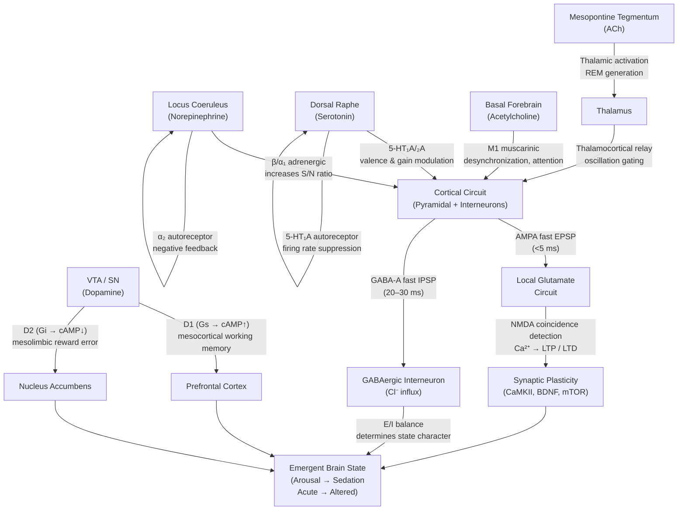

# Lesson 2: Neurotransmitter Systems in State Modulation

## 1. First-Principles Intuition & Invariants

The brain does not simply process information — it continuously negotiates the *conditions* under which information is processed. What we call an "altered state" — whether induced by sleep deprivation, pharmacological agents, extreme exertion, meditative practice, or acute psychological stress — is, at the cellular level, a wholesale reconfiguration of neuromodulatory tone. Understanding how that reconfiguration happens requires treating the nervous system not as a fixed circuit but as a dynamically weighted network whose gain, threshold, and temporal integration properties shift in response to the chemical milieu bathing its synapses.

The five major neuromodulatory systems — monoaminergic (dopamine, serotonin, norepinephrine), cholinergic, GABAergic, and glutamatergic — do not operate in isolation. They form an interlocking regulatory hierarchy in which each system's output reshapes the sensitivity of the others. The practitioner who understands this hierarchy gains the ability to reason predictively about state: why a selective serotonin reuptake inhibitor (SSRI) blunts the affective salience of pain without fully abolishing nociception, why alpha-2 adrenergic agonists produce sedation rather than analgesia, and why the transition from wakefulness to slow-wave sleep requires not just the withdrawal of excitatory drive but the active, coordinated suppression of multiple arousal systems simultaneously.

The first invariant governing all of this is **neuromodulatory specificity through projection geometry**. Each major monoamine nucleus is anatomically concentrated — the dorsal raphe for serotonin, the locus coeruleus (LC) for norepinephrine, the ventral tegmental area (VTA) and substantia nigra for dopamine — yet each broadcasts across vast cortical and subcortical territories through divergent axonal arborizations. A single LC neuron may contact targets from the prefrontal cortex to the spinal dorsal horn. This architecture means that relatively small changes in firing rate within these compact nuclei produce system-wide state shifts, not focal modulation.

The second invariant is **receptor subtype heterogeneity as a gain-control mechanism**. The existence of multiple receptor subtypes for each transmitter — fourteen serotonin receptor subtypes, five dopamine receptor families, nine adrenergic receptor configurations — is not redundancy. It is a biochemical strategy for embedding context-sensitivity into the response to a single signal. D1-class receptors couple to Gs and potentiate adenylyl cyclase, increasing cAMP and PKA activity; D2-class receptors couple to Gi, suppressing the same cascade. The balance of D1 versus D2 signaling in the striatum determines whether a motor pattern is released or suppressed. The practitioner must internalize receptor pharmacology not as a list of names but as a set of gain coefficients that the brain applies differentially by brain region, developmental state, and ambient transmitter concentration.

The third invariant is **the distinction between fast synaptic transmission and slow neuromodulation**. Glutamate and GABA operate on millisecond timescales, opening ion channels directly through ionotropic receptors and setting the moment-to-moment excitation-inhibition (E/I) balance of local circuits. Monoamines and acetylcholine, acting primarily through metabotropic G-protein-coupled receptors, operate on timescales of hundreds of milliseconds to minutes, reshaping the *responsiveness* of circuits to whatever fast synaptic inputs they receive. Altered states arise when this slower neuromodulatory layer is shifted far from its baseline, changing the terrain on which fast synaptic events occur.

---

## 2. Core Architecture & Mechanics

### Monoaminergic Systems

The locus coeruleus sits at the apex of the brain's arousal-modulation hierarchy. Its roughly 50,000 noradrenergic neurons (in the human brain) fire tonically at 1–3 Hz during alert wakefulness, increase phasic burst firing in response to salient or unexpected stimuli, and fall nearly silent during REM sleep. Norepinephrine released from LC terminals binds postsynaptically to β-adrenergic receptors, increasing neuronal excitability and signal-to-noise ratio in sensory cortices, while simultaneously suppressing "default" or spontaneous activity — a mechanism William Deacon's group framed as a shift in the cortical operating mode from exploration to exploitation. High tonic LC activity, as seen under psychological stress or moderate stimulant exposure, paradoxically *degrades* performance by flooding the system with norepinephrine beyond the optimal operating range, shifting the inverted-U dose-response curve past its peak and reducing working memory fidelity.

Serotonergic output from the dorsal raphe modulates emotional valence and temporal integration. Raphe neurons fire tonically during goal-directed movement, slow during quiet waking, and cease during REM. Their dense projections to the basolateral amygdala, prefrontal cortex, and anterior cingulate mediate the regulation of threat-related arousal — a mechanistic basis for the blunted fear consolidation observed under SSRIs. Critically, 5-HT₁A autoreceptors on raphe soma provide negative feedback: when extracellular serotonin rises (as under SSRI loading), autoreceptor activation hyperpolarizes the raphe and reduces firing rate, an adaptation that explains the 2–4 week clinical lag before therapeutic effect. Practitioners working with pharmacological state interventions must account for this autoreceptor desensitization timeline, as the functional serotonergic output follows a non-linear trajectory after treatment initiation.

Dopaminergic circuitry divides cleanly into two functional streams for the purposes of state modulation. The mesocortical pathway (VTA → prefrontal cortex) governs working memory, cognitive flexibility, and motivational salience for goal-directed behavior. The mesolimbic pathway (VTA → nucleus accumbens, hippocampus, amygdala) encodes reward prediction error — the difference between expected and received reward — and drives associative learning during altered states. During extreme physical exertion, the mesolimbic system interprets effort cost against anticipated reward, and the perception of fatigue is partly a prediction generated by this system rather than a direct read of peripheral muscle metabolite accumulation. This is why dopamine precursor loading or reuptake inhibition can extend performance past what peripheral physiology alone would predict.

### Cholinergic Architecture

The cholinergic system operates across two distinct populations: the basal forebrain (BF) nuclei, including the nucleus basalis of Meynert, projecting diffusely to neocortex; and the brainstem mesopontine tegmentum (pedunculopontine and laterodorsal tegmental nuclei), projecting to thalamus and brainstem. BF cholinergic tone increases with attention and cortical arousal, promoting the transition from synchronized slow oscillations (high-amplitude, low-frequency EEG) to desynchronized fast oscillations (low-amplitude, high-frequency beta/gamma) — a shift that reflects increased cortical computation. This desynchronization is mediated predominantly through muscarinic M1 receptors on cortical pyramidal neurons, which suppress the slow afterhyperpolarization (sAHP) current and thereby increase neuronal firing rates in response to synaptic inputs.

The mesopontine cholinergic system is the proximate driver of REM sleep. During REM, acetylcholine release in the thalamus and brainstem reaches waking levels while norepinephrine and serotonin inputs fall to near-zero. This "cholinergic REM" state produces the distinctive phenomenology of dreaming — vivid internal imagery, narrative incoherence, reduced metacognitive monitoring — through the combination of robust thalamocortical activation without the organizing constraint of monoaminergic tone.

### GABAergic Inhibition and the E/I Balance

GABA operates through two mechanistically distinct receptor classes that the practitioner must treat separately. GABA-A receptors are ionotropic chloride channels. Their fast inhibitory postsynaptic potential (IPSP) lasts 20–30 ms and provides the precise temporal gating on which cortical computation depends. Benzodiazepines, barbiturates, neurosteroids, and ethanol all act here — but through different mechanisms. Benzodiazepines are positive allosteric modulators that increase the *frequency* of chloride channel opening without altering single-channel conductance, explaining their ceiling effect and relative safety in overdose. Barbiturates increase channel *open duration* and, at high doses, directly activate the channel in the absence of GABA, eliminating the ceiling and producing respiratory depression.

GABA-B receptors are metabotropic, Gi-coupled, and mediate a slow, prolonged inhibition through potassium channel opening. Their activation suppresses both presynaptic neurotransmitter release (reducing glutamatergic excitation at the synapse level) and postsynaptic excitability. The clinical relevance is direct: baclofen's selectivity for GABA-B provides spasticity relief without sedation proportional to that of benzodiazepines, because the two receptor classes modulate fundamentally different aspects of inhibitory tone.

The E/I balance — the ratio of excitatory glutamatergic drive to inhibitory GABAergic constraint — is the most consequential single parameter for predicting the character of an altered state. When E/I shifts toward excitation (reduced GABAergic tone, increased glutamatergic activity), the result progresses through heightened arousal, perceptual sensitization, to seizure threshold reduction. When it shifts toward inhibition, the progression moves through sedation, anesthesia, and respiratory depression. Many psychedelic and dissociative agents achieve their effects precisely by disrupting the normal spatial and temporal patterns of E/I balance across cortical areas, producing uncoordinated excitation in some regions while suppressing others.

### Glutamatergic Excitation and NMDA Receptor Dynamics

Glutamate, acting on AMPA and NMDA receptors, provides the substrate on which all other modulation operates. AMPA receptors mediate the fast depolarization of the EPSP; NMDA receptors act as coincidence detectors, requiring both presynaptic glutamate release and postsynaptic depolarization (to relieve the voltage-dependent Mg²⁺ block) before they open. This coincidence-detection property is the molecular basis of Hebbian synaptic plasticity and long-term potentiation (LTP). During altered states that involve heightened arousal or psychedelic activation, NMDA receptor-mediated calcium influx increases, initiating kinase cascades (CaMKII, PKA, ERK) that phosphorylate AMPA receptor subunits, increasing their surface expression and thereby increasing synaptic strength — the same cellular sequence that underlies learning and memory consolidation.

Ketamine's mechanism as a dissociative anesthetic and, at sub-anesthetic doses, a rapid antidepressant illustrates the complexity of glutamatergic modulation. Ketamine is an uncompetitive open-channel blocker of NMDA receptors, but its antidepressant effect depends on a rebound excitation hypothesis: by blocking NMDA receptors on inhibitory interneurons, it disinhibits glutamate release, producing a surge of AMPA-mediated signaling that triggers BDNF release and mTOR-dependent synaptic protein synthesis — restoring synaptic density in prefrontal circuits depleted by chronic stress.

The following diagram maps the signal-flow topology between these systems, illustrating how state emerges from the interaction of neuromodulatory tone with fast E/I dynamics.

---

## 3. High-Performance Optimization & Failure Modes

For the advanced practitioner, the actionable challenge is not simply understanding these systems descriptively but reasoning accurately about *interventions* — pharmacological, behavioral, or physiological — and anticipating where they produce expected versus paradoxical effects, and where the system fails under boundary conditions.

**Optimizing Arousal for Performance Domains.** The most robust practitioner protocol for modulating noradrenergic-serotonergic tone in the direction of heightened performance involves behavioral rather than pharmacological leverage as a first-order tool. Acute aerobic exercise at 65–80% VO₂ max for 20–30 minutes increases LC firing rate and extracellular norepinephrine in prefrontal cortex, with concurrent serotonin elevation in the dorsal striatum. The resulting neurochemical state — elevated NE and 5-HT with intact dopaminergic reward signaling — corresponds to the "flow-adjacent" operational state characterized by high signal discrimination and reduced latency to decision-making. This is not metaphor; Magnetoencephalography studies confirm that post-exercise cortical desynchronization (beta-band power increase at 15–30 Hz) mirrors the profile produced by therapeutic doses of noradrenergic agents, without the receptor downregulation that follows chronic pharmacological exposure.

**Receptor Desensitization and Tolerance as Failure Modes.** Every receptor system has a time-domain failure mode: chronic overstimulation drives receptor internalization and downregulation, while chronic understimulation produces supersensitivity. The clinical failure mode most practitioners encounter is SSRI-induced blunting of dopaminergic reward signaling. When serotonergic tone is elevated continuously, 5-HT₂C receptor stimulation in the VTA suppresses dopamine release into the prefrontal cortex and nucleus accumbens — a mechanism underlying the "emotional blunting" or anhedonia reported in a significant minority of SSRI users. Practitioners monitoring this failure mode should track motivational drive and reward responsiveness, not just mood, as the first sensitive indicator of dopaminergic suppression.

**GABAergic Ceiling and Paradoxical Excitation.** At very high GABAergic tone — such as during benzodiazepine loading or acute ethanol intoxication — a paradoxical excitation phenomenon emerges in some individuals, particularly in those with baseline GABAergic system variants (e.g., GABA-A α-subunit polymorphisms) or in contexts of high baseline anxiety where cortical inhibitory interneurons are already suppressed. The mechanism: GABA-A agonism at inhibitory interneurons preferentially suppresses the interneurons that gate excitatory output, temporarily releasing pyramidal cell firing from constraint before the full sedative effect takes hold. This window is clinically meaningful in emergency care, where benzodiazepines administered for agitation can produce a brief intensification before sedation.

**Synaptic Plasticity and Altered State Persistence.** A critical edge case that practitioners in pharmacological and performance domains must track is the difference between *state* changes (transient, reversing with transmitter clearance) and *trait* changes (persistent, encoded in synaptic architecture). States that involve significant NMDA receptor activation and Ca²⁺ influx — including acute high-dose psychedelic exposure, intense prolonged training, and severe psychological trauma — can trigger LTP or LTD cascades that outlast the immediate neuromodulatory perturbation by hours to weeks. The mTOR pathway activated by ketamine-induced glutamate surges, for example, drives dendritic spine formation within two hours of a single dose in rodent models, and analogous structural plasticity has been confirmed in humans using longitudinal MRI and PET imaging of synaptic density tracers (e.g., [¹¹C]UCB-J). This means practitioners must distinguish between acute state management and long-term synaptic remodeling when evaluating intervention outcomes.

**Thalamic Gating Failure in State Transitions.** The thalamus acts as the critical gating node between brainstem arousal systems and cortical circuits. During normal wakefulness-to-sleep transitions, thalamocortical relay neurons shift from tonic firing (which relays sensory information faithfully) to burst firing (which generates sleep spindles and gates cortical access to sensory input). This shift depends on the coordinated withdrawal of noradrenergic and serotonergic input combined with sustained GABAergic input from the thalamic reticular nucleus (TRN). When this coordination is disrupted — by stimulant drugs that sustain LC activity, by PTSD-related hyperarousal locking the LC into elevated tonic firing, or by thalamic pathology — the transition fails. The result is not simply insomnia but a pathological mixed state in which cortical circuits receive both sleep-pattern thalamocortical oscillations and arousal-system excitation, producing the fragmented, non-restorative sleep characteristic of hyperarousal disorders. The intervention target in these cases is not the cortex but the upstream brainstem arousal system, which is why alpha-2 agonists (clonidine, guanfacine), which directly reduce LC firing rate, outperform direct hypnotics in PTSD-related insomnia.

---

## 4. Summary & Verification Matrix

| System | Primary Transmitter & Receptors | State Modulation Mechanism | Failure Mode | Diagnostic Criterion | Intervention Leverage Point |
|---|---|---|---|---|---|
| Noradrenergic | NE; α₁, α₂, β₁, β₂ adrenergic | LC tonic/phasic firing sets cortical signal-to-noise ratio; inverted-U dose-response for working memory | High tonic LC activity degrades prefrontal function; LC-driven thalamic gating failure blocks sleep transitions | EEG: β-band hyperactivation; subjective hypervigilance with WM errors; non-restorative sleep | α₂ agonists (clonidine, guanfacine) reduce LC firing; acute aerobic exercise optimizes NE range |
| Serotonergic | 5-HT; 5-HT₁A, 5-HT₂A/₂C, 5-HT₃ | Raphe projections regulate emotional valence, threat processing, temporal integration; autoreceptor-mediated slow feedback | SSRI-induced 5-HT₂C activation suppresses VTA dopamine; autoreceptor desensitization lag produces delayed therapeutic onset | Anhedonia under SSRI; blunted reward salience without mood normalization; 2–4 week therapeutic lag | 5-HT₁A autoreceptor desensitization required for full efficacy; monitor dopaminergic indicators concurrently |
| Dopaminergic | DA; D1 (Gs), D2 (Gi) | Mesocortical D1: working memory and cognitive flexibility; mesolimbic reward-prediction error encoding in NAcc | D2 receptor downregulation under chronic stimulant exposure; fatigue perception modulation by mesolimbic system | Reduced motivational drive; impaired cognitive flexibility; subjective fatigue disproportionate to peripheral metabolites | Dopamine precursor loading (tyrosine); physical performance interventions target mesolimbic effort-cost computation |
| Cholinergic / GABAergic | ACh (M1, nAChR); GABA (GABA-A Cl⁻, GABA-B K⁺) | BF ACh drives cortical desynchronization and attention; GABA-A sets fast E/I balance; GABA-B mediates presynaptic suppression | Paradoxical excitation during GABA-A agonist loading; REM disruption from sustained cholinergic suppression | EEG: α-band suppression failure under benzodiazepine; clinical agitation paradox in GABA-A α-subunit variants | GABA-B selective agents (baclofen) for spasticity without sedation; mesopontine ACh integrity essential for REM |
| Glutamatergic | Glutamate; AMPA (fast EPSP), NMDA (coincidence detection) | NMDA Ca²⁺ influx initiates LTP/LTD cascades; E/I ratio sets state character from arousal to seizure threshold | Excessive NMDA activation (excitotoxicity) under ischemia or seizure; sub-anesthetic NMDA block produces disinhibitory glutamate surge | Seizure threshold reduction at high E/I; structural synaptic remodeling (mTOR-driven spine growth) detectable via [¹¹C]UCB-J PET | NMDA antagonism (ketamine) for rapid antidepressant remodeling; E/I balance monitoring as primary altered-state risk index |
| Synaptic Plasticity Integration | CaMKII, BDNF, mTOR downstream | State-to-trait encoding: persistent LTP/LTD outlasts acute neuromodulatory perturbation by hours to weeks | Maladaptive plasticity after trauma or repeated drug exposure encodes pathological attractor states | Longitudinal synaptic density imaging; persistent behavioral trait shifts after single acute event | Timing-sensitive interventions (propranolol peritraumatic, MDMA-assisted reconsolidation) target plasticity window |
