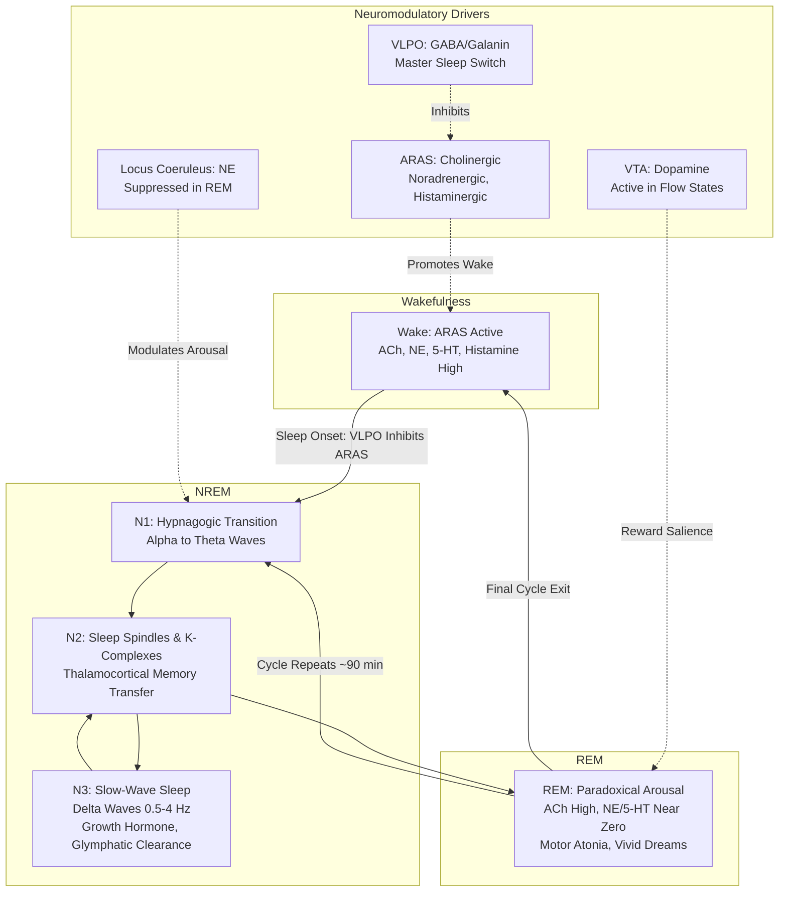

# Lesson 3: Endogenous Altered States

## 1. First-Principles Intuition & Invariants

The human brain never simply "shuts off." Instead, it cycles through a series of state transitions orchestrated by distinct neurochemical gradients, oscillatory patterns, and autonomic shifts. Endogenous altered states—sleep, dreaming, meditation, flow, and hypnosis—are not passive recesses from consciousness but highly organized, metabolically distinct phases of neural operation. Understanding them requires abandoning the idea that wakefulness is the baseline and everything else is a deviation. Each state is a deliberate, evolutionarily conserved configuration with specific functional objectives: memory consolidation, emotional regulation, threat rehearsal, metabolic restoration, or hyper-focused performance optimization.

At the core of these state transitions is the reciprocal interaction between two primary neural systems: the ascending reticular activating system (ARAS), which promotes wakefulness via cholinergic, noradrenergic, and histaminergic projections, and the ventrolateral preoptic nucleus (VLPO) of the hypothalamus, which acts as the brain's master sleep switch via GABAergic and galaninergic inhibition of the ARAS. This is not a simple on/off toggle. It is a bistable flip-flop circuit, heavily stabilized by neuromodulatory feedback, designed to resist intermediate states. When the system is healthy, transitions are sharp and decisive. When it is compromised—by sleep deprivation, circadian misalignment, or exogenous stress—the stability degrades, producing fragmented sleep, intrusive micro-sleeps during wakefulness, and impaired cognitive throughput.

The fundamental invariant governing all endogenous state changes is that consciousness is a pharmacological phenomenon. You do not simply "decide" to enter REM sleep or a flow state; your neurochemistry shifts beneath the threshold of conscious control, and the qualitative experience of consciousness changes as a downstream effect. Acetylcholine climbs during REM to produce the vivid internal imagery of dreams while noradrenaline flatlines to suppress motor output. Norepinephrine and dopamine co-release in the locus coeruleus and ventral tegmental area during flow states to produce hyper-focus and temporal distortion. The practitioner's job is not to directly manipulate these neurotransmitters but to engineer the behavioral, environmental, and physiological conditions that allow the nervous system to initiate the correct pharmacological cascade at the correct time.

This brings us to the practical invariant: state transitions are threshold-governed, not willpower-governed. You cannot force a patient into deep sleep by instruction, and you cannot force an athlete into flow by encouragement. You can only optimize the antecedent variables—core body temperature, light exposure, cardiovascular load, respiratory rate, and cognitive load distribution—so that the threshold for the desired state is crossed naturally. The protocols that follow are grounded in this principle. They are not psychological tricks; they are physiological leverage points applied with precision.

## 2. Core Architecture & Mechanics

### Sleep Architecture: The Ultradian Cycle

Sleep is not a monolithic block of unconsciousness. It is a structured sequence of stages repeated in roughly 90-minute ultradian cycles, with each cycle containing distinct phases of non-rapid eye movement (NREM) and rapid eye movement (REM) sleep. The architecture of these cycles determines whether sleep is restorative or merely time spent in bed.

NREM sleep is divided into three stages of increasing depth. Stage N1 represents the hypnagogic transition, where alpha waves (8-13 Hz) characteristic of relaxed wakefulness attenuate and theta waves (4-8 Hz) emerge. This is the threshold of sleep onset, and it is where the practitioner's focus on sleep latency begins. A healthy adult should transition from full wakefulness to N1 within 10-20 minutes. Latencies under 5 minutes indicate pathological sleep pressure, typically from severe sleep deprivation or a sleep-onset disorder. Latencies over 30 minutes indicate psychophysiological arousal—usually driven by hyperactivation of the sympathetic nervous system or circadian phase delay.

Stage N2 is characterized by sleep spindles (bursts of 12-14 Hz activity lasting 0.5-2 seconds) and K-complexes (high-amplitude biphasic waves). Spindles are generated by thalamocortical circuits and are functionally tied to memory consolidation, specifically the transfer of declarative memories from hippocampal temporary storage to cortical long-term networks. This stage occupies approximately 45-55% of total sleep time, making it the architectural backbone of the sleep period.

Stage N3, slow-wave sleep (SWS), is the deepest and most metabolically restorative phase. It is defined by delta waves (0.5-4 Hz), high amplitude and low frequency, and it is during this stage that growth hormone secretion peaks, glymphatic clearance of beta-amyloid and tau proteins accelerates, and synaptic homeostasis is rebalanced. SWS dominates the first third of the sleep period, a fact that has direct clinical relevance: if a patient goes to bed two hours late, they do not lose a proportional slice of every stage. They disproportionately lose SWS, because the homeostatic pressure that drives deep sleep is highest at sleep onset and dissipates rapidly. This is why shift workers and late-sleeping athletes wake up feeling unrefreshed even after eight hours in bed—they missed the window of maximal SWS.

REM sleep, by contrast, dominates the final third of the night. It is a paradoxical state: the brain consumes nearly as much energy as it does during waking, yet voluntary skeletal muscle tone is abolished by descending motor inhibition originating in the nucleus magnocellularis of the medulla. The EEG during REM resembles waking—low-amplitude, high-frequency, with sawtooth waves—but the neurochemical environment is radically different. Acetylcholine rises to waking levels or above, creating the conditions for vivid hallucinatory imagery, while norepinephrine, serotonin, and histamine drop to near-zero. This neuromodulatory profile is critical: the absence of norepinephrine means the dreamer cannot access the full range of episodic memory, which explains why dreams are bizarre and narrative-incoherent. The brain is generating imagery without the organizing influence of the noradrenergic system.

### Circadian Regulation: The SCN and Peripheral Clocks

The timing of these sleep stages is not arbitrary. It is governed by the suprachiasmatic nucleus (SCN) of the hypothalamus, the brain's master circadian clock. The SCN operates on a near-24-hour cycle, entrained primarily by light intensity falling on intrinsically photosensitive retinal ganglion cells (ipRGCs) that project directly to the SCN via the retinohypothalamic tract. These cells are maximally sensitive to short-wavelength blue light (approximately 480 nm), which is why evening exposure to LED screens and artificial lighting delays melatonin onset and shifts the circadian phase later.

The SCN does not act alone. It coordinates a network of peripheral clocks in the liver, muscle, adipose tissue, and gut, all of which express their own circadian gene networks (CLOCK, BMAL1, PER, CRY). The synchrony between the central SCN clock and peripheral clocks determines metabolic efficiency, immune function, and cognitive performance. When a practitioner evaluates a patient with chronic fatigue, the question is not simply "How many hours are you sleeping?" but "Is your sleep aligned with your circadian phase?" A patient sleeping 23:00–07:00 after a lifetime of 22:00–06:00 schedules is sleeping out of phase, and the consequences are measurable: reduced glucose tolerance, elevated evening cortisol, and blunted morning growth hormone pulses.

Melatonin, the hormone of darkness, is the primary chemical messenger of the circadian system. It is produced by the pineal gland under SCN control, with secretion beginning approximately two hours before habitual sleep onset—a window known as dim light melatonin onset (DLMO). Practitioners can leverage exogenous melatonin strategically, but the dosing is counterintuitive. The standard pharmacy dose of 3-10 mg produces supraphysiological blood levels that can cause receptor desensitization and phase shifts far larger than intended. The correct dose for circadian phase advancement is 0.3-0.5 mg, taken 5-7 hours before DLMO. This mimics the endogenous rise and nudges the clock forward without overwhelming the system.

### Meditation-Induced States: Neural Oscillatory Shifts

Meditation is not relaxation. It is a trained, directed alteration of neural oscillatory dynamics. The practitioner must understand the specific neurophysiological signatures of different meditative traditions to apply them therapeutically.

Focused attention meditation (FAM), as practiced in Samatha and early-stage mindfulness protocols, targets sustained attention on a single object—typically the breath. The neural signature is increased beta and gamma activity in the dorsolateral prefrontal cortex (DLPFC) and anterior cingulate cortex (ACC), reflecting active cognitive control and conflict monitoring. As expertise develops, the default mode network (DMN)—associated with self-referential thinking and mind-wandering—shows reduced activity and increased functional connectivity with executive networks. This is not "emptying the mind" in a mystical sense; it is a measurable redistribution of cortical resources away from self-referential processing toward task-focused engagement.

Open monitoring meditation (OMM), as practiced in Vipassana and advanced mindfulness, does not focus on a single object. Instead, it cultivates non-reactive metacognitive awareness of whatever arises in consciousness. The neural signature shifts to enhanced alpha and theta activity across broader cortical areas, reflecting a state of relaxed alertness with reduced evaluative reactivity. Experienced meditators show increased theta coherence in the prefrontal and temporal regions, correlated with the subjective experience of "watching thoughts pass without attachment."

Loving-kindness meditation (LKM) and compassion meditation target affective circuits, increasing activation in the insula and temporo-parietal junction (TPJ), regions involved in interoceptive awareness and theory of mind. The practical application here is clinical: patients with chronic pain, anxiety, or trauma-related hyperarousal benefit differentially from different traditions. FAM is contraindicated for trauma survivors with severe intrusive imagery, because sustained focus on internal states can amplify re-experiencing. OMM or body-scan protocols with externalized attention are safer starting points.

### Flow States: The Hypofrontality Hypothesis

Flow—the state of complete absorption in a challenging task—is characterized by a specific neurochemical and neuroanatomical signature that distinguishes it from both ordinary focus and meditative absorption. The leading model, Dietrich's transient hypofrontality hypothesis, proposes that flow involves a temporary reduction of activity in the prefrontal cortex, specifically in regions responsible for self-monitoring, time perception, and explicit verbal narration of experience. The subjective experience of "losing oneself" in the task is not metaphorical; it reflects a measurable reduction in metabolic activity in the medial prefrontal cortex.

The neurochemical cocktail of flow is distinct from meditation. It involves the co-activation of dopamine (from the ventral tegmental area), norepinephrine (from the locus coeruleus), anandamide (the endogenous cannabinoid), serotonin, and endorphins. This combination produces heightened focus, analgesia, euphoria, and temporal distortion—specifically, the subjective compression of time, where minutes feel like seconds. The challenge-skill balance is the critical trigger: flow occurs when the task difficulty is roughly 4% greater than the individual's current skill level. Below this threshold, the task is too easy and the mind wanders. Above it, the task is too hard and anxiety takes over. The practitioner's role is to calibrate the load with the same precision as a strength coach adjusting barbell weight: not too light, not too heavy, precisely at the edge of current capability.

### Hypnotic Phenomena: Dissociation and Suggestibility

Hypnosis is perhaps the most misunderstood endogenous state. It is not mind control or sleep. It is a state of focused attention, peripheral awareness reduction, and heightened responsiveness to suggestion, accompanied by specific changes in brain function. Functional MRI studies show that hypnosis involves decreased activity in the default mode network (reduced self-referential processing), increased connectivity between the DLPFC and the insula (enhanced mind-body integration), and reduced connectivity between the DLPFC and the dorsal anterior cingulate cortex (reduced conflict monitoring and evaluative judgment).

The practical implication is that hypnotic suggestibility is a stable trait, measurable by standardized instruments like the Stanford Hypnotic Susceptibility Scale, but the state itself can be facilitated in almost anyone with proper induction. The induction phase uses repetitive, monotonous stimulation—typically verbal pacing—combined with guided imagery to shift the subject from beta-dominant waking EEG into the alpha-theta borderland (7-8 Hz), a state of deep physical relaxation with preserved mental alertness. This is the same EEG signature observed in the hypnagogic transition (N1 sleep), which is why hypnosis is sometimes described as "a structured, controlled entry into the threshold of sleep."

Clinically, hypnosis has robust evidence for pain management, irritable bowel syndrome, post-traumatic stress disorder, and smoking cessation. The mechanism for analgesia is not simply relaxation but a modulation of the somatosensory cortex's response to nociceptive input. The pain signal still arrives at the thalamus, but the cortical interpretation of the signal as "suffering" is attenuated. This is the same neural mechanism by which placebo analgesia operates, but hypnosis can produce analgesia even when the subject knows they are being hypnotized, because the effect operates on sub-cortical sensory gating, not on belief alone.

## 3. High-Performance Optimization & Failure Modes

Optimizing endogenous altered states requires treating sleep, meditation, and flow as trainable variables, not fixed traits. The practitioner's intervention strategy must be grounded in measurable biomarkers, and the failure modes must be diagnosed with the same rigor applied to musculoskeletal injuries.

### Sleep Optimization: Protocol and Failure Diagnosis

The foundational sleep optimization protocol begins with the two-process model: Process S (homeostatic sleep pressure, driven by time awake and adenosine accumulation) and Process C (circadian timing, driven by the SCN). High-quality sleep requires both processes to be aligned. Process S is accumulated by simply staying awake, but it is dissipated by naps longer than 20 minutes, which reduce SWS pressure and can make subsequent nighttime sleep fragmented. Process C is anchored by morning light exposure: 10,000 lux for 20-30 minutes within 30 minutes of waking suppresses melatonin, advances the circadian phase, and stabilizes the subsequent night's sleep onset.

The optimization protocol for a healthy adult targets a consistent sleep window with less than 30 minutes variability across the week. The pre-sleep phase begins 90 minutes before target sleep onset: ambient lighting reduced to under 50 lux, blue light blocked with amber glasses or screen filters, core body temperature facilitated by a warm shower 60-90 minutes before bed (the rapid post-shower cooling drop of 0.3-0.5°C mirrors the natural pre-sleep temperature decline and triggers sleep onset), and caffeine cutoff no later than 10 hours before target sleep onset (caffeine's half-life is 5-6 hours, with a quarter-life of 10-12 hours, meaning a 16:00 coffee still has 25% of its peak blood concentration at 02:00).

Common failure modes in sleep architecture are diagnosable and treatable. Sleep onset insomnia—latency greater than 30 minutes for three or more nights per week—is most often a Process C problem (phase delay) or a hyperarousal problem (sympathetic dominance at bedtime). The treatment differs: phase delay responds to morning bright light, evening melatonin, and strictly enforced wake times; hyperarousal responds to cognitive defusion techniques, progressive muscle relaxation, and parasympathetic breathing protocols (resonant frequency breathing at approximately 5.5 breaths per minute, which maximizes heart rate variability and vagal tone).

Sleep maintenance insomnia—waking after sleep onset and being unable to return to sleep—often reflects a different mechanism. In younger adults, it is frequently caused by untreated obstructive sleep apnea, alcohol consumption (which suppresses REM in the first half of the night and causes REM rebound fragmentation in the second half), or environmental disruption. In older adults, it is more often the result of reduced SWS pressure and phase advancement, where the patient falls asleep early and wakes early. The treatment is to delay sleep onset rather than go to bed earlier, combined with bright light exposure in the early evening to delay the circadian phase.

### Circadian Misalignment: Shift Work and Jet Lag

Shift work and rapid timezone travel produce the most severe disruptions of endogenous state regulation. The SCN entrains slowly—approximately one hour per day for eastward travel and 1.5 hours per day for westward travel—so a five-hour timezone shift requires 3-5 days of alignment for eastward travel and 2-3 days for westward travel. During this misalignment window, the patient's sleep architecture is degraded: SWS is reduced because the body attempts to sleep during the biological day when SWS pressure is low, and REM is fragmented because the circadian REM propensity peak is misaligned with the sleep window.

The practical protocol for jet lag management uses strategically timed light exposure and melatonin to accelerate phase shifting. For eastward travel (phase advance needed), the patient should seek bright light in the early morning of the destination time zone and take 0.3-0.5 mg melatonin 5-7 hours before local bedtime. For westward travel (phase delay needed), the patient should avoid bright morning light and seek bright light in the late afternoon and evening, and melatonin is generally not useful because it primarily advances, not delays, the phase.

For shift workers, the strategy is to anchor the circadian system to a stable schedule rather than oscillate between day and night schedules on days off. The "anchor sleep" approach schedules a 4-hour block of sleep at the same time every day, supplemented by a variable nap before or after the shift. This reduces the circadian disruption caused by constantly shifting sleep windows.

### Meditation Protocol Optimization and Failure Modes

Meditation training should be periodized like physical training. A beginner protocol starts with 10 minutes of FAM, daily, for four weeks, focusing on breath counting to stabilize attention. The progression increases duration by 5 minutes every two weeks, up to 30 minutes, at which point OMM techniques can be introduced. The key diagnostic marker for progression is not subjective enjoyment but measurable reduction in mind-wandering frequency, which can be self-monitored using a simple tally counter during the session.

The most common failure mode is not lack of effort but incorrect technique selection. Patients with anxiety disorders often find that FAM amplifies their internal monitoring, leading to increased rumination rather than decreased arousal. The diagnostic signal is that the patient reports feeling more anxious after meditation, not less. The intervention is to shift to an externalized attention protocol, such as open monitoring with a focus on ambient sounds, or to use body-scan techniques that direct attention to somatic sensation rather than breath, which is more emotionally loaded.

A second failure mode is "false meditative absorption," where the patient confuses relaxation with meditative absorption. The EEG signature is predominantly alpha with low theta, indicating drowsiness rather than the alpha-theta borderland of true meditative absorption. The practitioner can detect this by asking the patient to report the precise moment of transition from alert focus to drowsy drifting; a trained meditator can identify this transition with high precision, while a false absorber reports only a vague "drifted off."

### Flow State Engineering and Boundary Conditions

Flow state optimization requires engineering the challenge-skill ratio, eliminating distractions, and managing the neurochemical preconditions. The protocol for a knowledge worker or athlete begins with a 90-120 minute uninterrupted work block, initiated after a brief priming period of 10-15 minutes of moderate aerobic exercise, which elevates dopamine and norepinephrine to levels conducive to sustained focus. The environment should be engineered to eliminate interruption: notifications off, phone in another room, and a single task displayed with all others hidden from view. The cognitive load should be pre-determined: the task should be clearly defined with a specific end state, so the brain does not waste resources on goal-switching.

The failure mode most commonly observed is the "anxiety wall," where the challenge exceeds the skill level by more than approximately 8%, triggering sympathetic activation that disrupts the prefrontal hypofrontality required for flow. The diagnostic signal is increased heart rate, shallow breathing, and intrusive self-evaluative thoughts. The intervention is to reduce task difficulty temporarily—break the task into smaller sub-tasks with clearly defined next steps—until the challenge-skill ratio returns to the 4% zone.

A less obvious failure mode is "boredom drift," where the task is too easy and the mind disengages. This is not simply a loss of focus but a loss of neurochemical engagement: without sufficient challenge, dopamine release is insufficient to sustain the attentional lock required for flow. The intervention is to increase complexity—add a secondary constraint (e.g., time pressure, a creative variation on the task)—to bring the challenge level back to the threshold.

## 4. Summary & Verification Matrix

| Invariant | Mechanism | Diagnostic Criteria | Failure Mode | Intervention |
|---|---|---|---|---|
| Sleep is ultradian, not monolithic | 90-minute NREM-REM cycles driven by reciprocal ARAS/VLPO inhibition; SWS dominates early cycles, REM dominates late cycles | Polysomnography: latency <20 min, N2 45-55%, SWS 15-25%, REM 20-25% | SWS loss from delayed sleep onset; REM fragmentation from alcohol/caffeine | Enforce consistent sleep window; caffeine cutoff 10h before sleep; avoid alcohol within 3h of bedtime |
| Circadian phase gates sleep quality | SCN entrained by ipRGC blue light (480 nm); DLMO occurs ~2h before sleep onset; melatonin signals darkness | DLMO measurement; actigraphy showing stable sleep midpoint; morning cortisol slope | Phase delay from evening blue light; phase advance in aging; jet lag misalignment | 10,000 lux morning light within 30 min of waking; 0.3-0.5 mg melatonin 5-7h before DLMO; amber glasses post-sunset |
| Meditation shifts neural oscillatory dynamics | FAM increases DLPFC beta/gamma; OMM increases broad alpha/theta; LKM activates insula/TPJ; DMN suppressed across traditions | EEG coherence: alpha-theta borderland (7-8 Hz); reduced DMN activity on fMRI; self-reported mind-wandering frequency | Trauma re-experiencing from FAM in PTSD; false absorption (drowsy alpha without theta) | Screen trauma history before FAM; shift to OMM or body-scan; use externalized attention protocols for high-arousal patients |
| Flow requires hypofrontality and challenge-skill balance | DLPFC metabolic reduction; co-release of dopamine, NE, anandamide, serotonin, endorphins; triggered at ~4% challenge above skill | Subjective time compression; loss of self-referential thought; sustained single-task focus; HRV elevation | Anxiety wall (>8% challenge): sympathetic hyperactivation; boredom drift (<2% challenge): dopamine insufficiency | Reduce task granularity for anxiety wall; add secondary constraint for boredom drift; 90-120 min uninterrupted blocks post-aerobic priming |
| Hypnosis is dissociative focused attention, not sleep | DMN suppression; DLPFC-insula connectivity increase; DLPFC-dACC connectivity decrease; EEG shifts to alpha-theta borderland | Stanford Susceptibility Scale; analgesia response to suggestion; preserved awareness with reduced evaluative monitoring | Suggestibility ceiling effects in low-trait individuals; confabulation mistaken for genuine hypnotic response | Use validated susceptibility scales; pace verbal induction with subject's breathing; test analgesia with calibrated stimuli before therapeutic suggestions |
| Two-process model governs sleep timing | Process S: adenosine accumulation during wake, dissipated by sleep; Process C: SCN-driven 24h rhythm; optimal sleep requires S+C alignment | Multiple Sleep Latency Test (MSLT); actigraphy; sleep diary tracking consistency | Naps >20 min dissipate SWS pressure; shift work creates chronic S-C misalignment | Limit naps to 20 min; anchor sleep schedule with <30 min variability; shift work uses fixed 4h anchor block + variable supplemental nap |
