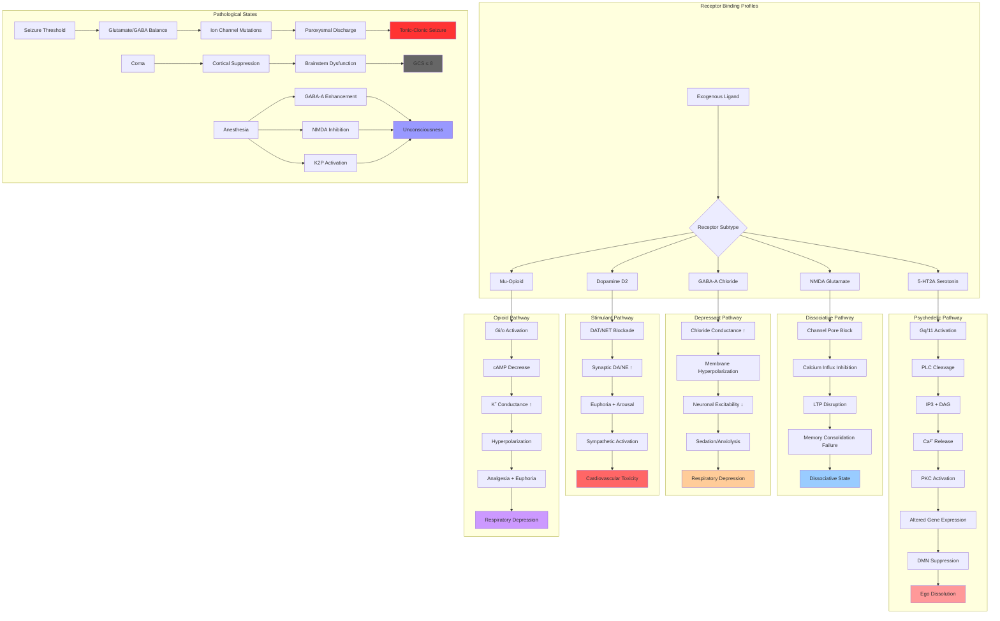

# Lesson 4: Exogenous Pharmacological Pathological States

## 1. First-Principles Intuition & Invariants

The human nervous system operates as an electrochemical machine governed by precise receptor-ligand kinetics, ion channel conductances, and neurotransmitter turnover rates. Consciousness, perception, and motor control emerge from the orchestrated firing of billions of neurons whose activity is modulated by endogenous signaling molecules—dopamine, serotonin, GABA, glutamate, acetylcholine, and norepinephrine—each binding to specific receptors with defined affinity constants and downstream effector cascades. When exogenous pharmacological agents enter this tightly regulated system, they act as molecular mimics, antagonists, or modulators of endogenous ligands, hijacking receptor sites and ion channels to produce altered states of consciousness that range from therapeutic sedation to pathological seizure activity.

The governing invariant for all psychoactive substances is the receptor binding profile: the collection of receptor subtypes to which a molecule binds, the affinity (measured as dissociation constant $K_d$) for each receptor, and whether the molecule acts as a full agonist, partial agonist, antagonist, or allosteric modulator. A full agonist produces maximal receptor activation at saturating concentrations, while a partial agonist produces submaximal activation even when all receptors are occupied. Antagonists block receptor activation without triggering downstream signaling, and allosteric modulators alter receptor conformation to enhance or inhibit the binding and efficacy of orthosteric ligands. The therapeutic index, defined as the ratio of the dose producing toxicity to the dose producing the desired effect, determines the safety margin of any psychoactive agent. Substances with narrow therapeutic indices—such as barbiturates and opioids—require precise dosing to avoid respiratory depression and death, while those with wide therapeutic indices—such as benzodiazepines and selective serotonin reuptake inhibitors—offer greater clinical safety.

Psychoactive substances are classified by their primary mechanism and behavioral effects into five broad categories: psychedelics (serotonergic hallucinogens), dissociatives (NMDA receptor antagonists), depressants (GABAergic and sedative agents), stimulants (dopaminergic and noradrenergic agonists), and opioids (mu-opioid receptor agonists). Each class produces a characteristic constellation of subjective effects, physiological changes, and potential adverse outcomes. Psychedelics such as psilocybin and LSD act primarily as serotonin 5-HT2A receptor agonists, producing perceptual distortions, synesthesia, and altered time perception without significant physiological toxicity at typical doses. Dissociatives such as ketamine and phencyclidine block the NMDA subtype of glutamate receptors, producing a sense of detachment from the body and environment, analgesia, and at higher doses, emergence delirium and neurotoxic excitotoxicity. Depressants including alcohol, benzodiazepines, and barbiturates enhance GABAergic inhibition, producing anxiolysis, sedation, motor incoordination, and dose-dependent respiratory depression. Stimulants such as amphetamine and cocaine increase synaptic dopamine and norepinephrine concentrations through reuptake inhibition or vesicular release, producing euphoria, increased alertness, sympathetic activation, and potential cardiovascular toxicity. Opioids bind mu, delta, and kappa opioid receptors distributed throughout the central and peripheral nervous system, producing analgesia, euphoria, respiratory depression, and constipation through decreased gastrointestinal motility.

Pathological states affecting consciousness arise from disruptions in neuronal excitability, metabolic homeostasis, or structural integrity. Seizures represent paroxysmal, synchronized neuronal discharges that overwhelm inhibitory control mechanisms, propagating across cortical networks to produce motor convulsions, sensory distortions, or loss of awareness. The balance between excitatory glutamatergic transmission and inhibitory GABAergic transmission determines seizure threshold, and any perturbation that shifts this balance toward excitation—whether through ion channel mutations, neurotransmitter imbalances, or exogenous substances—can trigger ictal activity. Coma represents a profound suppression of cortical and subcortical arousal networks, assessed clinically using the Glasgow Coma Scale (GCS), which quantifies eye opening, verbal response, and motor response on a 15-point scale. Coma may result from diffuse bilateral hemispheric injury, brainstem lesions disrupting the ascending reticular activating system, metabolic derangements such as hypoglycemia or hepatic encephalopathy, or pharmacological depression of central nervous system activity.

Anesthetic agents are deliberately engineered to produce reversible loss of consciousness, amnesia, analgesia, and muscle relaxation. General anesthetics—whether inhaled volatiles such as sevoflurane or intravenous agents such as propofol—act through multiple receptor mechanisms including enhancement of GABA-A receptor chloride conductance, inhibition of NMDA receptors, and activation of two-pore domain potassium channels. The Meyer-Overton correlation, established in the early 20th century, demonstrated that anesthetic potency correlates strongly with lipid solubility, suggesting that anesthetics disrupt neuronal membrane function through physicochemical effects. However, modern molecular pharmacology has revealed that anesthetics bind to specific protein targets within ion channels and receptors, and mutations in these binding sites can confer resistance to anesthetic effects. The minimal alveolar concentration (MAC) for inhaled anesthetics represents the alveolar concentration at which 50% of patients fail to move in response to surgical incision, providing a standardized measure of anesthetic potency that scales inversely with lipid solubility.

## 2. Core Architecture & Mechanics

The serotonergic psychedelics—psilocybin, LSD, DMT, and mescaline—share a common molecular scaffold resembling serotonin (5-hydroxytryptamine) and bind with high affinity to the 5-HT2A receptor subtype, a G-protein-coupled receptor distributed densely in cortical layer V pyramidal neurons. Upon agonist binding, the 5-HT2A receptor activates Gq/11 proteins, stimulating phospholipase C to cleave phosphatidylinositol 4,5-bisphosphate into inositol trisphosphate (IP3) and diacylglycerol (DAG). IP3 triggers calcium release from endoplasmic reticulum stores, while DAG activates protein kinase C, initiating a cascade of intracellular signaling that alters gene expression, synaptic plasticity, and neuronal excitability. Functional MRI studies during psychedelic states reveal decreased activity in the default mode network—a collection of midline brain structures including the medial prefrontal cortex and posterior cingulate cortex that support self-referential thought and autobiographical memory—alongside increased global functional connectivity between cortical regions that normally operate independently. This dissolution of modular network segregation underlies the subjective experience of ego dissolution, synesthesia, and altered perception of space and time.

Psilocybin, the prodrug found in *Psilocybe* mushrooms, undergoes rapid dephosphorylation in vivo to psilocin, which crosses the blood-brain barrier and exhibits a half-life of approximately 2.5 hours. Typical recreational doses range from 1 to 3 grams of dried mushroom material, equivalent to 10 to 30 milligrams of psilocybin. LSD (lysergic acid diethylamide) binds 5-HT2A receptors with picomolar affinity and exhibits an extraordinarily long residence time at the receptor, with a dissociation half-life exceeding 2 hours. This prolonged receptor occupancy explains LSD's extended duration of action—8 to 12 hours—despite relatively rapid plasma clearance. Mescaline, the phenethylamine alkaloid from *Lophophora williamsii* (peyote), requires substantially higher doses (200 to 400 milligrams) due to lower receptor affinity and produces effects lasting 10 to 12 hours. DMT (N,N-dimethyltryptamine), when smoked or vaporized, produces an intense but brief experience lasting 10 to 20 minutes due to rapid metabolism by monoamine oxidase enzymes in peripheral tissues and the brain. Ayahuasca preparations combine DMT-containing plants with monoamine oxidase inhibitors such as harmaline, preventing enzymatic degradation and enabling oral activity with prolonged duration of 4 to 6 hours.

Dissociative anesthetics act as non-competitive antagonists at the NMDA receptor, an ionotropic glutamate receptor that mediates excitatory neurotransmission and synaptic plasticity. The NMDA receptor requires both glutamate binding and postsynaptic depolarization to relieve magnesium block of the channel pore, permitting calcium influx that triggers long-term potentiation and memory consolidation. Ketamine, phencyclidine, dextromethorphan, and nitrous oxide bind within the NMDA receptor channel pore when the channel is open, physically occluding ion flow and preventing calcium entry. Ketamine is administered clinically at doses of 0.5 to 2 milligrams per kilogram intravenously for procedural sedation, producing a dissociative state characterized by maintained airway reflexes, preserved respiratory drive, and analgesia without loss of consciousness. The "K-hole" phenomenon at subanesthetic recreational doses (1 to 2 milligrams per kilogram intranasally) represents profound depersonalization and derealization, with users reporting out-of-body experiences and near-death sensations. Phencyclidine (PCP), originally developed as a surgical anesthetic in the 1950s but discontinued due to emergence delirium, binds the NMDA receptor with 10-fold higher affinity than ketamine and produces prolonged psychosis, violent behavior, and neurotoxic effects through excessive glutamate release and oxidative stress.

GABAergic depressants enhance the inhibitory neurotransmitter gamma-aminobutyric acid (GABA) through distinct molecular mechanisms. Benzodiazepines such as diazepam, lorazepam, and alprazolam bind to an allosteric site at the interface between the alpha and gamma subunits of the GABA-A receptor, a pentameric ligand-gated chloride channel. Benzodiazepine binding increases the frequency of channel opening events in response to GABA, enhancing chloride conductance and hyperpolarizing the neuronal membrane. Barbiturates such as phenobarbital and pentobarbital bind to a distinct site on the GABA-A receptor and increase the duration of channel opening, producing more profound CNS depression than benzodiazepines. At high concentrations, barbiturates directly activate GABA-A receptors in the absence of GABA, explaining their narrow therapeutic index and lethal potential. Ethanol exhibits promiscuous pharmacology, enhancing GABA-A receptor function through membrane fluidization and allosteric modulation, inhibiting NMDA receptors, and modulating voltage-gated calcium channels. Chronic ethanol exposure induces compensatory upregulation of NMDA receptors and downregulation of GABA-A receptors, and abrupt cessation precipitates withdrawal seizures as the excitation-inhibition balance shifts dramatically toward excitation.

Stimulants increase catecholamine neurotransmission through inhibition of reuptake transporters or direct vesicular release. Cocaine binds the dopamine transporter (DAT), norepinephrine transporter (NET), and serotonin transporter (SERT), blocking reuptake and elevating synaptic concentrations of all three monoamines. The euphoric and reinforcing effects of cocaine derive primarily from dopamine accumulation in the nucleus accumbens, part of the mesolimbic reward circuit. Amphetamine and methamphetamine act as substrates for DAT and NET, entering presynaptic terminals and triggering reverse transport of dopamine and norepinephrine from the cytoplasm into the synapse. Amphetamines also inhibit vesicular monoamine transporter 2 (VMAT2), releasing dopamine from synaptic vesicles into the cytoplasm where it is available for reverse transport. Methamphetamine crosses the blood-brain barrier more readily than amphetamine due to increased lipophilicity, producing more intense CNS effects and greater neurotoxicity. Chronic methamphetamine use produces dopaminergic terminal degeneration in the striatum, visualized as reduced DAT binding on PET imaging, and persistent cognitive deficits affecting executive function, working memory, and impulse control.

Opioid analgesics bind mu, delta, and kappa opioid receptors, all of which are Gi/o-coupled G-protein-coupled receptors that inhibit adenylyl cyclase, reduce cAMP production, close voltage-gated calcium channels, and open inwardly rectifying potassium channels. The net effect is neuronal hyperpolarization and reduced neurotransmitter release. Morphine, hydrocodone, oxycodone, and fentanyl are mu-opioid receptor agonists with varying potency, lipophilicity, and oral bioavailability. Fentanyl exhibits 50 to 100 times the potency of morphine due to higher intrinsic efficacy and receptor affinity, and synthetic analogs such as carfentanil exhibit potencies exceeding 10,000 times that of morphine, creating extreme overdose risk. Respiratory depression occurs when mu-opioid receptors in the pre-Bötzinger complex of the medullary respiratory center are activated, reducing responsiveness to carbon dioxide and hypoxia. Naloxone, a competitive mu-opioid receptor antagonist, reverses opioid-induced respiratory depression within 1 to 2 minutes when administered intravenously at doses of 0.4 to 2 milligrams, but its short half-life of 30 to 60 minutes necessitates repeated dosing or continuous infusion for long-acting opioids such as methadone or fentanyl.

Seizures are classified by the International League Against Epilepsy into focal (originating in localized cortical regions) and generalized (involving bilateral hemispheres from onset) subtypes. Focal seizures may remain confined to one brain region or spread to become secondarily generalized. Tonic-clonic seizures, the most dramatic seizure subtype, begin with a tonic phase of sustained muscle contraction, respiratory arrest, and loss of consciousness lasting 10 to 30 seconds, followed by a clonic phase of rhythmic muscle jerking at 2 to 4 Hz lasting 30 to 60 seconds, and concluding with a postictal period of confusion, lethargy, and amnesia lasting minutes to hours. Status epilepticus, defined as continuous seizure activity exceeding 5 minutes or recurrent seizures without return to baseline consciousness, represents a medical emergency with mortality rates of 10 to 20 percent. First-line treatment consists of intravenous benzodiazepines—lorazepam 0.1 milligrams per kilogram or diazepam 0.15 milligrams per kilogram—to enhance GABAergic inhibition, followed by fosphenytoin or levetiracetam loading for refractory cases.

Coma assessment begins with the Glasgow Coma Scale, which assigns points for eye opening (spontaneous = 4, to speech = 3, to pain = 2, none = 1), verbal response (oriented = 5, confused = 4, inappropriate words = 3, incomprehensible sounds = 2, none = 1), and motor response (obeys commands = 6, localizes pain = 5, withdraws from pain = 4, flexor posturing = 3, extensor posturing = 2, none = 1). A GCS score of 8 or less indicates severe brain injury and inability to protect the airway, necessitating endotracheal intubation. The differential diagnosis of coma includes structural lesions (intracranial hemorrhage, ischemic stroke, tumor, abscess), metabolic derangements (hypoglycemia, hyperglycemia, hyponatremia, uremia, hepatic encephalopathy), toxicological causes (opioids, sedatives, carbon monoxide), infectious etiologies (meningitis, encephalitis), and post-ictal states. Computed tomography of the head identifies structural lesions, while laboratory assessment of glucose, electrolytes, renal function, hepatic function, ammonia, toxicology screen, and arterial blood gas guides metabolic and toxicological diagnosis.

## 3. High-Performance Optimization & Failure Modes

Optimizing psychedelic therapy protocols requires attention to set (the subject's psychological state and expectations), setting (the physical and social environment), and pharmacological support. Clinical trials of psilocybin-assisted psychotherapy for treatment-resistant depression utilize doses of 10 to 25 milligrams administered in a supervised setting with trained therapists present to provide reassurance and guidance through challenging psychological content. Pretreatment preparation sessions establish rapport, clarify intentions, and provide psychoeducation about expected effects. During the dosing session, subjects wear eyeshades and listen to curated music playlists to facilitate introspection and emotional processing. Integration sessions in the days and weeks following dosing help subjects contextualize insights and translate subjective experiences into behavioral change. The mystical-type experience, characterized by feelings of unity, transcendence, sacredness, and noetic quality, correlates strongly with therapeutic outcomes, and maximizing the likelihood of mystical experience through appropriate dose and environmental support enhances treatment efficacy. Adverse events during psychedelic sessions include anxiety, paranoia, and transient psychotic symptoms, managed through calm verbal reassurance rather than pharmacological intervention unless severe agitation threatens safety.

Ketamine's clinical utility in emergency and perioperative settings derives from its unique pharmacological profile preserving airway reflexes and respiratory drive. Procedural sedation protocols administer 1 to 2 milligrams per kilogram intravenously over 1 to 2 minutes, producing dissociative anesthesia within 30 to 60 seconds and lasting 10 to 20 minutes. Emergence reactions—vivid dreams, hallucinations, and confusion during recovery—occur in 10 to 30 percent of patients and are attenuated by coadministration of benzodiazepines. Ketamine's rapid-onset antidepressant effects, observed within hours of a single subanesthetic infusion (0.5 milligrams per kilogram over 40 minutes), have revolutionized treatment of refractory depression and acute suicidal ideation. The antidepressant mechanism involves NMDA receptor blockade on GABAergic interneurons, disinhibiting glutamate release and triggering AMPA receptor activation, which stimulates brain-derived neurotrophic factor (BDNF) expression and synaptogenesis in prefrontal cortex. Repeated ketamine infusions at 0.5 to 1.0 milligrams per kilogram twice weekly sustain antidepressant effects, but dose escalation and tolerance development necessitate careful monitoring and eventual transition to maintenance therapies.

Benzodiazepine prescribing requires balancing anxiolytic efficacy against tolerance, dependence, and cognitive impairment. Short-acting benzodiazepines such as alprazolam (half-life 12 hours) produce rapid onset and offset, increasing abuse potential and rebound anxiety, while long-acting agents such as clonazepam (half-life 40 hours) provide sustained anxiolysis with lower interdose rebound. Physical dependence develops within 2 to 4 weeks of daily use, and abrupt discontinuation precipitates withdrawal symptoms including anxiety, insomnia, tremor, perceptual distortions, and potentially life-threatening seizures. Benzodiazepine withdrawal is managed through gradual taper at rates of 5 to 10 percent per week, substituting long-acting diazepam for short-acting agents to smooth plasma concentration fluctuations. Flumazenil, a benzodiazepine receptor antagonist, reverses benzodiazepine-induced sedation but precipitates acute withdrawal in dependent individuals and is contraindicated in patients with seizure history or suspected coingestants.

Stimulant toxicity manifests as sympathetic hyperactivity—hypertension, tachycardia, hyperthermia, diaphoresis, and agitation—progressing to life-threatening complications including myocardial infarction, ischemic stroke, aortic dissection, and rhabdomyolysis. Emergency management focuses on sedation with benzodiazepines to reduce sympathetic outflow, external cooling for hyperthermia exceeding 39.5°C, and beta-blockade only after alpha-blockade has been established to prevent unopposed alpha-mediated vasoconstriction. Cocaine-induced chest pain requires careful evaluation to distinguish benign musculoskeletal pain from acute coronary syndrome. Troponin elevation, ECG changes, and hemodynamic instability warrant cardiology consultation and consideration of percutaneous coronary intervention. Amphetamine-induced psychosis, clinically indistinguishable from paranoid schizophrenia, resolves spontaneously within days of drug cessation but may require antipsychotic treatment for severe agitation.

Opioid overdose presents as the classic triad of altered mental status, respiratory depression (respiratory rate less than 12 breaths per minute), and miosis (pinpoint pupils). Respiratory arrest leads to hypoxia, hypercapnia, and cardiac arrest if untreated. Naloxone administration at 0.04 to 2 milligrams intravenously, intramuscularly, or intranasally reverses respiratory depression within 1 to 3 minutes. Titrate naloxone to restore adequate respiratory effort without precipitating acute withdrawal, which causes agitation, vomiting, and pain. The duration of naloxone effect (30 to 90 minutes) is shorter than most opioids, necessitating observation for recurrent respiratory depression and repeat dosing as needed. Opioid-naive individuals receiving naloxone may require only 0.04 to 0.4 milligrams, while chronic users may require 2 to 10 milligrams due to receptor saturation and tolerance. Buprenorphine, a partial mu-opioid agonist with high receptor affinity and long duration of action, reduces overdose risk in opioid-dependent individuals through ceiling effect on respiratory depression and blockade of full agonist effects.

Seizure management in the prehospital and emergency setting prioritizes airway protection, oxygen supplementation, and benzodiazepine administration. Position the seizing patient in lateral recumbent position to facilitate drainage of secretions and reduce aspiration risk. Administer oxygen via nasal cannula or non-rebreather mask targeting oxygen saturation above 94 percent. If intravenous access is available, administer lorazepam 0.1 milligrams per kilogram (maximum 4 milligrams per dose) slowly over 2 minutes. If intravenous access is unavailable, administer midazolam 0.2 milligrams per kilogram intramuscularly (maximum 10 milligrams) or intranasal midazolam 0.2 milligrams per kilogram (5 milligrams per nostril). If seizures continue 5 minutes after benzodiazepine administration, load with fosphenytoin 20 phenytoin equivalents per kilogram intravenously at a rate not exceeding 150 milligrams phenytoin equivalents per minute, or levetiracetam 60 milligrams per kilogram intravenously over 10 minutes. Third-line therapy for refractory status epilepticus includes continuous infusions of midazolam, propofol, or barbiturates, guided by continuous EEG monitoring and managed in an intensive care setting.

Coma management begins with rapid assessment and stabilization of airway, breathing, and circulation. Administer intravenous dextrose 25 grams (50 milliliters of 50% dextrose solution) for suspected hypoglycemia, thiamine 100 milligrams intravenously before dextrose administration to prevent precipitation of Wernicke's encephalopathy in thiamine-deficient patients, and naloxone 0.4 to 2 milligrams intravenously for suspected opioid toxicity. Obtain immediate non-contrast CT of the head to identify intracranial hemorrhage, mass lesions, or hydrocephalus requiring neurosurgical intervention. Laboratory evaluation includes comprehensive metabolic panel, complete blood count, coagulation studies, arterial blood gas, lactate, ammonia, toxicology screen, and blood cultures if infectious etiology is suspected. Lumbar puncture for cerebrospinal fluid analysis is indicated when meningitis or subarachnoid hemorrhage is suspected but CT findings are negative. Targeted therapies include hypertonic saline for elevated intracranial pressure, antibiotics for bacterial meningitis, and specific antidotes for identified toxins.

General anesthesia requires careful titration of agent dosage to maintain unconsciousness, amnesia, and hemodynamic stability while avoiding overdose and organ toxicity. Propofol, the most commonly used intravenous induction agent, is administered at 1.5 to 2.5 milligrams per kilogram for induction, producing unconsciousness within 30 to 45 seconds. Propofol infusion syndrome, a rare but fatal complication characterized by metabolic acidosis, rhabdomyolysis, hyperkalemia, and cardiac failure, occurs with prolonged high-dose propofol infusions exceeding 4 milligrams per kilogram per hour for more than 48 hours. Inhalational anesthetics such as sevoflurane are dosed to maintain end-tidal concentrations of 1 to 1.5 MAC (minimal alveolar concentration), adjusted based on patient age, comorbidities, and surgical stimulation. Emergence from anesthesia is monitored using processed EEG indices such as bispectral index (BIS), targeting values of 60 to 80 during maintenance and greater than 90 for emergence. Delayed emergence or failure to regain consciousness prompts evaluation for residual anesthetic effect, metabolic derangement, stroke, or unrecognized hypoxic injury.

## 4. Summary & Verification Matrix

| **Invariant / Mechanism** | **Receptor Target** | **Clinical Manifestation** | **Failure Mode / Toxicity** | **Management Protocol** |
|---------------------------|---------------------|----------------------------|----------------------------|-------------------------|
| **Psychedelics (5-HT2A agonists)** | 5-HT2A serotonin receptor, Gq/11 signaling, PLC/IP3/DAG cascade | Perceptual distortions, ego dissolution, altered time perception, default mode network suppression; psilocybin 10–30 mg, LSD 100–200 µg, duration 6–12 hours | Anxiety, paranoia, transient psychosis, trauma activation; minimal physiological toxicity; no respiratory depression or overdose lethality | Calm reassurance, grounding techniques, benzodiazepines for severe agitation; supervised setting with trained therapist; integration sessions post-experience |
| **Dissociatives (NMDA antagonists)** | NMDA glutamate receptor channel pore blockade, calcium influx inhibition, LTP disruption | Dissociation, analgesia, preserved airway reflexes; ketamine 0.5–2 mg/kg IV procedural sedation, 1–2 mg/kg IN recreational; emergence delirium, "K-hole" depersonalization | Emergence reactions (10–30%), hypertension, tachycardia, hypersalivation; chronic use causes bladder toxicity (ketamine cystitis); PCP neurotoxicity via glutamate excitotoxicity | Benzodiazepines for emergence agitation; anticholinergics (glycopyrrolate) for hypersalivation; supportive care for hypertension; avoid chronic high-dose use |
| **Depressants (GABAergic agents)** | GABA-A receptor allosteric modulation (benzodiazepines) or direct activation (barbiturates, ethanol); chloride conductance increase, membrane hyperpolarization | Anxiolysis, sedation, amnesia, muscle relaxation, anticonvulsant effects; benzodiazepines lorazepam 0.5–2 mg, diazepam 5–10 mg; ethanol dose-dependent CNS depression | Respiratory depression, aspiration, coma, death (barbiturates, ethanol); withdrawal seizures upon abrupt cessation; tolerance and physical dependence within 2–4 weeks | Flumazenil 0.2 mg IV for benzodiazepine reversal (caution in dependence); gradual taper for discontinuation; no antidote for barbiturates—supportive airway/ventilation only |
| **Stimulants (DAT/NET inhibitors)** | Dopamine and norepinephrine transporter blockade (cocaine) or vesicular release (amphetamine); synaptic catecholamine accumulation, mesolimbic reward activation | Euphoria, alertness, increased energy, sympathetic activation; cocaine 0.5–1.5 mg/kg IN, amphetamine 5–20 mg oral; cardiovascular stimulation, hyperthermia, agitation | Myocardial infarction, ischemic stroke, aortic dissection, hyperthermia, rhabdomyolysis, psychosis; neurotoxic dopaminergic terminal degeneration (methamphetamine) | Benzodiazepines for agitation and sympathetic hyperactivity; external cooling for hyperthermia >39.5°C; alpha-blockade before beta-blockade for hypertension; supportive care |
| **Opioids (mu-receptor agonists)** | Mu, delta, kappa opioid receptors, Gi/o signaling, cAMP reduction, potassium channel opening, calcium channel closure | Analgesia, euphoria, sedation; morphine 5–10 mg IV, fentanyl 50–100 µg IV; respiratory depression via medullary respiratory center mu-receptor activation | Respiratory arrest (rate <12/min), hypoxia, cardiac arrest; miosis triad (altered mental status, respiratory depression, pinpoint pupils); death without reversal | Naloxone 0.04–2 mg IV/IM/IN, titrate to respiratory effort; repeat dosing for long-acting opioids; observation for renarcotization; buprenorphine for opioid use disorder |
| **Seizures (excitation-inhibition imbalance)** | Glutamate/GABA imbalance, ion channel mutations, paroxysmal neuronal synchronization | Tonic-clonic: tonic phase (10–30 s sustained contraction), clonic phase (30–60 s rhythmic jerking), postictal confusion; status epilepticus >5 min continuous or recurrent seizures | Hypoxia, aspiration, traumatic injury, status epilepticus mortality 10–20%; refractory status requires ICU management with continuous EEG monitoring | Lorazepam 0.1 mg/kg IV (max 4 mg) or midazolam 0.2 mg/kg IM/IN; fosphenytoin 20 PE/kg IV or levetiracetam 60 mg/kg IV for refractory seizures; lateral positioning, airway protection |
| **Coma (cortical/brainstem suppression)** | Diffuse bilateral hemispheric injury, ascending reticular activating system disruption, metabolic/toxic encephalopathy | GCS ≤8 (inability to protect airway); absent verbal response, motor posturing or no response to pain, no spontaneous eye opening | Aspiration pneumonia, hypoxic brain injury, herniation syndromes; differential includes structural, metabolic, toxic, infectious, post-ictal etiologies | Secure airway (intubation for GCS ≤8); IV dextrose 25 g, thiamine 100 mg, naloxone 0.4–2 mg; urgent CT head, labs (glucose, electrolytes, toxicology); targeted therapy based on etiology |
| **General anesthesia (multimodal CNS depression)** | GABA-A enhancement (propofol, sevoflurane), NMDA inhibition, K2P channel activation; MAC-guided dosing (1.0–1.5 MAC maintenance) | Unconsciousness, amnesia, analgesia, muscle relaxation; propofol 1.5–2.5 mg/kg induction, sevoflurane 1–1.5 MAC; BIS 60–80 during maintenance, >90 for emergence | Propofol infusion syndrome (>4 mg/kg/h >48 h): metabolic acidosis, rhabdomyolysis, hyperkalemia, cardiac failure; delayed emergence suggests residual anesthetic or hypoxic injury | Titrate dose to clinical effect and BIS monitoring; limit propofol infusion duration and rate; assess for metabolic derangement, stroke, or hypoxia if delayed emergence |
