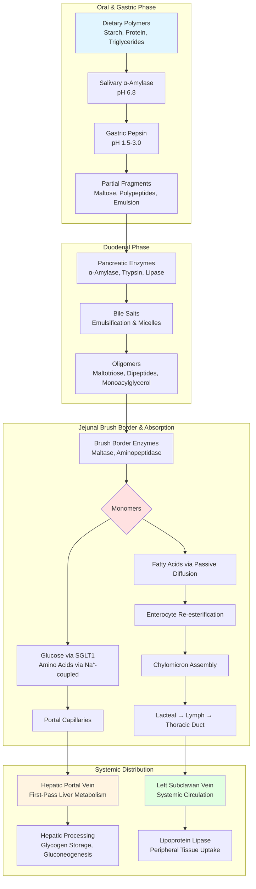

# Lesson 1: Macronutrient Digestion, Absorption, Transport

## 1. First-Principles Intuition & Invariants

The human digestive system operates as a high-throughput biochemical disassembly line, converting macronutrients—carbohydrates, proteins, and lipids—from their dietary polymer forms into absorbable monomers small enough to traverse the intestinal epithelium. This transformation is not merely mechanical grinding but a precisely orchestrated enzymatic cascade that begins in the oral cavity and concludes in the terminal ileum, spanning approximately nine meters of gastrointestinal tract and requiring six to eight hours for complete transit under normal physiological conditions.

The governing invariant across all macronutrient processing is the principle of progressive hydrolysis: each class of nutrient undergoes stepwise cleavage by compartmentalized enzymes optimized for specific pH environments and substrate configurations. Carbohydrates face salivary and pancreatic alpha-amylases that target alpha-1,4-glycosidic bonds, followed by brush border disaccharidases that complete the reduction to glucose, galactose, and fructose. Proteins encounter pepsin's broad-specificity endopeptidase activity in the acidic gastric lumen, then pancreatic trypsin, chymotrypsin, and elastase in the duodenum, and finally membrane-bound aminopeptidases that liberate individual amino acids and small dipeptides. Lipids, being hydrophobic and requiring emulsification before enzymatic access, rely on bile salt micelle formation to present triglyceride molecules to pancreatic lipase, which cleaves two of three fatty acid ester bonds to yield monoacylglycerols and free fatty acids.

The absorption phase introduces a second invariant: route specificity dictated by molecular polarity. Water-soluble products—monosaccharides and amino acids—enter enterocytes via sodium-coupled secondary active transport or facilitated diffusion, then pass directly into capillaries draining to the hepatic portal vein for first-pass hepatic metabolism. Lipid-soluble products traverse the apical membrane by passive diffusion, undergo re-esterification within the enterocyte's smooth endoplasmic reticulum to reform triglycerides, and are packaged into chylomicrons—large lipoprotein complexes that exit via the basolateral membrane into lacteals of the lymphatic system, bypassing hepatic surveillance until reaching systemic circulation through the thoracic duct. This bifurcation ensures that the liver immediately processes potentially toxic or immunogenic hydrophilic compounds while allowing fat-soluble vitamins and essential fatty acids direct systemic access.

The final invariant is regulation through hormonal feedback loops. Gastrin, secretin, and cholecystokinin orchestrate the timing and intensity of enzyme secretion, gastric emptying rate, and bile release to match nutrient load with digestive capacity. When this coordination fails—whether through pancreatic insufficiency, bile acid malabsorption, or epithelial transporter mutations—malabsorption syndromes emerge, manifesting as steatorrhea, protein-calorie malnutrition, or osmotic diarrhea from unabsorbed sugars fermenting in the colon.

## 2. Core Architecture & Mechanics

Carbohydrate digestion initiates with salivary alpha-amylase (ptyalin) cleaving internal alpha-1,4-glycosidic linkages in starch and glycogen, producing maltose, maltotriose, and branched alpha-limit dextrins where alpha-1,6 branch points resist cleavage. This enzyme operates optimally at pH 6.8 and is rapidly inactivated upon reaching the acidic gastric environment, though brief continuation occurs within the food bolus interior before acid penetration. The stomach contributes no carbohydrate-specific enzymes, serving primarily as a mechanical churning chamber that mixes chyme with hydrochloric acid and pepsinogen.

Upon entering the duodenum, pancreatic alpha-amylase—secreted in response to cholecystokinin and secretin—continues polysaccharide breakdown with far greater catalytic capacity than its salivary counterpart. The duodenal pH of 6.0 to 7.0, maintained by bicarbonate-rich pancreatic secretions neutralizing gastric acid, provides ideal conditions. By the time chyme reaches the jejunum, virtually all digestible starch has been reduced to maltose, maltotriose, and alpha-limit dextrins. Final hydrolysis occurs at the brush border membrane of jejunal enterocytes, where membrane-anchored disaccharidases—maltase-glucoamylase, sucrase-isomaltase, lactase, and trehalase—cleave remaining bonds to yield glucose, galactose, and fructose.

Glucose and galactose absorption proceeds via the sodium-glucose cotransporter 1 (SGLT1), a secondary active transporter that couples the downhill movement of sodium (driven by the basolateral Na⁺/K⁺-ATPase pump maintaining low intracellular sodium) with the uphill transport of glucose against its concentration gradient. This mechanism can concentrate glucose to levels five times higher than luminal concentration. Fructose, by contrast, enters via the GLUT5 facilitated diffusion transporter on the apical membrane and exits through GLUT2 on the basolateral side. Once in the interstitial space, all three monosaccharides diffuse into capillaries and drain via the superior mesenteric vein into the hepatic portal system.

Protein digestion begins in the stomach where chief cells secrete pepsinogen, activated to pepsin by gastric hydrochloric acid (pH 1.5 to 3.0) and by autocatalytic cleavage. Pepsin preferentially cleaves peptide bonds adjacent to aromatic amino acids—phenylalanine, tryptophan, and tyrosine—fragmenting intact proteins into polypeptides of ten to twenty amino acids. This partial digestion is not essential for survival, as evidenced by patients post-gastrectomy, but accelerates subsequent intestinal processing.

Pancreatic proteases—trypsin, chymotrypsin, elastase, and carboxypeptidases—are secreted as inactive zymogens and activated in the duodenum by enterokinase (enteropeptidase), a brush border enzyme that cleaves trypsinogen to active trypsin. Trypsin then activates all other pancreatic proteases in a cascade. Trypsin targets lysine and arginine residues, chymotrypsin cleaves at bulky hydrophobic residues, and elastase attacks small neutral amino acids. Carboxypeptidases remove single amino acids from the carboxyl terminus. The result is a mixture of free amino acids, dipeptides, and tripeptides.

Enterocyte uptake occurs via multiple sodium-coupled amino acid transporters with substrate specificity: neutral amino acids use system B⁰, cationic amino acids employ system B⁰⁺, and acidic amino acids require system X⁻ₐ. Dipeptides and tripeptides enter via the H⁺-coupled peptide transporter PepT1, then undergo cytoplasmic hydrolysis by peptidases. Amino acids exit the basolateral membrane through facilitated diffusion transporters into portal capillaries.

Lipid digestion presents unique challenges due to the hydrophobic nature of triglycerides in the aqueous intestinal environment. Emulsification begins with gastric churning and continues in the duodenum where bile salts—conjugated cholate and chenodeoxycholate synthesized from hepatic cholesterol—act as biological detergents, reducing fat globules from millimeter to micrometer dimensions. This increases surface area accessible to pancreatic lipase by three orders of magnitude.

Pancreatic lipase, co-secreted with colipase (which anchors lipase to the lipid-water interface despite bile salt interference), hydrolyzes triglycerides at the sn-1 and sn-3 positions, yielding two free fatty acids and a 2-monoacylglycerol. Phospholipase A₂ and cholesterol esterase similarly process membrane phospholipids and cholesterol esters. The resulting fatty acids, monoacylglycerols, cholesterol, and fat-soluble vitamins form mixed micelles with bile salts—spherical aggregates with hydrophobic cores and polar surfaces enabling diffusion to the enterocyte brush border.

Within the enterocyte, fatty acids and monoacylglycerols enter the smooth endoplasmic reticulum where acyl-CoA synthetase activates fatty acids, and monoacylglycerol acyltransferase re-esterifies them into triglycerides. These triglycerides, along with cholesterol esters, phospholipids, and apolipoprotein B-48, assemble into nascent chylomicrons in the Golgi apparatus. Chylomicrons—ranging from 75 to 600 nanometers in diameter—are too large to enter capillaries and instead exit via exocytosis into lacteals, the blind-ended lymphatic capillaries within each villus. Lymph flow carries chylomicrons through mesenteric lymph nodes and the thoracic duct, eventually draining into the left subclavian vein where they enter systemic circulation.

## 3. High-Performance Optimization & Failure Modes

Optimizing nutrient absorption requires synchronization of gastric emptying with intestinal enzyme secretion and bile release. Gastric emptying rate is inversely proportional to chyme caloric density and osmolality; hypertonic or lipid-rich meals trigger duodenal osmoreceptors and chemoreceptors to release secretin and cholecystokinin, which inhibit gastric motility via the vagal reflex and direct smooth muscle effects. This negative feedback prevents overwhelming the duodenum with nutrient loads exceeding enzymatic capacity. Athletes consuming high-calorie liquid meals can manipulate this by choosing isotonic carbohydrate solutions (6-8% concentration) that empty rapidly while still delivering substantial glucose flux for glycogen replenishment.

Carbohydrate absorption capacity is finite, governed by SGLT1 transporter density and brush border enzyme expression. Maximum glucose absorption approximates 1.0 to 1.2 grams per minute under optimal conditions, translating to 60 to 72 grams per hour. Exceeding this threshold causes osmotic retention of water in the intestinal lumen, triggering osmotic diarrhea as unabsorbed glucose draws fluid into the colon. Endurance athletes employing carbohydrate feeding during competition can circumvent this bottleneck through glucose-fructose co-ingestion; because fructose uses the independent GLUT5 transporter, combined intake can reach 90 grams per hour without gastrointestinal distress. Training upregulates transporter expression, increasing both density and maximal transport velocity—a phenomenon termed "gut training."

Protein absorption is rarely rate-limiting in healthy individuals due to redundant peptidase systems and multiple amino acid transporters. However, rapid gastric emptying of concentrated amino acid boluses can transiently saturate sodium-coupled transporters, resulting in amino acid spillage into the colon where bacterial decarboxylation produces biogenic amines and ammonia. Practical mitigation involves distributing protein intake across multiple moderate meals rather than single massive feedings, optimizing both absorption efficiency and minimizing nitrogenous waste load on renal clearance.

Lipid malabsorption syndromes provide instructive failure case studies. Pancreatic insufficiency, whether from chronic pancreatitis, cystic fibrosis, or pancreatic cancer, reduces lipase secretion below the threshold required for adequate triglyceride hydrolysis. Steatorrhea—excess fecal fat exceeding 7 grams per day—results, with stools appearing greasy, pale, and foul-smelling due to bacterial fatty acid metabolism. Enzyme replacement therapy with enteric-coated pancrelipase capsules (containing lipase, protease, and amylase) restores digestion when taken with meals, though maintaining adequate gastric acidity remains critical because enteric coatings require pH below 5.5 to prevent premature activation.

Bile acid insufficiency represents a distinct failure mode. Hepatic cirrhosis, biliary obstruction, or terminal ileal resection (removing the site of bile acid reabsorption and recycling via the enterohepatic circulation) depletes the bile acid pool below the critical micellar concentration required for lipid solubilization. Without micelles, fatty acids and fat-soluble vitamins remain sequestered in large emulsion droplets inaccessible to passive diffusion across the enterocyte membrane. Clinically, this manifests as combined fat and fat-soluble vitamin (A, D, E, K) deficiency, with night blindness, osteomalacia, neuropathy, and coagulopathy appearing sequentially. Supplementation with medium-chain triglycerides (MCTs)—fatty acids of eight to ten carbons—circumvents this limitation because MCTs do not require micellar solubilization and are directly absorbed into portal blood rather than packaged into chylomicrons.

Lactose intolerance exemplifies genetic polymorphism in brush border enzyme expression. Lactase-phlorizin hydrolase (LPH) gene expression normally declines after weaning in approximately 65% of the global adult population, particularly in East Asian, African, and Native American ancestry groups. Undigested lactose reaches the colon where bacterial fermentation produces short-chain fatty acids, hydrogen, methane, and carbon dioxide, causing bloating, cramping, and osmotic diarrhea. The hydrogen breath test quantifies this by measuring exhaled hydrogen levels after lactose loading; elevated concentrations confirm malabsorption. Management strategies include lactase enzyme supplementation, gradual lactose exposure to promote colonic bacterial adaptation, or dietary elimination.

Celiac disease represents an autoimmune failure mode where gliadin peptides from wheat gluten trigger T-cell mediated destruction of jejunal villi, collapsing the absorptive surface area by up to 90%. The resulting blunting of villi and crypt hyperplasia drastically reduces brush border enzyme and transporter expression, causing pan-malabsorption of carbohydrates, proteins, lipids, vitamins, and minerals. Diagnosis requires serological testing for anti-tissue transglutaminase antibodies followed by duodenal biopsy demonstrating villous atrophy. Strict gluten elimination allows mucosal recovery over six to twelve months, restoring absorptive capacity.

Chylomicron assembly defects, though rare, illuminate the critical dependence on apolipoprotein B-48 for lipid export. Abetalipoproteinemia—caused by mutations in the microsomal triglyceride transfer protein (MTP) gene—prevents apoB-48 lipidation, trapping triglycerides within enterocytes. Fat accumulates as cytoplasmic lipid droplets, and fat-soluble vitamins cannot reach systemic circulation. Patients develop progressive neurological degeneration from vitamin E deficiency and retinitis pigmentosa from vitamin A deficiency. Acanthocytosis (spiky red blood cells) appears due to abnormal membrane lipid composition. Management requires lifelong fat restriction and massive-dose fat-soluble vitamin supplementation in water-miscible forms.

## 4. Summary & Verification Matrix

| **Invariant Domain** | **Core Mechanism** | **Diagnostic Criterion** | **Primary Failure Mode** |
|---|---|---|---|
| **Carbohydrate Digestion & Absorption** | Sequential hydrolysis by salivary/pancreatic α-amylase (α-1,4 bonds) → brush border disaccharidases → SGLT1/GLUT5 sodium-coupled/facilitated transport into portal circulation | Glucose absorption rate 60–72 g/h; oral glucose tolerance test peak at 30–60 min; normal fasting glucose 70–100 mg/dL | Lactose intolerance (LPH deficiency): hydrogen breath test >20 ppm rise; osmotic diarrhea from colonic fermentation; stool pH < 5.5 |
| **Protein Digestion & Absorption** | Gastric pepsin (aromatic residue cleavage) → pancreatic endopeptidases (trypsin, chymotrypsin, elastase) → brush border aminopeptidases → Na⁺-coupled amino acid transport + PepT1 H⁺-coupled di/tripeptide uptake into portal blood | Serum albumin 3.5–5.0 g/dL; nitrogen balance calculation (intake − fecal/urinary loss); normal fecal nitrogen < 2 g/day | Pancreatic insufficiency: fecal elastase < 200 μg/g stool; elevated fecal nitrogen (>2.5 g/day); hypoalbuminemia; muscle wasting despite adequate intake |
| **Lipid Digestion, Micelle Formation & Chylomicron Assembly** | Bile salt emulsification → pancreatic lipase (sn-1/sn-3 hydrolysis) → mixed micelles → passive enterocyte uptake → smooth ER re-esterification → apoB-48 chylomicron packaging → lacteal lymphatic transport → thoracic duct systemic entry | Postprandial chylomicronemia peak 3–6 h; normal fecal fat < 7 g/day (72-h collection); serum triglycerides < 150 mg/dL fasting | Steatorrhea (fecal fat >7 g/day): pale, greasy, floating stools; fat-soluble vitamin deficiency (A/D/E/K); bile acid insufficiency or pancreatic lipase deficit; celiac villous atrophy |
| **Portal vs. Lymphatic Routing Bifurcation** | Hydrophilic nutrients (monosaccharides, amino acids, short/medium-chain fatty acids) → portal capillaries → hepatic first-pass metabolism; hydrophobic nutrients (long-chain fatty acids, fat-soluble vitamins) → chylomicrons → lymph → systemic circulation bypassing liver | Portal vein blood glucose 10–20 mg/dL higher than peripheral immediately postprandial; chylomicron appearance in serum 1–2 h post-fat meal; triglyceride-rich lipoprotein electrophoresis | Abetalipoproteinemia (MTP mutation): absent chylomicrons/VLDL; fat-laden enterocytes on biopsy; acanthocytosis; fat-soluble vitamin deficiency despite oral supplementation; progressive spinocerebellar degeneration |
| **Hormonal Feedback Coordination** | Gastrin (gastric acid/pepsinogen secretion) → secretin (pancreatic bicarbonate, inhibits gastric emptying) → cholecystokinin (pancreatic enzyme/bile release, delays gastric emptying) maintain nutrient load matching | CCK elevation within 15–30 min of fat/protein meal; secretin rise with duodenal acidification (pH < 4.5); gastric emptying half-time 90–120 min for mixed meal | Dumping syndrome (post-gastrectomy): rapid gastric emptying → osmotic fluid shift into jejunum → hypovolemia, tachycardia, diarrhea within 30 min; late reactive hypoglycemia from exaggerated insulin response |
| **Brush Border Surface Area Amplification** | Intestinal villi (1 mm height) × microvilli (1 μm height) create 200 m² absorptive surface; villus:crypt ratio 3–5:1 in healthy jejunum; tight junction permeability < 0.4 nm prevents paracellular macromolecule passage | Duodenal biopsy villous height ≥3× crypt depth; intraepithelial lymphocyte count < 25 per 100 enterocytes; disaccharidase activity (lactase >15 U/g protein) | Celiac disease: villous atrophy (villus:crypt < 1:1); intraepithelial lymphocytosis (>40 per 100 enterocytes); anti-tissue transglutaminase IgA >10× upper limit; complete malabsorption requiring gluten elimination |
