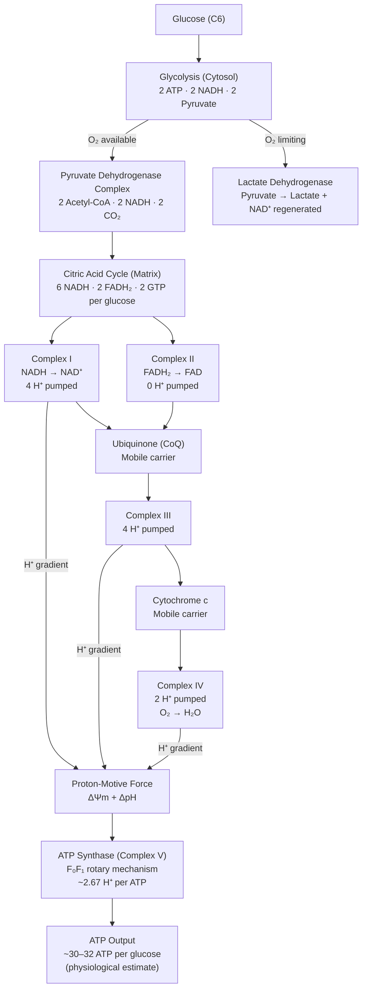

# Lesson 2: Cellular Bioenergetics: ATP Synthesis Pathways

## 1. First-Principles Intuition & Invariants

Every muscular contraction, every nerve impulse, every ribosomal translation event draws from a single universal energy currency: adenosine triphosphate. The cell does not store ATP in meaningful bulk reserves the way adipose tissue stores triglycerides. A resting human contains roughly 250 grams of ATP at any moment, yet turnover during maximal exertion can exceed 400 grams per minute — a throughput that demands continuous, high-fidelity regeneration across multiple parallel pathways. Understanding those pathways is not academic housekeeping. It is the mechanical foundation upon which every nutrition intervention, training prescription, and metabolic diagnostic decision rests.

The core invariant of cellular bioenergetics is thermodynamic: cells exist far from chemical equilibrium, and ATP synthesis is the controlled release of that disequilibrium's potential energy into a phosphoanhydride bond. The hydrolysis of ATP to ADP and inorganic phosphate (Pi) releases approximately −30.5 kJ/mol under standard conditions, though the actual free energy in a living cell — factoring in physiological concentrations of substrates and products — is closer to −50 to −60 kJ/mol. This gap between textbook and physiological values matters enormously to the practitioner, because it means the cell extracts considerably more work per hydrolysis event than simplified thermodynamic tables suggest.

Three distinct systems contribute to ATP regeneration, and they operate in temporal sequence during exercise rather than strict exclusivity. The phosphocreatine system (ATP-CP) replenishes ATP in under three seconds and saturates within roughly ten seconds of maximal effort. Glycolysis — both anaerobic and aerobic — takes over across the ten-second to two-minute window, trading speed for yield. Oxidative phosphorylation dominates from the two-minute mark onward, delivering fifteen to sixteen times more ATP per glucose molecule than anaerobic glycolysis alone but at a rate limited by oxygen delivery, mitochondrial density, and substrate availability. The practitioner who understands this temporal architecture can rationally design rest intervals, prescribe substrate loading strategies, and interpret lactate threshold data without reducing those decisions to guesswork.

The fundamental substrate hierarchy follows predictable logic. Carbohydrates, by virtue of their glycolytic accessibility, dominate energy provision at high intensities where the rate of ATP demand exceeds the respiratory capacity of oxidative phosphorylation. Fatty acids carry more caloric density per gram (approximately 9 kcal versus 4 kcal for carbohydrates) but enter the aerobic pathway via beta-oxidation, a mitochondrial process that is both slower to mobilize and dependent on adequate oxaloacetate availability — the classic observation that "fats burn in the flame of carbohydrates." Protein contributes minimally under normal fed conditions but becomes a meaningful substrate during prolonged caloric deficit or glycogen depletion, entering the cycle at multiple points as glucogenic or ketogenic amino acids.

The invariant every advanced practitioner must internalize is this: substrate selection is not a binary switch but a continuously regulated gradient controlled by AMPK activation state, insulin-to-glucagon ratio, intracellular [ADP]/[ATP] ratio, and mitochondrial redox state (NADH/NAD⁺). Nutritional intervention works precisely because it shifts these ratios, altering the cell's moment-to-moment decision about which fuel to oxidize and at what rate.

---

## 2. Core Architecture & Mechanics

### Glycolysis: The Cytosolic Gateway

Glycolysis converts one molecule of glucose (six carbons) into two molecules of pyruvate (three carbons each) in the cytosol, net-yielding two ATP through substrate-level phosphorylation and two NADH. The pathway has ten enzymatic steps, but practitioners should anchor their understanding around three irreversible, heavily regulated checkpoints: hexokinase (step 1), phosphofructokinase-1 (PFK-1, step 3), and pyruvate kinase (step 10). PFK-1 is the pacemaker. It is allosterically inhibited by high ATP and citrate (a signal of mitochondrial sufficiency) and activated by AMP and ADP (signals of energy deficit). This single enzyme translates the cell's energetic status directly into glycolytic flux rate, which is why carbohydrate availability and exercise intensity interact so predictably in practice.

The two ATP consumed in the investment phase (steps 1–5) are recovered with interest in the payoff phase (steps 6–10), where substrate-level phosphorylation at phosphoglycerate kinase and pyruvate kinase generates four ATP total. The two NADH produced in the cytosol face a critical routing decision: under aerobic conditions with functioning malate-aspartate or glycerol-3-phosphate shuttles, they deliver their electrons into the mitochondrial electron transport chain, contributing an additional 1.5 to 2.5 ATP each. Under anaerobic conditions or when the shuttle capacity is saturated, lactate dehydrogenase reduces pyruvate to lactate, regenerating NAD⁺ and allowing glycolysis to continue — a kinetically brilliant but thermodynamically wasteful solution.

### The Citric Acid Cycle: Mitochondrial Electron Harvesting

Pyruvate does not enter the citric acid cycle directly. It crosses the inner mitochondrial membrane via the mitochondrial pyruvate carrier and undergoes oxidative decarboxylation by the pyruvate dehydrogenase complex (PDC), producing acetyl-CoA, CO₂, and NADH. This is the irreversible commitment step: once pyruvate becomes acetyl-CoA, it cannot be reconverted to glucose in mammals (which is why dietary fat cannot replenish hepatic glycogen in net terms). The PDC is inhibited by its own products (acetyl-CoA and NADH) and by phosphorylation via pyruvate dehydrogenase kinase — a kinase that is itself activated by high-fat availability, explaining the glycolytic suppression observed during fat adaptation protocols.

Acetyl-CoA enters the cycle by condensing with oxaloacetate (OAA) to form citrate, catalyzed by citrate synthase. Over eight subsequent steps, the two carbons introduced as acetyl-CoA exit as CO₂, and the released electrons are captured on three NADH, one FADH₂, and one GTP (equivalent to ATP). The cycle is catalytic: OAA is regenerated at the end of each turn and is never consumed in net terms — which explains why anaplerotic substrates (glutamine, odd-chain fatty acids, propionate) that replenish OAA are metabolically important during high-volume training, when cycle intermediates become limiting. The practical implication: athletes running high training volumes with inadequate protein intake may experience cycle intermediate depletion that blunts aerobic capacity even when carbohydrate and fat are plentiful.

### Electron Transport Chain and Oxidative Phosphorylation

The NADH and FADH₂ generated by glycolysis and the citric acid cycle converge on the inner mitochondrial membrane, where their electrons drive the electron transport chain (ETC). The ETC comprises four large protein complexes (I–IV) and two mobile electron carriers (ubiquinone/CoQ and cytochrome c). Complex I (NADH dehydrogenase) accepts electrons from NADH; Complex II (succinate dehydrogenase) accepts electrons from FADH₂. Both funnel electrons through ubiquinone to Complex III, then via cytochrome c to Complex IV (cytochrome c oxidase), where molecular oxygen acts as the terminal electron acceptor, being reduced to water.

The critical mechanistic insight is that electron transfer through Complexes I, III, and IV is coupled to the active pumping of protons (H⁺) from the mitochondrial matrix into the intermembrane space. Complex II does not pump protons, which is precisely why FADH₂ yields less ATP than NADH: electrons entering at Complex II bypass the first proton-pumping site. The asymmetric distribution of protons creates the mitochondrial membrane potential (ΔΨm) and pH gradient (ΔpH), together constituting the proton-motive force (pmf) — the central construct of Peter Mitchell's chemiosmotic coupling hypothesis, for which he received the Nobel Prize in 1978.

ATP synthase (Complex V) is the engine that converts proton-motive force into chemical bond energy. As protons flow back down their electrochemical gradient through the Fo subunit, they drive rotation of the c-ring, which mechanically rotates the γ subunit within the α₃β₃ hexamer of the F₁ head. Each 360° rotation causes three conformational transitions in the three β subunits — open (binding ADP + Pi), tight (synthesizing ATP), and closed (releasing ATP) — producing three ATP per full rotation. The stoichiometry of protons required per ATP has been revised by structural biology to approximately 8 protons per 3 ATP (roughly 2.67 H⁺/ATP), a figure that meaningfully alters theoretical yield calculations away from older textbook values.

### ATP Yield: Revised Physiological Accounting

The historical textbook figure of 36–38 ATP per glucose has been substantially revised downward by modern bioenergetic accounting. The discrepancy arises from three corrections. First, the actual H⁺/ATP stoichiometry of ATP synthase is 2.67, not the integer values used in older estimates. Second, the malate-aspartate shuttle (the more efficient cytosolic NADH transporter, used predominantly in heart and liver) yields 2.5 ATP per NADH, while the glycerol-3-phosphate shuttle (prevalent in skeletal muscle during high-intensity work) yields only 1.5 ATP per NADH. Third, the cost of transporting ADP, Pi, and ATP across the inner membrane via the adenine nucleotide translocase and phosphate carrier consumes approximately one additional H⁺ per ATP synthesized. Under the most physiologically accurate accounting using the malate-aspartate shuttle, the yield is approximately 30–32 ATP per glucose molecule. Practitioners using this figure will generate more accurate predictions of exercise economy and caloric demand than those relying on the outdated 36–38 figure.

---

## 3. High-Performance Optimization & Failure Modes

### Training-Driven Mitochondrial Adaptation

The most consequential adaptation an endurance athlete can achieve is mitochondrial biogenesis: a quantitative increase in functional mitochondria per unit of muscle cross-sectional area. The signaling axis is well characterized. High-volume low-intensity training elevates intracellular calcium and AMP, activating AMPK and calcineurin, AMPK phosphorylates PGC-1α; calcineurin activates PGC-1α through dephosphorylation and direct coactivator interaction — the master transcriptional coactivator of mitochondrial genes. High-intensity interval training (HIIT) produces an acute, steep AMPK signal that generates a large PGC-1α response with lower total volume, which is why brief HIIT sessions can produce mitochondrial adaptations comparable to longer moderate-intensity sessions in time-limited populations.

The practical optimization strategy is periodization of training intensity. High-intensity work maximally stimulates PGC-1α; low-intensity work provides the duration-dependent signal for capillary density and fat oxidation enzymatic upregulation. Neither stimulus alone is sufficient. The polarized training model (approximately 80% low intensity, 20% high intensity) produces the most robust mitochondrial density outcomes in elite endurance athletes, and its mechanistic basis is precisely this dual-signal requirement. Nutritional periodization compounds this effect: training in a low-glycogen state amplifies the AMPK signal and enhances fat oxidation enzyme expression, while carbohydrate availability supports high-quality high-intensity sessions that drive the intensity-dependent adaptations.

### Substrate Flux Bottlenecks and Failure Modes

The most common failure mode in aerobic metabolism is not substrate depletion but rate-limiting enzyme saturation at PFK-1 and citrate synthase. When glycolytic flux exceeds the citric acid cycle's acetyl-CoA processing capacity, acetyl-CoA accumulates and activates pyruvate dehydrogenase kinase (PDK), which phosphorylates and inactivates PDC, and forces pyruvate toward lactate. This is the physiological basis of the lactate threshold: not an oxygen deficiency per se, but a kinetic mismatch between glycolytic rate and mitochondrial processing capacity. Athletes with high citrate synthase activity (a direct proxy for mitochondrial density) display a rightward shift in the lactate-intensity curve, sustaining higher absolute workloads before this bottleneck activates.

A second failure mode relevant to practitioners is electron transport chain uncoupling. Brown adipose tissue deliberately uncouples proton flow from ATP synthesis via uncoupling protein-1 (UCP1), dissipating pmf as heat for thermogenesis. In skeletal muscle, pathological uncoupling can occur with reactive oxygen species (ROS) accumulation when electrons leak from the ETC and reduce O₂ to superoxide rather than water. Mitochondrial ROS production is highest at Complex I when NADH/NAD⁺ ratios are very high — a state produced by sedentary overfeeding. High training volumes reduce ROS by increasing electron flow throughput and upregulating antioxidant enzymes (superoxide dismutase, glutathione peroxidase), providing another mechanistic explanation for why chronic exercise improves metabolic health beyond simple caloric expenditure.

A third failure mode is oxaloacetate depletion during prolonged, glycogen-depleted exercise. As cycle intermediates are drained by anaplerotic efflux (export of citrate for fatty acid synthesis, export of alpha-ketoglutarate for glutamine synthesis), OAA availability drops and the cycle slows. Paradoxically, this occurs precisely when fat oxidation is maximal, trapping acetyl-CoA without sufficient OAA to initiate condensation into citrate. The result is a ketogenic shift — not pathological in a trained athlete but a meaningful rate ceiling on oxidative capacity. This is why total fat oxidation rates plateau at approximately 1.0–1.5 g/min in even elite athletes regardless of training status: the OAA bottleneck limits cycle throughput regardless of beta-oxidation capacity.

### Nutritional Levers on ATP Pathway Efficiency

Creatine monohydrate supplementation (3–5 g/day maintenance following a loading protocol) expands the phosphocreatine buffer, extending the ATP-CP system's duration and accelerating PCr resynthesis during rest intervals. This directly benefits high-intensity repeated-sprint work and resistance training, where PCr resynthesis between sets determines the quality of successive bouts. The effect is structural, not pharmacological — it simply increases the buffer reservoir.

Dietary carbohydrate timing optimizes glycolytic substrate availability. Pre-exercise glycogen loading (targeting approximately 8–10 g/kg body mass over 24–48 hours for endurance athletes) maximizes glycolytic and oxidative flux capacity. During prolonged exercise beyond 90 minutes, exogenous carbohydrate delivery at 60–90 g/hour (using a glucose-fructose blend to saturate both SGLT1 and GLUT5 intestinal transporters independently) spares glycogen and maintains PFK-1 substrate availability in the final stages of competition, where glycogen-depleted muscle would otherwise shift to a predominantly fat-oxidative mode too slow to sustain race pace.

Dietary fat adaptation protocols lasting three or more weeks upregulate beta-oxidation enzymes and increase intramuscular triglyceride storage, but consistently reduce sprint capacity due to downregulated PDC activity and reduced glycogenolysis. This tradeoff is mechanistically unavoidable: chronic fat availability increases PDC kinase expression, which phosphorylates and inhibits PDC, blunting the rapid glycolytic-to-aerobic transition required for high-intensity efforts. For practitioners designing nutrition periodization for mixed-sport athletes, this means fat adaptation phases should precede a carbohydrate restoration window of at least five to seven days before competition, allowing PDC activity to recover before high-intensity demands are placed on the system.

---

## 4. Summary & Verification Matrix

| Pathway / Mechanism | Location | Key Regulated Step | Net ATP Yield (per glucose) | Diagnostic Indicator | Primary Failure Mode |
|---|---|---|---|---|---|
| **Glycolysis** | Cytosol | PFK-1 (inhibited by ATP, citrate; activated by AMP) | 2 ATP substrate-level + 2 NADH routed to ETC | Lactate accumulation; RQ approaching 1.0 | PFK-1 saturation at high intensity causing lactate overflow |
| **Pyruvate Dehydrogenase Complex** | Mitochondrial matrix | PDC kinase phosphorylation (inhibited by fat adaptation, acetyl-CoA, NADH) | Transition step; yields 2 NADH + 2 acetyl-CoA | Respiratory exchange ratio (RER); PDC activity assay | Chronic fat adaptation or acetyl-CoA accumulation blocking pyruvate entry |
| **Citric Acid Cycle** | Mitochondrial matrix | Citrate synthase (proxied by mitochondrial density) | 6 NADH + 2 FADH₂ + 2 GTP | Citrate synthase activity in muscle biopsy; VO₂ kinetics | OAA depletion under glycogen-depleted high-fat oxidation |
| **Electron Transport Chain** | Inner mitochondrial membrane | Complex I (NADH entry); Complex II (FADH₂ entry, 0 H⁺ pumped) | NADH ≈ 2.5 ATP; FADH₂ ≈ 1.5 ATP are standard mitochondrial P/O ratios; the malate-aspartate shuttle delivers cytosolic NADH at this efficiency, while the glycerol-3-phosphate shuttle delivers at ~1.5 ATP per cytosolic NADH | ΔΨm fluorescence assay; ROS markers (MDA, 8-OHdG) | ROS leak at Complex I under high NADH/NAD⁺ with sedentary overfeeding |
| **Oxidative Phosphorylation (Chemiosmotic Coupling)** | ATP synthase (Complex V) | Proton-motive force (ΔΨm + ΔpH); ~2.67 H⁺ per ATP | ~26–28 ATP from ETC-routed carriers | Mitochondrial membrane potential; P/O ratio measurement | Pathological uncoupling (UCP1/ROS) dissipating pmf as heat without ATP synthesis |
| **Total Aerobic Glucose Oxidation** | Cytosol + mitochondria | Integrated PFK-1, PDC, citrate synthase, ATP synthase | ~30–32 ATP physiological estimate (revised from 36–38) | VO₂max, lactate threshold power/pace, respiratory efficiency | Mitochondrial insufficiency (low density), substrate depletion, or ETC uncoupling capping aerobic yield below theoretical maximum |
