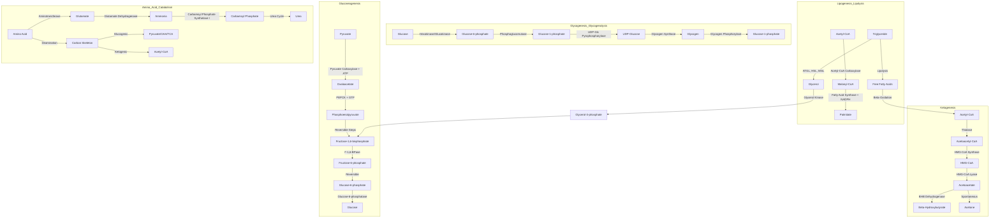

# Lesson 3: Anabolic, Catabolic Pathway Mechanics

## 1. First-Principles Intuition & Invariants

Metabolism is not a linear assembly line but a dynamic, reversible network of biochemical highways where energy storage and energy mobilization operate under reciprocal regulation. The fundamental tension in human physiology lies between anabolic processes—those that build complex molecules from simple precursors at the cost of ATP—and catabolic processes that dismantle macromolecules to liberate energy. Understanding this duality is not an academic exercise; it is the mechanistic foundation for manipulating body composition, optimizing athletic recovery, and predicting metabolic response to dietary intervention.

The core invariant governing all metabolic pathways is thermodynamic irreversibility at key control points. While many reactions in glycolysis and gluconeogenesis are near-equilibrium and can proceed in either direction depending on substrate concentration, each major pathway contains one to three irreversible, committed steps catalyzed by regulatory enzymes. These enzymes act as metabolic gates, responding to allosteric modulators, covalent phosphorylation, and hormonal signals to ensure that opposing pathways do not futilely cycle and waste ATP. Hexokinase in glycolysis and glucose-6-phosphatase in gluconeogenesis exemplify this principle: both operate on glucose-6-phosphate, but in opposite directions, and both are tightly regulated to prevent simultaneous activation.

Energy charge—the ratio of ATP to ADP and AMP—serves as the master metabolic rheostat. When ATP is abundant, anabolic pathways such as glycogenesis and lipogenesis dominate, storing excess energy in glycogen and triglycerides. When ATP drops and AMP rises, catabolic pathways such as glycogenolysis, lipolysis, and amino acid oxidation mobilize stored fuel. This reciprocal switching is orchestrated by AMP-activated protein kinase (AMPK), which phosphorylates and inhibits anabolic enzymes while activating catabolic ones, and by hormonal signals—insulin promoting anabolism, glucagon and epinephrine promoting catabolism.

Substrate flux through these pathways is not dictated solely by enzyme concentration but by the availability of substrates, the removal of products, and the thermodynamic favorability of each step. Gluconeogenesis, for instance, cannot simply reverse glycolysis because three steps are thermodynamically unfavorable in the reverse direction. Evolution solved this by introducing bypass reactions with distinct enzymes—pyruvate carboxylase and PEPCK bypass pyruvate kinase, fructose-1,6-bisphosphatase bypasses phosphofructokinase-1, and glucose-6-phosphatase bypasses hexokinase. These bypass enzymes are regulated independently, allowing gluconeogenesis to proceed when glycolysis is inhibited.

Lipogenesis and lipolysis exemplify substrate-level reciprocity. Lipogenesis converts acetyl-CoA into palmitate through repeated cycles of malonyl-CoA addition, catalyzed by fatty acid synthase in the fed state when citrate escapes the mitochondria and signals surplus energy. Lipolysis, conversely, hydrolyzes triglycerides into glycerol and free fatty acids under the influence of hormone-sensitive lipase and ATGL, which are activated by catecholamines and inhibited by insulin. The competitive inhibition of carnitine palmitoyltransferase-1 (CPT-1) by malonyl-CoA ensures that when lipogenesis is active, fatty acid oxidation is blocked—a brilliant example of metabolic exclusivity.

Amino acid catabolism introduces nitrogen disposal as a parallel challenge. Unlike carbohydrates and fats, amino acids contain nitrogen, which must be removed via transamination and deamination before carbon skeletons can enter the TCA cycle or gluconeogenesis. The urea cycle in the liver integrates ammonia and aspartate into urea, a non-toxic, excretable molecule. Ketogenesis, the hepatic production of acetoacetate and beta-hydroxybutyrate from acetyl-CoA, represents an elegant metabolic adaptation to prolonged fasting or carbohydrate restriction, providing an alternative fuel source for the brain when glucose is scarce.

The overarching invariant is that metabolic pathways are not isolated but integrated. Glycolysis feeds the TCA cycle, which provides precursors for gluconeogenesis and lipogenesis. Lipolysis liberates fatty acids for beta-oxidation, which generates acetyl-CoA that can either enter the TCA cycle or be diverted to ketogenesis. Amino acids can be glucogenic, ketogenic, or both, depending on their carbon skeleton. Regulatory enzymes at pathway branch points sense the metabolic state and direct flux accordingly, ensuring that energy production, storage, and mobilization remain balanced.

## 2. Core Architecture & Mechanics

Gluconeogenesis is the synthesis of glucose from non-carbohydrate precursors—lactate, pyruvate, glycerol, and glucogenic amino acids—primarily in the liver and, to a lesser extent, in the kidney cortex. This pathway is critical during fasting, intense exercise, and low-carbohydrate diets when glycogen stores are depleted. Gluconeogenesis is not simply glycolysis in reverse; it diverges at three irreversible steps. Pyruvate carboxylase, located in the mitochondrial matrix, converts pyruvate to oxaloacetate, requiring biotin as a cofactor and ATP as an energy source. Oxaloacetate cannot cross the mitochondrial membrane directly, so it is reduced to malate by mitochondrial malate dehydrogenase, exported to the cytosol, and reoxidized back to oxaloacetate. Phosphoenolpyruvate carboxykinase (PEPCK) then decarboxylates oxaloacetate to phosphoenolpyruvate, consuming GTP. This two-step bypass circumvents the irreversibility of pyruvate kinase.

The second bypass occurs at the fructose-1,6-bisphosphate step. Fructose-1,6-bisphosphatase hydrolyzes fructose-1,6-bisphosphate to fructose-6-phosphate, releasing inorganic phosphate. This enzyme is allosterically inhibited by AMP and fructose-2,6-bisphosphate, the same molecules that activate phosphofructokinase-1 in glycolysis, ensuring reciprocal regulation. The third and final bypass is catalyzed by glucose-6-phosphatase, an endoplasmic reticulum enzyme that hydrolyzes glucose-6-phosphate to free glucose, which can then exit the hepatocyte into the bloodstream. Muscle lacks glucose-6-phosphatase, which is why muscle glycogen cannot directly contribute to blood glucose maintenance.

Glycogenesis and glycogenolysis control the storage and mobilization of glucose as glycogen, a branched polymer of glucose residues linked by alpha-1,4-glycosidic bonds with alpha-1,6 branches every eight to twelve residues. Glycogenesis begins with glucose phosphorylation to glucose-6-phosphate by hexokinase (or glucokinase in hepatocytes), followed by isomerization to glucose-1-phosphate by phosphoglucomutase. UDP-glucose pyrophosphorylase activates glucose-1-phosphate by attaching it to UDP, forming UDP-glucose at the cost of UTP. Glycogen synthase then adds glucose residues to the growing chain via alpha-1,4 bonds, while the branching enzyme (amylo-1,4-to-1,6-transglucosidase) creates alpha-1,6 branch points. Glycogen synthase is the rate-limiting enzyme, regulated by phosphorylation—insulin activates protein phosphatase-1, which dephosphorylates and activates glycogen synthase, while glucagon and epinephrine activate protein kinase A, which phosphorylates and inhibits it.

Glycogenolysis is initiated by glycogen phosphorylase, which cleaves alpha-1,4-glycosidic bonds by phosphorolysis, releasing glucose-1-phosphate. Phosphorylase exists in an inactive b form and an active a form. Epinephrine and glucagon, via cAMP and protein kinase A, activate phosphorylase kinase, which phosphorylates and activates glycogen phosphorylase. AMP allosterically activates muscle phosphorylase during contraction when energy demand is high. The debranching enzyme has two activities: it transfers three glucose residues from a branch to the main chain, then hydrolyzes the alpha-1,6 bond, releasing free glucose. Glucose-1-phosphate is converted to glucose-6-phosphate by phosphoglucomutase, which enters glycolysis in muscle or is dephosphorylated to glucose by glucose-6-phosphatase in liver for export.

Lipogenesis converts acetyl-CoA into fatty acids, predominantly palmitate, in the fed state when carbohydrate and energy are abundant. Acetyl-CoA, generated from glucose via pyruvate dehydrogenase in the mitochondria, is condensed with oxaloacetate by citrate synthase to form citrate, which exits the mitochondria via the citrate-malate shuttle. In the cytosol, ATP citrate lyase cleaves citrate back into acetyl-CoA and oxaloacetate. Acetyl-CoA carboxylase (ACC), the committed and rate-limiting enzyme, carboxylates acetyl-CoA to malonyl-CoA using biotin and ATP. Fatty acid synthase, a multifunctional enzyme, iteratively condenses malonyl-CoA units onto a growing acyl chain, reducing each two-carbon addition with NADPH generated by the pentose phosphate pathway and malic enzyme. After seven cycles, palmitate (16:0) is released. ACC is activated by insulin-stimulated dephosphorylation and citrate, and inhibited by phosphorylation by AMPK and by long-chain fatty acyl-CoA, providing feedback inhibition.

Lipolysis hydrolyzes triglycerides stored in adipocytes into glycerol and free fatty acids. Adipose triglyceride lipase (ATGL) removes the first fatty acid, generating diacylglycerol. Hormone-sensitive lipase (HSL) removes the second, yielding monoacylglycerol. Monoacylglycerol lipase completes the process, releasing glycerol and the third fatty acid. HSL is the regulatory node: catecholamines (epinephrine, norepinephrine) bind beta-adrenergic receptors, activating adenylyl cyclase, raising cAMP, and activating protein kinase A, which phosphorylates and activates HSL. Insulin opposes this by activating phosphodiesterase-3, which degrades cAMP, and by activating protein phosphatase, which dephosphorylates and inactivates HSL. Free fatty acids are released into the bloodstream, bound to albumin, and taken up by tissues. Glycerol, which cannot be rephosphorylated in adipose tissue due to lack of glycerol kinase, travels to the liver and enters gluconeogenesis.

Amino acid catabolism begins with transamination, transferring the amino group to alpha-ketoglutarate to form glutamate, catalyzed by aminotransferases. Glutamate is then oxidatively deaminated by glutamate dehydrogenase in the mitochondria, releasing ammonia and regenerating alpha-ketoglutarate. Ammonia, toxic at high concentrations, is incorporated into carbamoyl phosphate by carbamoyl phosphate synthetase I in the mitochondrial matrix, the committed step of the urea cycle. Carbamoyl phosphate condenses with ornithine to form citrulline, which exits the mitochondria. In the cytosol, citrulline combines with aspartate (carrying the second nitrogen) to form argininosuccinate, which is cleaved to arginine and fumarate. Arginase hydrolyzes arginine to urea and regenerates ornithine, which re-enters the mitochondria. The carbon skeletons of amino acids are classified as glucogenic if they form pyruvate or TCA cycle intermediates, ketogenic if they form acetyl-CoA or acetoacetate, or both.

Ketogenesis occurs in hepatic mitochondria during fasting, low-carbohydrate diets, or prolonged exercise when acetyl-CoA from beta-oxidation exceeds the capacity of the TCA cycle. Two acetyl-CoA molecules condense to form acetoacetyl-CoA via thiolase. HMG-CoA synthase adds a third acetyl-CoA to form 3-hydroxy-3-methylglutaryl-CoA (HMG-CoA). HMG-CoA lyase cleaves HMG-CoA into acetoacetate and acetyl-CoA. Acetoacetate can be reduced to beta-hydroxybutyrate by beta-hydroxybutyrate dehydrogenase or spontaneously decarboxylate to acetone. The liver lacks the enzyme to metabolize ketone bodies, so they are exported to peripheral tissues. In muscle, heart, and brain, beta-hydroxybutyrate is oxidized back to acetoacetate, which is converted to acetoacetyl-CoA by succinyl-CoA:acetoacetate CoA transferase, then cleaved to two acetyl-CoA molecules that enter the TCA cycle.

## 3. High-Performance Optimization & Failure Modes

Optimizing metabolic pathway flux for performance, body composition, or metabolic health requires strategic manipulation of substrate availability, hormonal signaling, and training stimulus. The practitioner must recognize that anabolic and catabolic states are not binary but exist on a continuum modulated by nutrient timing, macronutrient composition, and energy expenditure. Maximizing glycogen storage, for example, depends on depleting glycogen through high-volume resistance training or glycolytic interval work, then providing adequate carbohydrate within the two-hour post-exercise window when insulin sensitivity and glycogen synthase activity are elevated. Consuming one to one-point-two grams of carbohydrate per kilogram body weight immediately post-training, combined with protein to stimulate insulin release, accelerates glycogen resynthesis and primes the muscle for subsequent training sessions.

Lipogenesis is minimized in athletes and physique competitors by controlling carbohydrate intake relative to energy expenditure and training volume. When glycogen stores are full and glucose flux exceeds oxidative capacity, acetyl-CoA accumulates and citrate signals lipogenesis. Strategic carbohydrate periodization—higher intake on training days, lower on rest days—prevents chronic carbohydrate surplus while maintaining performance. The inclusion of dietary fat does not directly stimulate lipogenesis, but excessive caloric intake from any source will eventually drive fat storage. Malonyl-CoA, the lipogenesis intermediate, also inhibits CPT-1, blocking fatty acid oxidation, which is why high-carbohydrate, high-fat diets are metabolically inefficient and promote fat gain.

Lipolysis is maximized during fasted training or low-carbohydrate states when insulin is low and catecholamines are elevated. Beta-adrenergic stimulation increases with exercise intensity, and training in a glycogen-depleted state enhances the hormonal drive for lipolysis. However, excessive reliance on fasted training without adequate recovery carbohydrate can impair muscle glycogen resynthesis and blunt training adaptations. The optimal strategy is periodized: use fasted or low-carbohydrate training blocks to enhance fat oxidation capacity, then transition to carbohydrate-supported training to maximize power output and hypertrophy stimulus.

Amino acid catabolism increases during caloric restriction, prolonged fasting, or inadequate protein intake, as the body sacrifices muscle protein to maintain blood glucose and provide TCA cycle intermediates. Leucine, a branched-chain amino acid, activates mTOR and inhibits protein breakdown, making it a key nutrient for preserving lean mass during energy deficit. Consuming two to three grams of leucine per meal, distributed across three to four meals daily, maintains a positive protein balance. The urea cycle's capacity can be overwhelmed by excessive protein intake, leading to elevated blood urea nitrogen (BUN) and renal stress, though healthy kidneys adapt well to high protein loads. The failure mode is not protein toxicity per se but inadequate hydration and micronutrient cofactor depletion—B vitamins are consumed in transamination and deamination reactions.

Ketogenesis becomes clinically relevant in ketogenic diets, fasting protocols, and endurance athletes who train in carbohydrate-restricted states. Beta-hydroxybutyrate concentrations of zero-point-five to three millimolar indicate nutritional ketosis, providing an alternative fuel that spares muscle glycogen and reduces reliance on gluconeogenesis. The brain can derive up to seventy percent of its energy from ketone bodies after several weeks of adaptation. However, the transition period—colloquially termed "keto flu"—involves fatigue, headache, and reduced performance as the body upregulates ketone transporters and oxidative enzymes. Sodium and magnesium supplementation mitigates electrolyte loss from reduced insulin and increased renal excretion. The failure mode of prolonged ketosis is micronutrient deficiency if vegetable intake is insufficient, and the potential for elevated LDL cholesterol in genetically susceptible individuals, necessitating lipid panel monitoring.

Pathway integration failure manifests as metabolic inflexibility—the inability to switch efficiently between carbohydrate and fat oxidation. Chronic high-carbohydrate diets with sedentary behavior downregulate fat oxidation enzymes, while chronic ketogenic diets without periodic carbohydrate refeeds can impair glycolytic capacity and reduce muscle glycogen stores, blunting high-intensity performance. Metabolic flexibility is trained through deliberate substrate manipulation: alternating carbohydrate-loaded and carbohydrate-depleted training blocks, incorporating fasted steady-state cardio, and using carbohydrate cycling to match intake with training intensity. The verification metric is respiratory exchange ratio (RER) during submaximal exercise—a well-adapted athlete will maintain an RER below zero-point-eight-five at moderate intensities, indicating preferential fat oxidation.

Irreversible step dysregulation is the root cause of metabolic disease. Gluconeogenesis that proceeds unchecked despite adequate circulating glucose, as in type 2 diabetes, reflects impaired insulin signaling at PEPCK and glucose-6-phosphatase. Excessive lipogenesis combined with impaired lipolysis drives hepatic steatosis and visceral adiposity. The therapeutic target is restoring hormonal sensitivity—metformin inhibits hepatic glucose production, AMPK activators enhance fat oxidation, and resistance training improves insulin receptor signaling. The practitioner's role is to recognize these patterns early through fasting glucose, HbA1c, and triglyceride levels, and intervene with targeted dietary and training modifications before pathology becomes entrenched.

## 4. Summary & Verification Matrix

| Pathway | Governing Invariant | Rate-Limiting Enzyme | Allosteric Regulation | Hormonal Control | Failure Mode |
|---------|---------------------|----------------------|----------------------|------------------|--------------|
| **Gluconeogenesis** | Cannot reverse glycolysis at three irreversible steps; requires bypass enzymes | PEPCK, Fructose-1,6-bisphosphatase, Glucose-6-phosphatase | Inhibited by AMP, fructose-2,6-bisphosphate; activated by citrate, ATP | Activated by glucagon, cortisol; inhibited by insulin | Uncontrolled hepatic glucose output in insulin resistance; hypoglycemia if excessive |
| **Glycogenesis / Glycogenolysis** | Reciprocal phosphorylation control prevents futile cycling | Glycogen synthase (synthesis), Glycogen phosphorylase (breakdown) | Phosphorylase activated by AMP (muscle); inhibited by ATP, glucose-6-phosphate | Insulin activates synthase; glucagon and epinephrine activate phosphorylase | Glycogen depletion during prolonged exercise; impaired resynthesis post-exercise if carbohydrate insufficient |
| **Lipogenesis / Lipolysis** | Malonyl-CoA inhibits CPT-1, preventing simultaneous fat synthesis and oxidation | Acetyl-CoA carboxylase (synthesis), Hormone-sensitive lipase (breakdown) | ACC inhibited by palmitoyl-CoA, AMP; activated by citrate | Insulin activates lipogenesis, inhibits lipolysis; catecholamines activate lipolysis | Hepatic steatosis from chronic carbohydrate surplus; impaired lipolysis in insulin resistance |
| **Amino Acid Catabolism** | Nitrogen disposal via urea cycle prevents ammonia toxicity | Carbamoyl phosphate synthetase I, Glutamate dehydrogenase | Activated by N-acetylglutamate (signals amino acid surplus) | Cortisol and glucagon increase amino acid oxidation; insulin reduces | Muscle wasting in caloric deficit; elevated BUN in excessive protein intake or dehydration |
| **Ketogenesis** | Liver produces but cannot oxidize ketone bodies; peripheral tissues consume them | HMG-CoA synthase | Activated when acetyl-CoA exceeds TCA cycle capacity; inhibited by insulin | Activated by glucagon, low insulin during fasting or low-carbohydrate states | Ketoacidosis in uncontrolled diabetes (pH < 7.3); "keto flu" during adaptation; potential LDL elevation |
| **Pathway Integration** | Energy charge (ATP/ADP/AMP ratio) and hormonal signals coordinate opposing pathways to prevent futile cycling | AMPK (master sensor) | AMPK activated by AMP, inhibits anabolic enzymes, activates catabolic enzymes | Insulin shifts toward anabolism; glucagon, epinephrine shift toward catabolism | Metabolic inflexibility from chronic substrate monotony; inability to switch fuel sources efficiently |
