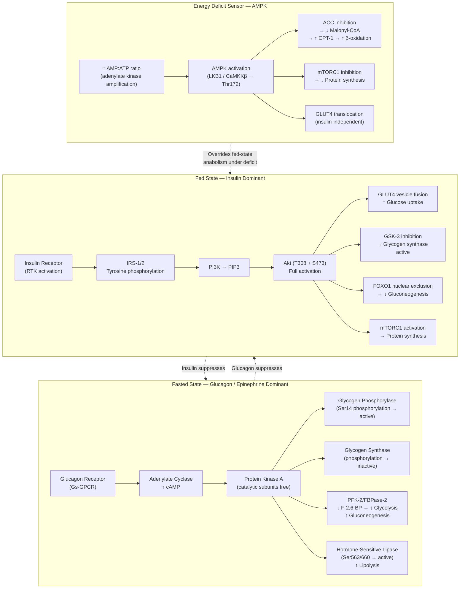

# Lesson 4: Metabolic Regulation, Hormonal Control Mechanisms

## 1. First-Principles Intuition & Invariants

The body's metabolic machinery faces a problem that no single organ can solve alone: how to continuously supply ATP to trillions of cells whose energy demands fluctuate by orders of magnitude across seconds to days, while simultaneously protecting the nervous system from glucose deprivation and preventing the runaway substrate accumulation that characterizes metabolic disease. Evolution's answer is a layered regulatory hierarchy in which enzymatic kinetics, allosteric signaling, covalent modification, and hormonal communication operate in concert, each layer operating at a different timescale and radius of influence.

The first invariant of metabolic regulation is that flux, not concentration, is what matters. A cell does not simply want glucose present; it wants glucose to move through glycolysis at exactly the rate demanded by ATP turnover. This distinction drives every regulatory mechanism we will examine. Allosteric effectors bend an enzyme's velocity-substrate curve without changing enzyme abundance. Covalent phosphorylation switches enzymes between active and inactive conformations in milliseconds. Hormonal cascades alter enzyme abundance over hours by controlling gene transcription. Each layer is calibrated to match the timescale of the perturbation it corrects.

The second invariant is the principle of reciprocal pathway inhibition. Anabolism and catabolism are not simply opposite reactions running simultaneously; they are actively suppressed in alternation. When insulin dominates the hormonal milieu, glycogen synthase and acetyl-CoA carboxylase are activated, while glycogen phosphorylase and hormone-sensitive lipase are suppressed. The machinery of storage is switched on precisely as the machinery of mobilization is switched off, preventing the metabolic futile cycling that would otherwise incinerate ATP without productive work. When glucagon or epinephrine predominates, the logic inverts with equal precision.

The third invariant governs tissue hierarchy. The brain, red blood cells, and renal medulla are obligate glucose consumers under normal conditions. Skeletal muscle, adipose tissue, and the liver are facultative — they switch substrates based on hormonal and nutrient availability. Cardiac muscle runs preferentially on fatty acids and ketone bodies, reserving glucose uptake for ischemic stress. Understanding metabolic regulation therefore requires tracking fuel allocation decisions across a tissue network, not merely inside any single cell.

The fourth invariant is the AMP:ATP and NAD⁺:NADH ratio as the cell-autonomous energy sensor. When work exceeds substrate supply, ATP is cleaved faster than it is regenerated, raising AMP concentration disproportionately because adenylate kinase converts two ADP to one ATP plus one AMP. This amplified AMP signal activates AMP-activated protein kinase (AMPK), which phosphorylates dozens of targets to simultaneously inhibit anabolic ATP consumers and activate catabolic ATP producers. AMPK is thus the intracellular counterpart to glucagon: both sense deficit and mandate mobilization, but at radically different spatial scales.

Holding these four invariants in mind — flux over concentration, reciprocal inhibition, tissue hierarchy, and dual-scale energy sensing — provides the interpretive framework for every clinical and performance scenario that follows.

---

## 2. Core Architecture & Mechanics

### Insulin Signaling: The Fed-State Executor

Insulin is released from pancreatic β-cells within two minutes of luminal glucose detection, with the first-phase spike driven by exocytosis of pre-docked secretory granules and the sustained second phase driven by new granule mobilization over the following thirty to sixty minutes. The portal vein delivers insulin directly to the liver, where concentrations reach five to ten times the peripheral level, making hepatic fuel storage the first priority of the postprandial response.

At the cellular level, insulin binds the extracellular α-subunit of the insulin receptor, a heterotetrameric receptor tyrosine kinase. Binding displaces an inhibitory loop in the β-subunit's cytoplasmic domain, allowing trans-autophosphorylation of three tyrosine residues in the activation loop, which opens the catalytic cleft to substrate access. The receptor then phosphorylates insulin receptor substrate proteins (IRS-1, IRS-2) on multiple tyrosine residues, creating docking sites for the p85 regulatory subunit of phosphoinositide 3-kinase (PI3K). PI3K phosphorylates the membrane lipid phosphatidylinositol-4,5-bisphosphate to generate PIP3, which recruits PDK1 and Akt (protein kinase B) to the inner leaflet of the plasma membrane. PDK1 phosphorylates Akt at threonine 308, and mTORC2 phosphorylates Akt at serine 473, achieving full activation.

Activated Akt executes the fed-state metabolic program through three converging actions. First, it phosphorylates AS160 (TBC1D4), inactivating the GTPase-activating protein that normally keeps Rab proteins in the GDP-bound state; this allows Rab-GTP to drive GLUT4-containing vesicles to fuse with the plasma membrane, increasing glucose uptake in muscle and adipose tissue by four- to fivefold within minutes. Second, Akt phosphorylates and inactivates GSK-3, disinhibiting glycogen synthase and enabling glycogen deposition. Third, Akt phosphorylates and inactivates FOXO1, a transcription factor that would otherwise drive expression of gluconeogenic enzymes including PEPCK and glucose-6-phosphatase — the insulin-mediated suppression of hepatic glucose output depends entirely on this nuclear exclusion.

### Glucagon Signaling: The Fasted-State Executor

Glucagon is secreted from pancreatic α-cells when portal glucose falls below approximately 4.5 mmol/L. It binds a Gs-coupled GPCR on hepatocytes (but not on myocytes, which lack the glucagon receptor), triggering adenylate cyclase to convert ATP to cyclic AMP (cAMP). cAMP binds the regulatory subunits of protein kinase A (PKA), releasing and activating the catalytic subunits, which then phosphorylate a network of metabolic enzymes with opposite consequences to insulin.

PKA phosphorylates phosphorylase kinase, which in turn phosphorylates glycogen phosphorylase b at serine 14, converting it to the highly active a form and initiating hepatic glycogenolysis. Simultaneously, PKA phosphorylates glycogen synthase, inactivating it. PKA also phosphorylates and inactivates PFK-2/FBPase-2 at serine 32, reducing fructose-2,6-bisphosphate levels; since F-2,6-BP is the most potent allosteric activator of hepatic phosphofructokinase-1, this suppresses glycolysis while relieving the allosteric inhibition of fructose-1,6-bisphosphatase, thereby accelerating gluconeogenesis. The logic is elegant: a single kinase cascade simultaneously dismantles glucose storage and consumption while constructing glucose export.

### Allosteric Regulation: Enzymatic Kinetics Without Gene Expression

Allosteric regulation operates at the timescale of milliseconds, making it the first responder to intracellular metabolic perturbations. The classic examples reward careful mechanical analysis. Phosphofructokinase-1 (PFK-1), the committed step of glycolysis, is allosterically activated by AMP, ADP, and fructose-2,6-bisphosphate, and inhibited by ATP and citrate. This allows the enzyme to function as an ATP-sensing gate: when cellular energy is abundant, high ATP inhibits PFK-1 and glycolytic flux falls even if glucose concentration remains high. When energy demand rises and ATP is consumed, the relief of ATP inhibition and rise in AMP concentration reactivates PFK-1 without requiring any change in enzyme protein concentration.

Citrate's inhibitory role on PFK-1 represents a cross-pathway signal: when the TCA cycle is well-supplied with acetyl-CoA from fatty acid oxidation, citrate accumulates and leaks into the cytoplasm, signaling the glycolytic machinery to slow down. This is the biochemical mechanism underlying the glucose-fatty acid (Randle) cycle: elevated circulating fatty acids inhibit glucose oxidation not by competing for transport per se, but by raising cytoplasmic citrate and thereby reducing PFK-1 activity.

Pyruvate kinase and pyruvate dehydrogenase (PDH) illustrate allosteric product inhibition. PDH is inhibited by its products acetyl-CoA and NADH and activated by its substrates pyruvate and NAD⁺, ensuring that flux through the gateway to the TCA cycle is tightly matched to the cycle's downstream capacity.

### Covalent Modification: The Phosphorylation Switch Grid

The phosphorylation state of metabolic enzymes is determined by the balance between protein kinases (PKA, AMPK, Akt, PDK1) and protein phosphatases (PP1, PP2A, PHLPP). What makes covalent modification more powerful than allostery is its persistence: a phosphorylated enzyme remains active or inactive until a phosphatase reverses the modification, allowing brief hormonal pulses to produce sustained metabolic shifts.

Hormone-sensitive lipase (HSL) in adipose tissue exemplifies this logic. At rest, HSL is in its inactive dephosphorylated form, and triglycerides accumulate in lipid droplets. During sympathetic activation or glucagon stimulation, PKA phosphorylates HSL at serine 563 and serine 660, increasing its catalytic activity five- to tenfold. PKA also phosphorylates perilipin-1, which normally acts as a steric barrier on the lipid droplet surface; phosphorylated perilipin releases adipose triglyceride lipase (ATGL) co-activator CGI-58, allowing ATGL to initiate the first hydrolysis of triglyceride to diacylglycerol, after which HSL efficiently cleaves the second fatty acid. The practical clinical consequence is that β-adrenergic blockers significantly blunt lipolysis during exercise, a pharmacologically meaningful interaction for patients on these drugs who are attempting fat loss.

### Signal Architecture Diagram

### Fed, Fasted, and Starvation States: A Continuum of Adaptation

The postprandial fed state, lasting roughly two to four hours after a mixed meal, is characterized by portal hyperinsulinemia, hepatic glycogen synthesis, and muscle glucose uptake. As glucose is absorbed and plasma glucose normalizes, insulin secretion subsides and glucagon rises slightly, initiating the early-fasted state.

By six to twelve hours of fasting, hepatic glycogen stores are substantially depleted and gluconeogenesis from lactate, alanine, and glycerol becomes the primary source of hepatic glucose export. Fatty acid oxidation in muscle and liver rises steadily, sparing glucose for the nervous system. The liver begins producing ketone bodies — acetoacetate and β-hydroxybutyrate — from excess acetyl-CoA that cannot enter the TCA cycle due to oxaloacetate consumption for gluconeogenesis.

Prolonged starvation beyond forty-eight to seventy-two hours produces a qualitative metabolic shift: the brain adapts to utilize β-hydroxybutyrate for up to sixty to seventy percent of its energy needs, reducing its absolute glucose demand from approximately 120 g/day to 40 g/day. This adaptation is not merely convenient; it is protein-sparing. The primary gluconeogenic substrates in extended starvation are glycerol from lipolysis and amino acids from muscle proteolysis. By developing cerebral ketone oxidation capacity, the body dramatically reduces the proteolytic pressure on skeletal muscle, extending survival time from days to weeks.

---

## 3. High-Performance Optimization & Failure Modes

### Practitioner Application: Manipulating Metabolic State

For the clinical physiologist or performance practitioner, the foregoing mechanistic detail is actionable only when translated into interventions that can be timed, dosed, and monitored. Three high-leverage manipulation points emerge from the architecture described above.

**Insulin timing and substrate partitioning** are the first. Because insulin's primary anabolic window in skeletal muscle peaks within thirty to sixty minutes of ingestion and correlates with GLUT4 surface density, delivering a leucine-rich protein source (0.3–0.4 g/kg body mass) alongside a moderate glycemic carbohydrate bolus in the immediate postexercise window maximizes mTORC1 activation and glycogen resynthesis simultaneously. The critical practitioner detail is that this window is blunted in insulin-resistant individuals: IRS-1 serine phosphorylation (a consequence of elevated diacylglycerol from intramyocellular lipid accumulation) uncouples the receptor from PI3K, requiring either higher insulin concentrations or prior exercise-mediated AMPK activation — which drives insulin-independent GLUT4 translocation — to achieve comparable glucose uptake.

**AMPK activation through exercise modality** provides the second manipulation point. High-volume resistance exercise and prolonged aerobic work both raise the AMP:ATP ratio and activate AMPK via LKB1 phosphorylation at threonine 172. AMPK phosphorylates acetyl-CoA carboxylase at serine 79, reducing malonyl-CoA production. Malonyl-CoA is the allosteric inhibitor of carnitine palmitoyltransferase-1 (CPT-1), the outer mitochondrial membrane translocase that gates long-chain fatty acid entry into the mitochondrial matrix. Reducing malonyl-CoA therefore disinhibits CPT-1 and accelerates β-oxidation, an effect that persists for twelve to twenty-four hours post-exercise. For fat loss protocols, this means that the substrate partitioning benefits of a training session outlast the session itself, and that training in a moderate glycogen-depleted state further amplifies this effect by keeping malonyl-CoA low and CPT-1 activity elevated.

**Glucagon-to-insulin ratio modulation through macronutrient composition** governs hepatic metabolic mode. A high-carbohydrate meal suppresses glucagon and elevates insulin, directing the liver toward glycogen synthesis and lipogenesis via ChREBP and SREBP-1c activation. A high-protein meal without carbohydrate stimulates both insulin and glucagon secretion, maintaining gluconeogenic flux while enabling muscle protein synthesis — an important distinction for practitioners designing refeeds in catabolic clinical populations. A fat-dominant meal with minimal carbohydrate and protein keeps both hormones low, prolonging the fasted-state metabolic program and extending ketogenesis.

### Failure Modes: When Regulation Breaks Down

Type 2 diabetes mellitus represents the canonical failure of this regulatory system, and its mechanistic progression is worth examining because it illustrates the cascade consequences of losing a single regulatory node. The sequence typically begins with chronic caloric surplus driving adipocyte hypertrophy. Enlarged adipocytes secrete elevated free fatty acids and inflammatory cytokines including TNF-α and IL-6, which activate IKKβ and JNK in hepatocytes and myocytes. These kinases phosphorylate IRS-1 at inhibitory serine residues (serine 307 in rodents, serine 312 in humans), blocking PI3K recruitment and creating post-receptor insulin resistance. The pancreas compensates with β-cell hyperplasia and increased insulin secretion, maintaining normoglycemia for years at the cost of β-cell exhaustion.

As β-cell reserve declines, postprandial glucose peaks rise progressively. Persistent hyperglycemia drives non-enzymatic glycation of proteins and generates reactive oxygen species through the hexosamine pathway and PKC activation, further impairing insulin signaling. The clinical result is a system in which insulin concentrations are often elevated but biologically ineffective — a hyperinsulinemic, insulin-resistant state in which FOXO1 nuclear exclusion fails, hepatic glucose production is not suppressed, and skeletal muscle glucose uptake is blunted simultaneously.

Non-alcoholic fatty liver disease (NAFLD) represents a related but distinct failure mode rooted in the same upstream excess. When de novo lipogenesis in hepatocytes (driven by ChREBP and SREBP-1c under hyperinsulinemia) outpaces VLDL export and β-oxidation capacity, diacylglycerol and ceramide accumulate in hepatocytes, activating PKCε and further impairing hepatic insulin signaling. The liver thus becomes simultaneously insulin-resistant for gluconeogenesis suppression and insulin-sensitive for lipogenesis — a selective resistance that accelerates both hyperglycemia and hepatic steatosis.

Hypoglycemia in pharmacologically treated diabetics represents the acute failure mode on the opposite end of the spectrum. Exogenous insulin administered without adequate carbohydrate intake drives plasma glucose below 3.9 mmol/L, the threshold at which glucagon secretion is stimulated and sympathoadrenal activation occurs. In long-standing type 1 diabetes, α-cell glucagon responses to hypoglycemia are frequently impaired, leaving sympathetic catecholamine release as the primary counter-regulatory mechanism. Practitioners monitoring athletes with type 1 diabetes must recognize that β-adrenergic blockers (taken for hypertension or anxiety) can mask both the symptomatic and counter-regulatory responses to hypoglycemia, creating a clinically dangerous situation during prolonged exercise.

### Tissue-Specific Fuel Utilization and Its Diagnostic Implications

The respiratory quotient (RQ), the molar ratio of CO₂ produced to O₂ consumed, provides a non-invasive window into substrate utilization at the whole-body level. Pure carbohydrate oxidation yields an RQ of 1.0; pure fat oxidation yields 0.70; protein oxidation yields approximately 0.82. During the fed state, whole-body RQ approaches 0.90 to 0.95, reflecting mixed oxidation with net carbohydrate dominance. During prolonged fasting or fat-adapted endurance exercise, RQ falls toward 0.72 to 0.75, confirming the shift toward β-oxidation. Measuring RQ via indirect calorimetry in a metabolic cart provides the practitioner with a direct readout of the hormonal and substrate environment operating within the patient at that moment, far more informative than a fasting glucose or insulin level in isolation.

The crossover concept, originally described by Brooks and Mercier, formalizes the exercise-intensity dependence of substrate selection: below approximately 60–65% of VO₂max, fat oxidation contributes the majority of energy flux; above this threshold, carbohydrate oxidation progressively dominates as fast-twitch fiber recruitment rises, intramyocellular malonyl-CoA transiently rises with insulin-independent glycolytic activity, and muscle glycogen becomes the primary substrate. This crossover point shifts rightward (more fat oxidation at higher intensities) in aerobically trained individuals due to mitochondrial biogenesis driven by PGC-1α, greater CPT-1 expression, and enhanced ketone oxidation capacity.

---

## 4. Summary & Verification Matrix

| Regulatory Layer | Primary Mechanism | Activated By | Inhibited By | Clinical Failure Mode |
|---|---|---|---|---|
| Allosteric regulation | Conformational enzyme switching (ms timescale); PFK-1 activated by AMP/F-2,6-BP, inhibited by ATP/citrate | ↑ AMP, ↑ ADP, ↑ F-2,6-BP, ↓ citrate | ↑ ATP, ↑ citrate (Randle cycle), ↑ NADH | Persistent high citrate in lipid overload blunts glycolysis; contributes to insulin resistance |
| Covalent phosphorylation | PKA/AMPK/Akt-mediated serine/threonine phosphorylation (seconds to minutes) | PKA (cAMP ↑), AMPK (AMP:ATP ↑), Akt (insulin → PIP3) | PP1, PP2A, PHLPP dephosphorylation; insulin silences PKA-dependent lipolysis | IRS-1 serine phosphorylation by IKKβ/JNK uncouples insulin receptor from PI3K → type 2 diabetes |
| Insulin/Akt signaling cascade | RTK → IRS → PI3K → PIP3 → Akt → GLUT4, GSK-3, FOXO1, mTORC1 | Postprandial glucose and amino acids; leucine activates mTORC1 directly via Ragulator | Prolonged fasting, glucagon, PTEN (dephosphorylates PIP3) | Post-receptor insulin resistance: Akt activation fails despite hyperinsulinemia; FOXO1 not excluded → excess gluconeogenesis |
| Glucagon/PKA cascade | Gs-GPCR → adenylate cyclase → cAMP → PKA → glycogenolysis, gluconeogenesis, lipolysis | Hypoglycemia, prolonged fasting, protein meals, exercise (epinephrine) | Insulin (raises PDE activity, reducing cAMP); refeeding | Impaired α-cell glucagon response in long-standing T1DM → hypoglycemia unawareness during exercise |
| AMPK energy sensing | LKB1/CaMKKβ phosphorylate AMPK Thr172; downstream: ACC inhibition → ↑ CPT-1 → β-oxidation; mTORC1 inhibition | ↑ AMP:ATP, exercise, caloric deficit, metformin (complex I inhibition → ↑ AMP) | High ATP, insulin/Akt (phosphorylates TSC2 to activate mTORC1 and suppress AMPK indirectly) | AMPK loss-of-function impairs exercise-stimulated glucose uptake and fat oxidation; contributes to metabolic inflexibility |
| Starvation adaptation | Ketogenesis (hepatic acetyl-CoA → acetoacetate → β-hydroxybutyrate); cerebral ketone oxidation spares glucose and muscle protein | Prolonged fasting (>36–48 h), very low carbohydrate intake, sustained glucagon > insulin ratio | Carbohydrate refeeding raises insulin → activates ACC → ↑ malonyl-CoA → inhibits CPT-1 → stops β-oxidation | Impaired ketogenesis in fatty liver disease (oxaloacetate depletion + hepatic mitochondrial dysfunction); diabetic ketoacidosis in absolute insulin deficiency |
