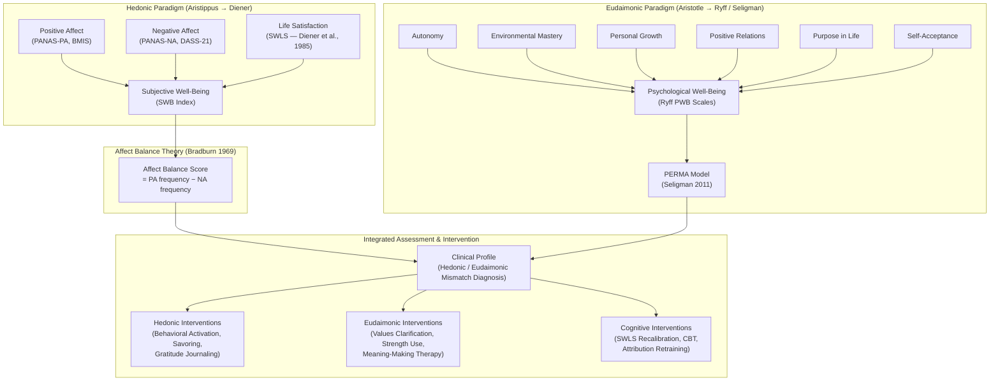

# Lesson 1: Theoretical Foundations of Happiness

## 1. First-Principles Intuition & Invariants

Happiness is among the oldest problems in philosophy and among the youngest in empirical science. The ancient Greeks debated its nature centuries before psychology existed as a discipline, and their debates seeded every major theoretical framework practitioners work with today. Understanding those roots is not an exercise in antiquarianism — it is the fastest route to diagnosing why a client's intervention is failing or why a measurement instrument is capturing something other than what the clinician intended.

The Greek tradition bequeathed two irreconcilable intuitions about what happiness fundamentally is. The first, traceable to Aristippus of Cyrene in the fourth century BCE and later systematized by Epicurus, held that happiness is the net surplus of pleasure over pain. This is the **hedonic** claim: a life goes well to the degree that it feels good, and the proper target of psychological intervention is the subjective quality of moment-to-moment experience. The second intuition, Aristotle's, refused this reduction. In the *Nicomachean Ethics*, Aristotle argued that the highest human good — *eudaimonia*, often translated as flourishing — is not a feeling at all but an activity: the vigorous exercise of one's distinctively human capacities in accordance with virtue. For Aristotle, a person who felt pleasant all day while doing nothing of consequence was not flourishing; they were simply comfortable. *Eudaimonia* required engagement, growth, authentic expression, and contribution to something larger than the self.

This ancient fault line runs directly through the architecture of modern positive psychology. When Martin Seligman and Mihaly Csikszentmihalyi formally launched the field in 2000, they were consciously reopening this debate and insisting that the science of happiness could not reduce to the science of pleasant affect. The practitioner who does not understand this split will routinely mistake their measurement for their construct. A client can score high on the Positive and Negative Affect Schedule (PANAS) — reporting frequent positive emotions and rare negative ones — while simultaneously reporting profound meaninglessness, relational emptiness, and a sense that their life lacks direction. These are not measurement errors; they are the signature of a person with high hedonic well-being and low eudaimonic well-being, and the two dimensions call for entirely different interventions.

The core **invariants** that govern all theoretical and applied work in this domain are as follows. First, well-being is multi-dimensional: no single variable captures it, and any instrument that collapses it to one axis is trading validity for convenience. Second, the hedonic and eudaimonic dimensions are correlated but dissociable, meaning that targeting one does not automatically improve the other. Third, subjective well-being (SWB) — the scientific operationalization of hedonic happiness developed by Ed Diener across the 1980s and 1990s — has three analytically separable components: positive affect (PA), negative affect (NA), and cognitive life satisfaction (LS). These components have different temporal dynamics, different neural substrates, and different responsiveness to intervention. Fourth, the affective components of SWB are trait-like: decades of behavioral genetic research, including twin studies by Lykken and Tellegen, suggest that approximately 50% of variance in dispositional affect is heritable, establishing a "set point" around which individuals fluctuate. This set-point model is not fatalistic — interventions reliably move people within and sometimes beyond their range — but it does constrain effect-size expectations and demands honest calibration of practitioner ambitions.

---

## 2. Core Architecture & Mechanics

### The Structural Model of Subjective Well-Being

Ed Diener's tripartite model of subjective well-being remains the dominant framework for operationalizing hedonic happiness in research and clinical settings. Positive affect is the frequency and intensity of pleasant emotional states — joy, engagement, pride, love. Negative affect is the frequency and intensity of unpleasant states — anxiety, sadness, anger, shame. Life satisfaction is a global cognitive appraisal: when people step back and evaluate their life as a whole against their own standards, how does it measure up? The critical structural insight is that PA and NA are not simply opposite poles of a single bipolar axis. Russell and Carroll's circumplex model and subsequent factor-analytic work established that they load onto separate factors with moderate negative correlation. High PA does not automatically suppress NA; a person can experience frequent joy and frequent anxiety. This independence means that therapeutic strategies targeting PA (savoring, gratitude practices, behavioral activation) operate through different mechanisms than strategies targeting NA (cognitive restructuring, exposure, mindfulness-based emotion regulation).

The eudaimonic tradition produces a different structural architecture. Carol Ryff's six-factor model of psychological well-being (PWB), developed in explicit reaction to what Ryff saw as Diener's excessive hedonism, identifies autonomy, environmental mastery, personal growth, positive relations with others, purpose in life, and self-acceptance as the constitutive dimensions of flourishing. These are not emotions; they are structural features of a life. Seligman's later PERMA model (Positive Emotion, Engagement, Relationships, Meaning, Accomplishment) is a practitioner-facing synthesis that attempts to bridge the hedonic-eudaimonic divide by treating positive emotion as one element among five rather than the sole target.

The diagram below maps the full theoretical architecture — the two paradigms, their respective constructs, their measurement instruments, and the intervention pathways that connect them to practitioner action.

### Affect Balance Theory and the Bradburn Legacy

Norman Bradburn's 1969 work *The Structure of Psychological Well-Being* introduced the most operationally elegant idea in the hedonic tradition: that happiness at the population level could be approximated by a simple algebraic difference between the frequency of positive and negative affect experiences over a given period. This **affect balance score** (ABS) influenced survey design for decades and remains embedded in instruments like the Day Reconstruction Method (DRM) developed by Kahneman and colleagues. The ABS has real practical utility in screening — a client with chronically negative affect balance is easy to identify — but it obscures the mechanistic independence of PA and NA discussed above. Two clients can have an identical ABS of zero; one through moderate levels of both PA and NA (emotionally labile), one through low levels of both (emotionally flat). These are phenomenologically and clinically distinct conditions that Bradburn's subtraction collapses into equivalence. The practitioner must look at the components separately before computing any aggregate.

### Life Satisfaction Models and Cognitive Appraisal

The Satisfaction With Life Scale (SWLS), Diener's five-item instrument published in 1985 with Emmons, Larsen, and Griffin, operationalizes life satisfaction as a global cognitive judgment rather than an affective state. This distinction is clinically important. Affect fluctuates rapidly — it is sensitive to weather, recency effects, and transient events. Life satisfaction, being a reflective judgment, is more stable and more sensitive to the deep structural features of a person's circumstances: the quality of their marriage, the meaning they derive from work, the adequacy of their material resources. Research by Schimmack and Oishi established that life satisfaction judgments are partly constructed at the moment of measurement, meaning they are sensitive to the accessibility of information at the time of survey completion. A client asked about life satisfaction immediately after recalling a recent humiliation will report lower satisfaction than the same client asked after recalling a recent success. This accessibility bias is not noise — it is a signal that cognitive interventions and narrative reframing have genuine leverage on the LS component of SWB, even when affect-focused interventions have plateaued.

---

## 3. High-Performance Optimization & Failure Modes

### Precision Assessment Before Intervention

The most consequential practitioner error in applied happiness science is treating SWB as unidimensional at the point of intervention design. A client enters the consultation scoring below population norms on a general well-being screen. The practitioner, working from an undifferentiated model, prescribes a gratitude journal — a PA-enhancement technique. Four weeks later, scores have not moved. The failure is not the technique; it is the diagnostic mismatch. Gratitude journaling is well-validated for increasing positive affect frequency, particularly in clients with intact hedonic capacity but attentional biases toward the negative. It has weak direct effects on life satisfaction in clients whose low LS stems from objective life circumstances (unemployment, relational conflict, chronic illness), and it has negligible effects on the eudaimonic dimensions Ryff identifies. Before selecting an intervention, the practitioner must generate a full profile across SWB's three components and across the eudaimonic dimensions most relevant to the client's presenting concern.

A recommended baseline assessment battery for advanced practitioners includes the SWLS for cognitive life satisfaction, the PANAS (Watson, Clark & Tellegen, 1988) scored separately for PA and NA rather than as a difference score, and either the 54-item Ryff PWB Scales or the validated 18-item short form for eudaimonic profiling. For clients presenting with existential or meaning-related concerns, the Meaning in Life Questionnaire (MLQ; Steger et al., 2006) provides separation between the *presence* of meaning and the *search* for meaning — a distinction with direct intervention implications, since high search combined with low presence predicts very different outcomes than high search combined with moderate presence.

### The Set-Point Problem and Intervention Realism

Lykken and Tellegen's 1996 twin study remains the most bracing data point in the practitioner's toolkit. Using a sample of several hundred twin pairs and a ten-year retest interval, they estimated that roughly 50% of variance in dispositional happiness was attributable to genetic factors, with shared environmental factors (the family and socioeconomic conditions shared by twins) accounting for essentially zero variance in the long run. The implication — that sustained attempts to make oneself lastingly happier might be "as futile as trying to be taller" — was deliberately provocative and has been partially walked back by Lykken himself in subsequent work. The more nuanced current consensus, synthesized by Lyubomirsky, Sheldon, and Schkade in their influential 2005 "architecture of sustainable happiness" paper, distinguishes between set point (genetic), life circumstances (income, marital status, geography), and intentional activity. Their model assigns roughly 40% of happiness variance to intentional activity — the domain in which practitioners actually operate — while noting that circumstance changes produce rapid hedonic adaptation, whereas effortful, varied, and self-concordant intentional activities resist adaptation more effectively.

The practical consequence for the advanced practitioner is a systematic preference for **activity-based** interventions over **circumstance-change** recommendations. Helping a client pursue a promotion, buy a larger house, or relocate to a sunnier climate will produce transient positive affect that adapts toward baseline within months. Helping the same client develop a consistent practice of using their signature strengths at work, deepening one significant relationship, and engaging in regular acts of prosocial behavior will produce smaller initial hedonic impact but more durable long-term elevation. This is not an argument against circumstance improvement when circumstances are genuinely harmful — poverty, abuse, and social exclusion must be addressed directly — but it is a strong argument against the implicit therapeutic promise that life-circumstance optimization is the primary lever of lasting happiness.

### Hedonic Adaptation and Its Countermeasures

Hedonic adaptation is the process by which the emotional impact of a stimulus diminishes with repeated exposure. It is phylogenetically ancient and functionally adaptive — it prevents organisms from being perpetually consumed by either joy or grief — but it is the primary enemy of sustained well-being interventions. Sheldon and Lyubomirsky's research on the mechanisms of adaptation identified two key variables that modulate its rate: variety and relevance. Activities that are varied in their moment-to-moment expression adapt more slowly than fixed rituals. Activities that are personally relevant to a client's core values and intrinsic motivations (consistent with self-determination theory's concept of autonomous motivation) produce more sustained engagement and slower affective decay.

Critically, negative hedonic adaptation is itself a clinical resource. Grief, loss-related affect, and anxiety all diminish over time through the same mechanism — a fact that underpins the exposure-based logic of behavior therapy. The practitioner can leverage this symmetry: clients who fear that engaging with negative experiences will permanently damage their well-being can be shown that the same system that dulls the shine of a new relationship also dulls the sting of a disappointment.

### Measurement Failure Modes

Several systematic errors corrupt well-being measurement in clinical and research settings. **Social desirability bias** inflates self-reported SWB, particularly life satisfaction scores, in cultures where admitting unhappiness carries stigma. This can be partially mitigated by emphasizing instrument anonymity, using indirect items, or supplementing self-report with experience sampling (ESM) methods that capture in-the-moment affect before retrospective reconstruction degrades accuracy. **Response scale adaptation** occurs when clients who have been in treatment for several weeks recalibrate their internal reference standards — reporting higher satisfaction not because their lives have improved but because their comparison group has shifted. This is a methodological nuisance but also, paradoxically, a potential therapeutic mechanism if the new comparison group is better calibrated to realistic aspirational standards. **Top-down versus bottom-up contamination** in SWB models refers to the ongoing theoretical dispute about whether global life satisfaction is primarily determined by domain satisfactions (bottom-up: satisfied with work + marriage + health → globally satisfied) or whether dispositional positive affect colors domain appraisals upward (top-down: trait cheerfulness → reports all domains as more satisfying). The practical upshot is that practitioners cannot read domain-specific satisfaction as a reliable causal variable without ruling out trait-level affect as a confound.

---

## 4. Summary & Verification Matrix

| Invariant / Construct | Mechanism | Assessment Instrument | Intervention Pathway | Key Failure Mode |
|---|---|---|---|---|
| Hedonic Well-Being (SWB) | Net balance of positive and negative affect frequency plus global cognitive life satisfaction; tri-component structure (PA, NA, LS) dissociable by factor analysis | PANAS (PA and NA scored separately), SWLS for life satisfaction | Behavioral activation, savoring, gratitude practices targeting PA; cognitive restructuring and mindfulness targeting NA; narrative reframing targeting LS | Collapsing PA/NA into a single bipolar axis or aggregate score, obscuring clinically distinct affective profiles |
| Eudaimonic Well-Being (PWB/PERMA) | Flourishing as active exercise of human capacities: autonomy, mastery, growth, relations, purpose, self-acceptance (Ryff); extended by Seligman's PERMA to include engagement and accomplishment | Ryff PWB Scales (54-item or 18-item short form), MLQ for meaning presence vs. search | Values clarification, signature-strengths deployment, meaning-making therapy, relationship deepening interventions | Assuming high hedonic SWB implies high eudaimonic well-being; neglecting eudaimonic profiling when affect scores appear normal |
| Affect Balance Theory | Happiness approximated as PA frequency minus NA frequency over a reference period; operationally convenient but masks independence of the two components | Bradburn Affect Balance Scale; Kahneman's Day Reconstruction Method (DRM) for ecological validity | Screening-level triage; insufficient alone for intervention design; use as first-pass filter before full SWB decomposition | Identical ABS scores masking opposing profiles (high PA/high NA vs. low PA/low NA); treating ABS as a sufficient diagnostic endpoint |
| Hedonic Set Point & Adaptation | ~50% of dispositional happiness variance is heritable; circumstance changes adapt rapidly; intentional activity (~40% of variance) resists adaptation more effectively when varied and self-concordant | Longitudinal PANAS retesting; baseline-to-follow-up SWB trajectories; twin and behavioral genetic benchmarks for realistic effect-size calibration | Prioritize varied, autonomously motivated activity-based interventions over circumstance-change recommendations; use SDT's autonomous motivation as a selection criterion | Overpromising durable gains from circumstance improvements (relocation, income increase) that adapt within 3–6 months; ignoring genetic floor constraints on effect-size expectations |
| Cognitive Life Satisfaction Appraisal | LS is a reflective judgment constructed partly at measurement time; sensitive to information accessibility, comparison standards, and narrative framing; more stable than affect but responsive to cognitive interventions | SWLS (5-item); domain satisfaction batteries; qualitative narrative interviews to surface active comparison standards | Cognitive reframing of comparison standards, attribution retraining, positive memory consolidation, deliberate journaling to shift information accessibility at appraisal time | Accessibility bias inflating or deflating scores based on recent salient events; failing to screen for standard recalibration during treatment (apparent gains driven by shifted reference group, not genuine SWB change) |
| Measurement Validity Threats | Social desirability bias, response scale drift, and top-down affect contamination of domain satisfaction reports systematically distort self-reported SWB, particularly LS | Multi-method triangulation: ESM alongside retrospective scales; anonymized administration; affect-as-information manipulation checks | Supplement trait-level scales with ESM or ecological momentary assessment (EMA) for in-the-moment affect accuracy; control for dispositional PA when interpreting domain satisfaction improvements | Attributing domain-specific satisfaction gains to targeted interventions when dispositional trait PA is the actual driver; treating post-treatment scale elevation as improvement when response recalibration is the operative mechanism |
