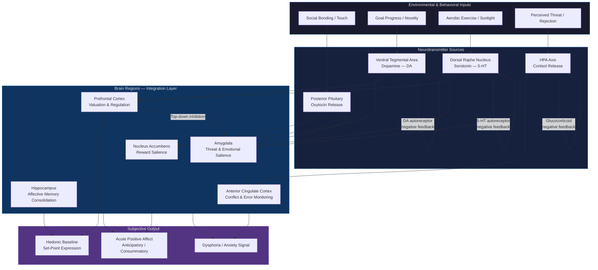

# Lesson 2: Biological Mechanisms of Happiness

## 1. First-Principles Intuition & Invariants

Happiness is not a feeling that simply happens to a person. It is the emergent output of a precisely regulated biological system, one that evolved not to maximize pleasure but to guide adaptive behavior. Understanding this distinction is the most important conceptual anchor a practitioner can carry into any clinical or research context. The hedonic signals we interpret as happiness are, at their mechanistic core, motivational signals. They push organisms toward resource acquisition, social bonding, and goal completion. The fact that they feel pleasant is an evolutionary design feature, not the system's primary purpose.

This reframing has profound clinical consequences. It means happiness cannot be meaningfully understood as a stable state to be achieved; it is a dynamic regulatory signal whose amplitude and baseline are governed by genetics, neurochemistry, structural brain architecture, and learned experiential patterns. A practitioner who ignores any one of these layers is working with an incomplete model, and an incomplete model produces incomplete interventions.

The first invariant to internalize is **set-point theory**. Developed through the longitudinal happiness research of Brickman, Coates, and Janoff-Bulman in the late 1970s, and later refined by Lykken and Tellegen's twin studies in the 1990s, set-point theory holds that each individual has a genetically influenced hedonic baseline to which they reliably return following both positive and negative life events. Lottery winners and accident survivors, famously, converge on nearly identical self-reported happiness levels within two years of their life-altering events. The genetic contribution to this baseline has been estimated at approximately 50% of the variance in stable happiness measures, a finding robust across multiple independent twin cohort studies.

The second invariant is **hedonic adaptation**, the process by which repeated or sustained stimuli produce diminishing hedonic returns. This is not a failure of the system; it is the system working correctly. Without adaptation, an organism would remain maximally satisfied with any achieved state and lose the motivational drive to continue seeking. Adaptation is the mechanism that keeps the signal meaningful. For the practitioner, this means that interventions targeting acute mood elevation are categorically different from interventions targeting baseline set-point elevation, and conflating the two is a persistent source of therapeutic error.

The third invariant is **homeostatic regulation**, which operates through negative feedback loops across multiple neurotransmitter systems. When serotonergic or dopaminergic tone is artificially elevated for sustained periods, receptor downregulation and autoreceptor sensitization work to restore pre-intervention baseline signaling. This is why pharmacological tolerance develops, why stimulant withdrawal produces dysphoria that is proportional to prior elevation, and why genuine baseline elevation through behavioral interventions tends to be more durable than elevation through pharmacology alone.

These three invariants, set-point, adaptation, and homeostasis, form the theoretical skeleton around which all subsequent mechanistic detail must be organized. Every neurotransmitter pathway, every brain region, every therapeutic protocol connects back to these governing principles.

---

## 2. Core Architecture & Mechanics

### The Neurotransmitter Systems

Dopamine is the most frequently mischaracterized neurotransmitter in popular and even clinical discourse. It is not the "pleasure chemical." It is more accurately described as the prediction error and anticipatory reward signal. The mesolimbic dopamine pathway, running from the ventral tegmental area (VTA) to the nucleus accumbens and onward to the prefrontal cortex via the mesocortical pathway, encodes the difference between expected and received reward rather than reward magnitude itself. When an event is better than predicted, dopamine neurons fire above their tonic baseline. When an event meets expectations exactly, they fire at baseline. When an event is worse than predicted, firing drops below baseline. This prediction error signal is what drives learning, habit formation, and goal-directed behavior. The clinical implication is significant: dopamine-driven wellbeing requires novelty, progress, and unmet expectation. It is fundamentally incompatible with static achievement, which explains why accomplished individuals frequently report hedonic emptiness after long-sought goals are finally reached.

Serotonin operates on an entirely different axis. Where dopamine governs wanting and anticipatory drive, serotonin governs contentment, social status perception, and behavioral inhibition. The dorsal raphe nucleus is the primary serotonergic hub, projecting broadly across the cortex, limbic system, and basal ganglia. High serotonergic tone correlates with a sense of calm sufficiency, patience, and what researchers sometimes describe as the "enough" signal. This explains why selective serotonin reuptake inhibitors (SSRIs) reduce anxiety and depression more reliably than they produce euphoria: they are not activating a pleasure circuit so much as quieting a deficit-signaling one. For practitioners working with clients who present with restless, achievement-driven dissatisfaction, serotonergic regulation through behavioral means, particularly aerobic exercise, social connection, and sunlight exposure, often addresses the problem more precisely than dopaminergic strategies.

Oxytocin is the third pillar of the happiness architecture, and its role is specifically social. Released by the posterior pituitary in response to physical touch, sustained eye contact, and cooperative social interaction, oxytocin reduces amygdala reactivity, lowers cortisol, and reinforces prosocial behavior through its action on oxytocin receptors in the nucleus accumbens and ventral tegmental area. It does not function in isolation from dopamine and serotonin; rather, it modulates both systems. Social bonding events that release oxytocin also trigger dopaminergic reward signals, creating a potent reinforcement of affiliative behavior. The practitioner implication is that social prescribing, the structured encouragement of community participation, physical contact, and cooperative activity, has a genuine neurobiological rationale, not merely a philosophical one.

### Brain Regions and Their Functional Roles

The prefrontal cortex (PFC), particularly its ventromedial and orbitofrontal subdivisions, functions as the hedonic integration and valuation center. It synthesizes inputs from limbic regions, interoceptive signals from the insula, and working memory representations of past outcomes to generate subjective evaluations of experienced and anticipated states. Critically, the PFC is also the primary site of top-down regulation of limbic reactivity. Thicker gray matter volume in the left PFC correlates with positive affect bias in multiple neuroimaging studies. This is the structural substrate behind the finding that cognitive reappraisal strategies, a core tool in cognitive behavioral therapy, have measurable neurobiological effects: they recruit PFC inhibitory circuits that dampen amygdalar threat responses.

The limbic system, specifically the amygdala and hippocampus, governs emotional salience, threat detection, and the affective coloring of memory. The amygdala's role in happiness is primarily negative-valence processing; its hyperactivation is a consistent feature of anxiety and depression. The hippocampus connects emotional memory to context, which means that episodic memories of positive social experiences function as a deployable neurobiological resource. This is not metaphorical. Research by Barbara Fredrickson's group has demonstrated that positive affect broadens attentional scope and builds lasting cognitive and social resources through what she termed the broaden-and-build cycle, a process that depends mechanistically on hippocampal memory consolidation and PFC-mediated attentional broadening.

The anterior cingulate cortex (ACC) serves as the conflict monitoring and error detection node in this architecture. Its activation during moments of social exclusion or unmet expectation links directly to both pain processing and negative affect, explaining why social rejection is not merely emotionally painful but neurobiologically pain-equivalent. For practitioners designing positive psychology interventions, this means that reducing chronic low-grade social threat perception, through belonging cues, consistency in social environments, and reduced social uncertainty, reduces ACC load and frees cognitive and emotional resources for wellbeing-generating activity.

### Signal Topology and Dataflow

The following diagram represents the core signal architecture: how key inputs activate neurotransmitter sources, how those sources modulate the primary brain regions involved in wellbeing, and how the regulatory feedback loops maintain homeostatic balance.

The diagram makes explicit what the prose describes mechanically: inputs do not map directly to subjective happiness. They converge on neurotransmitter sources, which modulate brain regions, which then produce hedonic output through integration rather than direct stimulation. The homeostatic feedback loops, autoreceptor negative feedback on dopamine and serotonin, and glucocorticoid feedback on the HPA axis, illustrate why any intervention that bypasses this architecture rather than working within it will face downregulatory correction.

---

## 3. High-Performance Optimization & Failure Modes

### Practitioner Protocols for Targeted System Modulation

A clinical practitioner's most powerful tool is not a pharmacological agent but a precisely designed behavioral protocol, because behavioral inputs engage the full regulatory architecture rather than forcing a single receptor class. The following protocols target specific subsystems based on the mechanistic model above.

For dopaminergic system optimization, the core principle is engineering structured anticipation and predictable novelty. Because dopamine fires most strongly on prediction errors and progress signals, clinical behavioral activation protocols should be structured around graduated goal hierarchies rather than fixed achievement states. A client working on wellbeing should maintain an active portfolio of goals at different completion stages: one approaching completion (generating consummatory reward), one at midpoint (generating progress-signaling reward), and one newly initiated (generating anticipatory drive). This is not motivational advice; it is an application of dopaminergic firing mechanics to daily life design. Practically, this involves weekly goal-mapping sessions where the practitioner audits the client's active goal portfolio and identifies hedonic gaps, periods with no active progress signals, which commonly precede low-mood episodes.

For serotonergic modulation without pharmacological intervention, the evidence converges on three high-effect behavioral inputs. Aerobic exercise at 60–70% of maximum heart rate for 30 minutes increases tryptophan availability at the blood-brain barrier by reducing competing large neutral amino acids through muscle uptake, thereby elevating central serotonin synthesis. Social status and belonging cues operate through a separate but converging pathway: perceived social rank and stability are among the most potent regulators of serotonergic tone in primate neurobiology, and therapeutic work that reduces social threat appraisal (through ACT-based defusion techniques or CFT-based compassion training) produces measurable improvements in trait positive affect that are consistent with serotonergic stabilization. Bright light exposure, particularly in the morning, activates retinal photoreceptors whose projections to the dorsal raphe directly stimulate serotonin synthesis, which is the mechanistic basis for light therapy in seasonal affective disorder.

Oxytocin system activation in a clinical context requires the practitioner to prescribe social contact with specific qualitative features: physical co-presence (remote interaction produces substantially smaller oxytocin responses than in-person contact), sustained mutual attention, and low-stakes cooperative activity. Research by Ruth Feldman's group has demonstrated that synchronous physiological states, matched respiratory and cardiac rhythms between individuals during close social contact, predict oxytocin release more reliably than the content of the interaction. The practical prescription is regular participation in activities that produce physiological synchrony: group exercise, shared meal preparation, music or dance. These are not lifestyle suggestions; they are targeted oxytocin delivery protocols.

### Failure Modes and Clinical Edge Cases

The most common clinical failure mode is **set-point conflation with current state**, wherein the practitioner treats a client's chronic low mood as a fixed biological ceiling rather than a displaced set-point. Set-point theory does not imply immutability. The genetic contribution to happiness baseline is approximately 50%, leaving substantial variance accessible to intervention. Studies of long-term meditators show structural changes in PFC gray matter density and persistent upward shifts in hedonic baseline that persist years after active practice, well beyond what adaptation theory would predict for a purely behavioral intervention. The practical implication is that high-dose, high-consistency behavioral interventions delivered over 12 to 24 months can produce genuine set-point elevation, not merely acute mood improvement.

The second failure mode is **dopaminergic overstimulation through digital behavior**, which is now a primary clinical presentation rather than an edge case. Social media platforms engineer variable-ratio reward schedules, the most potent schedule for dopaminergic entrainment, which produces escalating novelty seeking, attention narrowing, and a progressive elevation of the dopaminergic threshold required to generate a reward signal. Clinically, this presents as anhedonia toward low-intensity rewards: nature, conversation, reading, and unstructured rest feel flat, while screen-based stimulation continues to produce brief acute spikes. The intervention is a structured dopaminergic reset: a 2–4 week reduction in variable-ratio reward exposure, which allows autoreceptor downregulation to normalize and baseline sensitivity to recover. This period is predictably uncomfortable, and clients should be counseled that the discomfort is the mechanism of recovery, not evidence that the intervention is failing.

The third failure mode is **cortisol-serotonin antagonism** in chronically stressed populations. Sustained HPA axis activation results in hippocampal glucocorticoid receptor saturation, which impairs serotonergic signaling and reduces neurogenesis in the dentate gyrus. This creates a bidirectional trap: stress reduces serotonergic tone, which reduces stress resilience, which increases HPA reactivity. Practitioners must address this loop structurally, not symptomatically. Sleep restoration is the highest-leverage single intervention, as slow-wave sleep is the primary window for glucocorticoid clearance and hippocampal memory consolidation. A client whose sleep is chronically fragmented cannot achieve durable serotonergic improvement regardless of what other interventions are applied. Sleep assessment and hygiene protocol should therefore precede, not follow, all other wellbeing interventions in a clinical prioritization framework.

---

## 4. Summary & Verification Matrix

| Domain | Governing Invariant | Mechanism | Diagnostic Indicator | Intervention Target | Failure Mode |
|---|---|---|---|---|---|
| **Hedonic Baseline** | Set-point theory: ~50% genetically determined, resistant but not impervious to change | Structural PFC gray matter density; long-term limbic regulation capacity | Persistent return to below-average hedonic state after positive events; anhedonia lasting >2 weeks | High-dose behavioral interventions over 12–24 months; mindfulness-based set-point elevation protocols | Conflating genetic baseline with fixed ceiling; abandoning intervention prematurely |
| **Dopaminergic System** | Reward = prediction error signal, not pleasure magnitude; driven by novelty and progress | VTA → nucleus accumbens → PFC pathway; autoreceptor negative feedback normalizes chronic elevation | Anhedonia toward low-intensity stimuli; compulsive novelty seeking; loss of motivation following goal achievement | Graduated goal hierarchy design; structured anticipation cycles; variable-ratio reward schedule reduction | Dopaminergic threshold elevation from digital overstimulation; post-achievement hedonic emptiness |
| **Serotonergic System** | Governs contentment and social sufficiency signaling; homeostatic via autoreceptor feedback | Dorsal raphe nucleus projections; tryptophan availability at BBB; retinal-raphe photostimulation pathway | Irritability, restlessness, social threat hypervigilance, low frustration tolerance | 30 min aerobic exercise at 60–70% HRmax; morning bright light exposure; social status stability cues | Cortisol-serotonin antagonism from chronic HPA activation; sleep fragmentation blocking glucocorticoid clearance |
| **Oxytocin System** | Social bonding and affiliation drive; modulates amygdala reactivity and dopaminergic reward | Posterior pituitary release; nucleus accumbens and VTA oxytocin receptor activation; physiological synchrony | Social withdrawal, elevated amygdala reactivity, low tolerance for uncertainty in relationships | Prescribe in-person cooperative activity; physiological synchrony practices (group exercise, shared meals) | Substituting digital social contact for in-person contact; insufficient physical co-presence for oxytocin activation |
| **Hedonic Adaptation** | Repeated stimuli produce diminishing hedonic returns; adaptive by design | Receptor desensitization; reduced prediction error signal magnitude for expected events | Tolerance to previously pleasurable activities; escalating stimulus requirements for equivalent mood effect | Introduce structured variety and intermittency; protect low-stimulation recovery periods | Treating adaptation as pathology rather than mechanism; escalating intervention intensity instead of diversifying inputs |
| **Homeostatic Regulation** | All neurotransmitter systems resist sustained displacement from baseline via negative feedback | Autoreceptor sensitization; HPA glucocorticoid feedback; receptor downregulation under chronic artificial elevation | Rebound dysphoria following stimulant or SSRI cessation; tolerance development; withdrawal-proportional to prior elevation | Work within homeostatic architecture using behavioral inputs; prioritize sleep for glucocorticoid clearance | Pharmacological override without behavioral infrastructure; ignoring sleep as primary neurochemical reset mechanism |
