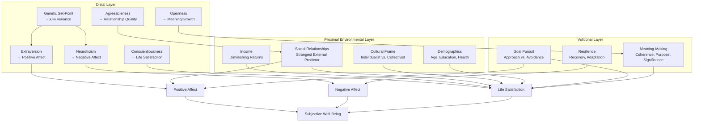

# Lesson 3: Predictors of Happiness

## 1. First-Principles Intuition & Invariants

The scientific study of happiness—more precisely, subjective well-being (SWB)—has evolved from philosophical speculation into a rigorous empirical discipline anchored in psychometric measurement, longitudinal cohort tracking, and experience-sampling methodology. For the advanced practitioner, the central challenge is not merely cataloguing which variables correlate with life satisfaction and positive affect, but understanding the causal architecture that binds them together: how dispositional traits set an individual's hedonic baseline, how environmental and demographic factors modulate that baseline, and how volitional processes such as goal pursuit and meaning-making can shift it over time. This lesson dissects that architecture with the precision a clinical psychologist or behavioral analyst requires, providing assessment protocols, intervention mechanics, and diagnostic decision frameworks that can be deployed in practice.

The foundational invariant of SWB research is that happiness is not a unitary construct. It comprises at minimum three discriminable components: cognitive life satisfaction (the evaluative judgment that one's life is going well, typically measured by the Satisfaction with Life Scale), positive affect (the frequency and intensity of pleasant emotional states, measured by instruments such as the PANAS), and negative affect (the frequency and intensity of unpleasant states). These components correlate modestly with each other—they share perhaps 30 to 50 percent of variance depending on the population—but they are driven by partially distinct predictors and respond to different interventions. A practitioner who treats "happiness" as a single number will misdiagnose the problem and prescribe the wrong intervention. A client scoring high on life satisfaction but high on negative affect requires a fundamentally different protocol than one scoring low on satisfaction but low on negative affect.

The second invariant is the set-point or hedonic adaptation principle. Individuals possess a dispositional baseline of well-being, strongly influenced by genetics—twin studies consistently estimate heritability of SWB at roughly 40 to 50 percent—and this baseline exerts a gravitational pull on subjective experience over time. Major life events, both positive (marriage, lottery wins) and negative (disability, bereavement), produce hedonic shifts that typically partially regress toward the baseline over months to years. The practical implication is not therapeutic nihilism. The set-point is a tendency, not a destiny, and the research on intentional activity—particularly goal pursuit, gratitude practice, and relationship investment—demonstrates that sustained behavioral change can produce durable elevations in SWB above the baseline. The practitioner's task is identifying which intentional activities are most leverage-worthy for a given client's predictor profile.

The third invariant is the distinction between external circumstances and intentional activity as sources of happiness. The widely cited model proposed by Sonja Lyubomirsky and colleagues allocates the variance in SWB roughly as 50 percent genetic set-point, 10 percent life circumstances (demographics, income, geography, marital status), and 40 percent intentional activity. The precise percentages are debated and vary by methodology, but the qualitative conclusion is robust and practically essential: circumstances matter less than most people believe, and volitional behavior matters more. This is the empirical backbone of every cognitive-behavioral and positive-psychology intervention. A practitioner who focuses exclusively on changing circumstances—advising a career change, recommending a geographic move—without addressing the dispositional and behavioral moderators of SWB will produce interventions with poor durability.

## 2. Core Architecture & Mechanics

The predictor architecture of happiness can be conceptualized as a layered system in which distal, relatively fixed factors (personality, genetics, demographics) establish a baseline, proximal environmental factors (income, social relationships, culture) modulate that baseline, and volitional processes (goal pursuit, meaning-making, resilience) generate the variance most amenable to intervention. Understanding the signal flow through this system—the degree to which each layer directly influences SWB outcomes versus indirectly mediating through other layers—is the analytical core of applied well-being assessment.

Personality traits, operationalized through the Big Five (Five-Factor Model), constitute the single most powerful predictor layer. The relationship is asymmetric across the five factors. Extraversion and neuroticism (often labeled emotional stability when reverse-scored) are the dominant predictors, with meta-analytic correlations typically in the range of 0.40 to 0.50 between extraversion and positive affect, and between neuroticism and negative affect. Conscientiousness shows a modest positive correlation with life satisfaction (approximately 0.20 to 0.30), mediated largely through its effects on goal progress, occupational success, and health behaviors. Agreeableness correlates with life satisfaction at similar magnitudes, mediated through relationship quality. Openness to experience is the weakest predictor of overall SWB, though it shows specific positive associations with the "meaning" and "growth" subcomponents of psychological well-being.

The practitioner should understand the mechanism behind these correlations rather than treating them as opaque associations. Extraversion predicts positive affect not because extraverts experience more intense positive emotions per event—they do not—but because they participate in more social events and are more sensitive to reward cues in the environment, generating a higher frequency of positive emotional episodes. Neuroticism predicts negative affect because high-neuroticism individuals exhibit lower thresholds for threat detection, stronger amygdala reactivity to negative stimuli, and more persistent rumination following negative events. The intervention implication is direct: for a high-neuroticism client, targeting the cognitive processing of negative events (rumination patterns, catastrophizing appraisals) yields more SWB improvement than attempting to increase positive event frequency.

Assessment of personality should use validated instruments appropriate to the context. The Big Five Inventory-2 (BFI-2) provides a comprehensive 60-item assessment with 15 facet scores suitable for clinical practice. The NEO-PI-R offers 240 items with 30 facets and remains the gold standard for research-grade assessment. For rapid screening, the Ten-Item Personality Inventory (TIPI) sacrifices facet-level resolution for brevity but maintains acceptable convergent validity at the domain level.

Demographic factors exhibit a paradoxical relationship with SWB. Individually, each shows small-to-moderate correlations, yet collectively they account for a surprisingly small proportion of total variance—rarely exceeding 10 to 15 percent in regression models. Age follows a U-shaped curve in many large-scale datasets, with SWB lowest in the mid-40s to early 50s and higher in both younger and older cohorts, though cross-sectional versus longitudinal designs complicate interpretation. Education correlates positively with SWB but the effect is substantially mediated by income and health. Physical health shows a moderate correlation with SWB that is stronger when health is subjectively rated than when measured objectively, a finding that highlights the mediating role of health perception and adaptation.

The income-SWB relationship is one of the most studied and most misunderstood findings in the literature. The Easterlin paradox—stating that within nations, richer individuals are happier than poorer ones, but across time, increasing national GDP does not increase average SWB—has been refined substantially. Kahneman and Deaton's 2010 analysis of over 450,000 Gallup-Healthways responses found that emotional well-being (positive and negative affect) plateaus at an annual household income of approximately $75,000 (2009 dollars), while life evaluation continues to rise logarithmically with income beyond that point. Matthew Killingsworth's 2021 experience-sampling study, tracking over 33,000 working adults via a smartphone app, found that both experienced well-being and evaluative well-being increased log-linearly with income well past the $75,000 threshold, though with diminishing marginal returns. The most defensible synthesis for practitioners: income matters more for life evaluation than for emotional experience, its marginal benefit diminishes but does not vanish at higher levels, and the effect is largely mediated through the reduction of financial stress, the expansion of choice and autonomy, and access to resources that support health and relationships rather than through direct hedonic consumption.

Social relationships are the single strongest external predictor of SWB. The Harvard Study of Adult Development, now spanning over 85 years, identifies relationship satisfaction in midlife as the strongest predictor of late-life well-being and health, surpassing income, social class, and genetics. Meta-analytic evidence consistently shows that social support, relationship quality, and social integration correlate with SWB at magnitudes of 0.30 to 0.50, and that loneliness predicts negative affect and mortality risk at effect sizes comparable to smoking. The UCLA Loneliness Scale (Version 3, 20 items) and the Social Provisions Scale provide validated assessment instruments. The practitioner should assess not merely the quantity but the quality and function of social connections: emotional support, instrumental support, companionship, and the absence of relational conflict each contribute distinct variance to SWB.

Cultural variation in happiness is not merely a matter of average differences in reported SWB across nations—though these are substantial, with Scandinavian nations consistently ranking highest and several East Asian nations ranking lower than their GDP would predict—but of differences in the very meaning and predictors of happiness. In individualist cultures, SWB is strongly associated with personal achievement, self-esteem, and the pursuit of personal goals. In collectivist cultures, SWB is more strongly associated with relational harmony, social embeddedness, and the fulfillment of obligations. The appraisal of positive affect itself differs: high-arousal positive emotions (excitement, elation) are valued more in individualist cultures, while low-arousal positive emotions (calmness, contentment) are valued more in collectivist cultures. A practitioner applying SWB assessment instruments validated in Western populations to clients from collectivist cultural backgrounds must account for these frame differences or risk systematic misinterpretation.

Goal pursuit and meaning-making constitute the volitional layer where practitioner interventions have the greatest leverage. Self-Determination Theory (Deci and Ryan) identifies three basic psychological needs—autonomy, competence, and relatedness—whose satisfaction predicts SWB across cultures and whose frustration is a robust predictor of psychological distress. Goal content matters: intrinsic goals (personal growth, relationships, community contribution) predict higher SWB than extrinsic goals (wealth, fame, physical attractiveness), even when goal progress is held constant. The mechanism is partly that extrinsic goals are less likely to be fully attained—satisficing is harder when the target is externally referenced—and partly that progress on intrinsic goals more directly satisfies the three basic needs.

The distinction between approach and avoidance goals is operationally critical. Approach goals (seeking positive outcomes) are associated with higher positive affect, greater goal progress, and higher SWB than avoidance goals (avoiding negative outcomes). The practitioner should assess goal framing using instruments such as the Personal Goals Inventory or structured interview protocols, identifying avoidance-framed goals and working with the client to reframe them. "I want to avoid failing this exam" becomes "I want to master this material and perform well." The underlying behavioral target may be identical, but the cognitive framing produces measurably different affective and motivational outcomes.

Meaning-making extends beyond goal pursuit into the construction of a coherent life narrative. The Meaning in Life Questionnaire (MLQ) assesses two separable dimensions: presence of meaning (the perception that one's life is meaningful) and search for meaning (the active pursuit of meaning). Presence of meaning correlates strongly with SWB; search for meaning shows a more complex relationship, correlating positively with SWB in collectivist cultures and negatively or neutrally in individualist cultures. Michael Steger's research demonstrates that meaning is constructed through three psychological processes: coherence (understanding one's life as making sense), purpose (having directional aims and goals), and significance (believing one's life matters). Practitioners can facilitate these processes through narrative therapy techniques, values clarification exercises, and the structured articulation of life purpose using instruments such as the Purpose in Life Test.

Resilience is the factor that determines whether adverse events produce temporary decrements in SWB or durable reductions. The Connor-Davidson Resilience Scale (CD-RISC-25 or the 10-item short form) provides a validated measure. Resilience operates through several mechanisms: cognitive reappraisal flexibility (the ability to reframe adverse events in multiple ways), emotional regulation capacity (the ability to tolerate and modulate negative affect without avoidance or rumination), social support utilization (the willingness to seek and accept help), and behavioral activation following setbacks (the resumption of goal-directed activity rather than withdrawal). Resilience is not a fixed trait but a capacity that can be built through specific interventions, including cognitive-behavioral therapy, mindfulness-based stress reduction, and structured exposure to manageable stressors that build self-efficacy through successive mastery experiences.

## 3. High-Performance Optimization & Failure Modes

Optimizing a well-being intervention begins with accurate diagnostic profiling. The practitioner should administer a core battery at intake: the SWLS for cognitive life satisfaction, the PANAS or its shorter form the Scale of Positive and Negative Experience (SPANE) for affective components, the BFI-2 for personality, the MLQ for meaning, the CD-RISC-10 for resilience, and a social support measure such as the Social Provisions Scale or the brief version of the UCLA Loneliness Scale. This battery yields a multidimensional profile that reveals which predictor layers are deficient and where intervention will produce the highest marginal return on effort.

The optimization logic follows a triage principle. If personality assessment reveals high neuroticism as the dominant risk factor, the intervention should prioritize cognitive restructuring of threat appraisal, rumination interrupt protocols, and emotional regulation training before addressing other domains. If the profile reveals adequate personality factors but deficient social relationships, the intervention should focus on social skills training, behavioral activation targeting social engagement, and relationship repair or development. If income or financial stress is the dominant negative predictor, the intervention should address financial literacy, debt management, or career advancement planning—recognizing that the SWB return on income changes is real but log-diminishing. If meaning is deficient despite adequate affective functioning, the intervention should target values clarification, narrative coherence work, and purpose articulation.

A common failure mode in well-being intervention is the adaptation effect. Any single positive intervention—gratitude journaling, acts of kindness, savoring exercises—produces significant SWB gains in the first one to two weeks, but the effect attenuates as the activity becomes routine and novel. The countermeasure is activity variation and intentional scheduling. A protocol that rotates between gratitude journaling, savoring exercises, social connection behaviors, and physical activity on different days of the week maintains novelty and prevents adaptation. The practitioner should monitor SWB measures at two- to four-week intervals and adjust the intervention mix when the measures plateau.

A second failure mode is the misalignment of intervention with cultural frame. Applying an individualist-optimized intervention—self-affirmation, personal goal-setting, self-expression—to a client with a collectivist cultural orientation will produce weaker effects and may increase intrapsychic conflict. The practitioner should assess cultural orientation using instruments such as the Individualism-Collectivism Scale and adapt the intervention accordingly. For collectivist-oriented clients, relationship-centered interventions, community contribution goals, and harmony-focused meaning-making will outperform autonomy-focused protocols.

A third failure mode is the neglect of the affect-satisfaction distinction. A client may report high life satisfaction but elevated negative affect, indicating that their cognitive evaluation of life is positive while their emotional experience is burdened by anxiety, anger, or depressive affect. Treating this profile with meaning-making or goal-pursuit interventions will be ineffective because the deficit is in emotional regulation, not in purpose or progress. The correct intervention is affect-focused: emotional regulation training, rumination interrupt, mindfulness-based approaches, or referral for treatment of an underlying mood or anxiety disorder if the PANAS profile and clinical interview warrant it.

A fourth failure mode is goal-content misalignment. Clients often present with goals that are extrinsically framed—wealth, status, appearance—that predict lower SWB even when achieved. The practitioner should conduct a goal audit using the Aspiration Index or a structured interview, identifying extrinsic goal dominance and working with the client to reweight the goal portfolio toward intrinsic goals. This is not an argument that wealth or status goals should be abandoned, but that they should not dominate the goal structure. The research consistently shows that the ratio of intrinsic to extrinsic goal pursuit is a stronger predictor of SWB than the absolute level of either.

A fifth failure mode is the single-predictor fallacy. Well-being is multiply determined, and interventions that target only one predictor domain produce smaller and less durable effects than multi-component interventions. The most effective protocols, such as Seligman's PERMA-based interventions and multi-component positive psychology interventions, target several predictor domains simultaneously: positive emotion (savoring, gratitude), engagement (strength identification and use, flow-promoting activity design), relationships (social connection exercises), meaning (values clarification, purpose articulation), and accomplishment (goal-setting with approach framing and progress monitoring). A meta-analysis by Bolier et al. (2013) found that multi-component interventions produced effect sizes approximately 50 percent larger than single-component interventions on measures of SWB.

## 4. Summary & Verification Matrix

| Predictor Domain | Core Mechanism | Assessment Instrument | Diagnostic Criterion | Primary Failure Mode |
|---|---|---|---|---|
| Personality (Big Five) | Extraversion drives positive affect frequency; neuroticism drives negative affect via threat sensitivity and rumination | BFI-2 (60 items, 15 facets); NEO-PI-R for research-grade depth | Extraversion < 30th percentile flags low positive affect risk; Neuroticism > 70th percentile flags elevated negative affect risk | Treating trait-level neuroticism as situational distress; failing to address cognitive appraisal patterns that sustain negative affect |
| Social Relationships | Relationship quality satisfies the need for relatedness; loneliness activates threat-relevant physiological and affective responses | UCLA Loneliness Scale (20 items); Social Provisions Scale (24 items) | Loneliness score > 43 (UCLA-3) or subscale deficits in emotional and instrumental support | Measuring social network size rather than relational quality and support function; prescribing social activity without addressing relational skill deficits |
| Income | Log-diminishing returns; primarily reduces financial stress and increases life evaluation rather than emotional well-being | Income assessment via structured intake; financial stress via Financial Stress Scale | Financial stress score elevated or income below regional threshold for basic needs adequacy | Assuming income increases will produce proportional SWB gains at all levels; neglecting the affect-satisfaction distinction (income lifts evaluation more than experience) |
| Cultural Frame | Individualist cultures link SWB to personal achievement and high-arousal affect; collectivist cultures link SWB to harmony and low-arousal affect | Individualism-Collectivism Scale; cultural formulation interview | Client cultural orientation misaligned with intervention frame (e.g., autonomy-focused protocol applied to collectivist client) | Applying Western-validated intervention protocols without cultural adaptation; interpreting low-arousal positive affect as deficient well-being |
| Goal Pursuit & Meaning | Intrinsic goals satisfy autonomy, competence, and relatedness needs; approach framing generates positive affect; meaning provides coherence, purpose, and significance | Aspiration Index; MLQ (presence and search subscales); Purpose in Life Test | Extrinsic goal dominance on Aspiration Index; MLQ presence score below norms; avoidance goal framing dominant | Pursuing extrinsic goals expecting proportional SWB returns; leaving avoidance-framed goals unreframed; treating search for meaning as pathology rather than developmental process |
| Resilience | Cognitive reappraisal flexibility, emotional regulation, social support utilization, and behavioral activation following setbacks | CD-RISC-10 or CD-RISC-25; resilience interview protocol | CD-RISC-10 score < 25 indicates low resilience capacity; history of prolonged SWB decrement following adverse events | Conceptualizing resilience as fixed trait rather than buildable capacity; failing to implement successive mastery experiences that develop self-efficacy |
