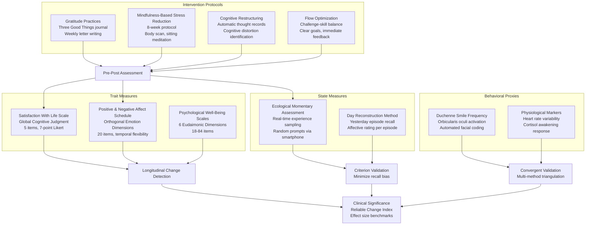

# Lesson 4: Measurement Methods for Happiness

## 1. First-Principles Intuition & Invariants

The quantification of happiness presents psychology with one of its most philosophically vexing yet practically essential challenges. Unlike physiological parameters such as blood glucose concentration or cortisol titration that permit direct biochemical assay, happiness exists as a subjective experiential state that must be inferred through proxy measurement. The field of positive psychology, catalyzed by Martin Seligman's 1998 American Psychological Association presidential address, formalized the study of optimal human functioning and shifted academic focus from pathology remediation toward flourishing cultivation. This paradigm demanded psychometric rigor equal to clinical assessment traditions while confronting the fundamental question: can we measure something as phenomenologically rich and culturally variable as happiness with scientific validity?

The measurement challenge begins with construct definition. Happiness bifurcates into two dominant theoretical frameworks that impose distinct measurement requirements. The hedonic perspective, rooted in Bentham's utilitarian calculus and operationalized by Ed Diener as subjective well-being, treats happiness as the predominance of positive affect over negative affect combined with global life satisfaction judgment. This tripartite model decomposes into measurable components: momentary emotional experience, retrospective satisfaction appraisal, and the algebraic balance between pleasant and unpleasant states across time. Conversely, the eudaimonic tradition emerging from Aristotelian philosophy and operationalized by Carol Ryff emphasizes psychological well-being through dimensions of purpose, personal growth, autonomy, environmental mastery, positive relations, and self-acceptance. These competing frameworks demand different instrumentation, with hedonic measures prioritizing affective intensity and frequency while eudaimonic instruments probe existential meaning and self-actualization.

The measurement invariants that govern all happiness assessment derive from fundamental psychometric principles adapted to subjective experience. First, the temporal grain problem: happiness fluctuates across milliseconds, minutes, days, and decades, requiring measurement tools calibrated to appropriate time scales. Global life satisfaction judgments compress years of experience into single numerical estimates, while ecological momentary assessment captures real-time affect in naturalistic contexts. Second, the reference frame dependency: individuals anchor happiness judgments against personal baselines, peer comparisons, and cultural norms, introducing relativity into ostensibly absolute scales. A respondent rating their happiness as seven on a ten-point scale provides information about their internal reference distribution, not an objective hedonic magnitude. Third, the memory construction bias: retrospective happiness reports suffer from peak-end rule distortion, duration neglect, and mood-congruent recall, as demonstrated by Daniel Kahneman's colonoscopy studies showing that remembered pain diverges systematically from real-time experience.

The validity challenge cuts deeper than ordinary psychometric concerns because happiness lacks an external criterion standard. While depression inventories can be validated against clinician diagnostic interviews and neuroimaging biomarkers, no gold-standard happiness assay exists for convergent validation. This forces reliance on construct validation networks wherein multiple instruments measuring theoretically related concepts should demonstrate appropriate correlation magnitudes while discriminating from orthogonal constructs. The absence of objective ground truth elevates internal consistency, test-retest reliability, and discriminant validity from desirable properties to essential survival requirements for any happiness measure.

Measurement methods must further contend with reactivity effects wherein the assessment process itself modifies the construct being measured. Completing a gratitude journal or mindfulness questionnaire may induce the very state the instrument aims to capture, creating circularity between intervention and measurement. This reactivity distinguishes happiness assessment from passive observation in natural sciences and demands experimental designs that account for assessment-induced state changes. The practitioner measuring happiness in clinical or research contexts must simultaneously function as instrument operator, data collector, and perturbation source, requiring sophisticated methodological calibration to disentangle genuine effects from measurement artifacts.

## 2. Core Architecture & Mechanics

The psychometric architecture of happiness measurement organizes into three nested layers: trait-level dispositional instruments that capture stable individual differences, state-level momentary assessments that sample experience in real time, and intervention protocols that manipulate happiness through evidence-based techniques. Each layer employs distinct data collection mechanics, temporal sampling strategies, and validity assurance mechanisms.

At the trait level, self-report questionnaires dominate through their logistical efficiency and direct access to subjective experience. The Satisfaction With Life Scale, developed by Diener and colleagues in 1985, exemplifies the global judgment approach through five items assessing life satisfaction as a conscious cognitive evaluation. Respondents rate agreement with statements like "In most ways my life is close to my ideal" on seven-point Likert scales, yielding total scores from five to thirty-five. The scale demonstrates robust internal consistency with Cronbach's alpha coefficients typically exceeding 0.85 and two-month test-retest reliability around 0.82, indicating stable trait measurement while permitting genuine change detection. The instrument avoids specifying domains of satisfaction, allowing respondents to weight life areas according to personal values rather than imposing researcher-determined criteria. This generality maximizes cross-cultural applicability but sacrifices diagnostic specificity, providing no information about which life domains drive overall satisfaction.

The Positive and Negative Affect Schedule, constructed by Watson and colleagues, operationalizes the affective component of subjective well-being through twenty emotion adjectives divided into positive affect and negative affect subscales. Respondents rate the extent to which they have felt emotions like enthusiastic, distressed, inspired, or irritable during specified time frames ranging from "right now" to "during the past year." The orthogonal factor structure with correlations near zero between positive and negative affect confirms that these represent independent dimensions rather than bipolar opposites, aligning with neurobiological evidence that approach and avoidance systems operate through distinct neural circuits. The temporal flexibility allows researchers to measure state affect, trait affectivity, or intermediate time horizons by simply modifying the instructional time frame, though this flexibility introduces validity concerns when respondents lack reliable access to aggregated emotional experience across extended periods.

Eudaimonic measurement requires more complex instrumentation to capture multidimensional psychological well-being. Ryff's Psychological Well-Being Scales operationalize six theoretically derived dimensions through 84 items in the full version or abbreviated 18-item forms for efficiency. The autonomy subscale assesses self-determination and independence from social pressures, while environmental mastery probes the capacity to manage complex life demands. Personal growth items evaluate openness to experience and continued development, positive relations measure interpersonal connection quality, purpose in life assesses goal directedness and meaning, and self-acceptance reflects positive self-evaluation. This comprehensive architecture provides diagnostic granularity unavailable in hedonic measures, enabling practitioners to identify specific eudaimonic deficits for targeted intervention. However, the six-factor structure shows variable replication across cultures, with collectivist societies often yielding alternative factor solutions that privilege interdependence over autonomy.

State-level measurement addresses the temporal grain problem through ecological momentary assessment protocols that sample experience in real time within naturalistic contexts. Participants carry smartphones programmed to deliver random prompts throughout waking hours, typically five to eight times daily for one to two weeks. Each prompt triggers a brief questionnaire assessing current mood, activity, social context, and location. This intensive longitudinal design captures within-person variability that cross-sectional trait measures cannot detect, revealing that situation and activity predict substantial happiness variance beyond dispositional baselines. The method minimizes retrospective recall bias by collapsing the delay between experience and report to seconds or minutes rather than days or weeks. However, compliance burden creates sample attrition, with missing data rates often exceeding twenty percent as participants ignore prompts during inconvenient moments, potentially biasing samples toward less demanding activities.

The Day Reconstruction Method, developed by Kahneman and colleagues as an efficient alternative to experience sampling, asks participants to reconstruct the previous day as a sequence of episodes like morning commute, lunch with colleague, or evening television watching. For each episode, respondents report duration, activities, companion presence, and experienced affect using the same emotion adjectives from real-time sampling protocols. This technique generates time-use weighted affect scores that aggregate momentary experience across the day while requiring only fifteen to twenty minutes of participant time rather than week-long intensive monitoring. Validation studies show moderate convergence with experience sampling, though systematic biases emerge wherein reconstructed affect amplifies peak moments and neglects episode duration, recapitulating the memory distortions the method aimed to circumvent.

Behavioral and physiological proxies offer objective measurement alternatives that circumvent self-report biases. Duchenne smiles, characterized by simultaneous activation of the zygomaticus major muscle raising the mouth corners and the orbicularis oculi muscle creating crow's feet eye wrinkles, reliably distinguish genuine positive emotion from social display smiles that lack orbital activation. Automated facial action coding systems like iMotions or Affectiva enable high-frequency smile detection in naturalistic video, though cultural display rules modulate expression independent of internal experience. Physiological markers including heart rate variability, cortisol awakening response, and frontal EEG asymmetry provide non-invasive biomarkers that correlate moderately with self-reported well-being, but none achieve sufficient sensitivity and specificity for individual diagnosis, limiting utility to group-level research rather than clinical decision-making.

Intervention protocols transform measurement from passive observation to active manipulation, providing experimental leverage to test causal hypotheses about happiness determinants. Gratitude practices operationalized through Seligman's Three Good Things exercise instruct participants to write three positive events and their causes each evening for one to three weeks. Meta-analytic evidence shows small to medium effect sizes around 0.3 standard deviations on well-being outcomes, with effects persisting at three-month follow-up when participants continue the practice voluntarily. The mechanism operates through attention retraining, shifting focus from negative rumination toward positive experience savoring while building attributional habits that internalize credit for positive events.

Mindfulness-Based Stress Reduction, adapted from Buddhist meditation traditions by Jon Kabat-Zinn, delivers eight weekly two-hour group sessions teaching body scan progressive relaxation, sitting meditation focused on breath awareness, and mindful movement through gentle yoga. Participants commit to forty-five minutes of daily home practice supported by audio recordings. The protocol cultivates present-moment awareness and non-judgmental acceptance of thoughts and emotions, demonstrating moderate effect sizes around 0.5 standard deviations for anxiety and depression reduction with smaller but significant well-being enhancement. The mechanism involves metacognitive awareness that disrupts automatic negative thought patterns and reduces experiential avoidance, though dismantling studies struggle to isolate active ingredients from non-specific therapeutic factors like group support and instructor alliance.

Cognitive-behavioral techniques target happiness through cognitive restructuring that identifies and modifies distorted automatic thoughts. Practitioners train clients to complete thought records capturing activating events, automatic thoughts, emotional consequences, and evidence-based rational responses. Common cognitive distortions include all-or-nothing thinking, overgeneralization, mental filtering that selectively attends to negative information, and personalization that assigns inappropriate self-blame. Socratic questioning helps clients generate alternative interpretations and behavioral experiments test thought accuracy empirically. The approach demonstrates robust efficacy for depression treatment with effect sizes exceeding 0.8 standard deviations, though applications to non-clinical happiness enhancement show more modest effects, suggesting cognitive restructuring may be more powerful for distress reduction than positive emotion amplification.

Flow optimization pursues happiness through activity engagement characterized by complete absorption, loss of self-consciousness, and intrinsic motivation. Csikszentmihalyi's flow theory posits that optimal experience arises when task challenge matches skill level, goals are clear, and feedback is immediate. Activities falling in this challenge-skill sweet spot ranging from rock climbing to chess to surgery generate intense focus and retrospective reports of time distortion and effortless action. Intervention protocols begin with experience sampling to identify personal flow activities, then systematically increase challenge-skill balance through progressive difficulty calibration. Athletic training, musical practice, and occupational job crafting provide natural flow optimization contexts, though individual differences in autotelic personality moderate flow accessibility.

## 3. High-Performance Optimization & Failure Modes

The optimization of happiness measurement hinges on matching instrument temporal grain, response burden, and validity requirements to specific research or clinical objectives while anticipating systematic failure modes that compromise data integrity. Practitioners must balance psychometric rigor against practical constraints of participant compliance, resource availability, and intervention feasibility.

Longitudinal assessment designs provide superior causal inference and individual change detection compared to cross-sectional snapshots, but introduce measurement occasion effects, practice effects, and differential attrition that threaten validity. Repeated administration of identical instruments creates familiarity that reduces measurement error through stable comprehension but also enables response memory wherein participants recall and anchor to previous responses rather than evaluating current states independently. Alternate form construction generating statistically equivalent item sets mitigates response memory but requires extensive pilot validation to confirm parallel form equivalence. Test-retest intervals must balance two competing demands: intervals too brief fail to allow genuine change, while intervals too extended permit extraneous life events to obscure intervention effects beneath noise. Optimal intervals for positive psychology interventions typically range from four to twelve weeks, sufficient for habit formation while minimizing dropout.

The reliable change index operationalizes clinically significant improvement by calculating the magnitude of change required to exceed measurement error with specified confidence, typically 95 percent. The index incorporates test-retest reliability and standard error of measurement to establish thresholds that distinguish genuine change from random fluctuation. For the Satisfaction With Life Scale with standard deviation of 6.4 and reliability of 0.85, the reliable change threshold approximates 6.2 scale points. This means a participant shifting from baseline score of 20 to post-intervention score of 27 demonstrates statistically reliable improvement, while a shift to 25 remains within measurement error bounds. Practitioners should report both statistical significance from group-level analyses and reliable change indices to document individual response heterogeneity often masked by aggregate means.

Response bias represents a pervasive threat wherein social desirability, acquiescence, and positive impression management distort self-reports away from veridical experience. Happiness measurement proves especially vulnerable because respondents perceive unhappiness reports as social failures, creating systematic upward bias. Balanced scale construction with equal positive and negative keyed items controls for acquiescence, while forced-choice formats requiring tradeoffs between equally desirable options reduce socially desirable responding. Anonymous assessment reduces impression management compared to identified administration, though anonymity prevents longitudinal matching for change detection. Inclusion of validity scales like the Marlowe-Crowne Social Desirability Scale enables statistical control for impression management by partialling out its influence, though this assumes social desirability operates as measurement error rather than substantive trait predictor.

Cultural validity failures emerge when instruments developed in Western individualist societies import assumptions about emotion expression, self-focus, and independence that violate collectivist cultural frameworks. The Satisfaction With Life Scale's emphasis on personal ideal attainment reflects individualist values, while collectivist respondents may prioritize family harmony and social duty fulfillment over personal satisfaction. Translation equivalence requires not merely linguistic conversion but conceptual adaptation ensuring construct equivalence across cultures. Back-translation protocols translate instruments from source to target language then reverse translate to source language, comparing original and back-translated versions to identify semantic drift. Cognitive interviewing where participants verbalize thought processes while completing instruments reveals comprehension failures and culturally inappropriate content requiring revision.

Ecological momentary assessment optimization requires careful attention to prompt timing, sampling density, and questionnaire brevity to maximize compliance while capturing within-person variability. Random sampling distributed across waking hours provides unbiased experience estimates but may miss rare but meaningful events like conflict or peak experiences. Event-contingent sampling triggered by specific occurrences such as social interactions or stress events ensures relevant moment capture but relies on participant initiation, introducing self-selection bias. Hybrid protocols combining random time-based prompts with event-contingent reporting balance coverage and precision. Questionnaire length must not exceed two minutes, limiting items to five or six affect ratings and context descriptors to maintain compliance across weeks. Compensation structures should reward completion rates rather than absolute response counts to incentivize consistent responding across all prompts.

Intervention implementation fidelity determines whether null findings reflect genuinely ineffective interventions or inadequate delivery. Gratitude practice adherence monitoring through daily completion logs reveals that many participants assigned to write Three Good Things complete fewer than half of scheduled entries, severely attenuating detectable effects. Intention-to-treat analyses preserve randomization but dilute effect sizes, while per-protocol analyses comparing compliant subgroups inflate effects through selection bias. Dose-response analyses examining outcomes as a function of completed sessions provide intermediate evidence, though these remain correlational and susceptible to confounding by motivation. Implementation optimization strategies include commitment devices like scheduled reminders, public commitments to peers or researchers, and if-then implementation intentions specifying exact contexts for practice execution.

Mindfulness intervention quality depends critically on instructor expertise, with evidence suggesting that instructor personal practice depth predicts participant outcomes independent of didactic training. Audio-guided home practice supports consistent technique but lacks real-time correction of postural misalignment or attentional drift. Objective adherence monitoring through timestamped audio file playback logs captures practice frequency but not engagement quality, as participants may initiate recordings without genuine participation. The eight-week group format creates scheduling barriers that exclude shift workers and caregivers with limited flexibility, systematically biasing samples toward privileged populations with schedule autonomy.

Cognitive-behavioral technique effectiveness hinges on between-session homework completion, with evidence suggesting that completed thought records mediate therapeutic gains. Clients often resist homework through beliefs that therapy occurs exclusively in-session or that worksheet completion lacks relevance to their concerns. Collaborative empiricism wherein therapist and client jointly examine evidence for automatic thoughts transforms homework from imposed busywork to valued empirical investigation. Mobile apps like MoodKit and Thought Diary automate thought record prompts and formatting, reducing completion barriers while enabling ecological assessment of cognitive patterns in naturalistic contexts rather than retrospective recall during sessions.

Flow optimization confronts the challenge that many occupational and obligatory daily activities offer limited challenge-skill modulation. Repetitive work tasks, household chores, and caregiving duties may resist flow induction regardless of intentional reframing. Job crafting interventions encourage employees to redesign task boundaries, relationship configurations, or cognitive framing to enhance meaning and challenge, demonstrating modest well-being improvements in organizational settings. However, structural constraints including manager oversight, standardized procedures, and productivity quotas limit crafting latitude, particularly for low-autonomy positions. Flow assessment through experience sampling reveals that passive leisure like television watching occupies substantial daily time despite generating lower engagement and retrospective satisfaction than active leisure, suggesting that inertia and ego depletion drive activity selection as strongly as flow potential.

## 4. Summary & Verification Matrix

| Measurement Domain | Governing Invariants | Core Mechanisms | Diagnostic Criteria | Primary Failure Modes |
|-------------------|---------------------|-----------------|---------------------|----------------------|
| **Trait-Level Self-Report** | Stable individual differences measured via aggregated judgments; temporal stability (r > 0.70) across months; internal consistency (α > 0.80) indicating coherent constructs | Conscious cognitive evaluation of life satisfaction (SWLS); affective frequency and intensity aggregation (PANAS); multidimensional eudaimonic functioning (PWBS) | Reliable change index exceeding 1.96 × SE_diff for individual improvement; effect sizes > 0.3 SD for intervention efficacy; discriminant validity with orthogonal constructs (r < 0.50) | Social desirability bias inflating scores 0.3–0.5 SD; recall bias amplifying peak moments and neglecting duration; cross-cultural inequivalence when individualist assumptions violate collectivist values |
| **State-Level Momentary Assessment** | Within-person variability across situations (40–60% of total variance); minimal retrospection delay (< 5 minutes) reducing memory distortion; situation-activity effects exceeding trait effects | Random time-based or event-contingent smartphone prompts; immediate affect and context rating; high-frequency sampling (5–8 daily) across 7–14 days; ecological validity through naturalistic capture | Compliance rates > 80% for unbiased sampling; convergence with trait measures (r = 0.50–0.70) supporting construct validity; situation variance components distinguishing contexts | Participant burden causing attrition and missing data > 20%; selective non-response during negative states biasing upward; prompt reactivity modifying experience through attention direction |
| **Intervention Protocols** | Mechanism specificity linking technique to outcome pathway; dose-response relationship between practice frequency and effect magnitude; sustained practice required for durable change (> 6 weeks) | Gratitude practices shifting attentional focus to positive events; mindfulness training enhancing metacognitive awareness and present-moment focus; cognitive restructuring identifying and modifying distorted thoughts; flow optimization balancing challenge-skill for absorption | Pre-post effect sizes > 0.30 for small effects, > 0.50 for medium effects; maintenance at 3-month follow-up indicating habit formation; mediation analyses confirming hypothesized mechanisms | Implementation fidelity failures when practice completion < 50%; non-specific therapeutic factors confounding mechanism; volunteer samples creating selection bias limiting generalizability to resistant populations |
| **Multi-Method Triangulation** | Convergent validity across self-report, behavioral, and physiological indicators (r = 0.30–0.50); discriminant validity distinguishing happiness from related constructs; method variance should not exceed trait variance | Duchenne smile frequency via automated facial coding; heart rate variability and cortisol as physiological proxies; day reconstruction aggregating time-use weighted affect; informant reports from close others | Cross-method correlations exceeding 0.30 supporting construct validity; method factors in confirmatory factor analysis accounting for < 40% of variance | Cultural display rules dissociating facial expression from internal experience; physiological markers showing insufficient specificity for individual diagnosis; informant limited access to target's internal states creating floor effects |
