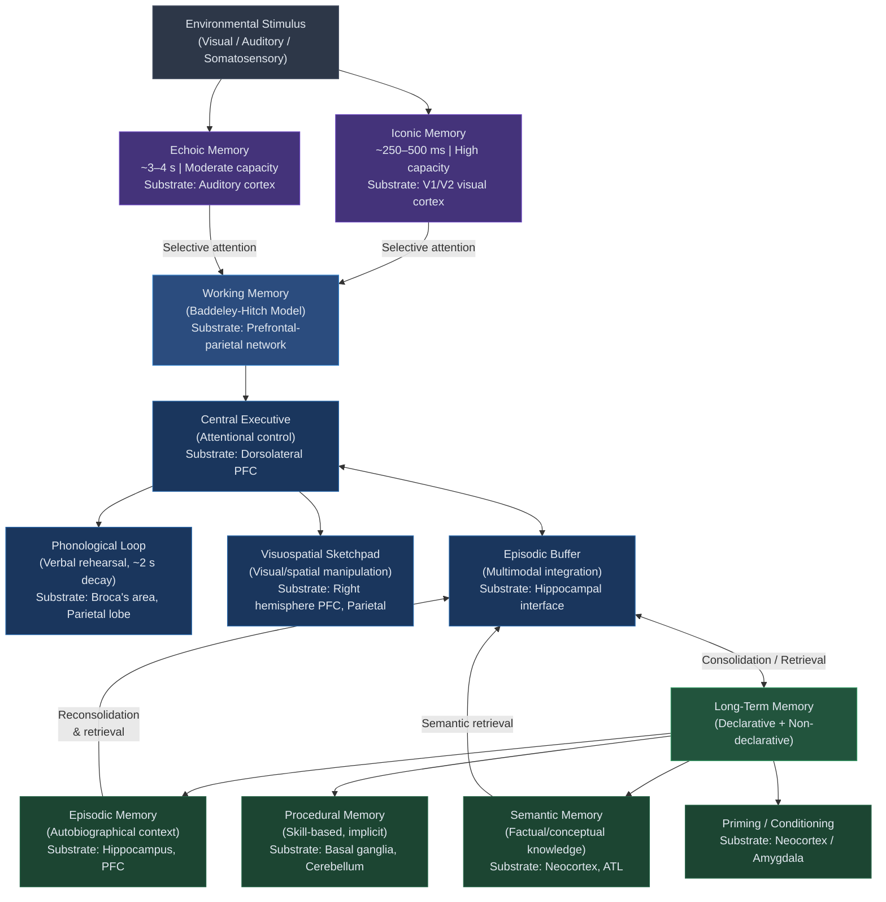

# Lesson 1: Memory Systems — Cognitive Foundations

## 1. First-Principles Intuition & Invariants

The practitioner who wants to train memory effectively must first understand what memory actually is — not as a vague faculty of the mind, but as a collection of distinct biological and computational systems with definable capacities, transfer conditions, and failure modes. The intuition that "memory is a single thing" is one of the most persistent and consequential misconceptions in applied cognitive psychology. It leads to interventions that target the wrong system, training protocols timed incorrectly relative to consolidation windows, and diagnostic frameworks that conflate retrieval failure with encoding failure. The first invariant of this masterclass is therefore categorical: memory is plural. It is an architecture of interacting subsystems, each with its own neurological substrate, capacity limit, and temporal profile.

Richard Atkinson and Richard Shiffrin formalized this intuition in their 1968 multi-store model, proposing that information flows through a sequence of stores — sensory, short-term, and long-term — with each transition gated by attentional and rehearsal processes. While the model has been substantially refined since, its core contribution was architectural: it established that the brain does not store information uniformly, and that the path a memory takes from perception to permanent encoding is not guaranteed. Information can stall, degrade, or fail to transfer at any stage. This is not a metaphor; it reflects the actual behavior of hippocampal-dependent consolidation and prefrontal working memory circuitry.

The second invariant is that capacity constraints are not bugs but design features. The bottleneck of working memory — roughly four chunks in Cowan's revised estimate, or the classic "seven plus or minus two" of Miller's original 1956 paper — reflects the limited bandwidth of the prefrontal-parietal attentional network. These constraints exist because selective filtering is computationally advantageous; the brain cannot and should not encode everything it perceives. For memory trainers, this means that overload is not merely inefficient — it is architecturally destructive to new encoding. Any intervention that fills working memory to capacity before consolidation processes begin will produce measurably inferior long-term retention.

The third invariant concerns the distinction between declarative and non-declarative memory, which maps directly onto different neurological systems. Declarative memory — the kind you can verbally report — depends critically on medial temporal lobe structures, particularly the hippocampus and entorhinal cortex. Non-declarative memory, including procedural skills, priming effects, and conditioned responses, operates through the basal ganglia, cerebellum, and amygdala respectively, largely without hippocampal involvement. This dissociation is not theoretical; it is demonstrated most starkly in the case of Henry Molaison (H.M.), whose bilateral hippocampal resection in 1953 left his procedural learning entirely intact while rendering him unable to form new episodic or semantic memories. A practitioner designing a protocol to accelerate skill acquisition is engaging a fundamentally different system than one designing a protocol for vocabulary retention, and the interventions that work for one will frequently underperform for the other.

The fourth and final foundational invariant is that encoding and retrieval are not symmetric operations. The strength of a memory at encoding does not predict retrieval success under all conditions; context-dependency, state-dependency, and the spacing of retrieval practice all modulate what can be recalled and when. Robert Bjork's concept of "desirable difficulties" — the finding that conditions that slow initial learning often produce superior long-term retention — follows directly from understanding that the act of retrieval itself strengthens the memory trace. A practitioner who conflates fluency during study with durable encoding is operating on a false model and will design training schedules that plateau early.

---

## 2. Core Architecture & Mechanics

### The Multi-Store Model and Its Refinements

Atkinson and Shiffrin's original architecture described three stores in serial order. Sensory memory — subdivided into iconic memory for visual information (lasting roughly 250–500 milliseconds, as demonstrated by George Sperling's 1960 partial-report experiments) and echoic memory for auditory information (lasting 3–4 seconds) — acts as a high-capacity but rapidly decaying buffer. Its function is to hold a momentary trace of environmental stimulation long enough for selective attention to operate on it. Only a fraction of what enters sensory memory is attended to and passed forward.

What Atkinson and Shiffrin called "short-term memory" (STM) is now more precisely understood through Alan Baddeley and Graham Hitch's 1974 working memory model, which replaced the unitary STM store with a multicomponent system. This was a critical architectural upgrade. The original STM was passive — a holding buffer — but behavioral experiments repeatedly showed that people could simultaneously store and manipulate information, suggesting an active processing workspace. Baddeley and Hitch proposed a central executive, which directs attentional resources and coordinates two slave systems: the phonological loop, which rehearses verbal and acoustic information through subvocal articulation, and the visuospatial sketchpad, which maintains and manipulates visual and spatial representations. A later addition, the episodic buffer, provides a temporary interface between working memory and long-term memory, holding integrated multimodal representations that can be consciously accessed.

The phonological loop is of particular practical importance because it underpins most verbal learning. It consists of a phonological store (holding speech-based traces for approximately 2 seconds) and an articulatory rehearsal process that refreshes those traces through subvocal repetition. The word-length effect — where lists of shorter words are recalled better than lists of longer words — is a direct behavioral signature of this loop, because longer words take more time to articulate and thus fewer can be rehearsed before the trace decays. The articulatory suppression paradigm, in which participants are asked to repeat an irrelevant word aloud while performing a verbal memory task, selectively impairs the phonological loop and produces measurable declines in serial recall, confirming its mechanistic role.

Long-term memory (LTM) is not a single warehouse but a taxonomy of functionally and neurologically distinct systems. Endel Tulving's distinction between episodic and semantic memory remains the foundational taxonomy. Episodic memory encodes personally experienced events with temporal and spatial context — the "where and when" of a specific occurrence. Semantic memory encodes world knowledge, facts, and concepts stripped of their autobiographical context. Procedural memory, as discussed above, encodes skill-based knowledge that is expressed through performance rather than verbal recall. Within the declarative domain, episodic memory is more vulnerable to aging, stress, and hippocampal damage than semantic memory, in part because episodic encoding requires a richer contextual binding process mediated by hippocampal-entorhinal circuitry.

The diagram below illustrates the information flow across these systems, including the gating mechanisms, transfer conditions, and primary neurological substrates.

The episodic buffer deserves particular attention in applied memory training because it is the site where working memory representations interact with long-term stores. When a practitioner uses elaborative encoding techniques — connecting new information to existing knowledge networks — the episodic buffer is the computational workspace where that integration occurs before synaptic consolidation stabilizes it in neocortical long-term storage.

---

## 3. High-Performance Optimization & Failure Modes

### Optimizing Encoding Across the Architecture

The most robust encoding intervention available to practitioners is spacing — distributing learning trials across time rather than massing them in a single session. The spacing effect, first documented by Hermann Ebbinghaus in 1885 and replicated thousands of times since, reflects the fact that memory consolidation is a time-dependent biological process. Each spaced retrieval attempt occurs after partial forgetting has occurred, which forces the hippocampus and associated neocortical networks to reconstruct the trace rather than simply re-access a still-active representation. This reconstructive effort strengthens the synaptic connections underlying the memory more than passive re-exposure does, an effect mediated in part by BDNF (brain-derived neurotrophic factor) upregulation and AMPA receptor trafficking at hippocampal synapses. The practical translation: spacing intervals should expand as retention improves — a schedule of 1 day, 3 days, 7 days, 21 days, and 60 days approximates the optimal forgetting-curve intercept for most declarative material.

Retrieval practice compounds the spacing effect. Testing yourself — through free recall, cued recall, or recognition, in roughly that order of efficacy — produces the testing effect, whereby the act of retrieving a memory makes it more retrievable in the future. Henry Roediger and Jeffrey Karpicke's 2006 study demonstrated that students who studied and were tested recalled significantly more after one week than students who studied and re-studied, even though the re-study group reported higher confidence during the learning phase. This dissociation between subjective fluency and objective retention is precisely the trap Bjork's desirable difficulties framework was designed to prevent. For practitioners administering memory training protocols, the clinical implication is that assessment should be integrated into training, not separated from it.

Interleaving — mixing different categories of material within a session rather than blocking all items of one type together — is a third high-performance intervention. Blocked practice allows learners to apply the same retrieval strategy repeatedly without variation; interleaved practice forces the learner to discriminate between categories and select the appropriate retrieval strategy on each trial. This added discrimination load slows initial acquisition but substantially improves long-term retention and transfer to novel exemplars. For a memory trainer working with medical students on diagnostic categories, interleaving disease presentations from multiple systems within a single study block will outperform a week of cardiology followed by a week of neurology, even though the blocked schedule feels more organized and productive to the learner.

Chunking is the primary strategy for circumventing the capacity ceiling of working memory. By grouping individual items into meaningful higher-order units, an expert encodes a single chunk rather than multiple separate items, effectively expanding functional capacity without changing the underlying biological limit. Chess grandmasters do not memorize piece positions individually; they perceive familiar configurations as single units, which is why their recall of game-legal positions vastly exceeds that of novices but collapses to chance when pieces are placed randomly — confirming that the advantage is pattern-based, not raw memory superiority.

### Failure Modes and Their Mechanistic Origins

The most common failure mode in applied memory training is proactive interference, where previously learned material disrupts the encoding or retrieval of new material that shares overlapping features. This is a natural consequence of the associative architecture of hippocampal memory, where new traces compete with established ones for the same retrieval cues. The solution is not to avoid similar material but to use distinctive encoding strategies — unique mnemonics, different physical contexts, contrastive elaboration — that increase discriminability between similar traces.

Retroactive interference runs in the opposite direction: new learning disrupts consolidation of recently encoded material. This is particularly acute within the first several hours after encoding, when hippocampal replay during rest and slow-wave sleep is consolidating the new trace into neocortical networks. Cognitive activities that share representational overlap with just-learned material — particularly verbal tasks after verbal learning — will impair consolidation. Practitioners should therefore schedule high-priority encoding before sleep-rich periods and avoid cognitively demanding tasks of the same modality in the hours immediately following training.

Source monitoring errors represent a failure mode specific to episodic memory: the correct information is retrieved, but the context of its acquisition is misattributed. A practitioner may accurately recall a clinical fact but falsely believe they learned it from a peer-reviewed source rather than a conference anecdote, with potentially significant downstream consequences for how much confidence they attach to it. Source monitoring is prefrontal-dependent and degrades more sharply with aging and fatigue than the content memory itself, which explains why a sleep-deprived clinician might recall the right answer while being uncertain where it came from.

Retrieval-induced forgetting is a subtler failure mode with direct relevance to training design. When a subset of learned items is repeatedly retrieved through practice, the non-practiced items sharing the same categorical cues are actively suppressed — their retrieval strength decreases below the baseline it would have reached without any practice at all. This means that selectively drilling high-priority items from a set can inadvertently weaken memory for related items in the same category. The mitigation is comprehensive retrieval practice across the entire target set, ensuring that no subset of items monopolizes retrieval cue access.

Finally, the distinction between storage failure and retrieval failure is clinically critical. When a practitioner or client cannot recall material, the default assumption is often that encoding failed — the information was never stored. In fact, retrieval failure in the presence of intact storage is demonstrably common, as evidenced by the tip-of-the-tongue phenomenon and by the well-documented finding that recognition performance can exceed free recall performance even for material that subjects claim they cannot remember. The implication is that training protocols should include both encoding interventions and retrieval support strategies — context reinstatement, cued recall scaffolding, and state-dependent retrieval conditions — rather than defaulting to re-encoding when recall fails.

---

## 4. Summary & Verification Matrix

| Memory System | Neurological Substrate | Capacity & Duration | Optimal Training Intervention | Primary Failure Mode | Diagnostic Criterion |
|---|---|---|---|---|---|
| Sensory Memory (Iconic/Echoic) | V1/V2 visual cortex; primary auditory cortex | High capacity; 250 ms – 4 s | Attentional focusing exercises; selective attention training | Inattentional filtering (information never reaches WM) | Partial-report paradigm; decay rate under attentional load |
| Working Memory (Baddeley-Hitch) | Dorsolateral PFC, inferior parietal lobe, Broca's area | ~4 chunks; ~20–30 s without rehearsal | Chunking, dual-task management, phonological rehearsal drills | Capacity overload; articulatory suppression interference | Digit span, N-back task, word-length effect assay |
| Episodic Memory | Hippocampus, entorhinal cortex, medial PFC | Theoretically unlimited; subject to interference | Spaced retrieval, context reinstatement, elaborative encoding | Source monitoring error; proactive/retroactive interference | Free recall vs. recognition dissociation; temporal ordering tasks |
| Semantic Memory | Anterior temporal lobe, distributed neocortex | Theoretically unlimited; highly stable | Interleaving, schema elaboration, semantic network mapping | Category-level interference; retrieval-induced forgetting | Semantic fluency tasks; priming latency measurement |
| Procedural Memory | Basal ganglia, cerebellum, supplementary motor area | Unlimited; highly resistant to decay | Distributed practice with variable conditions; errorless learning in early phase | Habit interference; negative transfer from similar skill sets | Serial reaction time task; motor sequence learning curves |
| Long-Term Consolidation Process | Hippocampal-neocortical dialogue; sleep-dependent replay | Consolidation window: 6–8 h post-encoding (critical) | Post-encoding rest; sleep scheduling; avoidance of same-modality interference | Retroactive interference during consolidation window | Delayed recall at 24 h vs. 1 h; sleep deprivation retention comparison |
