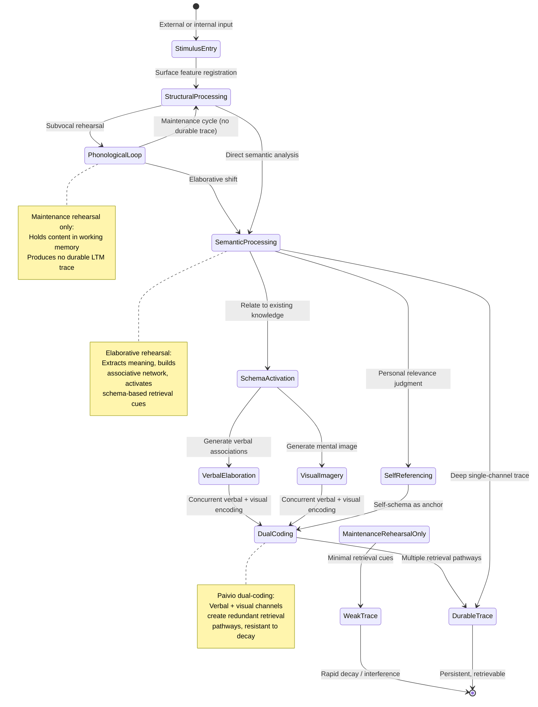

# Lesson 2: Encoding Mechanisms — Depth of Processing

## 1. First-Principles Intuition & Invariants

In 1972, Fergus Craik and Robert Lockhart published a paper that reframed how psychologists understood memory formation. Their argument was deceptively simple: memory is not a storage container that you pour information into. Memory is a byproduct of perception. The durability of a memory trace is determined not by how many times you rehearse an item, but by how deeply you process it. They proposed a continuum from shallow, structural processing — noticing the font, the sound, the surface features of a stimulus — to deep, semantic processing — extracting meaning, connecting the item to existing knowledge, evaluating its significance. The deeper the processing, the more durable the trace.

This framework, known as levels-of-processing theory, overturned the dominant rehearsal-centric model of the time. Before Craik and Lockhart, the assumption was that repetition was the engine of memory. The more you repeated something, the more likely it was to stick. But Craik and Lockhart demonstrated that repetition without depth is a poor predictor of retention. You can repeat a phone number silently in your working memory a hundred times and lose it the moment your attention shifts. You can hear a single vivid story once and recall it decades later. The difference is not frequency. It is depth.

The first invariant of encoding, then, is this: **the strength of a memory trace is a function of the cognitive operations performed on the stimulus, not the number of exposures to it.** Maintenance rehearsal — the silent, repetitive cycling of an item through working memory — maintains information in the short term but produces almost no durable long-term trace. Elaborative rehearsal — actively relating the item to other information, generating meaning, building associations — produces traces that persist.

The second invariant comes from Endel Tulving's encoding specificity principle, published in 1972 alongside Craik and Lockhart's work. A memory trace is not a neutral snapshot. It encodes not only the target item but the contextual conditions present at the time of encoding. Retrieval succeeds when the cues available at recall overlap with the cues present at encoding. If you study a word in the context of its semantic category, semantic cues at retrieval will trigger it. If you study it in the context of its rhyming sound, phonetic cues will be needed. The implication for practice is direct: you should encode information under conditions that match the conditions under which you will need to retrieve it. A student who studies facts in silence with a textbook open will struggle to retrieve them during a conversation where neither cue is present. A clinician who memorizes a diagnostic criterion list by rote will fail to access it when a patient presents with a ambiguous symptom pattern that requires semantic, not lexical, retrieval.

The third invariant is distinctiveness. Within the levels-of-processing framework, trace durability depends not only on depth but on the uniqueness of the processing operations. If you semantically process twenty items that all belong to the same category, each item's trace competes with the others for retrieval, because the semantic cues overlap. This is proactive and retroactive interference. If instead you process each item with a unique elaborative operation — a different personal association, a distinct visual image, a different evaluative judgment — each trace is bound to a unique cue set, and retrieval has a higher signal-to-noise ratio. Distinctiveness is the reason bizarre images, self-referential connections, and emotionally charged associations produce superior recall. They are not merely deeper. They are more isolable.

The fourth invariant is schema activation. Frederick Bartlett first demonstrated in 1932 that people do not store raw experiences. They store experiences that have been filtered through and assimilated into existing mental schemas — organized knowledge structures that represent typical patterns in a domain. When you encounter new information, the schemas you activate determine what features you encode, what features you discard, and how the information is stored. A chess master looking at a midgame board position encodes the strategic structure in seconds because their schema network for chess positions is dense and richly connected. A novice encoding the same board stores a scattered collection of piece locations that disintegrates within minutes. The practical implication is that encoding efficiency is not a fixed capacity. It scales with the density and organization of prior knowledge in the relevant domain. This is why domain expertise accelerates learning within that domain, and why the same encoding techniques that work for an expert produce mediocre results for a beginner who lacks the schemas to hang new information on.

These four invariants — depth over repetition, encoding specificity, distinctiveness, and schema dependence — form the theoretical backbone of every encoding protocol that follows.

## 2. Core Architecture & Mechanics

Encoding is not a single act. It is a pipeline of cognitive operations, each of which can be performed at shallow or deep levels. Understanding the pipeline means understanding where information enters, how it is transformed, and where it can be strengthened or lost.

When a stimulus enters working memory, it first undergoes structural processing. The visual system registers features like shape, contrast, and position. The auditory system registers pitch, tempo, and phonemic structure. This is the shallowest level of the pipeline, and it is where maintenance rehearsal operates. Maintenance rehearsal is the phonological loop described by Alan Baddeley's working memory model: a short-duration store that holds approximately two seconds of auditory-verbal content, refreshed by subvocal repetition. This loop is useful for holding a phone number long enough to dial it, but the loop does not transfer content into long-term storage. Research by Craik, Watkins, and others in the 1970s showed that subjects given a list of words and instructed to maintain rehearsal for varying durations showed no improvement in long-term recall as a function of rehearsal time. The items cycled through the phonological loop and then disappeared.

The transition to durable encoding requires a shift from maintenance to elaborative rehearsal. Elaborative rehearsal engages semantic processing: the extraction of meaning. When you encounter a word and silently note its definition, its category, its relationship to other words, or its personal relevance, you are performing semantic analysis. Craik and Lockhart's original experiments used orienting tasks to force different levels of processing. Subjects asked to judge whether a word was printed in uppercase or lowercase were forced into structural processing. Subjects asked to judge whether a word rhymed with another word were forced into phonological processing. Subjects asked to judge whether a word fit into a sentence frame or whether it described a concept meaningful to them were forced into semantic processing. Recall tests consistently showed that semantic processing produced two to three times more recall than structural processing, with phonological processing falling in between.

The mechanism behind this effect is elaboration breadth. Semantic processing activates a wider network of associated concepts than structural processing. When you semantically process the word "dog," you activate nodes for animal, pet, mammal, loyalty, specific dogs you have known, and countless semantic associates. Each activated node becomes a potential retrieval cue. When you structurally process the same word, noting only that it is printed in lowercase, you activate a minimal cue network. At retrieval, more cues mean more pathways to the target trace, and the probability of successful recall rises.

Allan Paivio's dual-coding theory, published in 1971, adds a second channel to this architecture. Paivio proposed that the human cognitive system processes information through two independent but interconnected channels: a verbal channel that handles linguistic and symbolic content, and a nonverbal channel that handles visual and imagery-based content. When you encode an item through both channels simultaneously — for example, by creating a vivid mental image of a word's referent while also processing its verbal meaning — you double the available retrieval pathways. If the verbal cue fails, the visual cue may succeed, and vice versa. Paivio demonstrated this with concrete and abstract words. Concrete words like "elephant" or "candle" are easy to image, and subjects recalled them better than abstract words like "justice" or "necessity," which lack referential images. The effect is not merely additive. Dual-coded items are particularly resistant to forgetting because they are anchored in two independent representational systems, and the decay of one does not destroy the other.

Chunking operates as a structural compression mechanism within this pipeline. George Miller's famous 1956 paper established that working memory holds approximately seven plus or minus two items, but subsequent work by Nelson Cowan revised this estimate to approximately four chunks in adults under conditions of focused attention. The key insight is that a chunk is not a fixed unit. It is a grouping determined by the encoder's prior knowledge and schemas. "CIA-FBI-IBM-ATF" is four chunks to someone unfamiliar with the acronyms, but it is one chunk to someone who recognizes them all as three-letter US agency abbreviations. Chunking does not increase the capacity of working memory. It increases the amount of information packed into each slot. For encoding purposes, chunking is a preprocessing step that determines how much semantic content can be held simultaneously for deep processing. Without chunking, complex material exceeds working memory capacity before semantic processing can begin.

Schema activation governs which chunks are available. When a practitioner begins studying a new domain, they have sparse schemas, and their chunks are small and inefficient. As they accumulate knowledge, schemas become denser, chunks become larger and more information-rich, and the rate at which new material can be deeply processed accelerates. This is the mechanism behind the expertise effect in memory: experts in a domain encode domain-relevant information faster, retain it longer, and retrieve it more accurately than novices, not because their general memory capacity is larger, but because their domain-specific schemas allow deeper processing with less cognitive effort.

The following diagram maps the encoding pipeline as a state machine, showing the transitions between processing levels and the branch points that determine trace durability.

The diagram makes explicit what the prose has described: the critical branch point is the transition from phonological loop cycling to semantic processing. Everything downstream of that transition produces durable traces. Everything that remains upstream of it produces transient traces that decay rapidly and are vulnerable to interference.

## 3. High-Performance Optimization & Failure Modes

The practical power of the levels-of-processing framework lies in the fact that depth is controllable. You do not need to wait for deep processing to happen spontaneously. You can engineer it through orienting tasks that force semantic analysis, dual-coding, self-referencing, and schema activation. The following protocols are the practitioner-grade implementations of this principle.

Elaborative interrogation is the most direct technique. When encoding new information, the practitioner pauses at each item and asks "why" and "how" questions that force semantic engagement. If you are learning that the hippocampus is critical for episodic memory formation, you do not repeat that fact. You ask: why would a brain structure involved in spatial mapping also be critical for episodic memory? How does the hippocampus's role in pattern separation relate to its role in distinguishing similar memories? Each question forces deeper processing and builds additional retrieval pathways. The technique is slow per item, but the retention payoff per unit of time is substantially higher than repetition. Studies by Michael Pressley and colleagues in the 1980s demonstrated that elaborative interrogation produced recall improvements of 30 to 50 percent over reading-only conditions, with the largest effects for materials that had clear causal or logical structure.

Self-referencing exploits the self-schema, which is the densest and most elaborated schema in any individual's knowledge network. When you encode information by relating it to personal experience, you activate a vast network of autobiographical memories, preferences, and self-knowledge that provides rich, unique retrieval cues. The practical implementation is simple: when encoding any item, ask "How does this relate to me?" or "When have I experienced something similar?" Research by Timothy Rogers, Nicholas Kuiper, and William Hertzog in 1977 showed that self-referential encoding produced recall superior to semantic encoding, which in turn produced recall superior to structural encoding. The self-reference effect is one of the most robust findings in the encoding literature, and it is directly implementable. A clinician learning a new therapeutic model can ask how each principle maps onto their own psychological patterns. A student learning neuroanatomy can ask how each structure's function relates to their own experience of attention, memory, or emotion.

Dual-coding implementation requires the deliberate generation of mental images concurrent with verbal processing. For concrete items, this is straightforward: when you learn that the amygdala is involved in fear processing, you picture the amygdala as a small almond-shaped structure lighting up during a moment of terror. For abstract items, the technique requires more creativity. You can use metaphoric imagery, spatial layouts, or relational diagrams. The key is that the image must be generated internally and must be specific. Research shows that the imagery must be vivid and detailed to produce the dual-coding benefit. Vague or generic images add little. The practitioner protocol is to spend five to ten seconds generating a specific, detailed mental image for each item being encoded, concurrent with verbal semantic analysis.

Chunking optimization requires active schema construction. Rather than encoding items in isolation, the practitioner groups them into meaningful units based on shared structure, function, or relationship. When learning a list of cranial nerves, for example, a practitioner does not encode twelve separate items. They encode three groups of four, organized by function: three sensory, five motor, four mixed. Each group is a chunk, and each chunk is a single working memory slot. The mnemonic acronyms that generations of medical students have used are chunking devices, not depth devices. They reduce the number of items working memory must hold, freeing capacity for deeper semantic processing of each item within the chunk.

The most powerful optimization is the combined protocol: chunk the material into schema-aligned groups, then apply elaborative interrogation and dual-coding to each group, using self-referencing as the primary elaborative strategy. This protocol maximizes depth, distinctiveness, dual-channel encoding, and schema activation simultaneously. It is slower per item than any single technique alone, but the retention per unit of encoding time is higher than any alternative.

The dominant failure mode in encoding is the illusion of competence. This occurs when a practitioner confuses familiarity with mastery. Maintenance rehearsal produces a feeling of fluency — the item is in working memory, it feels accessible, it feels known. But this fluency is transient. When the practitioner returns to the material the next day, the trace is gone or degraded, and the discrepancy between expected and actual performance is demoralizing. The diagnostic for this failure is simple: test yourself after a delay. If you can recall the material after twenty-four hours without re-exposure, the encoding was deep. If you cannot, the encoding was shallow regardless of how fluent it felt at the time. Retrieval practice under delay conditions is the ground truth test of encoding depth.

A second failure mode is shallow processing disguised as deep processing. Highlighting text while reading is the canonical example. The physical act of highlighting feels active, but it does not require semantic processing. The practitioner is engaging with the spatial and visual features of the text, not its meaning. The same applies to copying notes verbatim. These activities produce the subjective experience of studying without the cognitive operations that produce durable traces. The diagnostic is whether the practitioner can articulate the material in their own words from memory after a delay. If they cannot, the "studying" was structurally shallow regardless of the time invested.

Interference is a third failure mode that undermines otherwise deep encoding. When multiple items are encoded with overlapping semantic cues, they compete at retrieval. This is why studying two similar subjects back-to-back degrades recall of both. The practical mitigation is spacing: distribute encoding sessions across time so that interfering items do not share the same temporal context. It is also why distinctiveness matters: encoding each item with a unique elaborative operation reduces cue overlap even when the items themselves are semantically similar.

A fourth failure mode occurs at the boundary of schema dependence. When a practitioner attempts to apply deep encoding techniques to material in a domain where they have no prior schemas, the techniques lose effectiveness. Elaborative interrogation requires existing knowledge to generate meaningful questions. Self-referencing requires some bridge between the new material and personal experience. Dual-coding requires sufficient domain familiarity to generate accurate, detailed images. In a novel domain, the practitioner must first invest in schema construction before the high-performance encoding techniques will yield their full benefit. This is why the first pass through entirely new material often feels inefficient and produces weak retention despite the use of good techniques. The schemas are not yet in place to support deep processing. The solution is to accept a first pass that is slower and shallower, building the scaffold, and then return for a second pass where deep encoding techniques become effective.

A final failure mode is encoding-retrieval mismatch, the practical manifestation of encoding specificity. If a practitioner deeply encodes material in a context that does not match the retrieval context — studying in silence, then needing to recall during a high-pressure conversation — the retrieval cues available at test do not overlap with those present at encoding, and recall fails despite deep encoding. The mitigation is to encode under conditions that simulate the target retrieval environment. If the goal is to recall information during a clinical interview, the practitioner should practice retrieval in a conversational format, not just in silent study.

## 4. Summary & Verification Matrix

| Invariant | Mechanism | Diagnostic Criteria | Failure Mode |
|---|---|---|---|
| Depth over repetition | Elaborative rehearsal activates semantic networks; maintenance rehearsal cycles phonological loop without durable transfer | Delayed free recall succeeds only after semantic encoding, not after equivalent time in maintenance rehearsal | Illusion of competence: fluency during maintenance rehearsal mistaken for durable learning |
| Encoding specificity | Trace encodes contextual cues present at encoding; retrieval requires cue overlap between study and test conditions | Recall performance varies with match between encoding and retrieval contexts | Encoding-retrieval mismatch: deep encoding in mismatched context still produces failed recall |
| Distinctiveness | Unique elaborative operations per item reduce cue overlap and interference | Items encoded with unique personal or imagery associations show higher recall than items encoded with shared semantic features | Interference: semantically similar items encoded with overlapping cues compete at retrieval, degrading recall for all |
| Dual-coding | Concurrent verbal and visual encoding creates redundant retrieval pathways resistant to partial decay | Concrete, imageable items recalled better than abstract items; dual-coded items survive longer than single-channel items | Failure to generate vivid, specific imagery renders dual-coding ineffective for abstract material |
| Schema dependence | Prior knowledge structures determine chunk size, elaboration depth, and encoding efficiency | Domain experts encode domain-relevant material faster and retain it longer than novices using identical techniques | Techniques applied in a schema-poor domain produce weak traces regardless of technique quality |
| Chunking | Grouping items into schema-aligned units increases information density per working memory slot | Chunked items recalled as coherent units; chunk boundaries align with semantic structure | Artificial chunking without schema support produces groups that do not survive retrieval demands |
