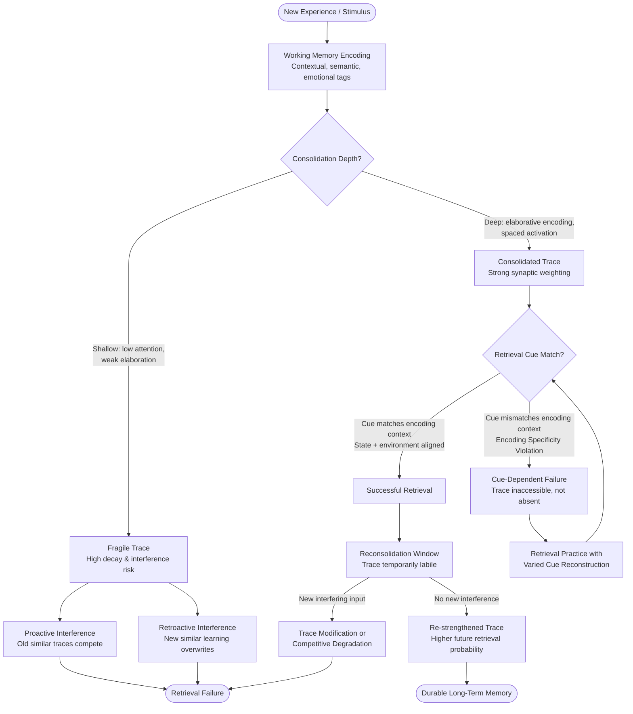

# Lesson 3: Retrieval Principles — Forgetting Theory

## 1. First-Principles Intuition & Invariants

Memory, in the practitioner's working model, is not a filing cabinet. It does not store information in discrete, stable locations that persist until deliberately erased. It is better understood as a reconstruction process: every act of remembering is an act of rebuilding, assembling fragments of encoded experience into a coherent representation under the influence of present context, emotional state, and competing associations. This distinction between storage and reconstruction is the foundational invariant from which all forgetting theory derives. If memory were simple storage, forgetting would mean deletion. Because memory is reconstructive, forgetting is better understood as retrieval failure — the encoded trace persists, but the cognitive machinery cannot locate or reassemble it under the conditions demanded at the moment of recall.

The practical implication is profound. When a client, student, or clinical subject reports "I forgot," the diagnostically useful question is not "was the information retained?" but rather "what retrieval conditions are present now, and how well do they match the conditions present during encoding?" This reframe shifts the practitioner's intervention target from input (how information is presented) toward context architecture (how retrieval environments are designed to match encoding states). It underpins everything from spaced repetition scheduling to the design of examination environments in applied educational psychology.

Hermann Ebbinghaus, working in the 1880s with himself as the sole subject, produced the first quantitative forgetting curve. His finding — that retention drops sharply in the first hours after learning and then levels into a gradual decline — established the temporal dimension of forgetting as empirically tractable. What Ebbinghaus measured, however, was cued recall under a single, impoverished condition: himself, alone, reciting nonsense syllables. His curve captured the worst case: minimal contextual richness, maximal interference potential, no retrieval practice. The practitioner's task is to build systems that bend that curve upward.

Three theoretical families structure our understanding of why retrieval fails. The first is **decay theory**, which holds that memory traces degrade passively over time through disuse, following the metabolic logic that neural representations not reactivated lose synaptic consolidation over time. Decay theory is intuitive and partially supported by neuroscience, particularly the LTP (long-term potentiation) literature, but it faces a persistent empirical challenge: memory often survives long dormant periods intact. Adults recall childhood languages not spoken for decades; soldiers remember combat skills after years of civilian life. Pure decay cannot explain such survivals.

The second family is **interference theory**, which locates forgetting not in the passage of time but in the competition between memory traces. Proactive interference occurs when older learning impairs the retrieval of newer learning — a French speaker learning Spanish will find that French vocabulary actively intrudes during Spanish recall. Retroactive interference runs in the opposite direction: newer learning impairs retrieval of older material. A student who learns Keynes after Hayek will find that Keynesian frameworks can contaminate, blur, or suppress the precise recall of Hayekian arguments. Interference theory predicts, correctly, that forgetting accelerates when new learning is similar in structure or domain to prior learning, because similar representations share overlapping neural activation patterns and compete for retrieval priority.

The third family is **cue-dependent forgetting**, developed most rigorously by Endel Tulving and articulated in his **encoding specificity principle** (1973). Tulving's central claim is that a retrieval cue is effective only to the degree that it matches the specific encoding context in which the memory was formed. The memory trace is not stored as an abstract fact but as a fact-in-context: bound to the environmental, physiological, and cognitive conditions present at encoding. This means that state-dependent memory — where recall is superior when the internal state at retrieval matches the state at encoding — is not a curiosity but a core feature of how memory is organized. A practitioner designing a retrieval training protocol must treat the cue environment as the primary variable, not an afterthought.

## 2. Core Architecture & Mechanics

Understanding the mechanistic relationship between encoding, storage, and retrieval requires a working model of how these processes interact over time. The diagram below maps the state transitions of a memory trace from initial encoding through consolidation, interference exposure, and retrieval attempts, illustrating the branching conditions that lead to successful recall or retrieval failure.

The diagram makes explicit what linear models of memory obscure: retrieval is not a terminal event but a transformative one. When a consolidated trace is successfully retrieved, it re-enters a labile reconsolidation state during which it is temporarily vulnerable to interference or modification before being re-stabilized. This reconsolidation window is not a liability — it is the mechanism by which retrieval practice strengthens memory. Each successful retrieval and reconsolidation cycle raises the retrieval probability for subsequent attempts, which is the neurological substrate of the **testing effect**.

The testing effect, documented extensively by Roediger and Karpicke (2006) and replicated across dozens of paradigms, states that actively retrieving information from memory produces stronger long-term retention than an equivalent amount of additional study time. The mechanism is not mere exposure repetition; it is the effortful reconstruction process itself that drives consolidation. When a practitioner asks a client to recall a previously encoded set of associations without looking at the source material, the neural effort required to locate and assemble the trace engages a broader network of associative pathways than passive re-reading activates. Each pathway engaged during retrieval becomes an additional potential retrieval route for the future, expanding the cue space that can successfully activate the trace.

The **spacing effect** operates through a related but distinct mechanism. When retrieval practice is distributed across time — the technique formalized as spaced repetition — each successive retrieval attempt occurs after a period of partial forgetting. Because the trace has decayed slightly, the effortful reconstruction required is greater than it would be in a massed practice session, and that increased effort drives deeper reconsolidation. Spaced repetition schedulers operationalize this by targeting each review session to occur at the moment the retrieval probability has dropped to a threshold (typically around 90%), maximizing the consolidation benefit without allowing the trace to decay past the point of retrieval. Algorithms such as SM-2 (the backbone of Anki) calculate inter-repetition intervals by tracking each item's historical retrieval difficulty and applying an exponentially growing schedule.

Interference theory at the mechanistic level is best understood through the concept of **associative competition**. Memory traces are not stored independently; they are organized in associative networks where nodes representing similar concepts share overlapping activation patterns. When two memories share significant overlap — two Italian vocabulary words with similar phonological structure, two theoretical frameworks with parallel argument architectures — retrieval of one automatically activates and partially suppresses the other. The practitioner's insight here is that interference is not random noise; it is structural and predictable. Proactive interference is strongest when the learner has a large, well-consolidated body of prior knowledge in the same domain as the new material, which explains the apparent paradox that domain experts sometimes show worse retention for new within-domain information than novices do in the short term.

## 3. High-Performance Optimization & Failure Modes

The practitioner's highest-leverage intervention is **interleaved retrieval practice**, which addresses interference and encoding specificity simultaneously. Where blocked practice (learning all material of one type before moving to the next) minimizes short-term interference and maximizes the feeling of fluency during the learning session, it fails to build discriminative retrieval. Interleaving forces the learner to identify not just the answer but the category and context of the problem before retrieving, which trains the associative network to route retrieval through contextually appropriate pathways. A practitioner designing a clinical memory training protocol should therefore schedule mixed-topic retrieval sessions rather than domain-blocked review, accepting the subjective difficulty as a feature, not a defect.

Encoding specificity violations are among the most common and least diagnosed failure modes in applied memory training. They manifest when a learner encodes material in a context that will not be reproduced at retrieval. A psychology doctoral student who studies Tulving's models exclusively from highlighted lecture notes, in a quiet library, in a low-arousal state, may find that recall during an oral examination in a high-arousal, conversational context is significantly degraded — not because the information was not learned, but because the retrieval cues present during examination do not match the encoding context. The intervention is **context variation during encoding**: deliberately studying the same material across multiple environments, internal states, and modality formats so that the memory trace accumulates a richer, more varied set of retrieval routes. This is not inefficiency; it is systematic cue-broadening.

State-dependent memory is the clinical application of encoding specificity that practitioners most frequently underweight. Mood-congruent recall — the well-established finding that depressed affect facilitates recall of negatively valenced memories and impairs recall of positive ones — is not merely a feature of mood disorders. It is a universal property of the memory system. Practitioners working with clients on procedural skill acquisition or factual learning should therefore attend to the affective and arousal state during encoding and, where possible, train across multiple states to prevent state-dependency from becoming a retrieval bottleneck.

The most common failure mode in spaced repetition practice is **interval collapse**: the learner, feeling uncertain about an item, repeatedly reschedules it for near-term review, preventing the interval from growing to the length needed to trigger deep reconsolidation. This produces a deck that perpetually contains many "difficult" cards reviewed at short intervals — high time cost, low retention benefit. The diagnostic signal is a card that has been reviewed more than eight times without reaching a stable interval above seven days. The intervention is **graduated desensitization of recall anxiety**: the practitioner reframes near-miss retrievals as the mechanistically ideal condition for consolidation, and trains the client to allow intervals to grow even when confidence is imperfect. The correct schedule is one where retrieval is effortful, not impossible.

Retroactive interference during consolidation sleep is a clinically important boundary case. The sleep-dependent memory consolidation literature establishes that slow-wave sleep and REM sleep each contribute to the stabilization of different memory types, and that learning new, overlapping material within the hours before sleep compresses the consolidation window for earlier-encoded material. A practitioner advising a client on study scheduling should treat the two hours before sleep as a consolidation protection window: introducing highly similar new material in that window maximizes retroactive interference precisely when the brain is preparing to stabilize the day's learning. The intervention is scheduling novel, high-overlap material earlier in the waking day and reserving pre-sleep sessions for low-interference review or entirely different domains.

Proactive interference becomes critical at scale in clients managing large, structured knowledge bases — attorneys learning case law, clinicians learning differential diagnoses, analysts building taxonomic classification competence. As prior learning grows denser, each new addition to a crowded domain faces higher competitive interference from the existing network. The practitioner's tool is **comparative elaboration**: encoding new material not in isolation but explicitly in relation to its most likely interference competitors, encoding both the shared features and the discriminating differences. This converts the competitive relationship from a retrieval hazard into a navigational map, using existing strongly consolidated traces as retrieval scaffolding for the new material rather than allowing them to function as suppressors.

The testing effect degrades under two specific conditions that practitioners must actively prevent. First, retrieval practice that is too easy — where the learner generates the answer immediately with no effortful reconstruction — does not trigger meaningful reconsolidation and produces minimal retention benefit beyond the first session. Second, retrieval practice that is too difficult — where the learner cannot retrieve the trace at all and must immediately consult the source — provides no retrieval benefit and may actually strengthen the error state if the learner generates a confident wrong answer before looking. The optimal retrieval difficulty is the region between these extremes: the learner experiences 3–10 seconds of effortful search before successfully reconstructing the target. This is operationally achievable by calibrating item difficulty through early session performance data and adjusting cue richness in real time.

---

## 4. Summary & Verification Matrix

| Principle | Governing Mechanism | Practitioner Protocol | Failure Mode | Diagnostic Signal | Mitigation |
|---|---|---|---|---|---|
| **Encoding Specificity** | Memory traces are bound to encoding context; retrieval cues must match that context to access the trace | Vary encoding environments, modalities, and affective states deliberately across study sessions | Context mismatch at retrieval; trace inaccessible despite adequate encoding | Reliable recall in study context, unreliable recall in novel or high-stakes contexts | Multi-context encoding; simulate retrieval conditions during practice |
| **Interference Theory** | Similar memory traces compete for retrieval; proactive interference flows from old to new, retroactive from new to old | Use interleaved practice; apply comparative elaboration to encode discriminating features explicitly | Intrusion errors; domain expert paradox (high prior knowledge impairs new within-domain retention) | Consistent cross-contamination of similar concepts under retrieval pressure | Explicit differentiation encoding; spaced separation of similar material across sessions |
| **Decay Theory** | Unused traces lose synaptic consolidation strength over time; reactivation resets the decay clock | Schedule minimum reactivation intervals using spaced repetition to prevent decay below retrieval threshold | Trace inaccessible after long dormancy with no competing interference | Gradual retrieval failure proportional to elapsed time since last retrieval | Spaced repetition with intervals calibrated to individual item decay rate |
| **Testing Effect** | Effortful retrieval triggers reconsolidation, expanding the associative retrieval network; passive re-exposure does not | Replace re-reading and highlighting with active retrieval practice as the primary review modality | Easy retrieval produces no consolidation benefit; failed retrieval without correction may strengthen error traces | Subjective fluency during study without reliable performance on subsequent novel retrieval tests | Calibrate retrieval difficulty to 3–10 second effortful reconstruction; correct errors immediately |
| **Spacing Effect** | Retrieval after partial forgetting requires greater reconstruction effort, driving deeper reconsolidation than massed practice | Distribute retrieval sessions using an exponentially growing interval schedule (e.g., Anki SM-2 algorithm) | Interval collapse: anxiety-driven over-review prevents intervals from growing, minimizing consolidation benefit | Cards reviewed >8 times without reaching a stable interval >7 days | Reframe effortful near-miss retrieval as the mechanistically optimal condition; allow intervals to grow |
| **Cue-Dependent & State-Dependent Forgetting** | Internal physiological and affective states form part of the encoding context; state mismatch at retrieval degrades access | Train across varied arousal and mood states; schedule high-overlap new learning away from pre-sleep consolidation window | State-locked retrieval: information accessible only in the encoding affective state; sleep-window retroactive interference | Retrieval failure correlated with affective or arousal state differences between study and test contexts | Cross-state encoding; protect pre-sleep consolidation window from high-interference new material |
