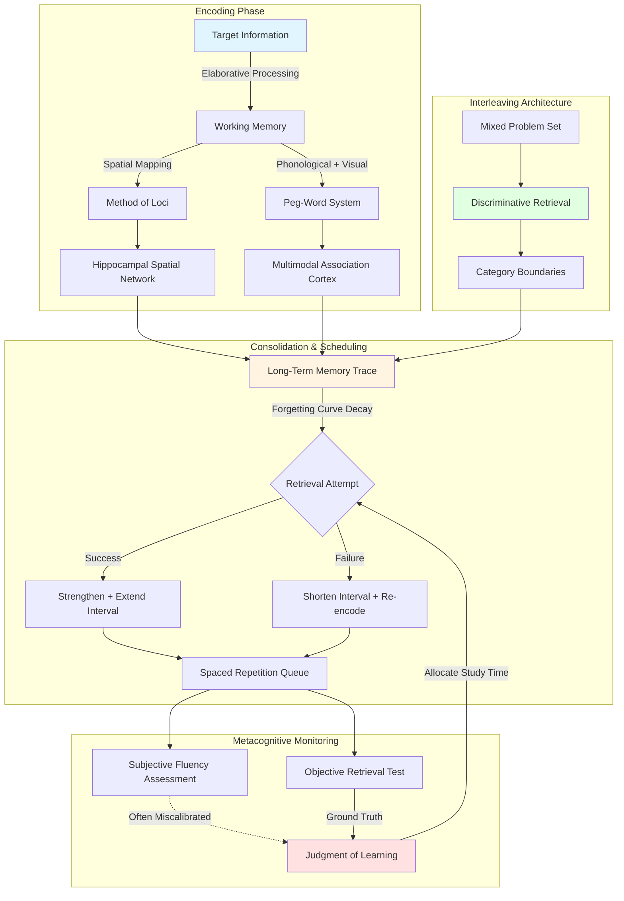

# Lesson 4: Mnemonic Strategies — Applied Memory Training

## 1. First-Principles Intuition & Invariants

Human memory operates not as a passive recording device but as a dynamic reconstruction engine that encodes, consolidates, and retrieves information through distributed neural ensembles firing in coordinated patterns. When practitioners ask why mnemonic strategies produce dramatic performance gains while passive rereading yields minimal improvement, the answer lies in understanding that memory formation depends fundamentally on elaborative encoding depth, retrieval practice frequency, and the architectural constraints of working memory capacity. The classic Atkinson-Shiffrin model proposed that information flows from sensory registers through a limited-capacity working memory buffer before consolidating into long-term storage, but contemporary neuroscience reveals a more nuanced picture: encoding strength depends on the number and quality of associative links forged during initial learning, the temporal spacing of retrieval attempts, and the metacognitive accuracy with which learners monitor their own knowledge states.

The method of loci stands as perhaps the oldest documented mnemonic system, with classical rhetoricians like Cicero describing the technique of mentally placing speech elements along a familiar spatial route and retrieving them by mentally walking that path. This technique exploits the hippocampal spatial mapping circuits that evolved to navigate physical environments, repurposing them to navigate conceptual landscapes. Neuroimaging studies demonstrate that expert practitioners of the method of loci show robust activation in parahippocampal regions during both encoding and retrieval, suggesting they are literally treating abstract information as locations in space. The invariant principle is that humans possess exceptional spatial memory—vastly superior to our capacity for arbitrary lists—and mnemonic systems succeed by translating arbitrary information into the representational formats our brains evolved to handle efficiently.

Peg-word systems operate on a complementary principle: they establish a fixed retrieval structure that remains constant across learning episodes, allowing new information to be temporarily attached to permanent mental landmarks. The classic one-is-a-bun, two-is-a-shoe rhyming scheme creates ten vivid, easily recalled concrete images that serve as cognitive hooks. When a practitioner needs to memorize a shopping list, historical dates, or procedural steps, they forge bizarre interactive mental images linking each item to its corresponding peg. The system succeeds because it provides both a phonological retrieval cue through the rhyme and a visual-semantic elaboration through the concrete image, creating redundant retrieval pathways. The neurocognitive invariant is that bizarre, emotionally salient, and multisensory images produce stronger encoding than abstract verbal representations because they recruit broader cortical networks including visual processing areas, emotional centers like the amygdala, and motor simulation regions.

Spaced repetition scheduling emerges from Hermann Ebbinghaus's nineteenth-century discovery that memory retention follows a predictable exponential decay function, with forgetting most rapid immediately after learning and gradually decelerating over time. Ebbinghaus demonstrated through painstaking self-experimentation with nonsense syllables that distributing practice sessions across expanding intervals produces superior long-term retention compared to massed practice. The forgetting curve reveals that each successful retrieval strengthens the memory trace and extends the interval before the next review becomes necessary. Modern spaced repetition algorithms like SuperMemo's SM-2 and Anki's implementation track individual item difficulty, adjusting review intervals based on retrieval success or failure. The governing invariant is that retrieval itself is a learning event—the act of successfully recalling information from long-term memory strengthens that memory more effectively than additional encoding exposures. This retrieval practice effect means that testing is not merely assessment but the most potent learning intervention available.

Interleaving challenges the intuitive practice strategy of blocking similar problems together, instead mixing different problem types or content categories within a single study session. While blocked practice produces smooth within-session performance gains that feel productive, interleaved practice forces the learner to discriminate between problem types and select appropriate strategies, strengthening discriminative cues and response selection processes. Research in motor learning, mathematics education, and category learning consistently demonstrates that interleaving produces superior long-term retention and transfer despite creating temporarily slower acquisition. The mechanism involves desirable difficulties: conditions that impair performance during training but enhance long-term learning by forcing deeper processing. The invariant is that learning requires effortful retrieval and discrimination; fluent performance during practice sessions often reflects short-term working memory activation rather than durable long-term encoding.

Metacognitive monitoring refers to the learner's ability to accurately assess their own knowledge states, predict future performance, and allocate study time accordingly. The Dunning-Kruger effect demonstrates systematic metacognitive miscalibration, particularly among low-skill individuals who lack the competence to recognize their own incompetence. In memory training contexts, learners frequently exhibit illusions of competence driven by recognition familiarity: material appears familiar during rereading, creating a subjective sense of knowing that does not correspond to actual retrieval ability. Effective memory training requires calibrating metacognitive judgments through objective retrieval tests rather than subjective familiarity assessments. Practitioners must learn to distinguish between the passive recognition that occurs when rereading notes and the active recall required to generate information without external cues. The calibration invariant is that subjective fluency during study is a poor predictor of actual retention, while objective retrieval performance under test-like conditions provides accurate diagnostic information.

## 2. Core Architecture & Mechanics

The method of loci technique requires establishing a detailed, stable mental route containing distinct locations that serve as memory anchors. Practitioners typically begin with a highly familiar environment—their childhood home, daily commute route, or workplace building—and explicitly enumerate sequential locations along a path through that space. A residential route might proceed: front door threshold, entry hall coat closet, living room couch, kitchen counter, dining room table, back door, and so forth. Each location must possess sufficient distinctive features to prevent confusion and must follow an unambiguous sequential order. During encoding, the practitioner mentally places each to-be-remembered item at successive locations by creating vivid, interactive mental images. For a grocery list containing milk, eggs, bread, and coffee, one might visualize a milk carton exploding against the front door, eggs hatching chicks in the coat closet, bread loaves piled impossibly high on the couch, and coffee beans raining from the kitchen ceiling. The more bizarre, multisensory, and emotionally resonant the image, the stronger the encoding.

During retrieval, the practitioner mentally walks the route, visiting each location in sequence and inspecting what item was placed there. The spatial structure provides automatic retrieval cues and ordering, eliminating the serial position effects that plague free recall of unstructured lists. Competitive memory athletes extend this technique to palace-scale architectures containing hundreds or thousands of distinct loci, allowing them to memorize the order of shuffled card decks or hundreds of random digits. The neuroanatomical substrate involves recruiting hippocampal place cells and grid cells—neurons that normally encode physical location—to represent abstract information. Functional imaging reveals that method of loci experts show activation patterns during memory retrieval that resemble spatial navigation, suggesting the technique genuinely repurposes spatial memory circuits for non-spatial content.

Peg-word systems establish a permanent ordered list of concrete images that serve as attachment points for temporary information. The phonological peg system uses rhyming cues: one is a bun, two is a shoe, three is a tree, four is a door, five is a hive, six are sticks, seven is heaven, eight is a gate, nine is wine, ten is a hen. Each number-image pair must be thoroughly overlearned until retrieval is automatic and effortless. Once established, the system allows rapid encoding of ordered lists by creating interactive images linking each list item to its corresponding peg. To remember that the third president was Jefferson, one might visualize Jefferson writing the Declaration of Independence while sitting in a tree. To remember that element 79 is gold, one could use a major system phonological conversion that maps 79 to specific consonants and create an image accordingly.

More sophisticated practitioners employ the major system, which provides pegs for hundreds or thousands of positions by converting numbers into consonant sounds and then into concrete words. The standard encoding maps 0 to s/z sounds, 1 to t/d/th sounds, 2 to n, 3 to m, 4 to r, 5 to l, 6 to j/sh/ch sounds, 7 to k/g sounds, 8 to f/v sounds, and 9 to p/b sounds. The number 42 converts to r-n sounds, which might become "rain" or "rune" or "ruin." The practitioner selects vivid concrete images for each number, creating a permanent mental filing system. This technique requires significant upfront investment to learn the phonological mappings and establish image associations, but once mastered it provides unlimited capacity for encoding ordered numerical information.

Spaced repetition scheduling algorithms determine optimal review timing by modeling the forgetting curve for individual items. The SM-2 algorithm, developed for SuperMemo in 1988 and later adapted by Anki, tracks two parameters for each flashcard: the interval until the next review and an easiness factor reflecting item difficulty. After each review, the learner rates their retrieval success on a scale from complete failure to perfect recall. Easy items receive increasingly long intervals—initially one day, then three days, then nine days, then 27 days, following an exponential expansion. Difficult items revert to short intervals and receive more frequent practice. The algorithm continuously adjusts each item's easiness factor based on historical performance, personalizing the schedule to the learner's specific knowledge profile.

The spacing effect operates through two complementary mechanisms: study-phase retrieval and encoding variability. When learners encounter material after a delay, they must engage in effortful retrieval from long-term memory rather than simply accessing lingering activation in working memory. This retrieval effort strengthens the memory trace more effectively than additional encoding exposures. Additionally, spaced presentations occur in varying mental contexts—different moods, locations, times of day—which creates multiple retrieval pathways and improves the probability that at least one pathway will be accessible during future retrieval attempts. The optimal spacing interval sits in a sweet spot: long enough to require effortful retrieval but short enough that retrieval remains possible. If intervals are too short, retrieval remains trivially easy and provides minimal strengthening; if intervals are too long, retrieval fails completely and learners must re-encode the information from scratch.

Interleaving implementations require careful problem set construction that mixes related but distinguishable problem types or content categories. In mathematics education, rather than completing 20 consecutive quadratic equation problems followed by 20 linear equations, interleaved practice presents them in pseudorandom order: quadratic, linear, quadratic, quadratic, linear, and so forth. This forces learners to identify which problem type they face and select the appropriate solution strategy rather than simply executing the same procedure repeatedly. In language learning, interleaved vocabulary practice mixes words from different semantic categories rather than blocking all food words together, then all transportation words together. The difficulty lies in balancing mixture—too much similarity causes confusion, while too much diversity prevents pattern detection.

Research demonstrates that interleaving produces a characteristic learning curve: blocked practice yields smooth linear improvement within sessions but poor long-term retention, while interleaved practice produces choppy, inconsistent within-session performance but superior delayed test performance. Learners typically perceive blocked practice as more effective because it feels easier and produces visible immediate gains, creating a metacognitive illusion. Effective implementation requires educating learners about this dissociation between training performance and learning outcomes, helping them tolerate the frustration of interleaved practice by understanding its long-term benefits. The mechanism involves strengthening discriminative cues—the features that distinguish one problem type from another—and preventing learners from relying on superficial retrieval cues like "this looks like the problem I just solved."

Metacognitive calibration training begins with distinguishing between different judgment types: judgments of learning assess current knowledge state, predictions of future performance estimate test outcomes, and feelings of knowing indicate whether currently irretrievable information could be recognized if presented. Research consistently shows that immediate judgments of learning—made right after studying material—are poorly calibrated because they reflect residual working memory activation rather than long-term storage. Delayed judgments made after allowing forgetting to occur show significantly better calibration. The practical implication is that learners should test themselves after delays rather than trusting the subjective fluency experienced during study.

Calibration protocols involve systematic comparison between predicted and actual performance. After studying a set of flashcards, the learner predicts their test score, takes an objective retrieval test, and then compares prediction to outcome. Repeated cycles of prediction, testing, and feedback gradually improve calibration accuracy. This process helps learners identify material they mistakenly believe they know—the dangerous illusion of competence—and material they understand better than they realize. Dunning-Kruger calibration specifically addresses the tendency of low-performers to overestimate their competence. Interventions that improve metacognitive skills—teaching learners to recognize what good performance looks like and developing self-assessment rubrics—reduce this overconfidence bias. The goal is shifting from passive recognition-based assessments toward active retrieval-based diagnostics that provide accurate performance data.

## 3. High-Performance Optimization & Failure Modes

Elite memory performance requires deliberate practice that progressively increases encoding specificity and retrieval difficulty. Beginners using the method of loci often create vague, generic images that lack sufficient distinctiveness to survive interference from subsequent encoding sessions. Advanced practitioners learn to incorporate bizarre action, exaggerated scale, emotional salience, and multisensory detail. Rather than simply placing a milk carton on the doorstep, an expert might visualize the doorstep transforming into a giant milk carton that explodes when stepped on, drenching them in cold milk while the smell triggers a childhood memory. This elaboration recruits broader neural networks and creates more retrieval pathways. Competitive memory athletes report that successful images often involve motion, personal relevance, humor, or mild disgust—emotions that tag memories as significant.

Scaling the method of loci to competition-level performance requires constructing multiple distinct mental palaces to prevent interference between learning episodes. Using the same route repeatedly causes new images to overwrite previous ones, creating catastrophic interference. Memory champions develop diverse routes—childhood homes, schools, commute paths, fictional locations from movies or video games—and systematically rotate between them. They also develop rapid encoding protocols that create serviceable images within seconds rather than leisurely minutes. Speed training involves timed drills where practitioners encode increasingly long lists with decreasing time per item, eventually reaching encoding rates of one item per two seconds for digit strings or playing cards. At this performance level, conscious deliberation becomes impossible; images must arise automatically through overlearned associations.

Peg-word system optimization addresses several failure modes: peg exhaustion when lists exceed available pegs, retrieval confusion when similar images are used for different items, and encoding delays caused by failure to quickly generate interactive images. Advanced practitioners expand their peg repertoire through the major system or by creating multiple specialized peg sets for different domains—one set for presidents, another for chemical elements, another for historical dates. They also develop rapid image generation skills through creativity training: given any two arbitrary concepts, they practice instantly generating a vivid interactive scene. This skill parallels the divergent thinking trained in improvisational theater, where actors must immediately create scenarios from random prompts. The neurological substrate likely involves strengthening connections between semantic memory networks and visual imagery systems, allowing rapid cross-domain association.

A critical failure mode involves confusing familiarity with retrievability. Learners often use pegs to encode information, feel satisfied when review sessions feel easy, but then discover during actual testing that they cannot spontaneously retrieve peg images without prompts. The solution requires free recall testing rather than cued recall: instead of reviewing pegs in order and checking what item hangs on each, practitioners must attempt to freely generate the entire list without any cues, then consult the peg structure only to identify forgotten items. This forces genuine retrieval practice and exposes knowledge gaps that cued review would mask.

Spaced repetition optimization requires balancing review load against learning rate. Aggressive spacing that pushes intervals as long as possible minimizes review time but increases failure rates, requiring re-encoding and ultimately consuming more total time. Conservative spacing maintains high success rates but requires excessive review sessions for well-learned material. The optimal balance depends on the acceptable failure rate—typically 10 to 20 percent—and the cost of forgetting. For critical professional knowledge where forgetting carries high costs, conservative spacing with 90 percent target retention makes sense. For supplementary material where forgetting is cheap and re-learning is easy, aggressive spacing with 70 percent target retention maximizes efficiency. Modern algorithms adapt to individual learner performance, but practitioners should consciously set retention targets based on material importance.

A subtle failure mode involves the stability-plasticity tradeoff: aggressively spaced material becomes highly stable and resistant to forgetting but also resistant to updating when new information contradicts old learning. Medical students learning drug dosages or anatomical structures that later change face this challenge. The solution involves occasionally introducing deliberate retrieval variability—reviewing material in different formats, from different perspectives, or with modified cues—that maintains plasticity while preserving stability. This prevents memories from becoming so rigidly encoded that they resist updating.

Interleaving implementation failures typically stem from insufficient mixture or inappropriate content selection. Simply randomizing problem order without ensuring adequate spacing between similar items provides minimal benefit. Effective interleaving requires that learners cannot use superficial cues to identify problem types; the mixture must force genuine discrimination. Additionally, interleaving works best for material where learners possess basic competence with individual problem types but need practice in discrimination and selection. For complete novices still learning basic procedures, some initial blocked practice to establish foundational skills may be necessary before introducing interleaving. The transition point typically occurs when learners can successfully solve individual problem types in isolation but struggle to select appropriate strategies when types are mixed.

Metacognitive calibration can paradoxically worsen when practitioners attend to the wrong cues. Learners who calibrate based on study time invested—reasoning that more time must mean better learning—show poor accuracy because time spent does not reliably predict learning quality. Similarly, calibrating based on subjective difficulty produces poor results because difficult material may reflect either poor learning or inherently challenging content. The most accurate calibration comes from delayed retrieval testing: after studying, wait at least several hours, then test yourself without any cues, and assess what percentage you successfully retrieve. This provides direct measurement of long-term storage strength. Practitioners should also track calibration accuracy over time, recording predicted versus actual test scores, and use this data to correct systematic biases like overconfidence or underconfidence.

A sophisticated optimization involves adjusting study strategies based on metacognitive monitoring outcomes. When testing reveals that certain material types consistently show poor retention despite adequate study time, practitioners should switch encoding strategies rather than simply increasing practice volume. Perhaps anatomical structures require spatial encoding via the method of loci, while drug mechanisms require conceptual elaboration through explanation generation. Metacognitive monitoring provides the feedback signal that drives strategic adaptation, transforming memory training from passive repetition into an active problem-solving process where practitioners diagnose failure modes and systematically test alternative approaches.

## 4. Summary & Verification Matrix

| Core Invariant | Mechanism | Diagnostic Protocol | Failure Mode & Mitigation |
|---|---|---|---|
| **Elaborative encoding depth determines retention strength** | Spatial method of loci and peg-word systems create multimodal associations recruiting hippocampal spatial circuits and visual-semantic networks; bizarre, emotionally salient images produce broader cortical activation | Test free recall after 24-hour delay without any retrieval cues; retention should exceed 70% for well-encoded material; detailed multisensory images should be retrievable with original location or peg as minimal cue | Generic, vague images fail to survive interference; solution requires systematic elaboration training emphasizing action, emotion, scale exaggeration, and personal relevance; competitive athletes report images must be instantly bizarre |
| **Retrieval practice strengthens memory more than re-encoding** | Spaced repetition exploits forgetting curve dynamics by scheduling reviews at expanding intervals calibrated to individual item difficulty; successful effortful retrieval from long-term memory potentiates synaptic connections more effectively than passive re-exposure | Track success rate across spaced reviews; optimal algorithms target 80-90% retrieval success; plot forgetting curves for individual items to verify exponential spacing expansion; measure long-term retention at 30+ days | Excessive spacing causes failures requiring re-encoding and consuming more total time than conservative schedules; calibrate interval expansion rate to maintain target success percentage; critical material warrants conservative spacing despite lower efficiency |
| **Interleaving forces discriminative learning and strategy selection** | Mixed practice prevents reliance on superficial retrieval cues and strengthens category boundaries by requiring problem-type identification before solution execution; desirable difficulty creates choppy acquisition but superior transfer and long-term retention | Compare blocked versus interleaved groups on delayed mixed tests; interleaved training should show 20-40% advantage despite equal or slower within-session performance; learners should accurately identify problem types before attempting solutions | Insufficient mixture allows superficial pattern matching; excessive mixture prevents pattern detection entirely; optimal interleaving maintains clear category structure while preventing block-based solution templates; requires basic competence before introduction |
| **Metacognitive calibration requires objective retrieval testing** | Delayed judgments of learning show superior accuracy to immediate judgments because they reflect long-term storage rather than residual working memory activation; Dunning-Kruger miscalibration stems from inability to recognize features of competent performance | Compare predicted versus actual test performance across multiple trials; well-calibrated learners show prediction-outcome correlations above 0.7; track overconfidence index by computing mean prediction minus actual percentage | Subjective fluency during study creates illusion of competence; passive recognition feels easy but does not predict recall ability; solution requires systematic delayed free-recall testing and explicit tracking of prediction accuracy to provide corrective feedback |
