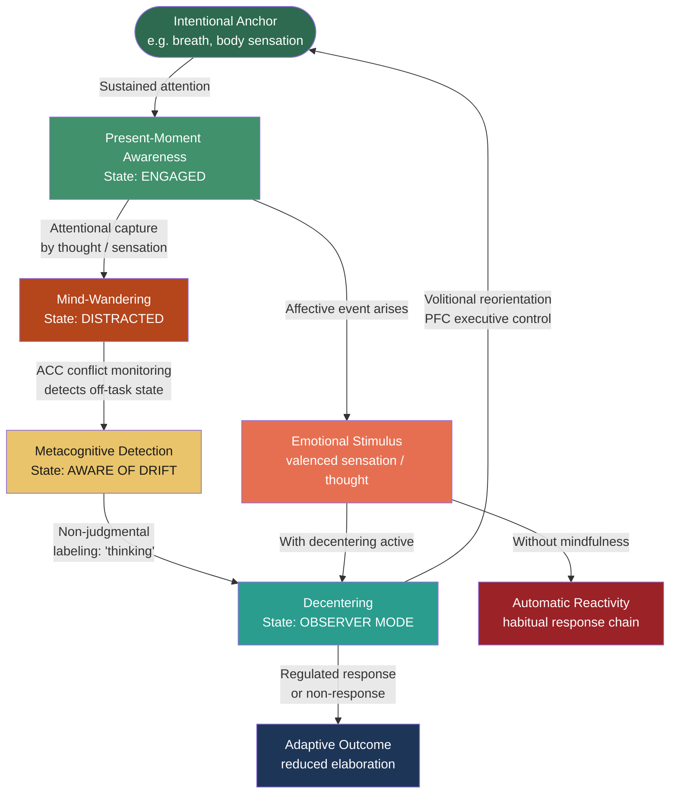

# Lesson 1: Foundations of Mindfulness

## 1. First-Principles Intuition & Invariants

Mindfulness is one of the most consequential constructs to enter Western psychological science in the past half-century, yet it remains persistently misunderstood, even among practitioners who deploy it clinically. At its core, mindfulness is not a relaxation technique, a stress-management shortcut, or a synonym for meditation. It is a specific mode of attentional engagement with present-moment experience, characterized by deliberate, non-reactive awareness. Getting that definition right at the outset is not pedantry—it is the load-bearing foundation on which every clinical intervention, measurement instrument, and theoretical model in this curriculum rests.

The construct enters the Western psychological lexicon most directly through Jon Kabat-Zinn's operational definition, formalized when he established the Stress Reduction Clinic at the University of Massachusetts Medical School in 1979: mindfulness is "paying attention in a particular way—on purpose, in the present moment, and non-judgmentally." This three-part structure is not incidental. Each clause encodes a distinct psychological mechanism. "On purpose" specifies the volitional, executive dimension of attentional control. "In the present moment" specifies the temporal anchor, excluding rumination (past-directed) and worry (future-directed). "Non-judgmentally" specifies the evaluative stance, distinguishing mindful awareness from ordinary metacognition, which almost always carries affective valence. Together, these three elements describe a cognitive state that is simultaneously alert and equanimous—conditions that are, in ordinary experience, in tension with one another.

To understand why this combination is functionally significant, one must trace its origins. The clinical construct is an adaptation of *sati*, a Pali-language term from the Theravāda Buddhist canon, particularly the *Satipaṭṭhāna Sutta* ("The Discourse on the Foundations of Mindfulness"), dated to approximately the 5th century BCE. In that tradition, *sati* does not translate simply as "awareness." It carries connotations of remembering—specifically, the capacity to hold the present-moment object of attention without losing it to distraction. The *Satipaṭṭhāna* framework organizes contemplative practice across four foundations: awareness of the body (*kāya*), awareness of feeling-tone (*vedanā*), awareness of mind-states (*citta*), and awareness of mental objects or phenomena (*dhammā*). This is not incidental taxonomy. It is a systematic phenomenological map of the layers of experience available to trained introspective attention, and modern psychological models have recapitulated its logic without always acknowledging the debt.

The transmission of these concepts into Western science passed through several critical junctures. William James, in his 1890 *Principles of Psychology*, described voluntary attention as "the taking possession by the mind, in clear and vivid form, of one out of what seem several simultaneously possible objects or trains of thought." James recognized attention as trainable and central to mental health, writing that "the faculty of voluntarily bringing back a wandering attention, over and over again, is the very root of judgment, character, and will." He had no access to Buddhist psychology as such, but his functional analysis of attention anticipated the cognitive architecture that mindfulness training would later be shown to modify. The mid-twentieth century saw interest in altered states and Eastern philosophy through figures like Alan Watts and later Daniel Goleman, whose 1977 book *The Meditative Mind* provided one of the earliest comparative scholarly surveys of contemplative traditions. But it was Kabat-Zinn's clinical operationalization—deliberately stripped of religious framing to meet the standards of medical and psychological research—that opened the empirical floodgates.

The clinical programs that emerged from this tradition, most consequentially Mindfulness-Based Stress Reduction (MBSR) and its derivative Mindfulness-Based Cognitive Therapy (MBCT), required that the construct be measurable. This demand produced the field's first critical invariant: **mindfulness must be separable into components that can be assessed independently**. The Five Facets of Mindfulness Questionnaire (FFMQ), developed by Baer and colleagues (2006), operationalizes mindfulness across five dimensions—observing, describing, acting with awareness, non-judging of inner experience, and non-reactivity to inner experience—each of which can be scored separately and correlates differentially with clinical outcomes. This granularity matters enormously for practitioners. A client who scores low on non-reactivity but high on observing is in a qualitatively different clinical situation than a client with the inverse profile, and the interventions appropriate to each will differ.

The second foundational invariant concerns the distinction between **trait mindfulness** and **state mindfulness**. State mindfulness is a momentary quality of experience—the degree to which a person is engaged in present-moment awareness at a given time. Trait mindfulness refers to the dispositional tendency to engage experience mindfully across contexts and over time. These are related but not identical. Formal meditation practice tends to reliably increase trait mindfulness over weeks and months, but it does so by accumulating and consolidating changes in state mindfulness across individual sessions. For the clinical practitioner, this means that acute state inductions (a brief breathing exercise, a body scan) have immediate, measurable effects on affect regulation and cognitive flexibility, while longer-term trait development requires sustained, repeated practice. Conflating these two levels of analysis is one of the most common sources of confusion in both research design and clinical expectation-setting.

The third invariant—and perhaps the most underappreciated—is that mindfulness is **not equivalent to meditation**. Meditation is a formal practice modality, a set of procedures by which one trains the mind. Mindfulness is a quality of attention that those procedures are designed to cultivate. One can practice mindfulness informally, without any structured meditation session, by deliberately attending to sensory experience during routine activities. Conversely, one can sit in a formal meditation posture and spend the entire session lost in conceptual elaboration—technically meditating, but not practicing mindfulness in any functionally meaningful sense. This distinction has direct clinical implications: patients who resist formal meditation are not foreclosed from mindfulness-based interventions. The delivery vehicle is flexible; the attentional quality being trained is not.

---

## 2. Core Architecture & Mechanics

The psychological architecture of mindfulness is not monolithic. Contemporary cognitive neuroscience and clinical psychology have converged on a model that treats mindfulness as the product of at least three interacting regulatory systems: attentional control, metacognitive awareness, and emotion regulation. Each system has a distinct functional role, a distinct set of failure modes, and a distinct set of training mechanisms. Understanding their interaction is prerequisite to designing effective interventions and interpreting clinical assessment data with precision.

Attentional control refers to the executive capacity to voluntarily select, sustain, and redirect the focus of attention. In mindfulness practice, this manifests most directly in concentration exercises—attending to a single object (typically the breath) and repeatedly returning attention to that object when it wanders. The neural substrate most implicated here is the anterior cingulate cortex (ACC), which monitors attentional conflict and signals the prefrontal cortex (PFC) when attentional capture by an off-task thought has occurred. Training this system increases what researchers call **attentional stability**: the ability to hold the object of attention across time without being captured by salient but irrelevant stimuli.

Metacognitive awareness—sometimes called decentering or defusion—is the capacity to observe one's own mental events as mental events rather than as direct representations of reality. In clinical terms, this is the shift from "I am anxious" (fusion with the state) to "I notice anxiety arising" (observation of the state from a slight distance). This is not emotional suppression or intellectualization; the phenomenological content is fully acknowledged. What changes is the relationship to the content. Decentering has been identified as a key mechanism of change in both MBCT and Acceptance and Commitment Therapy (ACT), and it is associated with reduced depressive relapse in multiple randomized controlled trials. The metacognitive dimension of mindfulness is what distinguishes it most sharply from simple relaxation techniques, which may reduce sympathetic activation without producing any change in the client's relationship to their own cognitive-emotional processes.

Emotion regulation via mindfulness operates through several pathways, but the most well-evidenced is what Gross and colleagues describe as antecedent-focused regulation through **attentional deployment**. By learning to notice the early-arising, low-intensity precursors of a maladaptive emotional response before full elaboration occurs, the practitioner gains a wider window of opportunity for adaptive response. This is what Kabat-Zinn's clinical work described as the "space between stimulus and response." Crucially, this is not accomplished by suppressing the emotional signal—a strategy that tends to increase physiological arousal while reducing its behavioral expression—but by developing the perceptual acuity to detect the signal earlier and the regulatory flexibility to allow it without automatic behavioral engagement.

The diagram below maps the operational architecture of a mindfulness session as a state-transition and dataflow model, illustrating how attentional drift, metacognitive detection, and volitional reorientation cycle through a single practice episode.

This architecture clarifies several frequently confused clinical observations. First, mind-wandering is not a failure of practice—it is an unavoidable and indeed necessary event in the training cycle, because the moment of metacognitive detection that follows it is precisely the repetition unit that strengthens both attentional control and decentering capacity. The practitioner who wanders and returns to anchor three hundred times in a single session has not had a poor session; they have executed three hundred training repetitions. This reframe is not merely motivational. It is mechanistically accurate and must be communicated explicitly to clients to prevent the demoralization that derails early practice.

Second, the diagram shows that automatic reactivity and mindful decentering share the same upstream input—the arising of an affectively valenced stimulus—but diverge at the detection point. This is why the FFMQ non-reactivity subscale is a particularly strong predictor of treatment outcomes in anxiety disorders: it measures the degree to which the decentering pathway is active and reliable rather than bypassed by habitual reactivity chains.

The practitioner-level implication is that assessment and intervention must address each node in this architecture independently. A client who has strong attentional control but weak metacognitive awareness will be able to focus during structured practice but will not transfer the skill to daily life. A client with high metacognitive awareness but poor attentional stability will understand what decentering means conceptually but will be unable to sustain the observer perspective long enough for it to interrupt the reactivity chain. Matching the training modality to the specific deficit is advanced clinical work that the remaining lessons in this curriculum address in detail.

---

## 3. High-Performance Optimization & Failure Modes

For advanced practitioners working with high-functioning populations—athletes, executives, clinicians, researchers—or deploying mindfulness-based protocols in intensive therapeutic contexts, the foundational architecture described above quickly encounters boundary conditions. These are not edge cases. They are predictable, well-documented failure modes that emerge systematically as practice deepens or as clinical complexity increases, and each requires a specific mitigation strategy.

The first and most clinically significant failure mode is **attentional over-narrowing**, sometimes called "concentration bypass." This occurs when a practitioner develops strong focused-attention capacity but inadvertently uses it as an avoidance strategy, sustaining absorption on the breath anchor to suppress emotionally aversive material rather than to cultivate open awareness. The behavioral signature is high performance on focused-attention tasks combined with elevated distress when open-monitoring practices (open awareness, choiceless awareness) are introduced. The clinical risk is substantial: in clients with trauma histories, this pattern can produce a kind of dissociative stability—the person appears regulated during structured practice but is not building the metacognitive exposure necessary for genuine integration. The mitigation requires explicitly titrating between focused-attention and open-monitoring modalities within each session, using the focused anchor as a home base from which to deliberately expand attention to the wider field of sensation, emotion, and thought, then return—never treating the anchor as a destination in itself.

A related failure mode specific to measurement-driven clinical contexts is **facet dissociation on structured assessment instruments**. The FFMQ and similar tools assume that the five facets of mindfulness develop in a broadly correlated fashion, and normative data supports this assumption in general population samples. In highly experienced meditators, however, facet profiles can become markedly heterogeneous, with extreme scores on observing combined with low scores on describing—a pattern that in novice samples predicts psychological distress but in experienced practitioners reflects a legitimate contemplative development that prioritizes direct experience over verbal elaboration. Practitioners scoring their own clients must be calibrated to population norms for practice experience level, not general population norms, to avoid misidentifying advanced practitioners as clinically impaired.

The second major failure mode is what MBCT researchers have termed **ruminative simulation of mindfulness**. Some clients, particularly those with high trait neuroticism or strong intellectualizing defenses, engage with mindfulness instructions conceptually rather than experientially. They can describe non-judgmental awareness fluently, articulate the difference between decentering and suppression with accuracy, and yet never actually shift their attentional mode during practice. The observing they report is not phenomenological observation but metacognitive commentary—thinking about their experience rather than attending to it. The diagnostic marker is that their practice reports are predominantly verbal and narrative, with little sensory specificity, low body-awareness scores on the FFMQ, and an inability to describe the experiential texture of practice at any granular level. The intervention is to anchor practice explicitly in raw sensory experience—temperature, pressure, texture, movement—before introducing any cognitive or emotional objects of attention. Sensory specificity is the operational test of whether genuine attentional contact with present-moment experience has been established.

Third, practitioners must account for the **dose-response curve and its non-linearity**. Early in MBSR protocol research, Kabat-Zinn's program specified 45 minutes of daily formal practice as the standard dose. Subsequent research has shown that outcomes do not scale linearly with practice time, and that for many clinical populations, shorter, more frequent practice episodes (12 to 20 minutes, twice daily) produce equivalent or superior outcomes compared to single long sessions, particularly on measures of affect regulation and stress reactivity. The mechanism is likely consolidation: distributed practice creates more frequent repetitions of the detection-and-return cycle, while massed practice in a single long session may produce diminishing returns after the first 20 to 25 minutes as attentional fatigue reduces the quality of repetitions. For practitioners designing protocols, this means that adherence at a moderate dose consistently outperforms non-adherence at an optimal dose, and program design should weight accessibility and sustainability over session duration.

Finally, practitioners working with clinical populations must have clear screening criteria for contraindications. Mindfulness-based interventions have documented adverse effects in a minority of participants, including depersonalization, increased anxiety, and in predisposed individuals, psychotic-spectrum experiences triggered by sustained self-referential attention. The adverse effects literature, synthesized in the work of Willoughby Britton and colleagues at Brown University, indicates that these effects are not randomly distributed: they are more common in individuals with trauma histories, dissociative tendencies, or personal or family history of psychosis. This does not mean mindfulness-based interventions are contraindicated in these populations—MBCT adapted for trauma (MBCT-T) and trauma-sensitive MBSR modifications have been developed and show efficacy—but it does mean that standard protocol delivery without modification is not appropriate, and that practitioners must conduct systematic screening and have established clinical responses when adverse effects emerge. The absence of this screening represents a critical failure mode at the program design level, not the individual session level, and it is non-negotiable for ethical clinical deployment.

---

## 4. Summary & Verification Matrix

| Invariant / Mechanism | Operational Definition | Clinical Diagnostic Criteria | Primary Failure Mode | Mitigation Strategy |
|---|---|---|---|---|
| **Attentional Control** | Volitional capacity to select, sustain, and redirect focus to a chosen object; trained through focused-attention practice targeting ACC-PFC regulatory loop | Client can sustain breath focus for ≥5 minutes with self-reported stability; FFMQ "acting with awareness" subscale ≥28 (norm-referenced) | Over-narrowing / concentration bypass: anchor used to suppress rather than observe aversive content | Titrate between focused-attention and open-monitoring modalities; treat anchor as home base, not endpoint |
| **Metacognitive Awareness (Decentering)** | Capacity to observe mental events as events rather than as reality; operationalized as "observer perspective" separating self from content | Client spontaneously uses observational language ("I notice...") in session; FFMQ non-judging and non-reactivity subscales elevated relative to intake baseline | Ruminative simulation: verbal/conceptual engagement substitutes for experiential attentional contact | Anchor early practice in raw sensory specificity (temperature, pressure, texture) before introducing cognitive-emotional objects |
| **State vs. Trait Mindfulness** | State: momentary quality of present-moment engagement. Trait: dispositional tendency across contexts. Related but non-identical psychological constructs | State assessed via Toronto Mindfulness Scale post-session; Trait assessed via FFMQ across a 4–8 week practice epoch | Conflation of constructs leads to misattributing acute session effects to enduring clinical change prematurely | Use time-locked assessment instruments matched to the construct level being measured; set explicit outcome timelines |
| **Dose-Response Non-Linearity** | Outcomes do not scale linearly with session duration; distributed practice (2× daily, 12–20 min) produces equivalent or superior regulation outcomes to single long sessions | Adherence rate >70% at moderate dose predicts outcome better than nominal dose alone; track completed minutes, not scheduled minutes | Single-session marathon practice in effort to compensate for missed days; attentional fatigue degrades repetition quality after ~25 minutes | Design protocols for sustainability; emphasize frequency over duration; build in formal adherence tracking |
| **Facet Dissociation in Assessment** | Advanced meditators may show heterogeneous FFMQ profiles (high observing / low describing) that mimic distress profiles in novice norms | Use practice-experience-stratified norms; clinical concern warranted only when non-reactivity and acting-with-awareness remain low after ≥8 weeks consistent practice | Misidentifying advanced practitioners as clinically impaired; or novice non-reactivity deficits going unaddressed because observing scores appear high | Stratify FFMQ interpretation by practice experience cohort; prioritize non-reactivity and acting-with-awareness as primary clinical targets |
| **Contraindication Screening** | Trauma history, dissociative tendencies, and psychosis-spectrum risk moderate adverse event probability; standard protocol delivery is insufficient for these subgroups | Administer Trauma History Questionnaire and Dissociative Experiences Scale at intake; establish adverse-effect monitoring protocol for all 8-week programs | Adverse effects (depersonalization, anxiety escalation, dissociation) occurring without clinical detection or response protocol | Pre-program screening; use trauma-sensitive MBSR or MBCT-T adaptations for flagged populations; train facilitators in adverse-effect recognition and response |
