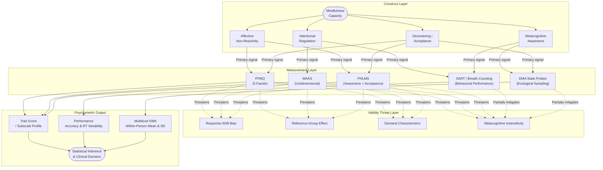

# Lesson 3: Measurement Approaches with Empirical Evidence

## 1. First-Principles Intuition & Invariants

Measuring mindfulness is not simply a matter of asking people whether they feel present. The construct sits at an uncomfortable intersection of phenomenology and psychometrics, and the history of its measurement reflects every tension inherent in that intersection. Before a clinician can interpret a patient's Five Facet Mindfulness Questionnaire score, before a researcher can interpret a meta-analytic effect size, they must grapple with a foundational question that remains genuinely unresolved: what exactly is mindfulness, and can anything we do with paper, pencil, or behavioral coding software reliably capture it?

The working definition that has dominated empirical psychology since Jon Kabat-Zinn's formalization in the late 1970s treats mindfulness as the sustained, intentional direction of attention to present-moment experience with an attitude of acceptance and non-judgment. This definition carries several invisible load-bearing assumptions. First, it frames mindfulness as a trainable trait-state hybrid: individuals vary in baseline dispositional mindfulness, and those baselines shift with practice. Second, it implies that mindfulness is multidimensional rather than unitary, encompassing attention regulation, metacognitive awareness, decentering from thought content, and affective non-reactivity as at least partially separable components. Third, it distinguishes between mindfulness as a practice (the act of meditating) and mindfulness as a psychological capacity (the cognitive and affective skill that practice is presumed to cultivate). These distinctions are not academic; they determine which measurement tools are valid, which outcomes are interpretable, and which clinical inferences are defensible.

The psychometric challenge is severe precisely because the gold standard for measuring a subjective state is self-report, yet the nature of mindfulness places structural limits on what introspection can reveal. A practitioner with poor metacognitive awareness may report high mindfulness because they lack the discriminative capacity to notice their own lapses in attention. Conversely, a seasoned meditator who has developed acute sensitivity to mental wandering may report lower scores than a novice, not because their mindfulness is inferior, but because their standard of evaluation has shifted. This is sometimes called the reference-group effect or the response-shift problem, and it creates a systematic bias that inflates pre-to-post effect sizes in intervention studies when comparison groups are not carefully matched.

Three invariants govern rigorous measurement practice in this domain. The first is construct alignment: the measurement instrument must operationalize the same facets of mindfulness that the intervention is designed to train. Using a measure of attentional stability to evaluate a compassion-focused mindfulness program, for instance, produces floor effects on theoretically active dimensions while missing genuine change on unmeasured ones. The second invariant is psychometric adequacy: internal consistency, test-retest reliability, convergent validity, and discriminant validity must be demonstrated in the specific population under study, not merely imported from validation samples. The third invariant is sensitivity to change: some instruments that have excellent properties as trait measures are poorly calibrated to detect within-person change over the timescale of an eight-week intervention, while state-level measures with strong sensitivity may confound practice-related growth with momentary situational arousal.

---

## 2. Core Architecture & Mechanics

### The Self-Report Instrument Landscape

The most widely deployed self-report instrument in clinical mindfulness research is the Five Facet Mindfulness Questionnaire (FFMQ), developed by Baer and colleagues in 2006 through a factor-analytic synthesis of five earlier scales. Its 39 items map onto five subscales: observing, describing, acting with awareness, non-judging of inner experience, and non-reactivity to inner experience. The observing facet captures the tendency to notice internal and external stimuli; describing reflects the ability to label experiences with words; acting with awareness indexes the tendency to engage in activities with full attentional engagement rather than on automatic pilot; non-judging reflects acceptance rather than self-criticism toward one's own thoughts and feelings; and non-reactivity captures the capacity to allow thoughts and emotions to arise and pass without behavioral activation.

Each subscale has distinct psychometric behavior. Crucially, in non-meditating samples, the observing facet often fails to load coherently onto a higher-order mindfulness factor and can correlate positively with measures of psychological distress, suggesting that for people without meditation experience, heightened self-observation resembles rumination more than mindful awareness. This finding, replicated across multiple independent samples, is not a defect of the instrument so much as a signal about the construct itself: observing attention without the accompanying non-judgmental stance produces monitoring behavior that is phenomenologically distinct from mindfulness. For practitioners, this means that FFMQ total scores must be interpreted with awareness of sample type, and that subscale-level analysis is almost always more informative than a composite.

The Mindful Attention Awareness Scale (MAAS), developed by Brown and Ryan in 2003, takes a deliberately unidimensional approach. Its 15 items all index the absence of mindless, automatic behavior, treating mindfulness as the degree to which attention and awareness are brought to everyday activities. Because it avoids the attitudinal components captured by the FFMQ, the MAAS is less sensitive to acceptance-related training but more sensitive to attentional fluctuation in daily life. Its confirmatory factor structure is robust, its test-retest reliability over short intervals is high, and it correlates negatively with measures of emotional disturbance and positively with well-being outcomes in a dose-dependent pattern that is consistent with theoretical predictions. For practitioners running outcome assessments in brief intervention contexts, the MAAS offers parsimony; for researchers studying the mechanisms of MBSR or MBCT, it undersamples the construct.

The Philadelphia Mindfulness Scale (PHLMS), the Southampton Mindfulness Questionnaire (SMQ), and the Cognitive and Affective Mindfulness Scale-Revised (CAMS-R) each occupy narrower niches. The PHLMS is particularly useful when disentangling awareness from acceptance, since it treats these as separate subscales rather than facets of a unitary trait. The SMQ was designed specifically for clinical populations experiencing distressing thoughts and imagery, making it sensitive in MBCT contexts where the relationship to intrusive cognitions is the primary mechanism of interest. For any practitioner designing a measurement battery, instrument selection should be driven by which facets are theoretically active in the intervention, what the clinical population's cognitive and literacy characteristics are, and whether the goal is trait assessment, outcome monitoring, or mechanistic mediation analysis.

### Behavioral and Performance-Based Measures

Self-report instruments share a common limitation: they depend on the accuracy of the respondent's metacognitive self-knowledge, which is precisely what mindfulness training is meant to cultivate. This circularity has motivated the development of behavioral and performance-based measures that index attentional capacities without relying on self-rating. The Sustained Attention to Response Task (SART) requires participants to respond to a rapidly presented series of non-target stimuli while withholding responses to infrequent targets. Error rates on target trials index attentional lapses; variability in response time indexes moment-to-moment attentional stability. SART performance correlates with MAAS scores in expected directions and improves following mindfulness training in ways that parallel improvements in self-reported awareness.

The Breath-Counting Task, developed by Levinson and colleagues, operationalizes meta-awareness directly: participants count breaths from 1 to 9 and restart at 1, pressing a separate key when they lose count. Because the task requires noticing attentional displacement as it happens rather than retrospectively reporting it, it functions as an objective index of the meta-awareness component that many self-report measures conflate with attentional maintenance. Notably, more experienced meditators do not always score higher on this task when scored purely by error rate; instead, their data show more accurate reporting of errors when errors occur, suggesting that the task is capturing meta-awareness rather than perfect attention.

Ecological Momentary Assessment (EMA) using experience sampling provides a third measurement modality that bridges self-report and behavioral assessment. Using platforms such as MetricWire, ilumivu, or REDCap with automated scheduling, practitioners can administer brief state mindfulness probes (typically one to three items derived from validated instruments such as the Toronto Mindfulness Scale) across multiple daily time points over assessment windows spanning days to weeks. EMA data capture intra-individual variability in mindful states in real-world contexts and are substantially less susceptible to the recall biases that corrupt retrospective trait reports. The analytic demands are higher: multilevel modeling with random effects for participant and time is required to separate within-person from between-person variance, but the resulting data maps the temporal ecology of mindfulness in a way that single time-point questionnaires cannot approach.

The following diagram represents the measurement architecture as a signal-processing system, tracing the path from construct to data and identifying where validity threats enter:

This architecture clarifies a point that is often obscured by single-method designs: the signal arriving at the inference layer has passed through a cascade of transformations, each of which introduces noise and systematic bias. No single instrument fully samples the construct, and the confidence an analyst can place in any observed effect size is bounded by the measurement model's fidelity at every stage of this path.

---

## 3. High-Performance Optimization & Failure Modes

### Meta-Analytic Efficacy Data and What It Actually Shows

The empirical case for mindfulness-based interventions rests substantially on meta-analytic accumulation. Khoury and colleagues' 2013 meta-analysis of 209 studies found a large pre-post effect size for mindfulness-based stress reduction (MBSR) and mindfulness-based cognitive therapy (MBCT) on symptoms of anxiety, depression, and stress (Hedges' g ≈ 0.63), which reduced to a medium effect size when compared against active control conditions. Goldberg and colleagues' 2018 meta-analysis, which applied stricter inclusion criteria requiring randomized controlled designs with active comparators, found that mindfulness-based interventions produced specific effects on depression (g = 0.55) and anxiety (g = 0.57) beyond active controls, though heterogeneity across studies was substantial. MBCT's specific efficacy for relapse prevention in recurrent major depressive disorder is among the most replicable findings in the literature, with Piet and Hougaard's 2011 meta-analysis reporting a 43% reduction in relapse risk relative to treatment as usual in patients with three or more prior episodes.

What practitioners must hold alongside these numbers is their conditionality. Effect sizes extracted from meta-analyses aggregate across heterogeneous populations, treatment protocols, comparator conditions, and outcome measures, and the funnel plot asymmetry evident in many published meta-analyses indicates non-trivial publication bias inflating average estimates. The Egger test for small-study effects is statistically significant in several prominent meta-analyses, meaning that the most favorable effects come disproportionately from smaller studies with less statistical power and less rigorous designs. When trim-and-fill corrections or selection model adjustments are applied, effect sizes typically shrink by 15 to 30 percent without disappearing, which is a meaningful qualification rather than a demolition of the literature.

### Construct Validity Challenges in Practice

The most consequential unresolved problem in this field is whether the mindfulness questionnaire scores that mediate observed clinical outcomes are measuring what theory claims they measure. Construct validity in its strongest Cronbachian sense requires that a scale's nomological network, the pattern of predicted correlations with theoretically related and unrelated constructs, holds across populations and contexts. The FFMQ's non-judging and non-reactivity subscales show theoretically coherent correlations with acceptance-based constructs and negative correlations with experiential avoidance, as measured by the Acceptance and Action Questionnaire. However, convergent validity with behavioral measures of mindfulness is inconsistent: FFMQ total scores correlate modestly with SART performance at best, with correlations in many samples falling below r = 0.20. This weak convergence either means that self-report and behavioral measures are capturing partially non-overlapping aspects of a genuinely multifaceted construct, or that one or both measurement modalities carry sufficient method variance to obscure their true covariance, or both.

For the practicing clinical psychologist designing an outcome battery, the operationally sound approach is to include at least two measurement modalities, treat subscale data as more theoretically interpretable than total scores, and select instruments that map explicitly onto the intervention's putative mechanisms. An MBCT protocol targeting depressive relapse through the decentering mechanism should include a measure of decentering directly, such as the Experiences Questionnaire (EQ), rather than relying solely on a broad dispositional mindfulness questionnaire that dilutes the mechanistic signal across components irrelevant to the treatment theory.

### Methodological Failure Modes and Their Mitigations

Several recurring failure modes compromise mindfulness research at the execution level. The first is allegiance-inflated effect sizes, in which studies conducted by developers of an intervention or strong advocates produce systematically larger effects than independent replications. When practitioners evaluate a training program's efficacy claims, they should check whether independent replication exists and what the effect size attenuation ratio between developer and non-developer studies is; in MBSR research this ratio is approximately 1.4, meaning developer studies overestimate effects by roughly 40 percent relative to independent studies.

The second failure mode is active-control inadequacy. Many trials compare mindfulness interventions against waitlist or treatment-as-usual conditions, which confound the specific effects of mindfulness training with nonspecific effects of therapeutic contact, expectancy, group cohesion, and homework engagement. The Health Enhancement Program (HEP), developed by MacCoon and colleagues specifically as a structurally matched active control for MBSR, equates group format, instructor contact, and home practice time while replacing mindfulness content with nutritional education, physical activity, and music therapy. Studies using HEP as a comparator consistently find smaller specific effects of mindfulness training, which is not evidence against its efficacy but evidence that the nonspecific components of structured group-based programs carry substantial therapeutic weight that simpler comparator designs cannot isolate.

The third failure mode is inadequate attention to individual differences in dose-response relationships. Population-averaged effect sizes obscure substantial heterogeneity: some participants respond strongly to brief mindfulness interventions, others show no change, and a small but non-trivial proportion report adverse effects including increased anxiety, derealization, and depressive episodes. Farias and colleagues' 2020 systematic review identified adverse events in approximately 8 percent of participants across studies that actively monitored for them, a rate that rises in clinical populations with trauma histories and in intensive retreat contexts. Practitioners should conduct systematic adverse event monitoring using instruments such as the Meditation-Induced Adverse Effects Scale (MIAES) or Lindahl and colleagues' phenomenological taxonomy, and they should not treat the absence of adverse event reporting in a study as evidence of safety rather than as evidence of inadequate monitoring.

Optimization of measurement practice at the practitioner level therefore converges on a small number of executable standards. Instrument selection must precede data collection and be driven by an explicit measurement model tied to the intervention's theory of change. Battery design should combine at minimum one multidimensional self-report instrument, one performance-based or behavioral index, and EMA state probes when feasible. Adverse event monitoring must be prospective and use a validated instrument, not an open-ended debriefing question. Psychometric properties should be re-estimated in each new sample rather than assumed from published validation studies, particularly when working with populations that differ demographically or clinically from original normative samples. And effect sizes should be interpreted against the benchmark of active-control comparison trials rather than pre-post or waitlist-control studies, anchoring clinical expectations at the more conservative and more accurate estimate.

---

## 4. Summary & Verification Matrix

| Domain | Governing Invariant | Operational Mechanism | Diagnostic Criterion | Key Failure Mode |
|---|---|---|---|---|
| **Self-Report Instruments** | Instrument facets must align with intervention's active components | FFMQ subscale profiling; MAAS unidimensional attentional assessment; PHLMS for awareness/acceptance dissociation | Subscale-level CFAs replicate in target population; α > 0.75 per subscale; test-retest ICC > 0.70 over 2–4 weeks | Construct undersampling when total score used without subscale analysis; reference-group bias inflating pre-to-post gains |
| **Behavioral & Performance Measures** | Behavioral indices partially bypass metacognitive self-report bias | SART error rate and RT variability; Breath-Counting meta-awareness accuracy; EMA state probes via multilevel modeling | Convergent validity with self-report r > 0.25; within-person EMA variance explained by practice dose | Weak self-report to behavioral convergence (r < 0.20) accepted without triangulation; EMA attrition biasing completers toward high engagers |
| **Construct Validity** | Nomological network must hold across populations and contexts; multidimensionality is empirical, not axiomatic | Discriminant validity against rumination and experiential avoidance; mediation analysis via decentering/EQ in MBCT designs | Observing facet in non-meditating samples shows non-significant or reversed loading on higher-order factor | Treating unidimensional total score as sufficient; importing validity evidence from mismatched normative samples |
| **Meta-Analytic Efficacy** | Published effect sizes overestimate specific effects due to publication bias and inadequate active controls | Hedges' g benchmarked against active-control (HEP) comparisons: depression g ≈ 0.55, anxiety g ≈ 0.57; MBCT relapse reduction ~43% in recurrent MDD | Funnel plot asymmetry tested via Egger; trim-and-fill correction applied; developer vs. independent study attenuation ratio checked | Citing pre-post or waitlist-control effect sizes as efficacy evidence; neglecting allegiance inflation (~40% in MBSR developer studies) |
| **Adverse Events & Safety Monitoring** | Adverse effects occur in ~8% of participants and are systematically underreported without prospective monitoring | MIAES or Lindahl taxonomy administered prospectively; heightened screening in trauma histories and intensive retreat formats | Adverse event rate reported; monitoring instrument named; clinical populations screened for contraindications prior to enrollment | Treating absence of adverse event reporting as evidence of safety; using open-ended debriefing as sole monitoring method |
| **Measurement Battery Design** | Multi-modal triangulation bounds construct coverage and reduces method variance bias | Minimum viable battery: one multidimensional self-report (FFMQ) + one behavioral measure (SART or Breath-Counting) + EMA state probes when resources allow | Battery design documented in pre-registration; measurement model specifies which facets are primary outcomes vs. mechanistic mediators | Single-modality designs; post-hoc instrument selection after data collection; failure to pre-register primary outcome subscale |
