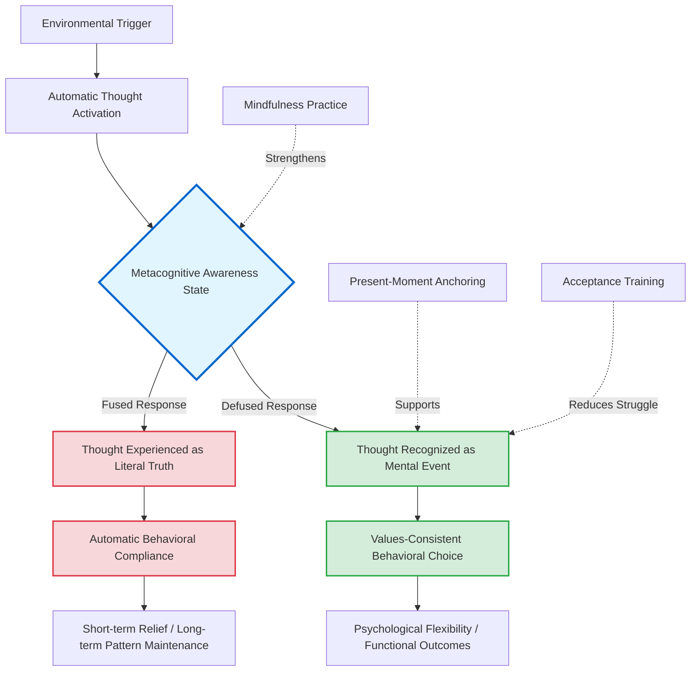

# Lesson 4: Clinical Applications of Mindfulness Interventions

## 1. First-Principles Intuition & Invariants

The clinical application of mindfulness interventions represents a paradigm shift in psychological treatment, moving from symptom suppression through cognitive restructuring or pharmacological intervention toward a metacognitive approach that fundamentally alters the relationship between conscious awareness and internal experience. At its core, mindfulness-based clinical work rests on a deceptively simple proposition: psychological suffering is not primarily caused by the content of thoughts, emotions, or sensations themselves, but rather by the secondary elaborative processes of rumination, experiential avoidance, and rigid cognitive fusion that trap individuals in recursive loops of distress. This first-principles understanding drives all evidence-based mindfulness protocols, from Mindfulness-Based Stress Reduction through Acceptance and Commitment Therapy, and establishes the therapeutic invariant that guides treatment selection, contraindication assessment, and outcome measurement.

Mindfulness-Based Stress Reduction, developed by Jon Kabat-Zinn at the University of Massachusetts Medical Center in 1979, emerged from a translation of Theravada Buddhist vipassana meditation into a secularized, manualized eight-week group intervention specifically designed for patients with chronic pain and stress-related medical conditions. The protocol architecture consists of weekly two-and-a-half-hour group sessions, a full-day silent retreat in week six, and a prescribed home practice regimen totaling forty-five minutes daily across body scan meditation, sitting meditation, and mindful yoga. The theoretical mechanism posits that systematic training in present-moment awareness with an attitude of non-judgmental acceptance disrupts the habitual reactivity patterns that amplify pain perception, autonomic arousal, and inflammatory cytokine expression. Randomized controlled trials have demonstrated moderate to large effect sizes for MBSR in reducing anxiety symptoms, depression severity, and chronic pain interference, with neuroimaging studies revealing increased gray matter density in the hippocampus and posterior cingulate cortex alongside decreased amygdala reactivity following eight-week interventions.

Mindfulness-Based Cognitive Therapy, collaboratively developed by Zindel Segal, Mark Williams, and John Teasdale in the late 1990s, represents a targeted adaptation of MBSR for individuals with recurrent major depressive disorder. The critical insight driving MBCT design came from cognitive science research demonstrating that individuals with three or more prior depressive episodes exhibit a distinctive vulnerability: minor dysphoric mood states automatically reactivate the entire constellation of negative cognitions, somatic sensations, and behavioral withdrawal patterns associated with previous major episodes, a phenomenon termed depressogenic cognitive reactivity. Traditional cognitive-behavioral therapy attempts to modify the content of these negative automatic thoughts through Socratic questioning and behavioral experiments, but MBCT adopts a fundamentally different stance, training participants to recognize thoughts as transient mental events rather than accurate reflections of reality, thereby decoupling the thought content from the behavioral and emotional response cascade. The eight-week MBCT protocol integrates psychoeducation about depression relapse patterns with formal mindfulness practices and cognitive therapy exercises, explicitly teaching participants to identify early warning signs of relapse and respond with deliberate mindfulness practice rather than habitual rumination. Meta-analytic evidence indicates MBCT reduces relapse risk by approximately forty-three percent in individuals with three or more prior episodes, performing equivalently to maintenance antidepressant medication with superior acceptability and no pharmacological side effects.

Dialectical Behavior Therapy, created by Marsha Linehan for the treatment of borderline personality disorder and chronic suicidality, incorporates mindfulness as the foundational skill module within a comprehensive biosocial treatment framework. Linehan's theoretical model proposes that borderline personality disorder emerges from a transaction between biological emotional vulnerability and an invalidating developmental environment that fails to teach emotion regulation skills and instead punishes emotional expression. The resulting phenotype exhibits rapid emotional cycling, interpersonal hypersensitivity, impulsive behavioral dyscontrol, and profound identity disturbance. DBT's mindfulness module, drawn explicitly from Zen practice, teaches three "what" skills—observe, describe, and participate—and three "how" skills—non-judgmentally, one-mindfully, and effectively—as prerequisite capacities for the subsequent emotion regulation, distress tolerance, and interpersonal effectiveness modules. The clinical innovation lies in recognizing that individuals with severe emotion dysregulation cannot successfully implement traditional cognitive-behavioral techniques during states of high arousal because the prefrontal executive functions required for cognitive reappraisal are offline during limbic hijack. Mindfulness skills provide a neurobiologically accessible intervention point, engaging attention regulation circuits that remain functional even during emotional storms and creating the psychological space necessary for subsequent skill deployment. Randomized trials demonstrate DBT reduces suicide attempts, psychiatric hospitalizations, and treatment dropout in chronically suicidal individuals, with mindfulness practice frequency correlating directly with symptom improvement trajectories.

Acceptance and Commitment Therapy, developed by Steven Hayes within the behavior-analytic tradition, embeds mindfulness within a broader framework of psychological flexibility defined as contacting the present moment fully as a conscious human being and persisting or changing behavior in the service of chosen values. ACT's theoretical foundation rests on Relational Frame Theory, a contemporary behavior-analytic account of human language and cognition proposing that verbal-symbolic capacity creates both human psychological sophistication and unique sources of suffering. Specifically, the ability to construct arbitrary stimulus relations allows humans to experience psychological pain in the absence of physical threats through temporal extension into imagined futures, social comparison, and self-conceptualization. ACT interventions target six core processes: present-moment awareness, acceptance, cognitive defusion, self-as-context, values clarification, and committed action. Mindfulness practices in ACT serve the dual function of strengthening present-moment contact and experiential acceptance while simultaneously creating cognitive defusion by demonstrating through direct experience that thoughts and emotions are transient private events rather than literal truths or commands requiring behavioral compliance. The treatment protocol is transdiagnostic by design, with therapists tailoring intervention emphasis based on functional analysis of the individual client's behavioral repertoire rather than diagnostic category. Meta-analyses indicate ACT produces moderate effect sizes across anxiety disorders, depression, chronic pain, and substance use disorders, with evidence suggesting particularly strong effects for conditions characterized by experiential avoidance and cognitive fusion.

The governing invariant uniting these four clinical frameworks is the cultivation of metacognitive awareness, defined as the capacity to observe one's own cognitive and affective processes from a decentered perspective without automatic behavioral engagement. This metacognitive stance interrupts the recursive self-perpetuating cycles that maintain psychopathology across diagnostic categories: the pain-tension-pain cycle in chronic pain, the mood-cognition-mood cycle in depression relapse, the emotion-dysregulation-invalidation cycle in borderline personality disorder, and the thought-fusion-avoidance cycle in anxiety disorders. Clinical implementation requires precise assessment of patient readiness, contraindication screening, culturally adapted delivery, and systematic outcome monitoring using validated instruments such as the Five Facet Mindfulness Questionnaire, Cognitive and Affective Mindfulness Scale-Revised, and the Acceptance and Action Questionnaire.

## 2. Core Architecture & Mechanics

The therapeutic architecture of mindfulness-based interventions operates through six interconnected neuropsychological mechanisms that collectively reshape the relationship between conscious awareness and internal experience. Attention regulation constitutes the foundational mechanism, involving the intentional direction and sustained maintenance of attentional focus on a designated anchor object such as breath sensations, body awareness, or auditory stimuli. This capacity engages the dorsolateral prefrontal cortex and anterior cingulate cortex in a top-down executive control network that modulates posterior sensory processing regions. The clinical training sequence begins with focused attention meditation using a single anchor point, progresses to open monitoring meditation involving panoramic awareness of all arising phenomena without selective focus, and culminates in effortless presence where attention rests naturally without deliberate effort or object. Functional neuroimaging reveals that expert meditators with ten thousand or more practice hours exhibit reduced activation in attention control networks during meditation, suggesting a transition from effortful executive control to automatized attention stability.

Body awareness represents the second critical mechanism, developing interoceptive precision for autonomic signals, proprioceptive information, and visceral sensations that typically operate below conscious threshold. The body scan meditation employed in MBSR and MBCT systematically moves attention through discrete body regions in a predetermined sequence, instructing participants to notice any sensations present without attempting to change, fix, or interpret them. This practice strengthens the salience network involving the insula and anterior cingulate cortex, regions critical for integrating interoceptive signals with emotional awareness. Enhanced interoceptive accuracy enables earlier detection of stress-response activation, providing a temporal window for skillful intervention before autonomic arousal crosses into panic territory or emotional cascade solidifies into depressive rumination. Clinical protocols standardize body scan duration at forty-five minutes initially, with graduated reduction to twenty or thirty minutes as skill consolidates, and emphasize the paradoxical instruction that there is nothing to achieve and no particular sensation to produce, thereby directly confronting achievement-oriented cognitive patterns that exacerbate stress.

Emotion regulation through non-reactive monitoring constitutes the third mechanism, fundamentally distinct from traditional cognitive reappraisal strategies. Rather than attempting to modify emotional content through cognitive restructuring, mindfulness-based emotion regulation involves maintaining stable present-moment awareness while allowing emotions to arise, peak, and naturally dissipate without behavioral engagement. This approach rests on the empirical observation that emotions, when fully experienced without suppression or expression, follow a characteristic rise-and-fall temporal trajectory lasting sixty to ninety seconds before naturally subsiding. Clinical training employs the RAIN acronym in MBCT: Recognize the emotion, Allow it to be present, Investigate with gentle curiosity, and Non-identify by recognizing the emotion as a transient experience rather than an essential self-attribute. Neurobiologically, this process engages ventromedial prefrontal regions in top-down modulation of amygdala reactivity while simultaneously preventing the cognitive elaboration that prolongs and intensifies emotional experience. Patients learn to identify the somatic signature of specific emotions—tightness in the chest for anxiety, heaviness for sadness, heat and muscle tension for anger—and use these sensations as mindfulness anchors rather than triggers for avoidance or rumination.

Cognitive defusion, particularly emphasized in ACT and MBCT, represents the fourth mechanism, targeting the automatic believability and behavioral compliance humans exhibit toward verbal-symbolic content. Fusion occurs when thoughts are experienced as literal facts rather than mental events, creating rigid behavioral control by cognitive content. Clinical defusion techniques include verbal repetition until semantic satiation occurs, voice manipulation exercises where thoughts are sung or spoken in cartoon voices, and labeling practices where thoughts are explicitly prefaced with the phrase "I am having the thought that..." rather than accepted as direct perception. The mechanisms diagram below illustrates how cognitive defusion interrupts the typical stimulus-thought-fusion-behavior chain by inserting metacognitive awareness between thought occurrence and behavioral response, creating psychological flexibility.

Self-as-context awareness constitutes the fifth mechanism, addressing the fundamental question of perspective: who is observing these thoughts, emotions, and sensations? Most psychopathology involves identification with a conceptualized self—a narrative story about personal identity constructed from memories, social roles, and evaluative judgments. This conceptualized self is inherently fragile, requiring constant defensive maintenance and vulnerable to invalidation. ACT specifically cultivates an alternative perspective termed self-as-context or observer self, the continuous locus of awareness that has been present across all life experiences but is not itself any particular thought, emotion, memory, or role. Clinical exercises include perspective-taking practices, continuity-of-consciousness meditations tracking awareness back through time, and experiential exercises demonstrating that awareness itself cannot be damaged or diminished by psychological content. This mechanism provides a stable platform for accepting difficult internal experiences because the observing self remains unthreatened regardless of content intensity.

Values clarification and committed action represent the sixth mechanism, unique to ACT but implicitly present in all mindfulness-based treatments through the concept of behavioral persistence despite discomfort. Values are defined as freely chosen life directions in domains such as relationships, work, health, creativity, and spirituality, distinct from goals in being ongoing directional movements rather than achievable outcomes. Mindfulness practice supports values-based living by creating psychological space between urges and actions, allowing individuals to experience cravings, fears, or impulses without automatic behavioral compliance. The clinical protocol involves explicit values assessment using card-sorting exercises and narrative writing, followed by committed action planning where specific behaviors aligned with values are scheduled and tracked despite anticipated psychological discomfort. This mechanism directly addresses the paradox that the most meaningful human activities—intimate relationships, creative work, skill development, parenting—inherently involve vulnerability, uncertainty, and discomfort that trigger avoidance in individuals with anxiety or depression.

Clinical implementation of these six mechanisms follows a sequential skill-building architecture. MBSR devotes the first three weeks primarily to attention regulation and body awareness through body scan and sitting meditation, introduces mindful yoga for integrated movement awareness in week three, and expands to emotion regulation and cognitive work in weeks five through eight. MBCT frontloads psychoeducation about depression relapse and cognitive reactivity in weeks one and two, then teaches formal mindfulness practices in weeks three through five, before integrating mindfulness with specific relapse prevention skills in the final three weeks. DBT presents mindfulness as the first skill module in a 24-week skills training curriculum, with ongoing practice expected throughout subsequent modules. ACT flexibly sequences interventions based on functional case conceptualization, typically establishing creative hopelessness and values clarity early, then teaching acceptance and defusion skills mid-treatment, and concluding with committed action planning.

## 3. High-Performance Optimization & Failure Modes

Clinical effectiveness of mindfulness interventions depends critically on precise patient selection, contraindication screening, dose optimization, and implementation fidelity monitoring. The primary contraindication spectrum involves active psychotic symptoms, acute suicidal crisis, and severe dissociative disorders. Patients experiencing active hallucinations or delusions lack the reality-testing capacity required for mindfulness practice and may interpret instructions to observe thoughts as external commands from the voices themselves. Acute suicidal crisis requires immediate safety intervention and crisis stabilization rather than skill-building treatment, though mindfulness can be introduced during the maintenance phase after acute risk subsides. Severe dissociative disorders present particular risks because mindfulness practice involves sustained present-moment attention to internal experience, potentially triggering flashbacks or dissociative episodes in individuals with unprocessed trauma. However, trauma-informed modifications including eyes-open practice, explicit permission to disengage at any time, and shorter practice durations with frequent grounding can safely adapt mindfulness protocols for trauma populations.

A second critical contraindication involves individuals who demonstrate compulsive or perfectionistic engagement with meditation practice itself. A subset of patients, particularly those with obsessive-compulsive personality traits or eating disorders, can transform mindfulness practice into another domain for harsh self-criticism and compulsive achievement striving, tracking practice minutes obsessively, berating themselves for perceived meditation failure, or developing rigid rules about proper practice. This pattern, sometimes termed "spiritual bypassing" or "meditation as avoidance," uses practice itself as experiential avoidance of genuine emotional engagement. Clinical detection relies on assessment questions about practice quality versus quantity, emotional experience during and after practice, and behavioral flexibility around practice schedules. Therapeutic correction involves explicitly addressing the paradox of striving in non-striving practice, reducing practice duration requirements, and emphasizing informal practice in daily activities over formal sitting meditation.

Dose optimization research indicates that practice frequency predicts outcomes more reliably than individual session duration, with daily practice of any duration superior to longer but less frequent sessions. The standard forty-five-minute daily practice prescription in MBSR represents an initial training dose rather than a maintenance requirement, with clinical effectiveness demonstrated for post-intervention practice averaging twenty minutes daily. Home practice tracking forms remain standard in research protocols but create compliance pressure that may paradoxically undermine the non-judgmental stance central to mindfulness. Contemporary implementations increasingly frame practice as experimentation and self-discovery rather than homework compliance, with therapists inquiring about barriers and problem-solving obstacles rather than reinforcing practice as obligation.

Cultural adaptation constitutes a critical but frequently neglected implementation consideration. Mindfulness interventions emerged from Buddhist contemplative traditions but were deliberately secularized for Western medical contexts, stripping explicit religious language and metaphysical cosmology. However, this secularization process itself reflects Western cultural assumptions about the separation of religion and healthcare that do not generalize universally. When implementing mindfulness interventions with religious populations, explicit discussion of compatibility or conflict with religious beliefs prevents covert value imposition. Christian practitioners may connect mindfulness with contemplative prayer traditions like Centering Prayer or Ignatian meditation. Muslim clients may recognize parallels with muraqaba meditation or dhikr remembrance practices. The key invariant is collaborative exploration of meaning and integration rather than prescriptive imposition of a supposedly universal secular technique.

Language translation extends beyond simple lexical substitution to cultural-conceptual adaptation. The English term "mindfulness" as translation of the Pali sati carries connotations of individual awareness and present-moment attention fitting Western psychological frameworks. However, many non-Western cultural contexts embed awareness within relational, communal, or cosmological frameworks rather than individual consciousness. Spanish translations vacillate between "atención plena" emphasizing full attention and "conciencia plena" emphasizing consciousness, each carrying different philosophical implications. Effective cultural adaptation requires collaboration with cultural insiders who understand indigenous healing traditions and can identify genuine conceptual parallels versus superficial linguistic matches.

Implementation science research identifies several common failure modes in real-world clinical deployment. Insufficient therapist training remains the most prevalent barrier, with many clinicians attending a single weekend workshop and believing themselves qualified to deliver manualized protocols requiring months of training and personal practice. Therapist personal practice constitutes a unique aspect of competency in mindfulness-based interventions, distinct from traditional therapy where personal therapy experience is recommended but not required for technique delivery. Research indicates that therapist meditation experience predicts client outcomes independently of other competency factors, suggesting that embodied understanding rather than intellectual knowledge drives effective teaching. Certification standards from the Center for Mindfulness now require personal retreat experience and ongoing practice documentation alongside didactic training and supervised case consultation.

Inadequate session structure and time management constitutes another common failure mode, particularly when mindfulness components are inserted into standard fifty-minute individual therapy sessions already crowded with crisis management, rapport building, and symptom monitoring. Effective integration requires explicit protected time for in-session practice, typically fifteen to twenty minutes for guided meditation followed by inquiry about the experience. Inquiry differs fundamentally from interpretation, involving open-ended questions that help clients articulate their direct experience rather than therapist explanations imposing theoretical meaning. Poor inquiry focuses on cognitive content—what thoughts occurred—rather than the relationship to experience—how did you relate to the thoughts, what did you notice about the arising and passing, where did you feel it in your body.

Premature termination and early dropout present significant challenges, particularly in the first three weeks before skill consolidation and subjective benefit emerge. Meta-analytic data indicate average dropout rates of fifteen to twenty percent for MBSR and MBCT, concentrated heavily in weeks one through three. Motivational interviewing techniques applied during intake assessment can identify ambivalence and strengthen commitment before beginning the program. Explicitly framing the first three weeks as a personal experiment rather than a presumed solution reduces performance pressure and normalizes uncertainty. Providing recorded guided practices for home use reduces technical barriers, though overdependence on guidance can prevent development of self-directed practice capacity.

The integration of mindfulness with pharmacological treatment requires careful clinical judgment. No pharmacological contraindications exist for mindfulness practice itself, but patients may misinterpret treatment rationale as suggesting that meditation can replace psychiatric medication, leading to non-adherence and relapse. Explicit education positioning mindfulness as complementary rather than alternative prevents this misunderstanding. For patients on benzodiazepines, clinical monitoring should track whether improved distress tolerance skills enable gradual taper, or whether medication effects mask practice learning by blunting the anxiety that practice is designed to accommodate.

## 4. Summary & Verification Matrix

| Clinical Protocol | Core Mechanism | Implementation Parameters | Primary Failure Mode | Diagnostic Verification |
|------------------|----------------|--------------------------|---------------------|------------------------|
| Mindfulness-Based Stress Reduction | Attention regulation and body awareness decouple pain perception from suffering elaboration through systematic interoceptive training | Eight weekly 2.5-hour group sessions plus six-hour retreat; 45-minute daily home practice across body scan, sitting meditation, mindful yoga; secular presentation with medical framing | Compulsive achievement striving transforms practice into self-criticism domain; inadequate therapist embodied practice prevents authentic transmission | Five Facet Mindfulness Questionnaire; Perceived Stress Scale; pre-post comparison with minimum 0.5 standard deviation effect size indicating clinically meaningful change |
| Mindfulness-Based Cognitive Therapy | Metacognitive awareness interrupts depressogenic cognitive reactivity by recognizing thoughts as mental events rather than reality, preventing rumination cascade | Eight weekly 2-hour sessions; psychoeducation weeks 1-2, formal practice weeks 3-5, relapse prevention integration weeks 6-8; targets individuals with 3+ prior depressive episodes | Premature dropout before week 4 when subjective benefit emerges; cognitive fusion with thoughts about meditation failure perpetuates self-criticism patterns | Relapse rate over 60-week follow-up as primary outcome; Five Facet Mindfulness Questionnaire observing subscale; Cognitive Reactivity Index assessing mood-linked negative cognition |
| Dialectical Behavior Therapy Mindfulness Module | Foundation skills of observe, describe, participate taught non-judgmentally, one-mindfully, and effectively enable emotion regulation during limbic activation when prefrontal executive functions offline | Skills training group format; mindfulness module weeks 1-4 of 24-week protocol; weekly individual therapy applies skills to target behaviors tracked on diary cards | Invalidating delivery contradicts dialectic philosophy; skills taught as cognitive techniques rather than embodied practices; inadequate in-session practice time | Behavioral outcome tracking: suicide attempts, self-injury episodes, psychiatric hospitalizations; Difficulties in Emotion Regulation Scale; treatment retention as process measure |
| Acceptance and Commitment Therapy | Psychological flexibility through present-moment contact, acceptance, defusion, self-as-context, values, and committed action creates behavioral persistence despite discomfort | Flexible protocol based on functional case conceptualization; typically 12-16 individual sessions; creative hopelessness and values early, acceptance and defusion mid-treatment, committed action late | Values clarification remains abstract without concrete behavioral commitment; defusion taught as cognitive technique rather than experiential shift; fusion with "proper" mindfulness practice | Acceptance and Action Questionnaire-II measuring psychological inflexibility; Valued Living Questionnaire assessing values consistency; behavioral tracking of values-concordant actions as ultimate criterion |
