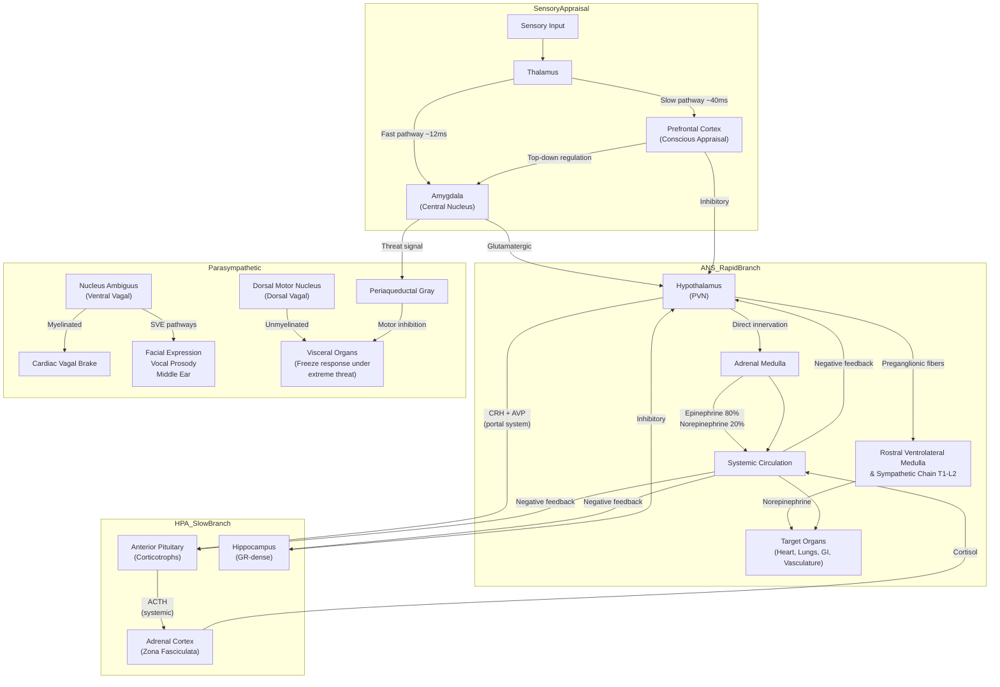

# Lesson 1: Stress Physiology, Neurobiology, Response Systems

## 1. First-Principles Intuition & Invariants

Stress is not an event. It is the organism's systemic recalibration in response to a perceived or actual threat to homeostatic integrity. The distinction matters because practitioners who treat stress as an external stimulus rather than an internal regulatory process will consistently misread their clients' presentations, overprescribe relaxation techniques, and miss the underlying neuroendocrine architecture driving symptom expression. The foundational invariant of stress physiology is that every stressor, whether psychological (anticipatory anxiety about a performance evaluation) or physical (blood loss from a laceration), converges on the same central nervous system appraisal circuits and activates overlapping neuroendocrine cascades. The body does not fundamentally distinguish between a lion and a mortgage; it distinguishes only the intensity, duration, and controllability of the threat signal reaching the hypothalamus and brainstem.

The second invariant is that the stress response is not pathological. It is a precisely evolved adaptive program designed to mobilize energy, sharpen cognition, suppress non-essential functions, and prepare the organism for survival action. Pathology emerges not from acute activation but from sustained or recurrent activation that exceeds the system's capacity to return to baseline. Bruce McEwen's concept of allostatic load captures this precisely: the wear and tear on biological systems that results from chronic overactivation or underactivation of mediators that help the body adapt to challenges. Allostatic load is the accumulated cost of adaptation, and it manifests across cardiovascular, metabolic, immunological, and neurocognitive domains. The practitioner's job is not to eliminate stress activation but to ensure the system cycles efficiently between activation and recovery, maintaining what McEwen and colleagues termed "allostatic balance" — the capacity to mount an adequate response when challenged and to shut that response down when the challenge has passed.

A third invariant governs the entire clinical picture: stress responses are mediated by two interlocking but temporally distinct systems. The autonomic nervous system operates on a millisecond timescale, deploying sympathetic and parasympathetic signals that alter heart rate, respiration, pupillary diameter, and gastrointestinal function within seconds of threat detection. The hypothalamic-pituitary-adrenal (HPA) axis operates on a minutes-to-hours timescale, orchestrating a glucocorticoid cascade whose effects persist long after the sympathetic surge has dissipated. Understanding the temporal dissociation between these systems is essential for practitioners because it explains why a client can feel calm thirty minutes after a panic episode (sympathetic withdrawal) yet remain cognitively impaired, fatigued, and emotionally flat for hours afterward (cortisol's sustained genomic effects on prefrontal cortex and hippocampal function). Treatment protocols must address both timescales independently; managing sympathetic activation alone, through breathing or grounding techniques, leaves the slower glucocorticoid-mediated disruption unaddressed.

The fourth invariant is that appraisal is neurological, not philosophical. The amygdala, specifically the central nucleus, initiates the stress cascade before conscious cortical processing occurs. Joseph LeDoux's work on the dual-pathway model of fear processing demonstrated that sensory input reaches the amygdala via a rapid thalamic pathway approximately 12 milliseconds faster than it reaches the prefrontal cortex. This means the body is already mounting a stress response before the person can verbally articulate what triggered it. For practitioners, this demands that assessment and intervention account for subcortical processing: asking a client to "think about what triggered you" engages a neural pathway that is functionally downstream of the system that actually generated the response.

## 2. Core Architecture & Mechanics

The stress response architecture begins at the level of sensory appraisal and descends through two primary effector branches: the autonomic nervous system and the HPA neuroendocrine axis. When a threat signal is detected, the amygdala's central nucleus sends glutamatergic projections to the hypothalamus, specifically the paraventricular nucleus (PVN), which serves as the master integration center for both branches. From the PVN, the rapid branch descends through brainstem nuclei to the sympathetic chain and the adrenal medulla, while the slower branch initiates a hormonal cascade through the anterior pituitary and adrenal cortex.

The sympathetic branch operates through a two-neuron pathway. Preganglionic neurons in the intermediolateral cell column of the spinal cord (T1–L2) synapse onto postganglionic neurons in the sympathetic chain or collateral ganglia, which then release norepinephrine at target organs. The adrenal medulla is the exception: it is directly innervated by preganglionic sympathetic fibers and functions as a modified sympathetic ganglion that releases epinephrine (80%) and norepinephrine (20%) directly into the bloodstream. This catecholamine surge produces the familiar fight-or-flight signature: increased heart rate and contractility, bronchodilation, pupil dilation, glycogenolysis in liver and skeletal muscle, inhibition of gastrointestinal motility, and peripheral vasoconstriction with selective vasodilation in skeletal muscle. Peak plasma epinephrine concentrations occur approximately 30 seconds after threat onset and return to baseline within 2 to 3 minutes if the threat signal ceases.

The parasympathetic branch, primarily through the vagus nerve (cranial nerve X), provides the counter-regulatory brake on this system. Stephen Porges's polyvagal theory elaborates the vagal architecture into functional tiers. The ventral vagal complex, a phylogenetically newer pathway originating in the nucleus ambiguus, innervates the heart via cardiac vagal fibers and the face via special visceral efferent pathways, enabling social engagement through facial expressivity, vocal prosody, and middle ear muscle regulation. The dorsal vagal complex, the older pathway originating in the dorsal motor nucleus, governs unmyelinated visceral regulation and, under extreme threat, produces the freeze response through massive vagal suppression of heart rate. The clinical implication is that parasympathetic recovery is not a single mechanism but a hierarchical process: clients must first re-engage ventral vagal social engagement systems before dorsal vagal visceral regulation can be optimized.

The HPA axis is the slower, more persistent effector branch. The PVN synthesizes corticotropin-releasing hormone (CRH) and arginine vasopressin (AVP), which travel through the hypophyseal portal system to the anterior pituitary, where they stimulate corticotrophs to release adrenocorticotropic hormone (ACTH) into systemic circulation. ACTH then acts on the adrenal cortex, specifically the zona fasciculata, to synthesize and release cortisol. Peak cortisol concentrations occur 20 to 30 minutes after stressor onset and follow a genomic action pathway: cortisol crosses the cell membrane, binds to intracellular glucocorticoid receptors, and the resulting complex translocates to the nucleus where it acts as a transcription factor, upregulating or downregulating gene expression over hours. This genomic latency explains why cortisol's cognitive and metabolic effects persist far beyond the stressor itself and why practitioners must track post-stressor recovery windows of 60 to 120 minutes, not just the immediate sympathetic resolution.

Cortisol feedback operates through a negative loop at three levels: the hippocampus, which contains the highest density of glucocorticoid receptors in the brain and provides inhibitory input to the PVN; the hypothalamus itself; and the anterior pituitary. The hippocampus is both the primary feedback regulator and a primary target of cortisol's damaging effects under chronic elevation. Sustained glucocorticoid exposure produces dendritic atrophy in hippocampal CA3 neurons, impairing the feedback circuit and creating a feed-forward loop of dysregulation. This is the neurobiological substrate of what clinicians observe as escalating stress sensitivity in chronically stressed clients: the very system designed to shut down the stress response is degraded by the stress response itself.

Cortisol also follows a robust diurnal rhythm, governed by the suprachiasmatic nucleus, with peak output 30 to 45 minutes after waking (the cortisol awakening response, or CAR) and a gradual decline across the day to a nadir around midnight. Practitioners assessing HPA function through salivary cortisol collection must account for this rhythm: a single morning sample captures only one point on the curve, and the CAR magnitude (calculated as the increase from waking to the 30-minute post-waking sample) provides different clinical information than absolute cortisol levels at any single time point. A blunted CAR is associated with burnout and chronic fatigue, while an elevated CAR is associated with anticipatory anxiety and sleep disturbance.

The fight-flight-freeze taxonomy maps onto specific neurobiological substrates. Fight and flight are sympathetic-dominant responses mediated by the amygdala-to-hypothalamus-to-sympathetic-chain pathway described above. The freeze response involves a different mechanism: simultaneous sympathetic activation with vagal suppression, producing a physiology of high arousal with motor immobility. The periaqueductal gray (PAG) in the midbrain orchestrates this response, integrating threat signals from the amygdala and producing descending inhibition of motor output while maintaining elevated catecholamine levels. Clinically, freeze presents differently from fight-flight: heart rate may be variable rather than uniformly elevated, clients report dissociation or numbing rather than agitation, and standard sympathetic-downregulation techniques (breathing, progressive muscle relaxation) may be insufficient because the vagal component requires separate addressing through ventral vagal engagement protocols.

The diagram above illustrates the parallel processing architecture of the stress response. A practitioner working with stress-related presentations must assess which branches are predominantly activated in a given client. A client with tachycardia, sweating, and hyperventilation is in a sympathetic-dominant state requiring ventral vagal re-engagement. A client with flat affect, bradyphrenia, and dissociation is in a dorsal vagal freeze state requiring graded activation and social engagement before relaxation techniques are introduced. A client with normal autonomic markers but persistent fatigue, cognitive fog, and afternoon energy crashes may be experiencing HPA axis dysregulation with aberrant cortisol patterning that requires diurnal salivary assessment rather than further autonomic intervention.

For practitioner assessment, the most accessible objective measure of autonomic stress regulation is heart rate variability (HRV), specifically the root mean square of successive R-R interval differences (RMSSD) and the high-frequency power band (0.15–0.40 Hz), which indexes vagal tone. A healthy adult at rest typically demonstrates an RMSSD of 30 to 60 milliseconds depending on age, sex, and fitness level. Chronically stressed clients frequently present with RMSSD values below 20 milliseconds, indicating sustained sympathetic dominance with inadequate vagal recovery. Practitioners should establish a baseline over five consecutive mornings of supine, post-waking, five-minute recordings before initiating intervention, and should re-measure every two weeks to track trajectory rather than relying on single-session snapshots, which are confounded by acute situational variability.

## 3. High-Performance Optimization & Failure Modes

Optimizing the stress response system requires the practitioner to treat it as a trainable regulatory network with identifiable inputs, feedback loops, and failure modes. The system performs optimally when it mounts a rapid, appropriately scaled response to genuine threats and returns to baseline efficiently once the threat has resolved. This requires three conditions: adequate sympathetic responsiveness (the ability to generate arousal), adequate parasympathetic recovery capacity (the ability to withdraw arousal), and a functioning HPA feedback loop (the ability to terminate glucocorticoid signaling). Failure can occur at any of these points, producing distinct clinical phenotypes that require distinct interventions.

The first failure mode is sympathetic hyperreactivity with impaired vagal recovery. This is the classic type-A presentation: rapid arousal escalation, prolonged sympathetic persistence after stressor removal, and chronically suppressed HRV. The client reports feeling "wired," unable to wind down, experiencing sleep-onset difficulty despite physical exhaustion. The underlying mechanism is impaired ventral vagal tone, often compounded by reduced prefrontal top-down regulation of the amygdala. The intervention protocol targets vagal engagement directly. The practitioner implements paced breathing at a 5.5-second inhalation and 5.5-second exhalation cadence (approximately 5.5 breaths per minute), which has been shown to maximize vagal afferent firing through the baroreflex mechanism. The protocol requires two 10-minute sessions daily, one immediately upon waking and one before sleep onset, for a minimum of four weeks. The practitioner should also prescribe slow exhale-emphasis breathing (4-second inhale, 6-second exhale) as an in-the-moment technique for acute sympathetic surges. HRV is reassessed biweekly; a 20% improvement in RMSSD over four weeks indicates the protocol is engaging the target mechanism.

The second failure mode is HPA axis dysregulation manifesting as cortisol rhythm disruption. This presents in two primary patterns. The hypercortisolemic pattern features elevated morning cortisol, an exaggerated CAR, and suppressed evening decline, producing a flattened diurnal slope. Clients report morning anxiety, afternoon energy crashes, and nighttime rumination. The mechanism is sustained PVN activation with inadequate hippocampal feedback. The intervention requires both behavioral and cognitive components. Behaviorally, the practitioner prescribes morning sunlight exposure (10,000 lux minimum) within 30 minutes of waking for 15 to 20 minutes, which strengthens the circadian cortisol rise through melanopsin-mediated suprachiasmatic nucleus signaling and helps consolidate the CAR into a sharper, time-limited peak rather than a sustained elevation. Evening light restriction (screen dimming, amber-tinted lighting after sunset) supports the natural cortisol decline. Cognitively, the practitioner implements a designated worry window: 15 minutes at a fixed afternoon time during which the client deliberately engages with stressors, writes concerns, and problem-solves. This consolidates anticipatory rumination into a time-limited period rather than allowing it to extend cortisol elevation throughout the evening.

The hypocortisolemic pattern is the inverse: a blunted CAR, flat diurnal curve, and subnormal peak cortisol output. This is the burnout phenotype. The client reports morning grogginess that takes hours to resolve, emotional blunting, and a sense of depletion that rest does not repair. The mechanism is adrenal downregulation following prolonged hyperactivation, combined with glucocorticoid receptor desensitization. The intervention must avoid further stress depletion while gently reconditioning the HPA axis. The practitioner implements a graded morning activation protocol: cold water face immersion (10–15°C for 30–60 seconds) immediately upon waking, which activates the mammalian dive reflex and produces a reflexive sympathetic surge that transiently elevates cortisol without requiring psychological stress activation. This is paired with a progressive resistance training program (three sessions weekly, compound movements, progressive overload from 60% to 75% 1RM over eight weeks), which provides a controlled physiological stressor that trains the HPA axis to mount and recover from cortisol pulses. The client must maintain a strict sleep window (consistent bedtime and wake time within a 30-minute range) because the blunted CAR partially reflects circadian dysregulation, and consistent entrainment is required to restore the morning cortisol peak.

The third failure mode is the freeze response, which represents the most clinically complex presentation. Freeze involves simultaneous sympathetic activation and dorsal vagal suppression, producing a physiology of high internal arousal with external immobility. The client reports feeling "stuck," describes dissociative experiences during stress, and may present with unexplained somatic symptoms (gastrointestinal distress, chronic pain) that reflect dorsal vagal visceral dysregulation. The clinical error is treating freeze with relaxation techniques, which can deepen the dissociative component by further activating the dorsal vagal system. The correct protocol is phased: first, ventral vagal engagement through social connection and facial-visual exercises (the practitioner guides the client through sustained eye contact exercises, humming, and vocalization practices that engage nucleus ambiguus pathways); second, graded sympathetic activation through controlled movement (progressive muscle activation starting with distal limb segments and advancing to full-body patterns) to discharge the immobilized arousal; third, integration through narrative processing of the freeze-triggering context. This three-phase protocol typically requires 8 to 12 sessions and must be titrated carefully, as premature narrative processing can re-trigger the freeze response if the autonomic foundation has not been stabilized.

A fourth failure mode that practitioners must recognize is allostatic load accumulation across systems. Chronic stress does not merely affect one regulatory axis; it produces cumulative damage across cardiovascular (endothelial dysfunction, elevated resting blood pressure), metabolic (insulin resistance, visceral adiposity through cortisol-mediated lipogenesis), immunological (chronic low-grade inflammation, impaired wound healing, reactivation of latent viral infections), and neurocognitive (hippocampal volume reduction, prefrontal dendritic remodeling, impaired working memory) domains. The practitioner assessing allostatic load should collect a multi-system panel: resting blood pressure and heart rate (supine and standing), waist-to-hip ratio, fasting glucose and insulin (HOMA-IR calculation), high-sensitivity C-reactive protein, and a cognitive screen (working memory span, processing speed). This panel provides the baseline against which the effectiveness of any stress management intervention should be measured, because subjective self-report measures of stress are unreliable indicators of physiological recovery and can diverge significantly from biomarker trajectories.

## 4. Summary & Verification Matrix

| System / Mechanism | Core Components | Activation Profile | Diagnostic Indicators | Primary Failure Mode |
|---|---|---|---|---|
| Autonomic Nervous System (Rapid Branch) | Amygdala → PVN → Sympathetic chain (T1–L2) → target organs; Adrenal medulla → epinephrine/norepinephrine | Millisecond timescale; peak catecholamine surge at ~30 seconds; resolution within 2–3 minutes if threat ceases | Tachycardia, bronchodilation, pupillary dilation, GI inhibition; RMSSD < 20 ms indicates chronic sympathetic dominance | Sympathetic hyperreactivity with impaired vagal recovery (wired-tired presentation, sleep-onset failure) |
| Parasympathetic / Vagal System (Recovery Branch) | Nucleus ambiguus (ventral vagal, myelinated) → cardiac & facial pathways; Dorsal motor nucleus (dorsal vagal, unmyelinated) → visceral organs | Ventral vagal: social engagement, facial expressivity, prosody; Dorsal vagal: freeze under extreme threat via PAG-mediated motor inhibition | Heart rate variability (RMSSD, HF power 0.15–0.40 Hz); flat affect and dissociation indicate dorsal vagal freeze | Ventral vagal disengagement (social withdrawal, prosody flattening); Dorsal vagal freeze misdiagnosed as calm (high arousal with immobility) |
| HPA Axis (Slow Branch) | PVN → CRH/AVP → anterior pituitary → ACTH → adrenal cortex (zona fasciculata) → cortisol → genomic effects via glucocorticoid receptors | Cortisol peak at 20–30 minutes post-stressor; genomic effects persist 60–120+ minutes; diurnal rhythm with CAR peak 30–45 min post-waking | Salivary cortisol at waking, +30 min, midday, evening; CAR magnitude = (+30 min − waking); flattened slope = dysregulation | Hypercortisolemia (elevated CAR, flat slope → anxiety, rumination); Hypocortisolism (blunted CAR → burnout, emotional numbing, adrenal downregulation) |
| Hippocampal Feedback Loop | Glucocorticoid receptors (highest brain density) → inhibitory input to PVN; site of cortisol-mediated negative feedback | Operates after cortisol peak; requires intact CA3 dendritic architecture for feedback signal processing | Cognitive assessment: working memory, episodic recall; structural: hippocampal volume on MRI in chronic cases | CA3 dendritic atrophy from sustained glucocorticoid exposure → feed-forward dysregulation → escalating stress sensitivity |
| Allostatic Load (Cross-System Accumulation) | Cumulative wear across cardiovascular, metabolic, immunological, neurocognitive domains from chronic mediator over- or underactivation | Progressive, dose-dependent accumulation over months to years of chronic stress exposure | Multi-system panel: BP (supine/standing), waist-to-hip ratio, HOMA-IR, hs-CRP, cognitive screen; subjective stress measures unreliable | Silent progression: subjective improvement without biomarker recovery; single-axis intervention insufficient for multi-system damage |
