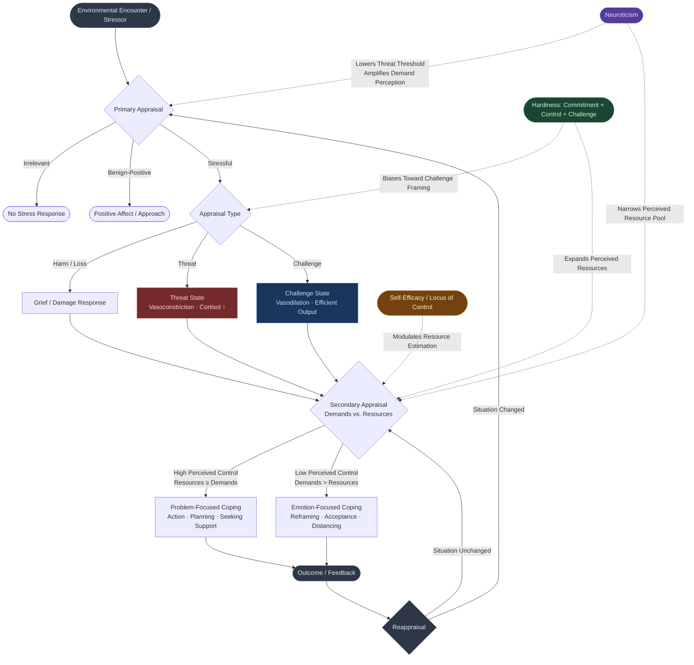

# Lesson 2: Psychological Models, Appraisal Theories, Individual Differences

## 1. First-Principles Intuition & Invariants

Stress is not a thing that happens to a person. It is a relationship between a person and their environment, one that is continuously negotiated through the machinery of cognition. This distinction, deceptively simple on the surface, dismantles a century of earlier stimulus-response thinking and places the individual's interpretive apparatus at the center of the story. Richard Lazarus, whose transactional model remains the definitive theoretical architecture for clinical and applied stress psychology, argued that the same external event can be catastrophic for one person and irrelevant to another not because their nervous systems differ in raw sensitivity, but because their appraisal processes assign fundamentally different meanings to it. The event is the same; the transaction is not.

The word "transaction" is load-bearing here. Lazarus and Folkman's 1984 formulation was deliberate in choosing it over "interaction," because interaction implies two independent variables acting on each other, whereas a transaction implies that the person and the environment are defined in relation to each other and change through contact. A job interview does not arrive as a fixed stressor. It arrives as raw material, and the appraisal process is the kiln that shapes it into either a threat, a challenge, an irrelevance, or a loss, depending on what the practitioner, athlete, or patient brings to the encounter. This is the first invariant of stress psychology: **meaning precedes physiological response**. Cortisol does not spike because a stimulus is objectively threatening; it spikes because the brain has already decided the stimulus is threatening.

The second invariant concerns control. Perceived control, the belief that one's actions can influence outcomes, is one of the most reliably protective psychological variables in the stress literature. It sits upstream of coping strategy selection. A person who appraises a situation as threatening but believes they have adequate resources to meet it will typically mobilize problem-focused coping: strategic action, information-seeking, planning. A person who appraises the same threat as beyond their influence tends toward emotion-focused coping: cognitive distancing, acceptance, meaning-making. Neither mode is pathological by default, but the ability to flexibly deploy both, governed by an accurate read of whether the situation is actually controllable, is a marker of resilience rather than vulnerability.

The third invariant is trait-level amplification. The appraisal process does not occur in a personality vacuum. Neuroticism, the broad disposition toward negative emotionality and reactivity, functions as a standing bias in the appraisal system: it lowers the threshold at which a stimulus is coded as threatening and amplifies the intensity of the resulting stress response. Hardiness, the constellation of commitment, control, and challenge described by Kobasa, operates in the opposing direction, biasing appraisal toward challenge framing and sustaining coping engagement under prolonged pressure. These are not mere moderators sitting politely at the edge of a regression model. They are architectural features of the appraisal engine itself, shaping every transaction the person conducts with their environment. Understanding them is the prerequisite for any serious clinical or applied stress intervention.

---

## 2. Core Architecture & Mechanics

The transactional model unfolds in a sequence of evaluative operations that Lazarus organized into primary and secondary appraisal, followed by a coping response and a reappraisal loop that feeds back into the entire process. It is worth being precise about what each stage actually does, because confusing them is the most common error both in clinical formulation and in training practitioners to intervene at the right point.

Primary appraisal is the initial evaluation of what is at stake. The person scans the encounter and asks, implicitly and rapidly, whether this matters for their wellbeing. The outcome of primary appraisal is one of three categorical judgments. The encounter is irrelevant, in which case the stress process terminates immediately. It is benign-positive, meaning it carries promise or pleasure. Or it is stressful, which itself branches into three sub-categories: harm/loss, referring to damage already sustained; threat, referring to anticipated harm; and challenge, referring to a situation appraised as demanding but potentially yielding growth or gain. The clinical significance of the threat-versus-challenge distinction cannot be overstated. These two appraisal states produce distinct psychophysiological signatures: threat appraisals are associated with vasoconstriction, greater cortisol release, and performance degradation on complex tasks, while challenge appraisals are associated with vasodilation, more efficient cardiac output, and performance enhancement under the same objective conditions. A sports psychologist working with an athlete in competition, or a clinical psychologist preparing a patient for an anxiety-provoking procedure, is fundamentally in the business of moving the needle from threat to challenge appraisal, and the first step in doing that is understanding what drives primary appraisal in a given person.

Secondary appraisal is not secondary in importance, it is secondary in sequence. Where primary appraisal asks "what is at stake?", secondary appraisal asks "what can I do about it?" The person evaluates their available coping options, their confidence in executing them, and the likely consequences of each option, all against the backdrop of the perceived demands established in primary appraisal. The result is a stress magnitude estimate: the gap between perceived demands and perceived coping resources. This is why perceived control is so critical. It operates directly on secondary appraisal. A person high in generalized self-efficacy enters secondary appraisal with a larger perceived coping resource pool, which compresses the demand-resource gap and down-regulates the stress response before any actual coping behavior has occurred.

Reappraisal closes the loop. As the person acts, as new information arrives, as outcomes become clearer, the appraisal process revises its prior estimates. This continuous feedback is what makes the transactional model dynamic rather than a one-pass computation. It also explains why cognitive reappraisal, as a clinical intervention, is not simply about changing a belief before the stressor arrives; it is about inserting a new evaluative signal into a live, running process. The timing and target of intervention matter accordingly.

The following diagram maps the full architecture of the transactional stress process, including personality moderation and the coping feedback loop.

The personality factors shown in the diagram as modulators are worth examining at a mechanistic level, because advanced practitioners too often treat neuroticism and hardiness as background noise rather than as active variables that must be assessed and addressed before intervention design.

Neuroticism, as measured on instruments like the NEO-PI-R or the BFI, reflects a stable propensity for the nervous system to respond to stimuli with negative affect: anxiety, hostility, depression, self-consciousness. Its mechanism of action on the appraisal system is two-pronged. At primary appraisal, high-neuroticism individuals set a lower activation threshold for the threat categorization, meaning stimuli that would read as irrelevant or mildly challenging to a low-neuroticism person are coded as threatening. At secondary appraisal, neuroticism narrows the perceived resource pool through ruminative cognition, pulling working memory resources toward threat monitoring and away from coping strategy generation. The clinical consequence is that neuroticism does not merely predict higher stress levels; it predicts a systematically distorted appraisal process that will undermine interventions targeting the stressor itself unless the appraisal bias is addressed directly.

Kobasa's hardiness construct describes a cluster of attitudes that buffer
