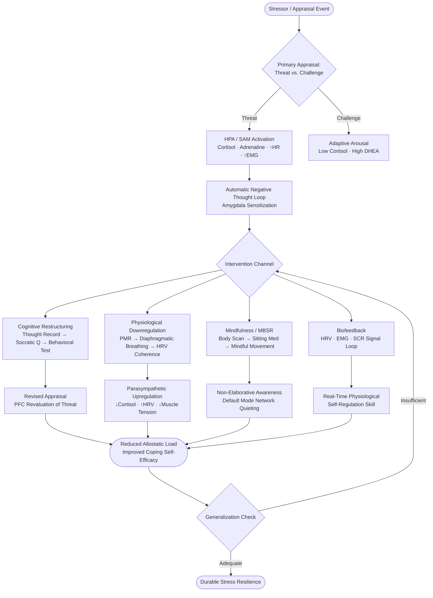

# Lesson 3: Evidence-Based Interventions, Cognitive-Behavioral Techniques, Mindfulness

## 1. First-Principles Intuition & Invariants

Stress, in its clinical sense, is not simply an unpleasant feeling to be overcome by willpower. It is a coordinated biological and psychological response system whose architecture was optimized for short-duration, physical threats and whose modern mismatch with chronic, symbolic stressors produces most of the pathology practitioners are called to treat. The hypothalamic-pituitary-adrenal (HPA) axis and the sympathetic-adrenal-medullary (SAM) system together constitute the substrate that evidence-based interventions must address. When a practitioner teaches a client to restructure a catastrophic thought or sustain diaphragmatic breathing, they are not offering comfort or coping philosophy — they are applying specific perturbations to measurable physiological and cognitive feedback loops. Understanding those loops at a mechanistic level is what separates a clinician from a motivational speaker.

The first invariant of stress intervention is that all durable change operates through *appraisal modification or physiological deactivation*, and the most effective protocols accomplish both simultaneously. Lazarus and Folkman's transactional model established that stress arises not from events themselves but from the interaction between an event and the individual's appraisal of their own coping resources relative to the perceived demand. A stimulus appraised as exceeding available resources produces threat arousal; that same stimulus appraised as manageable produces challenge arousal, which carries a markedly different hormonal signature (lower cortisol, higher testosterone and DHEA). This means that any intervention targeting only relaxation without addressing appraisal leaves the cognitive vulnerability intact, and any intervention targeting only cognition without lowering physiological tone fails to interrupt the somatic reinforcement loop. The best protocols are therefore always dual-channel.

The second invariant is *dose dependency*. Mindfulness-based stress reduction, cognitive restructuring, and progressive muscle relaxation (PMR) all exhibit dose-response curves with published threshold parameters. MBSR at fewer than four formal practice sessions produces measurable but clinically marginal cortisol changes; at eight weeks of daily formal practice (45 minutes/session), studies consistently show reductions in amygdala gray matter density and functional connectivity with the anterior cingulate cortex. The practitioner who delivers these techniques casually, without monitoring practice dose, is operating below the therapeutic threshold and should not expect protocol-level outcomes.

The third invariant is the *primacy of the working alliance* as a moderating variable. Meta-analyses of CBT outcomes consistently show that the alliance coefficient explains 5–10% of outcome variance independent of technique, and in stress management specifically, where self-efficacy generalization matters enormously, a practitioner who models confident, competent engagement with the technique substantially improves adherence rates. This is not a soft observation — it is a replicable statistical finding that belongs in the technical model of intervention delivery.

Cognitive-behavioral techniques for stress management descend from Beck's cognitive therapy and Ellis's rational emotive behavior therapy, both developed in the 1960s, but their mechanisms have been refined substantially through neuroimaging and psychophysiology. The core mechanism of cognitive restructuring is the interruption of automatic negative thought (ANT) loops that sustain HPA activation. When a client rehearses a catastrophic appraisal ("I will fail and lose everything"), each repetition is both a cognitive event and an HPA stimulus, incrementally elevating baseline cortisol and sensitizing the amygdala to future threat cues. Restructuring replaces this loop with an evaluated, evidence-grounded appraisal that produces lower threat salience and therefore lower physiological activation — measurably so, within a single session under EEG and heart rate variability monitoring.

---

## 2. Core Architecture & Mechanics

### Cognitive Restructuring: The Clinical Execution Protocol

The practitioner's execution of cognitive restructuring follows a structured sequence that must not be collapsed or skipped. The first stage is *thought monitoring*, where the client learns to catch automatic thoughts in real time using a Thought Record form. The standard format captures the situation, the automatic thought, the emotion and its intensity (0–100 SUDS), the physiological response, and the evidence for and against the thought. The practitioner must train the client to distinguish between thoughts and emotions — a distinction that is surprisingly non-obvious to most clients and that, if unestablished, derails the technique entirely because clients conflate "I feel like I'll fail" (emotion) with "I will fail" (thought available for examination).

The second stage is *Socratic questioning*, which is the technical core of the technique. The practitioner does not tell the client the thought is irrational. Instead, they deploy a series of guided questions: What is the evidence for this belief? What would you say to a close friend holding this belief? What is the realistic worst-case outcome, and could you survive it? What is the most likely outcome? This process leverages the client's own prefrontal cortical evaluation against the amygdala-generated catastrophe. The key practitioner invariant here is that premature reassurance short-circuits this process. If the therapist says "I'm sure it'll be fine," the client's prefrontal evaluation never fires, and no durable appraisal change occurs.

The third stage is *behavioral testing*, where the restructured appraisal is exposed to real-world evidence. The client enters the feared situation with a prediction based on the new appraisal and records the actual outcome. This behavioral loop provides corrective information at the level of declarative memory and episodic encoding, gradually updating the associative threat map that the amygdala uses for automatic appraisal.

### PMR, Diaphragmatic Breathing, and Physiological Downregulation

Progressive muscle relaxation, as formalized by Edmund Jacobson and later refined by Bernstein and Borkovec, operates through a contraction-release cycle that exploits the spinal reflex arcs governing muscle tone. The practitioner delivers PMR in a standardized sequence of 16 major muscle groups (the full protocol) or a condensed 7-group sequence appropriate for outpatient use. Each contraction is held at approximately 70% maximal voluntary contraction for 5–7 seconds, followed by 20–30 seconds of passive release with directed attention to the proprioceptive contrast between tension and relaxation. This contrast is the active ingredient; without it, the client learns nothing about what relaxation actually feels like in the body, which is precisely the problem in chronically stressed individuals who have lost baseline calibration. Heart rate variability (HRV) biofeedback confirms that a well-executed PMR session produces measurable parasympathetic upregulation within 15 minutes.

Diaphragmatic breathing (DB) works through a different but complementary mechanism. Slow, low-thoracic breathing at approximately 5–6 breaths per minute — a rate that maximizes respiratory sinus arrhythmia — directly entrains baroreflex sensitivity and increases high-frequency HRV, which indexes vagal tone. The practitioner teaches this by positioning one hand on the client's sternum and one on the lower abdomen, targeting minimal sternal movement and maximal abdominal excursion. The inhalation phase should last 4–5 seconds; the exhalation phase 6–8 seconds, with the extended exhalation producing greater parasympathetic activation via the vagus nerve. At session outset, the practitioner should take a baseline respiratory rate and demonstrate breath-by-breath pacing with a metronome application (such as the Coherence Coach or Elite HRV), so the client has an objective external anchor rather than a vague instruction to "breathe slowly."

### Mindfulness-Based Stress Reduction (MBSR): Structural Protocol

Kabat-Zinn's MBSR protocol is an 8-week group intervention structured around three formal practice modalities: body scan meditation (45 minutes, daily for weeks 1–2), sitting meditation with breath focus (30–45 minutes, weeks 3–5), and mindful movement/yoga (30–45 minutes, weeks 4–8), with all modalities carried forward in the final weeks. The practitioner must resist the clinical impulse to abbreviate the protocol. The 8-week architecture is not arbitrary; it reflects the temporal dynamics of hippocampal neuroplasticity and the time required for default mode network deactivation patterns to consolidate.

The body scan is the structural foundation of the protocol because it trains interoceptive accuracy — the ability to perceive internal somatic states without immediately appraising or reacting to them. Chronically stressed individuals typically exhibit hyperreactive appraisal of somatic signals (a racing heart becomes "I'm having a heart attack"), and the body scan systematically trains non-elaborative awareness of sensation. The practitioner guides the client's attention sequentially from the toes through the body in roughly 2–3 minute increments per region, instructing neither relaxation nor analysis but simply *noticing what is there*. This is a subtle but critical instruction because telling clients to relax introduces an achievement goal that generates meta-worry about whether they are relaxing correctly, which is counterproductive.

### Biofeedback Integration

Biofeedback provides objective, real-time physiological signal to the practitioner-client dyad, converting what would otherwise be an internal and invisible process into a visible data stream. The two most clinically validated modalities for stress management are HRV biofeedback and electromyography (EMG) biofeedback. For HRV work, the practitioner uses a photoplethysmography (PPG) or electrocardiography (ECG) sensor paired with software such as HeartMath emWave Pro or the Thought Technology BioGraph Infiniti suite. The client learns to shift from erratic HRV patterns (high sympathetic tone) to coherent sinusoidal patterns through paced breathing and positive emotional induction. The visual signal provides corrective feedback that accelerates acquisition of voluntary self-regulation well beyond what is achievable through instruction alone.

The following diagram maps the signal flow and intervention logic across the core treatment architecture:

---

## 3. High-Performance Optimization & Failure Modes

### Maximizing Cognitive Restructuring Efficacy

The most common failure mode in cognitive restructuring is *surface-level thought substitution* — replacing "I will fail" with "I will succeed" without evidence examination. This produces positive affirmation, not cognitive restructuring, and evidence shows it is ineffective and sometimes counterproductive in trait-anxious individuals because the forced positive statement violates the client's existing evidence base and reduces credibility. The practitioner must enforce the evidential process even when the client is impatient for relief. The technical fix is to redirect from the alternative thought back to the evidence chain: "Let's not decide what the new thought is yet — what does your track record actually show?"

A second failure mode is *emotional reasoning contamination*, where the client cites the intensity of the feeling as evidence for the thought ("I feel terrified, so it must be dangerous"). The practitioner addresses this by teaching the distinction between emotion as information and emotion as evidence in the first session, ideally with an example from a neutral domain: stage fright before a performance does not constitute evidence that the performance will be objectively poor. Building this meta-cognitive distinction early protects the restructuring process from circular reasoning.

Time management and problem-focused coping integrate naturally into the cognitive restructuring framework as behavioral complements. When a stressor is objectively modifiable — a deadline, a workload volume, a relationship conflict — the practitioner should shift explicitly to problem-focused coping and schedule-based intervention rather than applying restructuring to what is essentially an unsolved practical problem. The clinical error is treating a time management crisis as a cognitive distortion. The proper sequence is to first assess whether the stressor is controllable: if it is, teach prioritization frameworks (Eisenhower matrix applied to the client's specific task list, weekly time-blocking with protected recovery periods) and return to cognitive work only for the residual appraisal load that persists after practical solutions have been implemented.

### MBSR Adherence and Dose Maintenance

MBSR outcome variance is tightly predicted by home practice dose. Studies by Carmody and Baer (2008) established that formal practice time (not informal practice) was the significant predictor of symptom improvement, with a dose-response relationship evident from 20 minutes/day upward. The practitioner's most important optimization lever is therefore the first week's practice architecture. Clients who complete the first body scan session in a practitioner-supervised setting report significantly higher self-efficacy for home practice than those who receive only an audio recording. This suggests that at least one co-practice session should precede independent home practice, treating it as a skills acquisition phase rather than a prescription handoff.

A common failure mode specific to MBSR is what might be called *relaxation-expectation interference* — clients who expect each session to produce felt relaxation and interpret restlessness, boredom, or increased somatic awareness during early body scan sessions as evidence that "meditation doesn't work for me." The practitioner should inoculate against this in the first session by explicitly framing the body scan as an *awareness training exercise* with no relaxation criterion, noting that noticing discomfort without elaborating it is itself the target skill, and that felt relaxation is a frequent but incidental byproduct rather than the mechanism.

### Biofeedback Optimization and Ceiling Effects

HRV biofeedback reaches a ceiling effect for clients who already exhibit high baseline vagal tone, typically athletes and experienced meditators. For these individuals, the practitioner should shift the biofeedback target to a more sensitive modality: electrodermal activity (EDA/SCR), which tracks sympathetic skin conductance with higher sensitivity to residual stress reactivity, or frontal EEG asymmetry (greater relative left prefrontal activation indexing positive affect regulation), assessed through dry-electrode consumer systems such as the Muse S headband for clinical demonstration purposes, or research-grade systems such as the Biosemi ActiveTwo for quantitative assessment.

The technical failure mode in biofeedback practice is *reactive interference*, where the client monitors their own signal so intently that the monitoring itself produces arousal, paradoxically degrading HRV coherence. The practitioner resolves this by instructing the client to treat the display as peripheral feedback rather than a performance target, using paced breathing as the primary control variable and allowing HRV coherence to emerge as a consequence rather than pursuing it directly. This reframing also protects against frustration escalation, which reliably deactivates parasympathetic function.

### Cross-Technique Integration and Sequencing

For advanced practitioners managing complex presentations — such as a client with high baseline physiological reactivity AND significant cognitive rigidity — the sequencing of techniques matters substantially. Beginning with cognitive restructuring in a client who is physiologically hyperaroused is frequently ineffective because the prefrontal cortical function required for Socratic evaluation is compromised under high sympathetic activation. The evidence-consistent sequence is to open the session with 10–15 minutes of diaphragmatic breathing or brief PMR to bring physiological tone into the working range, then proceed to thought record work, and close with a brief mindfulness exercise that consolidates the session's cognitive gains as a form of non-elaborative integration. This three-phase session architecture (downregulate, restructure, consolidate) produces measurably better within-session affect change than any single-technique approach.

---

## 4. Summary & Verification Matrix

| Intervention | Core Mechanism | Delivery Parameters | Key Failure Mode | Diagnostic Signal | Corrective Action |
|---|---|---|---|---|---|
| **Cognitive Restructuring** | PFC revaluation of amygdala-generated threat appraisals via Socratic evidence examination | Thought Record (5-column), Socratic Q, behavioral test; minimum 8–12 weekly sessions | Surface substitution (affirmation without evidence chain) | Client replaces thought without evidence review; no SUDS reduction | Return to evidence examination; withhold alternative thought generation until evidence phase completes |
| **Progressive Muscle Relaxation** | Contraction-release cycle exploits proprioceptive contrast to recalibrate baseline muscle tone and upregulate parasympathetic function | 16-group (full) or 7-group (brief) protocol; 70% MVC, 5–7 sec hold, 20–30 sec release; daily practice for 4+ weeks | Client skips contraction phase; relaxation without contrast yields no calibration learning | No SUDS reduction after 3 sessions; client reports technique "does nothing" | Re-teach contraction intensity; use EMG biofeedback to verify adequate muscle activation |
| **Diaphragmatic Breathing** | Slow breathing at 5–6 breaths/min entrains baroreflex and maximizes RSA, directly upregulating vagal tone | 4–5 sec inhale, 6–8 sec exhale; metronome or pacing app; baseline respiratory rate recorded before training | Thoracic breathing pattern persists; client achieves target rate without achieving diaphragmatic mechanics | Sternal hand shows dominant movement; HRV coherence does not improve | Reposition hand cues; supine practice with book on abdomen as proprioceptive anchor |
| **MBSR (8-Week Protocol)** | Non-elaborative interoceptive awareness training quiets default mode network and reduces amygdala-PFC threat-salience coupling | 45 min/day formal practice; body scan wks 1–2, sitting meditation wks 3–5, mindful movement wks 4–8; at least one supervised practice session before home practice | Relaxation-expectation interference; client abandons practice after session 2–3 citing "not relaxing" | Low home practice dose (<20 min/day); dropout at weeks 2–3 | Reframe body scan as awareness training with no relaxation criterion in session 1; offer one co-practice supervision session |
| **HRV Biofeedback** | Real-time PPG/ECG signal provides corrective feedback loop for voluntary autonomic self-regulation via paced breathing | emWave Pro or BioGraph Infiniti; PPG sensor; paced breathing protocol; 20 min/session, 3×/week minimum; 6–8 week training block | Reactive interference (monitoring arousal degrades coherence); ceiling effect in high-baseline vagal tone clients | Coherence score plateaus or degrades across sessions despite continued practice | Shift to peripheral visual monitoring; for ceiling effect, transition to EDA or frontal EEG asymmetry modality |
| **Problem-Focused Coping / Time Management** | Removes or modifies objective stressors, reducing allostatic load at source rather than modulating appraisal of a persistent threat | Eisenhower prioritization matrix applied to client's specific task inventory; weekly time-blocking with recovery periods; session-level problem analysis before cognitive restructuring | Applying cognitive restructuring to controllable, unsolved practical problems (treating logistics as distortion) | SUDS remains high after repeated restructuring; client's stressor list is objectively modifiable | Assess stressor controllability first; shift to problem-focused mode for controllable stressors; reserve restructuring for residual appraisal load |
