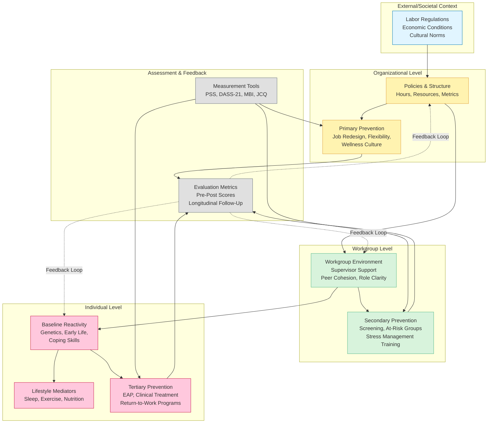

# Lesson 4: Application Contexts, Organizational Stress, Prevention Strategies

## 1. First-Principles Intuition & Invariants

Stress management at the organizational and systemic level operates on a fundamentally different set of principles than the individual cognitive or physiological interventions explored in prior lessons. Where individual stress reduction focuses on reappraisal, breathing mechanics, and personal autonomy, organizational stress management acknowledges that the human organism exists within nested ecological contexts—workplaces, social networks, communities, and cultural systems—that either attenuate or amplify allostatic load regardless of individual coping capacity. The practitioner must therefore adopt a public health lens, recognizing that stress is not merely a personal failure of resilience but a product of environmental demands, resource availability, and systemic design. This shift from treating symptoms in isolated individuals to engineering healthier contexts represents the transition from clinical psychology to occupational health psychology and community mental health.

The theoretical foundation for organizational stress intervention rests on the Job Demands-Resources model, which posits that workplace strain emerges from an imbalance between job demands—psychological, physical, social, or organizational requirements that sustain effort—and job resources, which are structural, social, or organizational features that facilitate goal achievement, buffer demands, or stimulate growth. High demands coupled with low resources create a depletion pathway characterized by exhaustion, cynicism, and eventual burnout. Conversely, adequate resources in the presence of moderate demands trigger an engagement pathway marked by vigor, dedication, and absorption. This dual-process architecture means that effective interventions must either reduce pathogenic demands or augment salutogenic resources, and ideally both. The practitioner cannot merely teach mindfulness to overworked nurses or breathing techniques to understaffed customer service representatives and expect lasting change; the structural determinants of their stress must be addressed.

Burnout itself is operationalized through the Maslach Burnout Inventory as a tripartite syndrome: emotional exhaustion (depletion of emotional and cognitive reserves), depersonalization or cynicism (detached, callous attitudes toward work and recipients of service), and reduced personal accomplishment (declining sense of competence and achievement). Unlike acute stress, which triggers sympathetic arousal and cortisol elevation, burnout represents chronic resource depletion—a state of allostatic overload where regulatory systems remain activated but become ineffective, analogous to a muscle held in sustained isometric contraction until metabolic byproducts accumulate and contractile failure occurs. The physiological signature includes flattened diurnal cortisol slopes, elevated inflammatory cytokines, poor heart rate variability, and disrupted sleep architecture. From a practitioner standpoint, burnout is both a terminal outcome of unmanaged chronic workplace stress and a risk factor for major depressive disorder, cardiovascular disease, and substance use disorders, making its prevention a clinical and organizational imperative.

Prevention science in the stress domain is structured hierarchically into primary, secondary, and tertiary levels, borrowed from public health epidemiology. Primary prevention targets entire populations before stress-related pathology emerges, focusing on universal risk reduction through policy changes, environmental redesign, and health promotion. Examples include flexible work scheduling, ergonomic workspace design, and organizational cultures that normalize recovery behaviors. Secondary prevention identifies at-risk subgroups through screening and surveillance, then delivers targeted early interventions before full syndrome development. This might involve stress management workshops for employees scoring above clinical cutoffs on the Perceived Stress Scale or resilience training for emergency service personnel experiencing subclinical symptoms. Tertiary prevention provides treatment and rehabilitation for individuals already exhibiting stress-related disorders, aiming to restore function and prevent relapse. Each level requires distinct measurement tools, implementation strategies, and evaluation metrics, and the advanced practitioner must be fluent in deploying all three tiers within organizational contexts.

Social support operates as a critical buffer across all prevention levels, functioning through two primary mechanisms: the stress-buffering hypothesis and the main effect model. The buffering hypothesis proposes that social support attenuates the relationship between stressors and outcomes specifically when stress is high, acting as a protective factor that reduces the impact of demands on physiology and psychology. This operates through perceived availability of instrumental support (tangible assistance), informational support (advice and guidance), and emotional support (empathy and validation). The main effect model, by contrast, argues that social support confers health benefits regardless of stress level by providing a sense of belonging, stable identity, and positive affect. Neurobiologically, social connection reduces amygdala reactivity, enhances prefrontal regulatory capacity, and stimulates oxytocin release, which inhibits hypothalamic-pituitary-adrenal axis activation. For the organizational practitioner, this means that interventions fostering peer support networks, mentorship programs, and team cohesion are not merely feel-good initiatives but evidence-based stress countermeasures with measurable physiological and performance outcomes.

Lifestyle factors—sleep, exercise, and nutrition—represent modifiable mediators between organizational stressors and individual outcomes. Sleep debt impairs prefrontal cortex function, reducing executive control over emotional reactivity and increasing perceived stress from objectively identical demands. A single night of restricted sleep elevates next-day cortisol, reduces heart rate variability, and impairs glucose metabolism, creating a physiological state indistinguishable from acute stress exposure. Exercise, particularly moderate-intensity aerobic activity sustained for thirty to forty-five minutes, triggers brain-derived neurotrophic factor release, enhances hippocampal neurogenesis, and improves baroreflex sensitivity, creating a more resilient autonomic nervous system. Nutrition influences stress reactivity through multiple pathways: omega-3 fatty acids modulate inflammatory signaling, B vitamins serve as cofactors in neurotransmitter synthesis, and stable blood glucose prevents reactive hypoglycemia-induced sympathetic surges. The practitioner must therefore assess and intervene on these lifestyle dimensions not as adjuncts to "real" stress management but as foundational elements of stress resilience architecture.

## 2. Core Architecture & Mechanics

The architecture of organizational stress intervention is best conceptualized as a multi-tiered system with bidirectional feedback loops connecting individual workers, workgroup microsystems, organizational policies, and external societal factors. At the individual level, workers possess baseline stress reactivity determined by genetic polymorphisms (such as COMT Val158Met affecting prefrontal dopamine clearance), early life adversity (programming hypothalamic-pituitary-adrenal axis sensitivity), and learned coping repertoires. These individuals interact with immediate workgroup environments characterized by role clarity, supervisor support quality, peer cohesion, and task autonomy. Workgroups operate under organizational structures that define work hours, resource allocation, performance metrics, communication channels, and safety climates. Organizations themselves exist within broader societal contexts including labor regulations, economic conditions, cultural norms around work-life balance, and healthcare system accessibility. Effective intervention requires alignment across these nested levels; a mindfulness program delivered at the individual level will fail if organizational policies continue to mandate unrealistic workloads or if cultural norms stigmatize stress disclosure.

The implementation pathway for organizational stress interventions follows a systematic sequence beginning with needs assessment and risk identification. The practitioner deploys validated measurement instruments to establish baseline stress levels and identify high-risk groups. The Perceived Stress Scale (PSS) is a ten-item self-report measure assessing the degree to which situations in the past month were appraised as unpredictable, uncontrollable, and overloading, scored on a zero-to-four Likert scale yielding a total score ranging from zero to forty, with scores above twenty indicating moderate stress and above twenty-seven indicating high stress. The Depression Anxiety Stress Scales (DASS-21) is a twenty-one-item instrument with three seven-item subscales measuring depression (dysphoria, hopelessness, devaluation of life), anxiety (autonomic arousal, situational anxiety, subjective experience of anxious affect), and stress (difficulty relaxing, nervous arousal, irritability), each subscale scored from zero to twenty-one with severity classifications ranging from normal through mild, moderate, severe, to extremely severe. These instruments provide quantitative benchmarks for intervention targeting and outcome evaluation.

Additional assessment tools include the Maslach Burnout Inventory (MBI), which contains twenty-two items across emotional exhaustion (nine items), depersonalization (five items), and personal accomplishment (eight items) subscales scored on zero-to-six frequency scales, and the Job Content Questionnaire (JCQ), which operationalizes the demand-control-support model through scales measuring decision latitude (skill discretion and decision authority), psychological demands, supervisor support, and coworker support. Combining these instruments allows the practitioner to triangulate whether observed stress stems primarily from excessive demands, insufficient control, inadequate support, or individual vulnerability factors, thereby directing intervention design toward the most potent leverage points. For instance, if JCQ data reveal low decision latitude despite manageable demands, interventions should focus on participatory decision-making structures and job enrichment rather than time management training.

Following assessment, the practitioner designs interventions aligned with the primary-secondary-tertiary prevention framework. Primary prevention organizational changes include job redesign initiatives that increase task variety and autonomy, flexible scheduling policies that allow workers to align work hours with circadian preferences and family demands, transparent communication systems that reduce uncertainty and rumor propagation, and wellness programming that normalizes recovery behaviors and destigmatizes mental health support-seeking. These structural changes alter the upstream determinants of stress exposure across entire workforce populations. Secondary prevention targets at-risk individuals identified through screening, delivering group-based stress management training covering cognitive restructuring techniques, progressive muscle relaxation protocols, time management and prioritization strategies, and assertive communication skills for boundary-setting. These workshops typically span eight to twelve weeks with weekly ninety-minute sessions and include between-session homework assignments to promote skill consolidation.

Tertiary prevention involves individualized clinical interventions for workers exhibiting diagnosable stress-related disorders. Employee Assistance Programs (EAPs) provide confidential short-term counseling, typically three to eight sessions, using evidence-based modalities such as Cognitive Behavioral Therapy or Problem-Solving Therapy. For workers on medical leave due to burnout or adjustment disorders, return-to-work programs incorporate graded task reintegration, workplace accommodations, ongoing psychological support, and coordination between occupational health providers and mental health clinicians. The critical invariant across all three prevention levels is measurement and evaluation; interventions must include pre-post assessment using standardized instruments, comparison against control groups when feasible, and longitudinal follow-up to assess maintenance of effects.

Social support interventions are implemented through structured peer support programs, mentorship pairings, and team-building initiatives designed to strengthen both perceived and received support. Peer support programs train designated employees in active listening, empathic responding, and resource referral, creating accessible first-line support for colleagues experiencing stress. These peer supporters are not therapists but serve as informed compassionate listeners who can normalize stress experiences, validate emotions, and connect individuals to professional resources when needed. Mentorship programs pair less experienced workers with seasoned colleagues who provide guidance on navigating organizational challenges, modeling effective coping strategies, and offering career development support. Team-building initiatives use facilitated activities to enhance communication, trust, and cohesion, thereby strengthening the density and quality of support networks within workgroups.

Lifestyle modification programming addresses sleep, exercise, and nutrition through education, environmental modification, and behavioral support. Sleep hygiene education covers circadian biology, the detrimental effects of blue light exposure on melatonin secretion, the importance of consistent sleep-wake schedules, and bedroom optimization for temperature (sixteen to nineteen degrees Celsius), darkness, and noise reduction. Organizations can support sleep health through policies that prohibit after-hours email expectations, provide flexible start times to accommodate individual chronotypes, and avoid mandatory early morning meetings. Exercise programming ranges from subsidized gym memberships to on-site fitness facilities, group exercise classes, walking meetings, and active workstation options such as standing desks or treadmill desks. The goal is to reduce sedentary time and facilitate accumulation of one hundred fifty minutes per week of moderate-intensity aerobic activity as recommended by public health guidelines.

Nutritional interventions focus on ensuring access to healthy food options in workplace cafeterias and vending machines, eliminating trans fats and reducing added sugars, providing nutrition education on the relationship between diet quality and stress resilience, and accommodating adequate meal breaks to prevent rushed eating or meal skipping. The practitioner emphasizes that these lifestyle interventions are not about individual willpower but about creating organizational environments that make healthy behaviors the default easy option rather than requiring constant effortful self-regulation. This aligns with behavioral economics principles that human decision-making is heavily influenced by choice architecture, and that systemic environmental change produces larger population health effects than education alone.

## 3. High-Performance Optimization & Failure Modes

Optimization of organizational stress interventions requires attention to implementation fidelity, reach, dosage, and sustainability. Fidelity refers to the degree to which interventions are delivered as designed, with adherence to core components and standardized protocols. High fidelity is achieved through comprehensive training of intervention facilitators, use of manualized curricula with session-by-session guides, ongoing supervision and fidelity monitoring through observation or recording review, and adaptation protocols that allow surface-level cultural tailoring while preserving active ingredients. Low fidelity occurs when interventions are diluted, truncated, or delivered by inadequately trained personnel, resulting in null effects that falsely suggest the intervention itself is ineffective when in reality the implementation was flawed.

Reach optimization addresses the proportion of the intended population that actually participates in interventions. Many workplace stress programs suffer from low uptake due to stigma around stress disclosure, time constraints that prevent attendance, scheduling conflicts with work demands, or lack of awareness. Strategies to maximize reach include leadership endorsement and visible participation to signal organizational legitimacy, scheduling sessions during paid work time rather than before or after shifts, offering multiple session times to accommodate different schedules, providing virtual attendance options for remote workers, and framing interventions using wellness language rather than deficit-focused mental health terminology. The practitioner must also address self-selection bias whereby the least stressed workers with the most resources are most likely to participate, while the highest-risk individuals most in need of intervention are least likely to engage. Targeted outreach, peer recruitment, and removal of logistical barriers are essential to achieving equitable reach.

Dosage considerations involve determining the minimum effective exposure required to produce meaningful change. For stress management training, evidence suggests that programs shorter than four weeks with fewer than eight contact hours produce minimal sustained effects, while programs spanning eight to twelve weeks with fifteen to twenty contact hours show robust pre-post improvements and six-month maintenance. However, longer programs face higher attrition and implementation costs, creating a tension between efficacy and pragmatic feasibility. The practitioner must balance scientific evidence with organizational constraints, potentially implementing tiered approaches where universal brief interventions are supplemented by intensive programming for high-risk subgroups. Booster sessions delivered at three-month and six-month intervals after initial training help maintain skill use and prevent decay of treatment effects.

Sustainability requires embedding interventions into ongoing organizational structures and budgets rather than treating them as time-limited projects. This involves securing leadership commitment to long-term resource allocation, training internal personnel to deliver interventions rather than relying solely on external consultants, integrating stress metrics into routine organizational health surveillance, and institutionalizing policies that support stress reduction as permanent features of organizational culture. Failure to plan for sustainability results in programs that produce initial improvements but fade once external support or funding ends, leaving organizations back at baseline stress levels within twelve to eighteen months.

Common failure modes in organizational stress intervention include initiative fatigue, where workers become cynical about repeated programs that fail to address root structural problems; window-dressing interventions that provide superficial wellness programming while maintaining toxic workload or management practices; blame shifting, where organizations frame stress as an individual deficit requiring personal resilience enhancement rather than acknowledging organizational contributions; and measurement-induced harm, where surveillance through stress assessments creates anxiety about performance evaluation or job security rather than serving developmental purposes. The advanced practitioner anticipates these failure modes through participatory intervention design that includes worker voice in assessment and planning, transparent communication about assessment purposes and data confidentiality, coupling individual-level programming with genuine organizational policy changes, and ongoing evaluation that includes qualitative feedback on worker perceptions of intervention authenticity and relevance.

Edge cases requiring specialized approaches include shift workers who face circadian disruption from rotating schedules, making standard sleep hygiene advice inadequate and necessitating strategic napping protocols and bright light therapy; emotionally demanding occupations such as healthcare, social work, and emergency services where exposure to trauma and suffering is inherent to the work, requiring trauma-informed organizational support and routine access to psychological debriefing; gig economy and precarious workers who lack stable employment relationships and organizational support structures, necessitating community-based rather than workplace-based interventions; and high-performance environments such as academic medicine or finance where cultures of overwork are deeply entrenched and status-linked, requiring top-down leadership modeling of recovery behaviors to shift norms. For each edge case, the practitioner must adapt standard protocols while maintaining adherence to core principles of demand reduction, resource augmentation, and social support strengthening.

The practitioner must also navigate ethical tensions inherent in organizational stress work, including conflicts between worker welfare and productivity optimization, confidentiality of individual stress data versus organizational need for aggregate health metrics, and potential for interventions to be co-opted as tools for increasing work intensity rather than genuinely promoting health. Ethical practice requires clear contractual agreements about data ownership and use, worker representation on intervention planning committees, separation of health surveillance from performance management systems, and commitment to addressing organizational determinants of stress even when this requires challenging existing power structures or economic models. The occupational health psychologist operates as both organizational consultant and worker advocate, a dual role that requires skilled negotiation and unwavering commitment to evidence-based practice and social justice principles.

## 4. Summary & Verification Matrix

| **Dimension** | **Core Mechanism** | **Operational Metric** | **Optimization Target** | **Primary Failure Mode** |
|---------------|-------------------|------------------------|-------------------------|--------------------------|
| **Organizational Intervention Architecture** | Multi-level nested systems (individual, workgroup, organizational, societal) with bidirectional feedback between job demands, job resources, and worker outcomes via Job Demands-Resources model | Job Content Questionnaire demand-control-support subscale scores; pre-post organizational stress climate assessment; intervention reach percentage (target ≥60% eligible workforce) | Align primary prevention (policy, job redesign), secondary prevention (screening, targeted training), and tertiary prevention (EAP, return-to-work) with needs assessment data; ensure fidelity through manualized protocols and facilitator training | Low implementation fidelity due to inadequate training or resource constraints; self-selection bias where highest-risk workers do not participate; window-dressing interventions that provide superficial programming without structural change |
| **Burnout Prevention & Assessment** | Chronic allostatic overload producing emotional exhaustion, depersonalization, and reduced accomplishment via sustained resource depletion without recovery; measured through Maslach Burnout Inventory tripartite subscales | MBI emotional exhaustion score (high ≥27), depersonalization score (high ≥13), personal accomplishment score (low ≤31); physiological correlates include flattened diurnal cortisol slope, elevated inflammatory markers, reduced heart rate variability | Target upstream determinants: reduce emotional labor demands, increase decision latitude and skill utilization, strengthen supervisor and peer support, institutionalize recovery time and workload limits; deliver secondary prevention to workers scoring moderate burnout (1 SD above mean) | Attribution error where burnout is framed as individual resilience deficit rather than organizational design failure; initiative fatigue where repeated interventions fail to address root structural problems; measurement without action leading to cynicism |
| **Social Support Systems** | Stress-buffering (support attenuates stressor-outcome relationship when stress is high) and main effect (support provides direct health benefits regardless of stress level) mechanisms operating through perceived availability of instrumental, informational, and emotional support; neurobiologically mediated by oxytocin release inhibiting HPA axis activation | Multidimensional Scale of Perceived Social Support scores (7-point scale, ≥5.1 high support); workplace social capital indices; peer support program utilization rates; pre-post change in workgroup cohesion scores | Structure peer support training programs with active listening and resource referral skills; implement mentorship pairings using matching algorithms for compatibility; deliver team-building interventions targeting communication, trust, and psychological safety; ensure support access without stigma | Performative support where programs exist but workers do not trust confidentiality or perceive genuine care; support provider burnout when peers lack adequate training or organizational backing; fragmented support where instrumental help is unavailable despite emotional validation |
| **Lifestyle Factor Integration** | Sleep, exercise, and nutrition operate as modifiable mediators between organizational stressors and individual outcomes via prefrontal-amygdala regulatory capacity, autonomic nervous system resilience (HRV, baroreflex sensitivity), anti-inflammatory pathways, and metabolic stability | Pittsburgh Sleep Quality Index global score (>5 indicates poor sleep); weekly moderate-intensity physical activity minutes (target ≥150); dietary inflammatory index scores; pre-post within-subject change following lifestyle interventions | Create choice architecture supporting healthy defaults: eliminate after-hours email expectations, provide flexible scheduling for circadian chronotype alignment, offer on-site fitness facilities and group classes, ensure workplace cafeteria access to anti-inflammatory Mediterranean-pattern foods | Individualized blame where lifestyle change is framed as personal responsibility without addressing organizational time and resource constraints; insufficient dosage where one-time education produces no behavior change; rebound effects where stress-reduction programs paradoxically increase time pressure |
